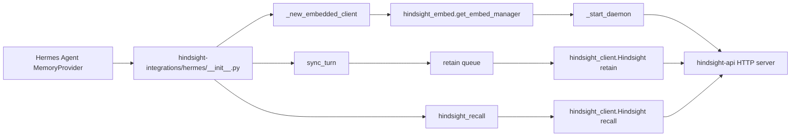
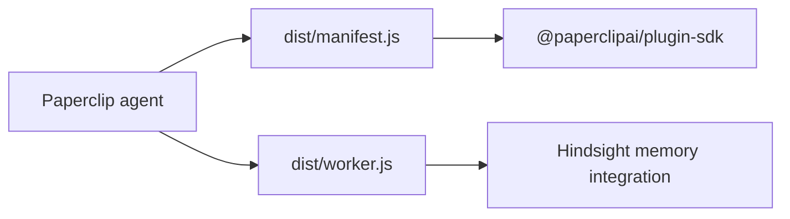
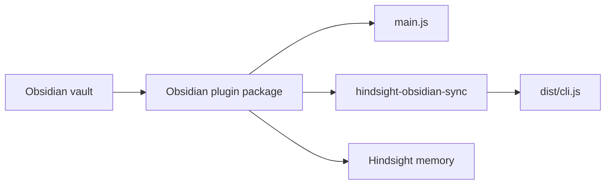
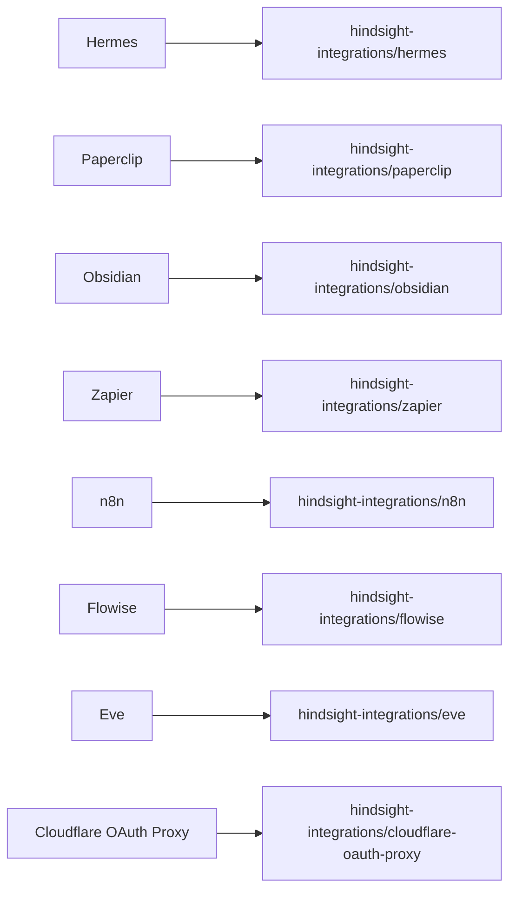
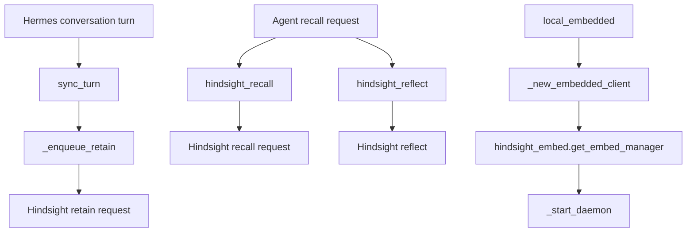

<!-- source: DeepWiki mcp.deepwiki.com · repo vectorize-io/hindsight · page 5.10 Additional Integrations · fetched 2026-10-27 -->

# Additional Integrations

<details>
<summary>Relevant source files</summary>

The following files were used as context for generating this wiki page:

- [.claude/skills/hs-release/SKILL.md](.claude/skills/hs-release/SKILL.md)
- [deno.lock](deno.lock)
- [hindsight-dev/tests/test_generate_changelog_migrations.py](hindsight-dev/tests/test_generate_changelog_migrations.py)
- [hindsight-docs/blog/2026-06-09-version-0-8-1.md](hindsight-docs/blog/2026-06-09-version-0-8-1.md)
- [hindsight-docs/docs-integrations/eve.md](hindsight-docs/docs-integrations/eve.md)
- [hindsight-docs/docs-integrations/hermes.md](hindsight-docs/docs-integrations/hermes.md)
- [hindsight-docs/docs-integrations/n8n.md](hindsight-docs/docs-integrations/n8n.md)
- [hindsight-docs/docs-integrations/paperclip.md](hindsight-docs/docs-integrations/paperclip.md)
- [hindsight-docs/src/pages/changelog/integrations/cloudflare-oauth-proxy.md](hindsight-docs/src/pages/changelog/integrations/cloudflare-oauth-proxy.md)
- [hindsight-docs/src/pages/changelog/integrations/eve.md](hindsight-docs/src/pages/changelog/integrations/eve.md)
- [hindsight-docs/src/pages/changelog/integrations/flowise.md](hindsight-docs/src/pages/changelog/integrations/flowise.md)
- [hindsight-docs/src/pages/changelog/integrations/hermes.md](hindsight-docs/src/pages/changelog/integrations/hermes.md)
- [hindsight-docs/src/pages/changelog/integrations/n8n.md](hindsight-docs/src/pages/changelog/integrations/n8n.md)
- [hindsight-docs/src/pages/changelog/integrations/obsidian.md](hindsight-docs/src/pages/changelog/integrations/obsidian.md)
- [hindsight-docs/src/pages/changelog/integrations/paperclip.md](hindsight-docs/src/pages/changelog/integrations/paperclip.md)
- [hindsight-docs/static/img/icons/obsidian.svg](hindsight-docs/static/img/icons/obsidian.svg)
- [hindsight-embed/hindsight_embed/control_center/ui/package-lock.json](hindsight-embed/hindsight_embed/control_center/ui/package-lock.json)
- [hindsight-embed/hindsight_embed/control_center/ui/package.json](hindsight-embed/hindsight_embed/control_center/ui/package.json)
- [hindsight-integrations/cloudflare-oauth-proxy/package-lock.json](hindsight-integrations/cloudflare-oauth-proxy/package-lock.json)
- [hindsight-integrations/cloudflare-oauth-proxy/package.json](hindsight-integrations/cloudflare-oauth-proxy/package.json)
- [hindsight-integrations/eve/README.md](hindsight-integrations/eve/README.md)
- [hindsight-integrations/eve/package-lock.json](hindsight-integrations/eve/package-lock.json)
- [hindsight-integrations/eve/package.json](hindsight-integrations/eve/package.json)
- [hindsight-integrations/eve/src/auto-memory.test.ts](hindsight-integrations/eve/src/auto-memory.test.ts)
- [hindsight-integrations/eve/src/auto-memory.ts](hindsight-integrations/eve/src/auto-memory.ts)
- [hindsight-integrations/eve/src/client.test.ts](hindsight-integrations/eve/src/client.test.ts)
- [hindsight-integrations/eve/src/client.ts](hindsight-integrations/eve/src/client.ts)
- [hindsight-integrations/eve/src/config.test.ts](hindsight-integrations/eve/src/config.test.ts)
- [hindsight-integrations/eve/src/config.ts](hindsight-integrations/eve/src/config.ts)
- [hindsight-integrations/eve/src/index.ts](hindsight-integrations/eve/src/index.ts)
- [hindsight-integrations/flowise/package-lock.json](hindsight-integrations/flowise/package-lock.json)
- [hindsight-integrations/flowise/package.json](hindsight-integrations/flowise/package.json)
- [hindsight-integrations/hermes/README.md](hindsight-integrations/hermes/README.md)
- [hindsight-integrations/hermes/__init__.py](hindsight-integrations/hermes/__init__.py)
- [hindsight-integrations/hermes/config_schema.py](hindsight-integrations/hermes/config_schema.py)
- [hindsight-integrations/hermes/embedded.py](hindsight-integrations/hermes/embedded.py)
- [hindsight-integrations/hermes/plugin.yaml](hindsight-integrations/hermes/plugin.yaml)
- [hindsight-integrations/hermes/pyproject.toml](hindsight-integrations/hermes/pyproject.toml)
- [hindsight-integrations/hermes/settings.py](hindsight-integrations/hermes/settings.py)
- [hindsight-integrations/hermes/setup.py](hindsight-integrations/hermes/setup.py)
- [hindsight-integrations/hermes/tests/conftest.py](hindsight-integrations/hermes/tests/conftest.py)
- [hindsight-integrations/hermes/tests/test_local_runtime.py](hindsight-integrations/hermes/tests/test_local_runtime.py)
- [hindsight-integrations/hermes/tests/test_multibank.py](hindsight-integrations/hermes/tests/test_multibank.py)
- [hindsight-integrations/hermes/tests/test_provider.py](hindsight-integrations/hermes/tests/test_provider.py)
- [hindsight-integrations/hermes/tests/test_settings.py](hindsight-integrations/hermes/tests/test_settings.py)
- [hindsight-integrations/hermes/uv.lock](hindsight-integrations/hermes/uv.lock)
- [hindsight-integrations/n8n/.gitignore](hindsight-integrations/n8n/.gitignore)
- [hindsight-integrations/n8n/README.md](hindsight-integrations/n8n/README.md)
- [hindsight-integrations/n8n/credentials/HindsightApi.credentials.ts](hindsight-integrations/n8n/credentials/HindsightApi.credentials.ts)
- [hindsight-integrations/n8n/index.ts](hindsight-integrations/n8n/index.ts)
- [hindsight-integrations/n8n/nodes/Hindsight/Hindsight.node.ts](hindsight-integrations/n8n/nodes/Hindsight/Hindsight.node.ts)
- [hindsight-integrations/n8n/nodes/Hindsight/hindsight.png](hindsight-integrations/n8n/nodes/Hindsight/hindsight.png)
- [hindsight-integrations/n8n/nodes/Hindsight/hindsight.svg](hindsight-integrations/n8n/nodes/Hindsight/hindsight.svg)
- [hindsight-integrations/n8n/package-lock.json](hindsight-integrations/n8n/package-lock.json)
- [hindsight-integrations/n8n/package.json](hindsight-integrations/n8n/package.json)
- [hindsight-integrations/n8n/test/credentials.test.ts](hindsight-integrations/n8n/test/credentials.test.ts)
- [hindsight-integrations/n8n/test/node-execute.test.ts](hindsight-integrations/n8n/test/node-execute.test.ts)
- [hindsight-integrations/n8n/test/node.test.ts](hindsight-integrations/n8n/test/node.test.ts)
- [hindsight-integrations/n8n/tsconfig.json](hindsight-integrations/n8n/tsconfig.json)
- [hindsight-integrations/n8n/vitest.config.ts](hindsight-integrations/n8n/vitest.config.ts)
- [hindsight-integrations/obsidian/esbuild.config.mjs](hindsight-integrations/obsidian/esbuild.config.mjs)
- [hindsight-integrations/obsidian/manifest.json](hindsight-integrations/obsidian/manifest.json)
- [hindsight-integrations/obsidian/package-lock.json](hindsight-integrations/obsidian/package-lock.json)
- [hindsight-integrations/obsidian/package.json](hindsight-integrations/obsidian/package.json)
- [hindsight-integrations/obsidian/versions.json](hindsight-integrations/obsidian/versions.json)
- [hindsight-integrations/paperclip/README.md](hindsight-integrations/paperclip/README.md)
- [hindsight-integrations/paperclip/esbuild.config.mjs](hindsight-integrations/paperclip/esbuild.config.mjs)
- [hindsight-integrations/paperclip/package-lock.json](hindsight-integrations/paperclip/package-lock.json)
- [hindsight-integrations/paperclip/package.json](hindsight-integrations/paperclip/package.json)
- [hindsight-integrations/paperclip/src/bank.ts](hindsight-integrations/paperclip/src/bank.ts)
- [hindsight-integrations/paperclip/src/client.ts](hindsight-integrations/paperclip/src/client.ts)
- [hindsight-integrations/paperclip/src/manifest.ts](hindsight-integrations/paperclip/src/manifest.ts)
- [hindsight-integrations/paperclip/src/worker.ts](hindsight-integrations/paperclip/src/worker.ts)
- [hindsight-integrations/paperclip/tests/plugin.spec.ts](hindsight-integrations/paperclip/tests/plugin.spec.ts)
- [hindsight-integrations/paperclip/tsconfig.json](hindsight-integrations/paperclip/tsconfig.json)
- [hindsight-integrations/zapier/package-lock.json](hindsight-integrations/zapier/package-lock.json)
- [hindsight-integrations/zapier/package.json](hindsight-integrations/zapier/package.json)
- [skills/hindsight-docs/references/changelog/integrations/cloudflare-oauth-proxy.md](skills/hindsight-docs/references/changelog/integrations/cloudflare-oauth-proxy.md)
- [skills/hindsight-docs/references/changelog/integrations/eve.md](skills/hindsight-docs/references/changelog/integrations/eve.md)
- [skills/hindsight-docs/references/changelog/integrations/flowise.md](skills/hindsight-docs/references/changelog/integrations/flowise.md)
- [skills/hindsight-docs/references/changelog/integrations/hermes.md](skills/hindsight-docs/references/changelog/integrations/hermes.md)
- [skills/hindsight-docs/references/changelog/integrations/n8n.md](skills/hindsight-docs/references/changelog/integrations/n8n.md)
- [skills/hindsight-docs/references/changelog/integrations/obsidian.md](skills/hindsight-docs/references/changelog/integrations/obsidian.md)
- [skills/hindsight-docs/references/changelog/integrations/paperclip.md](skills/hindsight-docs/references/changelog/integrations/paperclip.md)
- [skills/hindsight-docs/references/sdks/integrations/eve.md](skills/hindsight-docs/references/sdks/integrations/eve.md)
- [skills/hindsight-docs/references/sdks/integrations/hermes.md](skills/hindsight-docs/references/sdks/integrations/hermes.md)
- [skills/hindsight-docs/references/sdks/integrations/paperclip.md](skills/hindsight-docs/references/sdks/integrations/paperclip.md)

</details>


## Purpose and scope

This page covers integration packages beyond the general framework and coding-agent integrations. The supplied source excerpts support implementation detail for Hermes and package-level descriptions for Paperclip and Obsidian; for the other named integrations, the available excerpts identify their names or package artifacts but do not show implementation details. Those integrations are listed without inferring behavior that the sources do not establish.

Sources: [hindsight-integrations/hermes/README.md:1-9](), [hindsight-integrations/paperclip/package.json:1-8](), [hindsight-integrations/obsidian/package.json:1-8]()

## Hermes Agent

The Hermes integration is a memory-provider plugin installed from the Hermes plugin catalog. It supports cloud, local embedded, and local external modes. The former built-in provider was moved out of Hermes core; the current plugin is maintained in `hindsight-integrations/hermes`. [hindsight-integrations/hermes/README.md:1-9]()

### Installation and activation

Install the catalog plugin and select it as the memory provider:

```text
hermes plugins install hindsight
hermes memory setup
```

The plugin catalog install can prompt for confirmation; `--enable` and `--no-enable` control that prompt. A memory provider is activated through `memory.provider` in Hermes `config.yaml`, which `hermes memory setup` writes—not by `hermes plugins enable`. The plugin declares `hindsight-client` and `hindsight-embed` dependencies in its `pyproject.toml`; its minimum versions are `0.10.1`. [hindsight-integrations/hermes/README.md:13-32](), [hindsight-integrations/hermes/pyproject.toml:1-20]()

The old standalone `hindsight-hermes` pip plugin is deprecated. The documentation warns that its tools fail on current Hermes builds with a timeout-context error and directs users to the native Hermes memory-provider path instead. [hindsight-docs/docs-integrations/hermes.md:10-20]()

Sources: [hindsight-integrations/hermes/README.md:13-32](), [hindsight-integrations/hermes/pyproject.toml:1-20](), [hindsight-docs/docs-integrations/hermes.md:10-20]()

### Modes and local embedded client

In `local_embedded` mode, the Hindsight server runs as a separate process rather than as a dependency inside Hermes’ virtual environment. The plugin uses an installed `hindsight-api` binary when available, or falls back to `uvx hindsight-api`, then communicates with the server over HTTP. [hindsight-integrations/hermes/README.md:34-40]()

The plugin’s `_new_embedded_client` composes `hindsight_embed.get_embed_manager()` with `hindsight_client.Hindsight` instead of importing the older `hindsight.HindsightEmbedded` wrapper. The selected profile determines the daemon and reuses its existing embedded PostgreSQL directory and profile environment file. [hindsight-integrations/hermes/README.md:49-54]()

The plugin implementation imports `MemoryProvider` and `RecallStatus` from Hermes, and groups embedded-daemon lifecycle helpers such as `_start_daemon`, `_stop_daemon`, and `_daemon_is_running` in the `embedded` module. [hindsight-integrations/hermes/__init__.py:27-50]()

#### Configuration inputs

The plugin documents profile-scoped configuration at `$HERMES_HOME/hindsight/config.json`, a legacy `~/.hindsight/config.json` location, and environment-variable inputs. These include API key, bank ID, budget, API URL, mode, timeouts, retain tags and scopes, source, strategy, and speaker prefixes. [hindsight-integrations/hermes/__init__.py:1-8]()

The implementation also defines `_scoped_setting` and `_scoped_flag` for profile-aware setting reads. Its comments distinguish presentation-shaping settings from isolation-critical values such as mode, API key, and bank ID. [hindsight-integrations/hermes/__init__.py:106-134]()

| Configuration area | Examples documented in the provider |
|---|---|
| Connection and partition | `HINDSIGHT_API_KEY`, `HINDSIGHT_BANK_ID`, `HINDSIGHT_API_URL`, `HINDSIGHT_MODE` |
| Recall | `HINDSIGHT_BUDGET`, timeout settings |
| Retain shaping | Tags, observation scopes, source, strategy, user and assistant prefixes |

Sources: [hindsight-integrations/hermes/__init__.py:1-8](), [hindsight-integrations/hermes/__init__.py:106-134]()

### Retain and recall behavior

The provider tests show that `sync_turn` retains user and assistant messages as a flat JSON array, with speaker prefixes. When the API supports append updates, the retain uses a stable session document ID and `update_mode: append`; tags include configured tags and a session tag. [hindsight-integrations/hermes/tests/test_provider.py:17-40]()

Retains can be buffered until a configured turn cadence is reached; shutdown flushes turns still waiting in that buffer. The tests also verify that disabling `auto_retain` prevents storage, and that a queued turn’s timestamp is captured when queued rather than when eventually written. [hindsight-integrations/hermes/tests/test_provider.py:42-80]()

For recall, the tests exercise the `hindsight_recall` tool call against the configured bank and budget. The default recall type is `observation`; returned memories are formatted as a numbered result. Optional `min_scores` thresholds are passed to recall and applied to returned results by the provider. [hindsight-integrations/hermes/tests/test_provider.py:85-119](), [hindsight-integrations/hermes/tests/test_provider.py:133-154]()

The tests also show a `hindsight_reflect` tool call. The supplied excerpt verifies that the tool uses the reflect path, but does not show the remainder of its assertions or the full tool implementation. [hindsight-integrations/hermes/tests/test_provider.py:157-159]()

Sources: [hindsight-integrations/hermes/tests/test_provider.py:17-80](), [hindsight-integrations/hermes/tests/test_provider.py:85-119](), [hindsight-integrations/hermes/tests/test_provider.py:133-159]()

### Hermes data flow: natural-language concepts to code entities

This diagram connects the provider’s visible runtime concepts to symbols and paths in the repository.

**Diagram: Hermes provider and Hindsight client flow**



Sources: [hindsight-integrations/hermes/__init__.py:27-50](), [hindsight-integrations/hermes/tests/test_provider.py:27-40](), [hindsight-integrations/hermes/tests/test_provider.py:85-95](), [hindsight-integrations/hermes/README.md:34-54]()

### Provider lifecycle and data ownership

Hermes’ migration path detects a configured `memory.provider: hindsight`, looks up the provider in the plugin catalog when it is no longer present on disk, and installs it at the reviewed catalog pin. The migration does not move the memory data: the README places that data in the Hindsight bank, with local embedded data associated with the selected profile. [hindsight-integrations/hermes/README.md:62-87]()

The README distinguishes updating Hermes from updating the plugin. `hermes update` reinstalls plugin dependencies but does not itself move the plugin checkout; the documented command for following the catalog pin is `hermes plugins update hindsight`. [hindsight-integrations/hermes/README.md:89-111]()

Sources: [hindsight-integrations/hermes/README.md:62-87](), [hindsight-integrations/hermes/README.md:89-111]()

## Paperclip

The Paperclip package metadata describes `@vectorize-io/hindsight-paperclip` as persistent long-term memory for Paperclip agents, with recall before each heartbeat and retain after each run. It is an ES module package whose manifest and worker entry points are published from `dist/manifest.js` and `dist/worker.js`. [hindsight-integrations/paperclip/package.json:1-9]()

The available source excerpt establishes the package identity, purpose, build and test scripts, and dependency on `@paperclipai/plugin-sdk`. It does not include the contents of `src/manifest.ts`, `src/worker.ts`, or the README, so hook names, configuration fields, and request details are not specified here. [hindsight-integrations/paperclip/package.json:29-49]()

**Diagram: Paperclip package boundary**



Sources: [hindsight-integrations/paperclip/package.json:1-9](), [hindsight-integrations/paperclip/package.json:29-49]()

## Obsidian

The Obsidian package metadata describes `@vectorize-io/hindsight-obsidian` as an Obsidian plugin for syncing a vault into agent memory and chatting grounded on notes. It also publishes a `hindsight-obsidian-sync` CLI entry point at `dist/cli.js`. [hindsight-integrations/obsidian/package.json:1-8]()

The package metadata lists `chokidar` as a runtime dependency and identifies a TypeScript/esbuild build, test, and type-check workflow. The supplied files do not show the plugin implementation, CLI arguments, sync protocol, or note-to-memory mapping; those details cannot be established from the available excerpt. [hindsight-integrations/obsidian/package.json:27-36]()

**Diagram: Obsidian package entry points**



Sources: [hindsight-integrations/obsidian/package.json:1-15](), [hindsight-integrations/obsidian/package.json:27-36]()

## Other integrations in this section

The following names are in the requested scope. The supplied excerpts do not provide implementation files or descriptive documentation for these integrations, so this page does not assign them specific APIs, lifecycle hooks, or data flows.

| Integration | Evidence available in supplied excerpts |
|---|---|
| NemoClaw | No implementation or documentation excerpt supplied. |
| Zapier | A package artifact is listed, but its contents are not shown. |
| n8n | Package artifacts are listed, but their contents are not shown. |
| Dify | No implementation or documentation excerpt supplied. |
| Flowise | Package artifacts are listed, but their contents are not shown. |
| Vapi | No implementation or documentation excerpt supplied. |
| Eve / Eliza | Eve package artifacts are listed, but implementation details are not shown. |
| Zed | No implementation or documentation excerpt supplied. |
| Cline | No implementation or documentation excerpt supplied. |
| Cursor | No implementation or documentation excerpt supplied. |
| GitHub Copilot | No implementation or documentation excerpt supplied. |
| Devin Desktop | No implementation or documentation excerpt supplied. |
| OpenHands | No implementation or documentation excerpt supplied. |
| Omo | No implementation or documentation excerpt supplied. |
| zcode | No implementation or documentation excerpt supplied. |
| Composio | No implementation or documentation excerpt supplied. |
| Continue | No implementation or documentation excerpt supplied. |
| Copilot CLI | No implementation or documentation excerpt supplied. |
| Roo Code | No implementation or documentation excerpt supplied. |
| Gemini Spark | No implementation or documentation excerpt supplied. |
| Claude Agent SDK | No implementation or documentation excerpt supplied. |
| Superagent | No implementation or documentation excerpt supplied. |
| Cloudflare OAuth Proxy | A package artifact is listed, but its contents are not shown. |
| Aider | No implementation or documentation excerpt supplied. |
| Meta Muse | No implementation or documentation excerpt supplied. |
| `agent-plugin` | No implementation or documentation excerpt supplied. |
| `grok-bot` | No implementation or documentation excerpt supplied. |
| `agent-framework` | No implementation or documentation excerpt supplied. |

Sources: [hindsight-integrations/zapier/package-lock.json](), [hindsight-integrations/n8n/package.json](), [hindsight-integrations/flowise/package.json](), [hindsight-integrations/eve/package.json](), [hindsight-integrations/cloudflare-oauth-proxy/package.json]()

## Integration names mapped to repository entities

The diagram below maps the integrations with source paths present in the supplied material. A path indicates a repository location, not a claim about the package’s full runtime behavior.

**Diagram: Integration names to package paths**



Sources: [hindsight-integrations/hermes/README.md:1-9](), [hindsight-integrations/paperclip/package.json:1-8](), [hindsight-integrations/obsidian/package.json:1-8](), [hindsight-integrations/zapier/package-lock.json](), [hindsight-integrations/n8n/package.json](), [hindsight-integrations/flowise/package.json](), [hindsight-integrations/eve/package.json](), [hindsight-integrations/cloudflare-oauth-proxy/package.json]()

**Diagram: Hermes natural-language operations to implementation symbols**



Sources: [hindsight-integrations/hermes/tests/test_provider.py:27-40](), [hindsight-integrations/hermes/tests/test_provider.py:85-95](), [hindsight-integrations/hermes/tests/test_provider.py:157-159](), [hindsight-integrations/hermes/README.md:49-54](), [hindsight-integrations/hermes/__init__.py:35-50]()

Sources: [hindsight-integrations/hermes/README.md:1-111](), [hindsight-integrations/hermes/__init__.py:1-134](), [hindsight-integrations/hermes/pyproject.toml:1-20](), [hindsight-integrations/hermes/tests/test_provider.py:17-159](), [hindsight-integrations/paperclip/package.json:1-49](), [hindsight-integrations/obsidian/package.json:1-36](), [hindsight-integrations/zapier/package-lock.json](), [hindsight-integrations/n8n/package.json](), [hindsight-integrations/flowise/package.json](), [hindsight-integrations/eve/package.json](), [hindsight-integrations/cloudflare-oauth-proxy/package.json]()

---

