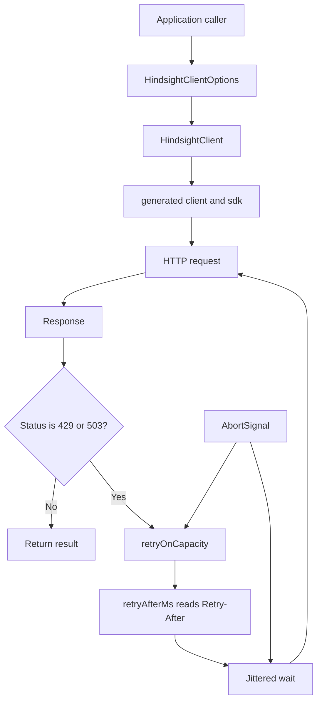
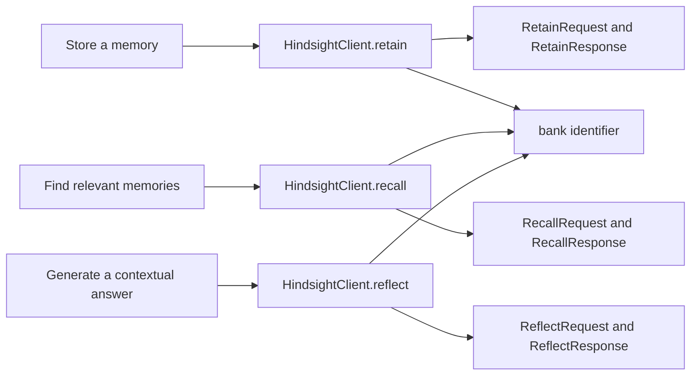
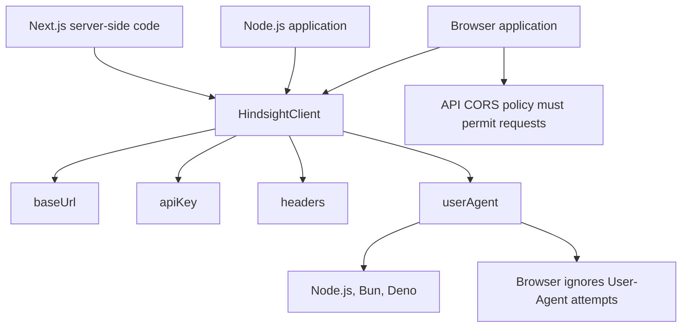

<!-- source: DeepWiki mcp.deepwiki.com · repo vectorize-io/hindsight · page 5.2 TypeScript Client · fetched 2026-10-27 -->

# TypeScript Client

Relevant source files

The following files were used as context for generating this wiki page:

- [hindsight-api-slim/tests/test_format_facts_for_prompt.py](hindsight-api-slim/tests/test_format_facts_for_prompt.py)
- [hindsight-clients/python/hindsight_client/__init__.py](hindsight-clients/python/hindsight_client/__init__.py)
- [hindsight-clients/python/hindsight_client/hindsight_client.py](hindsight-clients/python/hindsight_client/hindsight_client.py)
- [hindsight-clients/python/tests/test_main_operations.py](hindsight-clients/python/tests/test_main_operations.py)
- [hindsight-clients/python/tests/test_prompt_formatting.py](hindsight-clients/python/tests/test_prompt_formatting.py)
- [hindsight-clients/python/tests/test_version.py](hindsight-clients/python/tests/test_version.py)
- [hindsight-clients/typescript/src/index.ts](hindsight-clients/typescript/src/index.ts)
- [hindsight-clients/typescript/tests/prompt_formatting.test.ts](hindsight-clients/typescript/tests/prompt_formatting.test.ts)

## Purpose and scope

The `@vectorize-io/hindsight-client` package provides a TypeScript SDK for calling the Hindsight API. Its public entry point documents `HindsightClient` initialization and use of the core `retain`, `recall`, and `reflect` operations. This page covers the documented initialization options, generated API types, retry behavior, and considerations for using the client in Node.js, Next.js, and browser applications. [hindsight-clients/typescript/src/index.ts:1-25]()

Sources: [hindsight-clients/typescript/src/index.ts:1-25]()

## Package and client overview

The package’s top-level module imports the generated client configuration and SDK, and imports request and response types from the generated type module. It also defines package-version and default user-agent constants. The introductory example shows creating a `HindsightClient` with a `baseUrl`, optionally adding an API key, and awaiting `retain`, `recall`, and `reflect`. [hindsight-clients/typescript/src/index.ts:1-25]()[hindsight-clients/typescript/src/index.ts:28-30]()[hindsight-clients/typescript/src/index.ts:31-93]()

| Concern | Public symbol or behavior |
|---|---|
| Client | `HindsightClient` |
| Required initialization option | `baseUrl` |
| Optional authentication | `apiKey` |
| Optional request customization | `userAgent`, `headers`, `maxAttempts` |
| Core operations shown in the package example | `retain`, `recall`, `reflect` |
| Generated SDK dependencies | `createClient`, `createConfig`, and `sdk` |
| Type source | `../generated/types.gen` |

The top-level module declares the `HindsightClientOptions` interface and imports generated request and response types, including `RetainRequest`, `RecallRequest`, `ReflectRequest`, and their response types. [hindsight-clients/typescript/src/index.ts:28-30]()[hindsight-clients/typescript/src/index.ts:31-85]()[hindsight-clients/typescript/src/index.ts:159-182]()

Sources: [hindsight-clients/typescript/src/index.ts:28-30](), [hindsight-clients/typescript/src/index.ts:31-93](), [hindsight-clients/typescript/src/index.ts:159-182]()

## Initialization and request configuration

`HindsightClientOptions` requires `baseUrl`, the root URL used to reach the Hindsight API. `apiKey` is optional; the option’s documentation says it is sent as a Bearer token in the `Authorization` header. Callers can also provide additional `headers`. [hindsight-clients/typescript/src/index.ts:159-175]()

The optional `userAgent` value identifies an integrating product before the client’s own user-agent token. The client’s default token is `hindsight-client-typescript/<version>`, with the version supplied by the build-time `__CLIENT_VERSION__` value when available and a `0.0.0-dev` fallback for raw-source loads. The option documentation notes that browsers ignore attempts to set `User-Agent`, so this customization applies to Node.js, Bun, and Deno rather than browser requests. [hindsight-clients/typescript/src/index.ts:87-93]()[hindsight-clients/typescript/src/index.ts:166-175]()

`maxAttempts` configures the total number of attempts for idempotent calls when the server reports capacity pressure (`429` or `503`). Its documented default is three attempts; setting it to `1` disables retries. The retry helper is explicitly limited to idempotent operations: the source identifies `recall` and `reflect` as reads and excludes synchronous `retain` because retrying a write could duplicate it. [hindsight-clients/typescript/src/index.ts:95-99]()[hindsight-clients/typescript/src/index.ts:111-128]()[hindsight-clients/typescript/src/index.ts:159-182]()

Sources: [hindsight-clients/typescript/src/index.ts:87-99](), [hindsight-clients/typescript/src/index.ts:111-128](), [hindsight-clients/typescript/src/index.ts:159-182]()

### Request and retry flow

**Diagram: From SDK initialization to capacity retry**

The package imports `createClient`, `createConfig`, and the generated `sdk`; its `HindsightClientOptions` describes the caller-provided URL, credentials, headers, user-agent, and retry count. `retryOnCapacity` checks for `429` or `503`, uses `retryAfterMs` when a usable delta-seconds header exists, otherwise applies a fallback exponential delay, then applies full jitter. The helper checks an optional `AbortSignal` before and after requests and during the wait. [hindsight-clients/typescript/src/index.ts:28-30]()[hindsight-clients/typescript/src/index.ts:95-157]()[hindsight-clients/typescript/src/index.ts:159-182]()

Sources: [hindsight-clients/typescript/src/index.ts:28-30](), [hindsight-clients/typescript/src/index.ts:95-157](), [hindsight-clients/typescript/src/index.ts:159-182]()

## Core asynchronous operations

The package example invokes the three core operations with a bank identifier and text input:

| Method | Example purpose | Example result |
|---|---|---|
| `retain` | Store content in a bank | Await the operation |
| `recall` | Retrieve memories relevant to a query | Receive results |
| `reflect` | Generate a contextual answer | Receive an answer |

The example also shows that each call is asynchronous and is awaited. The file imports the corresponding generated request and response type families, including `RetainRequest`/`RetainResponse`, `RecallRequest`/`RecallResponse`, and `ReflectRequest`/`ReflectResponse`. [hindsight-clients/typescript/src/index.ts:17-25]()[hindsight-clients/typescript/src/index.ts:31-45]()

**Diagram: Hindsight operations mapped to client symbols**

The operation names and usage shown in the package example are `retain`, `recall`, and `reflect`; the top-level module imports their generated request and response types. The example passes a bank identifier to each method, with content supplied to `retain` and a query supplied to `recall` and `reflect`. [hindsight-clients/typescript/src/index.ts:17-25]()[hindsight-clients/typescript/src/index.ts:31-45]()

Sources: [hindsight-clients/typescript/src/index.ts:17-25](), [hindsight-clients/typescript/src/index.ts:31-45]()

## Generated type definitions

The TypeScript entry point imports its operation and domain types from `../generated/types.gen`. The imported types include content blocks (`TextContentBlock`, `ImageContentBlock`, `FileContentBlock`), request and response types for retain, recall, and reflect, and `RecallResult`. The import list also exposes types for budgets, bank configuration and templates, tag groups, temporal windows, asynchronous operation submission, knowledge pages, mental models, directives, documents, extraction results, and version information. These type names are evidence of the generated model surface; the generated declarations themselves are not included in the files provided for this page. [hindsight-clients/typescript/src/index.ts:31-85]()

The generated runtime client is imported separately from `../generated/client`, while generated operation functions are imported from `../generated/sdk.gen`. This separates the generated request execution layer from the generated model definitions used by TypeScript callers. [hindsight-clients/typescript/src/index.ts:28-30]()

| Type group | Representative imported types |
|---|---|
| Content and retain | `TextContentBlock`, `ImageContentBlock`, `FileContentBlock`, `RetainRequest`, `RetainResponse` |
| Recall | `RecallRequest`, `RecallResponse`, `RecallResult`, `Budget`, `TagGroupLeaf`, `TemporalWindow` |
| Reflect | `ReflectRequest`, `ReflectResponse`, `MinScores` |
| Banks and templates | `BankProfileResponse`, `BankConfigResponse`, `CreateBankRequest`, `BankTemplateManifest` |
| Knowledge and models | `KnowledgePageResponse`, `KnowledgePageSearchResponse`, `MentalModelResponse`, `MentalModelTriggerInput` |
| Documents and extraction | `DocumentResponse`, `DocumentHistoryResponse`, `DryRunExtractionResult`, `ExtractedFact` |
| Operations and version | `AsyncOperationSubmitResponse`, `VersionResponse` |

Sources: [hindsight-clients/typescript/src/index.ts:28-85]()

## Usage in Node.js, Next.js, and browsers

The package’s usage example can be applied in a Node.js service or a Next.js server-side module by constructing the client with the API’s `baseUrl`, adding `apiKey` when authentication is required, and awaiting the relevant operation. The option documentation specifically identifies Node.js, Bun, and Deno as runtimes where the custom `userAgent` setting takes effect. [hindsight-clients/typescript/src/index.ts:1-25]()[hindsight-clients/typescript/src/index.ts:166-175]()

A browser application can also use the client, subject to the server’s CORS configuration. The source explicitly cautions that browsers ignore attempts to set the `User-Agent` header. Browser callers should therefore not depend on `userAgent` customization for integration identification. [hindsight-clients/typescript/src/index.ts:166-175]()

For Next.js, the distinction is primarily where the request runs: server-side code can supply server-held credentials and use the runtime’s user-agent behavior, while browser-side code is subject to browser header restrictions and the API’s CORS policy. The provided TypeScript source documents the runtime constraints but does not prescribe a particular Next.js routing or proxy architecture. [hindsight-clients/typescript/src/index.ts:166-175]()

Sources: [hindsight-clients/typescript/src/index.ts:1-25](), [hindsight-clients/typescript/src/index.ts:166-175]()

### Runtime-to-code mapping

**Diagram: Runtime choices associated with client configuration**

The runtime constraints in this mapping come from the `userAgent` option documentation: Node.js, Bun, and Deno can use the custom value, browsers ignore attempts to set `User-Agent`, and browser use depends on the server permitting CORS. `baseUrl`, `apiKey`, and `headers` are the corresponding client configuration options. [hindsight-clients/typescript/src/index.ts:159-175]()

Sources: [hindsight-clients/typescript/src/index.ts:159-175]()

## Error handling and capacity retries

`HindsightError` is the client’s documented error class for API request failures. It exposes optional `statusCode` and `details` properties; its constructor accepts a message and optional status and details values. [hindsight-clients/typescript/src/index.ts:184-193]()

The exported `retryOnCapacity` helper retries results whose response status is `429` or `503`, up to the configured attempt limit. It honors a numeric `Retry-After` delta-seconds value when available, otherwise uses a fallback delay that grows exponentially with the attempt number, and randomizes the wait across the full interval. An optional `AbortSignal` can stop the process before another request or interrupt the wait. [hindsight-clients/typescript/src/index.ts:95-157]()

The retry policy is deliberately scoped to idempotent calls. The source warns that synchronous `retain` is not retried because an `operation_id` is ignored for synchronous writes, which could make a repeated request duplicate a write. [hindsight-clients/typescript/src/index.ts:111-122]()

Sources: [hindsight-clients/typescript/src/index.ts:95-157](), [hindsight-clients/typescript/src/index.ts:184-193]()

## Implementation notes

The entry point uses generated code for transport and API operations while providing package-level configuration, exported types, version identification, and retry helpers. The visible source imports `createClient` and `createConfig` from the generated client module and `sdk` from the generated SDK module; it imports operation-related types from the generated type module. [hindsight-clients/typescript/src/index.ts:28-85]()

The version constant is intended to be replaced by `tsup` at build time. For raw-source test loads, a `typeof` guard prevents a missing build-time constant from causing a `ReferenceError` and selects the `0.0.0-dev` sentinel instead. The default user-agent string incorporates that version. [hindsight-clients/typescript/src/index.ts:87-93]()

Sources: [hindsight-clients/typescript/src/index.ts:28-93]()

## Summary

`HindsightClient` is the TypeScript package’s high-level entry point for asynchronous Hindsight API operations. Callers configure it with a required `baseUrl` and optional authentication, headers, user-agent identification, and retry count. The package exposes generated operation types alongside the generated SDK, and provides capacity retries for idempotent calls with `Retry-After` handling, jitter, and cancellation support. Browser use depends on CORS and cannot rely on custom `User-Agent` headers. [hindsight-clients/typescript/src/index.ts:1-25]()[hindsight-clients/typescript/src/index.ts:28-93]()[hindsight-clients/typescript/src/index.ts:95-182]()

Sources: [hindsight-clients/typescript/src/index.ts:1-25](), [hindsight-clients/typescript/src/index.ts:28-93](), [hindsight-clients/typescript/src/index.ts:95-182]()

---

