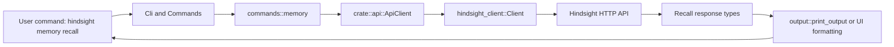
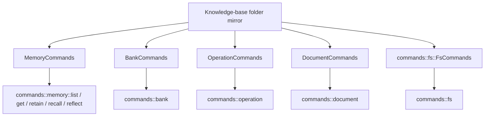
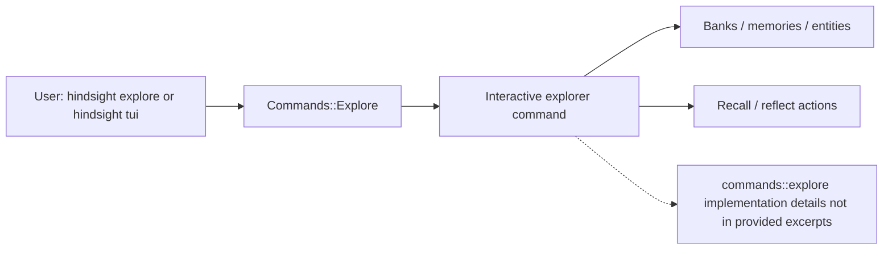
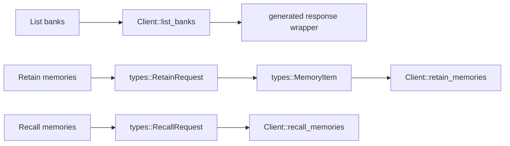

<!-- source: DeepWiki mcp.deepwiki.com · repo vectorize-io/hindsight · page 5.3 Rust CLI · fetched 2026-10-27 -->

# Rust CLI

Relevant source files

The following files were used as context for generating this wiki page:

- [hindsight-cli/smoke-test.sh](hindsight-cli/smoke-test.sh)
- [hindsight-cli/src/commands/audit.rs](hindsight-cli/src/commands/audit.rs)
- [hindsight-cli/src/commands/bank.rs](hindsight-cli/src/commands/bank.rs)
- [hindsight-cli/src/commands/directive.rs](hindsight-cli/src/commands/directive.rs)
- [hindsight-cli/src/commands/document.rs](hindsight-cli/src/commands/document.rs)
- [hindsight-cli/src/commands/health.rs](hindsight-cli/src/commands/health.rs)
- [hindsight-cli/src/commands/memory.rs](hindsight-cli/src/commands/memory.rs)
- [hindsight-cli/src/commands/mental_model.rs](hindsight-cli/src/commands/mental_model.rs)
- [hindsight-cli/src/commands/mod.rs](hindsight-cli/src/commands/mod.rs)
- [hindsight-cli/src/commands/operation.rs](hindsight-cli/src/commands/operation.rs)
- [hindsight-cli/src/main.rs](hindsight-cli/src/main.rs)
- [hindsight-cli/src/ui.rs](hindsight-cli/src/ui.rs)
- [hindsight-cli/tests/cli_integration.rs](hindsight-cli/tests/cli_integration.rs)
- [hindsight-cli/tests/integration_test.rs](hindsight-cli/tests/integration_test.rs)
- [hindsight-clients/rust/build.rs](hindsight-clients/rust/build.rs)
- [hindsight-clients/rust/src/lib.rs](hindsight-clients/rust/src/lib.rs)

## Purpose and scope

The Rust CLI (`hindsight-cli`) is a command-line interface for connecting to a Hindsight API and managing banks, memories, documents, operations, mental models, directives, and related resources. It also exposes an interactive explorer, a web-UI launcher, and commands for mirroring a knowledge base to a local folder. This page describes the CLI’s command surface, configuration, request flow, and the Rust client library. [hindsight-cli/src/main.rs:32-54]()[hindsight-cli/src/main.rs:73-158]()

Sources: [hindsight-cli/src/main.rs:32-54]()[hindsight-cli/src/main.rs:73-158]()

## Architecture and request flow

The binary’s `main.rs` declares the CLI modules, defines the top-level `Cli` parser with `clap`, and maps `Commands` subcommands to command groups. The command implementations use the CLI’s `ApiClient` abstraction; memory commands, for example, call methods such as `list_memories` and then render the returned values. The Rust client crate exposes the generated API client and typed request and response models. [hindsight-cli/src/main.rs:1-11]()[hindsight-cli/src/main.rs:32-54]()[hindsight-cli/src/main.rs:73-158]()[hindsight-cli/src/commands/memory.rs:7-17]()[hindsight-cli/src/commands/memory.rs:108-132]()[hindsight-clients/rust/src/lib.rs:22-30]()

**Diagram: User intent to CLI and API entities**

Sources: [hindsight-cli/src/main.rs:1-11]()[hindsight-cli/src/main.rs:32-54]()[hindsight-cli/src/main.rs:73-158]()[hindsight-cli/src/commands/memory.rs:7-17]()[hindsight-cli/src/commands/memory.rs:108-189]()[hindsight-clients/rust/src/lib.rs:22-23]()

The CLI provides global output-format, verbose, and profile options. `Format` supports `pretty`, `json`, and `yaml`, and converts to the output module’s `OutputFormat`. Pretty output can use CLI presentation helpers; JSON and YAML paths pass results to `output::print_output`. [hindsight-cli/src/main.rs:15-29]()[hindsight-cli/src/main.rs:38-51]()[hindsight-cli/src/commands/memory.rs:138-184]()

**Diagram: Human-facing operation names and code entities**

Sources: [hindsight-cli/src/main.rs:73-125]()[hindsight-cli/src/commands/memory.rs:108-118]()[hindsight-cli/src/commands/operation.rs:22-27]()[hindsight-cli/src/commands/document.rs:8-17]()

## Command groups

The top-level command enum includes bank, memory, document, entity, tag, chunk, operation, mental-model, knowledge-base, directive, webhook, audit, filesystem, health, metrics, version, explore, UI, configure, and profile commands. The `Explore` command also accepts the `tui` alias. Exact subcommands and flags are declared in the corresponding command enums and modules. [hindsight-cli/src/main.rs:73-158]()

| Command group | Purpose and implementation notes |
|---|---|
| `memory` | Lists, gets, retains, recalls, reflects on, and clears memories. Listing supports pagination and optional type/query filters. Recall helpers parse budgets, tag matching, and temporal-window bounds. [hindsight-cli/src/main.rs:79-81]()[hindsight-cli/src/commands/memory.rs:39-106]()[hindsight-cli/src/commands/memory.rs:108-189]() |
| `bank` | Manages banks, including listing, creation, updates, profile/disposition, statistics, mission, graph, and deletion operations. The list implementation calls `ApiClient::list_agents`; disposition display reads bank configuration and the bank’s name. [hindsight-cli/src/main.rs:75-77]()[hindsight-cli/src/main.rs:191-232]()[hindsight-cli/src/commands/bank.rs:6-37]()[hindsight-cli/src/commands/bank.rs:39-97]() |
| `operation` | Lists and inspects asynchronous operations and supports cancellation and retry. Pretty summaries include operation ID, type, status, item count, and optional filename/document ID. [hindsight-cli/src/main.rs:99-101]()[hindsight-cli/src/commands/operation.rs:6-20]()[hindsight-cli/src/commands/operation.rs:22-63]()[hindsight-cli/src/commands/operation.rs:98-216]() |
| `document` | Lists, gets, and deletes documents. Listing supports query, pagination, and date filtering; date-filtered listing fetches pages and groups results by creation date. [hindsight-cli/src/main.rs:83-85]()[hindsight-cli/src/commands/document.rs:8-62]()[hindsight-cli/src/commands/document.rs:64-177]() |
| `mental_model` | Manages user-curated summaries. Its helpers validate trigger modes (`full` or `delta`) and tag-match values, and preserve stored trigger settings when applying partial updates. [hindsight-cli/src/main.rs:103-105]()[hindsight-cli/src/commands/mental_model.rs:11-33]()[hindsight-cli/src/commands/mental_model.rs:92-169]() |
| `directive` | Manages behavioral rules. It is registered as a top-level command group; its detailed subcommands are implemented in `commands/directive.rs`. [hindsight-cli/src/main.rs:111-113]()[hindsight-cli/src/commands/mod.rs:1-15]() |
| `knowledge-base` | Manages the knowledge-base folder/page tree, search, and export. [hindsight-cli/src/main.rs:107-109]() |
| `fs` | Mirrors a bank’s knowledge base as a live local folder of Markdown files. The command group is implemented under `commands::fs`. [hindsight-cli/src/main.rs:123-125]() |
| `explore` / `tui` | Launches the interactive explorer for navigating banks, memories, entities, and performing recall/reflect. [hindsight-cli/src/main.rs:136-138]() |
| Other groups | `entity`, `tag`, `chunk`, `webhook`, and `audit` cover their named resource areas; `health`, `metrics`, `version`, and `ui` provide status, metrics, version, and control-plane UI entry points. [hindsight-cli/src/main.rs:87-141]() |

Sources: [hindsight-cli/src/main.rs:73-158]()[hindsight-cli/src/commands/memory.rs:39-189]()[hindsight-cli/src/commands/bank.rs:6-97]()[hindsight-cli/src/commands/operation.rs:6-63]()[hindsight-cli/src/commands/document.rs:8-177]()[hindsight-cli/src/commands/mental_model.rs:11-169]()

### Memory command behavior

Memory commands use generated request and response types from `hindsight_client::types`. The list path calls `ApiClient::list_memories` with bank ID, filters, limit, offset, and verbose mode. Pretty output displays fact type, ID, a text preview, and document ID when present; structured output delegates to the output formatter. [hindsight-cli/src/commands/memory.rs:7-17]()[hindsight-cli/src/commands/memory.rs:108-189]()

The recall-side helpers map budget strings to generated `Budget` variants and tag-match strings to `TagsMatch` variants. Temporal windows require both start and end; date/time strings without offsets are interpreted as UTC, and reversed ranges are rejected. [hindsight-cli/src/commands/memory.rs:39-46]()[hindsight-cli/src/commands/memory.rs:49-92]()[hindsight-cli/src/commands/memory.rs:94-106]()

The `memory retain` interface exposes a timestamp flag, and a regression test checks that the flag appears in command help. The same test module verifies that a memory timestamp serializes as a plain string in the generated request type. [hindsight-cli/tests/integration_test.rs:120-165]()

Sources: [hindsight-cli/src/commands/memory.rs:7-17]()[hindsight-cli/src/commands/memory.rs:39-106]()[hindsight-cli/src/commands/memory.rs:108-189]()[hindsight-cli/tests/integration_test.rs:120-165]()

### Operations and documents

Operation listing and status commands conditionally show spinners in pretty mode. The status renderer distinguishes completed, pending, processing, failed, cancelled, and not-found states; cancel and retry commands call the corresponding `ApiClient` methods. [hindsight-cli/src/commands/operation.rs:22-63]()[hindsight-cli/src/commands/operation.rs:98-216]()

For date-filtered document listings, `fetch_all_documents` requests pages of 500 items until the response is empty or the reported total has been reached. The command parses date filters such as `today`, `yesterday`, `all`, and `YYYY-MM-DD`, then groups documents by creation date for pretty output. [hindsight-cli/src/commands/document.rs:64-177]()[hindsight-cli/src/commands/document.rs:179-195]()

Sources: [hindsight-cli/src/commands/operation.rs:22-63]()[hindsight-cli/src/commands/operation.rs:98-216]()[hindsight-cli/src/commands/document.rs:64-195]()

## Configuration and profiles

The CLI documents this configuration priority: environment variables, named profile, `~/.hindsight/config`, then the default API URL `http://localhost:8888`. `HINDSIGHT_API_URL` and `HINDSIGHT_API_KEY` override profile values; `HINDSIGHT_PROFILE` selects a profile when `--profile` is not supplied. The global `-p`/`--profile` option is available across commands. [hindsight-cli/src/main.rs:38-51]()[hindsight-cli/src/main.rs:143-158]()

The `configure` command accepts an API URL and API key, with an interactive prompt when the URL is omitted. The `profile` command group supports create, list, show, and delete. Profile files are described as `~/.hindsight/cli-profiles/<name>.toml`; the CLI specifies that an optional API key is stored with file permissions `0600`. [hindsight-cli/src/main.rs:143-158]()[hindsight-cli/src/main.rs:161-189]()

The supplied implementation defines `Config::load` as the configuration-loading entry point used when composing help text. The config module’s internal parsing and persistence details are not included in the provided file excerpts. [hindsight-cli/src/main.rs:57-67]()

| Setting | Role |
|---|---|
| `HINDSIGHT_API_URL` | API base URL; highest priority. [hindsight-cli/src/main.rs:49-51]() |
| `HINDSIGHT_API_KEY` | API key sent as a Bearer token; highest priority. [hindsight-cli/src/main.rs:49-51]()[hindsight-cli/src/main.rs:147-153]() |
| `HINDSIGHT_PROFILE` | Profile name used when `--profile` is omitted. [hindsight-cli/src/main.rs:47-51]() |
| `~/.hindsight/cli-profiles/<name>.toml` | Named profile location. [hindsight-cli/src/main.rs:47-51]()[hindsight-cli/src/main.rs:156-189]() |
| `~/.hindsight/config` | Shared CLI config file in the documented priority order. [hindsight-cli/src/main.rs:143-146]() |
| `http://localhost:8888` | Fallback API URL. [hindsight-cli/src/main.rs:57-67]()[hindsight-cli/src/main.rs:143-146]() |

Sources: [hindsight-cli/src/main.rs:47-67]()[hindsight-cli/src/main.rs:143-189]()

## Knowledge-base sync and filesystem mirror

The CLI registers `fs` as a command group described as mirroring a bank’s knowledge base as a live local folder of Markdown files. The `knowledge-base` command group separately manages the knowledge-base folder/page tree, search, and export. These command descriptions establish the CLI-facing purpose; the sync algorithm, daemon lifecycle, conflict handling, and file-watching implementation are not shown in the provided excerpts. [hindsight-cli/src/main.rs:107-125]()

Sources: [hindsight-cli/src/main.rs:107-125]()

## Interactive explorer and terminal output

`explore` is described as an interactive TUI explorer, with `tui` as an alias. Its help text identifies navigation of banks, memories, and entities, as well as recall and reflect actions. The implementation details of the event loop and TUI state are not included in the provided excerpts, so this page does not assert a particular rendering or background-task architecture. [hindsight-cli/src/main.rs:136-138]()

The `ui` module supplies terminal presentation helpers, including section headers and memory/chunk rendering. ANSI styling is gated by terminal and color-environment checks; the help logo is omitted when styling is disabled. This avoids emitting escape codes in non-interactive output. [hindsight-cli/src/ui.rs:23-52]()[hindsight-cli/src/ui.rs:110-132]()[hindsight-cli/src/ui.rs:134-207]()

**Diagram: TUI command entry and code boundary**

Sources: [hindsight-cli/src/main.rs:136-138]()

## Output formats and automation

The global `--output`/`-o` flag accepts `pretty`, `json`, or `yaml`, defaulting to `pretty`. In command implementations, pretty mode can add spinners and formatted summaries; non-pretty modes serialize the returned result through `output::print_output`. [hindsight-cli/src/main.rs:15-29]()[hindsight-cli/src/main.rs:38-41]()[hindsight-cli/src/commands/memory.rs:119-184]()[hindsight-cli/src/commands/operation.rs:28-57]()

The integration tests exercise help/version output and API-backed commands. The server-dependent test helper checks `/health`, and the tests cover bank listing, bank lifecycle, memory listing, and other CLI flows. The smoke-test script also runs representative commands against a configured API URL, including retain, recall, reflect, stats, entities, documents, and operations. [hindsight-cli/tests/integration_test.rs:3-13]()[hindsight-cli/tests/integration_test.rs:66-123]()[hindsight-cli/smoke-test.sh:1-17]()[hindsight-cli/smoke-test.sh:76-119]()

Sources: [hindsight-cli/src/main.rs:15-41]()[hindsight-cli/src/commands/memory.rs:119-184]()[hindsight-cli/src/commands/operation.rs:28-57]()[hindsight-cli/tests/integration_test.rs:3-13]()[hindsight-cli/tests/integration_test.rs:66-123]()[hindsight-cli/smoke-test.sh:1-17]()[hindsight-cli/smoke-test.sh:76-119]()

## Underlying Rust client library

The `hindsight-clients/rust` crate exposes `hindsight_client::Client` and includes generated client code at build time from `OUT_DIR/hindsight_client_generated.rs`. Its public API includes `CLIENT_VERSION`, `DEFAULT_USER_AGENT`, and helpers for constructing a client with a default or caller-supplied user agent. [hindsight-clients/rust/src/lib.rs:22-30]()[hindsight-clients/rust/src/lib.rs:32-70]()

The generated client is async-friendly: the crate’s documented usage calls `list_banks(None).await`. The library also exposes `types` through the generated code, which the CLI uses for request and response types such as `Budget`, `TemporalWindow`, `MemoryItem`, and mental-model trigger types. [hindsight-clients/rust/src/lib.rs:5-20]()[hindsight-clients/rust/src/lib.rs:22-23]()[hindsight-cli/src/commands/memory.rs:12-16]()[hindsight-cli/src/commands/mental_model.rs:9-10]()

**Diagram: Natural-language API use mapped to Rust client entities**

Sources: [hindsight-clients/rust/src/lib.rs:5-20]()[hindsight-clients/rust/src/lib.rs:111-175]()

`reqwest_client_with_user_agent` appends the library’s default client/version identifier to a caller-provided user agent. `client_with_user_agent` uses that HTTP client to construct a `Client`; `default_client` constructs one with the library’s default user agent. The crate recommends these helpers over bare `Client::new` where reverse proxies filter user agents. [hindsight-clients/rust/src/lib.rs:29-70]()

The library integration test demonstrates a memory lifecycle using a configured `Client`: create a bank, retain memories, and proceed to recall. It uses a longer HTTP timeout for the test’s LLM operations and permits the API URL to come from `HINDSIGHT_API_URL`. [hindsight-clients/rust/src/lib.rs:111-178]()

Sources: [hindsight-clients/rust/src/lib.rs:29-70]()[hindsight-clients/rust/src/lib.rs:111-178]()

## Scope notes

The provided excerpts identify the CLI command groups and their public descriptions, but do not include the full `api.rs`, `config.rs`, `commands/explore.rs`, or filesystem-mirror implementation. Consequently, details such as the precise CLI-to-client async bridging mechanism, TUI event-loop internals, and knowledge-base sync daemon behavior are not specified here. [hindsight-cli/src/main.rs:1-11]()[hindsight-cli/src/main.rs:107-138]()

Sources: [hindsight-cli/src/main.rs:1-11]()[hindsight-cli/src/main.rs:107-138]()

---

