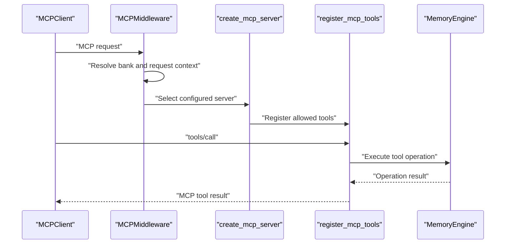

<!-- source: DeepWiki mcp.deepwiki.com · repo vectorize-io/hindsight · page 5.5 MCP Integration · fetched 2026-10-27 -->

# MCP Integration

<details>
<summary>Relevant source files</summary>

The following files were used as context for generating this wiki page:

- [hindsight-api-slim/hindsight_api/api/mcp.py](hindsight-api-slim/hindsight_api/api/mcp.py)
- [hindsight-api-slim/hindsight_api/api/observability.py](hindsight-api-slim/hindsight_api/api/observability.py)
- [hindsight-api-slim/hindsight_api/api/passthrough_headers.py](hindsight-api-slim/hindsight_api/api/passthrough_headers.py)
- [hindsight-api-slim/hindsight_api/api/unknown_params.py](hindsight-api-slim/hindsight_api/api/unknown_params.py)
- [hindsight-api-slim/hindsight_api/extensions/tenant.py](hindsight-api-slim/hindsight_api/extensions/tenant.py)
- [hindsight-api-slim/hindsight_api/mcp_tools.py](hindsight-api-slim/hindsight_api/mcp_tools.py)
- [hindsight-api-slim/tests/test_extension_passthrough_headers.py](hindsight-api-slim/tests/test_extension_passthrough_headers.py)
- [hindsight-api-slim/tests/test_http_observability_middleware.py](hindsight-api-slim/tests/test_http_observability_middleware.py)
- [hindsight-api-slim/tests/test_mcp_routing.py](hindsight-api-slim/tests/test_mcp_routing.py)
- [hindsight-api-slim/tests/test_mcp_tools.py](hindsight-api-slim/tests/test_mcp_tools.py)
- [hindsight-api-slim/tests/test_unknown_params.py](hindsight-api-slim/tests/test_unknown_params.py)
- [hindsight-docs/docs/developer/mcp-server.md](hindsight-docs/docs/developer/mcp-server.md)
- [skills/hindsight-docs/references/developer/mcp-server.md](skills/hindsight-docs/references/developer/mcp-server.md)

</details>


## Purpose and scope

Hindsight’s Model Context Protocol (MCP) server exposes memory operations and bank-scoped management tools to MCP-compatible clients. This page covers the shared tool implementations, HTTP transport, routing and bank selection, tool filtering, authentication, and the local stdio mode. [hindsight-docs/docs/developer/mcp-server.md:5-12](), [hindsight-api-slim/hindsight_api/mcp_tools.py:1-6]()

Sources: [hindsight-docs/docs/developer/mcp-server.md:5-12](), [hindsight-api-slim/hindsight_api/mcp_tools.py:1-6]()

---

## Overview

Hindsight provides a built-in MCP server implemented with FastMCP. The HTTP server is enabled by default and mounted at `/mcp`; clients can connect either to a bank-specific endpoint or to the unscoped endpoint. MCP tool logic is shared between the HTTP transport in `api/mcp.py` and the stdio transport identified as `mcp_local.py`. [hindsight-docs/docs/developer/mcp-server.md:5-26](), [hindsight-api-slim/hindsight_api/api/mcp.py:1-23](), [hindsight-api-slim/hindsight_api/mcp_tools.py:1-6]()

| Concern | Implementation |
|---|---|
| HTTP transport | `create_mcp_server()` constructs a `FastMCP` instance and configures tool registration. [hindsight-api-slim/hindsight_api/api/mcp.py:101-126]() |
| Shared tool logic | `register_mcp_tools()` is imported by the HTTP server; `mcp_tools.py` describes its implementations as shared with the local stdio and HTTP transports. [hindsight-api-slim/hindsight_api/api/mcp.py:20-23](), [hindsight-api-slim/hindsight_api/mcp_tools.py:1-6]() |
| Tool inventory | `_ALL_TOOLS` is the explicit allowlist of tool names; it does not use wildcards. [hindsight-api-slim/hindsight_api/mcp_tools.py:35-85]() |
| Bank selection | A bank-specific URL scopes tool calls to that bank; the HTTP transport also defines a default bank ID from `HINDSIGHT_MCP_BANK_ID`. [hindsight-docs/docs/developer/mcp-server.md:80-108](), [hindsight-api-slim/hindsight_api/api/mcp.py:41-49]() |
| Authentication | The endpoint is open by default in the documented setup; API-key authentication can be enabled through the tenant extension. [hindsight-docs/docs/developer/mcp-server.md:28-39]() |

Sources: [hindsight-docs/docs/developer/mcp-server.md:5-39](), [hindsight-docs/docs/developer/mcp-server.md:80-108](), [hindsight-api-slim/hindsight_api/api/mcp.py:41-49](), [hindsight-api-slim/hindsight_api/api/mcp.py:101-126](), [hindsight-api-slim/hindsight_api/mcp_tools.py:1-6](), [hindsight-api-slim/hindsight_api/mcp_tools.py:35-85]()

---

## HTTP transport and request flow

`create_mcp_server(memory, multi_bank=True)` creates a FastMCP server named `hindsight-mcp-server`. It determines the baseline tool set from the selected mode, applies the global `mcp_enabled_tools` allowlist when configured, builds optional descriptions for `retain` and `recall`, and prepares `MCPToolsConfig` for shared registration. [hindsight-api-slim/hindsight_api/api/mcp.py:101-183]()

The transport module defines context variables for the current bank, API key, tenant ID, API-key ID, MCP pre-authentication state, and allowlisted extension headers. Accessor functions expose the corresponding values for tool handling. [hindsight-api-slim/hindsight_api/api/mcp.py:48-99]()

### Diagram: MCP transport mapped to code entities



Sources: [hindsight-api-slim/hindsight_api/api/mcp.py:48-99](), [hindsight-api-slim/hindsight_api/api/mcp.py:101-183](), [hindsight-api-slim/hindsight_api/mcp_tools.py:1-6]()

### Diagram: natural-language requests mapped to tool and engine entities

```mermaid
flowchart LR
    "AgentQuestion[Agent asks about remembered information]" --> "recall[recall]"
    "AgentRequest[Agent asks for a reasoned answer]" --> "reflect[reflect]"
    "AgentFact[Agent supplies a fact or event]" --> "retain[retain or sync_retain]"
    "recall" --> "register_mcp_tools[register_mcp_tools]"
    "reflect" --> "register_mcp_tools"
    "retain" --> "register_mcp_tools"
    "register_mcp_tools" --> "MCPToolsConfig[MCPToolsConfig]"
    "MCPToolsConfig" --> "MemoryEngine[MemoryEngine]"
    "MemoryEngine" --> "RequestContext[RequestContext]"
```

Sources: [hindsight-api-slim/hindsight_api/mcp_tools.py:1-6](), [hindsight-api-slim/hindsight_api/mcp_tools.py:19-31](), [hindsight-api-slim/hindsight_api/api/mcp.py:20-23]()

---

## Operational modes and routing

The documented bank-specific endpoint format is `/mcp/{bank_id}/`; for example, `/mcp/alice/`. The unscoped `/mcp/` endpoint supports multi-bank operation. In single-bank mode, the bank is implicit in the connection; in multi-bank mode, tools can receive a `bank_id` parameter and bank-management tools are available. [hindsight-docs/docs/developer/mcp-server.md:9-20](), [hindsight-docs/docs/developer/mcp-server.md:88-108]()

The HTTP transport declares `DEFAULT_BANK_ID` from `HINDSIGHT_MCP_BANK_ID`, defaulting to `"default"`, and keeps the active bank in `_current_bank_id`. The documented bank-selection priority is URL path, then `X-Bank-Id`, then the configured default. [hindsight-api-slim/hindsight_api/api/mcp.py:41-49](), [hindsight-docs/docs/developer/mcp-server.md:80-87]()

| Mode | Endpoint | Bank behavior | Tool-set behavior |
|---|---|---|---|
| Single-bank | `/mcp/{bank_id}/` | Bank is implicit from the endpoint. | Uses the single-bank allowlist, which omits global bank-list and bank-create tools. [hindsight-api-slim/hindsight_api/api/mcp.py:130-171]() |
| Multi-bank | `/mcp/` | Bank can be selected per tool call; the HTTP transport also defines a default bank ID. | Starts from the full explicit tool inventory, subject to configured filtering. [hindsight-api-slim/hindsight_api/api/mcp.py:41-49](), [hindsight-api-slim/hindsight_api/api/mcp.py:128-176]() |

### Diagram: bank selection mapped to routing code

```mermaid
flowchart TD
    "MCPRequest[MCP request]" --> "PathBank[bank_id in URL path]"
    "MCPRequest" --> "HeaderBank[X-Bank-Id header]"
    "MCPRequest" --> "DefaultBank[HINDSIGHT_MCP_BANK_ID]"
    "PathBank" --> "BankContext[_current_bank_id]"
    "HeaderBank" --> "BankContext"
    "DefaultBank" --> "BankContext"
    "BankContext" --> "create_mcp_server[create_mcp_server]"
    "create_mcp_server" --> "register_mcp_tools[register_mcp_tools]"
```

Sources: [hindsight-docs/docs/developer/mcp-server.md:80-108](), [hindsight-api-slim/hindsight_api/api/mcp.py:41-49](), [hindsight-api-slim/hindsight_api/api/mcp.py:114-183]()

---

## Exposed MCP tools

The canonical tool inventory is `_ALL_TOOLS` in `mcp_tools.py`. It contains explicit names for memory operations, mental models, directives, documents, operations, tags, bank management, and knowledge-base pages. The single-bank subset is defined separately in `api/mcp.py`. [hindsight-api-slim/hindsight_api/mcp_tools.py:35-85](), [hindsight-api-slim/hindsight_api/api/mcp.py:130-171]()

| Area | Tools |
|---|---|
| Retain and retrieve | `retain`, `sync_retain`, `recall`, `reflect`. [hindsight-api-slim/hindsight_api/mcp_tools.py:42-51]() |
| Banks | `list_banks`, `create_bank`, `get_bank`, `get_bank_stats`, `update_bank`, `delete_bank`, `clear_memories`. [hindsight-api-slim/hindsight_api/mcp_tools.py:50-52](), [hindsight-api-slim/hindsight_api/mcp_tools.py:73-76]() |
| Mental models | `list_mental_models`, `get_mental_model`, `create_mental_model`, `update_mental_model`, `delete_mental_model`, `refresh_mental_model`, `clear_mental_model`. [hindsight-api-slim/hindsight_api/mcp_tools.py:52-58]() |
| Directives | `list_directives`, `create_directive`, `delete_directive`. [hindsight-api-slim/hindsight_api/mcp_tools.py:59-61]() |
| Memories | `list_memories`, `get_memory`, `update_memory`, `invalidate_memory`. [hindsight-api-slim/hindsight_api/mcp_tools.py:62-66]() |
| Documents | `list_documents`, `get_document`, `delete_document`. [hindsight-api-slim/hindsight_api/mcp_tools.py:67-69]() |
| Operations | `list_operations`, `get_operation`, `cancel_operation`. [hindsight-api-slim/hindsight_api/mcp_tools.py:69-72]() |
| Tags | `list_tags`. [hindsight-api-slim/hindsight_api/mcp_tools.py:72-73]() |
| Knowledge pages and folders | `get_knowledge_base_tree`, `search_knowledge_base`, `get_knowledge_page`, `create_knowledge_folder`, `create_knowledge_page`, `update_knowledge_node`, `delete_knowledge_node`. [hindsight-api-slim/hindsight_api/mcp_tools.py:78-84]() |

`retain` and `sync_retain` are distinct tools: the MCP documentation describes `retain` as asynchronous and `sync_retain` as waiting for the memory to finish processing, for read-after-write workflows. [hindsight-docs/docs/developer/mcp-server.md:129-188]()

Knowledge pages are exposed through the knowledge-base tools; mental-model management is exposed through the separate mental-model tools. The tool inventory also includes refresh and clear operations for mental models. [hindsight-api-slim/hindsight_api/mcp_tools.py:52-58](), [hindsight-api-slim/hindsight_api/mcp_tools.py:78-84]()

Sources: [hindsight-api-slim/hindsight_api/mcp_tools.py:35-85](), [hindsight-api-slim/hindsight_api/api/mcp.py:130-171](), [hindsight-docs/docs/developer/mcp-server.md:127-188]()

---

## Tool filtering and metadata

The HTTP server starts with either the complete `_ALL_TOOLS` set or the single-bank subset. If `mcp_enabled_tools` is configured, `create_mcp_server()` intersects that allowlist with the mode’s baseline tools; this prevents a configured list from adding tools that the selected mode excluded. [hindsight-api-slim/hindsight_api/api/mcp.py:130-176]()

The server can append deployment-specific instructions to the descriptions of `retain` and `recall`. `_build_mcp_tool_descriptions()` trims the configured text and, when nonempty, appends it as additional instructions to both default descriptions. The documentation identifies `HINDSIGHT_API_MCP_INSTRUCTIONS` as the environment setting for this guidance. [hindsight-api-slim/hindsight_api/api/mcp.py:101-112](), [hindsight-api-slim/hindsight_api/api/mcp.py:178-180](), [hindsight-docs/docs/developer/mcp-server.md:110-116]()

The MCP documentation describes annotations for built-in tools: read operations are marked read-only, destructive operations such as delete, clear, and invalidate receive destructive hints, and the built-in tools use `openWorldHint: false`. [hindsight-docs/docs/developer/mcp-server.md:118-123]()

Sources: [hindsight-api-slim/hindsight_api/api/mcp.py:101-112](), [hindsight-api-slim/hindsight_api/api/mcp.py:130-180](), [hindsight-docs/docs/developer/mcp-server.md:110-123]()

---

## Authentication and request context

The documented default is an open MCP endpoint. To require authentication, the deployment can configure the built-in `ApiKeyTenantExtension` and an API key; clients then send the key in an `Authorization: Bearer …` header. The documentation states that missing or invalid keys produce `401 Unauthorized`. [hindsight-docs/docs/developer/mcp-server.md:28-39](), [hindsight-docs/docs/developer/mcp-server.md:67-78]()

The HTTP MCP module has context variables for the current API key, tenant ID, API-key ID, bank ID, pre-authenticated state, and extra headers. `get_current_api_key()` and the other accessors read these request-scoped values. [hindsight-api-slim/hindsight_api/api/mcp.py:48-99]()

`TenantExtension.authenticate()` receives a `RequestContext` and returns a `TenantContext` containing the PostgreSQL schema name used for tenant isolation. The tenant extension documentation describes `RequestContext.api_key` as the default authentication input, with optional, operator-allowlisted headers available through `RequestContext.extra_headers`. [hindsight-api-slim/hindsight_api/extensions/tenant.py:24-35](), [hindsight-api-slim/hindsight_api/extensions/tenant.py:54-80](), [hindsight-api-slim/hindsight_api/extensions/tenant.py:83-97]()

The MCP transport also supports a legacy `mcp_auth_token` setting for backwards compatibility; the module comments say it is checked before tenant-extension authentication. [hindsight-api-slim/hindsight_api/api/mcp.py:41-47]()

Sources: [hindsight-docs/docs/developer/mcp-server.md:28-39](), [hindsight-docs/docs/developer/mcp-server.md:67-78](), [hindsight-api-slim/hindsight_api/api/mcp.py:41-99](), [hindsight-api-slim/hindsight_api/extensions/tenant.py:24-35](), [hindsight-api-slim/hindsight_api/extensions/tenant.py:54-97]()

---

## Local MCP mode: `hindsight-local-mcp`

The shared-tool module identifies `mcp_local.py` as the stdio transport and `api/mcp.py` as the HTTP transport. Both reuse the tool implementations in `mcp_tools.py`, so local mode and the API-hosted server share the MCP tool logic rather than defining separate inventories. [hindsight-api-slim/hindsight_api/mcp_tools.py:1-6]()

This allows a local MCP client to use the same categories of Hindsight tools as the HTTP server, subject to the local transport’s configuration. The supplied source excerpts establish the stdio transport and shared implementation, but do not include the local entry-point implementation or establish the exact packaging, command-line options, configuration, or daemon lifecycle for the `hindsight-local-mcp` executable. [hindsight-api-slim/hindsight_api/mcp_tools.py:1-6]()

Sources: [hindsight-api-slim/hindsight_api/mcp_tools.py:1-6]()

---

## Routing and operational notes

- The HTTP MCP server is documented as enabled by default and mounted at `/mcp`; set `HINDSIGHT_API_MCP_ENABLED=false` to disable it. [hindsight-docs/docs/developer/mcp-server.md:9-26]()
- Use `/mcp/{bank_id}/` when a client should remain scoped to one bank; use `/mcp/` for multi-bank access. [hindsight-docs/docs/developer/mcp-server.md:88-108]()
- A bank-specific endpoint avoids passing a bank ID on each tool call and scopes that MCP connection to the selected bank. [hindsight-docs/docs/developer/mcp-server.md:88-96]()
- Tool filtering is an allowlist intersection with the selected mode’s supported tools. [hindsight-api-slim/hindsight_api/api/mcp.py:130-176]()
- For authenticated deployments, configure the tenant extension and send a bearer token. [hindsight-docs/docs/developer/mcp-server.md:28-47]()

Sources: [hindsight-docs/docs/developer/mcp-server.md:9-47](), [hindsight-docs/docs/developer/mcp-server.md:80-108](), [hindsight-api-slim/hindsight_api/api/mcp.py:130-176]()

---

