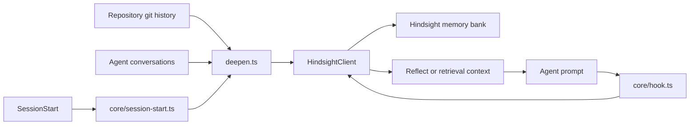
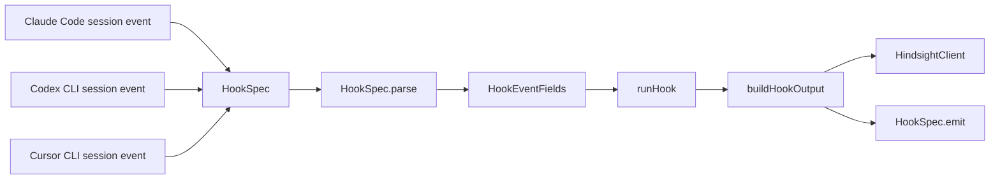
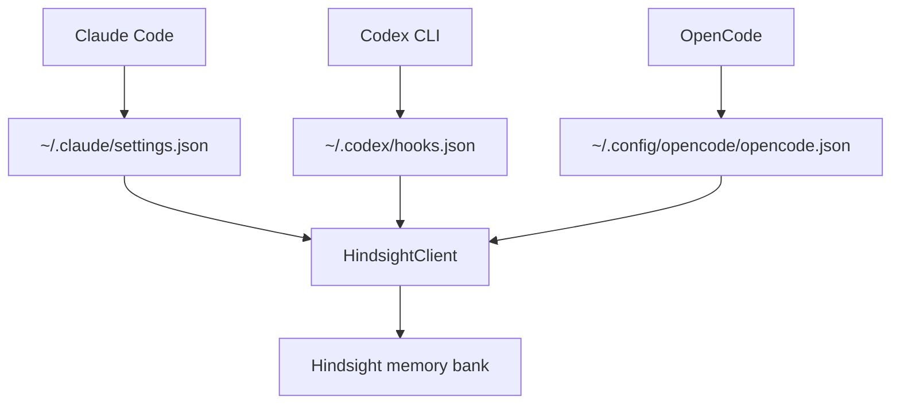

<!-- source: DeepWiki mcp.deepwiki.com · repo vectorize-io/hindsight · page 5.6 Coding Agent Integrations · fetched 2026-10-27 -->

# Coding Agent Integrations

Relevant source files

The following files were used as context for generating this wiki page:

- [hindsight-docs/docs-integrations/coding-agents.md](hindsight-docs/docs-integrations/coding-agents.md)
- [hindsight-integrations/coding-agents/README.md](hindsight-integrations/coding-agents/README.md)
- [hindsight-integrations/coding-agents/skill/SKILL.md](hindsight-integrations/coding-agents/skill/SKILL.md)
- [hindsight-integrations/coding-agents/src/core/config.test.ts](hindsight-integrations/coding-agents/src/core/config.test.ts)
- [hindsight-integrations/coding-agents/src/core/config.ts](hindsight-integrations/coding-agents/src/core/config.ts)
- [hindsight-integrations/coding-agents/src/core/hindsight.pages.test.ts](hindsight-integrations/coding-agents/src/core/hindsight.pages.test.ts)
- [hindsight-integrations/coding-agents/src/core/hindsight.test.ts](hindsight-integrations/coding-agents/src/core/hindsight.test.ts)
- [hindsight-integrations/coding-agents/src/core/hindsight.ts](hindsight-integrations/coding-agents/src/core/hindsight.ts)
- [hindsight-integrations/coding-agents/src/core/hook.test.ts](hindsight-integrations/coding-agents/src/core/hook.test.ts)
- [hindsight-integrations/coding-agents/src/core/hook.ts](hindsight-integrations/coding-agents/src/core/hook.ts)
- [hindsight-integrations/coding-agents/src/core/missions.test.ts](hindsight-integrations/coding-agents/src/core/missions.test.ts)
- [hindsight-integrations/coding-agents/src/core/missions.ts](hindsight-integrations/coding-agents/src/core/missions.ts)
- [hindsight-integrations/coding-agents/src/core/session-start.ts](hindsight-integrations/coding-agents/src/core/session-start.ts)
- [hindsight-integrations/coding-agents/src/deepen.ts](hindsight-integrations/coding-agents/src/deepen.ts)
- [skills/hindsight-docs/references/sdks/integrations/coding-agents.md](skills/hindsight-docs/references/sdks/integrations/coding-agents.md)

## Purpose and scope

Coding-agent integrations connect coding assistants to Hindsight’s long-term project memory. The unified `hindsight-coding-agents` package is described as sharing memory across harnesses: repository git history and conversations feed a memory bank, and project knowledge pages help provide context to later sessions [hindsight-integrations/coding-agents/README.md:3-13](). This parent page introduces how the package, harness adapters, and standalone plugins fit together; implementation details belong in the child pages.

For details, see [hindsight-coding-agents Core](#5.6.1), [Installer, Harnesses and Transcript Parsers](#5.6.2), and [Claude Code, Codex and OpenCode Plugins](#5.6.3).

Sources: [hindsight-integrations/coding-agents/README.md:3-13]()

---

## 1. Unified `hindsight-coding-agents` package

The package provides a shared memory core with harness-specific entry points. The documented integrations include Claude Code, Codex CLI, Dcode, OpenCode, Cursor CLI, GitHub Copilot CLI, ZCode, and others [hindsight-integrations/coding-agents/README.md:3-7](). Its premise is to retain project-specific decisions from git history and past conversations, then make them available alongside curated knowledge pages [hindsight-integrations/coding-agents/README.md:9-13]().

The core includes a harness-agnostic `HindsightClient`, shared session and prompt-hook logic, configuration, and background ingestion. Harness adapters use the shared runtime rather than implementing memory behavior independently [hindsight-integrations/coding-agents/src/core/hindsight.ts:1-7](), [hindsight-integrations/coding-agents/src/core/hook.ts:1-22](). For the core lifecycle, bank derivation, knowledge tools, and ingestion flow, see [hindsight-coding-agents Core](#5.6.1).

### Diagram: Project memory flow, from agent lifecycle to core

Sources: [hindsight-integrations/coding-agents/README.md:3-13](), [hindsight-integrations/coding-agents/src/core/hindsight.ts:1-7](), [hindsight-integrations/coding-agents/src/core/hook.ts:1-22](), [hindsight-integrations/coding-agents/src/core/session-start.ts:1-20](), [hindsight-integrations/coding-agents/src/deepen.ts:1-21]()

---

## 2. Installer, harness adapters, and transcript parsers

The package documents an installer CLI for selecting harnesses, alongside commands for uninstalling, updating the runtime, and viewing usage statistics [hindsight-integrations/coding-agents/README.md:46-73](). Integrations use harness-specific wiring: for example, the README describes Claude Code hooks and MCP registration, Codex hooks and MCP configuration, and an OpenCode plugin entry with native tools [hindsight-integrations/coding-agents/README.md:79-93](), [hindsight-integrations/coding-agents/README.md:116-122]().

The shared hook runtime accepts a `HookSpec` that supplies harness-specific event parsing and output formatting, while keeping the hook logic in a common path [hindsight-integrations/coding-agents/src/core/hook.ts:19-22](), [hindsight-integrations/coding-agents/src/core/hook.ts:55-85](). For installer behavior, harness-specific adapters, and transcript parser coverage, see [Installer, Harnesses and Transcript Parsers](#5.6.2).

### Diagram: Harness events mapped to shared code entities

Sources: [hindsight-integrations/coding-agents/src/core/hook.ts:19-22](), [hindsight-integrations/coding-agents/src/core/hook.ts:55-85]()

---

## 3. Standalone Claude Code, Codex, and OpenCode integrations

The repository also documents harness-specific integration paths for Claude Code, Codex CLI, and OpenCode. Claude Code’s installer wiring includes hooks and MCP registration; Codex uses hooks and MCP configuration; OpenCode uses a plugin entry with native tools [hindsight-integrations/coding-agents/README.md:79-93](), [hindsight-integrations/coding-agents/README.md:116-122](). These details are distinct from the parent-level view of the shared package and its adapter model.

For the standalone plugin implementations and their hooks, skills, tools, and configuration, see [Claude Code, Codex and OpenCode Plugins](#5.6.3).

### Diagram: Harness-specific setup names and shared memory client

Sources: [hindsight-integrations/coding-agents/README.md:79-93](), [hindsight-integrations/coding-agents/README.md:116-122](), [hindsight-integrations/coding-agents/src/core/hindsight.ts:1-7]()

---

## 4. Integration overview

| Area | Role in the overall integration | Details |
|---|---|---|
| Shared package | Common client and runtime for memory operations across harnesses [hindsight-integrations/coding-agents/src/core/hindsight.ts:1-7]() | [hindsight-coding-agents Core](#5.6.1) |
| Installer and adapters | Connects supported harnesses to shared runtime behavior [hindsight-integrations/coding-agents/src/core/hook.ts:19-22]() | [Installer, Harnesses and Transcript Parsers](#5.6.2) |
| Standalone integrations | Documents Claude Code, Codex CLI, and OpenCode setup paths [hindsight-integrations/coding-agents/README.md:79-93](), [hindsight-integrations/coding-agents/README.md:116-122]() | [Claude Code, Codex and OpenCode Plugins](#5.6.3) |

Sources: [hindsight-integrations/coding-agents/src/core/hindsight.ts:1-7](), [hindsight-integrations/coding-agents/src/core/hook.ts:19-22](), [hindsight-integrations/coding-agents/README.md:79-93](), [hindsight-integrations/coding-agents/README.md:116-122]()

### Child pages

- [hindsight-coding-agents Core](#5.6.1) — Shared client and runtime, configuration, session and prompt hooks, memory tools, knowledge pages, and background ingestion.
- [Installer, Harnesses and Transcript Parsers](#5.6.2) — Installer CLI, harness adapters, plugin wiring, and transcript parsers.
- [Claude Code, Codex and OpenCode Plugins](#5.6.3) — Standalone integrations for the three named harnesses, including their hooks, tools, and configuration.

Sources: [hindsight-integrations/coding-agents/README.md:3-7](), [hindsight-integrations/coding-agents/src/core/hindsight.ts:1-7](), [hindsight-integrations/coding-agents/src/core/hook.ts:19-22]()

---

