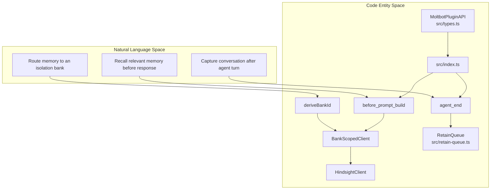
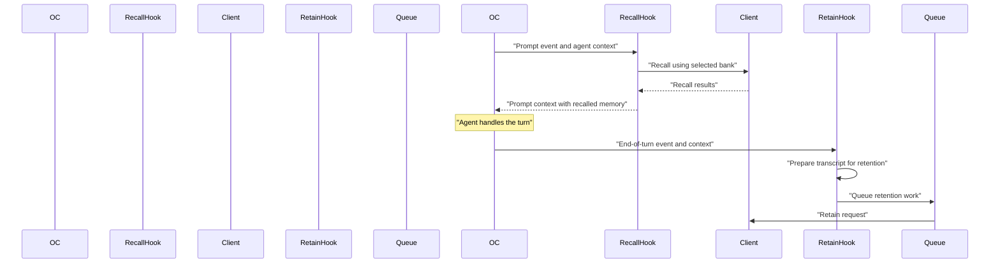
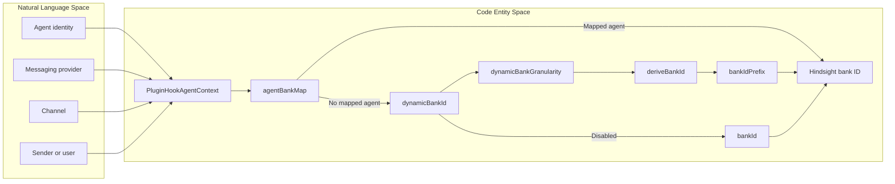

<!-- source: DeepWiki mcp.deepwiki.com · repo vectorize-io/hindsight · page 5.7 OpenClaw Plugin · fetched 2026-10-27 -->

# OpenClaw Plugin

Relevant source files

The following files were used as context for generating this wiki page:

- [hindsight-docs/docs-integrations/openclaw.md](hindsight-docs/docs-integrations/openclaw.md)
- [hindsight-docs/src/pages/changelog/integrations/openclaw.md](hindsight-docs/src/pages/changelog/integrations/openclaw.md)
- [hindsight-integrations/openclaw/README.md](hindsight-integrations/openclaw/README.md)
- [hindsight-integrations/openclaw/openclaw.plugin.json](hindsight-integrations/openclaw/openclaw.plugin.json)
- [hindsight-integrations/openclaw/package-lock.json](hindsight-integrations/openclaw/package-lock.json)
- [hindsight-integrations/openclaw/package.json](hindsight-integrations/openclaw/package.json)
- [hindsight-integrations/openclaw/scripts/doctor-check-selftest.sh](hindsight-integrations/openclaw/scripts/doctor-check-selftest.sh)
- [hindsight-integrations/openclaw/scripts/smoke-test.sh](hindsight-integrations/openclaw/scripts/smoke-test.sh)
- [hindsight-integrations/openclaw/src/backfill.test.ts](hindsight-integrations/openclaw/src/backfill.test.ts)
- [hindsight-integrations/openclaw/src/backfill.ts](hindsight-integrations/openclaw/src/backfill.ts)
- [hindsight-integrations/openclaw/src/goal-safe-hooks.test.ts](hindsight-integrations/openclaw/src/goal-safe-hooks.test.ts)
- [hindsight-integrations/openclaw/src/index.test.ts](hindsight-integrations/openclaw/src/index.test.ts)
- [hindsight-integrations/openclaw/src/index.ts](hindsight-integrations/openclaw/src/index.ts)
- [hindsight-integrations/openclaw/src/local-daemon-parity.test.ts](hindsight-integrations/openclaw/src/local-daemon-parity.test.ts)
- [hindsight-integrations/openclaw/src/retain-queue.test.ts](hindsight-integrations/openclaw/src/retain-queue.test.ts)
- [hindsight-integrations/openclaw/src/retain-queue.ts](hindsight-integrations/openclaw/src/retain-queue.ts)
- [hindsight-integrations/openclaw/src/session-patterns.test.ts](hindsight-integrations/openclaw/src/session-patterns.test.ts)
- [hindsight-integrations/openclaw/src/session-patterns.ts](hindsight-integrations/openclaw/src/session-patterns.ts)
- [hindsight-integrations/openclaw/src/setup-lib.test.ts](hindsight-integrations/openclaw/src/setup-lib.test.ts)
- [hindsight-integrations/openclaw/src/setup-lib.ts](hindsight-integrations/openclaw/src/setup-lib.ts)
- [hindsight-integrations/openclaw/src/setup.test.ts](hindsight-integrations/openclaw/src/setup.test.ts)
- [hindsight-integrations/openclaw/src/setup.ts](hindsight-integrations/openclaw/src/setup.ts)
- [hindsight-integrations/openclaw/src/types.ts](hindsight-integrations/openclaw/src/types.ts)
- [hindsight-integrations/openclaw/tests/hooks.integration.test.ts](hindsight-integrations/openclaw/tests/hooks.integration.test.ts)
- [hindsight-integrations/openclaw/tests/integration.test.ts](hindsight-integrations/openclaw/tests/integration.test.ts)
- [skills/hindsight-docs/references/changelog/integrations/openclaw.md](skills/hindsight-docs/references/changelog/integrations/openclaw.md)
- [skills/hindsight-docs/references/sdks/integrations/codex.md](skills/hindsight-docs/references/sdks/integrations/codex.md)
- [skills/hindsight-docs/references/sdks/integrations/llamaindex.md](skills/hindsight-docs/references/sdks/integrations/llamaindex.md)
- [skills/hindsight-docs/references/sdks/integrations/openclaw.md](skills/hindsight-docs/references/sdks/integrations/openclaw.md)

The OpenClaw plugin, `@vectorize-io/hindsight-openclaw`, connects OpenClaw agents to Hindsight for persistent memory. It provides automatic recall before prompt construction and automatic retention at the end of an agent turn, with configurable bank routing and either an embedded Hindsight daemon or an external API. [hindsight-integrations/openclaw/package.json:1-15]()

Sources: [hindsight-integrations/openclaw/package.json:1-15]()

## Purpose and Scope

This page describes the plugin’s hook lifecycle, bank ID routing, transcript handling, retain queue and historical backfill entry points, session utilities, setup modes, and configuration. It focuses on the OpenClaw integration package; it does not document the internals of Hindsight’s memory engine. [hindsight-integrations/openclaw/src/index.ts:1-32]()

Sources: [hindsight-integrations/openclaw/src/index.ts:1-32]()

## 1. Architecture Overview and Component Mapping

The package’s OpenClaw entry point is `src/index.ts`. It imports the Hindsight embedded-server wrapper and client, the `RetainQueue`, session-pattern and session-file utilities, bank-default helpers, and the plugin’s type definitions. The package manifest registers `dist/index.js` as an OpenClaw extension and publishes separate setup and backfill CLI binaries. [hindsight-integrations/openclaw/src/index.ts:1-32]()[hindsight-integrations/openclaw/package.json:1-15]()

The diagram maps user-facing memory behavior to the plugin’s code entities. `MoltbotPluginAPI` supplies the hook and service-registration interface; the entry point coordinates the Hindsight client, bank-scoped requests, and retention support. [hindsight-integrations/openclaw/src/types.ts:12-28]()[hindsight-integrations/openclaw/src/index.ts:1-32]()

**Diagram: OpenClaw memory lifecycle mapped to plugin code**

Sources: [hindsight-integrations/openclaw/src/types.ts:12-28]()[hindsight-integrations/openclaw/src/index.ts:1-32]()

### Runtime and client structure

The entry point maintains module-level references for the embedded `HindsightServer`, `HindsightClient`, client options, initialization state, and whether the plugin uses an external API. It also tracks service generations and abort controllers so hook work can be associated with a cancellable lifecycle. [hindsight-integrations/openclaw/src/index.ts:80-118]()

`BankScopedClient` provides a bank-specific facade over `HindsightClient`. Its interface accepts retain and recall requests without requiring hook code to mutate a shared client’s bank selection. [hindsight-integrations/openclaw/src/index.ts:146-163]()

The plugin API type includes `registerService`, event registration through `on`, a logger, and an optional `registerMemoryCapability` method for hosts that support a native memory provider runtime. [hindsight-integrations/openclaw/src/types.ts:12-28]()

Sources: [hindsight-integrations/openclaw/src/index.ts:80-118]()[hindsight-integrations/openclaw/src/index.ts:146-163]()[hindsight-integrations/openclaw/src/types.ts:12-28]()

## 2. Auto-Recall and Auto-Retain Hooks

The plugin’s automatic recall and retention are driven by OpenClaw hook events. Its configuration exposes `autoRecall` and `autoRetain`, both enabled by default, and `excludeProviders` can exclude message providers from recall and retention. [hindsight-integrations/openclaw/src/types.ts:126-137]()

**Diagram: Prompt recall and end-of-turn retention**

Sources: [hindsight-integrations/openclaw/src/index.ts:1-32]()[hindsight-integrations/openclaw/src/types.ts:126-137]()

### Auto-recall: `before_prompt_build`

The plugin’s recall hook uses the incoming message or prompt to identify a query. Tests cover `extractRecallQuery`, including handling short messages, falling back to prompt text, removing leading `System:` lines, and rejecting prompts consisting only of metadata. [hindsight-integrations/openclaw/src/index.test.ts:141-180]()

The entry point has an `inflightRecalls` map for deduplicating concurrent recall work. The plugin also defines helpers for formatting recall results and current time, composing and truncating recall queries, and removing injected memory tags. These helpers are covered by the entry-point test suite. [hindsight-integrations/openclaw/src/index.ts:140-145]()[hindsight-integrations/openclaw/src/index.test.ts:6-45]()

Recall results are intended to be injected into prompt context rather than stored as ordinary conversation text. The integration documentation describes automatic injection before agent responses and identifies stripping injected memory tags as a feedback-loop prevention measure. [hindsight-docs/docs-integrations/openclaw.md:83-91]()

Sources: [hindsight-integrations/openclaw/src/index.ts:140-145]()[hindsight-integrations/openclaw/src/index.test.ts:6-45]()[hindsight-integrations/openclaw/src/index.test.ts:141-180]()[hindsight-docs/docs-integrations/openclaw.md:83-91]()

### Auto-retain: `agent_end`

Retention is configured to include selected transcript roles; the default is `user` and `assistant`. `retainFormat` selects JSON or text serialization, and `retainToolCalls` controls whether JSON-formatted content includes typed tool-call and tool-result blocks. `retainTags`, `retainSource`, and `retainContext` provide document tags, source metadata, and interpretation guidance. [hindsight-integrations/openclaw/src/types.ts:126-137]()

The plugin defines `DEFAULT_RETAIN_CONTEXT` to clarify that OpenClaw routing metadata—such as sender, channel, provider, bank, and session identifiers—is operational metadata, not semantic identity. It also clarifies that assistant first-person statements refer to the assistant, while user messages refer to the human user. [hindsight-integrations/openclaw/src/index.ts:46-57]()

Transcript preparation includes helpers to strip injected memory tags and runtime envelopes. The tests show that the tag stripper removes both `<hindsight_memories>` and `<relevant_memories>` blocks, while runtime-envelope stripping removes opaque IDs without discarding ordinary text containing a colon. [hindsight-integrations/openclaw/src/index.test.ts:63-111]()[hindsight-integrations/openclaw/src/index.test.ts:118-138]()

Sources: [hindsight-integrations/openclaw/src/types.ts:126-137]()[hindsight-integrations/openclaw/src/index.ts:46-57]()[hindsight-integrations/openclaw/src/index.test.ts:63-111]()[hindsight-integrations/openclaw/src/index.test.ts:118-138]()

### API capability detection and append retention

The entry point tracks whether the Hindsight API supports `update_mode: 'append'`. Its comments specify a version probe against `<apiUrl>/version`, with append support associated with API version `0.5.0` or later. When append is unavailable, the plugin’s documented fallback is a per-turn document ID, avoiding overwriting earlier turns or sending unsupported append requests. [hindsight-integrations/openclaw/src/index.ts:88-100]()

The plugin separately tracks support for async retain operation IDs, with a minimum version constant of `0.8.6`. [hindsight-integrations/openclaw/src/index.ts:102-105]()

Sources: [hindsight-integrations/openclaw/src/index.ts:88-105]()

## 3. Dynamic Bank ID Derivation

The plugin can direct different agents or conversation contexts to different Hindsight banks. The configuration includes `agentBankMap`, `dynamicBankId`, `dynamicBankGranularity`, `bankId`, and `bankIdPrefix`. The defaults documented in the type definitions enable dynamic bank IDs and use `agent`, `channel`, and `user` as the default granularity fields. [hindsight-integrations/openclaw/src/types.ts:120-125]()[hindsight-integrations/openclaw/src/types.ts:130-132]()

**Diagram: Context fields resolved to a Hindsight bank**

Sources: [hindsight-integrations/openclaw/src/types.ts:50-58]()[hindsight-integrations/openclaw/src/types.ts:120-125]()

### Routing inputs and precedence

`PluginHookAgentContext` carries fields including `agentId`, `sessionKey`, `messageProvider`, `channelId`, and `senderId`. These provide the context used by the plugin’s bank-routing configuration. [hindsight-integrations/openclaw/src/types.ts:50-58]()

The configuration comments specify that `agentBankMap` provides explicit `agentId` → `bankId` routing checked before static or dynamic derivation. Mapped names are used as given; `bankIdPrefix` is not applied to mapped values. When dynamic bank routing is disabled, `bankId` is the configured static bank identifier. [hindsight-integrations/openclaw/src/types.ts:120-125]()

`dynamicBankGranularity` selects which context dimensions participate in derived bank IDs. The manifest describes dynamic routing as per-user memory banks, while the type definition allows the granularity to be configured across agent, provider, channel, and user. [hindsight-integrations/openclaw/openclaw.plugin.json:117-135]()[hindsight-integrations/openclaw/src/types.ts:120-125]()

Sources: [hindsight-integrations/openclaw/src/types.ts:50-58]()[hindsight-integrations/openclaw/src/types.ts:120-125]()[hindsight-integrations/openclaw/openclaw.plugin.json:117-135]()

## 4. Retain Queue and Backfill Execution

The entry point imports `RetainQueue` from `src/retain-queue.ts`. The package also publishes the `hindsight-openclaw-backfill` executable, implemented by `dist/backfill.js`. The README describes backfill as importing prior OpenClaw session history and using the active plugin bank-routing configuration by default. [hindsight-integrations/openclaw/src/index.ts:15-18]()[hindsight-integrations/openclaw/package.json:7-10]()[hindsight-integrations/openclaw/README.md:68-73]()

### Retain queue

`RetainQueue` is the plugin’s retention-queue component, imported by the main entry point. The supplied source excerpt identifies its module but does not include the queue implementation, so details such as its persistence format, retry policy, batching behavior, or flush schedule are not specified here. [hindsight-integrations/openclaw/src/index.ts:15-16]()

The hook integration tests describe invoking `agent_end` with realistic events and spying on client `retain` and `recall` calls. They verify orchestration against a running Hindsight API rather than requiring a full LLM pipeline. [hindsight-integrations/openclaw/tests/hooks.integration.test.ts:1-14]()

Sources: [hindsight-integrations/openclaw/src/index.ts:15-16]()[hindsight-integrations/openclaw/tests/hooks.integration.test.ts:1-14]()

### Historical backfill

The package’s `bin` mapping exposes `hindsight-openclaw-backfill`, and the README identifies it as the historical session import command. The package includes a `backfill:help` script for displaying the command’s help. [hindsight-integrations/openclaw/package.json:7-10]()[hindsight-integrations/openclaw/package.json:37-47]()[hindsight-integrations/openclaw/README.md:68-73]()

The backfill implementation is in `src/backfill.ts`; the supplied file contents do not show its option parsing or exact file-discovery and retention behavior. [hindsight-integrations/openclaw/package.json:7-10]()

Sources: [hindsight-integrations/openclaw/package.json:7-10]()[hindsight-integrations/openclaw/package.json:37-47]()[hindsight-integrations/openclaw/README.md:68-73]()

## 5. Session Patterns and File Parsing

The entry point imports `compileSessionPatterns` and `matchesSessionPattern` from `session-patterns.ts`, and `parseSessionFile` from `session-file.ts`. These modules are used alongside the backfill functionality; their detailed pattern syntax and file parsing rules are not shown in the supplied source excerpts. [hindsight-integrations/openclaw/src/index.ts:16-19]()

The plugin’s types include an `endedTranscript` field for session-end events on supported OpenClaw versions. The bounded transcript reader can report that a transcript is unavailable, or read a tail using maximum message and byte limits and return the message count and truncation status. [hindsight-integrations/openclaw/src/types.ts:57-70]()

Sources: [hindsight-integrations/openclaw/src/index.ts:16-19]()[hindsight-integrations/openclaw/src/types.ts:57-70]()

## 6. Setup, Doctor, and Configuration Options

### Setup modes and installation

The package publishes the `hindsight-openclaw-setup` binary. The documented quick start installs the plugin with OpenClaw, runs the setup command through `npx`, and then starts the OpenClaw gateway. The README describes three setup modes: managed Cloud, an external Hindsight API, and an embedded `hindsight-embed` daemon. [hindsight-integrations/openclaw/package.json:7-15]()[hindsight-integrations/openclaw/README.md:5-24]()

The setup wizard supports interactive configuration and non-interactive flags. The documented examples show passing credentials inline or using OpenClaw `SecretRef` configuration for tokens and API keys. [hindsight-docs/docs-integrations/openclaw.md:33-69]()

The plugin manifest declares `llmApiKey` and `hindsightApiToken` as secret inputs. The configuration types describe the LLM API key and external API token as sensitive values that can be configured through a secret reference. [hindsight-integrations/openclaw/openclaw.plugin.json:5-18]()[hindsight-integrations/openclaw/src/types.ts:115-121]()

Sources: [hindsight-integrations/openclaw/package.json:7-15]()[hindsight-integrations/openclaw/README.md:5-24]()[hindsight-docs/docs-integrations/openclaw.md:33-69]()[hindsight-integrations/openclaw/openclaw.plugin.json:5-18]()[hindsight-integrations/openclaw/src/types.ts:115-121]()

### Doctor and diagnostics

The supplied package manifest exposes setup and backfill binaries, and its scripts include build, test, and integration-test commands. A doctor-related self-test script is listed among the additional repository files, but its contents and the plugin’s diagnostic checks are not included in the supplied excerpts. [hindsight-integrations/openclaw/package.json:7-47]()

Sources: [hindsight-integrations/openclaw/package.json:7-47]()

### Configuration reference

Configuration is declared in the `PluginConfig` TypeScript interface and validated through `openclaw.plugin.json`. The table groups options by purpose; “default” is shown only where the supplied interface, manifest, or documentation gives one. [hindsight-integrations/openclaw/src/types.ts:72-137]()[hindsight-integrations/openclaw/openclaw.plugin.json:19-150]()

| Area | Option | Meaning |
|---|---|---|
| API and daemon | `hindsightApiUrl` | External Hindsight API URL; when set, local daemon startup is skipped. [hindsight-integrations/openclaw/src/types.ts:119-121]() |
| API and daemon | `hindsightApiToken` | Token for an authenticated external API; supports a secret input. [hindsight-integrations/openclaw/src/types.ts:119-121]()[hindsight-integrations/openclaw/openclaw.plugin.json:5-18]() |
| API and daemon | `embedVersion` | `hindsight-embed` version; the manifest gives `latest` as the default. [hindsight-integrations/openclaw/src/types.ts:112-114]()[hindsight-integrations/openclaw/openclaw.plugin.json:78-82]() |
| API and daemon | `embedPackagePath` | Local Hindsight package path used for development. [hindsight-integrations/openclaw/src/types.ts:112-115]()[hindsight-integrations/openclaw/openclaw.plugin.json:100-103]() |
| API and daemon | `embedPort` | Embedded server port; the manifest describes automatic assignment when unspecified. [hindsight-integrations/openclaw/src/types.ts:106-114]()[hindsight-integrations/openclaw/openclaw.plugin.json:27-31]() |
| API and daemon | `apiPort` | Port for the OpenClaw profile daemon; documented default is `9077`. [hindsight-integrations/openclaw/src/types.ts:118-120]()[hindsight-integrations/openclaw/openclaw.plugin.json:104-108]() |
| LLM | `llmProvider` | Provider for memory processing, including OpenAI, Anthropic, Gemini, Groq, Ollama, OpenAI Codex, and Claude Code. [hindsight-integrations/openclaw/src/types.ts:115-118]()[hindsight-integrations/openclaw/openclaw.plugin.json:83-86]() |
| LLM | `llmModel` | Model name used with `llmProvider`. [hindsight-integrations/openclaw/src/types.ts:115-118]()[hindsight-integrations/openclaw/openclaw.plugin.json:88-91]() |
| LLM | `llmApiKey` | Provider API key; declared as a secret input in the manifest. [hindsight-integrations/openclaw/src/types.ts:115-118]()[hindsight-integrations/openclaw/openclaw.plugin.json:5-18]()[hindsight-integrations/openclaw/openclaw.plugin.json:92-95]() |
| LLM | `llmBaseUrl` | Optional base URL override for OpenAI-compatible providers. [hindsight-integrations/openclaw/src/types.ts:115-118]()[hindsight-integrations/openclaw/openclaw.plugin.json:96-99]() |
| Bank routing | `dynamicBankId` | Enables dynamic bank routing; defaults to `true`. [hindsight-integrations/openclaw/src/types.ts:120-125]()[hindsight-integrations/openclaw/openclaw.plugin.json:117-121]() |
| Bank routing | `dynamicBankGranularity` | Selects `agent`, `provider`, `channel`, and/or `user` dimensions; the type default is `agent`, `channel`, and `user`. [hindsight-integrations/openclaw/src/types.ts:130-132]() |
| Bank routing | `bankId` | Static bank ID used when dynamic routing is disabled. [hindsight-integrations/openclaw/src/types.ts:120-125]()[hindsight-integrations/openclaw/openclaw.plugin.json:122-125]() |
| Bank routing | `bankIdPrefix` | Optional prefix for bank IDs. [hindsight-integrations/openclaw/src/types.ts:120-125]()[hindsight-integrations/openclaw/openclaw.plugin.json:126-129]() |
| Bank routing | `agentBankMap` | Explicit mapping from agent IDs to bank IDs, evaluated before static or dynamic derivation. [hindsight-integrations/openclaw/src/types.ts:124-125]()[hindsight-integrations/openclaw/openclaw.plugin.json:130-136]() |
| Bank defaults | `bankMission` | Reflect mission stamped on a bank on first use; it does not affect retain or recall. [hindsight-integrations/openclaw/src/types.ts:72-78]()[hindsight-integrations/openclaw/openclaw.plugin.json:32-35]() |
| Bank defaults | `retainMission` | Retain mission that steers fact extraction. [hindsight-integrations/openclaw/src/types.ts:78-84]()[hindsight-integrations/openclaw/openclaw.plugin.json:36-39]() |
| Bank defaults | `observationsMission` | Mission for observation consolidation. [hindsight-integrations/openclaw/src/types.ts:84-88]()[hindsight-integrations/openclaw/openclaw.plugin.json:40-43]() |
| Bank defaults | `retainExtractionMode` | Extraction mode: `concise`, `verbose`, `custom`, `verbatim`, or `chunks`. [hindsight-integrations/openclaw/src/types.ts:88-95]()[hindsight-integrations/openclaw/openclaw.plugin.json:44-48]() |
| Bank defaults | `enableObservations` | Toggles observation consolidation for new banks. [hindsight-integrations/openclaw/src/types.ts:93-97]()[hindsight-integrations/openclaw/openclaw.plugin.json:49-52]() |
| Bank defaults | `enableAutoConsolidation` | Toggles automatic consolidation scheduling for new banks. [hindsight-integrations/openclaw/src/types.ts:93-97]()[hindsight-integrations/openclaw/openclaw.plugin.json:53-56]() |
| Bank defaults | `dispositionSkepticism`, `dispositionLiteralism`, `dispositionEmpathy` | Reflect disposition traits on a 1–5 scale, stamped on first bank use. [hindsight-integrations/openclaw/src/types.ts:98-102]()[hindsight-integrations/openclaw/openclaw.plugin.json:57-74]() |
| Bank defaults | `entityLabels` | Controlled vocabulary for entity labels, passed through to bank configuration when accepted. [hindsight-integrations/openclaw/src/types.ts:103-107]()[hindsight-integrations/openclaw/openclaw.plugin.json:75-77]() |
| Retention | `autoRetain` | Enables automatic retention; defaults to `true`. [hindsight-integrations/openclaw/src/types.ts:130-137]() |
| Retention | `retainRoles` | Transcript roles to retain; documented default is `user` and `assistant`. [hindsight-integrations/openclaw/src/types.ts:130-135]() |
| Retention | `retainFormat` | Chooses JSON or text transcript serialization; documented default is `json`. [hindsight-integrations/openclaw/src/types.ts:133-135]() |
| Retention | `retainToolCalls` | Controls inclusion of typed tool-call and tool-result blocks when JSON serialization is used. [hindsight-integrations/openclaw/src/types.ts:133-136]() |
| Retention | `retainTags` | Tags applied to retained documents. [hindsight-integrations/openclaw/src/types.ts:124-129]() |
| Retention | `retainSource` | Source written into retained document metadata; documented default is `openclaw`. [hindsight-integrations/openclaw/src/types.ts:126-129]() |
| Retention | `retainContext` | Interpretation guidance for retain; defaults to the plugin’s built-in OpenClaw transcript guidance. [hindsight-integrations/openclaw/src/types.ts:126-129]()[hindsight-integrations/openclaw/src/index.ts:46-57]() |
| Recall | `autoRecall` | Enables recall for prompts; defaults to `true`. [hindsight-integrations/openclaw/src/types.ts:126-132]() |
| Recall | `recallBudget` | Recall effort level; documented default is `mid`. [hindsight-integrations/openclaw/src/types.ts:136-137]() |
| Recall | `recallMaxTokens` | Maximum token budget for recall results; documented default is `1024`. [hindsight-integrations/openclaw/src/types.ts:136-137]() |
| Filtering | `excludeProviders` | Provider names excluded from recall and retention. [hindsight-integrations/openclaw/src/types.ts:126-132]() |
| Deprecated | `daemonIdleTimeout` | Deprecated and ignored; the manifest says the daemon no longer shuts down from inactivity. [hindsight-integrations/openclaw/src/types.ts:108-114]()[hindsight-integrations/openclaw/openclaw.plugin.json:22-26]() |
| Deprecated | `enableKnowledgeTools` | Deprecated and ignored; the type definition notes that the agent knowledge tools were removed. [hindsight-integrations/openclaw/src/types.ts:108-112]() |

Sources: [hindsight-integrations/openclaw/src/types.ts:72-137]()[hindsight-integrations/openclaw/openclaw.plugin.json:5-150]()[hindsight-integrations/openclaw/src/index.ts:46-57]()

---

