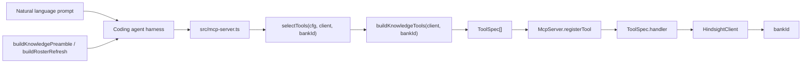
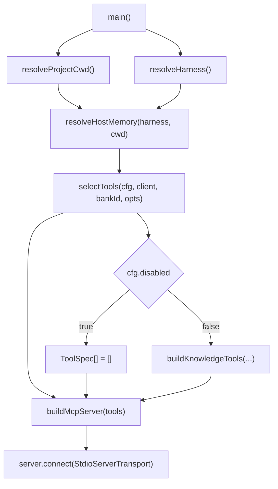
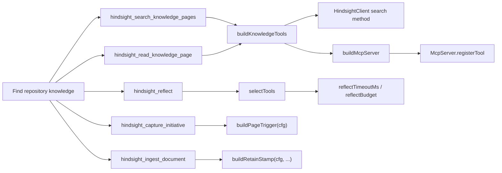

<!-- source: DeepWiki mcp.deepwiki.com · repo vectorize-io/hindsight · page 5.8 Skills and Agent Knowledge Tools · fetched 2026-10-27 -->

# Skills and Agent Knowledge Tools

Relevant source files

The following files were used as context for generating this wiki page:

- [.claude/skills/code-review/SKILL.md](.claude/skills/code-review/SKILL.md)
- [.gitignore](.gitignore)
- [CLAUDE.md](CLAUDE.md)
- [hindsight-api-slim/tests/test_document_tracking.py](hindsight-api-slim/tests/test_document_tracking.py)
- [hindsight-clients/go/model_document_response.go](hindsight-clients/go/model_document_response.go)
- [hindsight-clients/python/tests/test_mental_model_query_mapping.py](hindsight-clients/python/tests/test_mental_model_query_mapping.py)
- [hindsight-integrations/coding-agents/src/core/knowledge-injection.test.ts](hindsight-integrations/coding-agents/src/core/knowledge-injection.test.ts)
- [hindsight-integrations/coding-agents/src/core/knowledge-injection.ts](hindsight-integrations/coding-agents/src/core/knowledge-injection.ts)
- [hindsight-integrations/coding-agents/src/core/knowledge-tools.test.ts](hindsight-integrations/coding-agents/src/core/knowledge-tools.test.ts)
- [hindsight-integrations/coding-agents/src/core/knowledge-tools.ts](hindsight-integrations/coding-agents/src/core/knowledge-tools.ts)
- [hindsight-integrations/coding-agents/src/mcp-server.test.ts](hindsight-integrations/coding-agents/src/mcp-server.test.ts)
- [hindsight-integrations/coding-agents/src/mcp-server.ts](hindsight-integrations/coding-agents/src/mcp-server.ts)

## Purpose and scope

This page describes the skill and agent-knowledge-tool implementation visible in the supplied code excerpts: the repository’s `SKILL.md` metadata convention, coding-agent knowledge injection, and the native TypeScript MCP server that exposes Hindsight tools. The excerpts do not include the implementation of `scripts/generate-docs-skill.sh` or the contents of the requested `skills/` directories, so their generation details and individual skill contents cannot be verified here. [CLAUDE.md:3-4](), [hindsight-integrations/coding-agents/src/mcp-server.ts:1-24](), [.claude/skills/code-review/SKILL.md:1-9]()

Sources: [CLAUDE.md:3-4](), [hindsight-integrations/coding-agents/src/mcp-server.ts:1-24](), [.claude/skills/code-review/SKILL.md:1-9]()

## 1. Skills System Overview

Hindsight is an agent memory system that organizes memories as world facts, experience facts, and mental models. Its monorepo includes the API, client SDKs, integrations, documentation, and extensions; the coding-agent integration provides a TypeScript MCP server and knowledge tools that connect an agent to a Hindsight client and bank. [CLAUDE.md:5-10](), [CLAUDE.md:105-122](), [hindsight-integrations/coding-agents/src/mcp-server.ts:19-24]()

The available source excerpts show two related but distinct mechanisms:

- Repository-local skills use a `SKILL.md` file with YAML frontmatter, including `name`, `description`, and `user_invocable`. The provided example is the `code-review` skill. [.claude/skills/code-review/SKILL.md:1-9]()
- The coding-agent integration builds knowledge-tool specifications for an MCP server. The tools are bound to a `HindsightClient` and a bank ID; they are not shown as skills or as part of an `@vectorize-io/hindsight-agent-sdk` package. [hindsight-integrations/coding-agents/src/core/knowledge-tools.ts:1-15](), [hindsight-integrations/coding-agents/src/core/knowledge-tools.ts:74-90](), [hindsight-integrations/coding-agents/src/core/knowledge-tools.ts:112-131]()

Sources: [CLAUDE.md:5-10](), [CLAUDE.md:105-122](), [.claude/skills/code-review/SKILL.md:1-9](), [hindsight-integrations/coding-agents/src/core/knowledge-tools.ts:1-15](), [hindsight-integrations/coding-agents/src/core/knowledge-tools.ts:74-90](), [hindsight-integrations/coding-agents/src/core/knowledge-tools.ts:112-131]()

## 2. Documentation Skill Generation: `generate-docs-skill.sh`

The supplied excerpts identify `hindsight-docs` as the Docusaurus documentation site, but do not include `scripts/generate-docs-skill.sh`, its input files, or its generated output. As a result, this source set does not establish the script’s processing steps, output layout, or how it handles MDX, examples, provider data, or figures. [CLAUDE.md:105-122]()

The requested path `skills/hindsight-docs/` is not represented in the supplied file contents. Its existence, generated references, and relationship to `generate-docs-skill.sh` cannot be verified from these excerpts. [CLAUDE.md:105-122]()

Sources: [CLAUDE.md:105-122]()

## 3. `SKILL.md` Metadata

The provided `code-review` skill demonstrates a YAML-frontmatter format. Its metadata declares the skill name, a description of its purpose, and whether it is user-invocable; the markdown body then supplies the skill instructions. [.claude/skills/code-review/SKILL.md:1-13]()

| Metadata or content | Role in the provided example |
|---|---|
| `name` | Identifies the skill as `code-review`. [.claude/skills/code-review/SKILL.md:1-2]() |
| `description` | Summarizes the review task and when to run it. [.claude/skills/code-review/SKILL.md:2-4]() |
| `user_invocable` | Marks the skill as directly invocable by a user. [.claude/skills/code-review/SKILL.md:3-5]() |
| Markdown body | Gives the skill’s review guidance and standards. [.claude/skills/code-review/SKILL.md:7-13]() |

The excerpt documents the `code-review` skill only. It does not establish metadata or behavior for `hindsight-architect`, `hindsight-cloud`, `hindsight-local`, `hindsight-self-hosted`, or `skills/hindsight-docs/SKILL.md`. [.claude/skills/code-review/SKILL.md:1-13]()

Sources: [.claude/skills/code-review/SKILL.md:1-13]()

## 4. Harness-Agnostic Knowledge Tools

The TypeScript module `core/knowledge-tools.ts` defines tool specifications independently of the runtime MCP SDK. Its module comment describes the intended separation: the module builds specs and wraps `HindsightClient` methods, while `src/mcp-server.ts` imports the MCP SDK and registers those specs. Tool handlers convert client errors into text results marked `isError: true`, rather than propagating exceptions through the tool call. [hindsight-integrations/coding-agents/src/core/knowledge-tools.ts:1-15](), [hindsight-integrations/coding-agents/src/core/knowledge-tools.ts:92-109]()

`ToolSpec` contains a tool name, description, Zod input shape, required safety annotations, and an asynchronous handler. Read-only tools use `READ_ONLY_ANNOTATIONS`; the non-destructive write tools use `NON_DESTRUCTIVE_WRITE_ANNOTATIONS`. [hindsight-integrations/coding-agents/src/core/knowledge-tools.ts:41-57](), [hindsight-integrations/coding-agents/src/core/knowledge-tools.ts:74-90]()

The tests enumerate the eight expected tool names and verify that raw page CRUD tools are not exposed. The module comment explains the boundary: agents can search and read knowledge, capture initiatives, and ingest documents, but do not author page structure through raw create, update, or delete tools. [hindsight-integrations/coding-agents/src/core/knowledge-tools.test.ts:28-61](), [hindsight-integrations/coding-agents/src/core/knowledge-tools.ts:11-15]()

| Tool | Role established by the supplied source |
|---|---|
| `hindsight_sync_status` | Reports repository-bank synchronization status. [hindsight-integrations/coding-agents/src/core/knowledge-tools.ts:135-152]() |
| `hindsight_diagnose` | Reports safe runtime diagnostics. [hindsight-integrations/coding-agents/src/core/knowledge-tools.ts:153-156]() |
| `hindsight_search_knowledge_pages` | Searches knowledge pages and returns ranked results. [hindsight-integrations/coding-agents/src/core/knowledge-tools.test.ts:150-166]() |
| `hindsight_list_knowledge_pages` | Lists knowledge pages. [hindsight-integrations/coding-agents/src/core/knowledge-tools.test.ts:28-37]() |
| `hindsight_read_knowledge_page` | Reads a knowledge page. [hindsight-integrations/coding-agents/src/core/knowledge-tools.test.ts:28-37]() |
| `hindsight_reflect` | Runs reflection through the client; the MCP setup passes configured timeout and budget. [hindsight-integrations/coding-agents/src/mcp-server.ts:42-50](), [hindsight-integrations/coding-agents/src/mcp-server.test.ts:48-58]() |
| `hindsight_capture_initiative` | Captures an initiative for server-managed knowledge-page synthesis. [hindsight-integrations/coding-agents/src/core/knowledge-tools.ts:11-15](), [hindsight-integrations/coding-agents/src/core/knowledge-tools.test.ts:28-37]() |
| `hindsight_ingest_document` | Retains external document content; the tests verify harness attribution on ingested content. [hindsight-integrations/coding-agents/src/core/knowledge-tools.ts:11-15](), [hindsight-integrations/coding-agents/src/mcp-server.test.ts:60-73]() |

Sources: [hindsight-integrations/coding-agents/src/core/knowledge-tools.ts:1-15](), [hindsight-integrations/coding-agents/src/core/knowledge-tools.ts:41-57](), [hindsight-integrations/coding-agents/src/core/knowledge-tools.ts:74-109](), [hindsight-integrations/coding-agents/src/core/knowledge-tools.ts:112-156](), [hindsight-integrations/coding-agents/src/core/knowledge-tools.test.ts:28-61](), [hindsight-integrations/coding-agents/src/core/knowledge-tools.test.ts:150-166](), [hindsight-integrations/coding-agents/src/mcp-server.test.ts:48-73]()

### 4.1 Knowledge guidance and injection

`knowledge-injection.ts` defines a compact page reference (`PageRef`) and a defensive `parsePageList` function. The parser accepts the `items` property when it is an array and retains only entries with string `id` and `name` fields, mapping `name` to the displayed title. [hindsight-integrations/coding-agents/src/core/knowledge-injection.ts:1-19]()

The generated preamble describes how to use the tools without placing a full page-title index in the agent’s context. It directs agents to search for relevant pages, then read useful results; it also provides workflow guidance for reflection, initiative capture, and document ingestion. A refresh block can repeat the guidance during a session. [hindsight-integrations/coding-agents/src/core/knowledge-injection.ts:24-46](), [hindsight-integrations/coding-agents/src/core/knowledge-injection.ts:49-90]()

The tool guidance treats returned knowledge as historical evidence, not a live verification of current code. It instructs agents to check claims against the code and to credit relevant Hindsight memory in their response. [hindsight-integrations/coding-agents/src/core/knowledge-injection.ts:55-76]()

Sources: [hindsight-integrations/coding-agents/src/core/knowledge-injection.ts:1-19](), [hindsight-integrations/coding-agents/src/core/knowledge-injection.ts:24-46](), [hindsight-integrations/coding-agents/src/core/knowledge-injection.ts:49-90]()

### 4.2 Natural-language request to code entities

**Diagram: Agent knowledge flow from prompt to Hindsight client**

Sources: [hindsight-integrations/coding-agents/src/mcp-server.ts:19-24](), [hindsight-integrations/coding-agents/src/mcp-server.ts:32-50](), [hindsight-integrations/coding-agents/src/mcp-server.ts:104-126](), [hindsight-integrations/coding-agents/src/core/knowledge-tools.ts:74-90](), [hindsight-integrations/coding-agents/src/core/knowledge-tools.ts:112-131](), [hindsight-integrations/coding-agents/src/core/knowledge-injection.ts:49-55]()

## 5. Native MCP Server: `mcp-server.ts`

The native TypeScript MCP server binds the tool specifications to a project context. Startup resolves the project working directory and required harness identifier, calls `resolveHostMemory` to obtain configuration, bank ID, and client, selects tool specs, constructs the MCP server, and connects it through `StdioServerTransport`. [hindsight-integrations/coding-agents/src/mcp-server.ts:129-139]()

| Function | Responsibility |
|---|---|
| `selectTools` | Returns no tools when `cfg.disabled` is true; otherwise builds knowledge tools and forwards project, harness, page-trigger, reflection, and retain-stamp settings. [hindsight-integrations/coding-agents/src/mcp-server.ts:32-51]() |
| `resolveHarness` | Requires `HINDSIGHT_MCP_HARNESS`; it throws when the variable is absent instead of guessing a harness. [hindsight-integrations/coding-agents/src/mcp-server.ts:53-74]() |
| `resolveProjectCwd` | Uses `HINDSIGHT_MCP_PROJECT_CWD` when valid; for `cursor-cli`, it can use the interpolated workspace argument at `argv[2]`; otherwise it falls back to the process working directory. [hindsight-integrations/coding-agents/src/mcp-server.ts:76-95]() |
| `buildMcpServer` | Creates an `McpServer`, registers each `ToolSpec` with its description, schema, annotations, and handler, or advertises an empty tool list when no tools are enabled. [hindsight-integrations/coding-agents/src/mcp-server.ts:97-127]() |
| `main` | Resolves context, creates the server, and connects it over stdio. [hindsight-integrations/coding-agents/src/mcp-server.ts:129-139]() |

Requiring `HINDSIGHT_MCP_HARNESS` is a data-attribution safeguard: the harness affects bank resolution and the harness stamp on ingested data. The source comments describe the prior default as capable of assigning another harness’s data to the wrong bank. [hindsight-integrations/coding-agents/src/mcp-server.ts:53-73]()

**Diagram: Harness and project resolution to registered tools**

Sources: [hindsight-integrations/coding-agents/src/mcp-server.ts:32-51](), [hindsight-integrations/coding-agents/src/mcp-server.ts:53-95](), [hindsight-integrations/coding-agents/src/mcp-server.ts:97-139]()

### 5.1 Error handling and tool safety

Tool handlers use `guarded` to wrap asynchronous client operations. Successful values are JSON-serialized as text content; exceptions are converted to a structured error result with `isError: true`. [hindsight-integrations/coding-agents/src/core/knowledge-tools.ts:92-109]()

Every `ToolSpec` requires safety annotations. Read operations use the read-only annotation set, while write operations use the non-destructive-write set. The MCP server passes each tool’s annotations to `registerTool`, making that metadata available to the host. [hindsight-integrations/coding-agents/src/core/knowledge-tools.ts:41-57](), [hindsight-integrations/coding-agents/src/core/knowledge-tools.ts:74-90](), [hindsight-integrations/coding-agents/src/mcp-server.ts:112-125]()

Sources: [hindsight-integrations/coding-agents/src/core/knowledge-tools.ts:41-57](), [hindsight-integrations/coding-agents/src/core/knowledge-tools.ts:74-109](), [hindsight-integrations/coding-agents/src/mcp-server.ts:112-125]()

## 6. Skills Directory and Requested Skill Names

The repository guidance confirms that `hindsight-docs` is the Docusaurus documentation site and that `hindsight-integrations/` contains framework and agent integrations. However, the supplied excerpts do not include the `skills/` directory, `generate-docs-skill.sh`, or the `SKILL.md` files for `hindsight-docs`, `hindsight-architect`, `hindsight-cloud`, `hindsight-local`, or `hindsight-self-hosted`. Their contents and relationships therefore cannot be documented as verified implementation details from this source set. [CLAUDE.md:105-122]()

The supplied `SKILL.md` evidence is limited to `.claude/skills/code-review/SKILL.md`. It demonstrates frontmatter and instructional-body conventions, but does not establish that the requested `skills/` entries use the same metadata or generation process. [.claude/skills/code-review/SKILL.md:1-13]()

Sources: [CLAUDE.md:105-122](), [.claude/skills/code-review/SKILL.md:1-13]()

## 7. Natural Language Space and Code Entity Space

The agent-facing names correspond to implementation symbols in the coding-agent integration. The mapping below connects user-visible tool names and knowledge guidance to the functions that define or route them. [hindsight-integrations/coding-agents/src/core/knowledge-tools.ts:112-156](), [hindsight-integrations/coding-agents/src/core/knowledge-injection.ts:49-90](), [hindsight-integrations/coding-agents/src/mcp-server.ts:32-50]()

**Diagram: Agent concepts mapped to implementation symbols**

Sources: [hindsight-integrations/coding-agents/src/core/knowledge-tools.ts:112-156](), [hindsight-integrations/coding-agents/src/core/knowledge-injection.ts:55-90](), [hindsight-integrations/coding-agents/src/mcp-server.ts:32-50](), [hindsight-integrations/coding-agents/src/mcp-server.ts:104-125]()

## Summary

The verifiable implementation has two layers: `SKILL.md` files provide metadata and instructions for repository skills, while the coding-agent integration provides knowledge guidance and MCP tool specifications bound to a project-specific client and bank. `buildKnowledgeTools` defines the curated tool surface; `selectTools` applies configuration and context; and `buildMcpServer` registers the resulting tools for stdio MCP. [`.claude/skills/code-review/SKILL.md:1-13`](), [hindsight-integrations/coding-agents/src/core/knowledge-tools.ts:112-131](), [hindsight-integrations/coding-agents/src/mcp-server.ts:32-50](), [hindsight-integrations/coding-agents/src/mcp-server.ts:97-139]()

The supplied files do not include enough evidence to describe `generate-docs-skill.sh` or the requested `skills/` contents. Those details should be added when their source files are available. [CLAUDE.md:105-122]()

Sources: [CLAUDE.md:105-122](), [.claude/skills/code-review/SKILL.md:1-13](), [hindsight-integrations/coding-agents/src/core/knowledge-tools.ts:112-131](), [hindsight-integrations/coding-agents/src/mcp-server.ts:32-50](), [hindsight-integrations/coding-agents/src/mcp-server.ts:97-139]()

---

