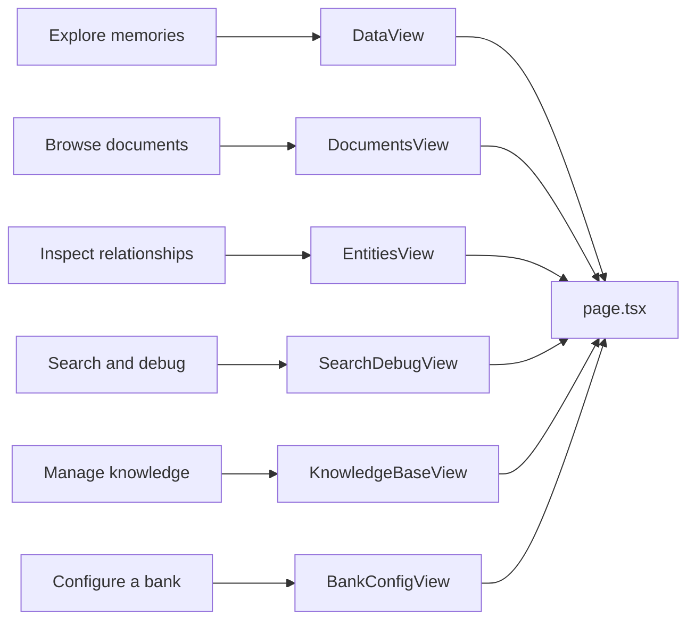
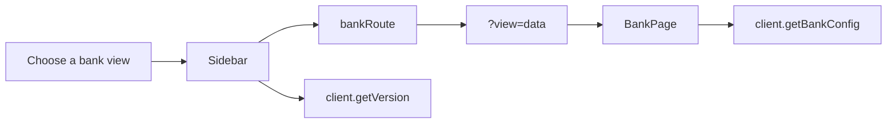

<!-- source: DeepWiki mcp.deepwiki.com · repo vectorize-io/hindsight · page 6 Control Plane UI · fetched 2026-10-27 -->

# Control Plane UI

Relevant source files

The following files were used as context for generating this wiki page:

- [hindsight-control-plane/src/app/[locale]/banks/[bankId]/page.tsx](hindsight-control-plane/src/app/[locale]/banks/[bankId]/page.tsx)
- [hindsight-control-plane/src/components/banks-overview.tsx](hindsight-control-plane/src/components/banks-overview.tsx)
- [hindsight-control-plane/src/components/sidebar.tsx](hindsight-control-plane/src/components/sidebar.tsx)
- [hindsight-control-plane/tests/components/banks-overview.test.tsx](hindsight-control-plane/tests/components/banks-overview.test.tsx)
- [hindsight-control-plane/tests/components/sidebar.test.tsx](hindsight-control-plane/tests/components/sidebar.test.tsx)

## Purpose and scope

The Control Plane is the Next.js web interface for working with Hindsight memory banks. This parent page introduces its main UI areas, how they relate to the Hindsight API, internationalization, and deployment options. For implementation details, see the child pages linked below.

**Sources:** [hindsight-control-plane/src/app/[locale]/banks/[bankId]/page.tsx:1-29]()

---

## Architecture overview

The bank page composes views for memory data, documents, entities, knowledge, recall debugging, and bank configuration. The UI uses a shared API client for operations such as fetching the API version and bank configuration; the sidebar also uses bank context to build bank-specific navigation. The control plane’s API proxy architecture separates browser-facing UI requests from the Hindsight API. For details, see [Overview and Features](#6.1).

**Sources:** [hindsight-control-plane/src/app/[locale]/banks/[bankId]/page.tsx:7-29](), [hindsight-control-plane/src/components/sidebar.tsx:5-7](), [hindsight-control-plane/src/components/sidebar.tsx:24-29](), [hindsight-control-plane/src/components/sidebar.tsx:61-75]()

### UI areas and code entities

The labels in the diagram connect user-facing tasks to the component names imported by the bank page.

**Sources:** [hindsight-control-plane/src/app/[locale]/banks/[bankId]/page.tsx:7-29]()

### Bank navigation and API interaction

The sidebar exposes the main bank views as navigation items, builds bank-specific links with `bankRoute`, and retrieves the API version through `client.getVersion()`. The bank page reads the selected view from URL query parameters and uses the API client to retrieve bank configuration when relevant feature support is enabled.

**Sources:** [hindsight-control-plane/src/components/sidebar.tsx:61-75](), [hindsight-control-plane/src/components/sidebar.tsx:87-104](), [hindsight-control-plane/src/app/[locale]/banks/[bankId]/page.tsx:103-124](), [hindsight-control-plane/src/app/[locale]/banks/[bankId]/page.tsx:140-164]()

---

## Features and navigation

For a selected bank, the sidebar links to home, memories, knowledge, recall, reflect, documents, entities, and bank profile views. The bank page also imports components for operations, mental models, webhooks, audit logs, LLM requests, statistics, and memory-defense settings. Which features are available can depend on API feature flags and resolved bank configuration. For details on capabilities and UI patterns, see [Overview and Features](#6.1).

**Sources:** [hindsight-control-plane/src/components/sidebar.tsx:26-34](), [hindsight-control-plane/src/components/sidebar.tsx:87-96](), [hindsight-control-plane/src/app/[locale]/banks/[bankId]/page.tsx:7-29](), [hindsight-control-plane/src/app/[locale]/banks/[bankId]/page.tsx:124-165]()

### Bank management and visualization

The bank overview supports server-paginated and searchable bank listings, with selection and bulk-delete flows. The bank page also brings together bank profile, configuration, statistics, and feature-specific settings. For details on bank creation, configuration, disposition, mission, statistics, and cloning, see [Bank Management and Visualization](#6.2).

**Sources:** [hindsight-control-plane/src/components/banks-overview.tsx:85-105](), [hindsight-control-plane/src/components/banks-overview.tsx:107-144](), [hindsight-control-plane/src/app/[locale]/banks/[bankId]/page.tsx:16-23]()

### Search debugging and tracing

The bank page includes `SearchDebugView` and `ThinkView`, connecting search and reflect-oriented debugging to the wider bank workspace. For recall traces, relationship visualizations, history diffs, and performance profiling, see [Search Debug and Tracing](#6.3).

**Sources:** [hindsight-control-plane/src/app/[locale]/banks/[bankId]/page.tsx:14-15]()

---

## Internationalization

The UI uses `next-intl` translation hooks in components such as `Sidebar` and `BanksOverview`; navigation labels and accessibility text are obtained from named translation namespaces. The provided code establishes localized UI text, while the broader catalog, locale-routing, and translation-validation details are covered in [Internationalization](#6.4).

**Sources:** [hindsight-control-plane/src/components/sidebar.tsx:5-6](), [hindsight-control-plane/src/components/sidebar.tsx:61-64](), [hindsight-control-plane/src/components/banks-overview.tsx:5-6](), [hindsight-control-plane/tests/components/sidebar.test.tsx:9-10]()

---

## Deployment options

The Control Plane is a separately identifiable application in the Hindsight repository. The project’s deployment choices include Docker, Kubernetes via Helm, and embedded/local use; deployment packaging and operational requirements are outside this parent page’s scope. For details, see [Deployment](#7).

**Sources:** [hindsight-control-plane/package.json:1-90](), [helm/hindsight/Chart.yaml:1-6](), [hindsight-embed/pyproject.toml:1-15]()

---

## Further reading

- [Overview and Features](#6.1) — Bank selector, data and document views, knowledge features, operations, and UI patterns.
- [Bank Management and Visualization](#6.2) — Bank creation and configuration, disposition, mission, statistics, cloning, and selection.
- [Search Debug and Tracing](#6.3) — Recall traces, think view, graph visualization, history diffs, and profiling.
- [Internationalization](#6.4) — Message catalogs, ICU syntax, locale routing, and translation key tests.

**Sources:** [hindsight-control-plane/src/app/[locale]/banks/[bankId]/page.tsx:7-29](), [hindsight-control-plane/src/components/sidebar.tsx:87-96]()

---

