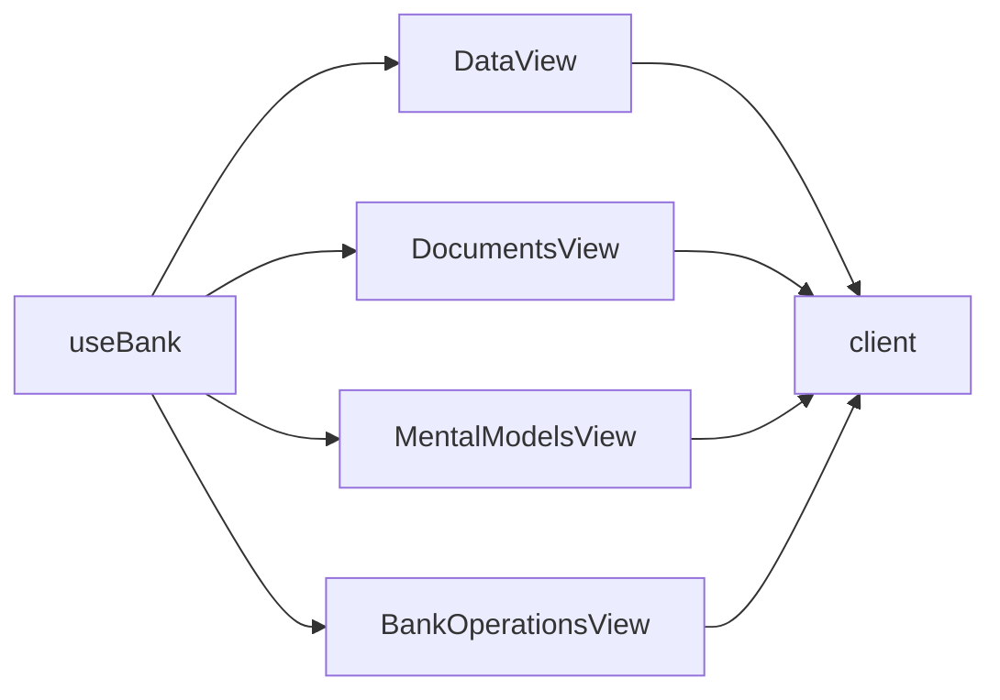
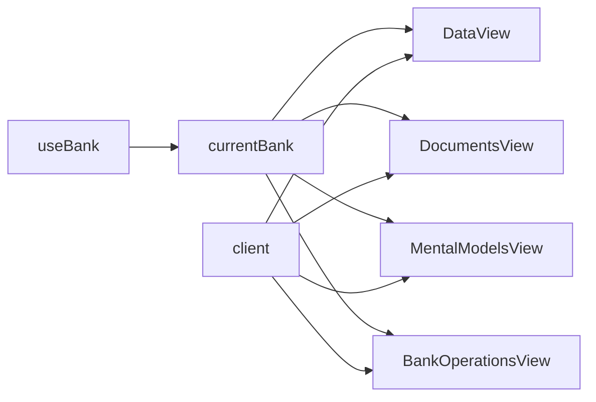
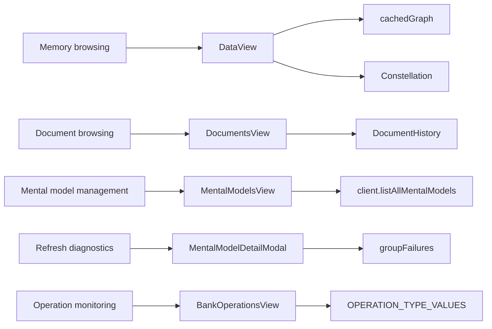

<!-- source: DeepWiki mcp.deepwiki.com · repo vectorize-io/hindsight · page 6.1 Overview and Features · fetched 2026-10-27 -->

# Overview and Features

Relevant source files

The following files were used as context for generating this wiki page:

- [hindsight-clients/go/api_operations.go](hindsight-clients/go/api_operations.go)
- [hindsight-clients/python/hindsight_client_api/api/operations_api.py](hindsight-clients/python/hindsight_client_api/api/operations_api.py)
- [hindsight-control-plane/src/components/bank-operations-view.tsx](hindsight-control-plane/src/components/bank-operations-view.tsx)
- [hindsight-control-plane/src/components/constellation.tsx](hindsight-control-plane/src/components/constellation.tsx)
- [hindsight-control-plane/src/components/data-view.tsx](hindsight-control-plane/src/components/data-view.tsx)
- [hindsight-control-plane/src/components/documents-view.tsx](hindsight-control-plane/src/components/documents-view.tsx)
- [hindsight-control-plane/src/components/mental-model-detail-modal.tsx](hindsight-control-plane/src/components/mental-model-detail-modal.tsx)
- [hindsight-control-plane/src/components/mental-models-view.tsx](hindsight-control-plane/src/components/mental-models-view.tsx)
- [hindsight-control-plane/src/components/search-debug-view.tsx](hindsight-control-plane/src/components/search-debug-view.tsx)

## Purpose and Scope

This page describes the Hindsight Control Plane’s bank-scoped data and memory views, document browsing, mental-model management, operation monitoring, and the UI patterns visible in the supplied component source. It also identifies where the available source excerpts do not show enough implementation detail to document a feature precisely. [hindsight-control-plane/src/components/data-view.tsx:105-126]()

Sources: `[hindsight-control-plane/src/components/data-view.tsx:105-126]()`

---

## Architecture Overview

The documented views are client-side React components. They obtain the selected bank through `useBank`, access backend operations through the shared `client` import, and use component state to manage filters, view modes, loading, and dialogs. The supplied excerpts do not include the API client implementation or the Control Plane’s Next.js proxy routes, so this page does not describe their routing or transport behavior. [hindsight-control-plane/src/components/data-view.tsx:1-21]()[hindsight-control-plane/src/components/documents-view.tsx:1-16]()[hindsight-control-plane/src/components/mental-models-view.tsx:1-15]()[hindsight-control-plane/src/components/bank-operations-view.tsx:1-8]()

### System Architecture Diagram

The diagram reflects component dependencies visible in the supplied excerpts: each listed view imports and uses `useBank`, and each imports the shared `client`. The excerpts do not show the implementation of `client` or establish the details of its backend request path. [hindsight-control-plane/src/components/data-view.tsx:5-15]()[hindsight-control-plane/src/components/documents-view.tsx:6-14]()[hindsight-control-plane/src/components/mental-models-view.tsx:5-9]()[hindsight-control-plane/src/components/bank-operations-view.tsx:6-8]()

Sources: `[hindsight-control-plane/src/components/data-view.tsx:5-15]()` `[hindsight-control-plane/src/components/documents-view.tsx:6-14]()` `[hindsight-control-plane/src/components/mental-models-view.tsx:5-9]()` `[hindsight-control-plane/src/components/bank-operations-view.tsx:6-8]()`

---

## Core Features

### Bank Selector and Bank-Scoped Views

The supplied view components obtain `currentBank` from the `useBank` hook. `DataView` uses that value when it looks up cached graph data, and `MentalModelsView` requires a selected bank before loading its list. `BankOperationsView` likewise reads the selected bank for its operations view. These excerpts show bank-scoped consumers, but do not include the selector component or context implementation, so selector interaction and bank creation behavior are outside the evidence available here. [hindsight-control-plane/src/components/data-view.tsx:115-147]()[hindsight-control-plane/src/components/mental-models-view.tsx:132-140]()[hindsight-control-plane/src/components/mental-models-view.tsx:175-187]()[hindsight-control-plane/src/components/bank-operations-view.tsx:142-149]()

Sources: `[hindsight-control-plane/src/components/data-view.tsx:115-147]()` `[hindsight-control-plane/src/components/mental-models-view.tsx:132-140]()` `[hindsight-control-plane/src/components/mental-models-view.tsx:175-187]()` `[hindsight-control-plane/src/components/bank-operations-view.tsx:142-149]()`

---

### Data Browsing and Memory Views

`DataView` supports three view modes: `table`, `timeline`, and `constellation`. Its `factType` is one of `world`, `experience`, or `observation`. The component initializes its view mode from `localStorage` under `hindsight.memories.viewMode`, defaults to `constellation` when no valid saved value is available, and writes the selected mode back when the user changes it. [hindsight-control-plane/src/components/data-view.tsx:67-82]()[hindsight-control-plane/src/components/data-view.tsx:105-134]()

The view maintains state for search text, tag filters, selected observation scope, pagination, memory detail selection, invalidated-memory display, fetch limit, recency basis, and constellation link-type visibility. Search state and applied filters are kept separately: the source comment explains that this prevents a typed-but-not-applied search from incorrectly changing the empty-bank state. Observation-scope filtering is represented separately from free-form tag filtering. [hindsight-control-plane/src/components/data-view.tsx:149-183]()

The component seeds its initial data from `cachedGraph` using the current bank, fact type, fetch limit, and optional document or chunk identifiers. Graph-related helpers such as `fetchGraph`, `prefetchGraph`, `sameGraph`, and `storeGraph` are imported from `@/lib/graph-cache`; the supplied excerpt does not show the later call sites, so their detailed refresh and caching behavior is not described here. [hindsight-control-plane/src/components/data-view.tsx:5-15]()[hindsight-control-plane/src/components/data-view.tsx:135-149]()

`Constellation` accepts graph data and optional callbacks and functions for node/link styling, node sizing, heat values, clustering, and group membership. Its props support cluster and group-based layouts; `DataView` also tracks observation-scope grouping and visible link types. [hindsight-control-plane/src/components/constellation.tsx:39-99]()[hindsight-control-plane/src/components/data-view.tsx:182-193]()

**Sources:** `[hindsight-control-plane/src/components/data-view.tsx:67-82]()` `[hindsight-control-plane/src/components/data-view.tsx:105-183]()` `[hindsight-control-plane/src/components/constellation.tsx:39-99]()` `[hindsight-control-plane/src/components/data-view.tsx:182-193]()`

---

### Documents View and Processing Status

`DocumentsView` is a bank-scoped document interface that imports `DataView`, `DocumentHistory`, and `TraceDialog` alongside the shared API client. Its state and imports support document listing and detail interactions, but the supplied excerpt does not include the component’s request handlers or render logic; this page therefore avoids specifying undocumented upload formats, processing steps, or document API calls. [hindsight-control-plane/src/components/documents-view.tsx:1-16]()

The excerpt defines two polling intervals: `PENDING_POLL_INTERVAL_MS` is 4 seconds, and `DOCUMENTS_AUTO_REFRESH_MS` is 8 seconds. It also defines a documents-refresh event name and a 250 ms filter debounce interval. The comments describe the 8-second cadence as an idle refresh for the table and the faster cadence as polling for pending uploads; the excerpts do not show the corresponding effect implementations. [hindsight-control-plane/src/components/documents-view.tsx:96-105]()

`LastRefreshedLabel` owns a one-second interval to update its relative-time display without requiring the whole table to re-render. It formats the time using the active locale and `Intl.RelativeTimeFormat`. [hindsight-control-plane/src/components/documents-view.tsx:123-150]()

The document UI imports attachment, metadata, tag, history, upload, and operation-related helpers. The visible code also defines a metadata renderer that displays all metadata entries and a row chip limit of three for the combined tags and metadata list. [hindsight-control-plane/src/components/documents-view.tsx:87-94]()[hindsight-control-plane/src/components/documents-view.tsx:158-190]()

**Sources:** `[hindsight-control-plane/src/components/documents-view.tsx:1-16]()` `[hindsight-control-plane/src/components/documents-view.tsx:87-105]()` `[hindsight-control-plane/src/components/documents-view.tsx:123-150]()` `[hindsight-control-plane/src/components/documents-view.tsx:158-190]()`

---

### Mental Models Management

`MentalModelsView` reads the current bank and maintains list, search, pagination, tag-filter, and dialog state. The component supports a dashboard/files view mode, selection of a mental model, and controls for creating, updating, deleting, and clearing models. It can also hide knowledge pages from the listing. [hindsight-control-plane/src/components/mental-models-view.tsx:130-161]()

`loadData` returns early when no bank is selected. Otherwise, it calls `client.listAllMentalModels` with the current bank, selected tags and match mode, `detail: "content"`, and the knowledge-page exclusion flag. The comments explain that content detail is requested because the view displays content previews, source queries, and triggers, and that the list endpoint may otherwise default to metadata. [hindsight-control-plane/src/components/mental-models-view.tsx:175-189]()

The local search filters loaded models by ID, name, source query, and content. Tag filtering is server-side, while this text search is applied locally. The model’s trigger data includes refresh mode, automatic and scheduled refresh settings, fact-type scope, tag matching, chunk inclusion, token budgets, structured output, and optional trace retention. [hindsight-control-plane/src/components/mental-models-view.tsx:90-128]()[hindsight-control-plane/src/components/mental-models-view.tsx:163-173]()

The view defines a 12-second polling interval for in-flight mental-model refresh attempts and imports helpers for refresh attempts, staleness, freshness, and next-refresh display. The supplied excerpt does not show the polling effect itself. [hindsight-control-plane/src/components/mental-models-view.tsx:63-76]()

`MentalModelDetailModal` includes history and diagnostic UI dependencies. Its history model distinguishes refresh failures from version snapshots, and `groupFailures` combines consecutive failures with the same reason and error message while preserving successful entries as boundaries between failure episodes. [hindsight-control-plane/src/components/mental-model-detail-modal.tsx:100-153]()

**Sources:** `[hindsight-control-plane/src/components/mental-models-view.tsx:63-76]()` `[hindsight-control-plane/src/components/mental-models-view.tsx:90-128]()` `[hindsight-control-plane/src/components/mental-models-view.tsx:130-189]()` `[hindsight-control-plane/src/components/mental-model-detail-modal.tsx:100-153]()`

---

### Directives Management

The supplied mental-model detail component imports `DirectiveDetailModal`, showing that directive details can be presented from that UI surface. The provided excerpts do not include a directives list view, directive CRUD handlers, or priority-ordering logic, so those behaviors cannot be documented here as verified Control Plane implementation details. [hindsight-control-plane/src/components/mental-model-detail-modal.tsx:52-60]()

**Sources:** `[hindsight-control-plane/src/components/mental-model-detail-modal.tsx:52-60]()`

---

### Operations View with Auto-Refresh

`BankOperationsView` maintains operation-list state, total count, status and task-type filters, pagination offset, and separate state for cancellation, retries, deletion, detail loading, and operation dialogs. The operation types represented in its filter include retain, consolidation, mental-model refresh, file conversion and retain, webhook delivery, graph and vector-index maintenance, and bank or document import/export tasks. [hindsight-control-plane/src/components/bank-operations-view.tsx:48-59]()[hindsight-control-plane/src/components/bank-operations-view.tsx:117-165]()

The operation detail shape can include status, operation type, timestamps, retry time, progress, result metadata, per-operation details, child operations, and task payload. The view’s state also supports opening a document-chunk modal. [hindsight-control-plane/src/components/bank-operations-view.tsx:69-115]()[hindsight-control-plane/src/components/bank-operations-view.tsx:142-161]()

The component tracks a local clock once per second so relative “last heartbeat” time advances between data polls. The supplied excerpt does not show the list polling interval or request implementation, so an exact auto-refresh cadence for this view cannot be confirmed from the provided lines. [hindsight-control-plane/src/components/bank-operations-view.tsx:162-165]()

The generated Python `OperationsApi.cancel_operation` method accepts a bank ID and operation ID and calls the generated API client. Its documentation describes pending operations as not yet started and processing operations as cooperatively cancelled; the method returns a `CancelOperationResponse`. [hindsight-clients/python/hindsight_client_api/api/operations_api.py:33-44]()[hindsight-clients/python/hindsight_client_api/api/operations_api.py:46-119]()

**Sources:** `[hindsight-control-plane/src/components/bank-operations-view.tsx:48-59]()` `[hindsight-control-plane/src/components/bank-operations-view.tsx:69-165]()` `[hindsight-clients/python/hindsight_client_api/api/operations_api.py:33-44]()` `[hindsight-clients/python/hindsight_client_api/api/operations_api.py:46-119]()`

---

### Webhook Configuration

The operations view includes `webhook_delivery` as an operation type, so webhook delivery work is represented in the operation-type filter. The supplied files do not include webhook configuration UI or delivery implementation details; URL, secret, subscription, and retry configuration behavior cannot be verified from these excerpts. [hindsight-control-plane/src/components/bank-operations-view.tsx:117-131]()

**Sources:** `[hindsight-control-plane/src/components/bank-operations-view.tsx:117-131]()`

---

## UI Patterns and Technical Details

### Bank-Scoped Component Flow

This diagram maps the visible relationship between bank context, the shared API client, and the principal views covered above. It does not imply a specific proxy route or request protocol, which are not shown in the supplied excerpts. [hindsight-control-plane/src/components/data-view.tsx:5-15]()[hindsight-control-plane/src/components/documents-view.tsx:6-14]()[hindsight-control-plane/src/components/mental-models-view.tsx:5-9]()[hindsight-control-plane/src/components/bank-operations-view.tsx:6-8]()

The component imports establish the shared `client` and `useBank` dependencies. The bank-scoped listing behavior is directly visible for mental models; the diagram shows the views’ context dependency, not every internal request path. [hindsight-control-plane/src/components/data-view.tsx:5-15]()[hindsight-control-plane/src/components/documents-view.tsx:6-14]()[hindsight-control-plane/src/components/mental-models-view.tsx:5-9]()[hindsight-control-plane/src/components/mental-models-view.tsx:175-189]()[hindsight-control-plane/src/components/bank-operations-view.tsx:6-8]()

Sources: `[hindsight-control-plane/src/components/data-view.tsx:5-15]()` `[hindsight-control-plane/src/components/documents-view.tsx:6-14]()` `[hindsight-control-plane/src/components/mental-models-view.tsx:5-9]()` `[hindsight-control-plane/src/components/mental-models-view.tsx:175-189]()` `[hindsight-control-plane/src/components/bank-operations-view.tsx:6-8]()`

---

### Natural-Language Features to Code Entities

The following diagram associates user-facing concepts with concrete component and API symbols present in the supplied code. It is intended as a code-navigation map, not a claim about undocumented backend endpoints. [hindsight-control-plane/src/components/data-view.tsx:105-126]()[hindsight-control-plane/src/components/documents-view.tsx:6-16]()[hindsight-control-plane/src/components/mental-models-view.tsx:132-145]()[hindsight-control-plane/src/components/mental-models-view.tsx:175-189]()[hindsight-control-plane/src/components/bank-operations-view.tsx:117-165]()

`DataView` imports graph-cache helpers and `Constellation`; `MentalModelsView` calls `client.listAllMentalModels`; `MentalModelDetailModal` defines `groupFailures`; and `BankOperationsView` defines its operation-type filter values. [hindsight-control-plane/src/components/data-view.tsx:5-15]()[hindsight-control-plane/src/components/data-view.tsx:60-63]()[hindsight-control-plane/src/components/mental-models-view.tsx:175-189]()[hindsight-control-plane/src/components/mental-model-detail-modal.tsx:131-153]()[hindsight-control-plane/src/components/bank-operations-view.tsx:117-131]()

Sources: `[hindsight-control-plane/src/components/data-view.tsx:5-15]()` `[hindsight-control-plane/src/components/data-view.tsx:60-63]()` `[hindsight-control-plane/src/components/mental-models-view.tsx:175-189]()` `[hindsight-control-plane/src/components/mental-model-detail-modal.tsx:131-153]()` `[hindsight-control-plane/src/components/bank-operations-view.tsx:117-131]()`

---

### UI State, Refresh, and Presentation Patterns

The components use local React state for view mode, filters, pagination, selected records, loading status, and dialogs. `DataView` persists its selected view mode in browser storage; `DocumentsView` separates the lightweight “last refreshed” ticker from table refresh work; and the mental-model detail UI groups repeated refresh failures into episodes for timeline presentation. [hindsight-control-plane/src/components/data-view.tsx:3-4]()[hindsight-control-plane/src/components/data-view.tsx:71-82]()[hindsight-control-plane/src/components/data-view.tsx:126-134]()[hindsight-control-plane/src/components/documents-view.tsx:123-150]()[hindsight-control-plane/src/components/mental-model-detail-modal.tsx:121-153]()

The search-debug component supports results, trace, and JSON display modes, and maintains query, fact-type, budget, token-limit, temporal-window, include-option, tag, result, entity, chunk, observation, and trace state. It formats scores to four significant digits and renders temporal values in UTC, avoiding display precision that the source timestamp does not claim. [hindsight-control-plane/src/components/search-debug-view.tsx:39-53]()[hindsight-control-plane/src/components/search-debug-view.tsx:56-103]()[hindsight-control-plane/src/components/search-debug-view.tsx:109-150]()

Sources: `[hindsight-control-plane/src/components/data-view.tsx:3-4]()` `[hindsight-control-plane/src/components/data-view.tsx:71-82]()` `[hindsight-control-plane/src/components/data-view.tsx:126-134]()` `[hindsight-control-plane/src/components/documents-view.tsx:123-150]()` `[hindsight-control-plane/src/components/mental-model-detail-modal.tsx:121-153]()` `[hindsight-control-plane/src/components/search-debug-view.tsx:39-53]()` `[hindsight-control-plane/src/components/search-debug-view.tsx:56-103]()` `[hindsight-control-plane/src/components/search-debug-view.tsx:109-150]()`

---

