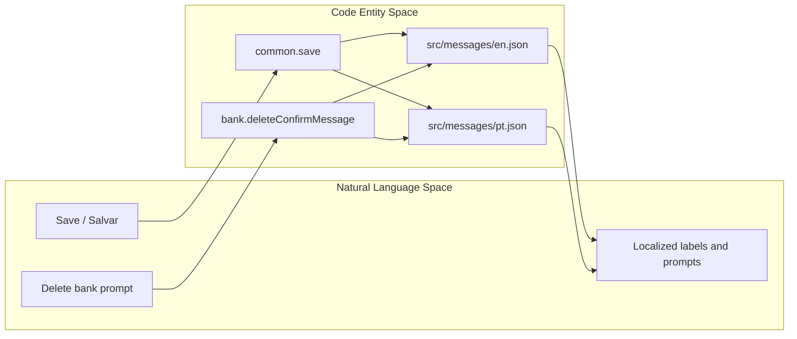
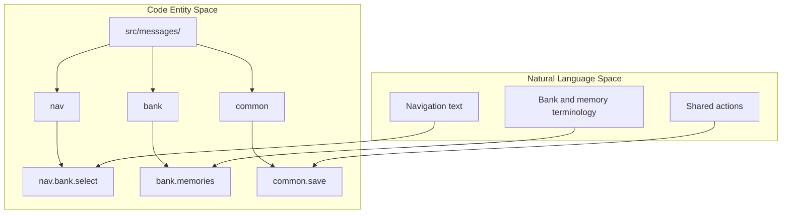

<!-- source: DeepWiki mcp.deepwiki.com · repo vectorize-io/hindsight · page 6.4 Internationalization · fetched 2026-10-27 -->

# Internationalization

Relevant source files

The following files were used as context for generating this wiki page:

- [hindsight-control-plane/src/messages/de.json](hindsight-control-plane/src/messages/de.json)
- [hindsight-control-plane/src/messages/en.json](hindsight-control-plane/src/messages/en.json)
- [hindsight-control-plane/src/messages/es.json](hindsight-control-plane/src/messages/es.json)
- [hindsight-control-plane/src/messages/fr.json](hindsight-control-plane/src/messages/fr.json)
- [hindsight-control-plane/src/messages/ja.json](hindsight-control-plane/src/messages/ja.json)
- [hindsight-control-plane/src/messages/ko.json](hindsight-control-plane/src/messages/ko.json)
- [hindsight-control-plane/src/messages/pt.json](hindsight-control-plane/src/messages/pt.json)
- [hindsight-control-plane/src/messages/yue-Hant.json](hindsight-control-plane/src/messages/yue-Hant.json)
- [hindsight-control-plane/src/messages/zh-CN.json](hindsight-control-plane/src/messages/zh-CN.json)
- [hindsight-control-plane/src/messages/zh-TW.json](hindsight-control-plane/src/messages/zh-TW.json)

## 6.4.1 Purpose and Scope

This page documents the Control Plane’s translation catalogs and the message patterns visible in the provided catalog files. It covers locale files, nested message namespaces, interpolation and pluralization examples, and what can—and cannot—be established about locale routing and key-parity tests from those files. The catalogs alone do not identify the routing implementation, translation library, fallback behavior, or test commands. [hindsight-control-plane/src/messages/en.json:1-150]()

Sources: `hindsight-control-plane/src/messages/en.json`

## 6.4.2 Message Catalogs Location and Structure

### Directory and Locale Coverage

The message catalogs are JSON files under `hindsight-control-plane/src/messages`. The provided files identify ten locales:

| Locale file | Locale |
|---|---|
| `en.json` | English |
| `de.json` | German |
| `es.json` | Spanish |
| `fr.json` | French |
| `ja.json` | Japanese |
| `ko.json` | Korean |
| `pt.json` | Portuguese |
| `zh-CN.json` | Simplified Chinese |
| `zh-TW.json` | Traditional Chinese |
| `yue-Hant.json` | Traditional Cantonese |

Each supplied catalog begins with a JSON object containing nested message groups and string values. For example, `common.save`, `nav.bank.select`, and `bank.deleteConfirmMessage` are represented by nested objects rather than flat dotted keys. [hindsight-control-plane/src/messages/en.json:1-68]()

Sources: `hindsight-control-plane/src/messages/en.json`, `hindsight-control-plane/src/messages/de.json`, `hindsight-control-plane/src/messages/es.json`, `hindsight-control-plane/src/messages/fr.json`, `hindsight-control-plane/src/messages/ja.json`, `hindsight-control-plane/src/messages/ko.json`, `hindsight-control-plane/src/messages/pt.json`, `hindsight-control-plane/src/messages/zh-CN.json`, `hindsight-control-plane/src/messages/zh-TW.json`, `hindsight-control-plane/src/messages/yue-Hant.json`

### Namespace Organization

The visible catalogs organize messages into top-level namespaces such as `common`, `nav`, and `bank`. These groupings distinguish shared interface text, navigation text, and bank-related interface text. Nested objects provide additional grouping; for example, `nav.bank` contains bank-selector messages, while `bank.sidebar` groups sidebar labels in the supplied Japanese catalog. [hindsight-control-plane/src/messages/en.json:2-68](), [hindsight-control-plane/src/messages/ja.json:139-152]()

The `bank` catalog includes labels and descriptions for concepts such as memories, observations, mental models, documents, entities, webhooks, and bank configuration. These names make the catalogs useful for locating UI terminology associated with those features. The supplied files do not establish that the namespace hierarchy mirrors backend configuration schemas, so that relationship should not be assumed from the catalogs alone. [hindsight-control-plane/src/messages/en.json:66-105]()

Sources: `hindsight-control-plane/src/messages/en.json`, `hindsight-control-plane/src/messages/ja.json`

## 6.4.3 ICU Message Syntax for Interpolation and Pluralization

Catalog strings use brace-delimited placeholders for dynamic values. For example, English messages include `{bankName}` in bank confirmation text and `{tag}` in a shared tag-removal label. The Portuguese catalog also uses `{bankName}` in bank-related messages. [hindsight-control-plane/src/messages/en.json:37-39](), [hindsight-control-plane/src/messages/en.json:105-115](), [hindsight-control-plane/src/messages/pt.json:37-39]()

Pluralization is visible in strings using the form `{count, plural, ...}`. The English `bank.recoveredMemories` message includes `one` and `other` branches; the Portuguese version likewise branches on `one` and `other`, with `#` representing the count within the selected branch. [hindsight-control-plane/src/messages/en.json:134-136](), [hindsight-control-plane/src/messages/pt.json:133-136]()

The Simplified Chinese catalog also includes plural expressions, including `other` branches for deletion summaries and observation counts. This demonstrates that plural syntax is present in catalogs beyond English, though the available files do not identify the formatter or its exact runtime behavior. [hindsight-control-plane/src/messages/zh-CN.json:155-168]()

Sources: `hindsight-control-plane/src/messages/en.json`, `hindsight-control-plane/src/messages/pt.json`, `hindsight-control-plane/src/messages/zh-CN.json`

## 6.4.4 Locale Routing and Language Selection

The supplied catalogs include a `common.changeLanguage` label in several locales, including English, Portuguese, Japanese, and Korean. This establishes that the UI has localized text for a language-change action, but does not show which component presents it or how a selection is stored or applied. [hindsight-control-plane/src/messages/en.json:23-29](), [hindsight-control-plane/src/messages/pt.json:23-29](), [hindsight-control-plane/src/messages/ja.json:23-29](), [hindsight-control-plane/src/messages/ko.json:23-29]()

The catalog filenames provide locale identifiers, but the provided file contents do not show Next.js route configuration, locale detection, provider setup, translation hooks, or fallback rules. Those implementation details cannot be documented reliably from these files alone. [hindsight-control-plane/src/messages/en.json:1-2](), [hindsight-control-plane/src/messages/zh-CN.json:1-2](), [hindsight-control-plane/src/messages/yue-Hant.json:1-2]()

Sources: `hindsight-control-plane/src/messages/en.json`, `hindsight-control-plane/src/messages/pt.json`, `hindsight-control-plane/src/messages/ja.json`, `hindsight-control-plane/src/messages/ko.json`, `hindsight-control-plane/src/messages/zh-CN.json`, `hindsight-control-plane/src/messages/yue-Hant.json`

## 6.4.5 Key-Parity and Validation Tests

The supplied catalog files show corresponding top-level namespaces and several matching message keys across locales. For example, the visible portions of the English and Portuguese catalogs both contain `common.save`, `common.cancel`, `nav.bank.select`, and `bank.deleteConfirmMessage`. [hindsight-control-plane/src/messages/en.json:2-68](), [hindsight-control-plane/src/messages/pt.json:2-68]()

The provided materials do not include test files or scripts. They therefore do not establish whether key parity is checked automatically, which catalog is treated as canonical, whether extra keys are allowed, or how validation is run. A parity test should be documented only after inspecting the corresponding test or package configuration. [hindsight-control-plane/src/messages/en.json:1-68](), [hindsight-control-plane/src/messages/pt.json:1-68]()

Sources: `hindsight-control-plane/src/messages/en.json`, `hindsight-control-plane/src/messages/pt.json`

## 6.4.6 Data Flow and Catalog-to-Interface Relationship

The catalogs provide locale-specific text organized under nested keys. The visible examples show reusable interface labels in `common`, navigation labels in `nav`, and bank-related labels and messages in `bank`. The supplied files do not reveal the runtime code that loads these catalogs or resolves a key for a component. [hindsight-control-plane/src/messages/en.json:2-68]()

### Diagram: Localized Interface Terms and Catalog Keys

The diagram maps visible natural-language examples to catalog entities: `common.save` has English and Portuguese values, and `bank.deleteConfirmMessage` has a `{bankName}` placeholder in both catalogs. It does not imply a particular loading, routing, or component-call implementation. [hindsight-control-plane/src/messages/en.json:2-5](), [hindsight-control-plane/src/messages/en.json:105-108](), [hindsight-control-plane/src/messages/pt.json:2-5](), [hindsight-control-plane/src/messages/pt.json:105-108]()

Sources: `hindsight-control-plane/src/messages/en.json`, `hindsight-control-plane/src/messages/pt.json`

### Diagram: Catalog Namespaces and UI Concepts

This mapping describes the visible structure of the JSON catalogs: `common.save`, `nav.bank.select`, and `bank.memories` are concrete keys corresponding to the English interface strings shown in the catalog. [hindsight-control-plane/src/messages/en.json:2-5](), [hindsight-control-plane/src/messages/en.json:46-64](), [hindsight-control-plane/src/messages/en.json:91-105]()

Sources: `hindsight-control-plane/src/messages/en.json`

## 6.4.7 Backend Configuration and UI Vocabulary

The catalogs contain bank-oriented UI vocabulary, including configuration labels, operation descriptions, and terminology for observations, mental models, documents, and entities. For example, `bank.bankConfiguration` labels the configuration view, while `bank.observationsDescription` describes observations as consolidated knowledge synthesized from facts. [hindsight-control-plane/src/messages/en.json:66-105]()

These strings document how the UI presents backend-related concepts to users. The supplied catalogs do not establish a one-to-one mapping between message namespaces and backend schema objects; confirm that relationship against the relevant configuration schemas and UI implementation before relying on it. [hindsight-control-plane/src/messages/en.json:66-105]()

Sources: `hindsight-control-plane/src/messages/en.json`

## 6.4.8 Examples of Message Keys and Context

| Message key | Visible use | English catalog value |
|---|---|---|
| `common.save` | Shared action label | `Save` |
| `nav.bank.select` | Memory-bank selector prompt | `Select a memory bank...` |
| `bank.deleteConfirmMessage` | Bank deletion confirmation with interpolation | `Are you absolutely sure you want to delete {bankName}?` |
| `bank.recoveredMemories` | Recovery status with pluralization | `Recovered {count} failed {count, plural, one {memory} other {memories}} for re-consolidation` |

These keys and values appear in the supplied English catalog. [hindsight-control-plane/src/messages/en.json:2-5](), [hindsight-control-plane/src/messages/en.json:50-61](), [hindsight-control-plane/src/messages/en.json:105-108](), [hindsight-control-plane/src/messages/en.json:134-136]()

Sources: `hindsight-control-plane/src/messages/en.json`

## Summary

The supplied Control Plane catalogs establish that translations are stored as nested JSON message objects under `hindsight-control-plane/src/messages`, with ten locale files represented in the provided materials. The visible message strings include variable interpolation and ICU-style plural expressions, and the namespaces include `common`, `nav`, and `bank`. [hindsight-control-plane/src/messages/en.json:1-68](), [hindsight-control-plane/src/messages/pt.json:1-68](), [hindsight-control-plane/src/messages/zh-CN.json:155-168]()

The catalog files do not, by themselves, establish locale routing mechanics, runtime translation APIs, fallback behavior, backend-schema mirroring, or key-parity tests. Those implementation details require evidence from the relevant application and test files. [hindsight-control-plane/src/messages/en.json:1-68]()

Sources: `hindsight-control-plane/src/messages/en.json`, `hindsight-control-plane/src/messages/pt.json`, `hindsight-control-plane/src/messages/zh-CN.json`

---

