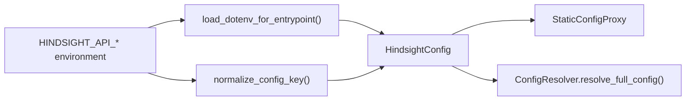
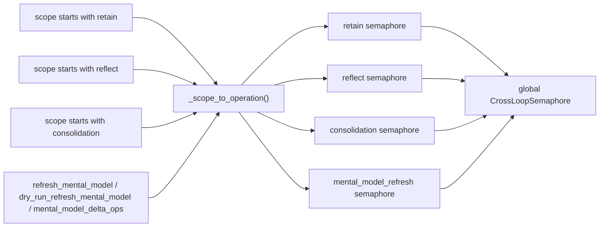
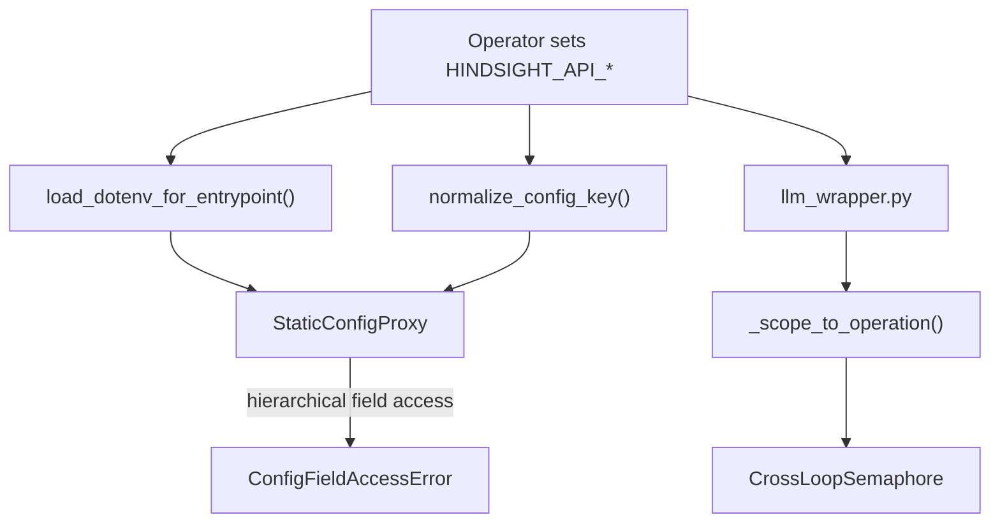
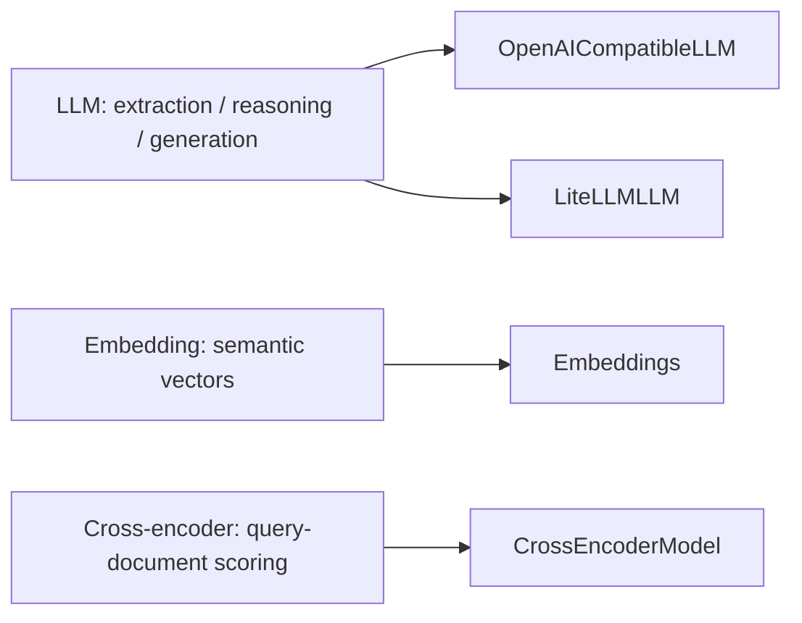

<!-- source: DeepWiki mcp.deepwiki.com · repo vectorize-io/hindsight · page 7.3 Configuration Reference · fetched 2026-10-27 -->

# Configuration Reference

Relevant source files

The following files were used as context for generating this wiki page:

- [.env.example](.env.example)
- [hindsight-api-slim/hindsight_api/config.py](hindsight-api-slim/hindsight_api/config.py)
- [hindsight-api-slim/hindsight_api/engine/cross_encoder.py](hindsight-api-slim/hindsight_api/engine/cross_encoder.py)
- [hindsight-api-slim/hindsight_api/engine/embeddings.py](hindsight-api-slim/hindsight_api/engine/embeddings.py)
- [hindsight-api-slim/hindsight_api/engine/llm_wrapper.py](hindsight-api-slim/hindsight_api/engine/llm_wrapper.py)
- [hindsight-api-slim/hindsight_api/engine/providers/litellm_llm.py](hindsight-api-slim/hindsight_api/engine/providers/litellm_llm.py)
- [hindsight-api-slim/hindsight_api/engine/providers/openai_compatible_llm.py](hindsight-api-slim/hindsight_api/engine/providers/openai_compatible_llm.py)
- [hindsight-api-slim/tests/test_litellm_sdk_embeddings.py](hindsight-api-slim/tests/test_litellm_sdk_embeddings.py)
- [hindsight-api-slim/tests/test_openai_compatible_response_hardening.py](hindsight-api-slim/tests/test_openai_compatible_response_hardening.py)
- [hindsight-docs/docs/developer/configuration.mdx](hindsight-docs/docs/developer/configuration.mdx)
- [hindsight-docs/docs/developer/models.mdx](hindsight-docs/docs/developer/models.mdx)
- [hindsight-docs/src/data/llmProviders.json](hindsight-docs/src/data/llmProviders.json)
- [hindsight-embed/hindsight_embed/env.example](hindsight-embed/hindsight_embed/env.example)
- [skills/hindsight-docs/references/developer/configuration.md](skills/hindsight-docs/references/developer/configuration.md)
- [skills/hindsight-docs/references/developer/models.md](skills/hindsight-docs/references/developer/models.md)
- [skills/hindsight-docs/references/faq.md](skills/hindsight-docs/references/faq.md)

## Purpose and scope

This page describes the configuration surfaces visible in the supplied reference material: the `HINDSIGHT_API_*` namespace for the API service, the `HINDSIGHT_CP_*` namespace for the control plane, and the available settings for database connectivity, LLM calls, embeddings, reranking, and configuration resolution. The API handles memory operations; the control plane is the web UI service. [skills/hindsight-docs/references/developer/configuration.md:4-20]()

The API’s centralized configuration module defines environment-variable names and configuration behavior. The reference material provided for this page includes only the opening portion of that module and of the environment-variable reference; consequently, tables below list only settings whose names or behavior are visible in the supplied content. [hindsight-api-slim/hindsight_api/config.py:1-5](), [skills/hindsight-docs/references/developer/configuration.md:19-30]()

Sources: [skills/hindsight-docs/references/developer/configuration.md:4-20](), [hindsight-api-slim/hindsight_api/config.py:1-5]()

---

## Overview

Hindsight has two documented service configuration prefixes:

| Service | Prefix | Role |
|---|---|---|
| API service | `HINDSIGHT_API_*` | Core memory engine and memory operations |
| Control plane | `HINDSIGHT_CP_*` | Web UI |

[skills/hindsight-docs/references/developer/configuration.md:6-20]()

API settings are centralized in `hindsight_api.config`. The module defines environment-variable constants, configuration field markers, and a `StaticConfigProxy`. The proxy rejects access to bank-configurable fields through the global configuration object, directing callers to resolve configuration for a bank instead. [hindsight-api-slim/hindsight_api/config.py:1-5](), [hindsight-api-slim/hindsight_api/config.py:56-90]()

Sources: [skills/hindsight-docs/references/developer/configuration.md:6-20](), [hindsight-api-slim/hindsight_api/config.py:1-5](), [hindsight-api-slim/hindsight_api/config.py:56-90]()

### Configuration entry points and data flow

The API configuration module documents an explicit `.env` loading path for Hindsight’s own standalone entry points. `load_dotenv_for_entrypoint()` discovers a `.env` file from the current working directory, loads it with `override=True`, and clears the configuration cache so later reads rebuild against the updated environment. Importing the library alone does not execute this helper. [hindsight-api-slim/hindsight_api/config.py:27-53]()

Environment-variable keys can be normalized to Python field names: `normalize_config_key()` strips the `HINDSIGHT_API_` prefix when present and lowercases the result. The configuration module also supports normalizing dictionaries whose keys are either environment-variable names or Python field names. [hindsight-api-slim/hindsight_api/config.py:114-149]()

**Diagram: Environment values to configuration access**

Sources: [hindsight-api-slim/hindsight_api/config.py:27-53](), [hindsight-api-slim/hindsight_api/config.py:56-90](), [hindsight-api-slim/hindsight_api/config.py:114-149]()

### Static and hierarchical fields

The configuration module distinguishes hierarchical fields from static fields. `hierarchical()` marks a field as eligible for tenant- or bank-level overrides; `static()` marks a field as server-level only. `StaticConfigProxy` checks the configurable-field set and raises `ConfigFieldAccessError` when code accesses a hierarchical field through the global proxy. [hindsight-api-slim/hindsight_api/config.py:56-111]()

| Field category | Marker | Intended scope |
|---|---|---|
| Hierarchical | `hierarchical(default_value)` | May be overridden at tenant or bank level |
| Static | `static(default_value)` | Server-level setting; not configurable per tenant or bank |

[hindsight-api-slim/hindsight_api/config.py:93-111]()

The supplied materials identify `ConfigResolver.resolve_full_config()` as the intended route for obtaining bank-specific configuration, but do not include the resolver implementation. Details of its merge order and tenant-extension behavior are therefore not specified here. [hindsight-api-slim/hindsight_api/config.py:74-84]()

Sources: [hindsight-api-slim/hindsight_api/config.py:56-111]()

---

## Environment Variables Reference

### API service: database

The database settings below are documented for `HINDSIGHT_API_*`. PostgreSQL is the default backend. If no database URL is supplied, the documented default is embedded `pg0`; the reference recommends against using embedded mode for production. [skills/hindsight-docs/references/developer/configuration.md:19-37]()

| Variable | Description | Default or fallback |
|---|---|---|
| `HINDSIGHT_API_DATABASE_URL` | PostgreSQL connection string. The documented default is embedded `pg0`. | `pg0` |
| `HINDSIGHT_API_READ_DATABASE_URL` | Optional read-replica URL. When set, recall queries for semantic, BM25, graph, and temporal retrieval use a separate connection pool. | Unset; uses primary |
| `HINDSIGHT_API_MIGRATION_DATABASE_URL` | Direct URL for migrations, bypassing connection poolers. | Falls back to `DATABASE_URL` |
| `HINDSIGHT_API_DATABASE_SCHEMA` | PostgreSQL schema used for tables. Migrations create the schema if it does not exist. | `public` |
| `HINDSIGHT_API_RUN_MIGRATIONS_ON_STARTUP` | Whether migrations run when the API starts. | `true` |
| `HINDSIGHT_API_MIGRATION_ISOLATION` | Whether migrations run in a subprocess rather than in the calling process. | `false` |
| `HINDSIGHT_API_MIGRATION_CONCURRENCY` | Number of tenant schemas migrated concurrently on PostgreSQL. Migrations within one schema remain sequential. | `1` |
| `HINDSIGHT_API_EXTERNALLY_OWNED_ROUTINES` | Comma-separated list of maintenance discovery routines managed by the deployment; migrations skip listed routines. | Empty |
| `HINDSIGHT_API_DATABASE_BACKEND` | Database engine backend: `postgresql` or `oracle` (Oracle 23ai). | `postgresql` |

[skills/hindsight-docs/references/developer/configuration.md:19-37]()

For embedded `pg0`, PostgreSQL parameters can be appended as a query string to the URL; changes take effect when the embedded database starts, so a restart is required. Oracle configuration uses the `oracle` backend and an `oracle+oracledb://…` URL. [skills/hindsight-docs/references/developer/configuration.md:33-38]()

The concurrency setting is intended for installations with many schemas or slow migrations. Each migration worker uses approximately three database connections; the documented guidance is to keep `concurrency × 3` within spare database connections and any pooler limit. [skills/hindsight-docs/references/developer/configuration.md:27-30]()

Sources: [skills/hindsight-docs/references/developer/configuration.md:19-38]()

#### Externally owned maintenance routines

The documented maintenance discovery routines are `mental_models_with_cron`, `banks_needing_consolidation`, `schemas_with_expired_rows`, and `schemas_with_expired_operations`. Deployments may replace a stock routine and list its name in `HINDSIGHT_API_EXTERNALLY_OWNED_ROUTINES` so migrations leave it in place. A replacement must match the stock signature; the setting does not verify that the replacement exists. [skills/hindsight-docs/references/developer/configuration.md:52-86]()

Sources: [skills/hindsight-docs/references/developer/configuration.md:52-86]()

### API service: database connection pools

| Variable | Description | Default or fallback |
|---|---|---|
| `HINDSIGHT_API_DB_POOL_MIN_SIZE` | Minimum connections in the primary pool. | `5` |
| `HINDSIGHT_API_DB_POOL_MAX_SIZE` | Maximum connections in the primary pool. | `100` |
| `HINDSIGHT_API_READ_DB_POOL_MIN_SIZE` | Minimum connections in the read-replica pool; applies only when a read URL is set. | Falls back to `DB_POOL_MIN_SIZE` |
| `HINDSIGHT_API_READ_DB_POOL_MAX_SIZE` | Maximum connections in the read-replica pool; applies only when a read URL is set. | Falls back to `DB_POOL_MAX_SIZE` |
| `HINDSIGHT_API_DB_COMMAND_TIMEOUT` | Asyncpg client-side PostgreSQL command timeout, in seconds. | `60` |
| `HINDSIGHT_API_DB_ACQUIRE_TIMEOUT` | Maximum time waiting for a pool connection; `0` waits indefinitely. | `30` |
| `HINDSIGHT_API_DB_POOL_SLOW_ACQUIRE_THRESHOLD_SECONDS` | Logs a slow-acquire warning when connection acquisition exceeds this duration; `0` disables the warning. | `0.05` |

[skills/hindsight-docs/references/developer/configuration.md:88-98]()

Sources: [skills/hindsight-docs/references/developer/configuration.md:88-98]()

### API service: LLM provider and shared controls

The example environment file documents `openai` as the example provider and `gpt-4o-mini` as the example model. It also lists supported provider names in its comments. Provider-specific availability and setup details are described in the model reference. [`.env.example:4-9](), [skills/hindsight-docs/references/developer/models.md:16-61]()

| Variable | Documented role |
|---|---|
| `HINDSIGHT_API_LLM_PROVIDER` | Selects the LLM provider. The example sets it to `openai`. |
| `HINDSIGHT_API_LLM_API_KEY` | Provider credential; the example uses a placeholder value. |
| `HINDSIGHT_API_LLM_MODEL` | Model identifier; the example sets `gpt-4o-mini`. |
| `HINDSIGHT_API_LLM_BASE_URL` | Optional endpoint override for compatible services. |
| `HINDSIGHT_API_LLM_REASONING_EFFORT` | Optional reasoning-effort value for models/providers that support it. When unset, no reasoning parameter is sent. |
| `HINDSIGHT_API_LLM_CONNECT_TIMEOUT` | Caps the connection phase; `0` disables the cap. Other transport phases retain the full LLM timeout budget. |
| `HINDSIGHT_API_LLM_HTTP_LOG_LEVEL` | Sets logging verbosity for `httpx`/`httpcore`; `DEBUG` exposes transport-phase details. |
| `HINDSIGHT_API_LLM_SUPPORTS_MAX_ITEMS` | Indicates whether the backend supports JSON Schema `maxItems`. |
| `HINDSIGHT_API_LLM_OPENAI_COMPATIBLE_JSON_MODE` | Overrides whether the backend honors `response_format: json_object`; an unset value lets provider behavior decide. |
| `HINDSIGHT_API_LLM_SUPPORTS_STRING_PATTERN` | Enables the JSON Schema string pattern used to constrain retain timestamps. |
| `HINDSIGHT_API_LLM_STRUCTURED_OUTPUT_FORCED_TOOL` | Requests structured output through a forced tool call instead of `response_format` for backends that require that path. |
| `HINDSIGHT_API_LLM_DEBUG_DUMP_4XX` | Enables diagnostic request logging on LLM 4xx responses; off by default. |

[`.env.example:4-9](), [`.env.example:19-23](), [`.env.example:48-72](), [`.env.example:99-115]()

#### Temperature and strict-schema precedence

The example configuration documents a global temperature override and operation-specific overrides. Temperatures may be numeric values from `0.0` through `2.0`, or `none` to omit the parameter. The documented operation defaults are verification `0.0`, retain `0.1`, reflect `0.9`, and consolidation `0.0`; mental-model refresh follows consolidation unless it has its own override. [`.env.example:25-36]()

| Variable | Scope |
|---|---|
| `HINDSIGHT_API_LLM_TEMPERATURE` | Global temperature override. |
| `HINDSIGHT_API_LLM_TEMPERATURE_VERIFICATION` | Verification calls. |
| `HINDSIGHT_API_LLM_TEMPERATURE_RETAIN` | Retain calls. |
| `HINDSIGHT_API_LLM_TEMPERATURE_REFLECT` | Reflect calls. |
| `HINDSIGHT_API_LLM_TEMPERATURE_CONSOLIDATION` | Consolidation calls. |
| `HINDSIGHT_API_LLM_TEMPERATURE_MENTAL_MODEL_REFRESH` | Mental-model refresh calls. |

[`.env.example:25-36]()

Strict-schema settings have a global switch and operation-specific overrides. The examples state that per-operation values take precedence in either direction, so an operation can opt out while the global setting is enabled. [`.env.example:38-46]()

| Variable | Scope |
|---|---|
| `HINDSIGHT_API_LLM_STRICT_SCHEMA` | Global structured-output mode. |
| `HINDSIGHT_API_LLM_STRICT_SCHEMA_RETAIN` | Retain override. |
| `HINDSIGHT_API_LLM_STRICT_SCHEMA_REFLECT` | Reflect override. |
| `HINDSIGHT_API_LLM_STRICT_SCHEMA_CONSOLIDATION` | Consolidation override. |

[`.env.example:38-46]()` 

Sources: [`.env.example:19-23](), [`.env.example:25-46](), [`.env.example:48-72](), [`.env.example:99-115]()

### Per-operation LLM settings

Operation-specific settings let selected operations use dedicated LLM configuration. The example file explicitly documents a separate mental-model-refresh group: each field falls back to its `REFLECT_LLM_*` counterpart, then to the global `LLM_*` setting, except refresh timeout, which falls back to global `LLM_TIMEOUT` rather than `REFLECT_LLM_TIMEOUT`. [`.env.example:87-97]()

The `llm_wrapper` module creates a process-wide concurrency semaphore from `llm_max_concurrent`. It also builds optional operation-specific semaphores for retain, reflect, consolidation, and mental-model refresh. A call in a configured operation bucket must acquire both its operation semaphore and the global semaphore. [hindsight-api-slim/hindsight_api/engine/llm_wrapper.py:59-105]()

| Variable family or variable | Documented behavior |
|---|---|
| `HINDSIGHT_API_LLM_MAX_CONCURRENT` | Global maximum concurrent LLM requests; the wrapper uses it to create a process-wide `CrossLoopSemaphore`. |
| `HINDSIGHT_API_RETAIN_LLM_MAX_CONCURRENT` | Optional retain concurrency cap. |
| `HINDSIGHT_API_REFLECT_LLM_MAX_CONCURRENT` | Optional reflect concurrency cap. |
| `HINDSIGHT_API_CONSOLIDATION_LLM_MAX_CONCURRENT` | Optional consolidation concurrency cap. |
| `HINDSIGHT_API_MENTAL_MODEL_REFRESH_LLM_MAX_CONCURRENT` | Optional mental-model-refresh concurrency cap. |
| `HINDSIGHT_API_MENTAL_MODEL_REFRESH_LLM_PROVIDER` | Example of a dedicated refresh provider. |
| `HINDSIGHT_API_MENTAL_MODEL_REFRESH_LLM_MODEL` | Example of a dedicated refresh model. |
| `HINDSIGHT_API_MENTAL_MODEL_REFRESH_LLM_TIMEOUT` | Example refresh timeout; falls back to global LLM timeout if unset. |

[`.env.example:87-97](), [hindsight-api-slim/hindsight_api/engine/llm_wrapper.py:59-105]()

`_scope_to_operation()` maps scopes beginning with `retain`, `reflect`, or `consolidation` to their operation buckets. Mental-model-refresh scopes are grouped separately, including refresh, dry-run refresh, and delta-operation scopes. [hindsight-api-slim/hindsight_api/engine/llm_wrapper.py:107-134]()

**Diagram: Operation names mapped to wrapper concurrency buckets**

Sources: [hindsight-api-slim/hindsight_api/engine/llm_wrapper.py:59-105](), [hindsight-api-slim/hindsight_api/engine/llm_wrapper.py:107-158]()

### Prompt-cache affinity and reflect output limit

`HINDSIGHT_API_LLM_CACHE_AFFINITY` accepts `auto`, `xai_conv_id`, `openai_prompt_cache_key`, or `none`. The example describes `auto` as host-based selection for supported xAI and OpenAI endpoints, and shows operation-specific overrides for retain, reflect, and consolidation. [`.env.example:74-85]()

`HINDSIGHT_API_REFLECT_MAX_COMPLETION_TOKENS` is an optional transport-level cap for reflect’s final synthesis call. The example describes it as unset by default and cautions that a hard cap can truncate visible output when reasoning tokens consume the generation budget. [`.env.example:105-110]()

Sources: [`.env.example:74-85](), [`.env.example:105-110]()

### LLM provider adapters

The model reference lists provider families including OpenAI, OpenAI Responses, Anthropic, Gemini, Vertex AI, Groq, Ollama, LM Studio, llama.cpp, LiteLLM, and others. OpenAI-compatible services can be configured with `HINDSIGHT_API_LLM_PROVIDER=openai` and a base URL for the compatible endpoint. The `openai` provider uses Chat Completions; `openai-responses` selects the Responses API. [skills/hindsight-docs/references/developer/models.md:16-61]()

`OpenAICompatibleLLM` supports OpenAI-compatible APIs and provider-specific handling. The implementation imports configuration access, cache-affinity helpers, transport utilities, retry handling, and structured-output helpers. [hindsight-api-slim/hindsight_api/engine/providers/openai_compatible_llm.py:1-20](), [hindsight-api-slim/hindsight_api/engine/providers/openai_compatible_llm.py:34-68]()

`LiteLLMLLM` provides an alternative adapter for models accessible through `litellm.acompletion()`, using provider-prefixed model names and LiteLLM’s credential handling. [hindsight-api-slim/hindsight_api/engine/providers/litellm_llm.py:1-12](), [hindsight-api-slim/hindsight_api/engine/providers/litellm_llm.py:144-180]()

Sources: [skills/hindsight-docs/references/developer/models.md:16-61](), [hindsight-api-slim/hindsight_api/engine/providers/openai_compatible_llm.py:1-20](), [hindsight-api-slim/hindsight_api/engine/providers/litellm_llm.py:1-12](), [hindsight-api-slim/hindsight_api/engine/providers/litellm_llm.py:144-180]()

### Embedding providers

Embeddings produce vector representations used for semantic search. The model reference gives `BAAI/bge-small-en-v1.5` as the default embedding model and says embedding and cross-encoder models are downloaded automatically from HuggingFace on first run. [skills/hindsight-docs/references/developer/models.md:6-12]()

`Embeddings` is an abstract provider interface with `provider_name`, `dimension`, `initialize()`, and `encode()` operations. Its documentation states that the embedding dimension is detected from the model at initialization and that the database schema is adjusted to match that dimension. [hindsight-api-slim/hindsight_api/engine/embeddings.py:146-187]()

Visible embedding configuration constants include provider selection and settings for Cohere, Gemini, LiteLLM, NVIDIA, OpenAI, TEI, and ZeroEntropy. The supplied code excerpt identifies these names as configuration inputs but does not show the complete variable inventory or provider selection implementation. [hindsight-api-slim/hindsight_api/engine/embeddings.py:30-64]()

| Visible environment-variable name | Purpose indicated by its identifier |
|---|---|
| `HINDSIGHT_API_EMBEDDINGS_PROVIDER` | Selects an embeddings provider. |
| `HINDSIGHT_API_EMBEDDINGS_COHERE_API_KEY` | Cohere credential. |
| `HINDSIGHT_API_EMBEDDINGS_GEMINI_API_KEY` | Gemini credential. |
| `HINDSIGHT_API_EMBEDDINGS_LITELLM_DIMENSIONS` | LiteLLM embedding dimensions. |
| `HINDSIGHT_API_EMBEDDINGS_NVIDIA_API_KEY` | NVIDIA credential. |
| `HINDSIGHT_API_EMBEDDINGS_OPENAI_API_KEY` | OpenAI credential. |
| `HINDSIGHT_API_EMBEDDINGS_TEI_URL` | TEI service URL. |
| `HINDSIGHT_API_EMBEDDINGS_ZEROENTROPY_API_KEY` | ZeroEntropy credential. |
| `HINDSIGHT_API_EMBEDDINGS_ZEROENTROPY_DIMENSIONS` | ZeroEntropy embedding dimensions. |
| `HINDSIGHT_API_EMBEDDINGS_ZEROENTROPY_ENCODING_FORMAT` | ZeroEntropy encoding format. |

[hindsight-api-slim/hindsight_api/engine/embeddings.py:30-64]()

Sources: [skills/hindsight-docs/references/developer/models.md:6-12](), [hindsight-api-slim/hindsight_api/engine/embeddings.py:30-64](), [hindsight-api-slim/hindsight_api/engine/embeddings.py:146-187]()

### Reranker providers

Cross-encoders rerank query-document pairs by producing relevance scores. `CrossEncoderModel` defines the provider interface and documents `provider_name`, initialization, and prediction behavior. [hindsight-api-slim/hindsight_api/engine/cross_encoder.py:141-175]()

The model reference gives `cross-encoder/ms-marco-MiniLM-L-6-v2` as the default cross-encoder model. The supplied implementation excerpt exposes defaults for local, TEI, Cohere, FlashRank, Google, LiteLLM, NVIDIA, Typesafe, ZeroEntropy, and other reranker configuration families, but it does not include the complete environment-variable mapping. [skills/hindsight-docs/references/developer/models.md:6-12](), [hindsight-api-slim/hindsight_api/engine/cross_encoder.py:26-61]()

Sources: [skills/hindsight-docs/references/developer/models.md:6-12](), [hindsight-api-slim/hindsight_api/engine/cross_encoder.py:26-61](), [hindsight-api-slim/hindsight_api/engine/cross_encoder.py:141-175]()

### Control plane: `HINDSIGHT_CP_*`

The supplied configuration reference establishes `HINDSIGHT_CP_*` as the control-plane prefix and identifies the service as the web UI. It does not include the control-plane variable names, defaults, or implementation details, so those values are not enumerated here. [skills/hindsight-docs/references/developer/configuration.md:6-14]()

Sources: [skills/hindsight-docs/references/developer/configuration.md:6-14]()

### Feature flags and optional behavior

The available example environment file documents several boolean or optional controls affecting LLM requests: strict-schema output, JSON mode behavior, schema support for `maxItems` and string patterns, forced-tool structured output, and diagnostic 4xx request dumps. Their effects and defaults are documented in the relevant tables above. [`.env.example:38-46](), [`.env.example:58-72](), [`.env.example:99-115]()

The supplied excerpts do not expose the complete feature-flag inventory across the API or control plane. [hindsight-api-slim/hindsight_api/config.py:1-5](), [skills/hindsight-docs/references/developer/configuration.md:4-14]()

Sources: [`.env.example:38-46](), [`.env.example:58-72](), [`.env.example:99-115](), [hindsight-api-slim/hindsight_api/config.py:1-5]()

---

## Configuration concepts mapped to code

### Environment and API configuration entities

This diagram connects operator-facing configuration terms to the code identifiers shown in the supplied source excerpts. The API configuration module handles environment-key normalization and guards access to hierarchical fields; `llm_wrapper` applies concurrency limits to operation scopes. [hindsight-api-slim/hindsight_api/config.py:56-90](), [hindsight-api-slim/hindsight_api/config.py:114-149](), [hindsight-api-slim/hindsight_api/engine/llm_wrapper.py:59-105]()

**Diagram: Operator settings to configuration code**

Sources: [hindsight-api-slim/hindsight_api/config.py:27-53](), [hindsight-api-slim/hindsight_api/config.py:56-90](), [hindsight-api-slim/hindsight_api/config.py:114-149](), [hindsight-api-slim/hindsight_api/engine/llm_wrapper.py:59-105]()

### Natural-language model roles mapped to provider interfaces

LLM, embedding, and reranker settings address distinct model roles: the model reference describes LLM use for extraction, reasoning, and generation; embeddings provide vectors; and cross-encoders rerank query-document pairs. Their corresponding code entities include `OpenAICompatibleLLM`, `LiteLLMLLM`, `Embeddings`, and `CrossEncoderModel`. [skills/hindsight-docs/references/developer/models.md:6-21](), [hindsight-api-slim/hindsight_api/engine/providers/openai_compatible_llm.py:129-145](), [hindsight-api-slim/hindsight_api/engine/providers/litellm_llm.py:144-156](), [hindsight-api-slim/hindsight_api/engine/embeddings.py:146-187](), [hindsight-api-slim/hindsight_api/engine/cross_encoder.py:141-175]()

**Diagram: Model configuration roles to code entities**

Sources: [skills/hindsight-docs/references/developer/models.md:6-21](), [hindsight-api-slim/hindsight_api/engine/providers/openai_compatible_llm.py:129-145](), [hindsight-api-slim/hindsight_api/engine/providers/litellm_llm.py:144-156](), [hindsight-api-slim/hindsight_api/engine/embeddings.py:146-187](), [hindsight-api-slim/hindsight_api/engine/cross_encoder.py:141-175]()

---

## Practical configuration guidance

- For development, the documented database default is embedded `pg0`; the configuration reference says it is convenient for development but not recommended for production. [skills/hindsight-docs/references/developer/configuration.md:33-38]()
- Use `HINDSIGHT_API_READ_DATABASE_URL` when recall queries should use a separate read-replica pool. [skills/hindsight-docs/references/developer/configuration.md:23-25]()
- Use `HINDSIGHT_API_MIGRATION_DATABASE_URL` when migrations need a direct database connection that bypasses a connection pooler. [skills/hindsight-docs/references/developer/configuration.md:24-29]()
- Increase migration concurrency only when schema count or migration latency justifies the extra worker startup and database connections. [skills/hindsight-docs/references/developer/configuration.md:27-30]()
- Use per-operation LLM concurrency caps alongside the global cap when background work needs to leave capacity for other operations. [hindsight-api-slim/hindsight_api/engine/llm_wrapper.py:71-105]()
- Set `HINDSIGHT_API_LLM_CONNECT_TIMEOUT` to bound connection establishment separately from the full request timeout. [`.env.example:48-51]()

Sources: [skills/hindsight-docs/references/developer/configuration.md:23-38](), [hindsight-api-slim/hindsight_api/engine/llm_wrapper.py:71-105](), [`.env.example:48-51]()

---

## Sources

- [skills/hindsight-docs/references/developer/configuration.md:1-98]()
- [hindsight-api-slim/hindsight_api/config.py:1-170]()
- [hindsight-api-slim/hindsight_api/engine/llm_wrapper.py:1-167]()
- [hindsight-api-slim/hindsight_api/engine/providers/openai_compatible_llm.py:1-160]()
- [hindsight-api-slim/hindsight_api/engine/providers/litellm_llm.py:1-180]()
- [hindsight-api-slim/hindsight_api/engine/embeddings.py:1-203]()
- [hindsight-api-slim/hindsight_api/engine/cross_encoder.py:1-175]()
- [skills/hindsight-docs/references/developer/models.md:1-116]()
- [`.env.example:1-120`]()

---

