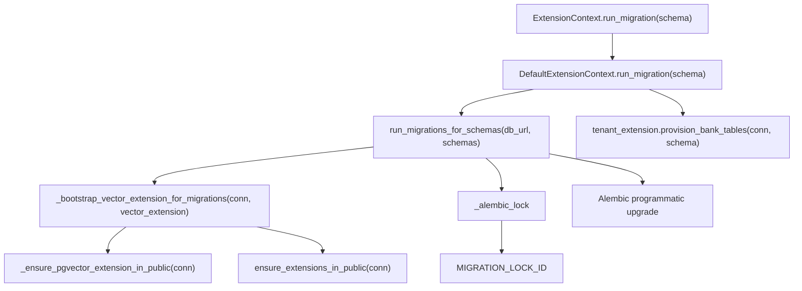
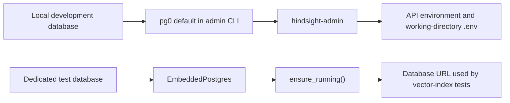

<!-- source: DeepWiki mcp.deepwiki.com · repo vectorize-io/hindsight · page 7.4 Database Setup · fetched 2026-10-27 -->

# Database Setup

Relevant source files

The following files were used as context for generating this wiki page:

- [hindsight-api-slim/hindsight_api/admin/cli.py](hindsight-api-slim/hindsight_api/admin/cli.py)
- [hindsight-api-slim/hindsight_api/alembic/_owned.py](hindsight-api-slim/hindsight_api/alembic/_owned.py)
- [hindsight-api-slim/hindsight_api/alembic/versions/b2429c65cc20_banks_needing_consolidation_hybrid_probe.py](hindsight-api-slim/hindsight_api/alembic/versions/b2429c65cc20_banks_needing_consolidation_hybrid_probe.py)
- [hindsight-api-slim/hindsight_api/alembic/versions/b2d4f6a8c1e3_repair_maintenance_routines_public.py](hindsight-api-slim/hindsight_api/alembic/versions/b2d4f6a8c1e3_repair_maintenance_routines_public.py)
- [hindsight-api-slim/hindsight_api/alembic/versions/b6d2f8a4c1e7_maintenance_routines_schema_local.py](hindsight-api-slim/hindsight_api/alembic/versions/b6d2f8a4c1e7_maintenance_routines_schema_local.py)
- [hindsight-api-slim/hindsight_api/alembic/versions/c7e9f1a3b5d2_maintenance_routines_skip_vanished_schemas.py](hindsight-api-slim/hindsight_api/alembic/versions/c7e9f1a3b5d2_maintenance_routines_skip_vanished_schemas.py)
- [hindsight-api-slim/hindsight_api/alembic/versions/c8b4e2a71f95_maintenance_routines_skip_locked_schemas.py](hindsight-api-slim/hindsight_api/alembic/versions/c8b4e2a71f95_maintenance_routines_skip_locked_schemas.py)
- [hindsight-api-slim/hindsight_api/alembic/versions/d7b2f8a1c934_add_schemas_with_expired_operations_routine.py](hindsight-api-slim/hindsight_api/alembic/versions/d7b2f8a1c934_add_schemas_with_expired_operations_routine.py)
- [hindsight-api-slim/hindsight_api/alembic/versions/e5f6a7b8c9d0_add_maintenance_routines.py](hindsight-api-slim/hindsight_api/alembic/versions/e5f6a7b8c9d0_add_maintenance_routines.py)
- [hindsight-api-slim/hindsight_api/alembic/versions/e8c1a4f7b2d9_drop_global_memory_units_vector_indexes.py](hindsight-api-slim/hindsight_api/alembic/versions/e8c1a4f7b2d9_drop_global_memory_units_vector_indexes.py)
- [hindsight-api-slim/hindsight_api/alembic/versions/f4d1c2b3a5e6_add_scheduled_mental_model_refresh_routine.py](hindsight-api-slim/hindsight_api/alembic/versions/f4d1c2b3a5e6_add_scheduled_mental_model_refresh_routine.py)
- [hindsight-api-slim/hindsight_api/engine/db_utils.py](hindsight-api-slim/hindsight_api/engine/db_utils.py)
- [hindsight-api-slim/hindsight_api/engine/memories/pg/transfer.py](hindsight-api-slim/hindsight_api/engine/memories/pg/transfer.py)
- [hindsight-api-slim/hindsight_api/engine/vector_index_health.py](hindsight-api-slim/hindsight_api/engine/vector_index_health.py)
- [hindsight-api-slim/hindsight_api/extensions/base.py](hindsight-api-slim/hindsight_api/extensions/base.py)
- [hindsight-api-slim/hindsight_api/extensions/context.py](hindsight-api-slim/hindsight_api/extensions/context.py)
- [hindsight-api-slim/hindsight_api/extensions/loader.py](hindsight-api-slim/hindsight_api/extensions/loader.py)
- [hindsight-api-slim/hindsight_api/migrations.py](hindsight-api-slim/hindsight_api/migrations.py)
- [hindsight-api-slim/tests/test_admin_backup_restore.py](hindsight-api-slim/tests/test_admin_backup_restore.py)
- [hindsight-api-slim/tests/test_admin_rename_bank.py](hindsight-api-slim/tests/test_admin_rename_bank.py)
- [hindsight-api-slim/tests/test_ann_iterative_scan.py](hindsight-api-slim/tests/test_ann_iterative_scan.py)
- [hindsight-api-slim/tests/test_consolidation_embedding_validation.py](hindsight-api-slim/tests/test_consolidation_embedding_validation.py)
- [hindsight-api-slim/tests/test_db_utils.py](hindsight-api-slim/tests/test_db_utils.py)
- [hindsight-api-slim/tests/test_ensure_vector_no_global_index.py](hindsight-api-slim/tests/test_ensure_vector_no_global_index.py)
- [hindsight-api-slim/tests/test_extension_alembic_tree.py](hindsight-api-slim/tests/test_extension_alembic_tree.py)
- [hindsight-api-slim/tests/test_externally_owned_routines.py](hindsight-api-slim/tests/test_externally_owned_routines.py)
- [hindsight-api-slim/tests/test_graph_maintenance_deadlock.py](hindsight-api-slim/tests/test_graph_maintenance_deadlock.py)
- [hindsight-api-slim/tests/test_hnsw_indexes.py](hindsight-api-slim/tests/test_hnsw_indexes.py)
- [hindsight-api-slim/tests/test_hnsw_indexes_store_owned.py](hindsight-api-slim/tests/test_hnsw_indexes_store_owned.py)
- [hindsight-api-slim/tests/test_knowledge_base.py](hindsight-api-slim/tests/test_knowledge_base.py)
- [hindsight-api-slim/tests/test_maintenance_routines.py](hindsight-api-slim/tests/test_maintenance_routines.py)
- [hindsight-api-slim/tests/test_migrations_parallel_schemas.py](hindsight-api-slim/tests/test_migrations_parallel_schemas.py)
- [hindsight-api-slim/tests/test_observation_expansion_single_fetch.py](hindsight-api-slim/tests/test_observation_expansion_single_fetch.py)
- [hindsight-api-slim/tests/test_reflections.py](hindsight-api-slim/tests/test_reflections.py)
- [hindsight-api-slim/tests/test_repair_bank_vector_indexes.py](hindsight-api-slim/tests/test_repair_bank_vector_indexes.py)
- [hindsight-docs/docs/developer/admin-cli.md](hindsight-docs/docs/developer/admin-cli.md)
- [skills/hindsight-docs/references/developer/admin-cli.md](skills/hindsight-docs/references/developer/admin-cli.md)

## Purpose and scope

This page describes Hindsight’s PostgreSQL setup and database lifecycle: extension bootstrapping, schema migrations, connection acquisition and retry behavior, pg0 as a development database, and operational considerations for vector indexes. The supplied code excerpts do not establish a PostgreSQL minimum version or expose the complete extension and pool configuration, so those details are not asserted here. [hindsight-api-slim/hindsight_api/migrations.py:1-16]()

Sources: [hindsight-api-slim/hindsight_api/migrations.py:1-16]()

---

## PostgreSQL extensions

### Vector extension bootstrap

Before migrations that depend on vector support, the migration system determines the configured vector backend and bootstraps it. For the `pgvector` backend, `_ensure_pgvector_extension_in_public()` checks whether the `vector` extension is installed. If it is missing, it attempts to create it; if creation fails, it checks again in case another process installed it concurrently. If the extension still does not exist, migration setup raises an error. The function also relocates an existing `vector` extension into `public`. `_bootstrap_vector_extension_for_migrations()` then bootstraps the configured backend, ensures extensions are in `public`, and commits. [hindsight-api-slim/hindsight_api/migrations.py:79-130]()

The migration module imports helpers for detecting and bootstrapping vector extensions, selecting index methods, and determining whether a backend uses per-bank vector indexes. The supplied excerpts do not include those helper implementations, so backend-specific SQL and tuning details are outside the evidence available here. [hindsight-api-slim/hindsight_api/migrations.py:44-53]()

| Setup concern | Implementation |
|---|---|
| Detect configured vector backend | `configured_vector_extension()` and `detect_vector_extension()` are imported by the migration module. [hindsight-api-slim/hindsight_api/migrations.py:44-53]() |
| Ensure `pgvector` availability | `_ensure_pgvector_extension_in_public()` checks for the `vector` extension and attempts creation when absent. [hindsight-api-slim/hindsight_api/migrations.py:84-111]() |
| Keep vector extension in `public` | The migration setup relocates `vector` to `public`, then calls `ensure_extensions_in_public()`. [hindsight-api-slim/hindsight_api/migrations.py:113-129]() |
| Bootstrap a non-default vector backend | `_bootstrap_vector_extension_for_migrations()` passes the configured backend to `bootstrap_extension()`. [hindsight-api-slim/hindsight_api/migrations.py:120-129]() |

### Text-search and trigram extensions

Migration setup imports helpers for `pg_search` tokenizer normalization and BM25 column handling, as well as extension helpers for creation, schema inspection, relocation, and ensuring extensions in `public`. The shown code explicitly calls `ensure_extensions_in_public()` during vector bootstrap. It does not show the complete extension list or establish which configurations install `pg_trgm`, `pgvectorscale`, `vchord`, or other text-search extensions. [hindsight-api-slim/hindsight_api/migrations.py:36-53]()

Sources: [hindsight-api-slim/hindsight_api/migrations.py:36-53](), [hindsight-api-slim/hindsight_api/migrations.py:79-130]()

---

## Schemas and tenant isolation

The migration module supports running migrations against a specific PostgreSQL schema, allowing tenant tables to be isolated by schema. Its documented design also calls for backward-compatible migrations to support rolling deployments. [hindsight-api-slim/hindsight_api/migrations.py:1-16]()

`ExtensionContext.run_migration(schema)` is the extension-facing provisioning seam. `DefaultExtensionContext.run_migration()` obtains the database URL, determines the embedding dimension when a memory engine is available, reads migration and backend configuration, and invokes `run_migrations_for_schemas()` for the requested schema. It then provisions extension-owned bank tables when the engine exposes a pool and tenant extension. [hindsight-api-slim/hindsight_api/extensions/context.py:37-55](), [hindsight-api-slim/hindsight_api/extensions/context.py:105-159]()

The tests demonstrate the schema lifecycle used for isolation: create a uniquely named schema, run `run_migrations(db_url, schema=...)`, and drop the schema during cleanup. [hindsight-api-slim/tests/test_admin_backup_restore.py:81-115]()

### Bank-scoped vector indexes

For per-bank vector backends, the documented admin command repairs vector-index coverage at bank and fact-type scope. A bank populated through a restore, upgrade, or backend switch may lack indexes created by the normal bank-creation path; the admin documentation describes this as a condition that can make recall slower and may under-return results. `repair-bank` detects missing or invalid coverage and rebuilds indexes with `CREATE INDEX CONCURRENTLY`; it is described as idempotent and safe to run while the API serves traffic. [hindsight-docs/docs/developer/admin-cli.md:71-92]()

The repair command is a no-op for backends using a single global vector index and for banks whose memories are owned by a custom store. The documentation warns that leftover indexes for store-owned banks are not automatically dropped. [hindsight-docs/docs/developer/admin-cli.md:92-121]()

| Operational condition | Guidance |
|---|---|
| Bank populated outside its normal creation path | Use `hindsight-admin repair-bank` to reconcile its per-bank index coverage. [hindsight-docs/docs/developer/admin-cli.md:73-80]() |
| Index build interrupted or index type drifted | The repair command treats invalid or mismatched coverage as missing and attempts a concurrent rebuild. [hindsight-docs/docs/developer/admin-cli.md:75-77]() |
| Memories are owned by a custom store | Repair does not build indexes for that bank; inspect and remove stale indexes separately if appropriate. [hindsight-docs/docs/developer/admin-cli.md:94-115]() |
| Per-bank backend has a stale global index | The migration path removes stale global indexes; runtime reconciliation is documented as avoiding surprise index DDL. [hindsight-api-slim/tests/test_ensure_vector_no_global_index.py:1-16](), [hindsight-api-slim/tests/test_ensure_vector_no_global_index.py:134-168]() |

Sources: [hindsight-api-slim/hindsight_api/migrations.py:1-16](), [hindsight-api-slim/hindsight_api/extensions/context.py:37-55](), [hindsight-api-slim/hindsight_api/extensions/context.py:105-159](), [hindsight-api-slim/tests/test_admin_backup_restore.py:81-115](), [hindsight-docs/docs/developer/admin-cli.md:71-121](), [hindsight-api-slim/tests/test_ensure_vector_no_global_index.py:1-16](), [hindsight-api-slim/tests/test_ensure_vector_no_global_index.py:134-168]()

---

## Alembic migration management

### Programmatic migrations

Hindsight configures Alembic programmatically rather than requiring an `alembic.ini`. The migration module is intended to run migrations during application startup and supports targeting PostgreSQL schemas. [hindsight-api-slim/hindsight_api/migrations.py:1-16]()

The migration module defines `MIGRATION_LOCK_ID = 123456789` as the advisory lock identifier for migrations. Its module documentation describes advisory locks as the coordination mechanism for concurrent execution across distributed workers. Alembic calls also use a process-wide `_alembic_lock`: the module explains that Alembic’s `command.upgrade()` relies on module-level state and is not thread-safe when invoked concurrently in one process. [hindsight-api-slim/hindsight_api/migrations.py:60-72]()

`_set_alembic_main_option()` escapes percent signs before setting a configuration option, preventing URL percent escapes from being treated as interpolation. [hindsight-api-slim/hindsight_api/migrations.py:74-77]()

### Running migrations operationally

The `hindsight-admin run-db-migration` command can run migrations separately from API startup. By default, it migrates the base schema plus schemas discovered through the tenant extension; `--schema` targets one schema. The command also supports an embedding-dimension check and an option to skip vector/text-search extension reconciliation when the backend has not changed. [hindsight-docs/docs/developer/admin-cli.md:39-63]()

Automatic migration at API startup can be disabled with `HINDSIGHT_API_RUN_MIGRATIONS_ON_STARTUP=false`, allowing migrations to be run as a separate deployment step. [hindsight-docs/docs/developer/admin-cli.md:65-67]()

### Migration flow

**Diagram: Migration setup from tenant provisioning to schema migration**

The diagram connects the extension provisioning entry point to the migration runner and the migration module’s named setup entities. The source excerpts document the runner call and extension-table provisioning in `DefaultExtensionContext`, and the lock and bootstrap entities in `migrations.py`. [hindsight-api-slim/hindsight_api/extensions/context.py:105-159](), [hindsight-api-slim/hindsight_api/migrations.py:60-72](), [hindsight-api-slim/hindsight_api/migrations.py:79-130]()

Sources: [hindsight-api-slim/hindsight_api/migrations.py:1-16](), [hindsight-api-slim/hindsight_api/migrations.py:60-77](), [hindsight-api-slim/hindsight_api/migrations.py:79-130](), [hindsight-api-slim/hindsight_api/extensions/context.py:105-159](), [hindsight-docs/docs/developer/admin-cli.md:39-67]()

---

## Connection acquisition and retry behavior

`acquire_with_retry()` is an asynchronous context manager that accepts a database backend or, for backward compatibility, a raw `asyncpg.Pool`. For backend instances, it retries failures while acquiring a connection. Exceptions raised by user code inside the context are not retried. [hindsight-api-slim/hindsight_api/engine/db_utils.py:124-149]()

The retry policy uses exponential backoff with equal jitter. The default policy allows three retries, with a 0.5-second base delay and a 5-second maximum delay. Retryable cases include operating-system, connection, and timeout errors, plus selected asyncpg connection and deadlock errors. [hindsight-api-slim/hindsight_api/engine/db_utils.py:17-44](), [hindsight-api-slim/hindsight_api/engine/db_utils.py:47-65]()

The code can warn when connection acquisition exceeds `db_pool_slow_acquire_threshold_seconds`. It reads this threshold from the raw configuration cache so that the check does not construct the full configuration on every acquire. [hindsight-api-slim/hindsight_api/engine/db_utils.py:116-121]()

| Behavior | Implementation detail |
|---|---|
| Retry acquisition | Retry wraps the acquire step, not the caller’s database work inside the context. [hindsight-api-slim/hindsight_api/engine/db_utils.py:124-135]() |
| Backoff | Exponential delay is capped, with random jitter to reduce synchronized retries. [hindsight-api-slim/hindsight_api/engine/db_utils.py:23-33]() |
| Retryable database errors | Includes selected connection failures and deadlocks; Oracle deadlocks are also recognized when the Oracle driver is available. [hindsight-api-slim/hindsight_api/engine/db_utils.py:36-65]() |
| Slow-acquire warning | A positive configured threshold enables warnings when acquisition exceeds it. [hindsight-api-slim/hindsight_api/engine/db_utils.py:116-121]() |

The supplied excerpts establish retry and slow-acquire behavior, but do not show the database pool construction or configuration defaults. Pool sizing and timeout values should therefore be taken from the deployment configuration reference rather than inferred here. [hindsight-api-slim/hindsight_api/engine/db_utils.py:116-149]()

Sources: [hindsight-api-slim/hindsight_api/engine/db_utils.py:17-65](), [hindsight-api-slim/hindsight_api/engine/db_utils.py:116-149]()

---

## pg0 embedded database

The admin CLI documentation identifies `pg0` as the default embedded development database. The CLI reads the same configuration as the API and connects directly to PostgreSQL; when using pg0, it must run on the host that owns the pg0 data. The supplied excerpts do not include the pg0 implementation, URL format, lifecycle, or tuning parameters. [hindsight-docs/docs/developer/admin-cli.md:15-22]()

The vector-index test suite also uses an `EmbeddedPostgres` instance and calls `ensure_running()` to obtain a database URL for tests. This demonstrates pg0’s use as a test database, but does not establish production suitability or configuration behavior. [hindsight-api-slim/tests/test_ensure_vector_no_global_index.py:38-48]()

**Diagram: pg0 usage mapped to code entities**

This maps the natural-language roles of pg0 to the documented admin CLI behavior and the test’s `EmbeddedPostgres.ensure_running()` call. [hindsight-docs/docs/developer/admin-cli.md:15-22](), [hindsight-api-slim/tests/test_ensure_vector_no_global_index.py:38-48]()

Sources: [hindsight-docs/docs/developer/admin-cli.md:15-22](), [hindsight-api-slim/tests/test_ensure_vector_no_global_index.py:38-48]()

---

## Production operations and tuning

### Separate migrations from API startup

For deployments that manage schema changes as a release step, run `hindsight-admin run-db-migration` before or as part of deployment and disable automatic startup migrations with `HINDSIGHT_API_RUN_MIGRATIONS_ON_STARTUP=false`. The admin command can target one schema or, by default, the base schema and tenant schemas discovered by the tenant extension. [hindsight-docs/docs/developer/admin-cli.md:39-67]()

The admin CLI connects directly to PostgreSQL rather than through the HTTP API. It reads the API’s environment and a `.env` file in the current working directory; production deployments set `HINDSIGHT_API_DATABASE_URL` to the PostgreSQL connection URL. The CLI is PostgreSQL-only and should run where it has the appropriate configuration and database network access. [hindsight-docs/docs/developer/admin-cli.md:15-35]()

### Index maintenance

Use `hindsight-admin repair-bank` after logical restore, cross-version upgrades, or vector-extension changes when bank-scoped index coverage may be missing. The command supports a single bank or all banks, optional schema targeting, and dry-run reporting. Its documented concurrent index builds avoid blocking live retain, recall, and consolidation operations. [hindsight-docs/docs/developer/admin-cli.md:71-92]()

The per-bank repair path is not appropriate for backends that use a single global vector index. It also does not guess about banks whose custom memory store cannot identify ownership; such cases are reported as incomplete rather than triggering potentially incorrect index creation. [hindsight-docs/docs/developer/admin-cli.md:92-121]()

### Database reliability checks

- Monitor slow connection acquisition through the configured `db_pool_slow_acquire_threshold_seconds` warning path. [hindsight-api-slim/hindsight_api/engine/db_utils.py:116-121]()
- Allow transient acquisition failures to use the built-in retry policy; the code uses capped exponential backoff with jitter. [hindsight-api-slim/hindsight_api/engine/db_utils.py:17-33](), [hindsight-api-slim/hindsight_api/engine/db_utils.py:124-174]()
- Keep migrations backward-compatible for rolling deployments, as required by the migration module’s design. [hindsight-api-slim/hindsight_api/migrations.py:9-16]()
- Treat PostgreSQL extensions and their schema placement as part of database readiness; vector bootstrap checks and repairs placement before migration work proceeds. [hindsight-api-slim/hindsight_api/migrations.py:84-130]()

The supplied files do not provide numeric production recommendations for PostgreSQL memory settings, pool sizing, or per-extension index parameters. Those values should be selected using the deployment’s workload, PostgreSQL limits, and the chosen backend’s documentation rather than assumed from this page. [hindsight-api-slim/hindsight_api/engine/db_utils.py:116-149](), [hindsight-api-slim/hindsight_api/migrations.py:44-53]()

Sources: [hindsight-docs/docs/developer/admin-cli.md:15-67](), [hindsight-docs/docs/developer/admin-cli.md:71-121](), [hindsight-api-slim/hindsight_api/engine/db_utils.py:17-33](), [hindsight-api-slim/hindsight_api/engine/db_utils.py:116-174](), [hindsight-api-slim/hindsight_api/migrations.py:9-16](), [hindsight-api-slim/hindsight_api/migrations.py:44-53](), [hindsight-api-slim/hindsight_api/migrations.py:84-130]()

---

## Key code entities

| Code entity | Role |
|---|---|
| `run_migrations_for_schemas()` | Called by `DefaultExtensionContext.run_migration()` to run configured migrations for the requested schema. [hindsight-api-slim/hindsight_api/extensions/context.py:105-147]() |
| `MIGRATION_LOCK_ID` | Migration advisory-lock identifier defined in `migrations.py`. [hindsight-api-slim/hindsight_api/migrations.py:60-65]() |
| `_alembic_lock` | Process-level lock that serializes Alembic invocations within the process. [hindsight-api-slim/hindsight_api/migrations.py:66-72]() |
| `_ensure_pgvector_extension_in_public()` | Ensures the `vector` extension exists and relocates it to `public`. [hindsight-api-slim/hindsight_api/migrations.py:84-118]() |
| `_bootstrap_vector_extension_for_migrations()` | Bootstraps the selected vector backend, ensures extensions are in `public`, and commits. [hindsight-api-slim/hindsight_api/migrations.py:120-130]() |
| `acquire_with_retry()` | Acquires a backend or pool connection with retry handling for transient acquisition failures. [hindsight-api-slim/hindsight_api/engine/db_utils.py:124-174]() |
| `hindsight-admin run-db-migration` | Runs migrations operationally, including targeted-schema execution. [hindsight-docs/docs/developer/admin-cli.md:39-63]() |
| `hindsight-admin repair-bank` | Reconciles bank-scoped vector-index coverage where supported. [hindsight-docs/docs/developer/admin-cli.md:71-92]() |

Sources: [hindsight-api-slim/hindsight_api/extensions/context.py:105-147](), [hindsight-api-slim/hindsight_api/migrations.py:60-72](), [hindsight-api-slim/hindsight_api/migrations.py:84-130](), [hindsight-api-slim/hindsight_api/engine/db_utils.py:124-174](), [hindsight-docs/docs/developer/admin-cli.md:39-63](), [hindsight-docs/docs/developer/admin-cli.md:71-92]()

---

