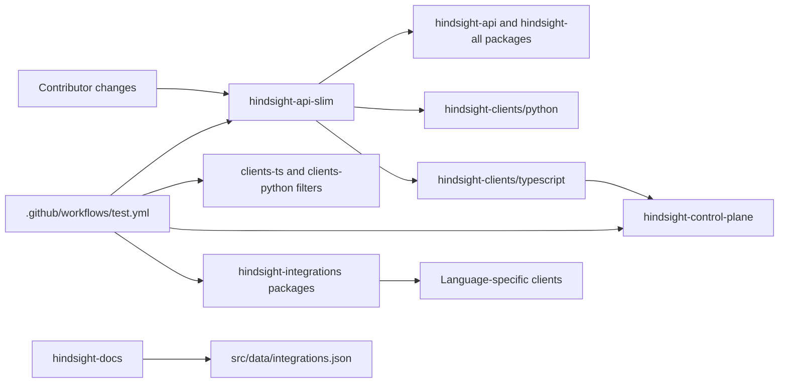
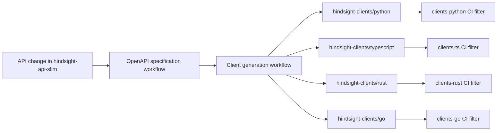
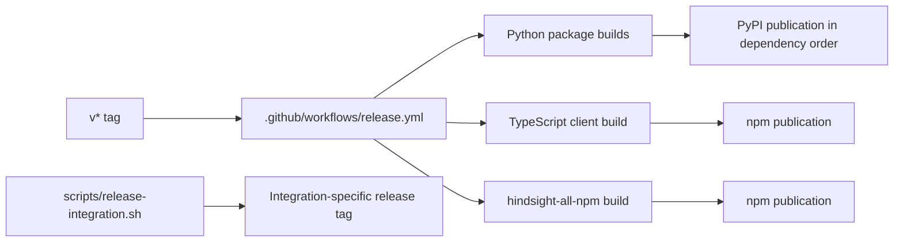

<!-- source: DeepWiki mcp.deepwiki.com · repo vectorize-io/hindsight · page 8 Development · fetched 2026-10-27 -->

# Development

Relevant source files

The following files were used as context for generating this wiki page:

- [.github/workflows/deploy-docs.yml](.github/workflows/deploy-docs.yml)
- [.github/workflows/release.yml](.github/workflows/release.yml)
- [.github/workflows/security-scan.yml](.github/workflows/security-scan.yml)
- [.github/workflows/test.yml](.github/workflows/test.yml)
- [docker/standalone/Dockerfile](docker/standalone/Dockerfile)
- [docker/test-image.sh](docker/test-image.sh)
- [docker/test-slim-local.sh](docker/test-slim-local.sh)
- [hindsight-api-slim/pyproject.toml](hindsight-api-slim/pyproject.toml)
- [hindsight-dev/hindsight_dev/generate_changelog.py](hindsight-dev/hindsight_dev/generate_changelog.py)
- [hindsight-docs/plugins/github-stars/index.js](hindsight-docs/plugins/github-stars/index.js)
- [hindsight-docs/src/components/HomeBenchmarks.module.css](hindsight-docs/src/components/HomeBenchmarks.module.css)
- [hindsight-docs/src/components/useGitHubStars.ts](hindsight-docs/src/components/useGitHubStars.ts)
- [hindsight-docs/src/data/integrations.json](hindsight-docs/src/data/integrations.json)
- [scripts/release-integration.sh](scripts/release-integration.sh)
- [scripts/smoke-test-slim.sh](scripts/smoke-test-slim.sh)
- [uv.lock](uv.lock)

## Purpose and scope

This page gives contributors a high-level map of the development workflow: how the repository’s packages fit together, how changes are checked, and how client and product releases are organized. It points to child pages for step-by-step setup, build, testing, generation, and release instructions.

**Sources:** [uv.lock:19-29](), [.github/workflows/test.yml:12-35](), [.github/workflows/release.yml:8-14]()

---

## Project Structure

The repository is a multi-package workspace. Its Python workspace includes `hindsight-api-slim`, `hindsight-api`, `hindsight-all`, `hindsight-all-slim`, `hindsight-client`, `hindsight-dev`, and `hindsight-embed`; the root lockfile records these workspace members. The API’s Python package metadata requires Python 3.11 or newer. [.github/workflows/test.yml:104-117](), [uv.lock:19-29](), [hindsight-api-slim/pyproject.toml:5-11]()

The wider repository also contains language-specific clients, the control plane, documentation, and many integrations. CI uses path filters to select checks for core code, clients, control plane, CLI, embed, and individual integrations. The documentation integration registry provides another view of the integration ecosystem. [.github/workflows/test.yml:19-93](), [hindsight-docs/src/data/integrations.json:1-40]()

### Repository relationships

This diagram connects contributor-facing concepts to names and locations used in the repository. It is a high-level orientation, not a complete dependency map.

Sources: [uv.lock:19-29](), [.github/workflows/test.yml:19-93](), [.github/workflows/test.yml:104-122](), [docker/standalone/Dockerfile:88-124](), [hindsight-docs/src/data/integrations.json:1-40]()

For details, see [Project Structure](#8.1).

**Sources:** [uv.lock:19-29](), [.github/workflows/test.yml:19-93](), [hindsight-docs/src/data/integrations.json:1-40]()

---

## Building from Source

The Python workspace is managed with `uv` and its root `uv.lock`; TypeScript packages are organized as npm workspaces. The standalone Docker build shows the relationship between the TypeScript client and control plane: it builds the client, then makes it available to the control-plane build. [.github/workflows/release.yml:18-26](), [uv.lock:19-29](), [docker/standalone/Dockerfile:88-124]()

Contributors should use the dedicated build guide for local setup, build commands, and linting details. For information about production-oriented image targets and build arguments, see [Docker Deployment](#7.1).

**Sources:** [uv.lock:19-29](), [docker/standalone/Dockerfile:1-22](), [docker/standalone/Dockerfile:88-124]()

For details, see [Building from Source](#8.2).

**Sources:** [uv.lock:19-29](), [docker/standalone/Dockerfile:88-124]()

---

## Testing

CI runs on pull requests targeting `main` and supports manual dispatch. A change-detection job filters changes across core packages, SDKs, control plane, CLI, integrations, extensions, and test suites, allowing subsequent checks to be scoped to affected areas. [.github/workflows/test.yml:1-15](), [.github/workflows/test.yml:19-93]()

The workflow’s filters distinguish core changes—including `hindsight-api-slim` and `hindsight-api`—from client, integration, system-test, and integration-test changes. This page describes the CI organization only; test commands and suite responsibilities are covered in the child page. [.github/workflows/test.yml:100-122](), [.github/workflows/test.yml:32-35]()

**Sources:** [.github/workflows/test.yml:1-15](), [.github/workflows/test.yml:19-35](), [.github/workflows/test.yml:98-122]()

For details, see [Testing](#8.3), including [System Tests and Stub Server](#8.3.1) and [Evaluations and Benchmarks](#8.3.2).

**Sources:** [.github/workflows/test.yml:32-35]()

---

## Client Generation from OpenAPI

The repository maintains Python, TypeScript, Rust, and Go client areas, and CI has separate change filters for those client languages. The release workflow builds and publishes the Python and TypeScript clients, which are distinct from the API package release steps. [.github/workflows/test.yml:19-23](), [.github/workflows/release.yml:42-65](), [.github/workflows/release.yml:136-183]()

Client generation is a contributor workflow separate from client testing and publishing. Consult the child page for the generation script, generators, post-generation handling, and preservation of maintained files.

**Sources:** [.github/workflows/test.yml:19-23](), [.github/workflows/release.yml:42-65](), [.github/workflows/release.yml:136-183]()

### From API changes to client packages

This diagram shows the contributor-facing flow between the API, generated client areas, and checks. The generator details belong in the child page.

Sources: [.github/workflows/test.yml:19-23](), [.github/workflows/test.yml:104-122](), [.github/workflows/release.yml:42-65](), [.github/workflows/release.yml:136-183]()

For details, see [Client Generation from OpenAPI](#8.4).

**Sources:** [.github/workflows/test.yml:19-23](), [.github/workflows/release.yml:42-65](), [.github/workflows/release.yml:136-183]()

---

## Release Process

The main release workflow is triggered by tags matching `v*`. It builds and publishes several Python packages, then builds and publishes the TypeScript client and `hindsight-all-npm` in separate jobs. [.github/workflows/release.yml:1-14](), [.github/workflows/release.yml:42-65](), [.github/workflows/release.yml:85-119](), [.github/workflows/release.yml:136-225]()

The Python publication sequence puts `hindsight-client` and `hindsight-api-slim` before packages that depend on them, followed by `hindsight-api`, `hindsight-all`, `hindsight-all-slim`, and `hindsight-embed`. Integration releases use a separate script; consult the release child page for the complete versioning and publication process. [.github/workflows/release.yml:85-119](), [scripts/release-integration.sh:16-28]()

**Sources:** [.github/workflows/release.yml:1-14](), [.github/workflows/release.yml:42-119](), [.github/workflows/release.yml:136-225](), [scripts/release-integration.sh:16-28]()

### Release path

Sources: [.github/workflows/release.yml:1-14](), [.github/workflows/release.yml:42-119](), [.github/workflows/release.yml:136-225](), [scripts/release-integration.sh:16-28]()

For details, see [Release Process](#8.5).

**Sources:** [.github/workflows/release.yml:1-14](), [.github/workflows/release.yml:85-119](), [scripts/release-integration.sh:16-28]()

---

This page is an entry point for contributors. Use the child pages for focused guidance:

- [Project Structure](#8.1)
- [Building from Source](#8.2)
- [Testing](#8.3)
- [Client Generation from OpenAPI](#8.4)
- [Release Process](#8.5)

**Sources:** [uv.lock:19-29](), [.github/workflows/test.yml:19-93](), [.github/workflows/release.yml:1-14)

---

