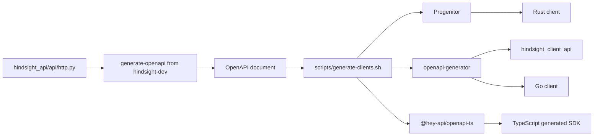
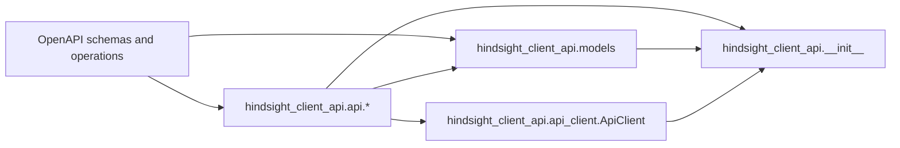
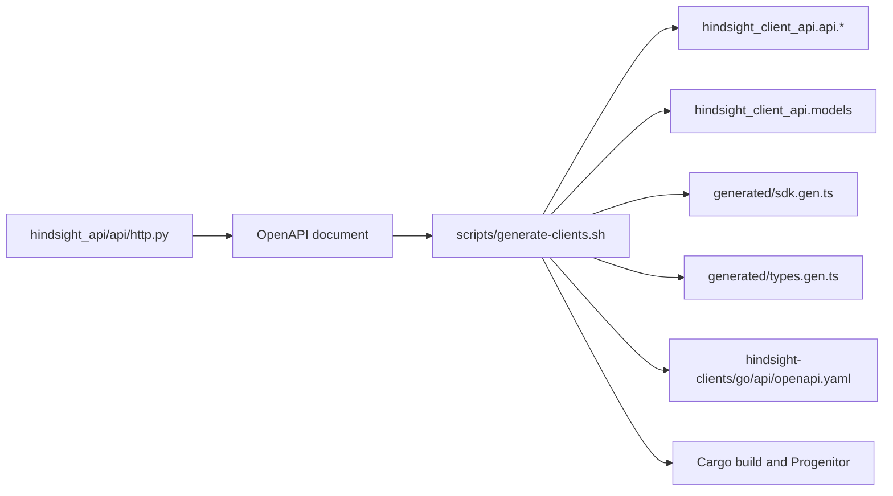
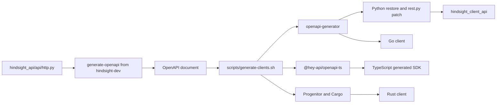

<!-- source: DeepWiki mcp.deepwiki.com · repo vectorize-io/hindsight · page 8.4 Client Generation from OpenAPI · fetched 2026-10-27 -->

# Client Generation from OpenAPI

Relevant source files

The following files were used as context for generating this wiki page:

- [hindsight-api-slim/hindsight_api/api/http.py](hindsight-api-slim/hindsight_api/api/http.py)
- [hindsight-api-slim/hindsight_api/engine/memory_engine.py](hindsight-api-slim/hindsight_api/engine/memory_engine.py)
- [hindsight-cli/src/api.rs](hindsight-cli/src/api.rs)
- [hindsight-clients/go/api/openapi.yaml](hindsight-clients/go/api/openapi.yaml)
- [hindsight-clients/go/hindsight_client.go](hindsight-clients/go/hindsight_client.go)
- [hindsight-clients/python/.openapi-generator/FILES](hindsight-clients/python/.openapi-generator/FILES)
- [hindsight-clients/python/hindsight_client_api/__init__.py](hindsight-clients/python/hindsight_client_api/__init__.py)
- [hindsight-clients/python/hindsight_client_api/models/__init__.py](hindsight-clients/python/hindsight_client_api/models/__init__.py)
- [hindsight-clients/typescript/generated/sdk.gen.ts](hindsight-clients/typescript/generated/sdk.gen.ts)
- [hindsight-clients/typescript/generated/types.gen.ts](hindsight-clients/typescript/generated/types.gen.ts)
- [hindsight-control-plane/src/lib/api.ts](hindsight-control-plane/src/lib/api.ts)
- [hindsight-docs/src/pages/changelog/integrations/ag2.md](hindsight-docs/src/pages/changelog/integrations/ag2.md)
- [hindsight-docs/static/openapi.json](hindsight-docs/static/openapi.json)
- [hindsight-integrations/ag2/README.md](hindsight-integrations/ag2/README.md)
- [hindsight-integrations/ag2/hindsight_ag2/__init__.py](hindsight-integrations/ag2/hindsight_ag2/__init__.py)
- [hindsight-integrations/ag2/hindsight_ag2/_client.py](hindsight-integrations/ag2/hindsight_ag2/_client.py)
- [hindsight-integrations/ag2/hindsight_ag2/config.py](hindsight-integrations/ag2/hindsight_ag2/config.py)
- [hindsight-integrations/ag2/hindsight_ag2/errors.py](hindsight-integrations/ag2/hindsight_ag2/errors.py)
- [hindsight-integrations/ag2/pyproject.toml](hindsight-integrations/ag2/pyproject.toml)
- [hindsight-integrations/ag2/tests/__init__.py](hindsight-integrations/ag2/tests/__init__.py)
- [hindsight-integrations/ag2/tests/test_tools.py](hindsight-integrations/ag2/tests/test_tools.py)
- [scripts/generate-clients.sh](scripts/generate-clients.sh)
- [skills/hindsight-docs/references/changelog/integrations/ag2.md](skills/hindsight-docs/references/changelog/integrations/ag2.md)
- [skills/hindsight-docs/references/openapi.json](skills/hindsight-docs/references/openapi.json)
- [skills/hindsight-docs/references/sdks/integrations/ag2.md](skills/hindsight-docs/references/sdks/integrations/ag2.md)

## Purpose and Scope

This page describes how Hindsight generates its Rust, Python, Go, and TypeScript client SDKs from OpenAPI, including the generator tools, the `generate-clients.sh` workflow, post-generation adjustments, and preservation of manually maintained files. The OpenAPI document describes the HTTP API exposed by the FastAPI application. [hindsight-api-slim/hindsight_api/api/http.py:1-5](), [hindsight-docs/static/openapi.json:1-14]()

Sources: [hindsight-api-slim/hindsight_api/api/http.py:1-5](), [hindsight-docs/static/openapi.json:1-14](), [scripts/generate-clients.sh:1-195]()

---

## Client Generation Architecture

Hindsight uses language-specific generators so the SDKs can share an API contract while producing language-specific output. Rust uses Progenitor; Python and Go use OpenAPI Generator; TypeScript uses `@hey-api/openapi-ts`. The workflow also uses `generate-openapi` from `hindsight-dev` to produce the OpenAPI document. [scripts/generate-clients.sh:1-27](), [scripts/generate-clients.sh:56-64](), [scripts/generate-clients.sh:118-134]()

### Data Flow: API to SDKs

**Diagram: OpenAPI generation and client outputs**

`hindsight_api/api/http.py` provides the FastAPI application and routes; the OpenAPI document records the API contract. The generator script coordinates generation from that contract. [hindsight-api-slim/hindsight_api/api/http.py:1-5](), [scripts/generate-clients.sh:1-27]()

The Python package exposes generated API classes such as `MemoryApi`, `BanksApi`, and `OperationsApi`, along with `ApiClient`, configuration, exceptions, and generated models. [hindsight-clients/python/hindsight_client_api/__init__.py:19-47]() The TypeScript output includes generated operation functions and schema types; its generated files identify `@hey-api/openapi-ts` as their generator. [hindsight-clients/typescript/generated/sdk.gen.ts:1-9](), [hindsight-clients/typescript/generated/types.gen.ts:1-5]()

Sources: [hindsight-api-slim/hindsight_api/api/http.py:1-5](), [scripts/generate-clients.sh:1-27](), [scripts/generate-clients.sh:56-64](), [scripts/generate-clients.sh:118-134](), [hindsight-clients/python/hindsight_client_api/__init__.py:19-47](), [hindsight-clients/typescript/generated/sdk.gen.ts:1-9](), [hindsight-clients/typescript/generated/types.gen.ts:1-5]()

---

## `generate-clients.sh` Script Overview

`scripts/generate-clients.sh` is the orchestration entry point for client generation. It coordinates the OpenAPI input, language-specific generators, generated output, and post-generation handling. [scripts/generate-clients.sh:1-27]()

| Client | Generator | Workflow or output detail |
|---|---|---|
| Rust | Progenitor | The script builds the Rust client with Cargo, triggering generation through its build process. [scripts/generate-clients.sh:56-64]() |
| Python | `openapi-generator` | Runs the generator in Docker and stages generated output before syncing it to the client directory. [scripts/generate-clients.sh:108-134](), [scripts/generate-clients.sh:146-175]() |
| Go | `openapi-generator` | Uses the OpenAPI Generator tool for Go client output. [scripts/generate-clients.sh:27]() |
| TypeScript | `@hey-api/openapi-ts` | Generates the TypeScript client artifacts. [scripts/generate-clients.sh:25-27](), [hindsight-clients/typescript/generated/sdk.gen.ts:1-1]() |
| OpenAPI | `generate-openapi` from `hindsight-dev` | Produces the API document consumed by generation. [scripts/generate-clients.sh:14-14]() |

The script’s Python workflow preserves selected files, removes generated output before regeneration, stages generator output, restores preserved files, and applies a patch to generated transport code. [scripts/generate-clients.sh:76-96](), [scripts/generate-clients.sh:108-175](), [scripts/generate-clients.sh:188-192]()

Sources: [scripts/generate-clients.sh:1-27](), [scripts/generate-clients.sh:56-64](), [scripts/generate-clients.sh:76-96](), [scripts/generate-clients.sh:108-175](), [scripts/generate-clients.sh:188-192](), [hindsight-clients/typescript/generated/sdk.gen.ts:1-1]()

---

## Python Client Generation Details

The generated Python package is `hindsight_client_api`. Its package initializer imports API classes, the transport client, configuration, exceptions, and models. [hindsight-clients/python/hindsight_client_api/__init__.py:19-47]()

The script protects hand-maintained Python client files during regeneration and confines cleanup to generated content:

1. It backs up `hindsight_client.py` and the README before regeneration. [scripts/generate-clients.sh:76-90]()
2. It removes generated content under `hindsight_client_api/`, leaving sibling, manually maintained files outside that generated package. [scripts/generate-clients.sh:93-96]()
3. It runs OpenAPI Generator in Docker and stages output in a temporary directory before syncing it into the client directory. [scripts/generate-clients.sh:108-134](), [scripts/generate-clients.sh:146-175]()
4. It restores the files saved before generation and creates `py.typed` markers. [scripts/generate-clients.sh:158-175]()
5. It patches generated `rest.py` so creation of `aiohttp.TCPConnector` is deferred, avoiding connector initialization when no event loop is running. [scripts/generate-clients.sh:188-192]()

The generator’s file manifest lists the generated package structure, including its API modules, models, transport client, and configuration. [hindsight-clients/python/.openapi-generator/FILES:1-24]()

Sources: [scripts/generate-clients.sh:76-96](), [scripts/generate-clients.sh:108-175](), [scripts/generate-clients.sh:188-192](), [hindsight-clients/python/hindsight_client_api/__init__.py:19-47](), [hindsight-clients/python/.openapi-generator/FILES:1-24]()

### Python Client: Code Entity Flow

**Diagram: OpenAPI models and generated Python client entities**

The generated package initializer re-exports API classes including `MemoryApi`, `BanksApi`, and `OperationsApi`, as well as `ApiClient` and the generated models. [hindsight-clients/python/hindsight_client_api/__init__.py:19-47]() The model package initializer re-exports generated schema models. [hindsight-clients/python/hindsight_client_api/models/__init__.py:16-25]()

Sources: [hindsight-clients/python/hindsight_client_api/__init__.py:19-47](), [hindsight-clients/python/hindsight_client_api/models/__init__.py:16-25]()

---

## TypeScript Client Generation

The TypeScript generated files identify `@hey-api/openapi-ts` as their generator. [hindsight-clients/typescript/generated/sdk.gen.ts:1-1](), [hindsight-clients/typescript/generated/types.gen.ts:1-1]() `sdk.gen.ts` contains generated operation imports, while `types.gen.ts` contains generated client options and API schema types. [hindsight-clients/typescript/generated/sdk.gen.ts:3-10](), [hindsight-clients/typescript/generated/types.gen.ts:3-5]()

Sources: [scripts/generate-clients.sh:25-27](), [hindsight-clients/typescript/generated/sdk.gen.ts:1-10](), [hindsight-clients/typescript/generated/types.gen.ts:1-5]()

---

## Go Client Generation

The Go client is generated with `openapi-generator`. The repository includes an OpenAPI YAML document at `hindsight-clients/go/api/openapi.yaml`; it describes the Hindsight HTTP API, including operations such as `get_graph`. [scripts/generate-clients.sh:27](), [hindsight-clients/go/api/openapi.yaml:1-13](), [hindsight-clients/go/api/openapi.yaml:88-100]()

Sources: [scripts/generate-clients.sh:27](), [hindsight-clients/go/api/openapi.yaml:1-13](), [hindsight-clients/go/api/openapi.yaml:88-100]()

---

## Rust Client Generation

The Rust client generation path uses Progenitor and Cargo. The script invokes a locked release build in the Rust client directory, which triggers the build-time generation workflow. [scripts/generate-clients.sh:56-64]()

The Rust CLI wraps the generated `hindsight-client` crate as an asynchronous API client. For example, `ApiClient::new` constructs the generated async client with a configured HTTP client, and the wrapper re-exports generated types. [hindsight-cli/src/api.rs:7-8](), [hindsight-cli/src/api.rs:161-188]()

Sources: [scripts/generate-clients.sh:56-64](), [hindsight-cli/src/api.rs:7-8](), [hindsight-cli/src/api.rs:161-188]()

---

## File Preservation Logic and Post-Generation Patches

Regeneration replaces generated artifacts, so the script separates generated output from maintained files. For Python, it backs up the wrapper and README, cleans generated package contents, stages fresh generator output, and restores the saved files. [scripts/generate-clients.sh:76-96](), [scripts/generate-clients.sh:146-175]()

| Handling | Purpose |
|---|---|
| Preserve `hindsight_client.py` and README | Retain manually maintained wrapper and documentation across regeneration. [scripts/generate-clients.sh:76-90]() |
| Clean the generated package | Remove stale files from `hindsight_client_api/` before generating replacements. [scripts/generate-clients.sh:93-96]() |
| Stage and sync generated files | Avoid generating directly into the mounted destination and then copy the staged output into place. [scripts/generate-clients.sh:108-134](), [scripts/generate-clients.sh:146-175]() |
| Restore preserved files and add `py.typed` | Return maintained files to the package and mark it as typed. [scripts/generate-clients.sh:158-175]() |
| Patch `rest.py` | Defer `aiohttp.TCPConnector` construction to avoid requiring an active event loop during client initialization. [scripts/generate-clients.sh:188-192]() |

Sources: [scripts/generate-clients.sh:76-96](), [scripts/generate-clients.sh:108-175](), [scripts/generate-clients.sh:188-192]()

---

## Summary of Key Generated Artifact Locations

| Language | Generator | Artifact location |
|---|---|---|
| Python | `openapi-generator` | `hindsight-clients/python/hindsight_client_api/` [hindsight-clients/python/.openapi-generator/FILES:1-24]() |
| TypeScript | `@hey-api/openapi-ts` | `hindsight-clients/typescript/generated/` [hindsight-clients/typescript/generated/sdk.gen.ts:1-10](), [hindsight-clients/typescript/generated/types.gen.ts:1-5]() |
| Go | `openapi-generator` | Go client generation uses the OpenAPI YAML at `hindsight-clients/go/api/openapi.yaml`. [scripts/generate-clients.sh:27](), [hindsight-clients/go/api/openapi.yaml:1-13]() |
| Rust | Progenitor | Rust client generation is triggered by the Cargo build invoked by the script. [scripts/generate-clients.sh:56-64]() |

Sources: [scripts/generate-clients.sh:27](), [scripts/generate-clients.sh:56-64](), [hindsight-clients/python/.openapi-generator/FILES:1-24](), [hindsight-clients/typescript/generated/sdk.gen.ts:1-10](), [hindsight-clients/typescript/generated/types.gen.ts:1-5](), [hindsight-clients/go/api/openapi.yaml:1-13]()

---

## Additional Diagrams

### Mapping System Components to Code Entities

**Diagram: API contract to generated client entities**

The diagram relates the FastAPI source, generation orchestration, OpenAPI contract, and language-specific artifacts. The Python package exports generated APIs and models; the TypeScript generated files identify `@hey-api/openapi-ts`; and the Go API directory contains an OpenAPI YAML input. [hindsight-api-slim/hindsight_api/api/http.py:1-5](), [scripts/generate-clients.sh:1-27](), [hindsight-clients/python/hindsight_client_api/__init__.py:19-47](), [hindsight-clients/typescript/generated/sdk.gen.ts:1-10](), [hindsight-clients/typescript/generated/types.gen.ts:1-5](), [hindsight-clients/go/api/openapi.yaml:1-13]()

Sources: [hindsight-api-slim/hindsight_api/api/http.py:1-5](), [scripts/generate-clients.sh:1-27](), [hindsight-clients/python/hindsight_client_api/__init__.py:19-47](), [hindsight-clients/typescript/generated/sdk.gen.ts:1-10](), [hindsight-clients/typescript/generated/types.gen.ts:1-5](), [hindsight-clients/go/api/openapi.yaml:1-13]()

### End-to-End Client Generation Flow

**Diagram: Generation, language-specific tools, and Python post-processing**

The workflow uses `generate-openapi` from `hindsight-dev` and dispatches generation to language-specific tools. Python additionally has preservation and patching steps after generation. [scripts/generate-clients.sh:14-27](), [scripts/generate-clients.sh:56-64](), [scripts/generate-clients.sh:146-192]()

Sources: [scripts/generate-clients.sh:14-27](), [scripts/generate-clients.sh:56-64](), [scripts/generate-clients.sh:146-192]()

---

