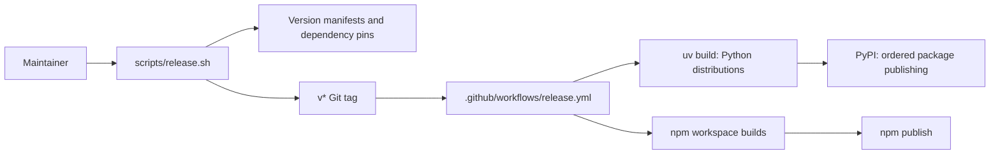
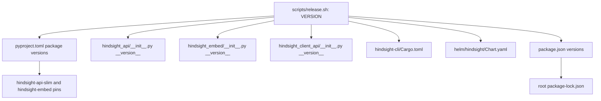
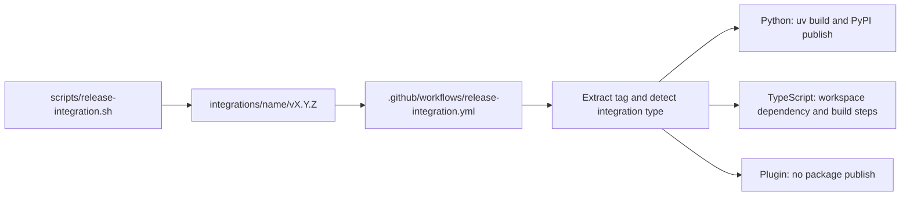
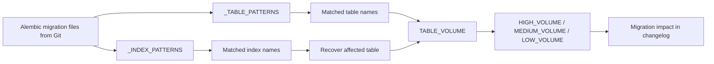
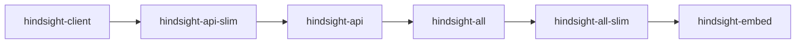
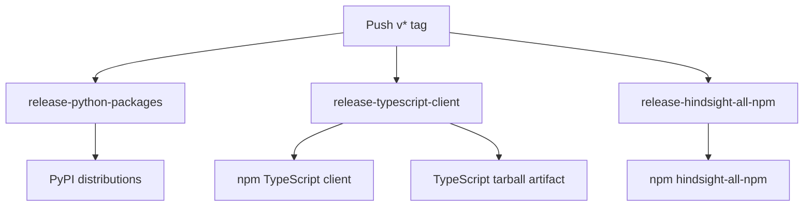

<!-- source: DeepWiki mcp.deepwiki.com · repo vectorize-io/hindsight · page 8.5 Release Process · fetched 2026-10-27 -->

# Release Process

Relevant source files

The following files were used as context for generating this wiki page:

- [.github/workflows/deploy-docs.yml](.github/workflows/deploy-docs.yml)
- [.github/workflows/release-integration.yml](.github/workflows/release-integration.yml)
- [.github/workflows/release.yml](.github/workflows/release.yml)
- [.github/workflows/security-scan.yml](.github/workflows/security-scan.yml)
- [.github/workflows/test.yml](.github/workflows/test.yml)
- [docker/standalone/Dockerfile](docker/standalone/Dockerfile)
- [docker/test-image.sh](docker/test-image.sh)
- [docker/test-slim-local.sh](docker/test-slim-local.sh)
- [hindsight-all-slim/README.md](hindsight-all-slim/README.md)
- [hindsight-all-slim/pyproject.toml](hindsight-all-slim/pyproject.toml)
- [hindsight-all/README.md](hindsight-all/README.md)
- [hindsight-all/pyproject.toml](hindsight-all/pyproject.toml)
- [hindsight-api-slim/hindsight_api/banner.py](hindsight-api-slim/hindsight_api/banner.py)
- [hindsight-api-slim/pyproject.toml](hindsight-api-slim/pyproject.toml)
- [hindsight-api-slim/tests/test_banner.py](hindsight-api-slim/tests/test_banner.py)
- [hindsight-dev/hindsight_dev/generate_changelog.py](hindsight-dev/hindsight_dev/generate_changelog.py)
- [hindsight-dev/hindsight_dev/generate_llms_full.py](hindsight-dev/hindsight_dev/generate_llms_full.py)
- [hindsight-docs/docs-integrations/obsidian.md](hindsight-docs/docs-integrations/obsidian.md)
- [hindsight-docs/plugins/github-stars/index.js](hindsight-docs/plugins/github-stars/index.js)
- [hindsight-docs/src/components/HomeBenchmarks.module.css](hindsight-docs/src/components/HomeBenchmarks.module.css)
- [hindsight-docs/src/components/useGitHubStars.ts](hindsight-docs/src/components/useGitHubStars.ts)
- [hindsight-docs/src/data/integrations.json](hindsight-docs/src/data/integrations.json)
- [hindsight-docs/static/llms.txt](hindsight-docs/static/llms.txt)
- [hindsight-integrations/obsidian/.gitignore](hindsight-integrations/obsidian/.gitignore)
- [hindsight-integrations/obsidian/LICENSE](hindsight-integrations/obsidian/LICENSE)
- [hindsight-integrations/obsidian/README.md](hindsight-integrations/obsidian/README.md)
- [hindsight-integrations/obsidian/src/chat-view.ts](hindsight-integrations/obsidian/src/chat-view.ts)
- [hindsight-integrations/obsidian/src/chat.ts](hindsight-integrations/obsidian/src/chat.ts)
- [hindsight-integrations/obsidian/src/client.ts](hindsight-integrations/obsidian/src/client.ts)
- [hindsight-integrations/obsidian/src/main.ts](hindsight-integrations/obsidian/src/main.ts)
- [hindsight-integrations/obsidian/src/node/cli-bin.ts](hindsight-integrations/obsidian/src/node/cli-bin.ts)
- [hindsight-integrations/obsidian/src/node/cli.ts](hindsight-integrations/obsidian/src/node/cli.ts)
- [hindsight-integrations/obsidian/src/node/fetch-transport.ts](hindsight-integrations/obsidian/src/node/fetch-transport.ts)
- [hindsight-integrations/obsidian/src/node/json-index.ts](hindsight-integrations/obsidian/src/node/json-index.ts)
- [hindsight-integrations/obsidian/src/settings.ts](hindsight-integrations/obsidian/src/settings.ts)
- [hindsight-integrations/obsidian/src/sync.ts](hindsight-integrations/obsidian/src/sync.ts)
- [hindsight-integrations/obsidian/src/types.ts](hindsight-integrations/obsidian/src/types.ts)
- [hindsight-integrations/obsidian/tests/chat.spec.ts](hindsight-integrations/obsidian/tests/chat.spec.ts)
- [hindsight-integrations/obsidian/tests/client.spec.ts](hindsight-integrations/obsidian/tests/client.spec.ts)
- [hindsight-integrations/obsidian/tests/node/cli.spec.ts](hindsight-integrations/obsidian/tests/node/cli.spec.ts)
- [hindsight-integrations/obsidian/tests/node/json-index.spec.ts](hindsight-integrations/obsidian/tests/node/json-index.spec.ts)
- [hindsight-integrations/obsidian/tests/node/reconcile-integration.spec.ts](hindsight-integrations/obsidian/tests/node/reconcile-integration.spec.ts)
- [hindsight-integrations/obsidian/tests/node/watch.spec.ts](hindsight-integrations/obsidian/tests/node/watch.spec.ts)
- [hindsight-integrations/obsidian/tests/sync.spec.ts](hindsight-integrations/obsidian/tests/sync.spec.ts)
- [scripts/check-integration-lockfiles.sh](scripts/check-integration-lockfiles.sh)
- [scripts/release-integration.sh](scripts/release-integration.sh)
- [scripts/release.sh](scripts/release.sh)
- [scripts/smoke-test-slim.sh](scripts/smoke-test-slim.sh)
- [skills/hindsight-docs/references/sdks/integrations/obsidian.md](skills/hindsight-docs/references/sdks/integrations/obsidian.md)
- [uv.lock](uv.lock)

## Purpose and scope

This page documents Hindsight’s core release preparation and publishing workflow, including `scripts/release.sh`, changelog generation and migration volume tiers, and the tag-triggered GitHub Actions workflows. It also covers the separate integration-release path. The available workflow excerpt shows PyPI and npm publishing; it does not expose all later release steps, so publishing details below are limited to what the supplied files establish. [scripts/release.sh:1-194]()[hindsight-dev/hindsight_dev/generate_changelog.py:1-110]()[.github/workflows/release.yml:1-227]()[.github/workflows/release-integration.yml:1-159]()

Sources: `scripts/release.sh`, `hindsight-dev/hindsight_dev/generate_changelog.py`, `.github/workflows/release.yml`, `.github/workflows/release-integration.yml`

---

## 8.5.1 Release pipeline overview

The core release path has two main stages:

1. A maintainer runs `scripts/release.sh <version>`. The script validates the requested semantic version, checks repository state and updates version declarations and dependency pins across packages and deployment manifests. [scripts/release.sh:23-112]()
2. Pushing a `v*` tag triggers `.github/workflows/release.yml`. The shown workflow builds Python packages, publishes them to PyPI in dependency order, then builds and publishes JavaScript packages to npm. [`.github/workflows/release.yml:1-9`]() [`.github/workflows/release.yml:42-120`]() [`.github/workflows/release.yml:136-183`]() [`.github/workflows/release.yml:185-227`]()

The version bump script also updates version fields for the Rust CLI, Helm chart, Control Plane package, npm wrapper, and Python and TypeScript clients. This is version-file preparation; the shown excerpt of the release workflow does not establish how every one of those artifacts is subsequently published. [scripts/release.sh:130-189]()

**Diagram: Core release preparation and visible publishing flow**

Sources: `scripts/release.sh`, `.github/workflows/release.yml`

Sources: `scripts/release.sh:23-112`, `.github/workflows/release.yml:1-9`, `.github/workflows/release.yml:42-120`, `.github/workflows/release.yml:136-227`

---

## 8.5.2 Version management and bumping

### Core version files

`scripts/release.sh` requires an explicit version matching `MAJOR.MINOR.PATCH`. It warns if the current branch is not `main`, requires a clean working tree, and stops if the corresponding `v<version>` tag already exists. [scripts/release.sh:23-63]()

The script updates these package and component manifests:

| Component | Version file |
|---|---|
| Python packages | `hindsight-api/pyproject.toml`, `hindsight-api-slim/pyproject.toml`, `hindsight-all-slim/pyproject.toml`, `hindsight-dev/pyproject.toml`, `hindsight-all/pyproject.toml`, `hindsight-embed/pyproject.toml` |
| Python client | `hindsight-clients/python/pyproject.toml` |
| TypeScript client | `hindsight-clients/typescript/package.json` |
| Control Plane | `hindsight-control-plane/package.json` |
| Rust CLI | `hindsight-cli/Cargo.toml` |
| Helm chart | `helm/hindsight/Chart.yaml` |
| npm wrapper | `hindsight-all-npm/package.json` |

The package list and update loops are defined in the release script. [scripts/release.sh:65-78]()[scripts/release.sh:130-189]()

### Dependency pins and runtime versions

After changing package versions, the script re-pins `hindsight-api-slim` dependencies in the meta-packages and pins `hindsight-embed` in `hindsight-all` and `hindsight-all-slim`. It also updates the `hindsight-api` pin in `hindsight-dev`. These changes keep wrapper packages aligned with the release version rather than allowing an older compatible dependency to remain installed. [scripts/release.sh:80-112]()

The script updates `__version__` in the API package, embedded package, and Python client API package. It also refreshes the root `package-lock.json` after updating npm workspace versions so that CI’s `npm ci` can resolve the bumped workspace packages. [scripts/release.sh:114-128]()[scripts/release.sh:191-194]()

**Diagram: Version synchronization across code entities**

Sources: `scripts/release.sh`

Sources: `scripts/release.sh:65-112`, `scripts/release.sh:114-128`, `scripts/release.sh:130-194`

---

## 8.5.3 Integration release process

Integrations use a separate script and tag namespace. `scripts/release-integration.sh` accepts an integration name from `VALID_INTEGRATIONS` and either an explicit semantic version or a `patch`, `minor`, or `major` bump keyword. The script reads the current version from supported manifests and constructs tags in the form `integrations/<integration>/v<version>`. [scripts/release-integration.sh:16-28]()[scripts/release-integration.sh:52-100]()

Before changing files, the script checks the branch, working-tree cleanliness, and whether the tag already exists. It requires `OPENAI_API_KEY` for changelog generation. For Python integrations it edits `pyproject.toml` and, when present, `plugin.yaml`; for npm integrations it edits `package.json` and synchronizes the package’s own version fields in `package-lock.json`. [scripts/release-integration.sh:102-138]()[scripts/release-integration.sh:140-173]()

The workflow is triggered by tags matching `integrations/**`. It extracts the integration and version from the tag, then selects Python, TypeScript, or plugin handling based on the integration’s files (with a special case for `hermes`). Python packages are built and published to PyPI; plugin integrations do not produce a registry package in the shown workflow. [`.github/workflows/release-integration.yml:1-48`]() [`.github/workflows/release-integration.yml:50-84`]()

**Diagram: Integration tag to workflow type**

Sources: `scripts/release-integration.sh`, `.github/workflows/release-integration.yml`

Sources: `scripts/release-integration.sh:16-100`, `.github/workflows/release-integration.yml:1-48`, `.github/workflows/release-integration.yml:50-84`, `.github/workflows/release-integration.yml:86-122`

---

## 8.5.4 Changelog generation and migration volume tiers

`hindsight-dev/hindsight_dev/generate_changelog.py` describes a changelog generator that fetches the commit diff between releases, summarizes it with an LLM, and prepends the resulting entry to the changelog. Migration discovery is deliberately deterministic: migration files are enumerated from Git rather than selected by the LLM. [hindsight-dev/hindsight_dev/generate_changelog.py:1-7]()[hindsight-dev/hindsight_dev/generate_changelog.py:26-33]()

Migration volume is represented by `VolumeTier` and the constants `HIGH_VOLUME`, `MEDIUM_VOLUME`, and `LOW_VOLUME`; `VOLUME_ORDER` establishes descending volume order. `TABLE_VOLUME` is a reviewed schema map, not an LLM classification. Its comments explain that table size influences migration duration and lock impact, and that tests require newly created tables to be classified. [hindsight-dev/hindsight_dev/generate_changelog.py:35-55]()

| Tier | Meaning in the map | Examples |
|---|---|---|
| `high volume` | Fact-, link-, entity-, chunk-, or history-heavy tables that can grow substantially | `memory_units`, `memory_links`, `entities`, `chunks`, `audit_log` |
| `medium` | Tables that grow with documents, operations, or consolidated knowledge | `documents`, `mental_models`, `async_operations`, `directives`, `attachments` |
| `small` | Configuration-sized tables with relatively few rows per tenant or bank | `banks`, `bank_aliases`, `webhooks`, `bank_stats_cache` |

These assignments and examples come directly from `TABLE_VOLUME`. [hindsight-dev/hindsight_dev/generate_changelog.py:55-92]()

The script identifies tables touched by Alembic operations and raw SQL using `_TABLE_PATTERNS`, and identifies index operations separately using `_INDEX_PATTERNS`. Index names can be used to recover the table they affect; the extracted names are intersected with the reviewed `TABLE_VOLUME` map to avoid treating arbitrary matched prose or column names as known table classifications. [hindsight-dev/hindsight_dev/generate_changelog.py:94-110]()

**Diagram: Migration change classification**

Sources: `hindsight-dev/hindsight_dev/generate_changelog.py`

Sources: `hindsight-dev/hindsight_dev/generate_changelog.py:31-55`, `hindsight-dev/hindsight_dev/generate_changelog.py:94-110`

---

## 8.5.5 Python package build and publish ordering

The core workflow stages the root `LICENSE` file into each isolated Python package build context, then builds each package with `uv build`. It verifies that each resulting wheel and source distribution contains license metadata and the license file before publishing. [`.github/workflows/release.yml:28-40`]() [`.github/workflows/release.yml:42-83`]()

Publishing is intentionally ordered because wrapper packages depend on packages published earlier in the same release. The workflow’s comment explicitly states the ordering rule: publish the client and `hindsight-api-slim` first, followed by API and all-in-one wrappers. The listed order is: [`.github/workflows/release.yml:85-120`]()

| Order | Distribution |
|---:|---|
| 1 | `hindsight-client` |
| 2 | `hindsight-api-slim` |
| 3 | `hindsight-api` |
| 4 | `hindsight-all` |
| 5 | `hindsight-all-slim` |
| 6 | `hindsight-embed` |

Each PyPI publish step uses `skip-existing: true`, allowing the workflow to skip an already-published distribution version. The workflow also uploads the built Python distributions as a short-retention artifact. [`.github/workflows/release.yml:85-120`]() [`.github/workflows/release.yml:122-134`]()

**Diagram: Strict Python publication dependency order**

Sources: `.github/workflows/release.yml`

Sources: `.github/workflows/release.yml:85-120`

---

## 8.5.6 Core release workflow

`.github/workflows/release.yml` runs on pushes to tags matching `v*`. Its Python job uses the PyPI environment and requests an OIDC identity token. It checks out the repository, installs `uv`, configures Python from `.python-version`, stages licenses, builds distributions, verifies license contents, and publishes in the order described above. [`.github/workflows/release.yml:1-26`]() [`.github/workflows/release.yml:28-120`]()

The TypeScript client job configures Node.js 20, installs the client workspace dependencies with `npm ci`, builds the workspace, and runs `npm publish --access public`. If npm reports that the version cannot be published because it already exists, the job treats that condition as a successful skip; other publish failures are returned as errors. It then packs the client and uploads the tarball artifact. [`.github/workflows/release.yml:136-183`]()

A separate `release-hindsight-all-npm` job configures Node.js 22, installs and builds the `hindsight-all-npm` workspace, publishes it to npm, and packs it for artifact upload. The shown excerpt does not include the remainder of the workflow, so it does not establish all downstream release or container-publishing steps. [`.github/workflows/release.yml:185-227`]()

**Diagram: Workflow jobs visible in the release workflow**

Sources: `.github/workflows/release.yml`

Sources: `.github/workflows/release.yml:1-14`, `.github/workflows/release.yml:85-120`, `.github/workflows/release.yml:136-183`, `.github/workflows/release.yml:185-227`

---

## 8.5.7 Integration publishing workflow

The integration workflow uses the tag to determine the integration name and version, then detects the package type from files under `hindsight-integrations/<integration>`. A `pyproject.toml` selects the Python path, a `package.json` selects the TypeScript path, and otherwise the workflow treats the integration as a plugin. `hermes` is explicitly treated as a plugin despite having a `pyproject.toml`. [`.github/workflows/release-integration.yml:21-48`]()

For Python integrations, the workflow installs `uv`, configures Python, builds from the integration directory, and publishes the distribution to PyPI with `skip-existing: true`. The shown TypeScript steps validate integration lockfiles, install root workspace dependencies, build the `hindsight-client` and `hindsight-all-npm` workspaces, then install integration dependencies and build the integration package. [`.github/workflows/release-integration.yml:50-74`]() [`.github/workflows/release-integration.yml:86-122`]()

Plugin integrations have no package publication step in the shown flow. The workflow also includes an Obsidian-specific provenance-attestation step after the TypeScript build; the supplied excerpt describes a mirror to a dedicated repository, but does not include the complete implementation of that mirroring step. [`.github/workflows/release-integration.yml:76-84`]() [`.github/workflows/release-integration.yml:124-159`]()

Sources: `.github/workflows/release-integration.yml`

---

## 8.5.8 Publishing destinations and boundaries

| Destination | What the supplied workflow establishes |
|---|---|
| PyPI | Core Python distributions and Python integrations are built and published with `pypa/gh-action-pypi-publish`. Core Python packages publish in a strict sequence. [`.github/workflows/release.yml:85-120`()]() [`.github/workflows/release-integration.yml:64-74`]() |
| npm | The TypeScript client and `hindsight-all-npm` are built and published with `npm publish`; duplicate-version errors are treated as skips in the shown jobs. [`.github/workflows/release.yml:136-183`()]() [`.github/workflows/release.yml:185-227`]() |
| GHCR and Helm OCI | `scripts/release.sh` updates the Helm chart version and `appVersion`; the supplied workflow excerpt does not show the associated GHCR or Helm OCI publishing steps. [scripts/release.sh:140-149]() |

The release script also updates the Docker-related product’s versioned components only where explicit manifests are listed; the provided Dockerfile excerpt describes image build targets, not release publication. Therefore this page does not infer GHCR publication behavior from the Docker build definition. [scripts/release.sh:130-169]()[docker/standalone/Dockerfile:1-22]()

Sources: `.github/workflows/release.yml`, `.github/workflows/release-integration.yml`, `scripts/release.sh`, `docker/standalone/Dockerfile`

---

## Sources

- Core release version updates: [scripts/release.sh:23-194]()
- Changelog generation and migration classification: [hindsight-dev/hindsight_dev/generate_changelog.py:1-110]()
- Core release workflow: [.github/workflows/release.yml:1-227]()
- Integration release preparation: [scripts/release-integration.sh:16-173]()
- Integration release workflow: [.github/workflows/release-integration.yml:1-159]()
- Docker build-target context: [docker/standalone/Dockerfile:1-22]()

---

