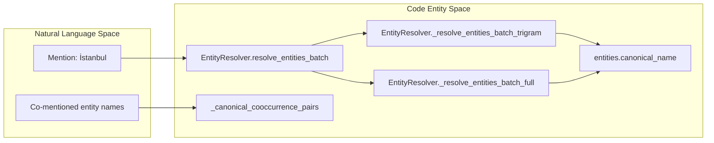
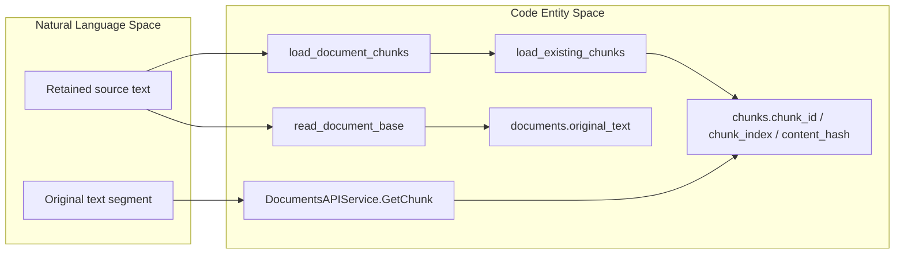

<!-- source: DeepWiki mcp.deepwiki.com · repo vectorize-io/hindsight · page 9.4 Entity, Document and Graph Endpoints · fetched 2026-10-27 -->

# Entity, Document and Graph Endpoints

Relevant source files

The following files were used as context for generating this wiki page:

- [hindsight-api-slim/hindsight_api/engine/memories/pg/retain.py](hindsight-api-slim/hindsight_api/engine/memories/pg/retain.py)
- [hindsight-api-slim/hindsight_api/engine/retain/entity_labels.py](hindsight-api-slim/hindsight_api/engine/retain/entity_labels.py)
- [hindsight-api-slim/tests/test_entity_labels.py](hindsight-api-slim/tests/test_entity_labels.py)
- [hindsight-api-slim/tests/test_entity_resolver.py](hindsight-api-slim/tests/test_entity_resolver.py)
- [hindsight-api-slim/tests/test_entity_resolver_pg_trgm.py](hindsight-api-slim/tests/test_entity_resolver_pg_trgm.py)
- [hindsight-api-slim/tests/test_fact_extraction_entities_llm.py](hindsight-api-slim/tests/test_fact_extraction_entities_llm.py)
- [hindsight-api-slim/tests/test_fact_extraction_entities_schema.py](hindsight-api-slim/tests/test_fact_extraction_entities_schema.py)
- [hindsight-api-slim/tests/test_fact_extraction_example_guard.py](hindsight-api-slim/tests/test_fact_extraction_example_guard.py)
- [hindsight-api-slim/tests/test_fact_extraction_fact_type_prompt.py](hindsight-api-slim/tests/test_fact_extraction_fact_type_prompt.py)
- [hindsight-api-slim/tests/test_observation_invalidation.py](hindsight-api-slim/tests/test_observation_invalidation.py)
- [hindsight-api-slim/tests/test_retain_entity_prune_race.py](hindsight-api-slim/tests/test_retain_entity_prune_race.py)
- [hindsight-api-slim/tests/test_retain_label_tag_projection.py](hindsight-api-slim/tests/test_retain_label_tag_projection.py)
- [hindsight-api-slim/tests/test_retain_tag_change_observations.py](hindsight-api-slim/tests/test_retain_tag_change_observations.py)
- [hindsight-clients/go/api_documents.go](hindsight-clients/go/api_documents.go)
- [hindsight-clients/python/hindsight_client_api/api/documents_api.py](hindsight-clients/python/hindsight_client_api/api/documents_api.py)
- [hindsight-docs/docs/developer/api/documents.mdx](hindsight-docs/docs/developer/api/documents.mdx)
- [hindsight-system-tests/tests/test_11_replace_document.py](hindsight-system-tests/tests/test_11_replace_document.py)
- [hindsight-system-tests/tests/test_24_observation_scopes.py](hindsight-system-tests/tests/test_24_observation_scopes.py)
- [hindsight-system-tests/tests/test_25_observation_lifecycle.py](hindsight-system-tests/tests/test_25_observation_lifecycle.py)
- [skills/hindsight-docs/references/developer/api/documents.md](skills/hindsight-docs/references/developer/api/documents.md)

## Purpose and scope

This page covers the entity, document, chunk, and graph areas of the API reference. The supplied source excerpts describe document behavior, generated document-client operations, document/chunk persistence helpers, and entity-resolution tests. They do **not** include the HTTP route implementation or graph endpoint implementation; where those details cannot be verified from the available files, that limitation is called out rather than inferred. [hindsight-docs/docs/developer/api/documents.mdx:23-38](), [hindsight-clients/go/api_documents.go:24-25](), [hindsight-api-slim/hindsight_api/engine/memories/pg/retain.py:24-35](), [hindsight-api-slim/tests/test_entity_resolver.py:13-16]()

Sources: [hindsight-docs/docs/developer/api/documents.mdx:23-38](), [hindsight-clients/go/api_documents.go:24-25](), [hindsight-api-slim/hindsight_api/engine/memories/pg/retain.py:24-35](), [hindsight-api-slim/tests/test_entity_resolver.py:13-16]()

---

## 1. Entity endpoints

Entities are canonical names resolved during memory retention. The supplied tests instantiate `EntityResolver`, exercise batch resolution, and verify persistence in the `entities` table. They also establish that entity co-occurrence pairs are canonicalized, so each distinct pair is represented in sorted order. [hindsight-api-slim/tests/test_entity_resolver.py:13-16](), [hindsight-api-slim/tests/test_entity_resolver.py:69-100](), [hindsight-api-slim/tests/test_entity_resolver.py:115-157]()

The available excerpts do **not** show the entity HTTP routes, request or response models, or handler functions. Consequently, list, detail, and regenerate route paths and semantics cannot be documented reliably from these files. The tests demonstrate entity resolution and storage behavior, not a public entity API contract. [hindsight-api-slim/tests/test_entity_resolver.py:105-161]()

Sources: [hindsight-api-slim/tests/test_entity_resolver.py:13-16](), [hindsight-api-slim/tests/test_entity_resolver.py:69-100](), [hindsight-api-slim/tests/test_entity_resolver.py:105-161]()

### 1.1 Entity resolution and code mapping

`EntityResolver.resolve_entities_batch` is exercised with a bank ID, extracted entity data, context, and an event date. The test verifies that a case-variant input (`"istanbul"`) resolves to the existing canonical entity `"İstanbul"` rather than creating a second row. [hindsight-api-slim/tests/test_entity_resolver.py:115-157]()

When `entity_lookup="trigram"`, the resolver checks whether `pg_trgm` is available; the tests verify use of the trigram path when available and fallback to the full-scan path when unavailable. The fallback is sticky, and the availability check is performed only once. [hindsight-api-slim/tests/test_entity_resolver_pg_trgm.py:1-9](), [hindsight-api-slim/tests/test_entity_resolver_pg_trgm.py:47-94](), [hindsight-api-slim/tests/test_entity_resolver_pg_trgm.py:97-121](), [hindsight-api-slim/tests/test_entity_resolver_pg_trgm.py:141-166]()

**Diagram: Extracted entity names mapped to resolver and storage symbols**

Sources: [hindsight-api-slim/tests/test_entity_resolver.py:69-100](), [hindsight-api-slim/tests/test_entity_resolver.py:115-157](), [hindsight-api-slim/tests/test_entity_resolver_pg_trgm.py:47-94]()

### 1.2 Entity labels

The retain-side label helpers support configurable, structured entity labels. `EntityLabelsConfig` contains `LabelGroup` definitions, and `parse_entity_labels` accepts either a list of groups or a dictionary with an `attributes` list. The helper also migrates legacy `free_values` and `multi_value` fields to the newer `type` field. [hindsight-api-slim/hindsight_api/engine/retain/entity_labels.py:33-48](), [hindsight-api-slim/hindsight_api/engine/retain/entity_labels.py:51-104]()

The available model-building code supports value, multi-value, text, multi-text, and recursive map field types. Tests cover parsing and the generated Pydantic schema shapes. These excerpts do not establish a separate HTTP endpoint for editing labels. [hindsight-api-slim/hindsight_api/engine/retain/entity_labels.py:107-162](), [hindsight-api-slim/hindsight_api/engine/retain/entity_labels.py:165-185](), [hindsight-api-slim/tests/test_entity_labels.py:26-86](), [hindsight-api-slim/tests/test_entity_labels.py:88-183]()

Sources: [hindsight-api-slim/hindsight_api/engine/retain/entity_labels.py:33-104](), [hindsight-api-slim/hindsight_api/engine/retain/entity_labels.py:107-185](), [hindsight-api-slim/tests/test_entity_labels.py:26-86](), [hindsight-api-slim/tests/test_entity_labels.py:88-183]()

---

## 2. Document endpoints

Documents are containers for retained content. They preserve source traceability and associate source material with extracted memories; retaining content splits it into chunks whose text preserves the original segments used to derive facts. [hindsight-docs/docs/developer/api/documents.mdx:23-38]()

The developer API documentation describes document listing, retrieval, tag updates, and deletion. It also documents document replacement by re-retaining under the same `document_id`. [hindsight-docs/docs/developer/api/documents.mdx:63-105](), [hindsight-docs/docs/developer/api/documents.mdx:130-157](), [skills/hindsight-docs/references/developer/api/documents.md:98-118]()

Sources: [hindsight-docs/docs/developer/api/documents.mdx:23-38](), [hindsight-docs/docs/developer/api/documents.mdx:63-105](), [hindsight-docs/docs/developer/api/documents.mdx:130-157](), [skills/hindsight-docs/references/developer/api/documents.md:98-118]()

### 2.1 List and retrieve documents

The documented list operation supports filtering by ID, tags, and time. The time range is half-open, `[start, end)`, and `time_field` selects `created_at` or `updated_at`; it also determines the timestamp used for newest-first ordering. [hindsight-docs/docs/developer/api/documents.mdx:153-158]()

Document retrieval returns the original text and metadata, including the document ID, memory-unit count, and creation timestamp in the documented client example. This is intended to expand source context when a recall result refers to a document. [hindsight-docs/docs/developer/api/documents.mdx:82-99](), [skills/hindsight-docs/references/developer/api/documents.md:171-197]()

Sources: [hindsight-docs/docs/developer/api/documents.mdx:82-99](), [hindsight-docs/docs/developer/api/documents.mdx:153-158](), [skills/hindsight-docs/references/developer/api/documents.md:171-197]()

### 2.2 Update document tags

The documented document update currently supports `tags`. The request replaces the complete tag array rather than merging it: callers send the desired final set, an empty array clears the tags, and omitting the field is rejected with `422`. [hindsight-docs/docs/developer/api/documents.mdx:101-105]()

When the tag set actually changes, consolidated observations derived from the document’s memories are invalidated and queued for re-consolidation under the new tags. Co-source memories from other documents that contributed to those observations are also reset. Tag comparison is set-based, so reordering the same tags does not trigger the retag/re-consolidation work. [hindsight-docs/docs/developer/api/documents.mdx:122-128]()

Sources: [hindsight-docs/docs/developer/api/documents.mdx:101-105](), [hindsight-docs/docs/developer/api/documents.mdx:122-128]()

### 2.3 Delete documents

Document deletion is destructive. The generated client describes deleting the document, its associated memory units, and links associated with those memories; the documentation warns that the action cannot be undone. [hindsight-clients/python/hindsight_client_api/api/documents_api.py:50-72](), [hindsight-clients/go/api_documents.go:44-55](), [hindsight-docs/docs/developer/api/documents.mdx:130-151]()

The system test checks the lifecycle consequence for derived observations: after deleting a source document, an observation based on its facts no longer appears in recall. [hindsight-system-tests/tests/test_25_observation_lifecycle.py:81-103]()

The generated Go client shows the delete operation as `DELETE /v1/default/banks/{bank_id}/documents/{document_id}`. [hindsight-clients/go/api_documents.go:72-87]()

Sources: [hindsight-clients/python/hindsight_client_api/api/documents_api.py:50-72](), [hindsight-clients/go/api_documents.go:44-55](), [hindsight-clients/go/api_documents.go:72-87](), [hindsight-docs/docs/developer/api/documents.mdx:130-151](), [hindsight-system-tests/tests/test_25_observation_lifecycle.py:81-103]()

---

## 3. Chunk endpoints

Chunks preserve source-text segments created during retention. The documentation describes them as useful for exact wording and surrounding context, and notes that recall can include chunks alongside matched facts. [hindsight-docs/docs/developer/api/documents.mdx:32-42]()

The generated Go client exposes `GetChunk` and constructs the path `/v1/default/chunks/{chunk_id}`. The available excerpt identifies the operation as fetching a specific chunk by ID; it does not include the server handler or response schema definition. [hindsight-clients/go/api_documents.go:160-185](), [hindsight-clients/go/api_documents.go:193-209]()

Sources: [hindsight-docs/docs/developer/api/documents.mdx:32-42](), [hindsight-clients/go/api_documents.go:160-185](), [hindsight-clients/go/api_documents.go:193-209]()

### 3.1 Document/chunk persistence helpers

The PostgreSQL retain helpers separate document and chunk persistence operations. `read_document_base` reads the stored original text and content hash; `load_existing_chunks` reads chunk IDs, indexes, and content hashes in chunk order. The latter scopes the query by both `document_id` and `bank_id`. [hindsight-api-slim/hindsight_api/engine/memories/pg/retain.py:24-35](), [hindsight-api-slim/hindsight_api/engine/memories/pg/retain.py:53-74]()

`load_document_chunks` combines the document version information with its existing chunk state. When requested, it also loads the original text; it then loads the existing chunks and returns a `DocumentChunkState`. [hindsight-api-slim/hindsight_api/engine/memories/pg/retain.py:138-169]()

**Diagram: Source text mapped to document/chunk code symbols**

Sources: [hindsight-api-slim/hindsight_api/engine/memories/pg/retain.py:24-35](), [hindsight-api-slim/hindsight_api/engine/memories/pg/retain.py:53-74](), [hindsight-api-slim/hindsight_api/engine/memories/pg/retain.py:138-169](), [hindsight-clients/go/api_documents.go:160-209]()

---

## 4. Graph endpoint and knowledge-tree exploration

The supplied files do not include a graph route, graph response model, graph traversal handler, or knowledge-tree implementation. Therefore, this section cannot verify endpoint paths, supported traversal parameters, graph result shape, or whether a graph operation is synchronous or asynchronous. The entity resolver tests establish entity storage and co-occurrence-pair canonicalization, but do not establish a public graph API. [hindsight-api-slim/tests/test_entity_resolver.py:69-100](), [hindsight-api-slim/tests/test_entity_resolver.py:115-157]()

Sources: [hindsight-api-slim/tests/test_entity_resolver.py:69-100](), [hindsight-api-slim/tests/test_entity_resolver.py:115-157]()

---

## 5. Endpoint and evidence summary

| Resource | Operation evidenced by supplied files | Verified details |
|---|---|---|
| Entities | Batch resolution and persistence | `EntityResolver.resolve_entities_batch`; canonical entity rows are stored in `entities`. No HTTP entity route is shown. [hindsight-api-slim/tests/test_entity_resolver.py:115-157]() |
| Documents | List | Supports ID, tag, and time filtering in the developer documentation. [hindsight-docs/docs/developer/api/documents.mdx:153-158]() |
| Documents | Get | Retrieves document text and metadata in the documented example. [skills/hindsight-docs/references/developer/api/documents.md:171-197]() |
| Documents | Update tags | Replaces the tag set; changed tags invalidate and queue affected observations for re-consolidation. [hindsight-docs/docs/developer/api/documents.mdx:101-105](), [hindsight-docs/docs/developer/api/documents.mdx:122-128]() |
| Documents | Delete | Generated client documents cascading deletion of the document, associated memories, and links. The Go client shows the `DELETE` path. [hindsight-clients/go/api_documents.go:44-55](), [hindsight-clients/go/api_documents.go:72-87]() |
| Chunks | Get | Go client path is `/v1/default/chunks/{chunk_id}`. [hindsight-clients/go/api_documents.go:193-209]() |
| Graph / knowledge tree | Not verifiable from supplied files | No graph route or implementation excerpt is included. [hindsight-api-slim/tests/test_entity_resolver.py:69-100]() |

Sources: [hindsight-api-slim/tests/test_entity_resolver.py:69-100](), [hindsight-api-slim/tests/test_entity_resolver.py:115-157](), [hindsight-docs/docs/developer/api/documents.mdx:101-105](), [hindsight-docs/docs/developer/api/documents.mdx:122-128](), [hindsight-docs/docs/developer/api/documents.mdx:153-158](), [skills/hindsight-docs/references/developer/api/documents.md:171-197](), [hindsight-clients/go/api_documents.go:44-55](), [hindsight-clients/go/api_documents.go:72-87](), [hindsight-clients/go/api_documents.go:193-209]()

---

