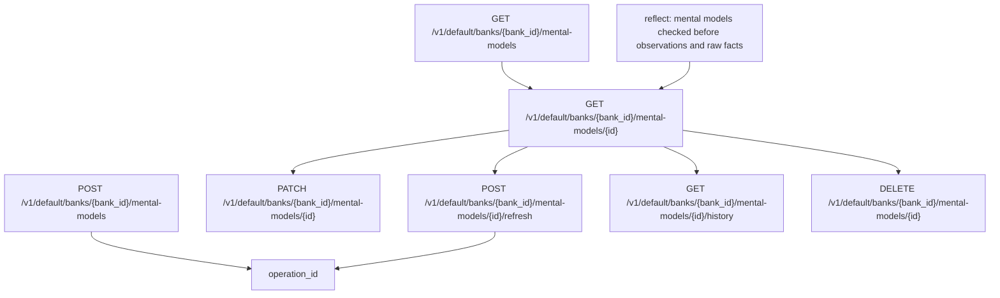
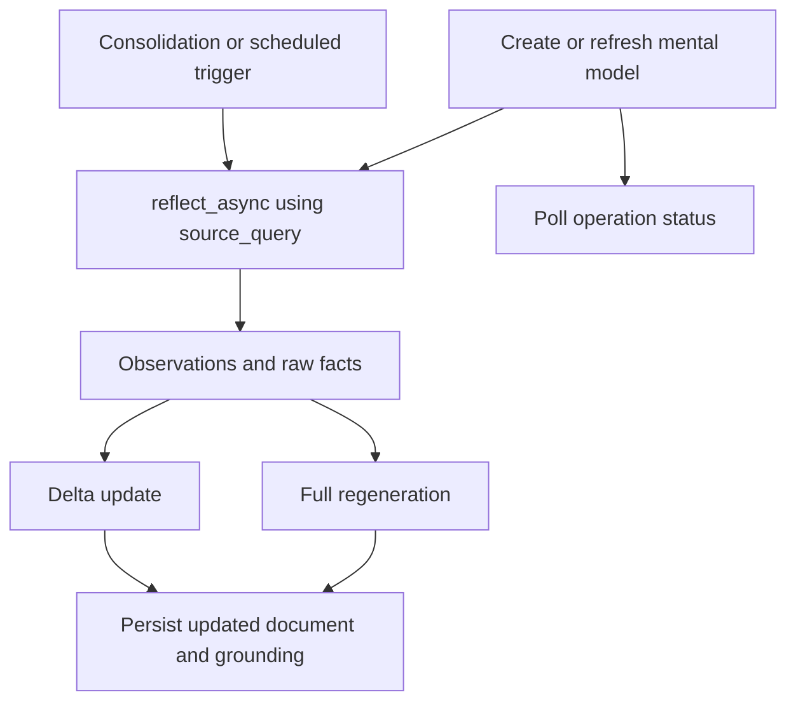
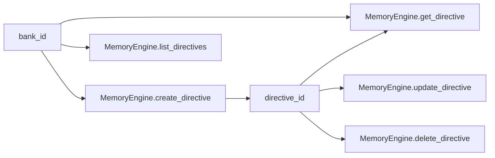
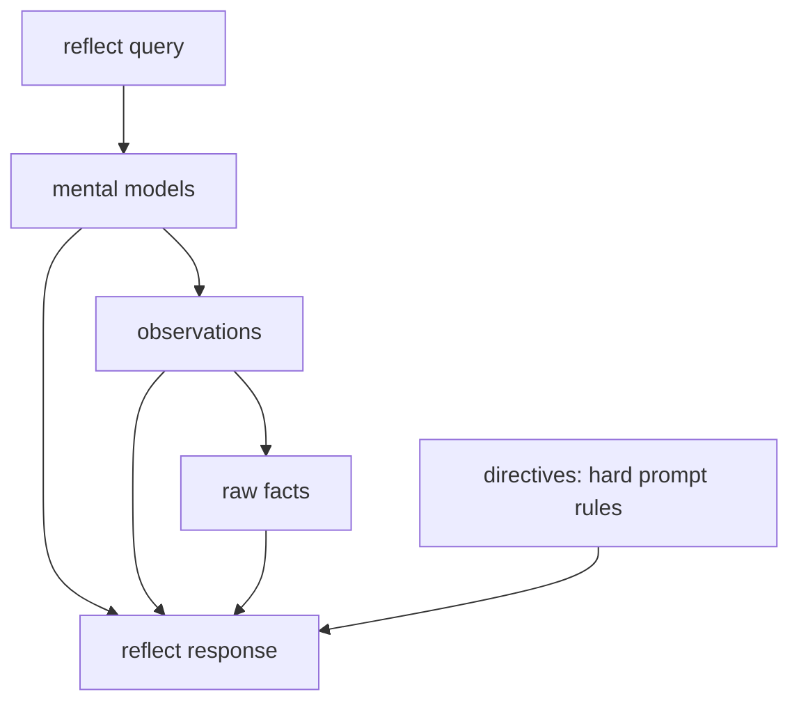
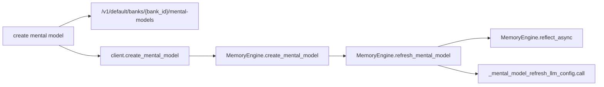
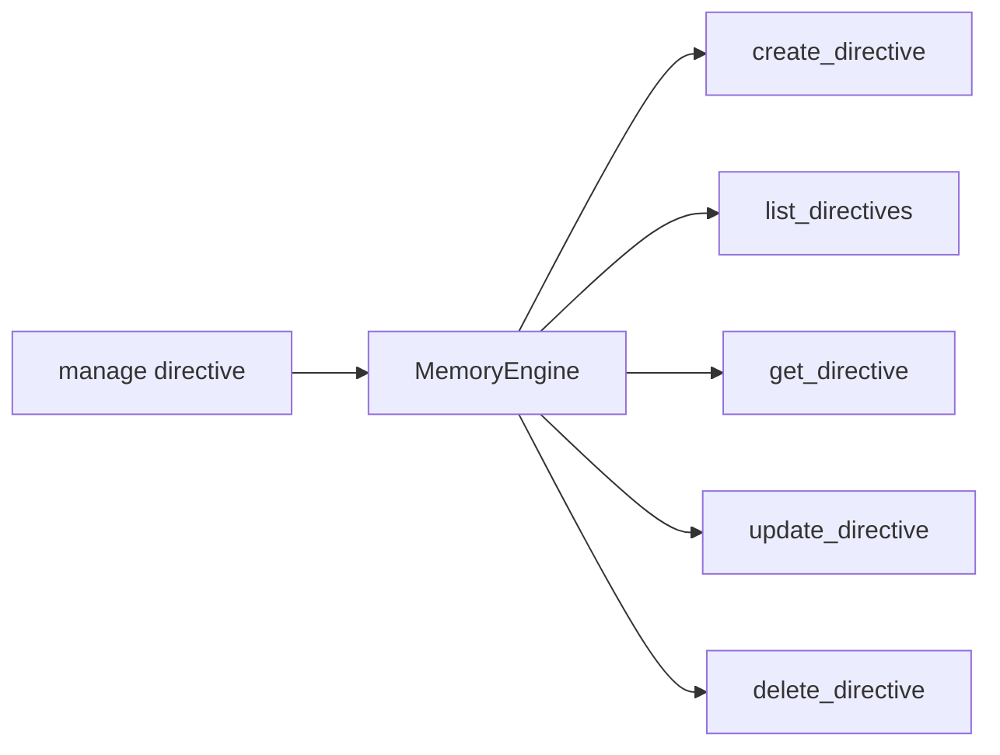

<!-- source: DeepWiki mcp.deepwiki.com · repo vectorize-io/hindsight · page 9.5 Mental Models and Directives Endpoints · fetched 2026-10-27 -->

# Mental Models and Directives Endpoints

Relevant source files

The following files were used as context for generating this wiki page:

- [hindsight-api-slim/tests/test_llm_temperature_env.py](hindsight-api-slim/tests/test_llm_temperature_env.py)
- [hindsight-api-slim/tests/test_mental_model_delta.py](hindsight-api-slim/tests/test_mental_model_delta.py)
- [hindsight-api-slim/tests/test_mental_model_retractions.py](hindsight-api-slim/tests/test_mental_model_retractions.py)
- [hindsight-api-slim/tests/test_mental_models.py](hindsight-api-slim/tests/test_mental_models.py)
- [hindsight-api-slim/tests/test_recall_config.py](hindsight-api-slim/tests/test_recall_config.py)
- [hindsight-docs/docs/developer/api/mental-models.mdx](hindsight-docs/docs/developer/api/mental-models.mdx)
- [hindsight-docs/examples/api/mental-models.go](hindsight-docs/examples/api/mental-models.go)
- [hindsight-docs/examples/api/mental-models.mjs](hindsight-docs/examples/api/mental-models.mjs)
- [hindsight-docs/examples/api/mental-models.py](hindsight-docs/examples/api/mental-models.py)
- [hindsight-docs/examples/api/mental-models.sh](hindsight-docs/examples/api/mental-models.sh)
- [skills/hindsight-docs/references/developer/api/mental-models.md](skills/hindsight-docs/references/developer/api/mental-models.md)

This page documents the bank-scoped mental model and directive API surface and its relationship to reflect. Mental models are saved reflect responses that can be refreshed; directives are rules that affect reflect. The available examples show mental model create, list, detail, update, delete, refresh, clear, dry-run refresh, and history operations. Directive CRUD behavior is exercised at the `MemoryEngine` layer. The supplied sources do not include the HTTP route definitions for these resources, so route-level implementation details beyond the paths shown in the examples are not asserted here. [hindsight-docs/examples/api/mental-models.py:32-55]() [hindsight-api-slim/tests/test_mental_models.py:81-168]()

Sources: [hindsight-docs/examples/api/mental-models.py:32-55](), [hindsight-api-slim/tests/test_mental_models.py:81-168]()

---

## Mental Models

Mental models are saved reflect responses associated with a memory bank. A model has a name and a `source_query`; refresh runs reflect for that query and stores the resulting content. Later reflect calls can consider mental models before observations and raw facts, allowing a saved knowledge page to provide a precomputed answer when it is relevant. [hindsight-docs/docs/developer/api/mental-models.mdx:24-47]() [skills/hindsight-docs/references/developer/api/mental-models.md:10-33]()

Sources: [hindsight-docs/docs/developer/api/mental-models.mdx:24-47](), [skills/hindsight-docs/references/developer/api/mental-models.md:10-33]()

### Concept and Purpose

The mental-model API accepts a human-readable `name` and a `source_query`; creation can also accept an `id`, `tags`, `max_tokens`, and `trigger`. A custom ID is optional; the documentation describes it as lowercase alphanumeric text with hyphens and rejects an ID already in use. Tags scope a model during reflect and filter source memories during refresh. [hindsight-docs/docs/developer/api/mental-models.mdx:51-79]() [hindsight-docs/docs/developer/api/mental-models.mdx:83-104]()

Trigger settings support full or delta refresh, refresh after consolidation, scheduled refresh, and refresh controls such as tag matching and fact-type filtering. The documented default refresh mode is `full`; a tagged model defaults to `all_strict` matching unless configured otherwise. [hindsight-docs/docs/developer/api/mental-models.mdx:108-127]()

Sources: [hindsight-docs/docs/developer/api/mental-models.mdx:51-79](), [hindsight-docs/docs/developer/api/mental-models.mdx:83-104](), [hindsight-docs/docs/developer/api/mental-models.mdx:108-127]()

---

### Mental Model Endpoints

The examples use bank-scoped paths under `/v1/default/banks/{bank_id}/mental-models`. They demonstrate list with optional `detail=content`, retrieve by model ID, create, update, refresh, clear, history, and delete. Refresh and creation return an `operation_id` for tracking completion. [hindsight-docs/examples/api/mental-models.py:32-55]() [hindsight-docs/examples/api/mental-models.py:92-115]() [hindsight-docs/examples/api/mental-models.py:118-180]() [hindsight-docs/examples/api/mental-models.py:182-199]()

Sources: [hindsight-docs/examples/api/mental-models.py:32-55](), [hindsight-docs/examples/api/mental-models.py:92-115](), [hindsight-docs/examples/api/mental-models.py:118-180](), [hindsight-docs/docs/developer/api/mental-models.mdx:39-47]()

| Operation | Path or method shown in examples | Behavior evidenced by the supplied sources |
|---|---|---|
| Create | `POST /v1/default/banks/{bank_id}/mental-models` | Creates a model and returns an operation ID; the content-generation work runs in the background. [hindsight-docs/examples/api/mental-models.py:32-43]() |
| List | `GET /v1/default/banks/{bank_id}/mental-models` | Lists models. `detail="content"` opts into `source_query`, `content`, and `trigger`; metadata is the default. [hindsight-docs/examples/api/mental-models.py:92-99]() [hindsight-docs/examples/api/mental-models.py:182-191]() |
| Detail | `GET /v1/default/banks/{bank_id}/mental-models/{id}` | Retrieves a specific model, including content and last-refresh time in the example. [hindsight-docs/examples/api/mental-models.py:104-115]() |
| Patch/update | `PATCH /v1/default/banks/{bank_id}/mental-models/{id}` | Updates metadata; the example changes the name and refresh trigger. [hindsight-docs/examples/api/mental-models.py:157-167]() |
| Delete | `DELETE /v1/default/banks/{bank_id}/mental-models/{id}` | The CLI example deletes a mental model; its HTTP method is shown in the example’s cleanup only for deleting the bank, not the model. [hindsight-docs/examples/api/mental-models.sh:128-131]() |
| Refresh | `POST /v1/default/banks/{bank_id}/mental-models/{id}/refresh` | Schedules refresh and returns an operation ID. A one-off `mode="full"` request is also demonstrated. [hindsight-docs/examples/api/mental-models.py:118-137]() |
| History | `GET /v1/default/banks/{bank_id}/mental-models/{id}/history` | Returns entries that the example reads for `changed_at` and `previous_content`. [hindsight-docs/examples/api/mental-models.py:170-180]() |

Sources: [hindsight-docs/examples/api/mental-models.py:32-43](), [hindsight-docs/examples/api/mental-models.py:92-115](), [hindsight-docs/examples/api/mental-models.py:118-137](), [hindsight-docs/examples/api/mental-models.py:157-180](), [hindsight-docs/examples/api/mental-models.sh:128-131]()

The sources show a delete operation but do not provide its HTTP method or exact request path. They also do not show a separate HTTP endpoint for knowledge-page search. The documented search behavior is part of reflect: mental models are checked first, followed by observations and raw facts. [hindsight-docs/docs/developer/api/mental-models.mdx:39-47]() [hindsight-docs/examples/api/mental-models.sh:128-131]()

Sources: [hindsight-docs/docs/developer/api/mental-models.mdx:39-47](), [hindsight-docs/examples/api/mental-models.sh:128-131]()

---

### Mental Model Lifecycle and Refresh Workflow

Creation saves the model and returns an operation ID while content generation runs in the background. The docs describe that generation as a reflect run using the model’s `source_query`, which stores the resulting document and the memories it is based on. [hindsight-docs/docs/developer/api/mental-models.mdx:51-54]() [skills/hindsight-docs/references/developer/api/mental-models.md:16-22]()

Refresh can be initiated manually or configured to run after consolidation or on a cron schedule. In delta mode, the implementation’s documented behavior is to preserve unchanged sections, remove stale content, and add new information with surgical edits. The tests describe fallback to full regeneration when the model has no existing content or its source query has changed. [hindsight-docs/docs/developer/api/mental-models.mdx:108-120]() [hindsight-api-slim/tests/test_mental_model_delta.py:1-10]()

Sources: [hindsight-docs/docs/developer/api/mental-models.mdx:51-54](), [skills/hindsight-docs/references/developer/api/mental-models.md:16-28](), [hindsight-api-slim/tests/test_mental_model_delta.py:1-10]()

The refresh implementation’s tests identify `MemoryEngine.refresh_mental_model` as the operation under test and patch `reflect_async` to verify refresh plumbing. They also patch `_mental_model_refresh_llm_config.call` for structured delta operations. These tests establish the relevant engine call boundaries, but do not expose the HTTP handler implementation. [hindsight-api-slim/tests/test_mental_model_delta.py:54-78]() [hindsight-api-slim/tests/test_mental_model_delta.py:81-122]()

Sources: [hindsight-api-slim/tests/test_mental_model_delta.py:54-78](), [hindsight-api-slim/tests/test_mental_model_delta.py:81-122]()

---

### Mental Model Data and Refresh Controls

The examples demonstrate metadata fields including `id`, `name`, `source_query`, `content`, `trigger`, and `last_refreshed_at`. They also demonstrate the `detail` list option: metadata-only by default, and content-oriented details when set to `"content"`. [hindsight-docs/examples/api/mental-models.py:92-115]() [hindsight-docs/examples/api/mental-models.py:182-191]()

Trigger configuration can influence which memories participate in refresh. Documented options include refresh mode, consolidation and cron triggers, tag matching, fact types, exclusion of other models, chunk inclusion, and recall token budgets. The recall-configuration tests confirm that `include_chunks`, `recall_max_tokens`, and `recall_chunks_max_tokens` can be passed through a `MentalModelTrigger`. [hindsight-docs/docs/developer/api/mental-models.mdx:108-127]() [hindsight-api-slim/tests/test_recall_config.py:137-159]()

| Control | Meaning evidenced in the sources |
|---|---|
| `mode` | Selects `"full"` or `"delta"` refresh. [hindsight-docs/docs/developer/api/mental-models.mdx:114-120]() |
| `refresh_after_consolidation` | Enables automatic refresh after observations are consolidated. [hindsight-docs/docs/developer/api/mental-models.mdx:114-120]() |
| `refresh_cron` | Schedules refresh using a UTC five-field cron expression. [hindsight-docs/docs/developer/api/mental-models.mdx:114-120]() |
| `tags_match` / `tag_groups` | Controls tag-based filtering of source memories. [hindsight-docs/docs/developer/api/mental-models.mdx:121-123]() |
| `fact_types` | Restricts refresh to specified fact types; the docs name `world`, `experience`, and `observation`. [hindsight-docs/docs/developer/api/mental-models.mdx:123-124]() |
| `include_chunks`, `recall_max_tokens`, `recall_chunks_max_tokens` | Overrides chunk inclusion and recall token budgets for refresh. [hindsight-docs/docs/developer/api/mental-models.mdx:126-127]() [hindsight-api-slim/tests/test_recall_config.py:137-159]() |

Sources: [hindsight-docs/examples/api/mental-models.py:92-115](), [hindsight-docs/examples/api/mental-models.py:182-191](), [hindsight-docs/docs/developer/api/mental-models.mdx:108-127](), [hindsight-api-slim/tests/test_recall_config.py:137-159]()

---

### Mental Model History, Preview, and Clearing

The examples expose history retrieval and show entries containing `changed_at` and `previous_content`. They also demonstrate a dry-run refresh preview with `effective_mode`, `would_persist`, and `diff`, and clearing content before requesting a fresh refresh. [hindsight-docs/examples/api/mental-models.py:140-153]() [hindsight-docs/examples/api/mental-models.py:170-199]()

A cleared model is subsequently refreshed to rebuild its content. The supplied sources demonstrate the client operations but do not include the server-side history schema, diff algorithm, or clear-handler implementation. [hindsight-docs/examples/api/mental-models.py:140-153]() [hindsight-docs/examples/api/mental-models.mjs:125-133]()

Sources: [hindsight-docs/examples/api/mental-models.py:140-153](), [hindsight-docs/examples/api/mental-models.py:170-199](), [hindsight-docs/examples/api/mental-models.mjs:125-133]()

---

## Directives

Directives are hard rules injected into prompts. The supplied tests exercise directive creation, retrieval, listing, updating, deletion, and priority ordering through methods on `MemoryEngine`. [hindsight-api-slim/tests/test_mental_models.py:1-5]() [hindsight-api-slim/tests/test_mental_models.py:81-168]()

Sources: [hindsight-api-slim/tests/test_mental_models.py:1-5](), [hindsight-api-slim/tests/test_mental_models.py:81-168]()

### Concept and Purpose

A directive has a name and content; creation defaults it to active with priority `0`, as asserted by the test. The tests also create directives with different priorities and expect listing to order them by descending priority. The available evidence does not specify directive tag filtering or the precise prompt-construction function. [hindsight-api-slim/tests/test_mental_models.py:84-103]() [hindsight-api-slim/tests/test_mental_models.py:170-197]()

Sources: [hindsight-api-slim/tests/test_mental_models.py:84-103](), [hindsight-api-slim/tests/test_mental_models.py:170-197]()

---

### Directive Endpoints

The supplied sources do not include directive HTTP route definitions or generated client endpoint files. The following behavior is verified at the engine layer through `create_directive`, `get_directive`, `list_directives`, `update_directive`, and `delete_directive`; the route mapping and wire-level request/response schemas cannot be established from these files. [hindsight-api-slim/tests/test_mental_models.py:107-168]()

Sources: [hindsight-api-slim/tests/test_mental_models.py:107-168]()

| Engine operation | Verified behavior |
|---|---|
| `create_directive` | Creates a directive with name and content; defaults include `is_active=True` and `priority=0`. [hindsight-api-slim/tests/test_mental_models.py:84-103]() |
| `get_directive` | Retrieves a directive by bank and directive ID; after deletion, retrieval returns `None`. [hindsight-api-slim/tests/test_mental_models.py:123-130]() [hindsight-api-slim/tests/test_mental_models.py:151-165]() |
| `list_directives` | Returns a paged result with `total` and `items`; the test checks priority-descending ordering. [hindsight-api-slim/tests/test_mental_models.py:133-140]() [hindsight-api-slim/tests/test_mental_models.py:170-197]() |
| `update_directive` | Updates directive content in the CRUD test. [hindsight-api-slim/tests/test_mental_models.py:142-150]() |
| `delete_directive` | Returns `True` in the CRUD test and removes the directive from subsequent lookup. [hindsight-api-slim/tests/test_mental_models.py:151-165]() |

Sources: [hindsight-api-slim/tests/test_mental_models.py:84-103](), [hindsight-api-slim/tests/test_mental_models.py:123-165](), [hindsight-api-slim/tests/test_mental_models.py:170-197]()

---

## Integration with Reflect Operation

Mental models are described as a preferred reflect source: reflect checks them before observations and raw facts. The mental-model documentation also says that a matching up-to-date model can supply an answer and that the response cites the model it used. [hindsight-docs/docs/developer/api/mental-models.mdx:39-47]() [skills/hindsight-docs/references/developer/api/mental-models.md:29-33]()

The tests identify directives as hard rules injected into prompts, and the reflect retraction tests treat `mental-models` and `directives` as distinct `based_on` categories—not as memory-unit fact types. The supplied files do not show the reflect endpoint handler or the code that assembles directive prompts. [hindsight-api-slim/tests/test_mental_models.py:1-5]() [hindsight-api-slim/tests/test_mental_model_retractions.py:41-60]()

Sources: [hindsight-docs/docs/developer/api/mental-models.mdx:39-47](), [skills/hindsight-docs/references/developer/api/mental-models.md:29-33](), [hindsight-api-slim/tests/test_mental_models.py:1-5](), [hindsight-api-slim/tests/test_mental_model_retractions.py:41-60]()

### Reflect Source Selection

Sources: [hindsight-docs/docs/developer/api/mental-models.mdx:39-47](), [hindsight-api-slim/tests/test_mental_models.py:1-5]()

---

## Code Entity Mapping: Natural Language → Code

### Mental Models: API Use → Engine Refresh

The examples establish the client-facing operation names and the bank-scoped mental-model path. The tests establish `MemoryEngine` and its refresh-related methods as engine-level entities; they do not show the HTTP route-to-engine call site. [hindsight-docs/examples/api/mental-models.py:32-43]() [hindsight-api-slim/tests/test_mental_model_delta.py:54-78]() [hindsight-api-slim/tests/test_mental_models.py:13-18]()

Sources: [hindsight-docs/examples/api/mental-models.py:32-43](), [hindsight-api-slim/tests/test_mental_models.py:13-18](), [hindsight-api-slim/tests/test_mental_model_delta.py:54-78](), [hindsight-api-slim/tests/test_mental_model_delta.py:111-122]()

### Directives: CRUD → `MemoryEngine`

Directive terminology maps directly to the engine methods asserted in `test_directive_crud`. The endpoint route and prompt-building code are not present in the supplied excerpts. [hindsight-api-slim/tests/test_mental_models.py:107-168]()

Sources: [hindsight-api-slim/tests/test_mental_models.py:107-168]()

---

## Summary

- Mental models are saved reflect responses identified by a name and source query; create and refresh examples return operation IDs for background work. [hindsight-docs/docs/developer/api/mental-models.mdx:51-54]() [hindsight-docs/examples/api/mental-models.py:32-43]()
- Mental models support full and delta refresh, trigger configuration, listing, detail retrieval, metadata updates, history, preview, and clearing in the documented examples. [hindsight-docs/docs/developer/api/mental-models.mdx:108-127]() [hindsight-docs/examples/api/mental-models.py:92-199]()
- Directives are described as hard prompt rules, and their engine-level CRUD and priority behavior are tested through `MemoryEngine`. [hindsight-api-slim/tests/test_mental_models.py:1-5]() [hindsight-api-slim/tests/test_mental_models.py:81-197]()
- The available sources do not establish directive HTTP route details or a separate knowledge-page search endpoint; they document mental-model lookup as part of reflect’s source selection. [hindsight-docs/docs/developer/api/mental-models.mdx:39-47]() [hindsight-api-slim/tests/test_mental_models.py:107-168]()

Sources: [hindsight-docs/docs/developer/api/mental-models.mdx:39-54](), [hindsight-docs/docs/developer/api/mental-models.mdx:108-127](), [hindsight-docs/examples/api/mental-models.py:92-199](), [hindsight-api-slim/tests/test_mental_models.py:81-197]()

---

