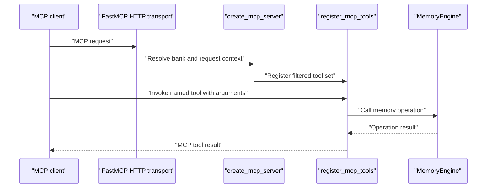

<!-- source: DeepWiki mcp.deepwiki.com · repo vectorize-io/hindsight · page 9.7 MCP Server API · fetched 2026-10-27 -->

# MCP Server API

<details>
<summary>Relevant source files</summary>

The following files were used as context for generating this wiki page:

- [hindsight-api-slim/hindsight_api/api/mcp.py](hindsight-api-slim/hindsight_api/api/mcp.py)
- [hindsight-api-slim/hindsight_api/api/observability.py](hindsight-api-slim/hindsight_api/api/observability.py)
- [hindsight-api-slim/hindsight_api/api/passthrough_headers.py](hindsight-api-slim/hindsight_api/api/passthrough_headers.py)
- [hindsight-api-slim/hindsight_api/api/unknown_params.py](hindsight-api-slim/hindsight_api/api/unknown_params.py)
- [hindsight-api-slim/hindsight_api/extensions/tenant.py](hindsight-api-slim/hindsight_api/extensions/tenant.py)
- [hindsight-api-slim/hindsight_api/mcp_tools.py](hindsight-api-slim/hindsight_api/mcp_tools.py)
- [hindsight-api-slim/tests/test_extension_passthrough_headers.py](hindsight-api-slim/tests/test_extension_passthrough_headers.py)
- [hindsight-api-slim/tests/test_http_observability_middleware.py](hindsight-api-slim/tests/test_http_observability_middleware.py)
- [hindsight-api-slim/tests/test_mcp_routing.py](hindsight-api-slim/tests/test_mcp_routing.py)
- [hindsight-api-slim/tests/test_mcp_tools.py](hindsight-api-slim/tests/test_mcp_tools.py)
- [hindsight-api-slim/tests/test_unknown_params.py](hindsight-api-slim/tests/test_unknown_params.py)
- [hindsight-docs/docs/developer/mcp-server.md](hindsight-docs/docs/developer/mcp-server.md)
- [skills/hindsight-docs/references/developer/mcp-server.md](skills/hindsight-docs/references/developer/mcp-server.md)

</details>


## Purpose and scope

This page documents Hindsight’s MCP interface: its HTTP access patterns, bank selection, tool catalog and filtering, authentication context, and the relationship between MCP tool calls and `MemoryEngine`. The HTTP transport is implemented with FastMCP in `hindsight_api.api.mcp`; the shared tool implementations are in `hindsight_api.mcp_tools`. [hindsight-api-slim/hindsight_api/api/mcp.py:1-23]() [hindsight-api-slim/hindsight_api/mcp_tools.py:1-6]()

**Sources:** `hindsight-api-slim/hindsight_api/api/mcp.py:1-23`; `hindsight-api-slim/hindsight_api/mcp_tools.py:1-6`

## Architecture and data flow

MCP is a protocol adapter: FastMCP exposes registered tools, and the shared tool module provides the implementations that invoke Hindsight operations. The tool module is explicitly shared between the HTTP transport and a local stdio transport. [hindsight-api-slim/hindsight_api/mcp_tools.py:1-6]() The HTTP server factory creates a `FastMCP` instance, selects the available tool set, builds an `MCPToolsConfig`, and registers tools using `register_mcp_tools`. [hindsight-api-slim/hindsight_api/api/mcp.py:114-126]() [hindsight-api-slim/hindsight_api/api/mcp.py:130-183]()

### Request propagation pipeline

A client sends MCP protocol requests to the HTTP endpoint. The transport resolves request-level values such as bank and authentication context into context variables; tool implementations use those values when calling the engine. [hindsight-docs/docs/developer/mcp-server.md:67-90]() [hindsight-api-slim/hindsight_api/api/mcp.py:48-99]() Tests confirm that a registered `retain` tool reads the bank from `_current_bank_id` and passes the resolved value to `submit_async_retain`. [hindsight-api-slim/tests/test_mcp_routing.py:49-73]()

**Diagram: MCP request path from client to engine**



**Sources:** `hindsight-api-slim/hindsight_api/api/mcp.py:48-99`; `hindsight-api-slim/hindsight_api/api/mcp.py:114-183`; `hindsight-api-slim/hindsight_api/mcp_tools.py:1-6`; `hindsight-api-slim/tests/test_mcp_routing.py:49-73`

### Natural-language actions and code entities

The MCP tool names form the client-facing vocabulary. For example, an agent’s request to store information maps to `retain` or `sync_retain`; a request to retrieve or reason over memories maps to `recall` or `reflect`. The tool catalog includes these names, and the HTTP server registers the catalog through `register_mcp_tools`. [hindsight-api-slim/hindsight_api/mcp_tools.py:42-85]() [hindsight-api-slim/hindsight_api/api/mcp.py:182-183]()

**Diagram: agent actions mapped to Hindsight code entities**

```mermaid
flowchart LR
    Agent as ["Agent intent"]
    Store as ["Store information"]
    Retrieve as ["Find relevant memories"]
    Reason as ["Generate a response"]
    Store --> Retain as ["retain"]
    Store --> SyncRetain as ["sync_retain"]
    Retrieve --> Recall as ["recall"]
    Reason --> Reflect as ["reflect"]
    Retain --> Register as ["register_mcp_tools"]
    SyncRetain --> Register
    Recall --> Register
    Reflect --> Register
    Register --> Engine as ["MemoryEngine"]
```

**Sources:** `hindsight-api-slim/hindsight_api/mcp_tools.py:42-50`; `hindsight-api-slim/hindsight_api/api/mcp.py:182-183`

### Server setup and transport modes

`create_mcp_server(memory, multi_bank=True)` constructs a FastMCP server named `hindsight-mcp-server` and includes the Hindsight version in its metadata. It reads the raw global configuration, chooses the mode’s base tool set, applies any configured tool allowlist, derives optional retain/recall descriptions, then constructs `MCPToolsConfig` and registers tools. [hindsight-api-slim/hindsight_api/api/mcp.py:114-126]() [hindsight-api-slim/hindsight_api/api/mcp.py:128-183]()

The documented HTTP access paths are `/mcp/` for multi-bank access and `/mcp/{bank_id}/` for bank-scoped access. The developer documentation describes the former as exposing bank-management tools and the latter as using the URL’s bank implicitly. [hindsight-docs/docs/developer/mcp-server.md:9-20]() [hindsight-docs/docs/developer/mcp-server.md:97-108]()

| Mode | Endpoint | Bank selection | Tool-set behavior |
|---|---|---|---|
| Multi-bank | `/mcp/` | Tools can receive an explicit `bank_id`; the transport also supports the documented header/default selection. [hindsight-docs/docs/developer/mcp-server.md:80-108]() | Uses the full catalog, subject to the global allowlist. [hindsight-api-slim/hindsight_api/api/mcp.py:130-176]() |
| Single-bank | `/mcp/{bank_id}/` | Bank is implicit from the endpoint. [hindsight-docs/docs/developer/mcp-server.md:88-108]() | Uses `_SINGLE_BANK_TOOLS`, subject to the global allowlist. [hindsight-api-slim/hindsight_api/api/mcp.py:130-176]() |

**Sources:** `hindsight-api-slim/hindsight_api/api/mcp.py:114-183`; `hindsight-docs/docs/developer/mcp-server.md:9-20`; `hindsight-docs/docs/developer/mcp-server.md:80-108`

## MCP tool definitions

The shared module declares `_ALL_TOOLS` as an explicit `frozenset` of tool names; it does not use a wildcard catalog. The list covers memory operations, bank management, mental models, directives, documents, operations, tags, and knowledge-base nodes. [hindsight-api-slim/hindsight_api/mcp_tools.py:42-85]()

### Tool catalog

The table below groups the names present in `_ALL_TOOLS`. It describes the tool categories by name; individual argument schemas and behavior are defined by the registered tool implementations. [hindsight-api-slim/hindsight_api/mcp_tools.py:42-85]()

| Category | Tool names |
|---|---|
| Memory operations | `retain`, `sync_retain`, `recall`, `reflect` |
| Banks | `list_banks`, `create_bank`, `get_bank`, `get_bank_stats`, `update_bank`, `delete_bank`, `clear_memories` |
| Mental models | `list_mental_models`, `get_mental_model`, `create_mental_model`, `update_mental_model`, `delete_mental_model`, `refresh_mental_model`, `clear_mental_model` |
| Directives | `list_directives`, `create_directive`, `delete_directive` |
| Memories | `list_memories`, `get_memory`, `update_memory`, `invalidate_memory` |
| Documents | `list_documents`, `get_document`, `delete_document` |
| Operations | `list_operations`, `get_operation`, `cancel_operation` |
| Tags | `list_tags` |
| Knowledge base | `get_knowledge_base_tree`, `search_knowledge_base`, `get_knowledge_page`, `create_knowledge_folder`, `create_knowledge_page`, `update_knowledge_node`, `delete_knowledge_node` |

**Sources:** `hindsight-api-slim/hindsight_api/mcp_tools.py:42-85`

### Tool inputs and validation constraints

The shared tool module uses Pydantic models and annotated fields for tool input validation. It defines paging constraints, including non-negative offsets, non-negative general limits, a limit range of 1–1000, and an operations limit range of 1–100. [hindsight-api-slim/hindsight_api/mcp_tools.py:15-40]()

`MentalModelTriggerInput` mirrors the HTTP trigger fields while making each field optional and forbidding extra fields. Its documented semantics distinguish unset fields from explicit `null`; MCP updates can send only fields supplied by the caller so that the engine can merge the partial update with stored settings. [hindsight-api-slim/hindsight_api/mcp_tools.py:91-106]()

**Sources:** `hindsight-api-slim/hindsight_api/mcp_tools.py:15-40`; `hindsight-api-slim/hindsight_api/mcp_tools.py:91-106`

### Tool annotations and operator instructions

The developer guide documents MCP annotations for read-only operations, destructive operations, and the built-in tools’ `openWorldHint`. It also documents deployment-specific guidance appended to `retain` and `recall` descriptions using `HINDSIGHT_API_MCP_INSTRUCTIONS`. [hindsight-docs/docs/developer/mcp-server.md:110-123]()

In the server implementation, `_build_mcp_tool_descriptions` returns no custom descriptions for absent or blank instructions. Otherwise, it appends an “Additional instructions” suffix to the default retain and recall descriptions. [hindsight-api-slim/hindsight_api/api/mcp.py:101-112]()

**Sources:** `hindsight-docs/docs/developer/mcp-server.md:110-123`; `hindsight-api-slim/hindsight_api/api/mcp.py:101-112`

## Endpoint routing and bank selection

The MCP server is enabled by default and mounted at `/mcp`; the documented bank-specific URL form is `/mcp/{bank_id}/`. [hindsight-docs/docs/developer/mcp-server.md:9-20]() The HTTP implementation defines `DEFAULT_BANK_ID` from `HINDSIGHT_MCP_BANK_ID`, defaulting to `default`. [hindsight-api-slim/hindsight_api/api/mcp.py:41-43]()

The documented bank-selection precedence is:

1. Bank ID in the URL path.
2. `X-Bank-Id` request header.
3. `HINDSIGHT_MCP_BANK_ID`, defaulting to `default`. [hindsight-docs/docs/developer/mcp-server.md:80-86]()

The MCP module keeps the current bank in `_current_bank_id`, a `ContextVar`, and exposes `get_current_bank_id()` to retrieve it. Tests verify that tool calls use the context bank when calling the engine. [hindsight-api-slim/hindsight_api/api/mcp.py:48-50]() [hindsight-api-slim/hindsight_api/api/mcp.py:67-70]() [hindsight-api-slim/tests/test_mcp_routing.py:49-73]()

**Diagram: endpoint selection and bank context**

```mermaid
flowchart TD
    Request as ["Request to /mcp"]
    Path as ["URL path includes bank_id"]
    Header as ["X-Bank-Id header"]
    Default as ["HINDSIGHT_MCP_BANK_ID"]
    Context as ["_current_bank_id"]
    Tool as ["MCP tool"]
    Engine as ["MemoryEngine"]

    Request --> Path
    Path -->| "present" | Context
    Path -->| "absent" | Header
    Header -->| "present" | Context
    Header -->| "absent" | Default
    Default --> Context
    Context --> Tool
    Tool --> Engine
```

**Sources:** `hindsight-api-slim/hindsight_api/api/mcp.py:41-50`; `hindsight-api-slim/hindsight_api/api/mcp.py:67-70`; `hindsight-docs/docs/developer/mcp-server.md:80-90`; `hindsight-api-slim/tests/test_mcp_routing.py:49-73`

## Tool filtering by configuration and extension

Tool exposure is selected in `create_mcp_server`. Multi-bank mode starts without a mode-specific restriction; single-bank mode starts with `_SINGLE_BANK_TOOLS`. If `global_config.mcp_enabled_tools` is configured, the server intersects that allowlist with the mode’s base set—or with `_ALL_TOOLS` in multi-bank mode. [hindsight-api-slim/hindsight_api/api/mcp.py:130-176]()

The server passes the resulting tool configuration to `register_mcp_tools`. The source shown here imports `MCPExtension` and `load_extension`, but does not expose their invocation or any extension-based tool filtering behavior; extension hooks should therefore not be inferred from those imports alone. [hindsight-api-slim/hindsight_api/api/mcp.py:19-23]() [hindsight-api-slim/hindsight_api/api/mcp.py:182-183]()

**Diagram: tool-set selection**

```mermaid
flowchart TD
    Mode as ["multi_bank"]
    All as ["_ALL_TOOLS"]
    Single as ["_SINGLE_BANK_TOOLS"]
    Config as ["mcp_enabled_tools"]
    Intersect as ["Allowed tool intersection"]
    Register as ["register_mcp_tools"]

    Mode -->| "true" | All
    Mode -->| "false" | Single
    All --> Intersect
    Single --> Intersect
    Config --> Intersect
    Intersect --> Register
```

**Sources:** `hindsight-api-slim/hindsight_api/api/mcp.py:130-176`; `hindsight-api-slim/hindsight_api/api/mcp.py:182-183`

## Authentication and request context propagation

The developer guide states that MCP is open by default. To enable API-key authentication, configure the tenant extension and its API key; authenticated clients send the key as a Bearer token in `Authorization`. The guide documents `401 Unauthorized` for a missing or invalid key. [hindsight-docs/docs/developer/mcp-server.md:28-39]() [hindsight-docs/docs/developer/mcp-server.md:67-78]()

The MCP module also reads a legacy MCP authentication token from configuration. Its comments state that this token is checked before TenantExtension authentication when configured. [hindsight-api-slim/hindsight_api/api/mcp.py:44-47]()

### Request-scoped context

The HTTP MCP module defines context variables for bank ID, API key, tenant ID, API key ID, whether MCP transport authentication succeeded, and allowlisted passthrough headers. It provides getter functions for these values; `get_current_extra_headers()` returns a copy of the stored header mapping. [hindsight-api-slim/hindsight_api/api/mcp.py:48-99]()

`MCPToolsConfig` is constructed with the configured tool set and the server’s request-context resolver functions in the server setup path. [hindsight-api-slim/hindsight_api/api/mcp.py:182-183]() The routing tests verify that API key, tenant ID, and API key ID context values are propagated into `RequestContext` for tool operations. [hindsight-api-slim/tests/test_mcp_routing.py:134-157]() [hindsight-api-slim/tests/test_mcp_routing.py:188-200]()

### Tenant extension and passthrough headers

`TenantExtension.authenticate(context)` is the extension seam for authenticating a request and returning a `TenantContext`; `TenantContext` carries the PostgreSQL schema name used for tenant isolation. [hindsight-api-slim/hindsight_api/extensions/tenant.py:24-35]() [hindsight-api-slim/hindsight_api/extensions/tenant.py:54-97]()

By default, the tenant extension receives the bearer credential as `RequestContext.api_key`. Additional headers are forwarded only when an operator opts them in through `HINDSIGHT_API_EXTENSION_PASSTHROUGH_HEADERS`; the extension documentation says these appear in `RequestContext.extra_headers` for both HTTP and MCP transports. [hindsight-api-slim/hindsight_api/extensions/tenant.py:71-81]() MCP transport tests cover allowlisted header collection. [hindsight-api-slim/tests/test_extension_passthrough_headers.py:173-193]()

**Diagram: MCP authentication context to tenant isolation**

```mermaid
flowchart LR
    Headers as ["Authorization and opted-in headers"]
    Middleware as ["MCPMiddleware"]
    ContextVars as ["_current_api_key, _current_tenant_id, _current_api_key_id"]
    RequestContext as ["RequestContext"]
    Extension as ["TenantExtension.authenticate"]
    TenantContext as ["TenantContext.schema_name"]
    Tool as ["MCP tool"]
    Engine as ["MemoryEngine"]

    Headers --> Middleware
    Middleware --> ContextVars
    ContextVars --> RequestContext
    RequestContext --> Extension
    Extension --> TenantContext
    TenantContext --> Tool
    Tool --> Engine
```

**Sources:** `hindsight-api-slim/hindsight_api/api/mcp.py:48-99`; `hindsight-api-slim/hindsight_api/extensions/tenant.py:24-35`; `hindsight-api-slim/hindsight_api/extensions/tenant.py:54-97`; `hindsight-api-slim/hindsight_api/extensions/tenant.py:71-81`; `hindsight-api-slim/tests/test_extension_passthrough_headers.py:173-193`

## MCP-specific request and response patterns

MCP clients use JSON-RPC requests. The developer guide’s direct HTTP example calls `tools/list` with a JSON-RPC `2.0` request and uses `Content-Type: application/json` plus an `Accept` header that includes both `application/json` and `text/event-stream`. [hindsight-docs/docs/developer/mcp-server.md:67-76]()

Tool calls carry a tool name and arguments; Hindsight’s tool definitions describe input parameters and constrain certain values through Pydantic models and annotated fields. [hindsight-docs/docs/developer/mcp-server.md:127-140]() [hindsight-api-slim/hindsight_api/mcp_tools.py:15-40]() The shared tool module includes helpers such as `parse_timestamp` and `build_content_dict`; tests verify ISO timestamp parsing and that an invalid timestamp produces an error rather than a content dictionary. [hindsight-api-slim/tests/test_mcp_tools.py:29-82]()

For retain, the documented distinction is that `retain` submits work asynchronously, while `sync_retain` waits for completion and is intended for read-after-write cases. [hindsight-docs/docs/developer/mcp-server.md:129-189]()

**Sources:** `hindsight-docs/docs/developer/mcp-server.md:67-76`; `hindsight-docs/docs/developer/mcp-server.md:127-189`; `hindsight-api-slim/hindsight_api/mcp_tools.py:15-40`; `hindsight-api-slim/tests/test_mcp_tools.py:29-82`

## Configuration reference

| Setting | Purpose |
|---|---|
| `HINDSIGHT_API_MCP_ENABLED` | The developer guide documents setting this to `false` to disable MCP. [hindsight-docs/docs/developer/mcp-server.md:9-26]() |
| `HINDSIGHT_MCP_BANK_ID` | Default MCP bank ID; the implementation defaults it to `default`. [hindsight-api-slim/hindsight_api/api/mcp.py:41-43]() |
| `HINDSIGHT_API_MCP_INSTRUCTIONS` | Adds deployment-specific instructions to the `retain` and `recall` tool descriptions. [hindsight-docs/docs/developer/mcp-server.md:110-116]() [hindsight-api-slim/hindsight_api/api/mcp.py:101-112]() |
| `mcp_enabled_tools` | Global configuration allowlist intersected with the selected mode’s tool set. [hindsight-api-slim/hindsight_api/api/mcp.py:173-176]() |
| `HINDSIGHT_API_TENANT_EXTENSION` | Selects the tenant extension used for API-key authentication. [hindsight-docs/docs/developer/mcp-server.md:28-39]() |
| `HINDSIGHT_API_TENANT_API_KEY` | Configures the API key for the documented built-in API-key tenant extension. [hindsight-docs/docs/developer/mcp-server.md:28-39]() |
| `HINDSIGHT_API_EXTENSION_PASSTHROUGH_HEADERS` | Opts selected request headers into `RequestContext.extra_headers` for extensions. [hindsight-api-slim/hindsight_api/extensions/tenant.py:71-81]() |

**Sources:** `hindsight-api-slim/hindsight_api/api/mcp.py:41-43`; `hindsight-api-slim/hindsight_api/api/mcp.py:101-112`; `hindsight-api-slim/hindsight_api/api/mcp.py:173-176`; `hindsight-docs/docs/developer/mcp-server.md:9-39`; `hindsight-docs/docs/developer/mcp-server.md:110-116`; `hindsight-api-slim/hindsight_api/extensions/tenant.py:71-81`

## Implementation map

| Code entity | Role |
|---|---|
| `hindsight_api.api.mcp.create_mcp_server` | Creates the FastMCP server and configures the selected tool set. [hindsight-api-slim/hindsight_api/api/mcp.py:114-183]() |
| `_ALL_TOOLS` | Explicit catalog of available tool names. [hindsight-api-slim/hindsight_api/mcp_tools.py:42-85]() |
| `_SINGLE_BANK_TOOLS` | Tool set used for single-bank server configuration. [hindsight-api-slim/hindsight_api/api/mcp.py:130-171]() |
| `_build_mcp_tool_descriptions` | Builds optional customized `retain` and `recall` descriptions. [hindsight-api-slim/hindsight_api/api/mcp.py:101-112]() |
| `MCPToolsConfig` | Shared configuration passed to tool registration. [hindsight-api-slim/hindsight_api/api/mcp.py:182-183]() |
| `register_mcp_tools` | Registers the shared MCP tools with the configured server. [hindsight-api-slim/hindsight_api/api/mcp.py:182-183]() |
| `TenantExtension` | Authentication and tenant-context extension interface. [hindsight-api-slim/hindsight_api/extensions/tenant.py:54-97]() |
| `RequestContext` | Carries request authentication and extension context into operations. [hindsight-api-slim/hindsight_api/extensions/tenant.py:71-97]() |

**Sources:** `hindsight-api-slim/hindsight_api/api/mcp.py:101-183`; `hindsight-api-slim/hindsight_api/mcp_tools.py:42-85`; `hindsight-api-slim/hindsight_api/extensions/tenant.py:54-97`

## Summary

Hindsight’s MCP API exposes an explicit tool catalog over FastMCP and shares tool implementations across HTTP and local stdio transports. [hindsight-api-slim/hindsight_api/mcp_tools.py:1-6]() The HTTP server selects tools by transport mode and intersects them with the configured allowlist. [hindsight-api-slim/hindsight_api/api/mcp.py:130-176]() Bank selection and request authentication are carried through request-scoped context, while `TenantExtension` provides the authentication-to-tenant boundary. [hindsight-api-slim/hindsight_api/api/mcp.py:48-99]() [hindsight-api-slim/hindsight_api/extensions/tenant.py:54-97]()

**Sources:** `hindsight-api-slim/hindsight_api/mcp_tools.py:1-6`; `hindsight-api-slim/hindsight_api/api/mcp.py:48-99`; `hindsight-api-slim/hindsight_api/api/mcp.py:130-176`; `hindsight-api-slim/hindsight_api/extensions/tenant.py:54-97`

---

