# Page: Overview

# Overview

<details>
<summary>Relevant source files</summary>

The following files were used as context for generating this wiki page:

- [README.md](README.md)
- [docker/standalone/start-all.sh](docker/standalone/start-all.sh)
- [docker/standalone/test-start-all.sh](docker/standalone/test-start-all.sh)
- [helm/hindsight/Chart.yaml](helm/hindsight/Chart.yaml)
- [hindsight-api-slim/hindsight_api/http_probe.py](hindsight-api-slim/hindsight_api/http_probe.py)
- [hindsight-api-slim/tests/test_http_probe.py](hindsight-api-slim/tests/test_http_probe.py)
- [hindsight-api/pyproject.toml](hindsight-api/pyproject.toml)
- [hindsight-cli/Cargo.toml](hindsight-cli/Cargo.toml)
- [hindsight-clients/python/pyproject.toml](hindsight-clients/python/pyproject.toml)
- [hindsight-clients/typescript/package.json](hindsight-clients/typescript/package.json)
- [hindsight-control-plane/bin/cli.js](hindsight-control-plane/bin/cli.js)
- [hindsight-control-plane/package.json](hindsight-control-plane/package.json)
- [hindsight-control-plane/tests/lib/cli-bind-host.test.ts](hindsight-control-plane/tests/lib/cli-bind-host.test.ts)
- [hindsight-dev/pyproject.toml](hindsight-dev/pyproject.toml)
- [hindsight-docs/docs/developer/api/quickstart.mdx](hindsight-docs/docs/developer/api/quickstart.mdx)
- [hindsight-docs/docs/developer/installation.md](hindsight-docs/docs/developer/installation.md)
- [hindsight-docs/versioned_docs/version-0.8/developer/installation.md](hindsight-docs/versioned_docs/version-0.8/developer/installation.md)
- [hindsight-docs/versioned_docs/version-0.9/developer/api/quickstart.mdx](hindsight-docs/versioned_docs/version-0.9/developer/api/quickstart.mdx)
- [hindsight-docs/versioned_docs/version-0.9/developer/installation.md](hindsight-docs/versioned_docs/version-0.9/developer/installation.md)
- [hindsight-embed/hindsight_embed/__init__.py](hindsight-embed/hindsight_embed/__init__.py)
- [hindsight-embed/pyproject.toml](hindsight-embed/pyproject.toml)
- [hindsight-integrations/litellm/pyproject.toml](hindsight-integrations/litellm/pyproject.toml)
- [skills/hindsight-docs/references/developer/api/quickstart.md](skills/hindsight-docs/references/developer/api/quickstart.md)
- [skills/hindsight-docs/references/developer/installation.md](skills/hindsight-docs/references/developer/installation.md)

</details>


## Purpose and Scope

Hindsight™ is an agent memory system designed to build smarter agents that learn and evolve over time. Moving beyond mere conversation history, Hindsight uses a **biomimetic long-term memory architecture** that distinctly organizes stored knowledge into three core fact types: world facts (external objective knowledge), experience facts (agent's interactions and actions), and mental models (curated knowledge summaries) [README.md:22-28](). This structure supports persistent, nuanced agent state, entity resolution across sessions, and autonomous reflection to synthesize new insights [README.md:22-28]().

This page provides a high-level introduction to Hindsight’s core concepts, operations, and monorepo architecture. For expanded technical details on package layout and documentation tooling, please refer to the child pages:
- **[Package Structure](#1.1)** — Overview of the monorepo composition including core engine variants, client SDKs, integrations, and distribution targets.
- **[Documentation and Skills Sites](#1.2)** — Explanation of the documentation site (`hindsight-docs`), the `skills/` AI-agent consumable references, and LLM provider metadata generation.

Sources: [README.md:22-28]()

---

## Biomimetic Memory Architecture

Hindsight’s design is inspired by human cognition, structuring memory into distinct but interconnected layers to foster comprehensive and adaptable agent reasoning.

### Memory Types and Their Representation

| Memory Type | Code Representation | Role and Purpose |
|---|---|---|
| **World Facts** | `MemoryUnit` entries with `fact_type = world` | Objective external facts about the environment or general knowledge [README.md:35](). |
| **Experience Facts** | `MemoryUnit` entries with `fact_type = experience` | Records of the agent's own actions, interactions, and experiences [README.md:35](). |
| **Observations** | `MemoryUnit` entries with `fact_type = observation` | Synthesized patterns and higher-level insight formed by consolidating related facts [README.md:35](). |
| **Mental Models** | `MentalModel` entities (stored separately) | Curated, stable knowledge pages or summaries established for common queries or persona definition [README.md:35](). |

The system supports interlinking these fact types, with reflection operations primarily operating on mental models and observations to prioritize relevant, distilled knowledge [README.md:35]().

### Diagram: Biomimetic Memory Hierarchy Mapping
```mermaid
graph TB
    subgraph "NaturalLanguageSpace"
        MM_NL["Mental Model (Curated Knowledge)"]
        OBS_NL["Observation (Pattern Synthesis)"]
        WORLD_NL["World Fact (Objective Knowledge)"]
        EXP_NL["Experience Fact (Agent Actions)"]
    end

    subgraph "CodeEntitySpace"
        MM["MentalModel<br/>(\"mental_models\" table)"]
        OBS["MemoryUnit (Observation)<br/>(\"memory_units\" table)"]
        WORLD["MemoryUnit (World Fact)<br/>(\"memory_units\" table)"]
        EXP["MemoryUnit (Experience Fact)<br/>(\"memory_units\" table)"]
    end
    
    MM_NL -.-> MM
    OBS_NL -.-> OBS
    WORLD_NL -.-> WORLD
    EXP_NL -.-> EXP
    
    MM -->|Reflect Priority 1| OBS
    OBS -->|Synthesized from| WORLD
    OBS -->|Synthesized from| EXP
```

Sources: [README.md:35]()

---

## Core Operations

Hindsight defines a concise set of operations as the backbone for memory interaction:

| Operation | Description |
|---|---|
| **RETAIN** | Ingest new information by extracting facts from inputs, performing entity resolution, and generating vector embeddings [README.md:35](). |
| **RECALL** | Retrieve relevant memories using a multi-strategy retrieval system that combines semantic vector search, BM25 text search, graph traversal, and temporal proximity [README.md:35](). |
| **REFLECT** | Perform autonomous reasoning by iteratively querying recall results, consulting mental models and directives, and synthesizing answers [README.md:35](). |

Sources: [README.md:35]()

---

## Monorepo Structure

Hindsight is developed and distributed as a monorepo consisting of specialized packages, SDKs, integration libraries, control plane UI, and developer tools.

For details on package organization, distribution targets, and interdependencies, see [Package Structure](#1.1).

### Diagram: Mapping Natural Language Components to Code Entities and Packages
```mermaid
graph TB
    subgraph "NaturalLanguageSpace"
        CoreEngine_NL["Core Memory Engine"]
        ClientSDKs_NL["Multi-language Clients and CLI"]
        ControlPlane_NL["Control Plane UI"]
    end

    subgraph "CodeEntitySpace"
        API_SLIM["hindsight-api-slim<br/>(\"hindsight_api\" package)"]
        API_FULL["hindsight-api<br/>(\"hindsight_api.main\")"]
        ALL_PACKAGES["hindsight-all / hindsight-all-slim / hindsight-all-npm"]
        PYTHON_SDK["hindsight-clients/python"]
        TS_SDK["hindsight-clients/typescript"]
        GO_SDK["hindsight-clients/go"]
        RUST_CLI["hindsight-cli (Rust CLI)"]
        EMBEDDED["hindsight-embed"]
        CONTROL_PLANE["hindsight-control-plane<br/>(\"@vectorize-io/hindsight-control-plane\")"]
    end

    CoreEngine_NL -.-> API_SLIM
    API_SLIM --> API_FULL
    API_FULL --> ALL_PACKAGES

    ClientSDKs_NL --> PYTHON_SDK
    ClientSDKs_NL --> TS_SDK
    ClientSDKs_NL --> GO_SDK
    ClientSDKs_NL --> RUST_CLI
    ClientSDKs_NL --> EMBEDDED

    ControlPlane_NL -.-> CONTROL_PLANE
    ALL_PACKAGES --> PYTHON_SDK
    ALL_PACKAGES --> TS_SDK
    ALL_PACKAGES --> RUST_CLI
    ALL_PACKAGES --> CONTROL_PLANE
```

Sources: [hindsight-api/pyproject.toml:7](), [hindsight-control-plane/package.json:3]()

---

## Documentation and Skills Sites

Hindsight includes comprehensive documentation (`hindsight-docs`), Docusaurus sites, versioned docs, an `skills/` directory containing AI-agent-consumable references, and automated `llms.txt` generation.

For details on documentation tooling, layout, and agent skills, see [Documentation and Skills Sites](#1.2).

Sources: [README.md:56-60]()

---

## Child Pages

- **[Package Structure](#1.1)** — Detail the monorepo organization: `hindsight-api-slim`, `hindsight-api`, `hindsight-all`, client SDKs, integrations, control plane, Rust CLI, `hindsight-embed`, and extensions.
- **[Documentation and Skills Sites](#1.2)** — Cover `hindsight-docs` Docusaurus site, `skills/` directory, and `llms.txt` generation.

Sources: [README.md:22-120]()

---

# Page: Package Structure

# Package Structure

<details>
<summary>Relevant source files</summary>

The following files were used as context for generating this wiki page:

- [helm/hindsight/Chart.yaml](helm/hindsight/Chart.yaml)
- [hindsight-all-slim/README.md](hindsight-all-slim/README.md)
- [hindsight-all-slim/pyproject.toml](hindsight-all-slim/pyproject.toml)
- [hindsight-all/README.md](hindsight-all/README.md)
- [hindsight-all/pyproject.toml](hindsight-all/pyproject.toml)
- [hindsight-api-slim/hindsight_api/banner.py](hindsight-api-slim/hindsight_api/banner.py)
- [hindsight-api-slim/tests/test_banner.py](hindsight-api-slim/tests/test_banner.py)
- [hindsight-api/pyproject.toml](hindsight-api/pyproject.toml)
- [hindsight-cli/Cargo.toml](hindsight-cli/Cargo.toml)
- [hindsight-clients/python/pyproject.toml](hindsight-clients/python/pyproject.toml)
- [hindsight-clients/typescript/package.json](hindsight-clients/typescript/package.json)
- [hindsight-control-plane/package.json](hindsight-control-plane/package.json)
- [hindsight-dev/hindsight_dev/generate_llms_full.py](hindsight-dev/hindsight_dev/generate_llms_full.py)
- [hindsight-dev/pyproject.toml](hindsight-dev/pyproject.toml)
- [hindsight-docs/static/llms.txt](hindsight-docs/static/llms.txt)
- [hindsight-embed/hindsight_embed/__init__.py](hindsight-embed/hindsight_embed/__init__.py)
- [hindsight-embed/pyproject.toml](hindsight-embed/pyproject.toml)
- [hindsight-integrations/litellm/pyproject.toml](hindsight-integrations/litellm/pyproject.toml)
- [scripts/release.sh](scripts/release.sh)

</details>


This document details the monorepo organization of the Hindsight codebase, explaining the relationships between the core engine, API variants, client SDKs, integrations, control plane, CLI, development tools, extensions, and distribution targets.

## Monorepo Organization

Hindsight uses a hybrid monorepo structure combining Python (managed by `uv` workspaces), TypeScript (managed by `npm` workspaces), and Rust (managed by Cargo). The repository contains multiple independently publishable packages that share common versioning and infrastructure.

### Repository Layout

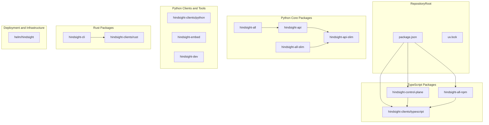

This graph reflects the multi-language workspace setup:

- Python core packages include the slim and full API variants, and meta-packages bundling these with clients and embedded tools.
- Python clients include the Python SDK, embedded CLI, and development utilities.
- TypeScript packages cover the TypeScript client, the control plane UI, and all-in-one npm meta-packages.
- Rust packages comprise the command-line interface and its Rust client library.
- Helm chart manages Kubernetes deployment configurations.

Sources: [uv.lock:20-28](), [hindsight-api/pyproject.toml:12-14](), [hindsight-control-plane/package.json:80-80](), [hindsight-cli/Cargo.toml:15-15]()

## Core API Packages

### hindsight-api-slim

This is the foundational Python package implementing the core Hindsight memory engine, accessible via a FastAPI HTTP server with background worker support. It focuses on minimal dependencies and uses external cloud providers for ML tasks unless extras are installed.

| Attribute      | Value                                  |
| -------------- | ------------------------------------ |
| **Package Name**  | `hindsight-api-slim`                  |
| **Location**      | `hindsight-api-slim/`                 |
| **Main Scripts**  | `hindsight-api`, `hindsight-worker`, `hindsight-local-mcp`, `hindsight-admin` |

**Key components:**

- API entry point at `hindsight_api.main:main`
- Background worker entry point at `hindsight_api.worker.main:main`
- Model Context Protocol (MCP) server at `hindsight_api.mcp_local:main`
- Admin CLI at `hindsight_api.admin.cli:main`

These are configured as Python console scripts in `pyproject.toml`.

Sources: [hindsight-api/pyproject.toml:19-23]()

### hindsight-api

A "batteries-included" wrapper package that depends on `hindsight-api-slim[all]`. This variant bundles local ML models such as `sentence-transformers` and `flashrank` for embeddings and reranking, removing the need for external ML service dependence.

| Attribute    | Value               |
| ------------ | ------------------- |
| Package Name | `hindsight-api`     |
| Location     | `hindsight-api/`    |
| Dependency  | `hindsight-api-slim[all]==<version>` |

Sources: [hindsight-api/pyproject.toml:6-14]()

### Meta-Packages: hindsight-all, hindsight-all-slim, hindsight-all-npm

- `hindsight-all` bundles the core slim API engine (`hindsight-api-slim`), the Python client package, and the embedded CLI package for ease of installation [hindsight-all/pyproject.toml:12-16]().
- `hindsight-all-slim` is a lighter variant bundling just the slim API and embedded CLI.
- `hindsight-all-npm` is an npm meta-package wrapping the TypeScript client and dependencies for JS ecosystem users.

These meta-packages provide a convenient way to install a full or minimal Hindsight system depending on user requirements, combining multiple sub-packages.

Sources: [hindsight-all/pyproject.toml:6-15](), [scripts/release.sh:68-189]()

## Client SDK Packages

Hindsight follows an API-first philosophy. All clients are generated from the OpenAPI specification (`openapi.json`) ensuring consistent data models and request schemas.

### Client Generation Pipeline

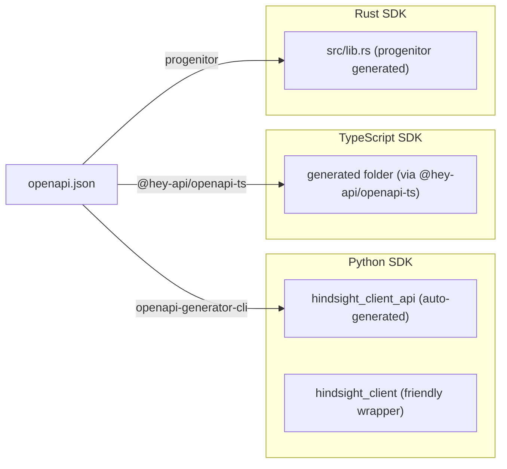

The Python SDK separates the auto-generated API client (`hindsight_client_api`) from the user-friendly high-level wrapper (`hindsight_client`) which offers async helpers and domain abstractions. The TypeScript client builds from the same specification and outputs typings and request wrappers to support browser and Node.js environments. The Rust client is generated by Progenitor for strong typing and command-line integration.

Sources: [hindsight-clients/typescript/package.json:18-18](), [hindsight-dev/pyproject.toml:33-33](), [hindsight-clients/python/pyproject.toml:33-33]()

### Python Client (`hindsight-client`)

- Location: `hindsight-clients/python/`
- Provides both `hindsight_client_api` (auto-generated models and clients) and `hindsight_client` (a developer-friendly wrapper class) [hindsight-clients/python/pyproject.toml:33-33]().
- Dependencies include `aiohttp` for async HTTP calls and `pydantic` for strict model validation [hindsight-clients/python/pyproject.toml:11-19]().
- Supports sync and async; handles token management, connection pooling, and retry logic internally.

Sources: [hindsight-clients/python/pyproject.toml:1-33]()

### TypeScript Client (`@vectorize-io/hindsight-client`)

- Location: `hindsight-clients/typescript/`
- Uses `tsup` for building distributable ESM, CommonJS, and type definitions [hindsight-clients/typescript/package.json:5-14]().
- Also relies on `@hey-api/openapi-ts` for generating fully typed clients from the OpenAPI spec [hindsight-clients/typescript/package.json:18-18]().
- Designed for modern JavaScript/TypeScript development in Node.js, browsers, and frameworks like Next.js.

Sources: [hindsight-clients/typescript/package.json:1-52]()

## Command Line Interface and Embedded Tools

### Rust CLI (`hindsight-cli`)

- Location: `hindsight-cli/`
- Provides the user-facing `hindsight` binary executable [hindsight-cli/Cargo.toml:9-11]().
- Implements numerous commands for bank management, memory operations, document management, and mental models.
- Uses asynchronous runtime Tokio and integrates the Rust client library for API calls [hindsight-cli/Cargo.toml:15-22]().
- Includes terminal UI components based on ratatui and crossterm [hindsight-cli/Cargo.toml:33-34]().

Sources: [hindsight-cli/Cargo.toml:1-63]()

### Embedded CLI and Daemon (`hindsight-embed`)

- Location: `hindsight-embed/`
- Python-based CLI tool for local memory operations in embedded mode without a separate server [hindsight-embed/pyproject.toml:6-8]().
- Provides `DaemonEmbedManager` to manage daemon lifecycle and profiles stored under `~/.hindsight/embed` [hindsight-embed/hindsight_embed/__init__.py:3-10]().
- Bundles a local HTTP server for control center UI, configuration management, and auto-spawning daemon processes.
- Designed for zero-config local development or single-user embedded deployments.

Sources: [hindsight-embed/pyproject.toml:6-18](), [hindsight-embed/hindsight_embed/__init__.py:1-11]()

## Control Plane UI and Documentation

### hindsight-control-plane (Next.js)

- Location: `hindsight-control-plane/`
- Full-featured React-based UI for managing memory banks, viewing memories/entities, configuring operations, and tracing search/debug data.
- Implemented with Next.js including API proxy routes to the backend memory engine [hindsight-control-plane/package.json:15-18]().
- Supports i18n (10 locales) and bundling for standalone deployment [hindsight-control-plane/package.json:16-17]().
- Distribution includes a standalone production build for simplified deployment [hindsight-control-plane/package.json:16-17]().

Sources: [hindsight-control-plane/package.json:1-90]()

### Documentation and Extensions

- `hindsight-dev`: Development utilities and CLI tooling for managing OpenAPI spec generation, changelogs, benchmarks, and experimental features [hindsight-dev/pyproject.toml:6-47]().
- `hindsight-extensions`: Authentication extensions and security add-ons.
- `hindsight-docs` / skills: Reference documentation and AI-agent-consumable skills directories.

Sources: [hindsight-dev/pyproject.toml:6-47]()

## Integration Packages

### hindsight-litellm

- Provides a universal LLM memory integration leveraging LiteLLM, supporting 100+ LLM providers in a unified adapter interface [hindsight-integrations/litellm/pyproject.toml:2-4]().
- Facilitates local and remote LLM access with fallback and batch features.
- Integrates closely with `hindsight-client` and `hindsight-api` for seamless ML operations [hindsight-integrations/litellm/pyproject.toml:36-36]().

Sources: [hindsight-integrations/litellm/pyproject.toml:1-49]()

## Deployment Artifacts

### Helm Chart

- Directory: `helm/hindsight`
- Kubernetes Helm chart for deploying Hindsight with configurable services, including API, control plane, and workers.
- Supports embedding search and reranker services (TEI), model cache volumes, Prometheus monitoring.
- Current chart and app version: `1.1.0` [helm/hindsight/Chart.yaml:5-6]().

Sources: [helm/hindsight/Chart.yaml:1-13]()

### Distribution Targets

| Method           | Packages/Artifacts                                              |
|------------------|----------------------------------------------------------------|
| PyPI             | `hindsight-api`, `hindsight-api-slim`, `hindsight-all`, `hindsight-all-slim`, `hindsight-embed`, `hindsight-dev` [scripts/release.sh:68-68]|
| NPM              | `@vectorize-io/hindsight-client` (TypeScript client), `@vectorize-io/hindsight-control-plane`, `hindsight-all-npm` [scripts/release.sh:152-169]|
| GHCR (Docker)    | Multi-variant container images: `latest` (full), `slim` (minimal), designed for standalone or slim deployments |

All version bumps and packaging are controlled by `scripts/release.sh` which updates version metadata and pins cross-package dependencies appropriately to prevent version drift on upgrades [scripts/release.sh:65-189]().

Sources: [scripts/release.sh:24-189]()

---

# Bridging Natural Language Space to Code Entity Space

### Diagram 1: Core API and Meta-packages

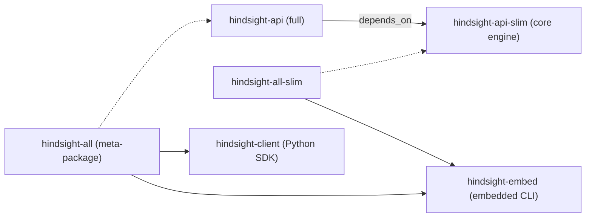

- `hindsight-api-slim` implements the core engine and API server.
- `hindsight-api` adds local ML features by extending `slim` with extras [hindsight-api/pyproject.toml:12-14]().
- `hindsight-all` bundles full API, Python client SDK, and embedded CLI for easy installation [hindsight-all/pyproject.toml:12-16]().
- `hindsight-all-slim` bundles slim API and embedded CLI only.

Sources: [hindsight-api/pyproject.toml:6-14](), [hindsight-all/pyproject.toml:6-16](), [scripts/release.sh:68-105]()

### Diagram 2: Client SDKs and CLI Tooling

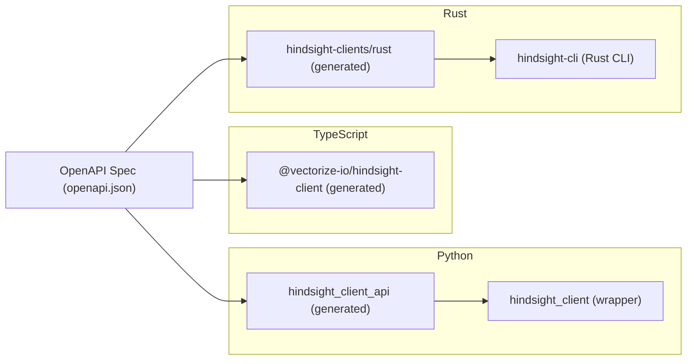

- OpenAPI specification drives generation of clients in Python, TypeScript, and Rust.
- Python client includes an auto-generated API client and a higher-level developer wrapper.
- Rust client library is consumed by the `hindsight` CLI [hindsight-cli/Cargo.toml:15-15]().
- TypeScript client powers browser and Node.js applications, including the control plane.

Sources: [hindsight-clients/typescript/package.json:18-18](), [hindsight-dev/pyproject.toml:33-33](), [hindsight-cli/Cargo.toml:15-15]()

---

This package structure supports Hindsight's goals of modularity, multi-language support, optimized deployment strategies, and extensibility via integration packages and control plane UI.

Sources:  
- [hindsight-api/pyproject.toml:6-23]()  
- [hindsight-all/pyproject.toml:5-16]()  
- [hindsight-control-plane/package.json:1-90]()  
- [hindsight-clients/python/pyproject.toml:1-33]()  
- [hindsight-clients/typescript/package.json:1-52]()  
- [hindsight-cli/Cargo.toml:1-63]()  
- [hindsight-embed/pyproject.toml:1-20]()  
- [hindsight-embed/hindsight_embed/__init__.py:1-11]()  
- [hindsight-integrations/litellm/pyproject.toml:1-49]()  
- [hindsight-dev/pyproject.toml:5-47]()  
- [helm/hindsight/Chart.yaml:1-13]()  
- [scripts/release.sh:24-189]()

---

# Page: Documentation and Skills Sites

# Documentation and Skills Sites

<details>
<summary>Relevant source files</summary>

The following files were used as context for generating this wiki page:

- [hindsight-docs/blog/2026-10-21-nemotron-3-5-embed-in-hindsight.md](hindsight-docs/blog/2026-10-21-nemotron-3-5-embed-in-hindsight.md)
- [hindsight-docs/blog/authors.yml](hindsight-docs/blog/authors.yml)
- [hindsight-docs/docs/developer/index.mdx](hindsight-docs/docs/developer/index.mdx)
- [hindsight-docs/docusaurus.config.ts](hindsight-docs/docusaurus.config.ts)
- [hindsight-docs/package.json](hindsight-docs/package.json)
- [hindsight-docs/sidebars.ts](hindsight-docs/sidebars.ts)
- [hindsight-docs/src/css/custom.css](hindsight-docs/src/css/custom.css)
- [hindsight-docs/src/pages/best-practices.mdx](hindsight-docs/src/pages/best-practices.mdx)
- [hindsight-docs/src/pages/faq.mdx](hindsight-docs/src/pages/faq.mdx)
- [hindsight-docs/src/theme/DocSidebarItem/Link/index.tsx](hindsight-docs/src/theme/DocSidebarItem/Link/index.tsx)
- [hindsight-docs/static/img/blog/nemotron-3-5-embed-beam-100k.png](hindsight-docs/static/img/blog/nemotron-3-5-embed-beam-100k.png)
- [hindsight-docs/static/img/blog/nemotron-3-5-embed-beam-1m.png](hindsight-docs/static/img/blog/nemotron-3-5-embed-beam-1m.png)
- [hindsight-docs/static/img/blog/nemotron-3-5-embed-languages-table.png](hindsight-docs/static/img/blog/nemotron-3-5-embed-languages-table.png)
- [hindsight-docs/static/img/blog/nemotron-3-5-embed-latency.png](hindsight-docs/static/img/blog/nemotron-3-5-embed-latency.png)
- [hindsight-docs/static/img/blog/nemotron-3-5-embed-leaderboard.png](hindsight-docs/static/img/blog/nemotron-3-5-embed-leaderboard.png)
- [hindsight-docs/static/img/blog/nemotron-3-5-embed-locomo.png](hindsight-docs/static/img/blog/nemotron-3-5-embed-locomo.png)
- [hindsight-docs/static/img/blog/nemotron-3-5-embed-multilingual.png](hindsight-docs/static/img/blog/nemotron-3-5-embed-multilingual.png)
- [hindsight-docs/static/img/blog/nemotron-3-5-embed-passages-locomo.png](hindsight-docs/static/img/blog/nemotron-3-5-embed-passages-locomo.png)
- [hindsight-docs/static/img/blog/nemotron-3-5-embed-results-table.png](hindsight-docs/static/img/blog/nemotron-3-5-embed-results-table.png)
- [hindsight-docs/static/img/social-card.png](hindsight-docs/static/img/social-card.png)
- [hindsight-docs/versioned_docs/version-0.10/developer/index.mdx](hindsight-docs/versioned_docs/version-0.10/developer/index.mdx)
- [package-lock.json](package-lock.json)
- [package.json](package.json)
- [skills/hindsight-docs/references/best-practices.md](skills/hindsight-docs/references/best-practices.md)
- [skills/hindsight-docs/references/developer/index.md](skills/hindsight-docs/references/developer/index.md)

</details>


## Purpose and Scope

This page covers the technical architecture and tooling behind Hindsight's documentation ecosystem. It details the Docusaurus-based `hindsight-docs` site, the structured AI-agent-consumable reference directory (`skills/`), automated generation pipelines, and the interactive figure tooling used to produce documentation diagrams and assets.

---

## 1. Docusaurus Documentation Engine (`hindsight-docs`)

The primary documentation site is located in the `hindsight-docs` package and built using Docusaurus v3 `[hindsight-docs/package.json:17-34]()`. It integrates core documentation, versioning frameworks, blogs, custom CSS themes, and an OpenAPI reference viewer via `redocusaurus` `[hindsight-docs/docusaurus.config.ts:160-197]()`.

### Configuration and Build Performance

The site configuration (`[hindsight-docs/docusaurus.config.ts:17-157]()`) sets up site metadata, internationalization, head tags, and optimization flags. To accelerate local builds and continuous integration, Docusaurus Faster is partially enabled (`[hindsight-docs/docusaurus.config.ts:22-38]()`):
- **Enabled Features**: SWC JS loader, Lightning CSS minifier, MDX cross-compiler cache, Rspack bundler, and Rspack persistent cache.
- **Disabled Features**: SWC JS minimizer and SSG worker threads are disabled to prevent runtime failures in Redoc where the `Prism` global variable is expected during static generation of `/api-reference` `[hindsight-docs/docusaurus.config.ts:30-37]()`.

The `package.json` for `hindsight-docs` defines scripts for Docusaurus operations such as `start`, `build`, `deploy`, and `clear` `[hindsight-docs/package.json:5-15]()`. The `build` script performs validation steps including `check-code-parity.mjs`, `check-integration-seo.mjs`, `check-integrations.mjs`, and `check-mock-bank.mjs` `[hindsight-docs/package.json:8]()`.

### Navigation, Sidebars, and Blogs

Documentation structure is governed by sidebar configurations (`[hindsight-docs/sidebars.ts:1-237]()`), dividing content into Architecture, API References, Security, Clients, Integrations, and Cloud & Enterprise. The integrations category dynamically injects entries from a registry at render time (`[hindsight-docs/sidebars.ts:209-216]()`).

The blog system (`[hindsight-docs/docusaurus.config.ts:147-153]()`) uses authors defined in `[hindsight-docs/blog/authors.yml:1-79]()` to publish release announcements, technical deep dives, and changelogs.

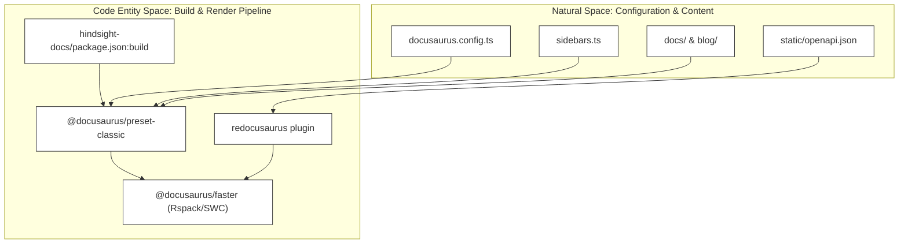
*Figure 1: Documentation build pipeline mapping configuration entities to compilation runtimes.*

Sources: `[hindsight-docs/docusaurus.config.ts:1-197]`, `[hindsight-docs/sidebars.ts:1-237]`, `[hindsight-docs/package.json:1-61]`, `[hindsight-docs/blog/authors.yml:1-80]`

---

## 2. AI-Agent Consumable References (`skills/`)

To support coding agents and automated workflows, Hindsight maintains a structured knowledge directory under `skills/hindsight-docs/`. This directory contains markdown files optimized for LLMs and agent harnesses, providing concise API and architecture references `[skills/hindsight-docs/references/developer/index.md:1-123]()`.

### Reference Organization and Generation

The `skills/` directory mirrors the documentation architecture, translating guides, API specifications, and architectural overviews into compact markdown formats. 
- **Synchronization Scripts**: Shell and Python scripts (`generate-docs-skill.sh` and `docs_skill_figures.py`) keep agent skills in sync with upstream documentation changes.
- **Metadata**: Each skill directory contains `SKILL.md` descriptors defining invocation parameters, metadata, and validation policies.

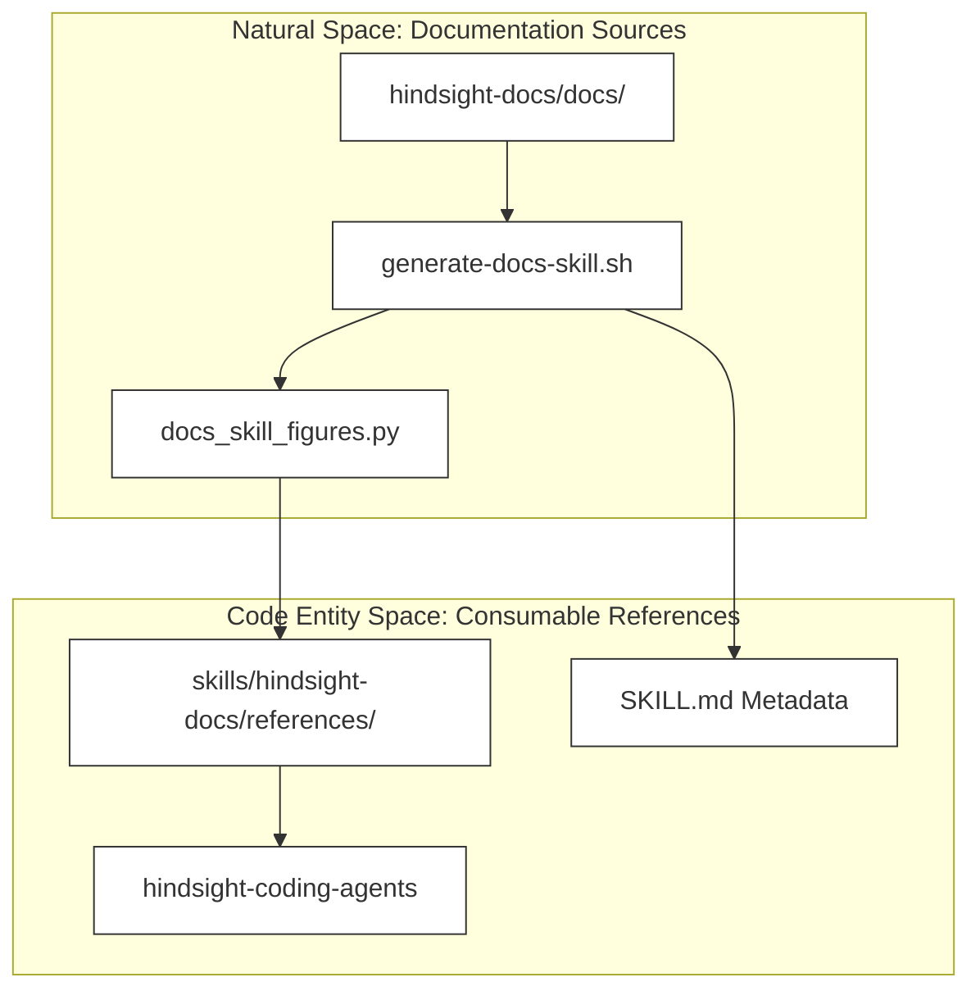
*Figure 2: Data flow for generating AI agent reference skills from core documentation.*

Sources: `[skills/hindsight-docs/references/developer/index.md:1-123]`, `[hindsight-docs/package.json:1-61]`

---

## 3. Documentation Figures and Interfig Tooling

Interactive flow figures, animated sequence diagrams, and social export assets are supported by `hindsight-interfig` (`[hindsight-interfig/README.md:1-91]()`), which integrates directly into `hindsight-docs` via custom components like `Figure` (`[hindsight-docs/docs/developer/index.mdx:14]()`).

### Architecture of Interfig

`interfig` provides a React component library (`Flow`, `MiniGraph`) where layout trees, edges, and step-by-step beats are defined (`[hindsight-interfig/README.md:1-91]()`):
- **Layout Tree**: Defines parent-child relationships, display directions, grouping frames, and box attributes.
- **Edges & Beats**: Connects nodes with identifiers, loop routing, and step data payloads.
- **Export Pipeline**: The export script drives headless Chromium via Playwright, paired with Vite (`[hindsight-interfig/scripts/export.mjs:1-178]()`), to capture step animations and transcode raw frames into video assets.

Sources: `[hindsight-docs/package.json:1-61]`, `[hindsight-docs/docs/developer/index.mdx:14]`

---

# Page: Getting Started

# Getting Started

<details>
<summary>Relevant source files</summary>

The following files were used as context for generating this wiki page:

- [README.md](README.md)
- [docker/standalone/start-all.sh](docker/standalone/start-all.sh)
- [docker/standalone/test-start-all.sh](docker/standalone/test-start-all.sh)
- [hindsight-api-slim/hindsight_api/http_probe.py](hindsight-api-slim/hindsight_api/http_probe.py)
- [hindsight-api-slim/tests/test_http_probe.py](hindsight-api-slim/tests/test_http_probe.py)
- [hindsight-control-plane/bin/cli.js](hindsight-control-plane/bin/cli.js)
- [hindsight-control-plane/tests/lib/cli-bind-host.test.ts](hindsight-control-plane/tests/lib/cli-bind-host.test.ts)
- [hindsight-docs/docs/developer/api/quickstart.mdx](hindsight-docs/docs/developer/api/quickstart.mdx)
- [hindsight-docs/docs/developer/installation.md](hindsight-docs/docs/developer/installation.md)
- [hindsight-docs/versioned_docs/version-0.8/developer/installation.md](hindsight-docs/versioned_docs/version-0.8/developer/installation.md)
- [hindsight-docs/versioned_docs/version-0.9/developer/api/quickstart.mdx](hindsight-docs/versioned_docs/version-0.9/developer/api/quickstart.mdx)
- [hindsight-docs/versioned_docs/version-0.9/developer/installation.md](hindsight-docs/versioned_docs/version-0.9/developer/installation.md)
- [skills/hindsight-docs/references/developer/api/quickstart.md](skills/hindsight-docs/references/developer/api/quickstart.md)
- [skills/hindsight-docs/references/developer/installation.md](skills/hindsight-docs/references/developer/installation.md)

</details>


Hindsight provides multiple quick-start paths tailored to different user types: API users deploying via Docker, embedded SDK users wanting zero-config local memory, and framework integrators connecting via client libraries. This page outlines the core getting started workflows and introduces the three fundamental memory operations (**retain**, **recall**, **reflect**).

**Choose Your Path:**

| User Type           | Method                         | Time to Start | Best For                         |
|---------------------|--------------------------------|---------------|---------------------------------|
| **API Users**        | Docker container               | 30 seconds    | Testing, development, local demos|
| **Python Developers**| `pip install hindsight-api`    | 1 minute      | Python applications, custom servers|
| **Embedded SDK Users**| `hindsight-all` / `hindsight-embed` | 1 minute      | Zero-config local memory, single-user apps|

For detailed installation procedures including Kubernetes charts, pip variants, and production requirements, see [Installation](#2.1). For complete code walkthroughs across Python, TypeScript, and CLI, see [Quick Start Guide](#2.2). For local daemon and profile management, see [Embedded Mode Setup](#2.3).

Sources: [README.md:62-117](), [hindsight-docs/docs/developer/installation.md:1-68]()

---

## Quick-Start Paths

### 1. API Users (Docker)

Run the Hindsight API server and Control Plane UI in a single container with embedded PostgreSQL (`pg0`) [hindsight-docs/docs/developer/installation.md:37-87]().

```bash
export OPENAI_API_KEY=sk-xxx

docker run -it --pull always --name hindsight --restart unless-stopped -p 8888:8888 -p 9999:9999 \
  -e HINDSIGHT_API_LLM_API_KEY=$OPENAI_API_KEY \
  -v hindsight-data:/home/hindsight/.pg0 \
  ghcr.io/vectorize-io/hindsight:latest
```

- **API Server:** `http://localhost:8888` (FastAPI application in `hindsight_api.http:app`) [hindsight-docs/docs/developer/installation.md:86]()
- **Control Plane UI:** `http://localhost:9999` (Next.js web interface) [hindsight-docs/docs/developer/installation.md:87]()

**Diagram: API Deployment Architecture (Natural Language to Code Entities)**

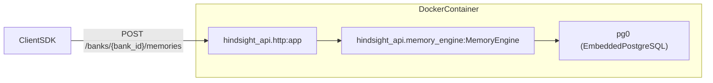
Sources: [README.md:64-75](), [hindsight-docs/docs/developer/installation.md:71-103](), [docker/standalone/start-all.sh:132-133]()

---

### 2. Python Developers (pip)

Install the API package directly and run the server locally, or use embedded mode [hindsight-docs/docs/developer/installation.md:11-18]().

```bash
pip install hindsight-api
export HINDSIGHT_API_LLM_API_KEY=sk-xxx
hindsight-api
```

To use Hindsight inside Python applications without managing a standalone server, leverage the embedded client API with `HindsightEmbedded` from `hindsight-all` [README.md:128-136]():

```python
from hindsight import HindsightEmbedded

with HindsightEmbedded(profile="myapp", llm_provider="openai") as client:
    client.retain(bank_id="my-bank", content="Alice works at Google")
    results = client.recall(bank_id="my-bank", query="Where does Alice work?")
```

**Diagram: Embedded SDK Architecture (Natural Language to Code Entities)**

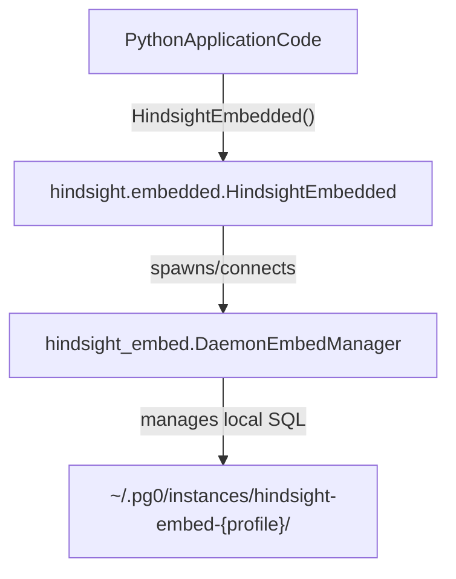
Sources: [hindsight-docs/docs/developer/installation.md:11-18](), [README.md:128-136]()

---

### 3. Framework Integrators

Hindsight exposes a rich HTTP API and generated client SDKs to integrate memory capabilities into agents and frameworks (Python, TypeScript, Go, Rust). Clients interact with core operations to store and retrieve memories and reason with them.

- The Python SDK (`hindsight-client`) provides synchronous and asynchronous methods: `retain`, `recall`, and `reflect`.
- The TypeScript SDK offers asynchronous client classes for browser, Node.js, and Next.js environments.
- The Rust CLI and client enable direct command-line usage and integration.
- The embedded SDK can be controlled programmatically or via command-line tools within the same process.

For detailed SDK usage and advanced integration patterns, see [Quick Start Guide](#2.2) and [Embedded Mode Setup](#2.3).

Sources: [README.md:119-136](), [hindsight-docs/docs/developer/api/quickstart.mdx:5-134]()

---

## Core Operations

Hindsight centers around three fundamental operations: **retain** (storing structured facts and entities), **recall** (multi-strategy retrieval), and **reflect** (disposition-aware reasoning) [hindsight-docs/docs/developer/api/quickstart.mdx:116-120]().

**Diagram: Core Operations Pipeline (Natural Language to Code Entities)**

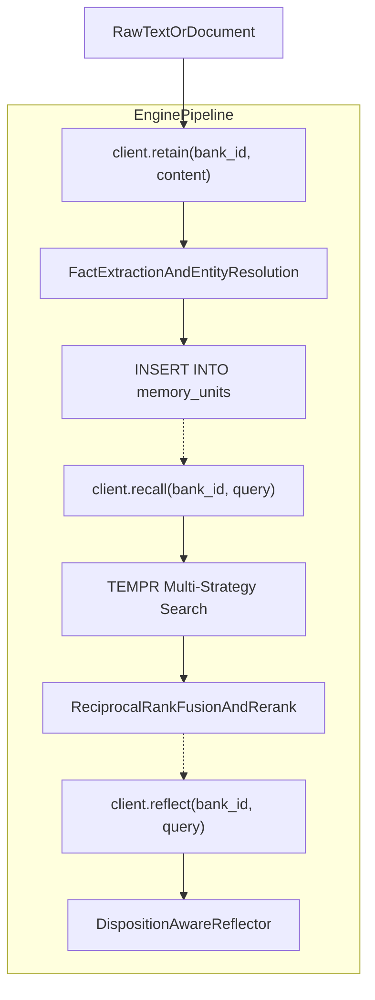
Sources: [hindsight-docs/docs/developer/api/quickstart.mdx:116-120](), [hindsight-docs/docs/developer/observations.mdx:13-21]()

---

### Minimal Example

All operations are organized around isolated **memory banks** (`bank_id`), which isolate data and configuration [hindsight-docs/src/pages/best-practices.mdx:24-32]().

```python
from hindsight_client import Hindsight

client = Hindsight(base_url="http://localhost:8888")

# 1. Retain: Extract facts and entities from raw content
client.retain(bank_id="my-bank", content="Alice works at Google as a software engineer.")

# 2. Recall: Retrieve relevant facts related to a query
results = client.recall(bank_id="my-bank", query="What does Alice do?")

# 3. Reflect: Generate a disposition-aware answer consolidating knowledge
answer = client.reflect(bank_id="my-bank", query="Tell me about Alice's career.")
print(answer.text)
```

**Diagram: Memory Bank Isolation**

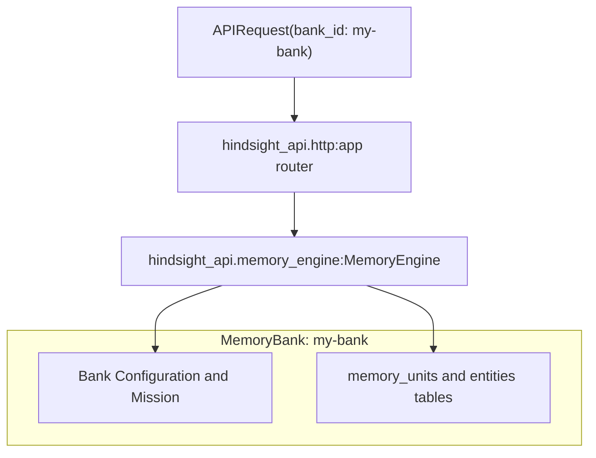
Sources: [hindsight-docs/docs/developer/api/quickstart.mdx:61-73](), [hindsight-docs/src/pages/best-practices.mdx:24-32]()

---

## Detailed Guides & Child Pages

For comprehensive deep dives into setup and configuration, explore the child pages:

- **[Installation](#2.1)** — Covering all installation methods including Docker images (full and slim), pip packages (`hindsight-api`, `hindsight-api-slim`, `hindsight-all`), Helm charts for Kubernetes deployment, and local development configurations including the embedded database.

- **[Quick Start Guide](#2.2)** — A step-by-step tutorial walking through a full cycle: creating a memory bank, retaining memories from text and files, recalling relevant information using multi-strategy retrieval, and reflecting to generate intelligent answers. Includes Python, TypeScript, and CLI examples side-by-side.

- **[Embedded Mode Setup](#2.3)** — Explains the `hindsight-embed` zero-config daemon architecture, managing multiple profiles, the control center UI, idle timeout behavior, and how the `HindsightServer` and `HindsightEmbedded` classes in `hindsight-all` work together. Also covers the `hindsight-all-npm` Node.js package for embedded client use.

Sources: [hindsight-docs/docs/developer/installation.md:1-118](), [hindsight-docs/docs/developer/api/quickstart.mdx:1-134]()

---

# Page: Installation

# Installation

<details>
<summary>Relevant source files</summary>

The following files were used as context for generating this wiki page:

- [README.md](README.md)
- [docker/standalone/start-all.sh](docker/standalone/start-all.sh)
- [docker/standalone/test-start-all.sh](docker/standalone/test-start-all.sh)
- [helm/hindsight/README.md](helm/hindsight/README.md)
- [helm/hindsight/templates/_helpers.tpl](helm/hindsight/templates/_helpers.tpl)
- [helm/hindsight/templates/api-deployment.yaml](helm/hindsight/templates/api-deployment.yaml)
- [helm/hindsight/templates/controlplane-deployment.yaml](helm/hindsight/templates/controlplane-deployment.yaml)
- [helm/hindsight/templates/extra-objects.yaml](helm/hindsight/templates/extra-objects.yaml)
- [helm/hindsight/templates/httproute.yaml](helm/hindsight/templates/httproute.yaml)
- [helm/hindsight/templates/postgresql-statefulset.yaml](helm/hindsight/templates/postgresql-statefulset.yaml)
- [helm/hindsight/templates/tei-embedding-deployment.yaml](helm/hindsight/templates/tei-embedding-deployment.yaml)
- [helm/hindsight/templates/tei-reranker-deployment.yaml](helm/hindsight/templates/tei-reranker-deployment.yaml)
- [helm/hindsight/templates/worker-statefulset.yaml](helm/hindsight/templates/worker-statefulset.yaml)
- [helm/hindsight/values.yaml](helm/hindsight/values.yaml)
- [hindsight-api-slim/hindsight_api/http_probe.py](hindsight-api-slim/hindsight_api/http_probe.py)
- [hindsight-api-slim/tests/test_http_probe.py](hindsight-api-slim/tests/test_http_probe.py)
- [hindsight-control-plane/bin/cli.js](hindsight-control-plane/bin/cli.js)
- [hindsight-control-plane/tests/lib/cli-bind-host.test.ts](hindsight-control-plane/tests/lib/cli-bind-host.test.ts)
- [hindsight-docs/docs/developer/api/quickstart.mdx](hindsight-docs/docs/developer/api/quickstart.mdx)
- [hindsight-docs/docs/developer/installation.md](hindsight-docs/docs/developer/installation.md)
- [hindsight-docs/versioned_docs/version-0.8/developer/installation.md](hindsight-docs/versioned_docs/version-0.8/developer/installation.md)
- [hindsight-docs/versioned_docs/version-0.9/developer/api/quickstart.mdx](hindsight-docs/versioned_docs/version-0.9/developer/api/quickstart.mdx)
- [hindsight-docs/versioned_docs/version-0.9/developer/installation.md](hindsight-docs/versioned_docs/version-0.9/developer/installation.md)
- [skills/hindsight-docs/references/developer/api/quickstart.md](skills/hindsight-docs/references/developer/api/quickstart.md)
- [skills/hindsight-docs/references/developer/installation.md](skills/hindsight-docs/references/developer/installation.md)

</details>


## Purpose and Scope

This document provides complete technical installation instructions for Hindsight across all supported deployment methods and environments. It covers:
- **Supported Platforms** — Operating systems, hardware footprints, and memory considerations [hindsight-docs/docs/developer/installation.md:9-68]().
- **Prerequisites** — PostgreSQL vector extension requirements (`pgvector`, `pgvectorscale`, `vchord`, `scann`) and embedded `pg0` bootstrap [hindsight-docs/docs/developer/installation.md:26-46]().
- **Docker Deployment** — Standalone and slim image variants, volume mounts, non-root user security (UID 1000), and startup coordination scripts [hindsight-docs/docs/developer/installation.md:71-118](), [docker/standalone/start-all.sh:1-125]().
- **Pip Installation** — Modular package distribution (`hindsight-api`, `hindsight-api-slim`, and `hindsight-all`) [hindsight-docs/docs/developer/installation.md:141-152](), [README.md:95-102]().
- **Kubernetes and Helm** — Chart configuration, StatefulSet workers, and secret interpolation [helm/hindsight/values.yaml:1-218](), [helm/hindsight/templates/api-deployment.yaml:1-138](), [helm/hindsight/templates/worker-statefulset.yaml:1-149]().
- **Embedded Mode** — Zero-config local development (`hindsight-embed`) and daemon process supervision [hindsight-docs/docs/developer/installation.md:37-37](), [README.md:124-128]().

Sources: [hindsight-docs/docs/developer/installation.md:1-68](), [docker/standalone/start-all.sh:1-125](), [helm/hindsight/values.yaml:1-218]()

---

## Supported Platforms

Hindsight runs on **Linux**, **macOS**, and **Windows**, supporting both local embedded databases (`pg0`) for development and production-grade external database clusters [hindsight-docs/docs/developer/installation.md:9-21]().

| Platform | Docker | Bare Metal (pip) | Embedded DB (pg0) | Notes |
|----------|--------|------------------|--------------------|-------|
| **Linux** (x86_64, ARM64) | ✅ | ✅ | ✅ | Fully supported, recommended for production [hindsight-docs/docs/developer/installation.md:15-15]() |
| **macOS** (Apple Silicon / arm64) | ✅ | ✅ | ✅ | Fully supported [hindsight-docs/docs/developer/installation.md:16-16]() |
| **macOS** (Intel / x86_64) | ✅ | ⚠️ slim only | ✅ | Use `hindsight-all-slim` / `hindsight-api-slim`. Local ML wheels (PyTorch/MLX) are absent for Intel-Mac [hindsight-docs/docs/developer/installation.md:17-17](). |
| **Windows** (x86_64) | ✅ | ✅ | ✅ | Fully supported with external PostgreSQL or pg0 [hindsight-docs/docs/developer/installation.md:18-20]() |

Sources: [hindsight-docs/docs/developer/installation.md:9-21]()

---

## Prerequisites

### PostgreSQL and Vector Extensions

Hindsight requires PostgreSQL 14+ with an active vector similarity extension [hindsight-docs/docs/developer/installation.md:26-28](). The supported backends configured via `HINDSIGHT_API_VECTOR_EXTENSION` include:
- **pgvector** (default) [hindsight-docs/docs/developer/installation.md:30-30]()
- **pgvectorscale** [hindsight-docs/docs/developer/installation.md:31-31]()
- **vchord** [hindsight-docs/docs/developer/installation.md:32-32]()
- **scann** (AlloyDB) [hindsight-docs/docs/developer/installation.md:33-33]()

For local development, **pg0** provides an embedded PostgreSQL instance that starts automatically [hindsight-docs/docs/developer/installation.md:37-37](). For production, managed or self-hosted PostgreSQL instances (Supabase, Neon, AWS RDS, Azure Database for PostgreSQL, Google AlloyDB) are recommended [hindsight-docs/docs/developer/installation.md:39-45]().

### Hardware and Resource Footprint

The memory footprint depends on whether the **full** package/image (bundling local embedding models and cross-encoders) or the **slim** package/image is deployed [hindsight-docs/docs/developer/installation.md:53-61]().

| Component | Minimum RAM | Recommended RAM | Notes |
|-----------|-------------|-----------------|-------|
| **API — Full image** | 1.5 GB | 2 GB | Loads local BGE embedder (~130 MB) and MiniLM cross-encoder (~90 MB) into PyTorch/ONNX runtime [hindsight-docs/docs/developer/installation.md:57-57](). |
| **API — Slim image** | 512 MB | 1 GB | No local models; requires external embedding and reranker endpoints (TEI, OpenAI, Cohere) [hindsight-docs/docs/developer/installation.md:58-58](). |
| **Control Plane (UI)** | 128 MB | 256 MB | Next.js process [hindsight-docs/docs/developer/installation.md:59-59](). |
| **Worker Service** | Matches API variant | Matches API variant | Loads model weights identical to the API server [hindsight-docs/docs/developer/installation.md:60-60](). |
| **PostgreSQL** | 512 MB | 1 GB+ | Scales with memory volume and HNSW index size [hindsight-docs/docs/developer/installation.md:61-61](). |

Sources: [hindsight-docs/docs/developer/installation.md:24-68]()

---

## Docker Deployment (Standalone and Slim Variants)

### Deployment Architecture & Startup Flow

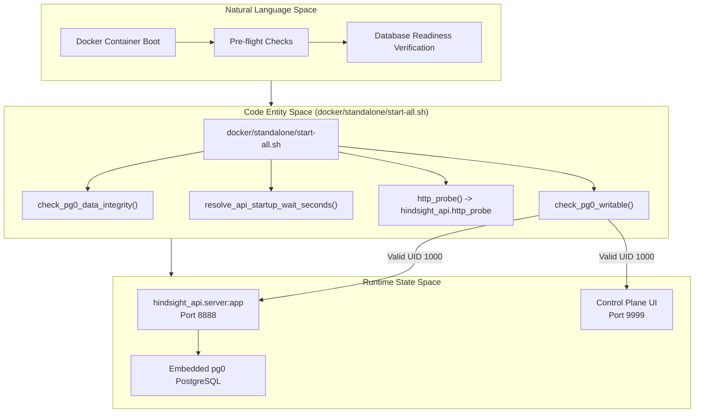

**Diagram: Docker Startup Sequence Bridging Natural Language to Code Entities (`docker/standalone/start-all.sh`)**
Sources: [docker/standalone/start-all.sh:13-144](), [hindsight-docs/docs/developer/installation.md:71-88]()

### Running Standalone Container

```bash
export OPENAI_API_KEY=sk-xxx

docker run -it --pull always --name hindsight --restart unless-stopped --shm-size=1g -p 8888:8888 -p 9999:9999 \
  -e HINDSIGHT_API_LLM_API_KEY=$OPENAI_API_KEY \
  -v hindsight-data:/home/hindsight/.pg0 \
  ghcr.io/vectorize-io/hindsight:latest
```

The standalone script `docker/standalone/start-all.sh` performs pre-flight checks:
- **Data Integrity (`check_pg0_data_integrity`)**: Verifies the presence of `PG_VERSION` across known database layouts to detect wipe or corruption events [docker/standalone/start-all.sh:13-44]().
- **Writability Check (`check_pg0_writable`)**: Ensures the unprivileged `hindsight` user (UID 1000) can write to the data directory, preventing opaque permission failures when using host bind mounts [docker/standalone/start-all.sh:49-91]().
- **Startup Timeout (`resolve_api_startup_wait_seconds`)**: Synchronizes wrapper termination timeouts with `HINDSIGHT_API_MODEL_INIT_TIMEOUT` for first-time model downloads [docker/standalone/start-all.sh:104-125]().

Sources: [hindsight-docs/docs/developer/installation.md:71-114](), [docker/standalone/start-all.sh:1-155]()

---

## Pip Installation (hindsight-api, hindsight-api-slim, hindsight-all)

For bare metal environments, Hindsight provides modular packages via PyPI:

| Package Name | Description | Target Environment |
|--------------|-------------|--------------------|
| `hindsight-api-slim` | Core FastAPI engine, data access layer, and HTTP routes without local ML weights [hindsight-docs/docs/developer/installation.md:58-58](). | Production clusters utilizing external embedding providers [hindsight-docs/docs/developer/installation.md:58-58](). |
| `hindsight-api` | Full API server bundling SentenceTransformers and cross-encoder weights. | Standalone servers with local acceleration [hindsight-docs/docs/developer/installation.md:57-57](). |
| `hindsight-all` | Meta-package bundling API, Python client SDK, and embedded daemon tools. | Local development and CLI toolsets [README.md:124-128](). |

```bash
# Install the core slim engine
pip install hindsight-api-slim

# Install the full engine with local ML models
pip install hindsight-api

# Start the server directly
export HINDSIGHT_API_LLM_API_KEY=sk-xxx
hindsight-api
```

Sources: [hindsight-docs/docs/developer/installation.md:141-152](), [README.md:95-102]()

---

## Kubernetes and Helm Charts

### Chart Architecture and Secret Interception

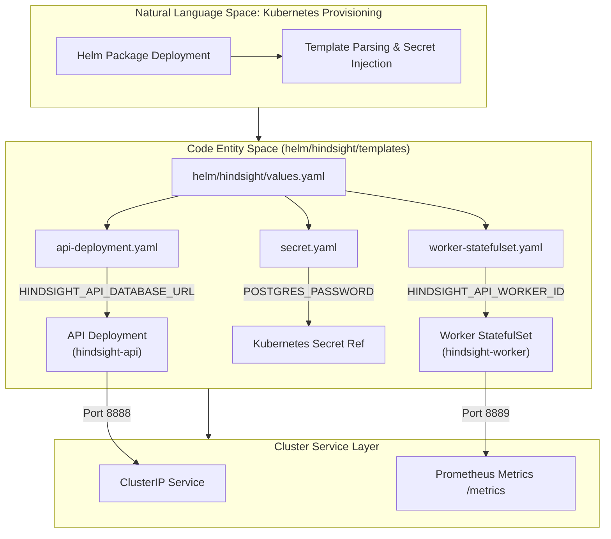

**Diagram: Kubernetes Chart Workload and Secret Injection Mapping**
Sources: [helm/hindsight/values.yaml:1-218](), [helm/hindsight/templates/api-deployment.yaml:40-95](), [helm/hindsight/templates/worker-statefulset.yaml:35-95]()

### Installation via Helm

```bash
helm repo add hindsight https://ghcr.io/vectorize-io/charts
helm install hindsight oci://ghcr.io/vectorize-io/charts/hindsight \
  --set api.llm.provider=openai \
  --set api.llm.apiKey=sk-xxx \
  --set postgresql.enabled=true
```

Key configuration features in the chart:
- **Worker Segregation**: When `worker.enabled: true`, dedicated StatefulSet pods run `hindsight-worker` while disabling the API server's internal worker thread via `HINDSIGHT_API_WORKER_ENABLED=false` [helm/hindsight/values.yaml:135-138](), [helm/hindsight/templates/api-deployment.yaml:62-66]().
- **Stable Worker Identities**: Workers inherit their pod names via Kubernetes `fieldRef` (`metadata.name`), ensuring task ownership persistence across restarts [helm/hindsight/templates/worker-statefulset.yaml:62-66]().

Sources: [helm/hindsight/values.yaml:1-218](), [helm/hindsight/templates/api-deployment.yaml:1-138](), [helm/hindsight/templates/worker-statefulset.yaml:1-149]()

---

## Embedded Mode and Zero-Config Local Development (`hindsight-embed`)

For local agent workflows requiring zero infrastructure setup, Hindsight provides embedded execution:
- **In-Process Initialization**: The `HindsightEmbedded` class initializes an embedded PostgreSQL instance (`pg0`) and boots the FastAPI server in a background thread or process.
- **CLI Daemon Management (`hindsight-embed`)**: Automatically handles daemon discovery, port binding, and profile management stored under `~/.hindsight/embed` [README.md:125-128]().

```bash
# Install client and embed tools
pip install hindsight-all

# Initialize embedded local profile
hindsight-embed configure
```

Sources: [hindsight-docs/docs/developer/installation.md:37-37](), [README.md:124-128]()

---

# Page: Quick Start Guide

# Quick Start Guide

<details>
<summary>Relevant source files</summary>

The following files were used as context for generating this wiki page:

- [README.md](README.md)
- [docker/standalone/start-all.sh](docker/standalone/start-all.sh)
- [docker/standalone/test-start-all.sh](docker/standalone/test-start-all.sh)
- [hindsight-api-slim/hindsight_api/http_probe.py](hindsight-api-slim/hindsight_api/http_probe.py)
- [hindsight-api-slim/tests/test_format_facts_for_prompt.py](hindsight-api-slim/tests/test_format_facts_for_prompt.py)
- [hindsight-api-slim/tests/test_http_probe.py](hindsight-api-slim/tests/test_http_probe.py)
- [hindsight-clients/python/hindsight_client/__init__.py](hindsight-clients/python/hindsight_client/__init__.py)
- [hindsight-clients/python/hindsight_client/hindsight_client.py](hindsight-clients/python/hindsight_client/hindsight_client.py)
- [hindsight-clients/python/tests/test_main_operations.py](hindsight-clients/python/tests/test_main_operations.py)
- [hindsight-clients/python/tests/test_prompt_formatting.py](hindsight-clients/python/tests/test_prompt_formatting.py)
- [hindsight-clients/python/tests/test_version.py](hindsight-clients/python/tests/test_version.py)
- [hindsight-clients/typescript/src/index.ts](hindsight-clients/typescript/src/index.ts)
- [hindsight-clients/typescript/tests/prompt_formatting.test.ts](hindsight-clients/typescript/tests/prompt_formatting.test.ts)
- [hindsight-control-plane/bin/cli.js](hindsight-control-plane/bin/cli.js)
- [hindsight-control-plane/tests/lib/cli-bind-host.test.ts](hindsight-control-plane/tests/lib/cli-bind-host.test.ts)
- [hindsight-docs/docs/developer/api/quickstart.mdx](hindsight-docs/docs/developer/api/quickstart.mdx)
- [hindsight-docs/docs/developer/installation.md](hindsight-docs/docs/developer/installation.md)
- [hindsight-docs/versioned_docs/version-0.8/developer/installation.md](hindsight-docs/versioned_docs/version-0.8/developer/installation.md)
- [hindsight-docs/versioned_docs/version-0.9/developer/api/quickstart.mdx](hindsight-docs/versioned_docs/version-0.9/developer/api/quickstart.mdx)
- [hindsight-docs/versioned_docs/version-0.9/developer/installation.md](hindsight-docs/versioned_docs/version-0.9/developer/installation.md)
- [skills/hindsight-docs/references/developer/api/quickstart.md](skills/hindsight-docs/references/developer/api/quickstart.md)
- [skills/hindsight-docs/references/developer/installation.md](skills/hindsight-docs/references/developer/installation.md)

</details>


This page walks through a complete Hindsight workflow: creating a memory bank, storing information from text and files, searching memories, and generating contextual responses. Examples are shown side-by-side across Python, TypeScript, and CLI environments [hindsight-docs/docs/developer/api/quickstart.mdx:1-134](). For zero-config embedded usage, see [Embedded Mode Setup](#2.3).

---

## Core Operations Flow

The following diagram bridges high-level Natural Language operations to the internal Code Entity space, mapping user interactions through client SDKs down to API routes and core engine classes.

**Diagram: Request Flow from Client to Engine**
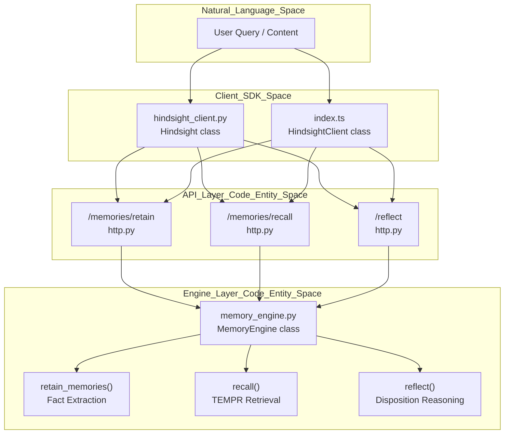
**Sources:** [hindsight-clients/python/hindsight_client/hindsight_client.py:84-150](), [hindsight-clients/typescript/src/index.ts:110-155](), [hindsight-api-slim/hindsight_api/api/http.py:1-6]()

---

## Step 1: Create a Memory Bank

A **bank** is an isolated memory namespace with its own configuration, mission, and disposition traits like skepticism, literalism, and empathy. Banks are managed via the `BanksApi` which exposes methods for listing, creating, updating, and deleting banks [hindsight-clients/python/hindsight_client/hindsight_client.py:458-482]().

| Language | Code Snippet |
| :--- | :--- |
| **Python** | ```python\nclient.create_bank(bank_id="demo", name="Demo Bank", mission="Helpful AI assistant")\n``` [hindsight-clients/python/hindsight_client/hindsight_client.py:463-477]() |
| **TypeScript** | ```typescript\nawait client.createBank("demo", { name: "Demo Bank", mission: "Helpful AI assistant" })\n``` [hindsight-clients/typescript/src/index.ts:620-650]() |
| **CLI** | ```bash\nhindsight bank create demo --mission "Helpful AI assistant"\n``` [hindsight-docs/docs/developer/api/quickstart.mdx:103-104]() |

**Sources:** [hindsight-clients/python/hindsight_client/hindsight_client.py:458-482](), [hindsight-clients/typescript/src/index.ts:620-650](), [hindsight-docs/docs/developer/api/quickstart.mdx:103-104]()

---

## Step 2: Retain Memories from Text

The `retain` operation accepts raw content (text, structured multimodal blocks) and processes it through fact extraction, entity resolution, and embedding to store it as memories [hindsight-clients/python/hindsight_client/hindsight_client.py:188-221](). This operation supports synchronous and asynchronous modes for scalability.

### Side-by-Side Implementation

| Feature              | Python Example                                                                                                                                                                                  | TypeScript Example                                                                                                                          | CLI Example                                                           |
|----------------------|-------------------------------------------------------------------------------------------------------------------------------------------------------------------------------------------------|--------------------------------------------------------------------------------------------------------------------------------------------|-----------------------------------------------------------------------|
| **Single Retain**     | ```python\nclient.retain(bank_id="demo", content="Alice works at Google")\n``` [hindsight-clients/python/hindsight_client/hindsight_client.py:188-221]()                                              | ```typescript\nawait client.retain("demo", "Alice works at Google")\n``` [hindsight-clients/typescript/src/index.ts:214-239]()             | `hindsight memory retain demo "Alice works at Google"` [hindsight-docs/docs/developer/api/quickstart.mdx:104]()            |
| **With Context**      | ```python\nclient.retain(bank_id="demo", content="Bob likes hiking", context="outdoor")\n```                                                                                                    | ```typescript\nawait client.retain("demo", "Bob likes hiking", { context: "outdoor" })\n```                                               | `hindsight memory retain demo "Bob likes hiking" --context outdoor`  |
| **Async Retain**      | ```python\nclient.retain(bank_id="demo", content="Async retain example", retain_async=True)\n```                                                                                               | ```typescript\nawait client.retain("demo", "Async retain example", { async: true })\n```                                                   | `hindsight memory retain demo "Async retain example" --async`        |

**Sources:** [hindsight-clients/python/hindsight_client/hindsight_client.py:188-221](), [hindsight-clients/typescript/src/index.ts:214-239](), [hindsight-docs/docs/developer/api/quickstart.mdx:104]()

---

## Step 3: Retain Memories from Files

Hindsight supports retaining facts from files such as PDFs, Office documents, and images. The process is asynchronous and handled via the `FilesApi`. Files are parsed into chunks, facts are extracted, and knowledge graph entities are linked behind the scenes [hindsight-clients/python/hindsight_client/hindsight_client.py:135-182]().

### Python Example to Retain a PDF
```python
response = client.files.file_retain(
    bank_id="demo",
    files=["policy.pdf"],
    context="company policies"
)
print(response.operation_ids)
```

### TypeScript Example
```typescript
const response = await client.files.fileRetain("demo", {
  files: ["policy.pdf"],
  context: "company policies"
});
console.log(response.operationIds);
```

**Sources:** [hindsight-clients/python/hindsight_client/hindsight_client.py:135-182](), [hindsight-clients/typescript/src/index.ts:270-311]()

---

## Step 4: Recall Relevant Information

The `recall` operation performs multi-strategy retrieval to find memories relevant to a query using semantic search, keyword search, graph traversal, and temporal filtering [hindsight-clients/python/hindsight_client/hindsight_client.py:284-318](), [hindsight-clients/typescript/src/index.ts:321-353]().

The following diagram bridges the user query space to the core engine retrieval code entities executing the TEMPR multi-strategy pipeline.

**Diagram: TEMPR Retrieval Pipeline and Code Execution**
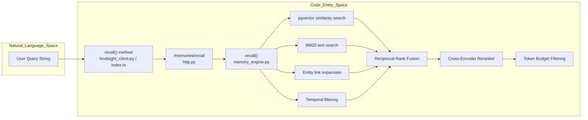
**Sources:** [hindsight-clients/python/hindsight_client/hindsight_client.py:284-318](), [hindsight-clients/typescript/src/index.ts:321-353]()

### Python Example
```python
response = client.recall(
    bank_id="demo",
    query="What does Alice do?",
    budget="high",
    max_tokens=2048,
    types=["world", "experience"],
    trace=True
)
for result in response.results:
    print(result.text)
```

### TypeScript Example
```typescript
const response = await client.recall("demo", "What does Alice do?", {
  budget: "high",
  maxTokens: 2048,
  types: ["world", "experience"],
  trace: true,
});
console.log(response.results?.map(r => r.text));
```

**Sources:** [hindsight-clients/python/hindsight_client/hindsight_client.py:284-318](), [hindsight-clients/typescript/src/index.ts:321-353]()

---

## Step 5: Reflect to Generate Answers

The `reflect` operation synthesizes an answer by reasoning over retrieved memories, using the bank’s dispositions, mental models, and directives to generate a disposition-aware and coherent response [hindsight-clients/python/hindsight_client/hindsight_client.py:320-373]().

### Python Example
```python
response = client.reflect(
    bank_id="demo",
    query="Tell me about Alice's career",
    budget="high"
)
print(response.text)
```

### TypeScript Example
```typescript
const response = await client.reflect("demo", "Tell me about Alice's career", {
  budget: "high"
});
console.log(response.text);
```

### CLI Example
```bash
hindsight memory reflect demo "Tell me about Alice's career" --budget high
```

**Sources:** [hindsight-clients/python/hindsight_client/hindsight_client.py:320-373](), [hindsight-clients/typescript/src/index.ts:387-416](), [hindsight-docs/docs/developer/api/quickstart.mdx:110]()

---

## Knowledge Consolidation: Observations

After `retain()` completes, Hindsight automatically triggers a background **consolidation** process that synthesizes observations from related facts [hindsight-docs/docs/developer/observations.mdx:13-21]().

**Diagram: Consolidation Engine**
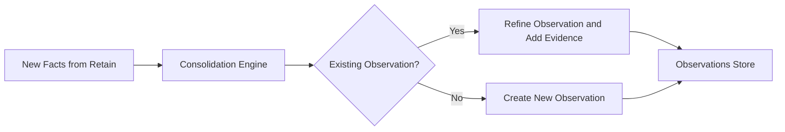
**Sources:** [hindsight-docs/docs/developer/observations.mdx:13-21](), [hindsight-docs/docs/developer/observations.mdx:46-54]()

---

## Summary

This guide covered the full cycle to quickly get started with Hindsight:
1. Create an isolated **memory bank** for namespace separation.
2. **Retain** structured memories from text or files.
3. **Recall** relevant information via multi-strategy retrieval.
4. **Reflect** using memories and dispositions to generate contextual answers.
5. Benefit from asynchronous **consolidation** into higher-order observations.

**Sources:**  
[hindsight-clients/python/hindsight_client/hindsight_client.py:188-373, 458-482](),  
[hindsight-clients/typescript/src/index.ts:110-155, 214-239, 270-311, 321-416, 620-650](),  
[hindsight-api-slim/hindsight_api/api/http.py:1-6](),  
[hindsight-docs/docs/developer/api/quickstart.mdx:1-134](),  
[hindsight-docs/docs/developer/observations.mdx:13-54]()

---

# Page: Embedded Mode Setup

# Embedded Mode Setup

<details>
<summary>Relevant source files</summary>

The following files were used as context for generating this wiki page:

- [hindsight-api-slim/hindsight_api/daemon.py](hindsight-api-slim/hindsight_api/daemon.py)
- [hindsight-api-slim/tests/test_daemonize.py](hindsight-api-slim/tests/test_daemonize.py)
- [hindsight-clients/python/tests/test_retain_async_kwarg.py](hindsight-clients/python/tests/test_retain_async_kwarg.py)
- [hindsight-clients/typescript/tests/deno_setup.ts](hindsight-clients/typescript/tests/deno_setup.ts)
- [hindsight-clients/typescript/tests/main_operations.test.ts](hindsight-clients/typescript/tests/main_operations.test.ts)
- [hindsight-docs/docs/sdks/embed.md](hindsight-docs/docs/sdks/embed.md)
- [hindsight-embed/README.md](hindsight-embed/README.md)
- [hindsight-embed/hindsight_embed/cli.py](hindsight-embed/hindsight_embed/cli.py)
- [hindsight-embed/hindsight_embed/control_center/server.py](hindsight-embed/hindsight_embed/control_center/server.py)
- [hindsight-embed/hindsight_embed/control_center/service.py](hindsight-embed/hindsight_embed/control_center/service.py)
- [hindsight-embed/hindsight_embed/daemon_client.py](hindsight-embed/hindsight_embed/daemon_client.py)
- [hindsight-embed/hindsight_embed/daemon_embed_manager.py](hindsight-embed/hindsight_embed/daemon_embed_manager.py)
- [hindsight-embed/hindsight_embed/embed_manager.py](hindsight-embed/hindsight_embed/embed_manager.py)
- [hindsight-embed/hindsight_embed/env_template.py](hindsight-embed/hindsight_embed/env_template.py)
- [hindsight-embed/hindsight_embed/profile_manager.py](hindsight-embed/hindsight_embed/profile_manager.py)
- [hindsight-embed/test.sh](hindsight-embed/test.sh)
- [hindsight-embed/tests/test_cli_forwarding.py](hindsight-embed/tests/test_cli_forwarding.py)
- [hindsight-embed/tests/test_control_center.py](hindsight-embed/tests/test_control_center.py)
- [hindsight-embed/tests/test_daemon_client.py](hindsight-embed/tests/test_daemon_client.py)
- [hindsight-embed/tests/test_embed_manager.py](hindsight-embed/tests/test_embed_manager.py)
- [hindsight-embed/tests/test_env_template.py](hindsight-embed/tests/test_env_template.py)
- [hindsight-embed/tests/test_profile_daemon_config.py](hindsight-embed/tests/test_profile_daemon_config.py)
- [hindsight-embed/tests/test_profile_integration.py](hindsight-embed/tests/test_profile_integration.py)
- [hindsight-embed/tests/test_profile_manager.py](hindsight-embed/tests/test_profile_manager.py)
- [skills/hindsight-docs/references/sdks/embed.md](skills/hindsight-docs/references/sdks/embed.md)

</details>


This page details the implementation and operational architecture of the `hindsight-embed` package, its auto-daemon spawning mechanism, configuration persistence via `~/.hindsight/embed` [hindsight-embed/hindsight_embed/cli.py:39-40](), the `ProfileManager` [hindsight-embed/hindsight_embed/profile_manager.py:1-6](), the browser-based control center UI, idle timeout semantics [hindsight-embed/hindsight_embed/daemon_embed_manager.py:74-74](), the programmatic `HindsightEmbedded` and `HindsightServer` classes, and the Node.js `hindsight-all-npm` bridge.

---

## Auto-Daemon Architecture

The `hindsight-embed` package implements a zero-configuration client-daemon architecture. When a CLI command or SDK client executes, it determines whether a local instance of `hindsight-api` is running. If no instance is active, it spawns the background server process automatically.

### Code Entity Mapping: Daemon Lifecycle & Spawning

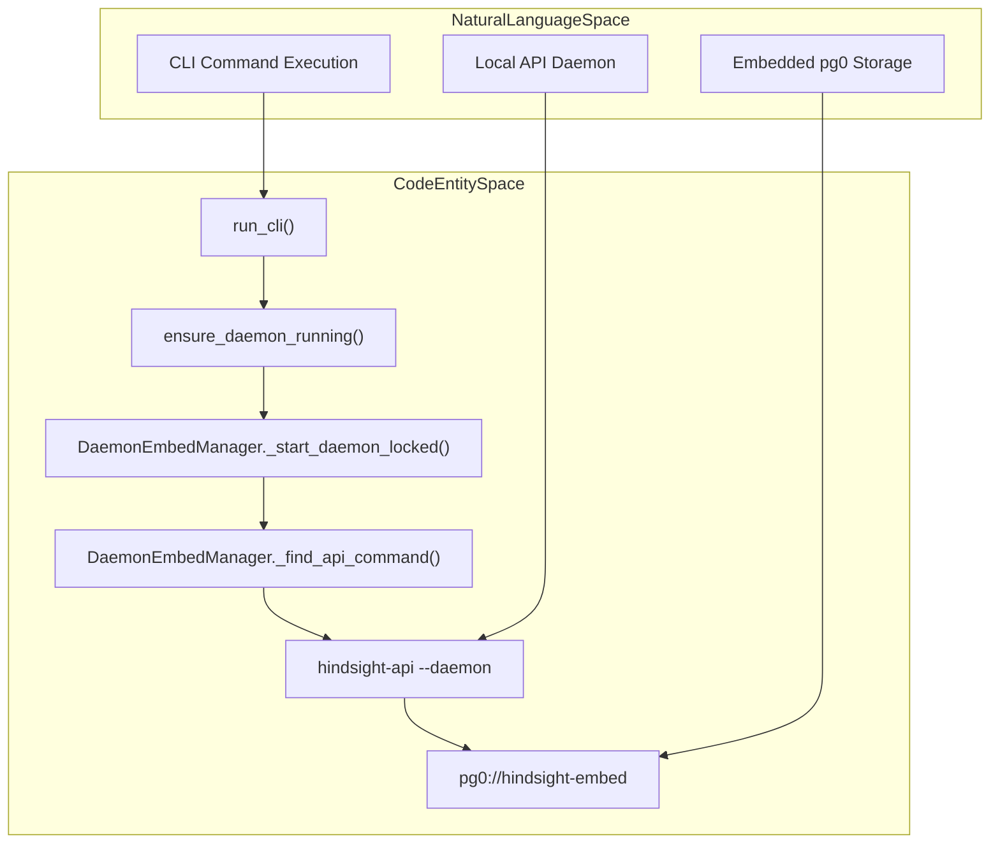

**Auto-Daemon Execution Flow:**
1. **Invocation**: The user invokes a CLI command (e.g., `hindsight-embed retain`) [hindsight-embed/hindsight_embed/cli.py:8-11]() or initializes `HindsightEmbedded` [hindsight-embed/hindsight_embed/daemon_client.py:42-60]().
2. **Liveness Check**: `DaemonEmbedManager.is_running()` probes loopback interfaces (`127.0.0.1` and `::1`) on the profile's allocated port [hindsight-embed/hindsight_embed/daemon_embed_manager.py:118-119]().
3. **Spawning**: If inactive, `_start_daemon_locked()` resolves the executable via `_find_api_command()` and executes `hindsight-api --daemon` using cross-platform detached process options [hindsight-embed/hindsight_embed/daemon_embed_manager.py:34-43]().
4. **Command Forwarding**: Once the health probe (`/health`) returns 200 OK, the request is dispatched via HTTP to the local listener [hindsight-docs/docs/sdks/embed.md:15-18]().

Sources: [hindsight-embed/hindsight_embed/daemon_embed_manager.py:34-123](), [hindsight-embed/hindsight_embed/daemon_client.py:28-100](), [hindsight-docs/docs/sdks/embed.md:10-20]()

---

## Configuration via `~/.hindsight/embed` and Profile Manager

Embedded mode isolates profiles inside `~/.hindsight/` [hindsight-embed/hindsight_embed/cli.py:39-40]() and `~/.hindsight/profiles/` [hindsight-embed/tests/test_profile_daemon_config.py:36-40](). Each profile maintains its own environment variables file, port allocation, and exclusive file lock (`*.lock`) [hindsight-embed/hindsight_embed/profile_manager.py:1-5]().

### Code Entity Mapping: Profile Management & Config Resolution

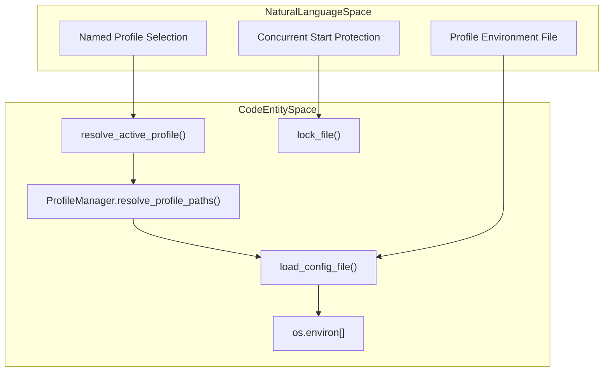

**Configuration Loading Rules:**
- **Active Profile Resolution**: `resolve_active_profile()` inspects the `--profile` CLI flag, environment variables, and active session markers [hindsight-embed/hindsight_embed/cli.py:73-88]().
- **Config Parsing**: `load_config_file()` reads the profile-specific `.env` file (`~/.hindsight/profiles/<profile>.env` or `~/.hindsight/embed`) without falling back to default when a named profile is targeted [hindsight-embed/hindsight_embed/cli.py:73-88]().
- **Environment Precedence**: Explicit process environment variables take precedence over settings loaded from profile files [hindsight-embed/hindsight_embed/cli.py:84-88]().
- **Exclusive File Locking**: `lock_file()` and `unlock_file()` provide cross-platform exclusive locking (`fcntl` on POSIX [hindsight-embed/hindsight_embed/profile_manager.py:76-87](), `msvcrt` on Windows [hindsight-embed/hindsight_embed/profile_manager.py:89-108]()) with exponential backoff to prevent race conditions during concurrent daemon initialization [hindsight-embed/hindsight_embed/profile_manager.py:46-54]().

### Summary of Embedded Environment Variables

| Variable | Description | Default |
|----------|-------------|---------|
| `HINDSIGHT_API_LLM_PROVIDER` | LLM provider (`openai`, `groq`, `gemini`, etc.) | `openai` [hindsight-embed/hindsight_embed/cli.py:114-114]() |
| `HINDSIGHT_API_LLM_API_KEY` | Authentication key for LLM provider | — |
| `HINDSIGHT_API_LLM_MODEL` | Target model name | Provider-specific [hindsight-embed/hindsight_embed/cli.py:16-16]() |
| `HINDSIGHT_EMBED_DAEMON_IDLE_TIMEOUT` | Seconds of inactivity before auto-exit | `0` (disabled) [hindsight-embed/hindsight_embed/daemon_embed_manager.py:74-74]() |
| `HINDSIGHT_EMBED_API_DATABASE_URL` | Database URL override | `pg0://hindsight-embed` [hindsight-embed/hindsight_embed/cli.py:19-19]() |
| `HINDSIGHT_EMBED_CONTROL_PORT` | Port for control center web app | `7878` [hindsight-embed/hindsight_embed/cli.py:23-23]() |
| `HINDSIGHT_EMBED_LOCK_TIMEOUT` | Max wait time in seconds for profile lock | `300.0` [hindsight-embed/hindsight_embed/profile_manager.py:51-51]() |

Sources: [hindsight-embed/hindsight_embed/cli.py:67-120](), [hindsight-embed/hindsight_embed/profile_manager.py:46-183](), [hindsight-embed/tests/test_profile_daemon_config.py:28-96]()

---

## Control Center UI

The local control center provides a browser-based dashboard for supervising daemons, inspecting configuration profiles, managing memory banks, and monitoring runtime operations [hindsight-docs/docs/sdks/embed.md:87-97]().

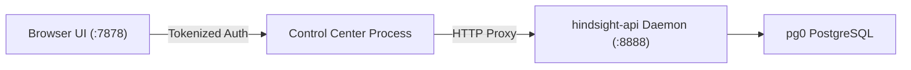

**Control Center Lifecycle & Storage:**
- **Launch Command**: Started via `hindsight-embed control start` [hindsight-docs/docs/sdks/embed.md:91-91]() or `start_ui()` [hindsight-embed/hindsight_embed/daemon_client.py:93-107]().
- **Access Control**: Stores a local access token in `~/.hindsight/control.token` and writes operational logs to `~/.hindsight/control.log` [hindsight-docs/docs/sdks/embed.md:97-97]().
- **Process Isolation**: The control center runs independently of the memory daemon; stopping or restarting the web UI does not terminate the underlying `hindsight-api` daemon process [hindsight-docs/docs/sdks/embed.md:112-113]().

Sources: [hindsight-embed/hindsight_embed/daemon_client.py:93-152](), [hindsight-docs/docs/sdks/embed.md:85-113]()

---

## Idle Timeout Behavior

The embedded daemon includes lifecycle monitoring to manage local system resources:

1. **Timeout Configuration**: Controlled by `HINDSIGHT_EMBED_DAEMON_IDLE_TIMEOUT` [hindsight-embed/hindsight_embed/daemon_embed_manager.py:74-74]().
2. **Behavior States**:
   - `0` (Default): Disabled. The daemon runs indefinitely until manually stopped, ensuring long-running processes, batch retain jobs, or consolidation routines are never interrupted [hindsight-docs/docs/sdks/embed.md:152-153]().
   - `>0`: Specifies an idle inactivity threshold in seconds. When exceeded without incoming HTTP requests, the daemon initiates a graceful self-termination.
3. **Manual Control**: Daemons can be queried or stopped explicitly via `hindsight-embed daemon status` and `hindsight-embed daemon stop` [hindsight-docs/docs/sdks/embed.md:158-166]().

Sources: [hindsight-embed/hindsight_embed/daemon_embed_manager.py:74-74](), [hindsight-docs/docs/sdks/embed.md:150-166]()

---

## Programmatic Embedded Mode: `hindsight-all` (`HindsightEmbedded` and `HindsightServer`)

The `hindsight-all` package exposes programmatic Python classes that encapsulate the same auto-daemon architecture utilized by the `hindsight-embed` CLI.

### `HindsightEmbedded` and `HindsightServer` Classes

`HindsightEmbedded` inherits full client functionality while automating daemon provisioning and profile attachment.

- **Lazy Initialization**: Parameters are recorded without spawning processes immediately. The daemon starts lazily on the first method execution.
- **Thread Safety**: Uses reentrant locks to coordinate simultaneous client threads during initial startup.
- **Selective Inheritance**: Parameters left as `None` are omitted from the daemon config payload, allowing inheritance from profile `.env` files or the parent shell environment without overwriting existing settings with defaults.

Sources: [hindsight-embed/hindsight_embed/daemon_client.py:28-60](), [hindsight-embed/hindsight_embed/daemon_embed_manager.py:34-123]()

---

## Node.js Embedded Support (`hindsight-all-npm`)

The `hindsight-all-npm` package brings identical local-first daemon management to the Node.js and TypeScript ecosystem.

```mermaid
graph TD
    A[Node.js/TypeScript Application] --> B{hindsight-all-npm package}
    B --> C[hindsight-embed CLI]
    C --> D[Python hindsight-api Daemon]
    D --> E[pg0 Embedded PostgreSQL]
```

- **Wrapper Architecture**: The `hindsight-all-npm` package internally invokes the `hindsight-embed` CLI to spawn and manage the underlying Python `hindsight-api` binary and `pg0` database instance transparently.
- **API Parity**: Exposes equivalent asynchronous methods for `retain`, `recall`, and `reflect` in TypeScript, mirroring the Python client [hindsight-clients/typescript/tests/main_operations.test.ts:22-149]().
- **Zero Configuration**: Automatically resolves local port binding (`127.0.0.1:8888`) and configures `pg0`-backed persistent storage without manual container orchestration.

Sources: [hindsight-clients/typescript/tests/main_operations.test.ts:1-25](), [hindsight-docs/docs/sdks/embed.md:10-29]()

---

# Page: System Architecture

# System Architecture

<details>
<summary>Relevant source files</summary>

The following files were used as context for generating this wiki page:

- [hindsight-api-slim/hindsight_api/api/http.py](hindsight-api-slim/hindsight_api/api/http.py)
- [hindsight-api-slim/hindsight_api/engine/memory_engine.py](hindsight-api-slim/hindsight_api/engine/memory_engine.py)
- [hindsight-cli/src/api.rs](hindsight-cli/src/api.rs)
- [hindsight-clients/go/api/openapi.yaml](hindsight-clients/go/api/openapi.yaml)
- [hindsight-clients/python/.openapi-generator/FILES](hindsight-clients/python/.openapi-generator/FILES)
- [hindsight-clients/python/hindsight_client_api/__init__.py](hindsight-clients/python/hindsight_client_api/__init__.py)
- [hindsight-clients/python/hindsight_client_api/models/__init__.py](hindsight-clients/python/hindsight_client_api/models/__init__.py)
- [hindsight-clients/typescript/generated/sdk.gen.ts](hindsight-clients/typescript/generated/sdk.gen.ts)
- [hindsight-clients/typescript/generated/types.gen.ts](hindsight-clients/typescript/generated/types.gen.ts)
- [hindsight-control-plane/src/lib/api.ts](hindsight-control-plane/src/lib/api.ts)
- [hindsight-docs/static/openapi.json](hindsight-docs/static/openapi.json)
- [skills/hindsight-docs/references/openapi.json](skills/hindsight-docs/references/openapi.json)

</details>


This page provides a comprehensive technical overview of Hindsight's multi-layered architecture, combining a FastAPI server, a memory engine orchestrator, PostgreSQL with vector extensions, external LLM/embedding/reranking providers, and an optional background worker service.

As a PARENT page, this overview outlines the big picture and links to detailed child pages for each subsystem:
- Component Overview → See [Component Overview](#3.1)
- Memory Engine → See [Memory Engine](#3.2)
- Data Model and Schema → See [Data Model and Schema](#3.3)
- Retrieval System (TEMPR Multi-Strategy) → See [Retrieval System (TEMPR Multi-Strategy)](#3.4)
- Background Worker and Task System → See [Background Worker and Task System](#3.5)
- Multi-tenancy and Authentication → See [Multi-tenancy and Authentication](#3.6)
- Extension System → See [Extension System](#3.7)
- Vector and Text Search Backends → See [Vector and Text Search Backends](#3.8)
- Configuration Hierarchy → See [Configuration Hierarchy](#3.9)
- Database Abstraction and Oracle Support → See [Database Abstraction and Oracle Support](#3.10)
- Memory Defense and Security → See [Memory Defense and Security](#3.11)
- Admin CLI, Backup and Bank Transfer → See [Admin CLI, Backup and Bank Transfer](#3.12)

Sources: [hindsight-api-slim/hindsight_api/engine/memory_engine.py:1-10](), [hindsight-api-slim/hindsight_api/api/http.py:1-15]()

---

## System Layers and Code Entity Mapping

Hindsight's architecture bridges natural language users and clients to the internal code entities that implement its memory system. Below is a diagram illustrating the major layers and important code symbols with exact source references.

Title: **Hindsight Architecture and Code Entity Mapping**
```mermaid
graph TB
    subgraph NaturalLanguage["Natural Language & Client Space"]
        SDK["External Clients & SDKs"]
        UI["Control Plane UI"]
    end

    subgraph API["API Layer (hindsight_api.api)"]
        FastAPIApp["FastAPIApp<br/>http.py:create_app"]
        CustomRoute["ExcludeNoneRoute<br/>http.py:ExcludeNoneRoute"]
        MCPServer["MCPServer<br/>mcp.py"]
    end

    subgraph Engine["Engine Layer (hindsight_api.engine)"]
        MemoryEng["MemoryEngine<br/>memory_engine.py:MemoryEngine"]
        ConfigRes["ConfigResolver<br/>config_resolver.py"]
    end

    subgraph Storage["Data Layer (hindsight_api.engine.db)"]
        PGBackend["PostgreSQLBackend<br/>db/postgresql.py:PostgreSQLBackend"]
    end

    SDK --> FastAPIApp
    SDK --> MCPServer
    UI --> CustomRoute
    FastAPIApp --> CustomRoute
    CustomRoute --> MemoryEng
    MCPServer --> MemoryEng
    MemoryEng --> ConfigRes
    MemoryEng --> PGBackend
```

Sources: [hindsight-api-slim/hindsight_api/api/http.py:1-40](), [hindsight-api-slim/hindsight_api/engine/memory_engine.py:10-55]()

---

## Core Components Overview

The main components constituting Hindsight's backend runtime are summarized in the table below. Each plays a critical role in providing core memory features, handling API requests, managing data persistence, or integrating with external AI services. For detailed component-level maps, see [Component Overview](#3.1).

| Component           | Primary Symbol / Class       | Code Path                              | Role / Purpose                                                                                               |
|---------------------|-----------------------------|---------------------------------------|-------------------------------------------------------------------------------------------------------------|
| **API Application**  | `create_app`                 | `hindsight_api/api/http.py`            | FastAPI application factory and route registration for HTTP API [hindsight-api-slim/hindsight_api/api/http.py:1-10]()                           |
| **Response Routing** | `ExcludeNoneRoute`           | `hindsight_api/api/http.py`            | Custom FastAPI APIRoute override which omits null fields to maintain wire compatibility [hindsight-api-slim/hindsight_api/api/http.py:162-165]() |
| **MCP Server**       | `MCPServer`                  | `hindsight_api/api/mcp.py`             | Model Context Protocol server for tool integrations and agent orchestration                                  |
| **Engine Orchestrator**| `MemoryEngine`              | `hindsight_api/engine/memory_engine.py`| Central orchestrator coordinating retain, recall, and reflect lifecycle operations [hindsight-api-slim/hindsight_api/engine/memory_engine.py:170-190]()  |
| **Database Backend** | `PostgreSQLBackend`          | `hindsight_api/engine/db/postgresql.py`| Database connection pool, schema management, vector extension integrations                                    |
| **LLM Interface**    | `LLMInterface`               | `hindsight_api/engine/llm_interface.py`| Abstraction wrapping external LLM, embedding, and reranker providers                                        |
| **Audit Subsystem**  | `AuditLogger`                | `hindsight_api/engine/audit.py`        | Contextual logging and auditing of API calls and memory operations                                          |

Sources: [hindsight-api-slim/hindsight_api/api/http.py:1-165](), [hindsight-api-slim/hindsight_api/engine/memory_engine.py:60-190]()

---

## Memory Operations Data Flow

The high-level request handling and processing flow covers external input, API routing, engine orchestration, retrieval from storage, interaction with LLMs/embedding providers, and final response generation.

The sequence diagram below captures the execution path for **retain** and **recall** operations across core modules.

Title: **Retain and Recall Data Flow across Code Modules**
```mermaid
sequenceDiagram
    participant API as "http.py<br/>create_app"
    participant Engine as "memory_engine.py<br/>MemoryEngine"
    participant DB as "postgresql.py<br/>PostgreSQLBackend"
    participant LLM as "llm_interface.py<br/>LLMInterface"

    Note over API, Engine: Retain Operation Flow
    API->>Engine: retain_batch(bank_id, items)
    Engine->>LLM: _extract_facts_from_chunk()
    LLM-->>Engine: Structured Facts & Entities
    Engine->>DB: INSERT memory_units & embeddings

    Note over API, Engine: Recall Operation Flow
    API->>Engine: recall(bank_id, query)
    par TEMPR Multi-Strategy Search
        Engine->>DB: pgvector semantic search
        Engine->>DB: BM25 text search
        Engine->>DB: Graph traversal (link_expansion)
    end
    DB-->>Engine: Raw Candidate Facts
    Engine->>Engine: Reciprocal Rank Fusion & Rerank
    Engine-->>API: Ranked Memory Units
```

Sources: [hindsight-api-slim/hindsight_api/api/http.py:1-50](), [hindsight-api-slim/hindsight_api/engine/memory_engine.py:1-30]()

---

## Multi-Tenancy and Configuration Hierarchy

Hindsight supports multi-tenancy by using PostgreSQL schema isolation with async-safe context variables for per-request schema and bank identification:
- `_current_schema` stores the PostgreSQL schema associated with the current tenant [hindsight-api-slim/hindsight_api/engine/memory_engine.py:92-94]()
- `_current_bank_id` tracks the bank in which the current operation executes for cost attribution and scoping [hindsight-api-slim/hindsight_api/engine/memory_engine.py:97-100]()

Configuration is layered and hierarchical, resolving from global defaults to tenant overrides to bank-specific settings via `ConfigResolver` and `StaticConfigProxy`.

For details, see [Multi-tenancy and Authentication](#3.6) and [Configuration Hierarchy](#3.9).

Sources: [hindsight-api-slim/hindsight_api/engine/memory_engine.py:90-99]()

---

## Subsystem Navigation

For deeper technical specifications, refer to the child pages:
1. Component Overview → See [Component Overview](#3.1)
2. Memory Engine → See [Memory Engine](#3.2)
3. Data Model and Schema → See [Data Model and Schema](#3.3)
4. Retrieval System (TEMPR Multi-Strategy) → See [Retrieval System (TEMPR Multi-Strategy)](#3.4)
5. Background Worker and Task System → See [Background Worker and Task System](#3.5)
6. Multi-tenancy and Authentication → See [Multi-tenancy and Authentication](#3.6)
7. Extension System → See [Extension System](#3.7)
8. Vector and Text Search Backends → See [Vector and Text Search Backends](#3.8)
9. Configuration Hierarchy → See [Configuration Hierarchy](#3.9)
10. Database Abstraction and Oracle Support → See [Database Abstraction and Oracle Support](#3.10)
11. Memory Defense and Security → See [Memory Defense and Security](#3.11)
12. Admin CLI, Backup and Bank Transfer → See [Admin CLI, Backup and Bank Transfer](#3.12)

Sources: [hindsight-api-slim/hindsight_api/engine/memory_engine.py:1-10]()

---

# Page: Component Overview

# Component Overview

<details>
<summary>Relevant source files</summary>

The following files were used as context for generating this wiki page:

- [hindsight-api-slim/hindsight_api/api/http.py](hindsight-api-slim/hindsight_api/api/http.py)
- [hindsight-api-slim/hindsight_api/engine/memory_engine.py](hindsight-api-slim/hindsight_api/engine/memory_engine.py)
- [hindsight-api-slim/hindsight_api/main.py](hindsight-api-slim/hindsight_api/main.py)
- [hindsight-api-slim/hindsight_api/server.py](hindsight-api-slim/hindsight_api/server.py)
- [hindsight-api-slim/tests/test_daemon_host_resolution.py](hindsight-api-slim/tests/test_daemon_host_resolution.py)
- [hindsight-api-slim/tests/test_dotenv_loading.py](hindsight-api-slim/tests/test_dotenv_loading.py)
- [hindsight-api-slim/tests/test_extension_context.py](hindsight-api-slim/tests/test_extension_context.py)
- [hindsight-api-slim/tests/test_main_module.py](hindsight-api-slim/tests/test_main_module.py)
- [hindsight-api-slim/tests/test_server_module.py](hindsight-api-slim/tests/test_server_module.py)
- [hindsight-cli/src/api.rs](hindsight-cli/src/api.rs)
- [hindsight-clients/go/api/openapi.yaml](hindsight-clients/go/api/openapi.yaml)
- [hindsight-clients/python/.openapi-generator/FILES](hindsight-clients/python/.openapi-generator/FILES)
- [hindsight-clients/python/hindsight_client_api/__init__.py](hindsight-clients/python/hindsight_client_api/__init__.py)
- [hindsight-clients/python/hindsight_client_api/models/__init__.py](hindsight-clients/python/hindsight_client_api/models/__init__.py)
- [hindsight-clients/typescript/generated/sdk.gen.ts](hindsight-clients/typescript/generated/sdk.gen.ts)
- [hindsight-clients/typescript/generated/types.gen.ts](hindsight-clients/typescript/generated/types.gen.ts)
- [hindsight-control-plane/src/lib/api.ts](hindsight-control-plane/src/lib/api.ts)
- [hindsight-docs/static/openapi.json](hindsight-docs/static/openapi.json)
- [skills/hindsight-docs/references/openapi.json](skills/hindsight-docs/references/openapi.json)

</details>


This page maps the major architectural components of Hindsight: the **API layer** (`hindsight_api/api/http.py`, `hindsight_api/api/mcp.py`, `hindsight_api/main.py`, `hindsight_api/server.py`), **engine layer** (`MemoryEngine` orchestrator in `hindsight_api/engine/memory_engine.py`), **data layer** (PostgreSQL schema and backends), and **external services** (LLM, embedding, and reranking providers). It details request execution flows, context propagation via `contextvars`, and client cancellation monitoring.

For data model specifics, see [Data Model and Schema](). For internal memory orchestration logic, see [Memory Engine]().

---

## Architectural Layers and Code Mapping

Hindsight separates execution into distinct architectural layers. The diagram below bridges natural language architectural concepts to concrete code entities in the codebase.

### System Architecture and Code Entities

```mermaid
graph TB
    subgraph "API_Layer"
        HTTP["HTTP_API<br/>hindsight_api/api/http.py<br/>create_app()"]
        MCP["MCP_Server<br/>hindsight_api/api/mcp.py"]
        BOOT["Bootstrap<br/>hindsight_api/main.py<br/>main()"]
        SERVER["ServerBootstrap<br/>hindsight_api/server.py"]
    end
    
    subgraph "Engine_Layer"
        ORCHESTRATOR["MemoryEngine<br/>hindsight_api/engine/memory_engine.py<br/>MemoryEngine"]
        CONFIG["ConfigResolver<br/>hindsight_api/config_resolver.py"]
        AUDIT["AuditLogger<br/>hindsight_api/engine/audit.py"]
    end
    
    subgraph "Data_Layer"
        PG["PostgreSQLBackend<br/>hindsight_api/engine/db/postgresql.py<br/>asyncpg"]
    end
    
    subgraph "External_Services"
        LLM["LLMWrapper<br/>hindsight_api/engine/llm_wrapper.py"]
    end
    
    BOOT --> SERVER
    SERVER --> HTTP
    HTTP --> ORCHESTRATOR
    MCP --> ORCHESTRATOR
    
    ORCHESTRATOR --> CONFIG
    ORCHESTRATOR --> AUDIT
    ORCHESTRATOR --> PG
    ORCHESTRATOR --> LLM
```

**Sources**: [hindsight-api-slim/hindsight_api/main.py:1-68]() [], [hindsight-api-slim/hindsight_api/api/http.py:1-6]() [], [hindsight-api-slim/hindsight_api/engine/memory_engine.py:1-120]() []

---

## API Layer Implementation

The API layer is responsible for ingress, request validation, authentication context initialization, and cancellation monitoring.

### Components and Entry Points
*   **`hindsight_api/api/http.py`**: Defines the FastAPI application factory function `create_app()` [hindsight-api-slim/hindsight_api/api/http.py:4-6](), custom routing via `ExcludeNoneRoute` [hindsight-api-slim/hindsight_api/api/http.py:162-163](), and observability/cancellation middleware.
*   **`hindsight_api/api/mcp.py`**: Implements the Model Context Protocol server, mapping MCP tool invocations to engine actions.
*   **`hindsight_api/main.py`**: Provides the command-line interface (`main()`) [hindsight-api-slim/hindsight_api/main.py:2-11](), daemon spawning [hindsight-api-slim/hindsight_api/main.py:39-43](), pre-flight port binding checks via `_wait_for_port()` [hindsight-api-slim/hindsight_api/main.py:171-178](), and resource cleanup routines (`_cleanup()`) [hindsight-api-slim/hindsight_api/main.py:92-103]().
*   **`hindsight_api/server.py`**: Sets up uvicorn server parameters and application bootstrapping hooks.

| Module | Core Symbol | Responsibility |
| :--- | :--- | :--- |
| `hindsight_api/api/http.py` | `create_app()` | FastAPI app assembly, routing, and middleware injection [hindsight-api-slim/hindsight_api/api/http.py:4-6]() |
| `hindsight_api/api/http.py` | `ClientDisconnectCancellationMiddleware` | Intercepts client hangups to trigger operation cancellation [hindsight-api-slim/hindsight_api/api/http.py:28-28]() |
| `hindsight_api/main.py` | `main()` | CLI argument parsing, port probes, and process supervision [hindsight-api-slim/hindsight_api/main.py:2-11]() |
| `hindsight_api/main.py` | `_wait_for_port()` | Pre-flight TCP bind verification to avoid restart loops [hindsight-api-slim/hindsight_api/main.py:171-178]() |

**Sources**: [hindsight-api-slim/hindsight_api/api/http.py:1-32]() [], [hindsight-api-slim/hindsight_api/main.py:1-180]() []

---

## Engine Layer Orchestrator

The engine layer coordinates all memory transactions. The primary orchestrator class is `MemoryEngine` defined in `hindsight_api/engine/memory_engine.py` [hindsight-api-slim/hindsight_api/engine/memory_engine.py:1-10]().

### Context Isolation
`MemoryEngine` relies on Python `contextvars` to manage multi-tenancy and bank-level attribution across asynchronous boundaries safely:
*   `_current_schema`: Stores the active PostgreSQL schema name per task [hindsight-api-slim/hindsight_api/engine/memory_engine.py:110-112]().
*   `_current_bank_id`: Tracks the target memory bank identifier for cost tracking and provider metadata [hindsight-api-slim/hindsight_api/engine/memory_engine.py:114-118]().

**Sources**: [hindsight-api-slim/hindsight_api/engine/memory_engine.py:1-120]() []

---

## Request Flow and Cancellation Handling

When a client initiates an HTTP request, FastAPI passes execution through observability and cancellation middleware. If a client disconnects prematurely, `ClientDisconnectCancellationMiddleware` signals cancellation down the request stack, raising `OperationCancelledError` [hindsight-api-slim/hindsight_api/cancellation.py:1-40]().

### Request Execution and Cancellation Flow

```mermaid
sequenceDiagram
    participant Client as "Client_SDK"
    participant Middleware as "ClientDisconnectCancellationMiddleware<br/>hindsight_api/api/disconnect.py"
    participant FastAPI as "FastAPI_Router<br/>hindsight_api/api/http.py"
    participant Engine as "MemoryEngine<br/>hindsight_api/engine/memory_engine.py"
    participant DB as "PostgreSQLBackend<br/>hindsight_api/engine/db/postgresql.py"

    Client->>Middleware: HTTP_Request
    Middleware->>FastAPI: Attach_Cancellation_Token
    FastAPI->>Engine: Run_Operation(bank_id, payload)
    
    alt Client_Disconnects
        Client--xMiddleware: Close_Connection
        Middleware->>Engine: Trigger_Cancellation
        Engine-->>FastAPI: OperationCancelledError
        FastAPI-->>Client: HTTP_499_Client_Closed_Request
    else Normal_Completion
        Engine->>DB: Execute_Query(asyncpg)
        DB-->>Engine: Result_Rows
        Engine-->>FastAPI: OperationResponse
        FastAPI-->>Client: HTTP_200_OK
    end
```

**Sources**: [hindsight-api-slim/hindsight_api/api/http.py:24-28]() [], [hindsight-api-slim/hindsight_api/cancellation.py:1-40]() [], [hindsight-api-slim/hindsight_api/engine/memory_engine.py:85-120]() []

---

# Page: Memory Engine

# Memory Engine

<details>
<summary>Relevant source files</summary>

The following files were used as context for generating this wiki page:

- [hindsight-api-slim/hindsight_api/api/http.py](hindsight-api-slim/hindsight_api/api/http.py)
- [hindsight-api-slim/hindsight_api/engine/chinese_temporal_periods.py](hindsight-api-slim/hindsight_api/engine/chinese_temporal_periods.py)
- [hindsight-api-slim/hindsight_api/engine/local_device.py](hindsight-api-slim/hindsight_api/engine/local_device.py)
- [hindsight-api-slim/hindsight_api/engine/memory_engine.py](hindsight-api-slim/hindsight_api/engine/memory_engine.py)
- [hindsight-api-slim/hindsight_api/engine/query_analyzer.py](hindsight-api-slim/hindsight_api/engine/query_analyzer.py)
- [hindsight-api-slim/hindsight_api/engine/search/temporal_extraction.py](hindsight-api-slim/hindsight_api/engine/search/temporal_extraction.py)
- [hindsight-api-slim/hindsight_api/engine/temporal_language_detection.py](hindsight-api-slim/hindsight_api/engine/temporal_language_detection.py)
- [hindsight-api-slim/hindsight_api/engine/temporal_periods.py](hindsight-api-slim/hindsight_api/engine/temporal_periods.py)
- [hindsight-api-slim/tests/data/query_analyzer_golden.json](hindsight-api-slim/tests/data/query_analyzer_golden.json)
- [hindsight-api-slim/tests/query_analyzer_bench.py](hindsight-api-slim/tests/query_analyzer_bench.py)
- [hindsight-api-slim/tests/query_analyzer_corpus.py](hindsight-api-slim/tests/query_analyzer_corpus.py)
- [hindsight-api-slim/tests/test_jina_mlx_release.py](hindsight-api-slim/tests/test_jina_mlx_release.py)
- [hindsight-api-slim/tests/test_local_device.py](hindsight-api-slim/tests/test_local_device.py)
- [hindsight-api-slim/tests/test_local_model_alignment.py](hindsight-api-slim/tests/test_local_model_alignment.py)
- [hindsight-api-slim/tests/test_local_model_build_lock.py](hindsight-api-slim/tests/test_local_model_build_lock.py)
- [hindsight-api-slim/tests/test_query_analyzer.py](hindsight-api-slim/tests/test_query_analyzer.py)
- [hindsight-api-slim/tests/test_temporal_default_reference_utc.py](hindsight-api-slim/tests/test_temporal_default_reference_utc.py)
- [hindsight-api-slim/tests/test_temporal_extraction.py](hindsight-api-slim/tests/test_temporal_extraction.py)
- [hindsight-api-slim/tests/test_temporal_language_detection_threading.py](hindsight-api-slim/tests/test_temporal_language_detection_threading.py)
- [hindsight-cli/src/api.rs](hindsight-cli/src/api.rs)
- [hindsight-clients/go/api/openapi.yaml](hindsight-clients/go/api/openapi.yaml)
- [hindsight-clients/python/.openapi-generator/FILES](hindsight-clients/python/.openapi-generator/FILES)
- [hindsight-clients/python/hindsight_client_api/__init__.py](hindsight-clients/python/hindsight_client_api/__init__.py)
- [hindsight-clients/python/hindsight_client_api/models/__init__.py](hindsight-clients/python/hindsight_client_api/models/__init__.py)
- [hindsight-clients/typescript/generated/sdk.gen.ts](hindsight-clients/typescript/generated/sdk.gen.ts)
- [hindsight-clients/typescript/generated/types.gen.ts](hindsight-clients/typescript/generated/types.gen.ts)
- [hindsight-control-plane/src/lib/api.ts](hindsight-control-plane/src/lib/api.ts)
- [hindsight-docs/static/openapi.json](hindsight-docs/static/openapi.json)
- [skills/hindsight-docs/references/openapi.json](skills/hindsight-docs/references/openapi.json)

</details>


## Purpose and Scope

This page provides a technical deep dive into `MemoryEngine` (`[hindsight-api-slim/hindsight_api/engine/memory_engine.py:1-494]()`), the central orchestrator for all memory operations within Hindsight. It covers the orchestrator pattern, the coordination of the `retain`, `recall`, and `reflect` pipelines, and the orchestration of underlying helper modules including `llm_wrapper`, `embeddings`, `cross_encoder`, `entity_resolver`, and `query_analyzer`.

Sources: `[hindsight-api-slim/hindsight_api/engine/memory_engine.py:1-494]()`

---

## Architecture and Orchestrator Pattern

### Overview

The `MemoryEngine` encapsulates the orchestrator pattern that directs the flow of data through specialized submodules. Its methods provide a unified API to execute the three core operations — retain, recall, and reflect — while delegating sub-tasks such as fact extraction, vector generation, entity resolution, and temporal/query parsing to dedicated subsystems.

### Natural Language to Code Entity Mapping: Orchestration Flow

```mermaid
graph TB
    subgraph "NaturalLanguageSpace"
        NL_Store["\"Store Memory / Retain\""]
        NL_Search["\"Recall / Semantic & Graph Search\""]
        NL_Reflect["\"Reflect / Autonomous Agent Reasoning\""]
    end

    subgraph "CodeEntitySpace"
        CE_Retain["\"MemoryEngine.retain_async()\"\n(hindsight_api/engine/memory_engine.py:1131)"]
        CE_Recall["\"MemoryEngine.recall_async()\"\n(hindsight_api/engine/memory_engine.py:1633)"]
        CE_Reflect["\"MemoryEngine.reflect_async()\"\n(hindsight_api/engine/memory_engine.py:1923)"]
        
        CE_LLM["\"LLMInterface / llm_wrapper\"\n(hindsight_api/engine/llm_wrapper.py:50)"]
        CE_Embed["\"Embeddings\"\n(hindsight_api/engine/embeddings.py)"]
        CE_Cross["\"CrossEncoderModel\"\n(hindsight_api/engine/cross_encoder.py)"]
        CE_Entity["\"EntityResolver\"\n(hindsight_api/engine/entity_resolver.py:1)"]
        CE_Query["\"QueryAnalyzer\"\n(hindsight_api/engine/query_analyzer.py:1)"]
    end

    NL_Store --> CE_Retain
    NL_Search --> CE_Recall
    NL_Reflect --> CE_Reflect

    CE_Retain --> CE_LLM
    CE_Retain --> CE_Entity
    CE_Retain --> CE_Embed

    CE_Recall --> CE_Embed
    CE_Recall --> CE_Query
    CE_Recall --> CE_Cross

    CE_Reflect --> CE_LLM
    CE_Reflect --> CE_Recall
```

**Key Responsibilities of `MemoryEngine`:**

| Responsibility | Implementation Details | Code Reference |
|---|---|---|
| Initialization | Creates DB connection pool, initializes submodules, runs database migrations | `[hindsight-api-slim/hindsight_api/engine/memory_engine.py:238-494]()` |
| Multi-tenancy | Maintains schema context per request, validates tenant access | `[hindsight-api-slim/hindsight_api/engine/memory_engine.py:520-551]()` |
| Operation Routing | Dispatches requests to retain, recall, and reflect pipelines | `[hindsight-api-slim/hindsight_api/engine/memory_engine.py:1131-1453]()` |
| Component Coordination | Manages LLM configs, embedding lifecycles, and rerankers | `[hindsight-api-slim/hindsight_api/engine/memory_engine.py:388-464]()` |
| Async Task Management | Submits background jobs like consolidation and file processing | `[hindsight-api-slim/hindsight_api/engine/memory_engine.py:553-826]()` |

Sources: `[hindsight-api-slim/hindsight_api/engine/memory_engine.py:227-494]()`, `[hindsight-api-slim/hindsight_api/config.py:1-250]()`

---

## Initialization and Configuration

### Constructor and Configuration

The constructor instantiates `MemoryEngine` with configuration parameters sourced from `HindsightConfig` (`[hindsight-api-slim/hindsight_api/config.py:141-250]()`). It sets up the asynchronous database connection pool, initializes vector storage settings, and configures distinct LLM profiles for different operations.

### Per-Operation LLM Configuration Hierarchy

The engine separates LLM behavior across different operational domains to optimize latency and cost:

| LLM Config | Purpose | Fallback | Code Reference |
|---|---|---|---|
| `_llm_config` | Global default configuration | Environment or defaults | `[hindsight-api-slim/hindsight_api/engine/memory_engine.py:388-397]()` |
| `_retain_llm_config` | Fact extraction during retain | `_llm_config` | `[hindsight-api-slim/hindsight_api/engine/memory_engine.py:400-419]()` |
| `_reflect_llm_config` | Reasoning loops during reflect | `_llm_config` | `[hindsight-api-slim/hindsight_api/engine/memory_engine.py:421-440]()` |
| `_consolidation_llm_config` | Observation synthesis and mental models | `_llm_config` | `[hindsight-api-slim/hindsight_api/engine/memory_engine.py:442-461]()` |

Sources: `[hindsight-api-slim/hindsight_api/engine/memory_engine.py:238-494]()`, `[hindsight-api-slim/hindsight_api/config.py:1-250]()`

---

## Module Coordination

The engine coordinates specialized subsystems to process raw text into structured graph and vector elements, and to answer queries using multi-strategy retrieval.

### Natural Language to Code Entity Space Mapping: Submodule Integration

```mermaid
graph TB
    subgraph "NaturalLanguageSpace"
        NL_RawInput["\"Raw Text / Prompt / Query\""]
        NL_ParsedQuery["\"Temporal & Semantic Intent\""]
        NL_ExtractedFacts["\"Structured World & Experience Facts\""]
    end

    subgraph "CodeEntitySpace"
        ME_Orchestrator["\"MemoryEngine (memory_engine.py)\""]
        
        QA["\"QueryAnalyzer\n(hindsight_api/engine/query_analyzer.py:1)\""]
        ER["\"EntityResolver\n(hindsight_api/engine/entity_resolver.py:1)\""]
        EM["\"Embeddings\n(hindsight_api/engine/embeddings.py)\""]
        CE["\"CrossEncoderModel\n(hindsight_api/engine/cross_encoder.py)\""]
        LLM["\"llm_wrapper / LLMInterface\n(hindsight_api/engine/llm_wrapper.py:50)\""]
    end

    NL_RawInput --> ME_Orchestrator
    ME_Orchestrator --> QA
    ME_Orchestrator --> ER
    ME_Orchestrator --> EM
    ME_Orchestrator --> CE
    ME_Orchestrator --> LLM

    QA --> NL_ParsedQuery
    LLM --> NL_ExtractedFacts
    ER --> NL_ExtractedFacts
```

### Submodule Roles

- **`llm_wrapper`**: Provides an abstraction over LLM providers with automatic retry, concurrency throttling via `CrossLoopSemaphore`, JSON schema validation, and tracing (`[hindsight-api-slim/hindsight_api/engine/llm_wrapper.py:50-115]()`).
- **`embeddings`**: Converts chunks and queries into dense vectors using local models (SentenceTransformers/ONNX) or remote APIs (`[hindsight-api-slim/hindsight_api/engine/embeddings.py:1-100]()`).
- **`cross_encoder`**: Performs reranking of recall candidates to maximize precision (`[hindsight-api-slim/hindsight_api/engine/cross_encoder.py:1-120]()`).
- **`entity_resolver`**: Handles entity canonicalization via trigram similarity matching (`[hindsight-api-slim/hindsight_api/engine/entity_resolver.py:82-93]()`).
- **`query_analyzer`**: Extracts temporal boundaries and query intent from natural language strings (`[hindsight-api-slim/hindsight_api/engine/query_analyzer.py:1-50]()`).

Sources: `[hindsight-api-slim/hindsight_api/engine/memory_engine.py:374-494]()`, `[hindsight-api-slim/hindsight_api/engine/llm_wrapper.py:50-115]()`, `[hindsight-api-slim/hindsight_api/engine/entity_resolver.py:1-150]()`, `[hindsight-api-slim/hindsight_api/engine/query_analyzer.py:1-50]()`

---

## Core Operation Methods

### Overview

`MemoryEngine` exposes core asynchronous methods that execute Hindsight's primary workflows.

```mermaid
graph TB
    subgraph "Public_API_Methods"
        RetainAsync["retain_async()"]
        RecallAsync["recall_async()"]
        ReflectAsync["reflect_async()"]
    end
    
    subgraph "Internal_Pipelines"
        RetainPipeline["retain_batch_internal()"]
        RecallPipeline["_recall_internal()"]
        ReflectPipeline["run_reflect_agent()"]
    end
    
    subgraph "Processing_Modules"
        ExtractFacts["fact_extraction.py"]
        ResolveEntities["entity_resolver.py"]
        GenerateEmbeddings["embeddings.py"]
        
        VectorSearch["vector search"]
        BM25Search["BM25 search"]
        GraphSearch["graph traversal"]
        TemporalFilter["temporal_periods.py"]
        Rerank["cross_encoder.py"]
        
        RecallTool["tool_recall"]
        LLMSynth["LLM synthesis"]
    end
    
    RetainAsync --> RetainPipeline
    RetainPipeline --> ExtractFacts
    RetainPipeline --> ResolveEntities
    RetainPipeline --> GenerateEmbeddings
    
    RecallAsync --> RecallPipeline
    RecallPipeline --> VectorSearch
    RecallPipeline --> BM25Search
    RecallPipeline --> GraphSearch
    RecallPipeline --> TemporalFilter
    RecallPipeline --> Rerank
    
    ReflectAsync --> ReflectPipeline
    ReflectPipeline --> RecallTool
    ReflectPipeline --> LLMSynth
```

### Method Summary

| Method | Description | Code Reference |
|---|---|---|
| `retain_async()` | Processes text input through chunking, extraction, entity resolution, and vectorization. | `[hindsight-api-slim/hindsight_api/engine/memory_engine.py:1131-1186]()` |
| `recall_async()` | Executes 4-way parallel retrieval (vector, BM25, graph traversal, temporal) with reranking. | `[hindsight-api-slim/hindsight_api/engine/memory_engine.py:1633-1921]()` |
| `reflect_async()` | Runs autonomous agent reasoning loops with tool calls and mental model integration. | `[hindsight-api-slim/hindsight_api/engine/memory_engine.py:1923-2109]()` |

Sources: `[hindsight-api-slim/hindsight_api/engine/memory_engine.py:1131-2109]()`, `[hindsight-api-slim/hindsight_api/engine/query_analyzer.py:1-50]()`

---

## Multi-Tenancy and Schema Isolation

Tenant and bank separation is implemented via PostgreSQL schema isolation coupled with task-local context variables.

| Component | Role | Code Reference |
|---|---|---|
| `_current_schema` | Async context variable storing the active schema | `[hindsight-api-slim/hindsight_api/engine/memory_engine.py:80]()` |
| `get_current_schema()` | Helper retrieving active schema with fallback | `[hindsight-api-slim/hindsight_api/engine/memory_engine.py:136-142]()` |
| `fq_table()` | Prefixes table names with current schema | `[hindsight-api-slim/hindsight_api/engine/memory_engine.py:188-197]()` |
| `_authenticate_tenant()` | Validates access and populates schema context | `[hindsight-api-slim/hindsight_api/engine/memory_engine.py:520-551]()` |

Sources: `[hindsight-api-slim/hindsight_api/engine/memory_engine.py:70-170]()`, `[hindsight-api-slim/hindsight_api/engine/memory_engine.py:520-551]()`

---

# Page: Data Model and Schema

# Data Model and Schema

<details>
<summary>Relevant source files</summary>

The following files were used as context for generating this wiki page:

- [hindsight-api-slim/hindsight_api/_vector_index.py](hindsight-api-slim/hindsight_api/_vector_index.py)
- [hindsight-api-slim/hindsight_api/alembic/_owned.py](hindsight-api-slim/hindsight_api/alembic/_owned.py)
- [hindsight-api-slim/hindsight_api/alembic/versions/2eee35aa3cfc_case_insensitive_entities_trgm_index.py](hindsight-api-slim/hindsight_api/alembic/versions/2eee35aa3cfc_case_insensitive_entities_trgm_index.py)
- [hindsight-api-slim/hindsight_api/alembic/versions/5a366d414dce_initial_schema.py](hindsight-api-slim/hindsight_api/alembic/versions/5a366d414dce_initial_schema.py)
- [hindsight-api-slim/hindsight_api/alembic/versions/a2b3c4d5e6f7_add_text_signals_column.py](hindsight-api-slim/hindsight_api/alembic/versions/a2b3c4d5e6f7_add_text_signals_column.py)
- [hindsight-api-slim/hindsight_api/alembic/versions/a4b5c6d7e8f9_fix_per_bank_vector_index_type.py](hindsight-api-slim/hindsight_api/alembic/versions/a4b5c6d7e8f9_fix_per_bank_vector_index_type.py)
- [hindsight-api-slim/hindsight_api/alembic/versions/b2429c65cc20_banks_needing_consolidation_hybrid_probe.py](hindsight-api-slim/hindsight_api/alembic/versions/b2429c65cc20_banks_needing_consolidation_hybrid_probe.py)
- [hindsight-api-slim/hindsight_api/alembic/versions/b2d4f6a8c1e3_repair_maintenance_routines_public.py](hindsight-api-slim/hindsight_api/alembic/versions/b2d4f6a8c1e3_repair_maintenance_routines_public.py)
- [hindsight-api-slim/hindsight_api/alembic/versions/b6d2f8a4c1e7_maintenance_routines_schema_local.py](hindsight-api-slim/hindsight_api/alembic/versions/b6d2f8a4c1e7_maintenance_routines_schema_local.py)
- [hindsight-api-slim/hindsight_api/alembic/versions/b8c9d0e1f2a3_vchord_cosine_opclass.py](hindsight-api-slim/hindsight_api/alembic/versions/b8c9d0e1f2a3_vchord_cosine_opclass.py)
- [hindsight-api-slim/hindsight_api/alembic/versions/c7e9f1a3b5d2_maintenance_routines_skip_vanished_schemas.py](hindsight-api-slim/hindsight_api/alembic/versions/c7e9f1a3b5d2_maintenance_routines_skip_vanished_schemas.py)
- [hindsight-api-slim/hindsight_api/alembic/versions/c8b4e2a71f95_maintenance_routines_skip_locked_schemas.py](hindsight-api-slim/hindsight_api/alembic/versions/c8b4e2a71f95_maintenance_routines_skip_locked_schemas.py)
- [hindsight-api-slim/hindsight_api/alembic/versions/d5e6f7a8b9c0_add_bank_internal_id_and_per_bank_hnsw.py](hindsight-api-slim/hindsight_api/alembic/versions/d5e6f7a8b9c0_add_bank_internal_id_and_per_bank_hnsw.py)
- [hindsight-api-slim/hindsight_api/alembic/versions/d6e7f8a9b0c1_drop_documents_metadata_column.py](hindsight-api-slim/hindsight_api/alembic/versions/d6e7f8a9b0c1_drop_documents_metadata_column.py)
- [hindsight-api-slim/hindsight_api/alembic/versions/d7b2f8a1c934_add_schemas_with_expired_operations_routine.py](hindsight-api-slim/hindsight_api/alembic/versions/d7b2f8a1c934_add_schemas_with_expired_operations_routine.py)
- [hindsight-api-slim/hindsight_api/alembic/versions/e5f6a7b8c9d0_add_maintenance_routines.py](hindsight-api-slim/hindsight_api/alembic/versions/e5f6a7b8c9d0_add_maintenance_routines.py)
- [hindsight-api-slim/hindsight_api/alembic/versions/f4d1c2b3a5e6_add_scheduled_mental_model_refresh_routine.py](hindsight-api-slim/hindsight_api/alembic/versions/f4d1c2b3a5e6_add_scheduled_mental_model_refresh_routine.py)
- [hindsight-api-slim/hindsight_api/alembic/versions/h3i4j5k6l7m8_merge_heads_and_add_unit_entities_index.py](hindsight-api-slim/hindsight_api/alembic/versions/h3i4j5k6l7m8_merge_heads_and_add_unit_entities_index.py)
- [hindsight-api-slim/hindsight_api/alembic/versions/n9i0j1k2l3m4_learnings_and_pinned_reflections.py](hindsight-api-slim/hindsight_api/alembic/versions/n9i0j1k2l3m4_learnings_and_pinned_reflections.py)
- [hindsight-api-slim/hindsight_api/engine/db_utils.py](hindsight-api-slim/hindsight_api/engine/db_utils.py)
- [hindsight-api-slim/hindsight_api/engine/memories/pg/transfer.py](hindsight-api-slim/hindsight_api/engine/memories/pg/transfer.py)
- [hindsight-api-slim/hindsight_api/engine/retain/embedding_utils.py](hindsight-api-slim/hindsight_api/engine/retain/embedding_utils.py)
- [hindsight-api-slim/hindsight_api/engine/search/reranking.py](hindsight-api-slim/hindsight_api/engine/search/reranking.py)
- [hindsight-api-slim/hindsight_api/engine/token_encoding.py](hindsight-api-slim/hindsight_api/engine/token_encoding.py)
- [hindsight-api-slim/tests/test_coarse_date_spans.py](hindsight-api-slim/tests/test_coarse_date_spans.py)
- [hindsight-api-slim/tests/test_combined_scoring.py](hindsight-api-slim/tests/test_combined_scoring.py)
- [hindsight-api-slim/tests/test_db_utils.py](hindsight-api-slim/tests/test_db_utils.py)
- [hindsight-api-slim/tests/test_embeddings_max_input_tokens.py](hindsight-api-slim/tests/test_embeddings_max_input_tokens.py)
- [hindsight-api-slim/tests/test_externally_owned_routines.py](hindsight-api-slim/tests/test_externally_owned_routines.py)
- [hindsight-api-slim/tests/test_graph_entity_fanout_cap.py](hindsight-api-slim/tests/test_graph_entity_fanout_cap.py)
- [hindsight-api-slim/tests/test_graph_maintenance_deadlock.py](hindsight-api-slim/tests/test_graph_maintenance_deadlock.py)
- [hindsight-api-slim/tests/test_knowledge_base.py](hindsight-api-slim/tests/test_knowledge_base.py)
- [hindsight-api-slim/tests/test_link_utils.py](hindsight-api-slim/tests/test_link_utils.py)
- [hindsight-api-slim/tests/test_maintenance_routines.py](hindsight-api-slim/tests/test_maintenance_routines.py)
- [hindsight-api-slim/tests/test_reflections.py](hindsight-api-slim/tests/test_reflections.py)
- [hindsight-api-slim/tests/test_reranker_failover_chain.py](hindsight-api-slim/tests/test_reranker_failover_chain.py)
- [hindsight-api-slim/tests/test_reranker_score_normalization.py](hindsight-api-slim/tests/test_reranker_score_normalization.py)
- [hindsight-api-slim/tests/test_reranking_proof_count.py](hindsight-api-slim/tests/test_reranking_proof_count.py)
- [hindsight-api-slim/tests/test_retain_orchestrator_mapping.py](hindsight-api-slim/tests/test_retain_orchestrator_mapping.py)
- [hindsight-api-slim/tests/test_vector_index.py](hindsight-api-slim/tests/test_vector_index.py)

</details>


This page documents the PostgreSQL database schema used by Hindsight for storing memories, entities, relationships, metadata, and background operations. It covers the following key aspects:

- Multi-tenancy via PostgreSQL schema isolation.
- Key tables: `banks`, `memory_units` (pgvector embeddings), `entities`, `entity_links`, `documents`, `chunks`, `observations`, `mental_models`, `directives`, `async_operations`.
- Per-bank partial HNSW vector indexes and support for multiple backend vector extensions (`pgvector`, `pgvectorscale`, `vchord`, `scann`).
- Alembic migration architecture with schema-aware migrations and extension pinning.
- Recurring maintenance routines coordinating consolidation, retention, and mental model refresh.

For retrieval system architecture and background worker details, see [3.4 Retrieval System (TEMPR Multi-Strategy)]() and [3.5 Background Worker and Task System](). For vector and text search backend configuration, see [3.8 Vector and Text Search Backends]().

---

## Schema Isolation and Multi-Tenancy

Hindsight achieves multi-tenancy by segregating each tenant into a dedicated PostgreSQL schema. For example, there can be the default `public` schema as well as tenant-specific schemas like `tenant_acme` or `tenant_xyz`. This provides strict storage isolation while sharing a physical database.

### Tenant Schema Context Management

Tenant schema context is centrally managed using an asynchronous Python context variable `_current_schema` maintained in the memory engine. Every SQL access uses fully-qualified table names via the helper function `fq_table()` which resolves the current schema context to prefix table names [hindsight-api-slim/hindsight_api/engine/memory_engine.py:50-61](). This ensures tenant separation at the SQL level.

Migrations executed by Alembic are also schema-aware, setting the `target_schema` option and guarded by advisory locks named after the schema hash to prevent concurrent migrations on the same schema [hindsight-api-slim/hindsight_api/migrations.py:61-70]().

At runtime, validation ensures no unqualified access to sensitive tables occurs to prevent accidental cross-tenant leaks [hindsight-api-slim/hindsight_api/engine/memory_engine.py:113-126]().

### Tenant Schema Resolution Flow (Natural Language to Code Entity Space)

```mermaid
graph TB
  subgraph NaturalLanguageSpace["Natural Language Space"]
    TenantRequest["Tenant API Request"]
    SchemaSelection["Tenant Schema Isolation"]
  end

  subgraph CodeEntitySpace["Code Entity Space"]
    TenantExt["TenantExtension.set_context()"]
    SchemaVar["_current_schema ContextVar (memory_engine.py)"]
    FQTable["fq_table(table_name) (memory_engine.py)"]
    AcquireConn["acquire_with_retry() (db_utils.py)"]
    PostgresQuery["PostgreSQL Query Execution"]
  end

  TenantRequest --> TenantExt
  TenantExt --> SchemaVar
  SchemaSelection --> SchemaVar
  SchemaVar --> FQTable
  FQTable --> AcquireConn
  AcquireConn --> PostgresQuery

  classDef ns fill:#fff,stroke:#333,stroke-width:2px;
  class NaturalLanguageSpace,CodeEntitySpace ns;
```

Title: Tenant Schema Resolution Flow
Sources:
- [hindsight-api-slim/hindsight_api/engine/memory_engine.py:50-61]()
- [hindsight-api-slim/hindsight_api/engine/db_utils.py:125-150]()
- [hindsight-api-slim/hindsight_api/migrations.py:61-70]()

---

## Alembic Migration Layout and Maintenance

Hindsight manages database schema changes via Alembic migrations without relying on an `alembic.ini` file, instead configuring migrations programmatically at runtime [hindsight-api-slim/hindsight_api/migrations.py:1-16]().

### Extension Installation and Pinning to `public`

PostgreSQL extensions needed (e.g., `vector`, `vchord`, `pg_trgm`, `btree_gin`) require installation in the `public` schema. Because migrations run with the tenant schema on the search path in schema mode, naïvely running `CREATE EXTENSION` installs extensions into tenant schemas, which breaks runtime extension resolution.

Hindsight wraps extension creation in a helper `create_extension()` that temporarily sets the search path to `public` for the extension install statement, thus pinning all extensions there [hindsight-api-slim/hindsight_api/_pg_extensions.py:72-100](). Misplaced extensions detected in schemas other than `public` are relocated automatically using `relocate_extension_to_public()` [hindsight-api-slim/hindsight_api/_pg_extensions.py:129-170]().

This approach ensures tenant schemas rely on the extensions in `public` and prevents extension duplication.

Sources:
- [hindsight-api-slim/hindsight_api/migrations.py:1-56]()
- [hindsight-api-slim/hindsight_api/_pg_extensions.py:50-100]()
- [hindsight-api-slim/hindsight_api/_pg_extensions.py:129-170]()

---

## Core Tables and Data Model

The Hindsight schema spans several core tables that collectively store bank configurations, memories, entity graphs, documents, observations, mental models, directives, and async background operations.

| Table Name       | Description                                                           | Key Columns / Usage                                                    |
|------------------|-----------------------------------------------------------------------|-----------------------------------------------------------------------|
| `banks`          | Stores memory bank configurations, mission statements, aliases, and disposition traits | `bank_id` PK (text), `internal_id` UUID for indexing, `config` JSONB  |
| `memory_units`   | Atomic memory facts including world, experience, observation facts, with text and vector embeddings | `id` UUID PK, `bank_id`, `text`, `fact_type`, `embedding` vector column, timestamps, tags JSONB |
| `entities`       | Canonical entities with frequency counts and classification by kind   | `id` UUID PK, `bank_id`, `canonical_name`, `entity_kind`             |
| `entity_links`   | Links between entities or facts such as temporal, semantic, or causal links | `from_unit_id`, `to_unit_id`, `link_type`, `weight`, `entity_id`      |
| `unit_entities`  | Junction table mapping entities mentioned in units                    | `unit_id`, `entity_id`, `bank_id`                                    |
| `documents`      | Metadata and state for ingested documents and their processing state  | `id` UUID PK, `bank_id`, `original_text`, `retain_params`, `tags`     |
| `chunks`         | Text chunks produced by document chunking and conversion              | `id`, `document_id`, `bank_id`, `chunk_index`, `text`                 |
| `observations`   | Synthesized semantic observations derived from associated facts       | `id`, `bank_id`, `scope`, `content`                                  |
| `mental_models`  | Cached knowledge pages and automated reflective queries, with scheduling triggers | `id`, `bank_id`, `name`, `content`, `source_query`, `trigger` JSONB  |
| `directives`     | Hard rules injected into reflective prompt contexts, prioritizing behavior | `id`, `bank_id`, `content`, `priority`, `enabled`                    |
| `async_operations` | Tracks background tasks (e.g., consolidation, refresh) with status  | `operation_id` UUID PK, `bank_id`, `operation_type`, `status`, `task_payload` JSONB |

Sources:
- [hindsight-api-slim/hindsight_api/alembic/versions/5a366d414dce_initial_schema.py:1-160]()
- [hindsight-api-slim/hindsight_api/alembic/versions/n9i0j1k2l3m4_learnings_and_pinned_reflections.py:1-120]()

---

## Per-Bank Vector Indexes and Backend Vector Extension Dispatch

Vector search in Hindsight is implemented with multiple supported PostgreSQL vector extensions:

- **pgvector** (default): Uses HNSW topologies indexed per bank.
- **pgvectorscale**: DiskANN backend variant.
- **vchord**: VectorChord vector index.
- **scann**: AlloyDB ScaNN vector search.

The choice is determined by the environment variable `HINDSIGHT_API_VECTOR_EXTENSION` and verified/installed at runtime [hindsight-api-slim/hindsight_api/_vector_index.py:1-49]().

### Partial Indexes per Bank on Embeddings

For extensions that support partial indexes (`pgvector`, `pgvectorscale`, `vchord`), Hindsight creates a set of deterministic partial vector indexes per bank internal UUID and fact type (`world`, `experience`, `observation`). This localizes index maintenance and targeting, improving search performance and concurrency.

Each index is a partial index defined on the `memory_units` table embedding column, filtered by `bank_id` and `fact_type` [hindsight-api-slim/hindsight_api/alembic/versions/a4b5c6d7e8f9_fix_per_bank_vector_index_type.py:72-126]().

### Vector Extension Dispatch Flow (Natural Language to Code Entity Space)

```mermaid
graph TB
  subgraph NaturalLanguageSpace["Natural Language Space"]
    ConfigEnv["Environment Vector Extension Setting (HINDSIGHT_API_VECTOR_EXTENSION)"]
    VectorBackend["Vector Backend Selection (pgvector, vchord, scann)"]
  end

  subgraph CodeEntitySpace["Code Entity Space"]
    ConfigFunc["configured_vector_extension() (_vector_index.py)"]
    BootstrapFunc["bootstrap_extension(conn, extension_name) (_vector_index.py)"]
    UsingClause["index_using_clause(extension_name) (_vector_index.py)"]
    MemoryTable["memory_units table (embedding vector column)"]
  end

  ConfigEnv --> ConfigFunc
  VectorBackend --> ConfigFunc
  ConfigFunc --> BootstrapFunc
  BootstrapFunc --> UsingClause
  UsingClause --> MemoryTable

  classDef ns fill:#fff,stroke:#333,stroke-width:2px;
  class NaturalLanguageSpace,CodeEntitySpace ns;
```

Title: Vector Extension Dispatch Flow
Sources:
- [hindsight-api-slim/hindsight_api/_vector_index.py:1-49]()
- [hindsight-api-slim/hindsight_api/alembic/versions/a4b5c6d7e8f9_fix_per_bank_vector_index_type.py:72-126]()

---

## Background Maintenance Routines

Housekeeping is implemented via a centralized `MaintenanceLoop` class that runs inside each API or worker process with no leader election. It periodically runs multiple jobs with configurable intervals, all driven by a shared asynchronous loop [hindsight-api-slim/hindsight_api/engine/maintenance.py:1-53](), [hindsight-api-slim/hindsight_api/engine/maintenance.py:114-135]().

### Maintenance Jobs Overview

1. **Retention Sweep**  
   Deletes aged-out rows from tables like `audit_log` and `llm_requests` across all tenant schemas. Deletes are chunked with `FOR UPDATE SKIP LOCKED` to avoid long locks and ensure contention-free pruning.

2. **Consolidation Reconcile**  
   Uses a PL/pgSQL routine `public.banks_needing_consolidation()` to find banks with facts eligible for consolidation but no current in-flight consolidation operation, and enqueues consolidation tasks for them [hindsight-api-slim/tests/test_maintenance_routines.py:84-126]().

3. **Scheduled Mental Model Refresh**  
   Runs refresh tasks for mental models (cached reflections) with scheduled cron triggers whose last refreshes are stale compared to newly added memories.

### Maintenance Loop Architecture Diagram

```mermaid
graph TD
  Loop["MaintenanceLoop._run()"]
  Engine["MemoryEngine"]
  RoutineConsolidation["PL/pgSQL routine: public.banks_needing_consolidation()"]
  RoutineRetention["Purge executor: _purge_table_in_batches"]
  AsyncOps["Table: async_operations"]

  Loop --> Engine
  Engine -->|Check eligible banks| RoutineConsolidation
  Engine -->|Purge tables| RoutineRetention
  RoutineConsolidation -->|Enqueue consolidation ops| AsyncOps

  Note["Single cooperative loop shared across all processes, with locking and idempotency"]
```

Title: Maintenance Loop Architecture
Sources:
- [hindsight-api-slim/hindsight_api/engine/maintenance.py:1-53]()
- [hindsight-api-slim/hindsight_api/engine/maintenance.py:114-135]()
- [hindsight-api-slim/tests/test_maintenance_routines.py:84-126]()

# End of 3.3 Data Model and Schema

---

# Page: Retrieval System (TEMPR Multi-Strategy)

# Retrieval System (TEMPR Multi-Strategy)

<details>
<summary>Relevant source files</summary>

The following files were used as context for generating this wiki page:

- [hindsight-api-slim/hindsight_api/engine/db/oracle.py](hindsight-api-slim/hindsight_api/engine/db/oracle.py)
- [hindsight-api-slim/hindsight_api/engine/db/postgresql.py](hindsight-api-slim/hindsight_api/engine/db/postgresql.py)
- [hindsight-api-slim/hindsight_api/engine/decision_model.py](hindsight-api-slim/hindsight_api/engine/decision_model.py)
- [hindsight-api-slim/hindsight_api/engine/search/decision_reranker.py](hindsight-api-slim/hindsight_api/engine/search/decision_reranker.py)
- [hindsight-api-slim/hindsight_api/engine/search/graph_retrieval.py](hindsight-api-slim/hindsight_api/engine/search/graph_retrieval.py)
- [hindsight-api-slim/hindsight_api/engine/search/recall_boost.py](hindsight-api-slim/hindsight_api/engine/search/recall_boost.py)
- [hindsight-api-slim/hindsight_api/engine/search/retrieval.py](hindsight-api-slim/hindsight_api/engine/search/retrieval.py)
- [hindsight-api-slim/hindsight_api/engine/search/types.py](hindsight-api-slim/hindsight_api/engine/search/types.py)
- [hindsight-api-slim/hindsight_api/engine/sql/base.py](hindsight-api-slim/hindsight_api/engine/sql/base.py)
- [hindsight-api-slim/hindsight_api/engine/sql/oracle.py](hindsight-api-slim/hindsight_api/engine/sql/oracle.py)
- [hindsight-api-slim/hindsight_api/engine/sql/postgresql.py](hindsight-api-slim/hindsight_api/engine/sql/postgresql.py)
- [hindsight-api-slim/tests/test_config_validation.py](hindsight-api-slim/tests/test_config_validation.py)
- [hindsight-api-slim/tests/test_db_abstraction.py](hindsight-api-slim/tests/test_db_abstraction.py)
- [hindsight-api-slim/tests/test_decision_model_config.py](hindsight-api-slim/tests/test_decision_model_config.py)
- [hindsight-api-slim/tests/test_decision_reranker.py](hindsight-api-slim/tests/test_decision_reranker.py)
- [hindsight-api-slim/tests/test_enable_text_search_flag.py](hindsight-api-slim/tests/test_enable_text_search_flag.py)
- [hindsight-api-slim/tests/test_knowledge_bm25_dispatch.py](hindsight-api-slim/tests/test_knowledge_bm25_dispatch.py)
- [hindsight-api-slim/tests/test_knowledge_search_text_search_disabled.py](hindsight-api-slim/tests/test_knowledge_search_text_search_disabled.py)
- [hindsight-api-slim/tests/test_multilingual_bm25.py](hindsight-api-slim/tests/test_multilingual_bm25.py)
- [hindsight-api-slim/tests/test_oracle_integration.py](hindsight-api-slim/tests/test_oracle_integration.py)
- [hindsight-api-slim/tests/test_recall_boost.py](hindsight-api-slim/tests/test_recall_boost.py)
- [hindsight-api-slim/tests/test_recall_boost_pipeline.py](hindsight-api-slim/tests/test_recall_boost_pipeline.py)
- [hindsight-api-slim/tests/test_recall_scoring_time.py](hindsight-api-slim/tests/test_recall_scoring_time.py)
- [hindsight-api-slim/tests/test_reranker_typesafe.py](hindsight-api-slim/tests/test_reranker_typesafe.py)
- [hindsight-api-slim/tests/test_temporal_arm_ordering.py](hindsight-api-slim/tests/test_temporal_arm_ordering.py)
- [hindsight-api-slim/tests/test_temporal_recall_selection.py](hindsight-api-slim/tests/test_temporal_recall_selection.py)
- [hindsight-docs/docs/developer/retain.md](hindsight-docs/docs/developer/retain.md)
- [hindsight-docs/docs/developer/retrieval.md](hindsight-docs/docs/developer/retrieval.md)
- [hindsight-docs/src/pages/changelog/integrations/zcode.md](hindsight-docs/src/pages/changelog/integrations/zcode.md)
- [skills/hindsight-docs/references/changelog/integrations/zcode.md](skills/hindsight-docs/references/changelog/integrations/zcode.md)
- [skills/hindsight-docs/references/developer/retain.md](skills/hindsight-docs/references/developer/retain.md)
- [skills/hindsight-docs/references/developer/retrieval.md](skills/hindsight-docs/references/developer/retrieval.md)
- [skills/hindsight-docs/references/sdks/integrations/zcode.md](skills/hindsight-docs/references/sdks/integrations/zcode.md)

</details>


The purpose of this page is to detail Hindsight's 4-way parallel retrieval system—known as TEMPR (Temporal, Entity, Memory, Procedural/Semantic Recall)—which coordinates semantic search (`pgvector`), BM25 text search, graph traversal (`link_expansion`/MPFP), and temporal search. It covers Reciprocal Rank fusion (RRF), cross-encoder reranking, recall boosts, token budget filtering, and search tracing.

---

## 1. Architecture Overview

When an agent or user invokes `recall()`, Hindsight delegates the retrieval process to `retrieve_all_fact_types_parallel` in `hindsight_api.engine.search.retrieval`. Rather than committing to a single search strategy upfront, the system concurrently executes four complementary retrieval arms. Their outputs are unified, scored using Reciprocal Rank Fusion (RRF), enhanced via neural cross-encoder reranking and multiplicative recall boosts, and filtered against a token budget.

### System Flow: Natural Language to Code Entities (Macro View)

```mermaid
graph TB
    subgraph "Natural_Language_Space"
        Q["UserQueryText<br/>'What did Alice do?'"]
    end

    subgraph "hindsight_api.engine.search"
        Orchestrator["retrieval.py<br/>retrieve_all_fact_types_parallel()"]
        
        subgraph "Parallel_Retrieval_Arms"
            Sem["SemanticSearchArm<br/>(pgvector/HNSW)"]
            KW["KeywordSearchArm<br/>(tokenize_query)"]
            Graph["GraphTraversalArm<br/>(LinkExpansionRetriever)"]
            Temp["TemporalSearchArm<br/>(DateWindow & Spreading)"]
        end

        subgraph "Fusion_And_Reranking"
            RRF["ReciprocalRankFusion<br/>(MergedCandidate)"]
            CE["decision_reranker.py<br/>apply_combined_scoring()"]
        end
    end

    subgraph "Code_Entity_Space"
        MU["memory_units table<br/>(embedding, fact_type)"]
        ML["memory_links table<br/>(link_type, weight)"]
        UE["unit_entities table<br/>(entity_id)"]
    end

    Q --> Orchestrator
    Orchestrator --> Sem & KW & Graph & Temp
    
    Sem --> MU
    KW --> MU
    Graph --> ML
    Graph --> UE
    Temp --> MU

    Sem & KW & Graph & Temp --> RRF
    RRF --> CE
    CE --> Final["List[ScoredResult]"]
```

Sources: [hindsight-api-slim/hindsight_api/engine/search/retrieval.py:129-166](), [hindsight-docs/docs/developer/retrieval.md:1-125]()

---

## 2. Four Parallel Retrieval Strategies

Each search strategy targets specific retrieval requirements, ensuring coverage whether the query relies on semantic conceptualization, exact keyword tokens, structural graph relationships, or temporal windows.

### 2.1 Semantic Search (pgvector)
Semantic search computes vector similarity between the query embedding string and stored item embeddings in `memory_units`. 
- Dedicated HNSW indexes per fact type (e.g., `idx_mu_emb_world`, `idx_mu_emb_experience`) isolate vector indexes to maximize selectivity.
- Executed via unified store routines coordinated by `retrieve_all_fact_types_parallel` [hindsight-api-slim/hindsight_api/engine/search/retrieval.py:129-166]().

### 2.2 BM25 Text Search
Keyword retrieval processes exact tokens using pluggable backends selected via configuration. Queries are normalized and tokenized via `tokenize_query` [hindsight-api-slim/hindsight_api/engine/search/retrieval.py:28-35]().
- Supported backends include `native` (`tsvector`), `vchord`, `pg_textsearch`, `pgroonga`, and `pg_search` (ParadeDB) [hindsight-docs/docs/developer/retrieval.md:55-65]().
- Dispatches are handled dynamically via SQL dialect layers such as `KnowledgeBm25Arm` in `hindsight_api.engine.sql.postgresql` [hindsight-api-slim/hindsight_api/engine/sql/postgresql.py:14-33]().

### 2.3 Graph Traversal (Link Expansion)
Graph traversal uses `LinkExpansionRetriever` to discover indirectly related memories by following relational edges in `memory_links` and `unit_entities` [hindsight-api-slim/hindsight_api/engine/search/graph_retrieval.py:1-50]().
- Seeds are established via semantic lookup before walking graph edges (co-occurrence, causal, and semantic neighbor links).
- Fanout limits constrain complexity across expansion steps.

### 2.4 Temporal Search
Temporal search parses natural language time constraints into structured `TemporalWindow` objects via `resolve_temporal_constraint` [hindsight-api-slim/hindsight_api/engine/search/retrieval.py:100-127]().
- Filters memories overlapping the target window.
- Distributes candidates across time buckets to ensure representative historical coverage rather than clustering on dense sub-intervals [hindsight-docs/docs/developer/retrieval.md:96-98]().

### Strategy-to-Code Execution Mapping

```mermaid
graph TB
    subgraph "Query_Input_Space"
        Input["retrieve_all_fact_types_parallel()"]
    end

    subgraph "Execution_Handlers"
        SHandler["Semantic Query<br/>(pgvector <=> operator)"]
        KHandler["Keyword Query<br/>(tokenize_query() -> text search)"]
        GHandler["Graph Expansion<br/>(LinkExpansionRetriever)"]
        THandler["Temporal Resolution<br/>(resolve_temporal_constraint())"]
    end

    subgraph "Database_Tables_And_Stores"
        TableMU["memory_units table<br/>(embedding, search_vector, fact_type)"]
        TableML["memory_links table<br/>(source_id, target_id, weight)"]
        TableUE["unit_entities table<br/>(unit_id, entity_id)"]
    end

    Input --> SHandler & KHandler & GHandler & THandler
    SHandler --> TableMU
    KHandler --> TableMU
    GHandler --> TableML
    GHandler --> TableUE
    THandler --> TableMU
```

Sources: [hindsight-api-slim/hindsight_api/engine/search/retrieval.py:28-166](), [hindsight-api-slim/hindsight_api/engine/sql/postgresql.py:14-75](), [hindsight-docs/docs/developer/retrieval.md:31-100]()

---

## 3. Result Fusion and Cross-Encoder Reranking

### Reciprocal Rank Fusion (RRF)
To reconcile heterogeneous scales and scoring metrics across the four arms, Hindsight uses Reciprocal Rank Fusion.
- RRF combines ranks rather than raw scores, summing inverse rank values ($1 / (\text{rank} + k)$).
- Consensus across multiple search arms elevates a candidate's fused standing.

### Neural Reranking & Recall Boosts
Following RRF, candidate subsets (up to 300 items) pass through `apply_combined_scoring` in `hindsight_api.engine.search.decision_reranker` [hindsight-api-slim/hindsight_api/engine/search/decision_reranker.py:1-50]().
- **Recency Decay:** Mapped via freshness functions reducing score weights over age in days.
- **Temporal Proximity:** Small positive adjustments for items near a temporal window midpoint.
- **Evidence Proof Count:** Logarithmic boosts for consolidated observations supported by extensive source evidence.

Sources: [hindsight-api-slim/hindsight_api/engine/search/decision_reranker.py:1-80](), [skills/hindsight-docs/references/developer/retrieval.md:15-21]()

---

## 4. Token Budget Filtering and Search Tracing

### Token Budget Management
Unlike conventional search engines returning a fixed count of top-$k$ results, Hindsight packs results against an agent's prompt context capacity:
- Candidates are sorted best-first by final fused and reranked scores.
- Memory text tokens accumulate until the configured `max_tokens` threshold (default `4096`) is exhausted [hindsight-docs/docs/developer/retrieval.md:129-135]().

### Search Tracing
Execution inspection is supported through tracing utilities in `tracer.py`, capturing arm timings, raw scores, consensus counts, and token tallies for review within the Control Plane UI [hindsight-docs/docs/developer/retrieval.md:140-145]().

Sources: [hindsight-docs/docs/developer/retrieval.md:129-145](), [skills/hindsight-docs/references/developer/retrieval.md:15-21]()

---

# Page: Background Worker and Task System

# Background Worker and Task System

<details>
<summary>Relevant source files</summary>

The following files were used as context for generating this wiki page:

- [hindsight-api-slim/hindsight_api/alembic/versions/e4a7c1b9d2f6_drop_memory_units_access_count.py](hindsight-api-slim/hindsight_api/alembic/versions/e4a7c1b9d2f6_drop_memory_units_access_count.py)
- [hindsight-api-slim/hindsight_api/engine/audit.py](hindsight-api-slim/hindsight_api/engine/audit.py)
- [hindsight-api-slim/hindsight_api/engine/background_writes.py](hindsight-api-slim/hindsight_api/engine/background_writes.py)
- [hindsight-api-slim/hindsight_api/engine/db/optional_routines.py](hindsight-api-slim/hindsight_api/engine/db/optional_routines.py)
- [hindsight-api-slim/hindsight_api/engine/llm_trace.py](hindsight-api-slim/hindsight_api/engine/llm_trace.py)
- [hindsight-api-slim/hindsight_api/engine/maintenance.py](hindsight-api-slim/hindsight_api/engine/maintenance.py)
- [hindsight-api-slim/hindsight_api/engine/task_backend.py](hindsight-api-slim/hindsight_api/engine/task_backend.py)
- [hindsight-api-slim/hindsight_api/tracing.py](hindsight-api-slim/hindsight_api/tracing.py)
- [hindsight-api-slim/hindsight_api/worker/main.py](hindsight-api-slim/hindsight_api/worker/main.py)
- [hindsight-api-slim/hindsight_api/worker/poller.py](hindsight-api-slim/hindsight_api/worker/poller.py)
- [hindsight-api-slim/tests/conftest.py](hindsight-api-slim/tests/conftest.py)
- [hindsight-api-slim/tests/test_async_batch_retain.py](hindsight-api-slim/tests/test_async_batch_retain.py)
- [hindsight-api-slim/tests/test_audit_per_bank.py](hindsight-api-slim/tests/test_audit_per_bank.py)
- [hindsight-api-slim/tests/test_background_writes.py](hindsight-api-slim/tests/test_background_writes.py)
- [hindsight-api-slim/tests/test_llm_provider.py](hindsight-api-slim/tests/test_llm_provider.py)
- [hindsight-api-slim/tests/test_llm_trace.py](hindsight-api-slim/tests/test_llm_trace.py)
- [hindsight-api-slim/tests/test_maintenance_loop.py](hindsight-api-slim/tests/test_maintenance_loop.py)
- [hindsight-api-slim/tests/test_migration_drop_access_count.py](hindsight-api-slim/tests/test_migration_drop_access_count.py)
- [hindsight-api-slim/tests/test_tracing.py](hindsight-api-slim/tests/test_tracing.py)
- [hindsight-api-slim/tests/test_tracing_context_propagation.py](hindsight-api-slim/tests/test_tracing_context_propagation.py)
- [hindsight-api-slim/tests/test_tracing_task_handoff.py](hindsight-api-slim/tests/test_tracing_task_handoff.py)
- [hindsight-api-slim/tests/test_worker.py](hindsight-api-slim/tests/test_worker.py)
- [hindsight-api-slim/tests/test_worker_main.py](hindsight-api-slim/tests/test_worker_main.py)
- [hindsight-clients/go/README.md](hindsight-clients/go/README.md)
- [hindsight-clients/go/go.mod](hindsight-clients/go/go.mod)
- [hindsight-clients/go/go.sum](hindsight-clients/go/go.sum)
- [hindsight-clients/go/openapi-generator-config.yaml](hindsight-clients/go/openapi-generator-config.yaml)
- [hindsight-clients/go/test/api_banks_test.go](hindsight-clients/go/test/api_banks_test.go)
- [hindsight-clients/go/test/api_directives_test.go](hindsight-clients/go/test/api_directives_test.go)
- [hindsight-clients/go/test/api_documents_test.go](hindsight-clients/go/test/api_documents_test.go)
- [hindsight-clients/go/test/api_entities_test.go](hindsight-clients/go/test/api_entities_test.go)
- [hindsight-clients/go/test/api_memory_test.go](hindsight-clients/go/test/api_memory_test.go)
- [hindsight-clients/go/test/api_mental_models_test.go](hindsight-clients/go/test/api_mental_models_test.go)
- [hindsight-clients/go/test/api_monitoring_test.go](hindsight-clients/go/test/api_monitoring_test.go)
- [hindsight-clients/go/test/api_operations_test.go](hindsight-clients/go/test/api_operations_test.go)
- [hindsight-docs/docs/sdks/go.md](hindsight-docs/docs/sdks/go.md)

</details>


## Purpose and Scope

The Background Worker and Task System provides a scalable and reliable distributed asynchronous processing framework for Hindsight. It enables the offloading of long-running and CPU/IO-intensive operations—such as fact extraction, file conversion, memory consolidation, mental model refresh, and webhook delivery—to dedicated worker processes. This architecture prevents API request timeouts and allows for horizontal scaling by distributing workloads across multiple worker instances.

This page provides an in-depth technical overview of the worker architecture, including asynchronous operation records, the PostgreSQL-backed task queue, poller and task backend implementations, consolidation jobs, file processing pipelines, webhook delivery with retry and backoff, tracing integration for LLM calls, and operation status tracking.

Sources: [hindsight-api-slim/hindsight_api/worker/poller.py:1-9](), [hindsight-api-slim/hindsight_api/engine/task_backend.py:1-210](), [hindsight-api-slim/hindsight_api/worker/main.py:1-184]()

---

## Architecture Overview

The worker system is composed of:

- **Async Operation Records**: The `async_operations` table tracks all async tasks and their states, such as pending, processing, completed, failed, etc.
- **Task Backends**: Abstractions handling task submission and execution:
  - `BrokerTaskBackend` for API servers to enqueue tasks.
  - `WorkerTaskBackend` for workers to handle already enqueued tasks.
  - `SyncTaskBackend` for synchronous inline execution (mostly testing/embedded mode).
- **Worker Poller (`WorkerPoller`)**: Long-running processes that poll the DB task queue, claim tasks safely using `FOR UPDATE SKIP LOCKED` semantics, and execute them concurrently.
- **Consolidation Jobs**: Periodic jobs to synthesize and deduplicate related memories.
- **File Processing Pipelines**: Asynchronous file parsing and extraction workflows.
- **Webhook Delivery System**: Reliable event notifications with retry and backoff.
- **Tracing and Observability**: Prometheus metrics, OpenTelemetry tracing of LLM calls, and health endpoints.

### Component Interaction Diagram

```mermaid
graph TB
    subgraph "API Server (hindsight-api-slim)"
        HTTP["HTTP API Layer<br/>(http.py, api.py)"]
        ENGINE["MemoryEngine<br/>(memory_engine.py)"]
        TASK_BROKER["BrokerTaskBackend<br/>(engine/task_backend.py)"]
    end

    subgraph "Database (PostgreSQL)"
        ASYNC_OPS["async_operations table"]
        MEMORY_UNITS["memory_units"]
        DOCUMENTS["documents"]
        ENTITIES["entities"]
    end

    subgraph "Worker Process (hindsight-api-slim)"
        POLLER["WorkerPoller<br/>(worker/poller.py)"]
        EXECUTOR["MemoryEngine.execute_task()"]
        FILE_PARSER["File Parsing<br/>(worker/poller.py parsers/)"]
        WEBHOOK["Webhook Delivery<br/>(worker/poller.py)"]
    end

    HTTP --> ENGINE
    ENGINE -->|submit_task| TASK_BROKER
    TASK_BROKER --> ASYNC_OPS
    POLLER -->|claim_batch / SKIP LOCKED| ASYNC_OPS
    ASYNC_OPS --> POLLER
    POLLER --> EXECUTOR
    EXECUTOR -->|update status| ASYNC_OPS
    EXECUTOR --> FILE_PARSER
    EXECUTOR --> WEBHOOK
```

Sources: [hindsight-api-slim/hindsight_api/worker/poller.py:4-9](), [hindsight-api-slim/hindsight_api/worker/main.py:55-162]()

---

## Task Backend Abstraction

The task backend abstracts how tasks are submitted and executed across different execution contexts.

| Backend | Description | Use Case | Reference |
|----------|-------------|----------|-----------|
| `SyncTaskBackend` | Executes tasks immediately in the caller's context | Testing, embedded mode, CLI | [hindsight-api-slim/hindsight_api/engine/task_backend.py:95-123]() |
| `WorkerTaskBackend` | No-op submit (worker polls for tasks independently) | Worker processes avoid blocking on nested tasks | [hindsight-api-slim/hindsight_api/engine/task_backend.py:126-151]() |
| `BrokerTaskBackend` | Serializes tasks to `async_operations` DB table | API servers enqueue work for workers | [hindsight-api-slim/hindsight_api/engine/task_backend.py:153-210]() |

`TaskBackend` defines abstract methods including `submit_task`, `initialize`, and `shutdown`. The API server uses `BrokerTaskBackend` to persist tasks, while worker processes utilize `WorkerTaskBackend` where task dispatch relies strictly on database polling.

Sources: [hindsight-api-slim/hindsight_api/engine/task_backend.py:26-210]()

---

## Async Operations Table and Lifecycle Status

All background tasks are tracked in the `async_operations` PostgreSQL table, which stores task metadata, execution status, timestamps, payload, and result or error information.

### Operation Status Values

| Status     | Meaning                                                                 |
|------------|-------------------------------------------------------------------------|
| `pending`  | Task is queued and awaiting a worker claim                              |
| `processing` | A worker has claimed and is executing the task                        |
| `completed` | Task finished successfully                                              |
| `failed`   | Task failed with an unrecoverable error                                |
| `cancelled` | Task was explicitly cancelled via API; marked cancelled instead of deleted |

The system exposes asynchronous operation status at the API level with support for filtering, retrying, cancelling, and inspecting execution traces [hindsight-api-slim/hindsight_api/worker/poller.py:1-9]().

Sources: [hindsight-api-slim/hindsight_api/worker/poller.py:1-9](), [hindsight-api-slim/tests/test_async_batch_retain.py:139-164]()

---

## Worker Poller: Safe Task Claiming and Execution

The `WorkerPoller` class in `worker/poller.py` implements the core worker loop that polls the database, claims rows safely, and drives task handlers [hindsight-api-slim/hindsight_api/worker/poller.py:4-9]().

- Periodically polls the `async_operations` table for pending tasks.
- Uses PostgreSQL `FOR UPDATE SKIP LOCKED` to claim tasks atomically without blocking other concurrent workers [hindsight-api-slim/hindsight_api/worker/poller.py:4-9]().
- Tracks claimed tasks and their runtime stages via `StageHolder` [hindsight-api-slim/hindsight_api/worker/poller.py:50]().
- Enforces wall-clock timeouts (`_WallCeiling`) per task type to prevent stuck or wedged tasks [hindsight-api-slim/hindsight_api/worker/poller.py:76-112]().
- Handles storage backpressure with exponential backoff and jittered retry logic [hindsight-api-slim/hindsight_api/worker/poller.py:33-65]().

### Wall Clock Ceiling Semantics

Tasks have configurable maximum wall-clock runtimes to ensure a stuck task does not hold a worker slot indefinitely:

- `retain` operations have an absolute timeout (`retain_wall_timeout`) representing expected operation duration [hindsight-api-slim/hindsight_api/worker/poller.py:76-103]().
- `consolidation` jobs use an *idle* timeout (`consolidation_wall_timeout`) reset on progress; allows long total runtime but detects stalls [hindsight-api-slim/hindsight_api/worker/poller.py:104-108]().
- `refresh_mental_model` shares the reflect timeout budget (`reflect_wall_timeout`) [hindsight-api-slim/hindsight_api/worker/poller.py:109-112]().

Sources: [hindsight-api-slim/hindsight_api/worker/poller.py:31-168]()

---

## Consolidation Jobs and Background Maintenance

Consolidation synthesizes observations from related facts to reduce redundancies and improve recall relevance.

- Consolidation jobs are scheduled via async operation rows with type `"consolidation"` [hindsight-api-slim/hindsight_api/engine/maintenance.py:9-14]().
- The `MaintenanceLoop` runs as a periodic background task (default every 60 seconds) across API and worker nodes [hindsight-api-slim/hindsight_api/engine/maintenance.py:1-79]().
- It performs:
  - Retention sweeps for audit logs and LLM request traces in bounded chunks with `FOR UPDATE SKIP LOCKED` [hindsight-api-slim/hindsight_api/engine/maintenance.py:6-37]().
  - Reconsolidation trigger for banks with eligible facts that lack scheduled consolidation [hindsight-api-slim/hindsight_api/engine/maintenance.py:9-14]().
  - Mental model refreshes when cron schedules indicate staleness [hindsight-api-slim/hindsight_api/engine/maintenance.py:15-21]().

Sources: [hindsight-api-slim/hindsight_api/engine/maintenance.py:1-115]()

---

## File Processing Pipeline

The worker handles asynchronous file uploads with a multi-stage parsing and extraction pipeline:

1. **File Uploading**: Files are uploaded and stored as binary attachments with unique storage keys [hindsight-api-slim/tests/test_async_batch_retain.py:1-10]().
2. **Parsing**: Various parsers support PDF, Office docs, images, markdown, etc. [hindsight-api-slim/hindsight_api/worker/poller.py:121-149]()
3. **Conversion and OCR**: Some parsers invoke external tools or OCR options for text extraction.
4. **Fact Extraction**: Parsed content is passed to the `retain` pipeline, broken into sub-batches if token limits are exceeded.
5. **Error Handling**: Child task errors from sub-batch extraction or document conversion are aggregated and surfaced at the root level.

### File Parser Pipeline Diagram

```mermaid
graph LR
    subgraph "File_Processing_Pipeline"
        UPLOAD["File Upload and Store<br/>(Document, Attachment)"]
        PARSER["MarkitdownParser / Iris / LlamaParse<br/>(parsers/markitdown.py)"]
        CONVERT["_convert_sync / OCR Options"]
        SUB_BATCH["Batch Split for Fact Extraction"]
        RETAIN_PIPELINE["Retain Memory Pipeline"]
        ERROR_AGGREGATION["Child Task Error Aggregation"]
    end
    
    UPLOAD --> PARSER
    PARSER --> CONVERT
    CONVERT --> SUB_BATCH
    SUB_BATCH --> RETAIN_PIPELINE
    RETAIN_PIPELINE --> ERROR_AGGREGATION
```

Sources: [hindsight-api-slim/hindsight_api/worker/poller.py:121-149]()

---

## Webhook Delivery with Retry and Exponential Backoff

The worker system supports reliable webhook event dispatch:

- Webhook tasks are enqueued to `async_operations` when events occur.
- Delivery attempts include HMAC signing using configured secrets for security.
- Failed delivery attempts trigger retries with exponential backoff delays.
- Maximum retry counts are applied before permanently failing and marking the operation failed.

Sources: [hindsight-api-slim/hindsight_api/worker/poller.py:25-26]()

---

## Tracing, Logging, and Observability

Hindsight leverages OpenTelemetry and Prometheus for observability in the worker system:

- **Tracing**: The `tracing.py` module initializes OTLP HTTP exporters compatible with Langfuse or any OTLP collector [hindsight-api-slim/hindsight_api/tracing.py:1-12](). It instruments all LLM calls, recording full GenAI semantic conventions (prompts, completions, token counts, errors) [hindsight-api-slim/hindsight_api/tracing.py:103-130]().
- **LLM Trace Context**: Per-bank and per-operation context propagation allows attribution of LLM requests to specific operations [hindsight-api-slim/hindsight_api/engine/llm_trace.py:69-94]().
- **Metrics**: The worker exposes `/metrics` endpoint with Prometheus-formatted data including DB pool statistics, operation durations, success/failure counts [hindsight-api-slim/hindsight_api/worker/main.py:77-106]().
- **Health Endpoints**: `/health/live` for liveness (process alive), and `/health/ready` for readiness (DB connectivity) [hindsight-api-slim/hindsight_api/worker/main.py:107-157]().
- **Resource Usage Tracking**: Resident Set Size (RSS) is polled on Linux via `/proc/self/statm` during worker polling cycles [hindsight-api-slim/hindsight_api/worker/poller.py:115-129]().

### Worker Health and Metrics Endpoints

| Endpoint      | Description                                     | Code Reference                  |
|---------------|------------------------------------------------|-------------------------------|
| `/health`     | Readiness, verifies DB connectivity             | [hindsight-api-slim/hindsight_api/worker/main.py:107-124]() |
| `/health/live`| Liveness, in-process check without DB calls     | [hindsight-api-slim/hindsight_api/worker/main.py:137-157]() |
| `/metrics`    | Prometheus metrics exposed for scraping         | [hindsight-api-slim/hindsight_api/worker/main.py:160-170]() |

Sources: [hindsight-api-slim/hindsight_api/worker/main.py:55-170](), [hindsight-api-slim/hindsight_api/worker/poller.py:115-129](), [hindsight-api-slim/hindsight_api/tracing.py:150-206]()

---

## Summary Diagram: Natural Language to Code Entity Mapping

This diagram associates workers' conceptual components with their concrete code implementations and data:

```mermaid
graph TD
    subgraph "Natural_Language_Space"
        A["Async Tasks"]
        B["Distributed Workers"]
        C["Memory Consolidation"]
        D["File Parsing"]
        E["Webhook Delivery"]
        F["Traces & Metrics"]
        G["Operation Status Tracking"]
    end

    subgraph "Code_Entity_Space"
        TBE["TaskBackends<br/>(engine/task_backend.py)"]
        POLLER["WorkerPoller<br/>(worker/poller.py)"]
        CONSOL["ConsolidationJob Logic<br/>(engine/maintenance.py)"]
        FILES["File Parsers<br/>(engine/parsers/)"]
        WEBHOOKS["Webhook Code<br/>(worker/poller.py)"]
        TRACING["OpenTelemetry Tracing<br/>(tracing.py, engine/llm_trace.py)"]
        OP_TABLE["async_operations Table<br/>(PostgreSQL schema)"]
        MAINT["MaintenanceLoop<br/>(engine/maintenance.py)"]
    end

    A -->|submit_task| TBE
    B -->|claim_batch / SKIP LOCKED| POLLER
    POLLER --> CONSOL
    POLLER --> FILES
    POLLER --> WEBHOOKS
    B --> F
    A --> OP_TABLE
    OP_TABLE --> POLLER
    G --> OP_TABLE
    F --> TRACING
    MAINT --> OP_TABLE
```

Sources: [hindsight-api-slim/hindsight_api/engine/task_backend.py:26-210](), [hindsight-api-slim/hindsight_api/worker/poller.py:1-210](), [hindsight-api-slim/hindsight_api/engine/maintenance.py:1-115](), [hindsight-api-slim/hindsight_api/tracing.py:1-206]()

---

# References

For additional details consult:

- `hindsight-api-slim/hindsight_api/worker/poller.py`
- `hindsight-api-slim/hindsight_api/engine/task_backend.py`
- `hindsight-api-slim/hindsight_api/worker/main.py`
- `hindsight-api-slim/hindsight_api/engine/maintenance.py`
- `hindsight-api-slim/hindsight_api/tracing.py`

---

# Page: Multi-tenancy and Authentication

# Multi-tenancy and Authentication

<details>
<summary>Relevant source files</summary>

The following files were used as context for generating this wiki page:

- [CONTRIBUTING.md](CONTRIBUTING.md)
- [hindsight-api-slim/hindsight_api/extensions/__init__.py](hindsight-api-slim/hindsight_api/extensions/__init__.py)
- [hindsight-api-slim/hindsight_api/extensions/builtin/__init__.py](hindsight-api-slim/hindsight_api/extensions/builtin/__init__.py)
- [hindsight-api-slim/hindsight_api/extensions/operation_validator.py](hindsight-api-slim/hindsight_api/extensions/operation_validator.py)
- [hindsight-api-slim/hindsight_api/models.py](hindsight-api-slim/hindsight_api/models.py)
- [hindsight-api-slim/tests/test_extension_unbundling.py](hindsight-api-slim/tests/test_extension_unbundling.py)
- [hindsight-api-slim/tests/test_extensions.py](hindsight-api-slim/tests/test_extensions.py)
- [hindsight-api-slim/tests/test_mcp_endpoint_routing.py](hindsight-api-slim/tests/test_mcp_endpoint_routing.py)
- [hindsight-docs/docs/developer/development.md](hindsight-docs/docs/developer/development.md)
- [hindsight-docs/docs/developer/extensions.md](hindsight-docs/docs/developer/extensions.md)
- [hindsight-extensions/.gitignore](hindsight-extensions/.gitignore)
- [hindsight-extensions/README.md](hindsight-extensions/README.md)
- [hindsight-extensions/supabase-tenant/Dockerfile](hindsight-extensions/supabase-tenant/Dockerfile)
- [hindsight-system-tests/server_extensions/tag_scope_validator.py](hindsight-system-tests/server_extensions/tag_scope_validator.py)
- [hindsight-system-tests/tests/test_83_bank_scoped_import.py](hindsight-system-tests/tests/test_83_bank_scoped_import.py)
- [hindsight-system-tests/tests/test_84_import_gate.py](hindsight-system-tests/tests/test_84_import_gate.py)
- [hindsight-system-tests/uv.lock](hindsight-system-tests/uv.lock)
- [scripts/dev/setup.sh](scripts/dev/setup.sh)
- [skills/hindsight-docs/references/developer/development.md](skills/hindsight-docs/references/developer/development.md)
- [skills/hindsight-docs/references/developer/extensions.md](skills/hindsight-docs/references/developer/extensions.md)

</details>


This page explains Hindsight's multi-tenancy architecture via PostgreSQL schemas, the `TenantExtension` interface for custom authentication, the official `hindsight-extensions` packages (`static-keys-tenant`, `supabase-tenant`), Bearer token authorization, and bank-level access control.

---

## PostgreSQL Schema-Based Isolation

Hindsight enforces multi-tenancy through **PostgreSQL schemas**, isolating data at the database level by tenant. Each tenant is assigned a dedicated schema name (e.g., `tenant_abc`, `tenant_xyz`), while common global metadata (like bank configurations) reside in the `public` schema.

The active tenant schema is dynamically determined and injected into query execution using Python's asynchronous `ContextVar`. This schema context guides all data accesses, ensuring tenant isolation.

### Data Isolation Architecture

- **Active schema context** is tracked with the `_current_schema` ContextVar and set during request authentication.
- SQL queries use a explicit schema routing helper that injects schema-qualified table names dynamically.
- Tenant-specific audit logs are stored in the tenant schema's audit tables.
- Extensions can add `BankScopedTable` instances tied to the bank; these are cleared upon bank deletion to prevent orphan data [hindsight-api-slim/hindsight_api/extensions/bank_tables.py:34-55]().

#### Natural Language Request to Code-Level Schema Isolation

```mermaid
graph TB
    Request["HTTP Request<br/>\"Authorization: Bearer sk-abc123\""]
    
    subgraph "Authentication_and_Context_Code_Entity_Space"
        TenantExt["TenantExtension interface<br/>[hindsight-api-slim/hindsight_api/extensions/tenant.py:74-97]()"]
        RequestContext["RequestContext object<br/>[hindsight-api-slim/hindsight_api/models.py:15-66]()"]
        CtxVar["_current_schema ContextVar<br/>[hindsight-api-slim/hindsight_api/engine/memory_engine.py:27-27]()"]
    end
    
    subgraph "Data_Access_Layer"
        FQTable["fq_table_explicit() helper<br/>[hindsight-api-slim/hindsight_api/engine/schema.py:23-23]()"]
        SQL["SQL: SELECT * FROM tenant_abc.memory_units"]
    end
    
    subgraph "PostgreSQL_Instance"
        PublicSchema["\"public\" schema<br/>(Global banks and config)"]
        TenantA["\"tenant_abc\" schema<br/>(Private memories)"]
        TenantB["\"tenant_xyz\" schema<br/>(Private memories)"]
    end
    
    Request --> TenantExt
    TenantExt --> RequestContext
    RequestContext --> CtxVar
    CtxVar --> FQTable
    FQTable --> SQL
    SQL --> TenantA
```

Sources:
[hindsight-api-slim/hindsight_api/engine/memory_engine.py:27-27](),
[hindsight-api-slim/hindsight_api/extensions/tenant.py:74-97](),
[hindsight-api-slim/hindsight_api/models.py:15-66](),
[hindsight-api-slim/hindsight_api/extensions/bank_tables.py:34-55]()

---

## TenantExtension Interface for Custom Authentication

Hindsight uses the `TenantExtension` abstraction to implement custom multi-tenant authentication and authorization. This extension is responsible for validating incoming credentials and determining which PostgreSQL schema should be used to isolate the tenant's data.

### Core Responsibilities

- **`authenticate(context: RequestContext) -> TenantContext`**: Given the incoming request context (which includes API key, headers, etc.), returns a `TenantContext` that specifies the active schema name [hindsight-api-slim/hindsight_api/extensions/tenant.py:84-97]()  
- **`list_tenants() -> list[Tenant]`**: Returns a list of all known tenants with their schema names; used by background workers and admin functions [hindsight-api-slim/hindsight_api/extensions/tenant.py:99-111]()  

These lifetime hooks allow multiple authentication strategies and tenant schema naming conventions.

Sources:
[hindsight-api-slim/hindsight_api/extensions/tenant.py:70-111]()

---

## Available Tenant Extensions (`hindsight-extensions`)

Three main tenant extension implementations are commonly used:

| Extension Name           | Description                                                                                                    | Location / Usage                                                                                                                  |
|-------------------------|----------------------------------------------------------------------------------------------------------------|----------------------------------------------------------------------------------------------------------------------------------|
| **ApiKeyTenantExtension**  | Simple static API key validation, always uses the `public` schema. Useful for single-tenant setups with fixed keys. | Built-in extension, configured with environment variables `HINDSIGHT_API_TENANT_EXTENSION=hindsight_api.extensions.builtin.tenant:ApiKeyTenantExtension` and `HINDSIGHT_API_TENANT_API_KEY` [hindsight-docs/docs/developer/extensions.md:13-20]() |
| **SupabaseTenantExtension** | Validates Supabase JWT tokens and creates a separate PostgreSQL schema per user tenant. Supports per-user isolation. | Available as an external extension in the `hindsight-extensions/supabase-tenant` directory. Must be added to images explicitly and configured with `HINDSIGHT_API_TENANT_EXTENSION=hindsight_ext_supabase_tenant:SupabaseTenantExtension` [hindsight-docs/docs/developer/extensions.md:22-28]() |
| **StaticKeysTenantExtension** | Fully self-hosted multi-user mode using API keys defined in environment variables, mapping users to schemas with prefix. Supports lazy schema provisioning. Userids normalize case and dashes to underscores. | Available in `hindsight-extensions/static-keys-tenant`. Adds strict schema-level isolation without external identity provider [hindsight-docs/docs/developer/extensions.md:30-36]() |

Sources:
[hindsight-docs/docs/developer/extensions.md:13-38](),
[hindsight-extensions/README.md:17-22]()

---

## OperationValidatorExtension and Bank-Level Access Control

The `OperationValidatorExtension` interface hooks into core operations—retain, recall, reflect, consolidation, etc.—to perform validation, quota enforcement, permission checks, and policy enrichment.

Key capabilities:

- **PrecheckContext**: A lightweight hook before full request body parsing, giving early hints like `content_length` to optimize decision-making [hindsight-api-slim/hindsight_api/extensions/operation_validator.py:99-126]()  
- **Validation hooks**: `validate_retain()`, `validate_recall()`, `validate_reflect()` receive detailed contextual payloads with user parameters, bank_id, and request context [hindsight-api-slim/hindsight_api/extensions/operation_validator.py:135-183]()  
- **Enrichment**: Validators can accept or reject operations. When accepting, they may inject or override request parameters (e.g., tags, tag groups, memory contents) to enforce policies transparently [hindsight-api-slim/hindsight_api/extensions/operation_validator.py:54-73]()  
- **Bank Write Validation**: Validates whether a given API key or user token is permitted to write to a specific bank ID [hindsight-system-tests/server_extensions/tag_scope_validator.py:44-48]()  

Sources:
[hindsight-api-slim/hindsight_api/extensions/operation_validator.py:1-183](),
[hindsight-system-tests/server_extensions/tag_scope_validator.py:34-65]()

---

## Bearer Token Auth and Execution Flow

Hindsight supports Bearer token authentication both for REST API operations and the Model Context Protocol (MCP), the latter used by AI assistants and coding agents.

### MCP Server Authentication

- MCP server is mounted at `/mcp/{bank_id}/` by default.
- By default, MCP endpoints are open, but deploying an authentication tenant extension enforces validation.
- Clients include the API key as a Bearer token in the `Authorization` header.
- Bank is resolved from the URL path or the `X-Bank-Id` request header.

### Execution Sequence Diagram for Authentication and Request Routing

```mermaid
sequenceDiagram
    participant Client
    participant HTTP as "\"FastAPI /v1/... API Server\""
    participant Ext as "\"TenantExtension.authenticate() [extensions/tenant.py]\""
    participant ME as "\"MemoryEngine.recall_async() [engine/memory_engine.py]\""
    participant CVar as "\"ContextVar _current_schema [engine/schema.py]\""

    Client->>HTTP: POST /v1/default/banks/b1/recall (Authorization: Bearer xyz)
    Note over HTTP: Extract Bearer token
    HTTP->>Ext: authenticate(RequestContext(api_key='xyz'))
    Ext-->>HTTP: TenantContext(schema_name='tenant_1')
    HTTP->>CVar: set schema_name 'tenant_1'
    HTTP->>ME: recall_async(bank_id='b1', ...)
    ME->>ME: Run queries with fq_table_explicit()
    ME-->>HTTP: recall results
    HTTP-->>Client: 200 OK
```

Sources:
[hindsight-api-slim/hindsight_api/extensions/tenant.py:84-97](),
[hindsight-api-slim/hindsight_api/engine/memory_engine.py:27-27](),
[hindsight-api-slim/tests/test_mcp_endpoint_routing.py:17-136]()

---

## Summary Matrix

| Concept                     | Description                                                                                                          | Relevant Code Entities / Paths                                      |
|-----------------------------|----------------------------------------------------------------------------------------------------------------------|--------------------------------------------------------------------|
| Multi-tenancy isolation      | PostgreSQL schema per tenant; `_current_schema` ContextVar controls schema for queries                                | `memory_engine.py`<br>`schema.py`<br>DB schemas                    |
| TenantExtension interface    | Authenticates requests; resolves tenant schema; custom extensions possible                                           | `extensions/tenant.py:70-111`                                      |
| Available Tenant Extensions  | Built-in `ApiKeyTenantExtension`; external `StaticKeysTenantExtension`, `SupabaseTenantExtension`                    | `hindsight-extensions/` registry                                    |
| Bearer token authentication  | Supported for MCP and HTTP API; token passed in `Authorization` header; enforced by tenant extension                 | `api/mcp.py`, `extensions/tenant.py`                              |
| OperationValidatorExtension  | Enforces bank-level access control, quotas, and validates operation parameters                                       | `extensions/operation_validator.py`                               |
| Bank-Level granularity       | Banks isolate memory and permissions within tenants; access enforced by operation validators                        | `extensions/operation_validator.py`                               |

Sources:
[hindsight-api-slim/hindsight_api/extensions/tenant.py](),
[hindsight-api-slim/hindsight_api/extensions/operation_validator.py](),
[hindsight-api-slim/hindsight_api/engine/memory_engine.py](),
[hindsight-docs/docs/developer/extensions.md]()

---

# Page: Extension System

# Extension System

<details>
<summary>Relevant source files</summary>

The following files were used as context for generating this wiki page:

- [CONTRIBUTING.md](CONTRIBUTING.md)
- [hindsight-api-slim/hindsight_api/admin/cli.py](hindsight-api-slim/hindsight_api/admin/cli.py)
- [hindsight-api-slim/hindsight_api/alembic/versions/e8c1a4f7b2d9_drop_global_memory_units_vector_indexes.py](hindsight-api-slim/hindsight_api/alembic/versions/e8c1a4f7b2d9_drop_global_memory_units_vector_indexes.py)
- [hindsight-api-slim/hindsight_api/engine/vector_index_health.py](hindsight-api-slim/hindsight_api/engine/vector_index_health.py)
- [hindsight-api-slim/hindsight_api/extensions/__init__.py](hindsight-api-slim/hindsight_api/extensions/__init__.py)
- [hindsight-api-slim/hindsight_api/extensions/base.py](hindsight-api-slim/hindsight_api/extensions/base.py)
- [hindsight-api-slim/hindsight_api/extensions/builtin/__init__.py](hindsight-api-slim/hindsight_api/extensions/builtin/__init__.py)
- [hindsight-api-slim/hindsight_api/extensions/context.py](hindsight-api-slim/hindsight_api/extensions/context.py)
- [hindsight-api-slim/hindsight_api/extensions/loader.py](hindsight-api-slim/hindsight_api/extensions/loader.py)
- [hindsight-api-slim/hindsight_api/extensions/operation_validator.py](hindsight-api-slim/hindsight_api/extensions/operation_validator.py)
- [hindsight-api-slim/hindsight_api/migrations.py](hindsight-api-slim/hindsight_api/migrations.py)
- [hindsight-api-slim/hindsight_api/models.py](hindsight-api-slim/hindsight_api/models.py)
- [hindsight-api-slim/tests/test_admin_backup_restore.py](hindsight-api-slim/tests/test_admin_backup_restore.py)
- [hindsight-api-slim/tests/test_admin_rename_bank.py](hindsight-api-slim/tests/test_admin_rename_bank.py)
- [hindsight-api-slim/tests/test_ann_iterative_scan.py](hindsight-api-slim/tests/test_ann_iterative_scan.py)
- [hindsight-api-slim/tests/test_consolidation_embedding_validation.py](hindsight-api-slim/tests/test_consolidation_embedding_validation.py)
- [hindsight-api-slim/tests/test_ensure_vector_no_global_index.py](hindsight-api-slim/tests/test_ensure_vector_no_global_index.py)
- [hindsight-api-slim/tests/test_extension_alembic_tree.py](hindsight-api-slim/tests/test_extension_alembic_tree.py)
- [hindsight-api-slim/tests/test_extension_unbundling.py](hindsight-api-slim/tests/test_extension_unbundling.py)
- [hindsight-api-slim/tests/test_extensions.py](hindsight-api-slim/tests/test_extensions.py)
- [hindsight-api-slim/tests/test_hnsw_indexes.py](hindsight-api-slim/tests/test_hnsw_indexes.py)
- [hindsight-api-slim/tests/test_hnsw_indexes_store_owned.py](hindsight-api-slim/tests/test_hnsw_indexes_store_owned.py)
- [hindsight-api-slim/tests/test_mcp_endpoint_routing.py](hindsight-api-slim/tests/test_mcp_endpoint_routing.py)
- [hindsight-api-slim/tests/test_migrations_parallel_schemas.py](hindsight-api-slim/tests/test_migrations_parallel_schemas.py)
- [hindsight-api-slim/tests/test_observation_expansion_single_fetch.py](hindsight-api-slim/tests/test_observation_expansion_single_fetch.py)
- [hindsight-api-slim/tests/test_repair_bank_vector_indexes.py](hindsight-api-slim/tests/test_repair_bank_vector_indexes.py)
- [hindsight-docs/docs/developer/admin-cli.md](hindsight-docs/docs/developer/admin-cli.md)
- [hindsight-docs/docs/developer/development.md](hindsight-docs/docs/developer/development.md)
- [hindsight-docs/docs/developer/extensions.md](hindsight-docs/docs/developer/extensions.md)
- [hindsight-extensions/.gitignore](hindsight-extensions/.gitignore)
- [hindsight-extensions/README.md](hindsight-extensions/README.md)
- [hindsight-extensions/supabase-tenant/Dockerfile](hindsight-extensions/supabase-tenant/Dockerfile)
- [hindsight-system-tests/server_extensions/tag_scope_validator.py](hindsight-system-tests/server_extensions/tag_scope_validator.py)
- [hindsight-system-tests/tests/test_83_bank_scoped_import.py](hindsight-system-tests/tests/test_83_bank_scoped_import.py)
- [hindsight-system-tests/tests/test_84_import_gate.py](hindsight-system-tests/tests/test_84_import_gate.py)
- [hindsight-system-tests/uv.lock](hindsight-system-tests/uv.lock)
- [scripts/dev/setup.sh](scripts/dev/setup.sh)
- [skills/hindsight-docs/references/developer/admin-cli.md](skills/hindsight-docs/references/developer/admin-cli.md)
- [skills/hindsight-docs/references/developer/development.md](skills/hindsight-docs/references/developer/development.md)
- [skills/hindsight-docs/references/developer/extensions.md](skills/hindsight-docs/references/developer/extensions.md)

</details>


The Extension System in Hindsight provides modular customization points that allow deployments to adapt the platform’s behavior without modifying the core codebase. These extensions support key capabilities like multi-tenant authentication, operation validation, audit logging, database migrations, file processing hooks, and content screening. Extensions are loaded dynamically at server startup using environment variables, and can optionally ship their own Alembic migration trees.

Sources: [hindsight-api-slim/hindsight_api/extensions/__init__.py:1-22](), [hindsight-docs/docs/developer/extensions.md:1-4]()

---

## Extension Types and Code Entity Mapping

Hindsight’s extensions are categorized by concern and interface, enabling seamless interoperability with the core `MemoryEngine`, HTTP API, and worker background tasks.

### Extension Architecture Mapping

This diagram maps natural language system extension concepts to their concrete code entities and execution runtimes in the Hindsight codebase.

```mermaid
graph TB
    subgraph "Natural Language Space"
        TENANT_DESC[""Tenant Authentication & Isolation""]
        VAL_DESC[""Operation Validation & Enrichment""]
        HTTP_DESC[""Custom HTTP Endpoints""]
        MCP_DESC[""Model Context Protocol Tools""]
        DEFENSE_DESC[""Content Screening & Redaction""]
    end
    
    subgraph "Code Entity Space"
        TENANT["TenantExtension<br/>(extensions/tenant.py)"]
        VALIDATOR["OperationValidatorExtension<br/>(extensions/operation_validator.py)"]
        HTTP_EXT["HttpExtension<br/>(extensions/http.py)"]
        MCP_EXT["MCPExtension<br/>(extensions/mcp.py)"]
        DEFENSE["MemoryDefenseExtension<br/>(extensions/memory_defense.py)"]
        ENGINE["MemoryEngineInterface<br/>(engine/memory_engine.py)"]
        MCP_SERVER["create_mcp_server<br/>(api/mcp.py)"]
        FASTAPI_APP["FastAPI app<br/>(api/http.py)"]
    end
    
    TENANT_DESC -.-> TENANT
    VAL_DESC -.-> VALIDATOR
    HTTP_DESC -.-> HTTP_EXT
    MCP_DESC -.-> MCP_EXT
    DEFENSE_DESC -.-> DEFENSE
    
    TENANT -. "authenticate()" .-> FASTAPI_APP
    TENANT -. "authenticate_mcp()" .-> MCP_SERVER
    VALIDATOR -. "validate_retain()" .-> ENGINE
    HTTP_EXT -. "get_router()" .-> FASTAPI_APP
    MCP_EXT -. "register_tools()" .-> MCP_SERVER
    DEFENSE -. "screen()" .-> ENGINE
```
Sources: [hindsight-api-slim/hindsight_api/extensions/__init__.py:24-93](), [hindsight-docs/docs/developer/extensions.md:7-113]()

### Primary Extension Points

- **TenantExtension**  
  Responsible for authenticating requests and resolving the tenant's PostgreSQL schema, enabling per-tenant data isolation. Common implementations include `ApiKeyTenantExtension` and external packages like `StaticKeysTenantExtension`.  
  Sources: [hindsight-docs/docs/developer/extensions.md:9-38](), [hindsight-api-slim/hindsight_api/extensions/tenant.py:50-138]()

- **OperationValidatorExtension**  
  Hooks into memory operations (`retain`, `recall`, `reflect`, `consolidate`) for validation, enrichment, and auditing. Supports rejecting requests (e.g., rate limiting), injecting additional tags or contexts, and modifying request parameters.  
  Sources: [hindsight-api-slim/hindsight_api/extensions/operation_validator.py:1-171](), [hindsight-api-slim/tests/test_extensions.py:120-185]()

- **MemoryDefenseExtension**  
  Screens retained content for sensitive data such as secrets or PII, applying allow/redact/block policies and generating identifiable fingerprints for redacted secrets.  
  Sources: [hindsight-api-slim/hindsight_api/extensions/memory_defense.py:1-185](), [hindsight-api-slim/hindsight_api/extensions/builtin/memory_defense_regex.py:14-25]()

- **HttpExtension**  
  Adds custom HTTP endpoints mounted at `/ext/` or at the root, allowing custom domain-specific APIs integrated with the memory engine.  
  Sources: [hindsight-docs/docs/developer/extensions.md:42-50]()

- **MCPExtension**  
  Registers additional Model Context Protocol (MCP) tools with the Hindsight MCP server.  
  Sources: [hindsight-api-slim/hindsight_api/api/mcp.py:171-174]()

---

## Extension Loader and Alembic Migration Trees

Extensions that maintain their own database state can declare Alembic migration version directories that are applied alongside core migrations at startup.

### Migration Orchestration Flow

```mermaid
graph TB
    subgraph "Migration Orchestration"
        RUNNER[""run_migrations()<br/>(migrations.py)""]
        COLLECT[""collect_alembic_version_locations()<br/>(extensions/loader.py)""]
        EXT_CLASS[""Extension.alembic_version_locations()""]
        ALEMBIC[""Alembic Engine<br/>(version_locations)""]
        
        RUNNER --> COLLECT
        COLLECT --> EXT_CLASS
        EXT_CLASS -. "version paths" .-> COLLECT
        COLLECT --> ALEMBIC
    end
```

- Extension Alembic trees have independent branch labels and base revisions (`down_revision = None`), ensuring no conflict or ordering dependency on core migrations.  
- Missing or misconfigured version directories are logged as warnings and skipped safely without causing startup failures.  
Sources: [hindsight-api-slim/hindsight_api/extensions/loader.py:156-185](), [hindsight-docs/docs/developer/extensions.md:113-140]()

---

## TenantExtension & Schema Isolation

The `TenantExtension` interface maps incoming requests (`RequestContext`) to a `TenantContext`, defining the PostgreSQL schema where that tenant's data resides.

### Schema Resolution & Lifecycle Diagram

```mermaid
sequenceDiagram
    participant API as "FastAPI / MCP"
    participant EXT as "TenantExtension"
    participant MIG as "DefaultExtensionContext"
    participant DB as "PostgreSQL"
    
    API->>EXT: "authenticate(RequestContext)"
    EXT-->>API: "TenantContext(schema_name='tenant_A')"
    
    Note over API, DB: "Schema lifecycle management"
    
    API->>MIG: "run_migrations('tenant_A')"
    MIG->>DB: "CREATE SCHEMA IF NOT EXISTS tenant_A"
    MIG->>DB: "alembic upgrade heads"
```

### Additional Features

- Operators can configure HTTP headers to forward to the tenant extension for richer authentication contexts via `HINDSIGHT_API_EXTENSION_PASSTHROUGH_HEADERS`.  
- Extensions can expose bank-scoped custom tables, allowing core to include them in bank deletion or backup operations using the `extra_bank_tables()` method and `BankScopedTable` dataclass.  
Sources: [hindsight-api-slim/hindsight_api/extensions/tenant.py:50-90, 160-185](), [hindsight-api-slim/hindsight_api/extensions/context.py:25-50]()

---

## OperationValidatorExtension

The `OperationValidatorExtension` interface provides hooks for pre-operation validation, post-operation auditing, file processing post-conversion hooks, and observation scope customization across all core memory operations.

### Validation Flow and Enrichment

Validators receive rich pre-operation context objects (`PrecheckContext`, `RetainContext`, `RecallContext`, `ConsolidateContext`) containing all user parameters and can accept, enrich, or reject requests [hindsight-api-slim/hindsight_api/extensions/operation_validator.py:82-195]().

Validators return a `ValidationResult` which may:
- Accept the operation unchanged (`ValidationResult.accept()`) [hindsight-api-slim/hindsight_api/extensions/operation_validator.py:49-51]()
- Accept with enriched parameters, e.g. injected tags or modified content (`ValidationResult.accept_with(...)`) [hindsight-api-slim/hindsight_api/extensions/operation_validator.py:54-73]()
- Reject with a reason and HTTP status code (`ValidationResult.reject(reason)`) [hindsight-api-slim/hindsight_api/extensions/operation_validator.py:76-78]()

### Post-Conversion Hooks for File Processing

File retain operations trigger post-conversion hooks where parsed Markdown or loaded documents can be inspected by extensions via `FileConvertResult`, allowing validation of parsing success or content properties after initial file retention.  
Sources: [hindsight-api-slim/hindsight_api/extensions/operation_validator.py:51-53]()

### Observation Scope Customization

Extensions and operation validators can adjust the scope of memory observations created from facts during consolidation (`observation_scopes`), enabling domain-specific control of which facts contribute to observations and their visibility.  
Sources: [hindsight-api-slim/hindsight_api/extensions/operation_validator.py:250-260]()

---

## Memory Defense and Redaction

The `MemoryDefenseExtension` scans retained content for sensitive data based on configurable policies.

### Policy Enforcement Pipeline

```mermaid
graph LR
    subgraph "Policy Pipeline"
        INPUT[""RetainContent""]
        POLICY[""DefensePolicy<br/>(bank config)""]
        SCREEN[""screen()<br/>(MemoryDefenseExtension)""]
        DECISION[""DefenseDecision""]
        ACTIONS[""Allow / Redact / Block""]
        STORE[""StoredContent<br/>(sanitized)""]
        
        INPUT --> SCREEN
        POLICY --> SCREEN
        SCREEN --> DECISION
        DECISION --> ACTIONS
        ACTIONS --> STORE
    end
```

- Policies can apply regexes with assigned confidence scores to decide actions: **allow**, **redact**, or **block**.  
- Redaction replaces secrets with fingerprints (e.g., `ghp_...AAAA`) to enable audit without leaking secrets.  
- The built-in `MemoryDefenseRegexExtension` detects common secret patterns for OpenAI, AWS, GitHub tokens, and others.  
Sources: [hindsight-api-slim/hindsight_api/extensions/memory_defense.py:20-68](), [hindsight-api-slim/hindsight_api/extensions/builtin/memory_defense_regex.py:14-25]()

---

## Audit Logging

Hindsight provides audit logging mechanisms that record activity across all transports (HTTP, MCP, background worker) for observability and compliance.

### Audit Architecture & Code Entity Mapping

This diagram maps the audit monitoring subsystem from conceptual entities to codebase components.

```mermaid
graph LR
    subgraph "Natural Language Space"
        AUDIT_DESC[""Fire-and-Forget Audit Logging""]
        METRICS_DESC[""Operation Telemetry & Metrics""]
    end

    subgraph "Code Entity Space"
        ENGINE[""MemoryEngine<br/>(engine/memory_engine.py)""]
        AUDIT_LOGGER[""AuditLogger<br/>(engine/audit.py)""]
        DB[""PostgreSQL audit_log table""]
        WORKER[""WorkerPoller<br/>(worker/poller.py)""]
        
        AUDIT_DESC -.-> AUDIT_LOGGER
        METRICS_DESC -.-> ENGINE
        ENGINE -- "log_fire_and_forget()" --> AUDIT_LOGGER
        WORKER -- "task tracking" --> AUDIT_LOGGER
        AUDIT_LOGGER --> DB
    end
```
Sources: [hindsight-api-slim/hindsight_api/engine/audit.py:1-50, 140-200](), [hindsight-api-slim/hindsight_api/worker/poller.py:1-40]()

- Audit logging is configurable per bank with the `audit_log_enabled` flag.  
- Entries include metadata such as transport type (`http`, `mcp`, `system`), timestamp, and user identity.  
Sources: [hindsight-api-slim/hindsight_api/engine/audit.py:1-50, 140-200](), [hindsight-api-slim/tests/test_audit_per_bank.py:1-15]()

---

# Summary Table: Extension Points and Responsibilities

| Extension Point             | Main Purpose                                       | Key Methods / Concepts                                      | Built-in Example                   |
|----------------------------|--------------------------------------------------|------------------------------------------------------------|----------------------------------|
| TenantExtension            | Multi-tenancy, API key validation, tenant schema | `authenticate()`, `extra_bank_tables()`, schema resolution | `ApiKeyTenantExtension`          |
| OperationValidatorExtension | Validate, enrich, reject retain/recall/reflect  | `validate_retain()`, `validate_recall()`, post hooks       | None built-in                    |
| MemoryDefenseExtension     | Screen retained content for secrets/PII          | `screen()`, `DefenseDecision`, redaction                   | `MemoryDefenseRegexExtension`    |
| HttpExtension              | Add custom HTTP API endpoints                      | `get_router(memory)`, `get_root_router(memory)`             | None                            |
| MCPExtension               | Add MCP server tools                               | `register_tools()`                                          | None                            |

Sources: [hindsight-api-slim/hindsight_api/extensions/__init__.py:24-169](), [hindsight-docs/docs/developer/extensions.md:9-113]()

---

# Page: Vector and Text Search Backends

# Vector and Text Search Backends

<details>
<summary>Relevant source files</summary>

The following files were used as context for generating this wiki page:

- [.env.example](.env.example)
- [hindsight-api-slim/hindsight_api/config.py](hindsight-api-slim/hindsight_api/config.py)
- [hindsight-api-slim/hindsight_api/engine/cross_encoder.py](hindsight-api-slim/hindsight_api/engine/cross_encoder.py)
- [hindsight-api-slim/hindsight_api/engine/db/oracle.py](hindsight-api-slim/hindsight_api/engine/db/oracle.py)
- [hindsight-api-slim/hindsight_api/engine/db/postgresql.py](hindsight-api-slim/hindsight_api/engine/db/postgresql.py)
- [hindsight-api-slim/hindsight_api/engine/embeddings.py](hindsight-api-slim/hindsight_api/engine/embeddings.py)
- [hindsight-api-slim/hindsight_api/engine/llm_wrapper.py](hindsight-api-slim/hindsight_api/engine/llm_wrapper.py)
- [hindsight-api-slim/hindsight_api/engine/providers/litellm_llm.py](hindsight-api-slim/hindsight_api/engine/providers/litellm_llm.py)
- [hindsight-api-slim/hindsight_api/engine/providers/openai_compatible_llm.py](hindsight-api-slim/hindsight_api/engine/providers/openai_compatible_llm.py)
- [hindsight-api-slim/hindsight_api/engine/search/graph_retrieval.py](hindsight-api-slim/hindsight_api/engine/search/graph_retrieval.py)
- [hindsight-api-slim/hindsight_api/engine/search/retrieval.py](hindsight-api-slim/hindsight_api/engine/search/retrieval.py)
- [hindsight-api-slim/hindsight_api/engine/search/types.py](hindsight-api-slim/hindsight_api/engine/search/types.py)
- [hindsight-api-slim/hindsight_api/engine/sql/base.py](hindsight-api-slim/hindsight_api/engine/sql/base.py)
- [hindsight-api-slim/hindsight_api/engine/sql/oracle.py](hindsight-api-slim/hindsight_api/engine/sql/oracle.py)
- [hindsight-api-slim/hindsight_api/engine/sql/postgresql.py](hindsight-api-slim/hindsight_api/engine/sql/postgresql.py)
- [hindsight-api-slim/tests/test_config_validation.py](hindsight-api-slim/tests/test_config_validation.py)
- [hindsight-api-slim/tests/test_db_abstraction.py](hindsight-api-slim/tests/test_db_abstraction.py)
- [hindsight-api-slim/tests/test_enable_text_search_flag.py](hindsight-api-slim/tests/test_enable_text_search_flag.py)
- [hindsight-api-slim/tests/test_knowledge_bm25_dispatch.py](hindsight-api-slim/tests/test_knowledge_bm25_dispatch.py)
- [hindsight-api-slim/tests/test_knowledge_search_text_search_disabled.py](hindsight-api-slim/tests/test_knowledge_search_text_search_disabled.py)
- [hindsight-api-slim/tests/test_litellm_sdk_embeddings.py](hindsight-api-slim/tests/test_litellm_sdk_embeddings.py)
- [hindsight-api-slim/tests/test_multilingual_bm25.py](hindsight-api-slim/tests/test_multilingual_bm25.py)
- [hindsight-api-slim/tests/test_openai_compatible_response_hardening.py](hindsight-api-slim/tests/test_openai_compatible_response_hardening.py)
- [hindsight-api-slim/tests/test_oracle_integration.py](hindsight-api-slim/tests/test_oracle_integration.py)
- [hindsight-api-slim/tests/test_temporal_recall_selection.py](hindsight-api-slim/tests/test_temporal_recall_selection.py)
- [hindsight-docs/docs/developer/configuration.mdx](hindsight-docs/docs/developer/configuration.mdx)
- [hindsight-docs/docs/developer/models.mdx](hindsight-docs/docs/developer/models.mdx)
- [hindsight-docs/src/data/llmProviders.json](hindsight-docs/src/data/llmProviders.json)
- [hindsight-embed/hindsight_embed/env.example](hindsight-embed/hindsight_embed/env.example)
- [skills/hindsight-docs/references/developer/configuration.md](skills/hindsight-docs/references/developer/configuration.md)
- [skills/hindsight-docs/references/developer/models.md](skills/hindsight-docs/references/developer/models.md)
- [skills/hindsight-docs/references/faq.md](skills/hindsight-docs/references/faq.md)

</details>


Purpose and scope: This page compares vector extension options (`pgvector` HNSW, `pgvectorscale` DiskANN, `vchord` vchordrq) and text search options (native `tsvector`, `vchord` BM25, `pg_textsearch`, `pgroonga`) available in Hindsight. It details performance characteristics, selection guidance, and deployment configurations utilizing specialized docker-compose variants.

---

## Architecture Overview

The retrieval system executes parallel search strategies. Vector and text search backends provide the database infrastructure for two of these strategies: semantic search (via vector indexes) and BM25 keyword search (via text indexes).

Title: "RetrievalStrategyToBackendMapping"
```mermaid
graph TB
    subgraph "NaturalLanguageSpace"
        NS_SEM["SemanticSearchArm"]
        NS_BM25["BM25TextSearchArm"]
    end

    subgraph "CodeEntitySpace"
        SEMANTIC["PostgreSQLDialect.build_semantic_arm()"]
        BM25_SQL["PostgreSQLDialect.build_bm25_arm()"]
        VEC_IDX_MODULE["hindsight_api._vector_index"]
        PG_EXT_MODULE["hindsight_api._pg_extensions"]
        MIGRATE["hindsight_api.migrations"]
    end
    
    subgraph "Vector Extensions"
        PGVECTOR["pgvector_extension<br/>HNSW index type"]
        VCHORD_VEC["vchord_extension<br/>vchordrq index type"]
        PGVECTORSCALE["vectorscale_extension<br/>diskann index type"]
        SCANN["alloydb_scann_extension<br/>ScaNN index type (GCP)"]
    end
    
    subgraph "Text Search Extensions"
        NATIVE["PostgreSQLBuiltIn<br/>tsvector + GIN"]
        VCHORD_BM25["vchord_bm25_extension<br/>bm25vector type"]
        PG_SEARCH["pg_search_extension<br/>ParadeDB True BM25"]
        PGROONGA["pgroonga_extension"]
    end
    
    NS_SEM --> SEMANTIC
    NS_BM25 --> BM25_SQL

    SEMANTIC -->|"configured_vector_extension()"| VEC_IDX_MODULE
    BM25_SQL -->|"text_search_extension"| PG_EXT_MODULE
    
    VEC_IDX_MODULE --> PGVECTOR
    VEC_IDX_MODULE --> VCHORD_VEC
    VEC_IDX_MODULE --> PGVECTORSCALE
    VEC_IDX_MODULE --> SCANN
    
    PG_EXT_MODULE --> NATIVE
    PG_EXT_MODULE --> VCHORD_BM25
    PG_EXT_MODULE --> PG_SEARCH
    PG_EXT_MODULE --> PGROONGA
    
    MIGRATE -->|"_bootstrap_vector_extension_for_migrations()"| VEC_IDX_MODULE
```
Sources: [hindsight-api-slim/hindsight_api/alembic/versions/5a366d414dce_initial_schema.py:108-156](), [hindsight-api-slim/hindsight_api/engine/sql/postgresql.py:124-173](), [hindsight-api-slim/hindsight_api/_vector_index.py:10-50](), [hindsight-api-slim/hindsight_api/_pg_extensions.py:38-50]()

---

## Backend Selection Architecture

The search backend selection is driven by environment variables:

- Vector search backend via `HINDSIGHT_API_VECTOR_EXTENSION`:
  - Supported values: `pgvector` (default), `vchord`, `pgvectorscale`, `scann` [hindsight-api-slim/hindsight_api/_vector_index.py:14-15]()
- Text search backend via `HINDSIGHT_API_TEXT_SEARCH_EXTENSION`:
  - Supported values: `native` (default), `vchord`, `pg_textsearch`, `pgroonga`, `pg_search` [hindsight-api-slim/hindsight_api/engine/sql/postgresql.py:31-122]()

These variables control which PostgreSQL extensions and indexing strategies are used at runtime and during schema migrations.

Sources: [hindsight-api-slim/hindsight_api/_vector_index.py:10-25](), [hindsight-api-slim/hindsight_api/_pg_extensions.py:38-50]()

---

## Vector Search Backends

Vector search backends implement dense vector similarity search over the `embedding` column of the `memory_units` table. They enable semantic recall by indexing embeddings produced by the configured embedding provider.

### Backend Comparison

| Backend       | Index Type       | Best For                      | Memory Use           | Extension(s)                  |
|---------------|------------------|-------------------------------|---------------------|------------------------------|
| **pgvector**  | HNSW             | Small to medium datasets       | High (in-memory)    | `vector`                     |
| **vchord**    | vchordrq         | High-dimensional embeddings   | Medium             | `vchord`                    |
| **pgvectorscale** | DiskANN       | Large-scale datasets (10M+)    | Low (disk-based)    | `vector`, `vectorscale`      |
| **scann**     | ScaNN (GCP AlloyDB) | AlloyDB cloud-native index  | Low                 | `alloydb_scann`              |

**Notes:**
- `pgvector` uses HNSW indexing with high recall and latency tunable via session parameters [hindsight-api-slim/hindsight_api/_vector_index.py:28-49]().
- `vchord` employs a custom vchordrq index type with operator classes bound 1:1 to cosine operators [hindsight-api-slim/hindsight_api/_vector_index.py:28-49]().
- `pgvectorscale` integrates Microsoft DiskANN, optimized for disk-based approximate nearest neighbors [hindsight-api-slim/hindsight_api/_vector_index.py:28-49]().
- `scann` is specific to AlloyDB on Google Cloud, integrating Google's ScaNN index technology [hindsight-api-slim/hindsight_api/_vector_index.py:28-49]().

Sources: [hindsight-api-slim/hindsight_api/_vector_index.py:28-49]()

### Index Implementation Details

The Postgres dialect SQL fragments abstract distance and similarity computations:

- Vector distance uses `<=>` (cosine distance) operator casting parameter as `vector` [hindsight-api-slim/hindsight_api/engine/sql/postgresql.py:128-133]().
- Similarity is implemented as `1 - (embedding <=> query)` or negated distances for BM25 forms [hindsight-api-slim/hindsight_api/engine/sql/postgresql.py:128-133]().
- The `ann_search_tuning_settings()` function maps profile names like `"low_latency"` or `"high_recall"` to extension GUC settings, e.g., `hnsw.ef_search`, mainly for `pgvector` HNSW tuning [hindsight-api-slim/hindsight_api/_vector_index.py:109-114]().
- Vchord disables GUC overrides for probes to let indices control this tuning, avoiding session-wide mismatches [hindsight-api-slim/hindsight_api/_vector_index.py:118-124]().

### Per-Bank Vector Indexes

Hindsight supports per-bank partial vector indexes to improve multi-tenant scalability and query performance, especially for `pgvector`, `vchord`, and `pgvectorscale` [hindsight-api-slim/hindsight_api/_vector_index.py:151-155]().

The extension bootstrapper ensures that all vector-related extensions (`vector`, `vchord`, `vectorscale`, `alloydb_scann`) and `pg_trgm` for text search are installed in the `public` schema during migrations, maintaining extension availability under schema isolation [hindsight-api-slim/hindsight_api/_pg_extensions.py:38-50]().

Sources: [hindsight-api-slim/hindsight_api/_vector_index.py:109-156](), [hindsight-api-slim/hindsight_api/_pg_extensions.py:38-50]()

---

## Text Search Backends

Hindsight supports several text search backends to enable keyword-based retrieval with BM25 ranking or similar scoring. The text search backend applies to both the memory recall BM25 arm and mental models knowledge page search.

### Supported Backends

| Backend         | Type/Extension                                 | Key Features                        | Notes                                  |
|-----------------|------------------------------------------------|-----------------------------------|----------------------------------------|
| **native**      | PostgreSQL built-in `tsvector` + GIN indexes   | `ts_rank_cd` ranking, `@@` operator | Defaults to 'english' config for knowledge pages |
| **pg_search**   | ParadeDB extension implementing true BM25      | Boolean arrays with `paradedb.score` | Query fans across multiple fields (`name`, `content`) |
| **vchord**      | `vchord_bm25` extension with BM25 vector type  | `<&>` operator, `to_bm25query()`  | Requires explicit `tokenize()` at write-time |
| **pgroonga**    | Multilingual text search with expression indexes | Uses `pgroonga_tokenize()` and `pgroonga_score()` | Score fallback avoids selecting non-indexed results |

### Implementation Highlights

- The native backend uses a generated column for `mental_models.search_vector` with an English dictionary, and SQL uses `ts_rank_cd(mm.search_vector, to_tsquery('english', $3))` for ordering and `@@` for matching [hindsight-api-slim/hindsight_api/engine/sql/postgresql.py:45-53]().
- ParadeDB (`pg_search`) executes BM25 queries via `paradedb.score(id)` and a boolean array built from multiple text columns, enhancing recall coverage for knowledge pages [hindsight-api-slim/hindsight_api/engine/sql/postgresql.py:71-91]().
- Vchord uses negative cosine distance `<&>` over the `bm25vector` search_vector for scoring; it gates results by requiring a score `> 0` [hindsight-api-slim/hindsight_api/engine/sql/postgresql.py:113-121]().
- Pgroonga's multilingual search performs tokenization and scoring with `pgroonga_tokenize()` and orders results deterministically with `pgroonga_score()` plus ID tiebreakers [hindsight-api-slim/hindsight_api/engine/sql/postgresql.py:54-70]().

### Knowledge Page Text Search Adaptations

The knowledge pages full-text search uses a separate `mental_models` table with two columns (`name` and `content`). The indexing strategy is consistent with the configured backend, but only `vchord` requires tokenizing on writing to maintain the `search_vector` column; other backends use generated or pre-indexed columns [hindsight-api-slim/hindsight_api/engine/sql/postgresql.py:130-143]().

Sources: [hindsight-api-slim/hindsight_api/engine/sql/postgresql.py:31-143]()

---

## Storage Alternatives: Oracle Database

For enterprise deployments requiring Oracle, Hindsight includes an Oracle backend leveraging `python-oracledb` in thin mode. This backend implements the same business logic and APIs over Oracle 23ai's native vector and text indexing features [hindsight-api-slim/hindsight_api/engine/db/oracle.py:1-190]().

Title: "OracleBackendDataFlowAndTranslation"
```mermaid
graph LR
    subgraph "NaturalLanguageSpace"
        NL_ENGINE["MemoryEngineQueryOrchestrator"]
        NL_DB["OracleDatabase23aiStorage"]
    end

    subgraph "CodeEntitySpace"
        API["MemoryEngine"]
        OB["hindsight_api.engine.db.oracle.OracleBackend"]
        RW["hindsight_api.engine.db.oracle.OracleDialect"]
        ARG["OracleBackend._convert_arg()"]
        ROW["OracleBackend._convert_row_from_oracle()"]
    end
    
    NL_ENGINE --> API
    API -->|"PG-Style SQL ($1, ::jsonb)"| OB
    OB -->|"Rewrite Logic"| RW
    RW -->|"Oracle-Style SQL (:1, CAST)"| ARG
    ARG --> NL_DB
    
    NL_DB -->|"RAW(16) / CLOB"| ROW
    ROW -->|"UUID / dict"| API
    API --> NL_ENGINE
```
Sources: [hindsight-api-slim/hindsight_api/engine/db/oracle.py:1-190](), [hindsight-api-slim/hindsight_api/engine/sql/base.py:10-235]()

### Features and Compatibility

- **Vector Search**: Uses native Oracle vector distance expressions such as `VECTOR_DISTANCE(col, :1, COSINE)` for cosine similarity [hindsight-api-slim/hindsight_api/engine/sql/base.py:66-95]().
- **Text Search**: Implements Oracle Text (`CTXSYS.CONTEXT`) full-text indexes and `CONTAINS()` queries with relevance `SCORE()` adapted by the Oracle dialect [hindsight-api-slim/hindsight_api/engine/sql/postgresql.py:101-112]().
- **SQL Translation**: The backend transparently rewrites PostgreSQL-style parameter markers (`$1`) and type casts (`::jsonb`) into Oracle-style bind variables (`:1`) and casts (`CAST(... AS ...)`), using regex transformation [hindsight-api-slim/hindsight_api/engine/db/oracle.py:55-130](). UUIDs are converted to Oracle `RAW(16)` binary format for storage [hindsight-api-slim/hindsight_api/engine/db/oracle.py:55-130]().
- **Session Settings**: Handles translation and application of session parameters and extensions at pool acquisition to maintain semantic equivalence [hindsight-api-slim/hindsight_api/engine/db/oracle.py:1-190]().
- **Driver**: Runs with `python-oracledb` (thin mode) without Oracle client dependencies [hindsight-api-slim/hindsight_api/engine/db/oracle.py:1-190]().

Oracle integration is verified through comprehensive tests that ensure parity with PostgreSQL behavior [hindsight-api-slim/tests/test_oracle_integration.py:80-170]().

Sources: [hindsight-api-slim/hindsight_api/engine/db/oracle.py:1-190](), [hindsight-api-slim/tests/test_oracle_integration.py:80-170]()

---

## Docker-Compose Variants and Backend Selection Guidance

Hindsight provides specialized docker-compose YAML variants to simplify deployment using different backend combinations which reflect common production patterns:

- `docker-compose.tei.yml`: Basic setup with PostgreSQL and `pgvector` for vector indexing, native `tsvector` full-text search.
- `docker-compose.vchord.yml`: Uses `vchord` vector and `vchord_bm25` text extensions for higher dimensional and BM25 vector ranking.
- `docker-compose.pg_search.yml`: Combines `pgvector` vectors with the ParadeDB `pg_search` BM25 extension for advanced BM25 ranking.
- `docker-compose.pgvectorscale.yml`: Provides `pgvectorscale` DiskANN extension for large-scale vector indexing alongside native or declared text search extensions.

When selecting the vector or text backend in your environment:

- Prioritize `pgvector` for simplicity, local development, and medium-scale uses.
- Choose `vchord` or `pgvectorscale` for high recall or larger vector spaces; `pgvectorscale` especially for 10M+ vector rows on disk-backed indexes.
- Use `pg_search` or `pgroonga` for advanced full-text BM25 ranking and multilingual support.
- On AlloyDB (GCP), `scann` is the recommended vector backend.

Configuration environment variables `HINDSIGHT_API_VECTOR_EXTENSION` and `HINDSIGHT_API_TEXT_SEARCH_EXTENSION` control backend selection and must be set appropriately to match your Postgres extensions installed by migration or overlays.

Sources: [hindsight-api-slim/hindsight_api/_vector_index.py:10-50](), [hindsight-api-slim/hindsight_api/engine/sql/postgresql.py:31-122]()

---

## Summary and Recommendations

| Aspect              | pgvector                          | vchord                          | pgvectorscale                   | scann (AlloyDB)                 |
|---------------------|----------------------------------|--------------------------------|--------------------------------|--------------------------------|
| Vector Index Type   | HNSW, memory-intensive            | vchordrq, operator-class-based | DiskANN, disk-backed            | ScaNN, Google Cloud proprietary |
| Performance         | Good for <10M vectors             | Good recall, high dim support  | Scales to >10M vectors          | Cloud optimized, fast           |
| Memory Usage        | High                             | Medium                        | Low                           | Low                            |
| Configuration       | Set `HINDSIGHT_API_VECTOR_EXTENSION=pgvector` | `vchord`                    | `pgvectorscale`                | `scann`                       |

| Text Search Backend   | native tsvector                  | vchord BM25                    | pg_search (ParadeDB)           | pgroonga                      |
|----------------------|---------------------------------|-------------------------------|-------------------------------|-------------------------------|
| Search Type          | GIN + tsvector, simple BM25     | BM25vector with tokenized data | True BM25 indexing             | Multilingual extension          |
| Query Syntax         | ts_rank_cd + @@ operator         | <&> operator and to_bm25query  | paradedb.boolean() array search | pgroonga_tokenize() + score    |
| Use Case             | Default, stable                  | Integrated with vchord vectors | More precise BM25 needs         | Multilingual and non-standard text processing|

Consult the docker-compose variants in the codebase deployment paths for sample deployment setups matching each backend for testing and production use.

Sources: [hindsight-api-slim/hindsight_api/_vector_index.py:10-50](), [hindsight-api-slim/hindsight_api/engine/sql/postgresql.py:31-143]()

---

## Further Reading

- Retrieval system architecture: [3.4]()
- Vector indexing implementation: [hindsight-api-slim/hindsight_api/_vector_index.py:1-160]()
- PostgreSQL text and vector SQL dialects: [hindsight-api-slim/hindsight_api/engine/sql/postgresql.py:1-173]()
- Oracle backend and dialect for vector and text: [hindsight-api-slim/hindsight_api/engine/db/oracle.py:1-190]()

Sources: [hindsight-api-slim/hindsight_api/_vector_index.py:1-160](), [hindsight-api-slim/hindsight_api/engine/sql/postgresql.py:1-173](), [hindsight-api-slim/hindsight_api/engine/db/oracle.py:1-190]()

---

# Page: Configuration Hierarchy

# Configuration Hierarchy

<details>
<summary>Relevant source files</summary>

The following files were used as context for generating this wiki page:

- [.env.example](.env.example)
- [hindsight-api-slim/hindsight_api/config.py](hindsight-api-slim/hindsight_api/config.py)
- [hindsight-api-slim/hindsight_api/config_resolver.py](hindsight-api-slim/hindsight_api/config_resolver.py)
- [hindsight-api-slim/hindsight_api/engine/cross_encoder.py](hindsight-api-slim/hindsight_api/engine/cross_encoder.py)
- [hindsight-api-slim/hindsight_api/engine/embeddings.py](hindsight-api-slim/hindsight_api/engine/embeddings.py)
- [hindsight-api-slim/hindsight_api/engine/llm_wrapper.py](hindsight-api-slim/hindsight_api/engine/llm_wrapper.py)
- [hindsight-api-slim/hindsight_api/engine/memories/__init__.py](hindsight-api-slim/hindsight_api/engine/memories/__init__.py)
- [hindsight-api-slim/hindsight_api/engine/providers/litellm_llm.py](hindsight-api-slim/hindsight_api/engine/providers/litellm_llm.py)
- [hindsight-api-slim/hindsight_api/engine/providers/openai_compatible_llm.py](hindsight-api-slim/hindsight_api/engine/providers/openai_compatible_llm.py)
- [hindsight-api-slim/hindsight_api/engine/retain/attachment_store.py](hindsight-api-slim/hindsight_api/engine/retain/attachment_store.py)
- [hindsight-api-slim/hindsight_api/engine/storage/__init__.py](hindsight-api-slim/hindsight_api/engine/storage/__init__.py)
- [hindsight-api-slim/tests/test_attachment_lifecycle.py](hindsight-api-slim/tests/test_attachment_lifecycle.py)
- [hindsight-api-slim/tests/test_attachments_store_owned.py](hindsight-api-slim/tests/test_attachments_store_owned.py)
- [hindsight-api-slim/tests/test_bank_info_cache_invalidation.py](hindsight-api-slim/tests/test_bank_info_cache_invalidation.py)
- [hindsight-api-slim/tests/test_bank_templates.py](hindsight-api-slim/tests/test_bank_templates.py)
- [hindsight-api-slim/tests/test_hierarchical_config.py](hindsight-api-slim/tests/test_hierarchical_config.py)
- [hindsight-api-slim/tests/test_http_api_integration.py](hindsight-api-slim/tests/test_http_api_integration.py)
- [hindsight-api-slim/tests/test_litellm_sdk_embeddings.py](hindsight-api-slim/tests/test_litellm_sdk_embeddings.py)
- [hindsight-api-slim/tests/test_openai_compatible_response_hardening.py](hindsight-api-slim/tests/test_openai_compatible_response_hardening.py)
- [hindsight-api-slim/tests/test_retain_attachment_ingress.py](hindsight-api-slim/tests/test_retain_attachment_ingress.py)
- [hindsight-api-slim/tests/test_retain_multimodal_extraction.py](hindsight-api-slim/tests/test_retain_multimodal_extraction.py)
- [hindsight-clients/go/api_bank_templates.go](hindsight-clients/go/api_bank_templates.go)
- [hindsight-clients/go/model_bank_template_config.go](hindsight-clients/go/model_bank_template_config.go)
- [hindsight-clients/python/hindsight_client_api/api/bank_templates_api.py](hindsight-clients/python/hindsight_client_api/api/bank_templates_api.py)
- [hindsight-clients/python/hindsight_client_api/models/bank_template_config.py](hindsight-clients/python/hindsight_client_api/models/bank_template_config.py)
- [hindsight-docs/docs/developer/configuration.mdx](hindsight-docs/docs/developer/configuration.mdx)
- [hindsight-docs/docs/developer/models.mdx](hindsight-docs/docs/developer/models.mdx)
- [hindsight-docs/src/data/llmProviders.json](hindsight-docs/src/data/llmProviders.json)
- [hindsight-docs/static/bank-template-schema.json](hindsight-docs/static/bank-template-schema.json)
- [hindsight-embed/hindsight_embed/env.example](hindsight-embed/hindsight_embed/env.example)
- [hindsight-system-tests/tests/test_93_attachments.py](hindsight-system-tests/tests/test_93_attachments.py)
- [skills/hindsight-docs/references/developer/configuration.md](skills/hindsight-docs/references/developer/configuration.md)
- [skills/hindsight-docs/references/developer/models.md](skills/hindsight-docs/references/developer/models.md)
- [skills/hindsight-docs/references/faq.md](skills/hindsight-docs/references/faq.md)

</details>


## Purpose and Scope

This page documents Hindsight's three-tier configuration system, which allows operational settings to be overridden at the **system** (environment variables), **tenant** (per-organization), and **bank** (per-memory-bank) levels. This architecture enables multi-tenant deployments where different banks can use different LLM providers, extraction missions, and disposition traits without requiring code changes or server restarts.

For a complete reference of available environment variables, see the configuration reference `[skills/hindsight-docs/references/developer/configuration.md:1-29]`. For details on how tenants are isolated, see section 3.6.

---

## Configuration Architecture Overview

Hindsight’s configuration system distinguishes between **static** infrastructure settings and **hierarchical** operational settings. This distinction is enforced by the `StaticConfigProxy` class `[hindsight-api-slim/hindsight_api/config.py:62-91]`, which prevents developers from accidentally accessing bank-configurable (hierarchical) fields from the global config context, thus avoiding silent use of defaults when bank overrides exist.

### Configuration Tiers

| Tier | Storage | Scope | Precedence Priority |
|---|---|---|---|
| **System** | Environment variables (`.env` or process env) | Global server-wide | 3 (Lowest) |
| **Tenant** | `tenant_config` table (accessed via `TenantExtension`) | Per-organization | 2 |
| **Bank** | JSONB `bank_config` column in `banks` table | Per-memory-bank isolation | 1 (Highest) |

Static configuration fields remain fixed at the system level, while hierarchical fields can be overridden per tenant or bank.

```mermaid
graph LR
    EnvVars["Environment Variables<br/>HINDSIGHT_API_*"]
    TenantConfigDB["tenant_config Table<br/>TenantExtension"]
    BankConfigDB["bank_config JSONB Column<br/>banks Table"]

    EnvVars -->|Load into| HindsightConfig["HindsightConfig<br/>(hindsight_api.config)"]

    HindsightConfig --> StaticProxy["StaticConfigProxy<br/>(hindsight_api.config)"]

    HindsightConfig --> ConfigResolver["ConfigResolver<br/>(hindsight_api.config_resolver)"]
    TenantConfigDB --> ConfigResolver
    BankConfigDB --> ConfigResolver

    ConfigResolver --> ResolvedConfig["Resolved Config Instance<br/>(Bank overrides applied)"]
```

**Title:** Configuration Resolution Architecture — Mapping System Components to `HindsightConfig`, `StaticConfigProxy`, and `ConfigResolver`

Sources:  
`[hindsight-api-slim/hindsight_api/config.py:61-112]()`  
`[hindsight-api-slim/hindsight_api/config_resolver.py:1-174]()`

---

## Hierarchical vs Static Fields

`HindsightConfig` marks config fields using two decorator helpers to differentiate override behavior `[hindsight-api-slim/hindsight_api/config.py:93-112]`:

- `hierarchical(default_value)`: Marks fields that are **bank-configurable**, allowing per-tenant and per-bank overrides stored in the database `[hindsight-api-slim/hindsight_api/config.py:94-101]`.  
  Examples include: retain missions, retrieval settings, and token limits.
  
- `static(default_value)`: Marks fields that are **static and global**, affecting the whole server and cannot be overridden in tenants or banks `[hindsight-api-slim/hindsight_api/config.py:103-112]`.  
  Examples: database connection URLs, port bindings, and worker concurrency parameters.

The `StaticConfigProxy` raises a `ConfigFieldAccessError` when any hierarchical field is accessed from global config directly `[hindsight-api-slim/hindsight_api/config.py:56-90]`.

Sources:  
`[hindsight-api-slim/hindsight_api/config.py:55-111]()`

---

## Configuration Resolution Flow and Logic

The `ConfigResolver` class is responsible for resolving the full merged configuration for a given bank and request context. It follows a strict priority cascade:

1. **System Config**: Base defaults loaded from environment variables and server settings (`HindsightConfig`).
2. **Tenant Configuration**: Overrides fetched from a per-tenant configuration source via the `TenantExtension` interface.
3. **Bank Configuration**: JSON overrides stored in the `bank_config` field of the `banks` table.

Resolution calls follow this pattern:

```python
resolved_config = ConfigResolver.resolve_full_config(bank_id, request_context)
```

- Loads bank-specific config JSON from the database.
- Merges with tenant-level config if available.
- Fills absent fields from system config (`HindsightConfig`).
- Returns a fully resolved, typed config instance with hierarchical fields set.

Sources:  
`[hindsight-api-slim/hindsight_api/config_resolver.py:1-174]()`

---

## StaticConfigProxy

To avoid accidental leakage of hierarchical config into global code paths, `StaticConfigProxy` wraps `HindsightConfig` and only allows access to static fields `[hindsight-api-slim/hindsight_api/config.py:62-91]`.

Attempting to access a hierarchical field from `StaticConfigProxy` causes a `ConfigFieldAccessError` with a descriptive message guiding developers to use `ConfigResolver` for bank-specific settings `[hindsight-api-slim/hindsight_api/config.py:74-88]`.

```mermaid
flowchart LR
    HindsightConfig["HindsightConfig"] --> StaticConfigProxy["StaticConfigProxy<br/>(static-only access)"]
    StaticConfigProxy -- "access allowed" --> StaticField["Static Fields<br/>(database_url, port)"]
    StaticConfigProxy -- "access denied" --> HierarchicalField["Hierarchical Fields<br/>(retain_mission, llm_model)"]
    HierarchicalField -->|Raises| ConfigFieldAccessError["ConfigFieldAccessError"]
```

**Title:** `StaticConfigProxy` Access Guard — Differentiating Static Fields from Hierarchical Fields

Sources:  
`[hindsight-api-slim/hindsight_api/config.py:61-90]()`

---

## Bank Templates

Bank templates allow operators to define reusable sets of hierarchical configuration fields for quick replication of commonly used bank configurations.

These templates bundle:
- Mission statements (retain and reflect)
- LLM parameters and model selectors
- Retrieval tuning strategies
- Disposition traits (e.g., skepticism, empathy)

Templates can be applied when creating banks via the API or CLI, enabling rapid provisioning with desired behaviors.

Sources:  
`[hindsight-api-slim/hindsight_api/engine/interface.py]()`  

---

## Environment Variable Precedence and Naming

All environment variables for the API service start with the prefix `HINDSIGHT_API_*` `[skills/hindsight-docs/references/developer/configuration.md:10-15]`. Variables define global system-level config which serve as base defaults.

Examples of per-operation environment variables:
- `HINDSIGHT_API_RETAIN_LLM_MODEL` `[.env.example:1-40]()`
- `HINDSIGHT_API_REFLECT_LLM_MODEL` `[.env.example:1-40]()`
- `HINDSIGHT_API_CONSOLIDATION_LLM_MODEL` `[.env.example:1-40]()`

If per-operation variables are missing, the fallback is `HINDSIGHT_API_LLM_MODEL`.

To maximize developer ergonomics, environment keys are normalized when read into Python dataclasses `[hindsight-api-slim/hindsight_api/config.py:114-149]`:
- Stripped of prefix if present
- Converted to lowercase snake_case for uniform access in the codebase

Sources:  
`[hindsight-api-slim/hindsight_api/config.py:114-149]()`  
`[.env.example:1-85]()`  
`[skills/hindsight-docs/references/developer/configuration.md:14-29]()`

---

## Bank Configuration API

Bank-specific overrides for hierarchical fields are managed through the `/config` sub-resource on the Bank API.

| Method | Endpoint | Purpose |
|---|---|---|
| `GET` | `/v1/{tenant}/banks/{id}/config` | Returns the fully resolved bank config and explicit overrides |
| `PATCH` | `/v1/{tenant}/banks/{id}/config` | Partially update one or more hierarchical config fields |
| `DELETE` | `/v1/{tenant}/banks/{id}/config` | Clear all bank-specific overrides, reverting to tenant/system defaults |

This API enables runtime modification and inspection of bank behavior without restarts or code changes.

```mermaid
sequenceDiagram
    participant Client
    participant API_Server as "Hindsight API (FastAPI)"
    participant DB as "PostgreSQL (banks table)"

    Client->>API_Server: GET /v1/{tenant}/banks/{id}/config
    API_Server->>DB: Query bank_config JSONB + tenant settings
    DB-->>API_Server: Return merged config state
    API_Server-->>Client: 200 OK + resolved config payload

    Client->>API_Server: PATCH /v1/{tenant}/banks/{id}/config
    API_Server->>DB: Update bank_config JSONB overrides
    DB-->>API_Server: Success
    API_Server-->>Client: 200 OK

    Client->>API_Server: DELETE /v1/{tenant}/banks/{id}/config
    API_Server->>DB: Clear bank_config JSONB column
    DB-->>API_Server: Success
    API_Server-->>Client: 204 No Content
```

**Title:** Bank Configuration API Request Flow — Interacting with the `/config` Sub-Resource via FastAPI

Sources:  
`[hindsight-api-slim/tests/test_http_api_integration.py:107-180]()`  
`[skills/hindsight-docs/references/developer/configuration.md:1-25]()`

---

## Per-Operation LLM Configuration and Concurrency Management

Hindsight supports configuring different LLM models for each core operation (`retain`, `reflect`, `consolidation`) with environment variables like `HINDSIGHT_API_RETAIN_LLM_MODEL`.

Concurrency limits for LLM calls use global and per-operation semaphores implemented via `CrossLoopSemaphore` `[hindsight-api-slim/hindsight_api/engine/llm_wrapper.py:59-106]`:

- `_global_llm_semaphore`: Limits total concurrent LLM calls for the process `[hindsight-api-slim/hindsight_api/engine/llm_wrapper.py:67-68]`.
- Per-operation semaphores (configurable via `HINDSIGHT_API_<OPERATION>_LLM_MAX_CONCURRENT`) to allocate slots for background or interactive operations separately `[hindsight-api-slim/hindsight_api/engine/llm_wrapper.py:71-102]`.

Sources:  
`[hindsight-api-slim/hindsight_api/engine/llm_wrapper.py:58-149]()`  
`[.env.example:1-123]()`

---

## Summary

Hindsight provides a robust hierarchical configuration system enabling multi-tenant flexibility and per-bank customization. Key architectural points:
- Configuration fields are strictly classified as **static** or **hierarchical** `[hindsight-api-slim/hindsight_api/config.py:93-112]`.
- Configuration is resolved via `ConfigResolver` merging environment variables, tenant configs, and bank overrides.
- `StaticConfigProxy` protects accidental misuse of hierarchical fields in global config contexts `[hindsight-api-slim/hindsight_api/config.py:62-90]`.
- Bank templates simplify provisioning of banks with common configuration profiles.
- The bank config API provides runtime patching and retrieval of per-bank settings.

Sources:  
- `[hindsight-api-slim/hindsight_api/config.py:1-170]()`  
- `[hindsight-api-slim/hindsight_api/config_resolver.py:1-174]()`  
- `[skills/hindsight-docs/references/developer/configuration.md:1-98]()`

---

# Page: Database Abstraction and Oracle Support

# Database Abstraction and Oracle Support

<details>
<summary>Relevant source files</summary>

The following files were used as context for generating this wiki page:

- [hindsight-api-slim/hindsight_api/engine/db/ops.py](hindsight-api-slim/hindsight_api/engine/db/ops.py)
- [hindsight-api-slim/hindsight_api/engine/db/ops_oracle.py](hindsight-api-slim/hindsight_api/engine/db/ops_oracle.py)
- [hindsight-api-slim/hindsight_api/engine/db/ops_postgresql.py](hindsight-api-slim/hindsight_api/engine/db/ops_postgresql.py)
- [hindsight-api-slim/hindsight_api/engine/graph_maintenance.py](hindsight-api-slim/hindsight_api/engine/graph_maintenance.py)
- [hindsight-api-slim/hindsight_api/engine/memories/base.py](hindsight-api-slim/hindsight_api/engine/memories/base.py)
- [hindsight-api-slim/hindsight_api/engine/memories/pg/consolidation.py](hindsight-api-slim/hindsight_api/engine/memories/pg/consolidation.py)
- [hindsight-api-slim/hindsight_api/engine/memories/pg/graph.py](hindsight-api-slim/hindsight_api/engine/memories/pg/graph.py)
- [hindsight-api-slim/hindsight_api/engine/memories/pg/reads.py](hindsight-api-slim/hindsight_api/engine/memories/pg/reads.py)
- [hindsight-api-slim/hindsight_api/engine/memories/postgres.py](hindsight-api-slim/hindsight_api/engine/memories/postgres.py)
- [hindsight-api-slim/hindsight_api/engine/retain/bank_utils.py](hindsight-api-slim/hindsight_api/engine/retain/bank_utils.py)
- [hindsight-api-slim/hindsight_api/engine/retain/fact_storage.py](hindsight-api-slim/hindsight_api/engine/retain/fact_storage.py)
- [hindsight-api-slim/hindsight_api/engine/retain/orchestrator.py](hindsight-api-slim/hindsight_api/engine/retain/orchestrator.py)
- [hindsight-api-slim/hindsight_api/engine/retain/types.py](hindsight-api-slim/hindsight_api/engine/retain/types.py)
- [hindsight-api-slim/hindsight_api/engine/transfer/__init__.py](hindsight-api-slim/hindsight_api/engine/transfer/__init__.py)
- [hindsight-api-slim/hindsight_api/engine/transfer/export.py](hindsight-api-slim/hindsight_api/engine/transfer/export.py)
- [hindsight-api-slim/hindsight_api/engine/transfer/importer.py](hindsight-api-slim/hindsight_api/engine/transfer/importer.py)
- [hindsight-api-slim/hindsight_api/engine/transfer/schema.py](hindsight-api-slim/hindsight_api/engine/transfer/schema.py)
- [hindsight-api-slim/tests/test_admin_bank_transfer.py](hindsight-api-slim/tests/test_admin_bank_transfer.py)
- [hindsight-api-slim/tests/test_consolidation_current_tags.py](hindsight-api-slim/tests/test_consolidation_current_tags.py)
- [hindsight-api-slim/tests/test_delta_retain.py](hindsight-api-slim/tests/test_delta_retain.py)
- [hindsight-api-slim/tests/test_document_body_accumulation.py](hindsight-api-slim/tests/test_document_body_accumulation.py)
- [hindsight-api-slim/tests/test_document_transfer.py](hindsight-api-slim/tests/test_document_transfer.py)
- [hindsight-api-slim/tests/test_ensure_bank_exists_optimization.py](hindsight-api-slim/tests/test_ensure_bank_exists_optimization.py)
- [hindsight-api-slim/tests/test_full_recall_temporal_window.py](hindsight-api-slim/tests/test_full_recall_temporal_window.py)
- [hindsight-api-slim/tests/test_graph_maintenance.py](hindsight-api-slim/tests/test_graph_maintenance.py)
- [hindsight-api-slim/tests/test_graph_maintenance_queue_race.py](hindsight-api-slim/tests/test_graph_maintenance_queue_race.py)
- [hindsight-api-slim/tests/test_graph_maintenance_submit_dedup.py](hindsight-api-slim/tests/test_graph_maintenance_submit_dedup.py)
- [hindsight-api-slim/tests/test_memories_extension.py](hindsight-api-slim/tests/test_memories_extension.py)
- [hindsight-api-slim/tests/test_retain_consolidation_deadlock.py](hindsight-api-slim/tests/test_retain_consolidation_deadlock.py)
- [hindsight-api-slim/tests/test_retain_store_owned_no_connection.py](hindsight-api-slim/tests/test_retain_store_owned_no_connection.py)
- [hindsight-api-slim/tests/test_store_owned_retain_parity.py](hindsight-api-slim/tests/test_store_owned_retain_parity.py)
- [hindsight-api-slim/tests/test_transfer_observation_source_liveness.py](hindsight-api-slim/tests/test_transfer_observation_source_liveness.py)
- [hindsight-api-slim/tests/test_transfer_restore_rows_oracle.py](hindsight-api-slim/tests/test_transfer_restore_rows_oracle.py)
- [hindsight-api-slim/tests/test_transfer_store_owned_import.py](hindsight-api-slim/tests/test_transfer_store_owned_import.py)
- [hindsight-api-slim/tests/test_transfer_streaming_import.py](hindsight-api-slim/tests/test_transfer_streaming_import.py)
- [hindsight-clients/go/model_create_bank_alias_request.go](hindsight-clients/go/model_create_bank_alias_request.go)
- [hindsight-clients/python/hindsight_client_api/models/create_bank_alias_request.py](hindsight-clients/python/hindsight_client_api/models/create_bank_alias_request.py)
- [hindsight-system-tests/tests/test_50_banks_and_config.py](hindsight-system-tests/tests/test_50_banks_and_config.py)

</details>


This section documents Hindsight's architectural separation between core business logic and underlying database and storage layers. Specifically, it covers the database connection abstraction (`engine/db`), the SQL dialect translation layer (`engine/sql`), the `DataAccessOps` strategy pattern, the pluggable memories store seam (`engine/memories`), and file storage backends (`engine/storage`).

---

## 1. Database Abstraction Layer (`engine/db`)

Hindsight decouples database driver execution from the engine orchestration layer using abstract base classes defined in `hindsight_api/engine/db/base.py` and implemented for specific relational engines.

### Key Classes and Interfaces
* **`DatabaseBackend`**: Abstract base class defining connection pool creation, health checking, and transaction lifecycle management [hindsight_api-slim/hindsight_api/engine/db/base.py]() (lines 1-50).
* **`DatabaseConnection`**: Abstract interface wrapping transactional execution methods (`execute`, `executemany`, `fetch`, `fetchrow`, `fetchval`, `copy_records_to_table`) [hindsight_api-slim/hindsight_api/engine/db/base.py]() (lines 51-110).
* **`DictResultRow` / `ResultRow`**: Provides unified dictionary and attribute access over database rows without redundant Python-level mapping overhead [hindsight_api-slim/hindsight_api/engine/db/result.py]() (entire file).

### Backends

* **PostgreSQL (`PostgreSQLBackend`)**:  
  Implemented via `asyncpg`, returning native `asyncpg.Record` objects that satisfy the `ResultRow` protocol directly in C to avoid interpreter overhead (~570K `__getitem__` calls per 20-query benchmark). It supports batched session setup with `apply_session_settings` to minimize roundtrips per connection acquire ([hindsight_api-slim/hindsight_api/engine/db/postgresql.py:1-139](), [hindsight_api-slim/hindsight_api/engine/db/postgresql.py:42-96]()).

* **Oracle 23ai (`OracleBackend`)**:  
  Implemented via `python-oracledb` in thin mode, which requires no Oracle client installation ([hindsight_api-slim/hindsight_api/engine/db/oracle.py:1-170]()). Features transparent query rewriting of PostgreSQL-specific SQL syntax (e.g., positional `$1` parameters, `::type` casts, `ON CONFLICT`, `RETURNING` clauses) into Oracle-compatible syntax. It also auto-converts `uuid.UUID` Python objects into Oracle `RAW(16)` format and handles JSON and LOB bindings seamlessly. Connection pools and sessions support multi-tenant schema isolation via `ALTER SESSION SET CURRENT_SCHEMA`.

```mermaid
graph TD
    subgraph "Code Entity Space"
        MemoryEngine["MemoryEngine"] --> DBBackend["DatabaseBackend"]
        DBBackend --> PGBackend["PostgreSQLBackend"]
        DBBackend --> OracleBackend["OracleBackend"]
        PGBackend --> PGConn["PostgresConnection"]
        OracleBackend --> OracleConn["OracleConnection"]
        PGConn --> AsyncPG["asyncpg.Connection"]
        OracleConn --> OracleDB["oracledb.AsyncConnection"]
        PGConn --> ResultRow["DictResultRow"]
        OracleConn --> ResultRow
    end
```

*Sources: `hindsight_api-slim/hindsight_api/engine/db/base.py`, `hindsight_api-slim/hindsight_api/engine/db/postgresql.py`, `hindsight_api-slim/hindsight_api/engine/db/oracle.py`, `hindsight_api-slim/hindsight_api/engine/db/result.py`*

---

## 2. SQL Dialect Layer (`engine/sql`)

The `SQLDialect` interface (`hindsight_api/engine/sql/base.py`) abstracts the syntax variations in SQL fragments, including parameter markers, JSON operators, vector similarity computations, and text-search query construction.

### Key Methods and Behavior

* `param(index: int) -> str`: Returns parameter binding syntax — e.g., `$1` for PostgreSQL, `:1` for Oracle.  
* `cast(expr: str, target_type: str) -> str`: Produces a cast expression, such as `$1::jsonb` (PG) or appropriate Oracle cast.  
* `vector_distance(column: str, param: str) -> str`: SQL snippet for vector distance comparisons using `embedding <=> $1::vector` in Postgres or appropriate equivalent in Oracle.  
* `json_extract_text(column: str, key: str) -> str`: JSON property access — `col ->> 'key'` in PostgreSQL, `JSON_VALUE(col, '$.key')` in Oracle.  
* `text_search_score(text_col: str, param: str, index_name: str = None) -> str`: Builds backend-specific full-text search ranking expressions. E.g., `ts_rank_cd` in PostgreSQL, `SCORE()` with `CONTAINS()` in Oracle.

The dialect also encapsulates complex patterns for UPSERT (`ON CONFLICT DO UPDATE` in PostgreSQL vs. `MERGE` in Oracle), bulk array unnesting, and row-locking semantics.

```mermaid
graph TD
    subgraph "Code Entity Space"
        SQLBuilder["SQLDialect"] --> PGDialect["PostgreSQLDialect"]
        SQLBuilder --> OracleDialect["OracleDialect"]
        PGDialect --> PGFrag["$1, col ->> 'key', embedding <=> $1::vector"]
        OracleDialect --> OracleFrag[":1, JSON_VALUE, VECTOR_DISTANCE(...)"]
    end
```

*Sources: `hindsight_api-slim/hindsight_api/engine/sql/base.py`, `hindsight_api-slim/hindsight_api/engine/sql/postgresql.py`, `hindsight_api-slim/hindsight_api/engine/sql/oracle.py`*

---

## 3. DataAccessOps Strategy Pattern

Hindsight encapsulates complex multi-statement database operations within the `DataAccessOps` strategy pattern to separate backend-agnostic business logic from engine-specific SQL implementation. This pattern abstracts batch inserts, graph traversals, link expansions, and consolidation queries that differ substantially between PostgreSQL and Oracle.

### Overview

* Defined in `hindsight_api/engine/db/ops.py`, `DataAccessOps` is an abstract base class enumerating key database operations used throughout the engine [hindsight_api-slim/hindsight_api/engine/db/ops.py:1-145]().  
* PostgreSQL-specific implementation uses powerful native features such as `unnest()`, `LATERAL JOIN`, and `DISTINCT ON` for batched, set-oriented queries [hindsight_api-slim/hindsight_api/engine/db/ops_postgresql.py:1-152]().  
* Oracle-specific implementation adapts using `executemany()`, JSON_TABLE, `ROW_NUMBER()`, and workarounds for Oracle's lack of some PostgreSQL features [hindsight_api-slim/hindsight_api/engine/db/ops_oracle.py:1-170]().  
* The memory engine (`memory_engine.py`) resolves the runtime database backend type and dispatches to the appropriate `DataAccessOps` subclass transparently.

### Example: Bulk Chunk Upsert

| Backend       | Implementation Detail                                                         |
|---------------|-------------------------------------------------------------------------------|
| PostgreSQL    | Uses `INSERT ... SELECT FROM unnest(...) ON CONFLICT (chunk_id)` with a bank_id check [hindsight_api-slim/hindsight_api/engine/db/ops_postgresql.py:118-152](). |
| Oracle        | Uses `executemany` on array parameters via thin driver, efficient batching with Oracle's native driver capabilities [hindsight_api-slim/hindsight_api/engine/db/ops_oracle.py:75-102](). |

```mermaid
graph TD
    subgraph "Code Entity Space"
        MemoryEngine["memory_engine.py"] --> DataAccessOps["DataAccessOps"]
        DataAccessOps --> OpsPG["ops_postgresql.py"]
        DataAccessOps --> OpsOracle["ops_oracle.py"]
        OpsPG --> PGQuery["PostgreSQL Optimized CTEs with unnest & lateral joins"]
        OpsOracle --> OracleQuery["Oracle PL/SQL & rewritten queries with JSON_TABLE & executemany"]
    end
```

*Sources: `hindsight_api-slim/hindsight_api/engine/db/ops.py`, `hindsight_api-slim/hindsight_api/engine/db/ops_postgresql.py`, `hindsight_api-slim/hindsight_api/engine/db/ops_oracle.py`*

---

## 4. Memories Store Seam (`engine/memories`)

Hindsight supports pluggable backends for storing, indexing, and recalling memory units. This seam permits future alternative databases or vector search engines without modifying the core engine.

### Architecture

* Defined via the abstract interface `MemoriesExtension` [hindsight_api-slim/hindsight_api/engine/memories/base.py:1-36]().  
* The default backend, `PostgresMemories`, implements the interface using the relational tables: `memory_units` (fact storage), `memory_links` (graph edges), and `unit_entities` (entities associated with memory units) [hindsight_api-slim/hindsight_api/engine/memories/postgres.py]().  
* Custom extensions can take full control (`store_owned = True`), managing their own persistence and search structures outside the PostgreSQL store tables. The engine interacts with them by calling exposed methods [hindsight_api-slim/tests/test_memories_extension.py:40-70]().  
* Unit IDs allocation is explicit via the `allocate_unit_ids` method instead of relying solely on database RETURNING clauses, enabling backends without native `RETURNING` support to conform [hindsight_api-slim/hindsight_api/engine/memories/base.py:22-27]().
* The `_oracle_append_operation_metadata` function in the retain orchestrator [hindsight_api-slim/hindsight_api/engine/retain/orchestrator.py:61-97]() and `_persist_facts_committed_checkpoint` [hindsight_api-slim/hindsight_api/engine/retain/orchestrator.py:100-136]() and `_persist_operation_document_id` [hindsight_api-slim/hindsight_api/engine/retain/orchestrator.py:139-169]() functions demonstrate specific Oracle handling for JSON metadata updates, where PostgreSQL's `jsonb_set` and `||` operators are not directly translatable. Oracle requires locking the row, merging JSON in Python, and writing it back in a transaction.

```mermaid
graph TD
    subgraph "Code Entity Space"
        EngineCore["memory_engine.py / Recall / Retain"] --> GetMemories["get_memories()"]
        GetMemories --> PGMemories["PostgresMemories (default)"]
        GetMemories --> CustomMemories["Custom MemoriesExtension"]
        PGMemories --> RelationalDB[("memory_units & memory_links tables")]
        CustomMemories --> ExternalStore[("External Vector/Graph Stores")]
        RetainOrchestrator["hindsight_api/engine/retain/orchestrator.py"] --> OracleMetadataOps["_oracle_append_operation_metadata"]
    end
```

*Sources: `hindsight_api-slim/hindsight_api/engine/memories/base.py`, `hindsight_api-slim/hindsight_api/engine/memories/postgres.py`, `hindsight_api-slim/tests/test_memories_extension.py`, `hindsight_api-slim/hindsight_api/engine/retain/orchestrator.py`*

---

## 5. File Storage Backends (`engine/storage`)

Hindsight abstracts file attachment storage behind pluggable backends implementing a common `StorageBackend` interface (`engine/storage/base.py`).

### Supported Backends

* **S3 (`S3Storage`)**: Amazon S3-compatible storage buckets, including MinIO and Cloudflare R2 [hindsight_api-slim/hindsight_api/engine/storage/s3.py]().
* **Google Cloud Storage (`GCSStorage`)**: Google Cloud Storage buckets integration [hindsight_api-slim/hindsight_api/engine/storage/gcs.py]().
* **Azure Blob Storage (`AzureStorage`)**: Azure blob containers for attachments [hindsight_api-slim/hindsight_api/engine/storage/azure.py]().
* **PostgreSQL (`PostgreSQLStorage`)**: Attachments stored directly as binary blobs in PostgreSQL tables for self-hosted, zero-infrastructure setups [hindsight_api-slim/hindsight_api/engine/storage/postgresql.py]().

These backends provide uniform APIs for upload, download, delete, and metadata management operations consumed by the document ingest and retain pipelines.

```mermaid
graph TD
    subgraph "Code Entity Space"
        DocIngest["Document Processing Pipeline"] --> StorageBase["StorageBackend interface"]
        StorageBase --> S3Store["S3Storage"]
        StorageBase --> GCSStore["GCSStorage"]
        StorageBase --> AzureStore["AzureStorage"]
        StorageBase --> PGStore["PostgreSQLStorage"]
    end
```

*Sources: `hindsight_api-slim/hindsight_api/engine/storage/base.py`, `hindsight_api-slim/hindsight_api/engine/storage/s3.py`, `hindsight_api-slim/hindsight_api/engine/storage/gcs.py`, `hindsight_api-slim/hindsight_api/engine/storage/azure.py`, `hindsight_api-slim/hindsight_api/engine/storage/postgresql.py`*

---

# Summary

Hindsight achieves database backend independence and flexibility through carefully designed layers of abstraction:

1. **Database abstraction (`engine/db`)** standardizes connection and transaction APIs across PostgreSQL and Oracle, hiding driver details and query execution specifics.

2. **SQL dialect modules (`engine/sql`)** encapsulate the divergent syntax and functions between backends, enabling query generation without scattering dialect conditionals.

3. **`DataAccessOps` strategy pattern (`engine/db/ops.py`)** provides optimized, backend-specific multi-statement workflows while the engine orchestrator remains agnostic.

4. **Memories store seam (`engine/memories`)** abstracts memory persistence and index strategies, supporting customizable vector/graph stores beyond PostgreSQL. Specific Oracle JSON handling is implemented where direct PostgreSQL feature translation is not possible.

5. **File storage backends (`engine/storage`)** allow configurable, pluggable attachment storage via cloud or database native mechanisms.

Together, these components maintain code clarity and encourage extensibility, enabling Hindsight to support PostgreSQL and Oracle backends transparently and prepare for alternative storage technologies in the future.

# References

- `hindsight_api-slim/hindsight_api/engine/db/base.py`  
- `hindsight_api-slim/hindsight_api/engine/db/postgresql.py`  
- `hindsight_api-slim/hindsight_api/engine/db/oracle.py`  
- `hindsight_api-slim/hindsight_api/engine/db/ops.py`  
- `hindsight_api-slim/hindsight_api/engine/db/ops_postgresql.py`  
- `hindsight_api-slim/hindsight_api/engine/db/ops_oracle.py`  
- `hindsight_api-slim/hindsight_api/engine/db/result.py`  
- `hindsight_api-slim/hindsight_api/engine/sql/base.py`  
- `hindsight_api-slim/hindsight_api/engine/sql/postgresql.py`  
- `hindsight_api-slim/hindsight_api/engine/sql/oracle.py`  
- `hindsight_api-slim/hindsight_api/engine/memories/base.py`  
- `hindsight_api-slim/hindsight_api/engine/memories/postgres.py`  
- `hindsight_api-slim/hindsight_api/engine/storage/base.py`  
- `hindsight_api-slim/hindsight_api/engine/storage/s3.py`  
- `hindsight_api-slim/hindsight_api/engine/storage/gcs.py`  
- `hindsight_api-slim/hindsight_api/engine/storage/azure.py`  
- `hindsight_api-slim/hindsight_api/engine/storage/postgresql.py`
- `hindsight_api-slim/hindsight_api/engine/retain/orchestrator.py`

---

# Page: Memory Defense and Security

# Memory Defense and Security

<details>
<summary>Relevant source files</summary>

The following files were used as context for generating this wiki page:

- [hindsight-api-slim/hindsight_api/extensions/builtin/memory_defense_regex.py](hindsight-api-slim/hindsight_api/extensions/builtin/memory_defense_regex.py)
- [hindsight-api-slim/hindsight_api/extensions/memory_defense.py](hindsight-api-slim/hindsight_api/extensions/memory_defense.py)
- [hindsight-api-slim/hindsight_api/webhooks/__init__.py](hindsight-api-slim/hindsight_api/webhooks/__init__.py)
- [hindsight-api-slim/tests/test_memory_defense.py](hindsight-api-slim/tests/test_memory_defense.py)
- [hindsight-control-plane/src/components/memory-defense-section.tsx](hindsight-control-plane/src/components/memory-defense-section.tsx)

</details>


This page documents Hindsight's Memory Defense extension system, covering content inspection for credential and PII secret leaks, prompt injection detection, size anomaly controls, built-in regex-based policies, action disposition routing (`allow`, `redact`, `block`), audit logging pipelines, and the Next.js control plane memory defense UI.

---

## 3.11.1 Extension Contract and Architecture

The Memory Defense subsystem is structured around an extensible extension contract defined in `hindsight_api.extensions.memory_defense` `[hindsight-api-slim/hindsight_api/extensions/memory_defense.py:1-78]()`. It decouples core memory ingestion and retrieval pipelines from concrete screening algorithms.

The primary protocol, `MemoryDefenseExtension`, processes input payloads against a bank's configured `DefensePolicy` `[hindsight-api-slim/hindsight_api/extensions/memory_defense.py:48-52]()`. Policies consist of a boolean `enabled` flag and a sequence of `PolicyRule` entities mapping a detector target (`on`) to a `DefenseAction` `[hindsight-api-slim/hindsight_api/extensions/memory_defense.py:42-46]`.

The retain pipeline's orchestrator invokes the Memory Defense extension during text ingestion by calling its `screen` method, which returns a `DefenseDecision` describing the action to take on the content (`allow`, `redact`, or `block`). Redaction transforms the text to mask suspected secrets, while blocking immediately rejects the operation with an error.

```mermaid
graph TD
    InputPayload["RetainRequest / Input Content"] --> RetainOrchestrator["MemoryEngine.retain pipeline"]
    RetainOrchestrator --> ScreenMethod["MemoryDefenseExtension.screen()"]
    ScreenMethod --> PolicyCheck{"DefensePolicy.enabled?"}
    PolicyCheck -- "No" --> PassRaw["Proceed with raw content"]
    PolicyCheck -- "Yes" --> RuleEval["Evaluate PolicyRules"]
    RuleEval --> DecisionResult["DefenseDecision"]
    DecisionResult --> ActionType{Action Type}
    ActionType -- "ALLOW" --> PassRaw
    ActionType -- "REDACT" --> ApplyRedaction["apply_redaction() & fingerprinting"]
    ActionType -- "BLOCK" --> RaiseError["Raise OperationValidationError (403)"]

    subgraph CodeEntitySpace
        RetainOrchestrator["memory_engine.retain (hindsight-api-slim/hindsight_api/engine/retain/orchestrator.py)"]
        ScreenMethod["MemoryDefenseExtension (memory_defense.py)"]
        RuleEval["parse_policy() (memory_defense.py)"]
        DecisionResult["DefenseDecision (memory_defense.py)"]
        RaiseError["OperationValidationError (operation_validator.py)"]
    end
```

*Figure: Memory Defense Request Inspection Pipeline bridging natural language evaluation to `MemoryDefenseExtension` and `DefenseDecision` execution.*

Sources: `[hindsight-api-slim/hindsight_api/extensions/memory_defense.py:1-78]()`, `[hindsight-api-slim/hindsight_api/extensions/operation_validator.py:15-35]()`, `[hindsight-api-slim/hindsight_api/engine/retain/orchestrator.py:19-57]()`.

---

## 3.11.2 Built-in Regex Policy and Pattern Screening

The default OSS memory defense implementation is `MemoryDefenseRegexExtension`, located in `hindsight_api.extensions.builtin.memory_defense_regex` `[hindsight-api-slim/hindsight_api/extensions/builtin/memory_defense_regex.py:1-57]()`.

It applies a set of high-confidence regular expression patterns targeting API keys, private keys, tokens, and PII to detect secret leaks. Because standard regex `\b` word boundaries treat CJK (Chinese/Japanese/Korean) characters as word constituents—causing boundary mismatches—the extension uses custom ASCII token boundaries to reliably find secrets even when embedded adjacently to CJK text `[hindsight-api-slim/hindsight_api/extensions/memory_defense.py:133-149]()`.

The ASCII token boundaries are implemented as follows:

```python
_ASCII_TOKEN_START = r"(?<![A-Za-z0-9_])"
_ASCII_TOKEN_END = r"(?![A-Za-z0-9_])"
```

This means a secret must not be immediately preceded or followed by an ASCII alphanumeric or underscore character, but can sit next to CJK or other Unicode characters without losing detection `[hindsight-api-slim/hindsight_api/extensions/memory_defense.py:133-149]()`.

Matched secret substrings are fingerprinted via `_fingerprint_value()` to generate safe, privacy-preserving summaries for audit logs and visualizations `[hindsight-api-slim/hindsight_api/extensions/memory_defense.py:79-106]()`:

- For secrets shorter than 6 characters, mask entirely as `[redacted]` `[hindsight-api-slim/hindsight_api/extensions/memory_defense.py:101-102]()`.
- For secrets 6 to 15 characters long, show the first 2 and last 2 characters with an ellipsis `[hindsight-api-slim/hindsight_api/extensions/memory_defense.py:103-104]()`.
- For longer secrets, show the first 4 and last 4 characters with an ellipsis `[hindsight-api-slim/hindsight_api/extensions/memory_defense.py:105-105]`.

These redaction rules ensure operators can identify the type and asset without leaking full secrets. The extension replaces detected values with redaction placeholders on retention `[hindsight-api-slim/hindsight_api/extensions/memory_defense.py:71-77]()`.

Sources: `[hindsight-api-slim/hindsight_api/extensions/memory_defense.py:79-173]()`, `[hindsight-api-slim/tests/test_memory_defense.py:1-178]()`, `[hindsight-api-slim/hindsight_api/extensions/builtin/memory_defense_regex.py:1-57]()`.

---

## 3.11.3 Action Modes: Allow, Redact, and Block

The `DefenseAction` enumeration defines three disposition modes returned inside a `DefenseDecision` object `[hindsight-api-slim/hindsight_api/extensions/memory_defense.py:24-28]`, `[hindsight-api-slim/hindsight_api/extensions/memory_defense.py:55-68]()`:

| Action    | Behavior                                                                                                                                    |
|-----------|---------------------------------------------------------------------------------------------------------------------------------------------|
| ALLOW     | Content passes unchanged through retention and storage. The system may still record audit metrics or events for monitoring.                  |
| REDACT    | Detected secrets are replaced/masked within the stored content. Actions include fingerprinting matched secrets to emit safe previews.       |
| BLOCK     | Incoming operation is immediately aborted by raising `OperationValidationError` with a 403 error. The suspicious content is never stored.    |

During retain processing, if a block action is returned for any item in a batch, those items are prevented from storing, and the retain request is rejected with a detailed error including the detected violation types `[hindsight-api-slim/hindsight_api/extensions/memory_defense.py:24-28]()`.

Redaction is handled by `apply_redaction` and the extension's `screen` method, returning a `DefenseDecision` containing matched patterns, actions, and sanitized content `[hindsight-api-slim/hindsight_api/extensions/builtin/memory_defense_regex.py:25-57]()`.

```mermaid
graph TD
    InputPayload["Input Retain Payload"] --> ScreenCall["MemoryDefenseRegexExtension.screen()"]
    ScreenCall --> ActionDecision{"DefenseDecision.action"}
    ActionDecision -- "ALLOW" --> ProceedOriginal["Proceed with original content"]
    ActionDecision -- "REDACT" --> RedactFunc["apply_redaction()"]
    RedactFunc --> ReplaceMask["Replace matched substrings with redact masks"]
    ActionDecision -- "BLOCK" --> RaiseValidation["Raise OperationValidationError(403)"]

    subgraph CodeEntitySpace
        ScreenCall["MemoryDefenseRegexExtension (memory_defense_regex.py)"]
        RedactFunc["apply_redaction (memory_defense.py)"]
        RaiseValidation["OperationValidationError (operation_validator.py)"]
    end
```

*Figure: Action routing logic within the retain middleware.*

Sources: `[hindsight-api-slim/hindsight_api/extensions/memory_defense.py:24-78]()`, `[hindsight-api-slim/hindsight_api/extensions/operation_validator.py:15-35]()`, `[hindsight-api-slim/hindsight_api/engine/retain/orchestrator.py:19-185]()`.

---

## 3.11.4 Audit Logging and Event Tracing

Memory Defense events—whether allows, redactions, or blocks—are logged comprehensively to an audit system interfaced by `AuditLogger` in the engine's audit module `[hindsight-api-slim/hindsight_api/engine/audit.py:124-185]()`. This includes operations, security policy hits, and redaction details for later review.

Audit logging evaluates hierarchical policies—global, tenant, and bank-level—before performing asynchronous writes to the `async_operations` store, preventing blocking retention latency `[hindsight-api-slim/hindsight_api/engine/audit.py:124-185]()`.

In the case of blocks or notable hits, configured webhooks are triggered via `WebhookManager` `[hindsight-api-slim/hindsight_api/webhooks/manager.py:1-50]` with event payloads structured as models in `hindsight_api.webhooks.models` `[hindsight-api-slim/hindsight_api/webhooks/models.py:1-38]()`. This integration facilitates real-time alerts or automated response integrations.

```mermaid
graph TD
    OpEvent["Retain/Reflect Operation"] --> CheckAudit["AuditLogger.should_log()"]
    CheckAudit --> EnabledCond{"Audit Logging Enabled?"}
    EnabledCond -- "Yes" --> FireAsync["AuditLogger.log_fire_and_forget()"]
    EnabledCond -- "No" --> SkipLog["Skip Audit Logging"]
    FireAsync --> WriteStore["Async write to async_operations and audit tables"]
    FireAsync --> TriggerWebhook["WebhookManager.fire_event()"]

    subgraph CodeEntitySpace
        CheckAudit["AuditLogger (engine/audit.py)"]
        FireAsync["AuditLogger.log_fire_and_forget (engine/audit.py)"]
        TriggerWebhook["WebhookManager (webhooks/manager.py)"]
    end
```

*Figure: Audit logging and webhook dispatch flow.*

Sources: `[hindsight-api-slim/hindsight_api/engine/audit.py:124-185]()`, `[hindsight-api-slim/hindsight_api/webhooks/models.py:1-38]()`, `[hindsight-api-slim/tests/test_memory_defense.py:180-300]()`.

---

## 3.11.5 Control Plane Memory Defense UI

The Memory Defense policy and its audit trail can be managed and inspected through the Hindsight control plane UI, implemented as a Next.js React component in `hindsight-control-plane/src/components/memory-defense-section.tsx` `[hindsight-control-plane/src/components/memory-defense-section.tsx:1-425]()`.

Key UI features include:

- Viewing and toggling the Memory Defense policy enablement status per bank `[hindsight-control-plane/src/components/memory-defense-section.tsx:202-210]()`.
- Managing the list of detection rules with actions (`allow`, `redact`, or `block`) `[hindsight-control-plane/src/components/memory-defense-section.tsx:135-156]()`.
- Visualizing blocked events and redaction fingerprints in real time for operators.
- Integration with audit logs and detailed event traces `[hindsight-control-plane/src/components/memory-defense-section.tsx:111-130]()`.

The UI interacts with the bank configuration API endpoints to update and fetch policy states and rules, reflecting changes live `[hindsight-control-plane/src/components/memory-defense-section.tsx:176-188]()`.

```mermaid
graph LR
    UIComponent["Memory Defense UI (Next.js Component)"] <--> BankAPI["Bank Config API Endpoints"]
    UIComponent --> DisplayPolicy["Display current DefensePolicy"]
    UIComponent --> EditRules["Edit Policy Rules (detector, action)"]
    UIComponent --> ViewLogs["View audit logs & blocked attempts"]
    BankAPI --> PersistConfig["Persist configuration changes"]

    subgraph CodeEntitySpace
        UIComponent["memory-defense-section.tsx (control-plane)"]
        BankAPI["banks API (control-plane API routes)"]
    end
```

*Figure: Operator interaction flow for Memory Defense policies via the control plane UI.*

Sources: `[hindsight-control-plane/src/components/memory-defense-section.tsx:1-425]()`, `[hindsight-api-slim/hindsight_api/extensions/memory_defense.py:42-53]()`.

---

# Summary

Hindsight's Memory Defense subsystem provides extensible, policy-driven inspection of retained content for secret leaks and prompt injection risks. The core OSS policy uses regex-based detection with rigorous token boundary handling in multilingual environments. Actions include allowing, redacting sensitive data with safe fingerprinting, or blocking operation requests outright to prevent pollution of the memory store.

Extensible audit logging and webhook event pipelines integrate with broader operational tooling for monitoring and response. The control plane UI empowers operators to visualize policy configurations, violations, and redaction results, maintaining security governance over memory ingestion.

This architecture balances extensibility, strong security guarantees, performance, and operator visibility.

---

Sources:

- `[hindsight-api-slim/hindsight_api/extensions/memory_defense.py:1-185]()`
- `[hindsight-api-slim/hindsight_api/extensions/builtin/memory_defense_regex.py:1-57]()`
- `[hindsight-api-slim/hindsight_api/extensions/operation_validator.py:15-35]()`
- `[hindsight-api-slim/hindsight_api/engine/retain/orchestrator.py:19-185]()`
- `[hindsight-api-slim/hindsight_api/engine/audit.py:124-185]()`
- `[hindsight-api-slim/hindsight_api/webhooks/models.py:1-38]()`
- `[hindsight-control-plane/src/components/memory-defense-section.tsx:1-425]()`
- `[hindsight-api-slim/tests/test_memory_defense.py:1-178]()`

---

# Page: Admin CLI, Backup and Bank Transfer

# Admin CLI, Backup and Bank Transfer

<details>
<summary>Relevant source files</summary>

The following files were used as context for generating this wiki page:

- [hindsight-api-slim/hindsight_api/admin/cli.py](hindsight-api-slim/hindsight_api/admin/cli.py)
- [hindsight-api-slim/hindsight_api/alembic/versions/e8c1a4f7b2d9_drop_global_memory_units_vector_indexes.py](hindsight-api-slim/hindsight_api/alembic/versions/e8c1a4f7b2d9_drop_global_memory_units_vector_indexes.py)
- [hindsight-api-slim/hindsight_api/engine/memories/base.py](hindsight-api-slim/hindsight_api/engine/memories/base.py)
- [hindsight-api-slim/hindsight_api/engine/memories/pg/consolidation.py](hindsight-api-slim/hindsight_api/engine/memories/pg/consolidation.py)
- [hindsight-api-slim/hindsight_api/engine/memories/pg/reads.py](hindsight-api-slim/hindsight_api/engine/memories/pg/reads.py)
- [hindsight-api-slim/hindsight_api/engine/memories/postgres.py](hindsight-api-slim/hindsight_api/engine/memories/postgres.py)
- [hindsight-api-slim/hindsight_api/engine/transfer/__init__.py](hindsight-api-slim/hindsight_api/engine/transfer/__init__.py)
- [hindsight-api-slim/hindsight_api/engine/transfer/export.py](hindsight-api-slim/hindsight_api/engine/transfer/export.py)
- [hindsight-api-slim/hindsight_api/engine/transfer/importer.py](hindsight-api-slim/hindsight_api/engine/transfer/importer.py)
- [hindsight-api-slim/hindsight_api/engine/transfer/schema.py](hindsight-api-slim/hindsight_api/engine/transfer/schema.py)
- [hindsight-api-slim/hindsight_api/engine/vector_index_health.py](hindsight-api-slim/hindsight_api/engine/vector_index_health.py)
- [hindsight-api-slim/hindsight_api/extensions/base.py](hindsight-api-slim/hindsight_api/extensions/base.py)
- [hindsight-api-slim/hindsight_api/extensions/context.py](hindsight-api-slim/hindsight_api/extensions/context.py)
- [hindsight-api-slim/hindsight_api/extensions/loader.py](hindsight-api-slim/hindsight_api/extensions/loader.py)
- [hindsight-api-slim/hindsight_api/migrations.py](hindsight-api-slim/hindsight_api/migrations.py)
- [hindsight-api-slim/tests/test_admin_backup_restore.py](hindsight-api-slim/tests/test_admin_backup_restore.py)
- [hindsight-api-slim/tests/test_admin_bank_transfer.py](hindsight-api-slim/tests/test_admin_bank_transfer.py)
- [hindsight-api-slim/tests/test_admin_rename_bank.py](hindsight-api-slim/tests/test_admin_rename_bank.py)
- [hindsight-api-slim/tests/test_ann_iterative_scan.py](hindsight-api-slim/tests/test_ann_iterative_scan.py)
- [hindsight-api-slim/tests/test_consolidation_current_tags.py](hindsight-api-slim/tests/test_consolidation_current_tags.py)
- [hindsight-api-slim/tests/test_consolidation_embedding_validation.py](hindsight-api-slim/tests/test_consolidation_embedding_validation.py)
- [hindsight-api-slim/tests/test_document_transfer.py](hindsight-api-slim/tests/test_document_transfer.py)
- [hindsight-api-slim/tests/test_ensure_vector_no_global_index.py](hindsight-api-slim/tests/test_ensure_vector_no_global_index.py)
- [hindsight-api-slim/tests/test_extension_alembic_tree.py](hindsight-api-slim/tests/test_extension_alembic_tree.py)
- [hindsight-api-slim/tests/test_hnsw_indexes.py](hindsight-api-slim/tests/test_hnsw_indexes.py)
- [hindsight-api-slim/tests/test_hnsw_indexes_store_owned.py](hindsight-api-slim/tests/test_hnsw_indexes_store_owned.py)
- [hindsight-api-slim/tests/test_memories_extension.py](hindsight-api-slim/tests/test_memories_extension.py)
- [hindsight-api-slim/tests/test_migrations_parallel_schemas.py](hindsight-api-slim/tests/test_migrations_parallel_schemas.py)
- [hindsight-api-slim/tests/test_observation_expansion_single_fetch.py](hindsight-api-slim/tests/test_observation_expansion_single_fetch.py)
- [hindsight-api-slim/tests/test_repair_bank_vector_indexes.py](hindsight-api-slim/tests/test_repair_bank_vector_indexes.py)
- [hindsight-api-slim/tests/test_retain_consolidation_deadlock.py](hindsight-api-slim/tests/test_retain_consolidation_deadlock.py)
- [hindsight-api-slim/tests/test_transfer_observation_source_liveness.py](hindsight-api-slim/tests/test_transfer_observation_source_liveness.py)
- [hindsight-api-slim/tests/test_transfer_restore_rows_oracle.py](hindsight-api-slim/tests/test_transfer_restore_rows_oracle.py)
- [hindsight-api-slim/tests/test_transfer_store_owned_import.py](hindsight-api-slim/tests/test_transfer_store_owned_import.py)
- [hindsight-api-slim/tests/test_transfer_streaming_import.py](hindsight-api-slim/tests/test_transfer_streaming_import.py)
- [hindsight-docs/docs/developer/admin-cli.md](hindsight-docs/docs/developer/admin-cli.md)
- [skills/hindsight-docs/references/developer/admin-cli.md](skills/hindsight-docs/references/developer/admin-cli.md)

</details>


This page documents the technical architecture of the `hindsight-admin` CLI, the LLM-free bank export and import engine (`hindsight_api.engine.transfer`), database-level backup and restore flows using PostgreSQL binary `COPY`, vector index health reconciliation and repair routines, and the `pg0` embedded PostgreSQL bootstrap mechanism.

---

## 1. Admin CLI Architecture (`hindsight-admin`)

The `hindsight-admin` administrative utility (`hindsight_api/admin/cli.py`) provides PostgreSQL-only database-level management tools for Hindsight deployments. It connects **directly to PostgreSQL** using `asyncpg`, bypassing the HTTP API and ORM layers for low-level operations such as backups, restores, migration runs, worker status inspection, and vector index repairs [hindsight-api-slim/hindsight_api/admin/cli.py:1-48]().

The CLI reads the same environment configuration as the API server (e.g., `HINDSIGHT_API_DATABASE_URL`) and is intended to be run on the same host or container with direct network access to the PostgreSQL instance [hindsight-docs/docs/developer/admin-cli.md:15-38]().

Because of its direct use of PostgreSQL-specific features like binary `COPY`, `TRUNCATE CASCADE`, concurrent index builds, and advisory locks, the CLI **does not support Oracle backends** [hindsight-api-slim/hindsight_api/admin/cli.py:1-5]().

### Key Commands

- `run-db-migration`: Run Alembic database migrations on one or multiple tenant schemas.
- `backup` and `restore`: Export and import all persistent data via efficient binary dump/restore.
- `repair-bank`: Verify and concurrently rebuild partial vector indexes per `(bank, fact_type)`.
- Other maintenance commands: worker status, vector index cleanup, etc.

### Architecture Diagram

```mermaid
graph TD
    subgraph "CLI User Commands"
        CLI["hindsight-admin CLI"]
        MigrateCmd["run-db-migration"]
        RepairCmd["repair-bank"]
        BackupRestore["backup / restore"]
    end

    subgraph "Code Implementation"
        TyperApp["hindsight_api.admin.cli.app (Typer)"]
        MigrationModule["hindsight_api.migrations.run_migrations"]
        IndexHealth["hindsight_api.engine.vector_index_health.reconcile_bank_vector_indexes"]
        BackupModule["_backup / _restore (hindsight_api.admin.cli)"]
    end

    CLI --> TyperApp
    TyperApp --> MigrateCmd --> MigrationModule
    TyperApp --> RepairCmd --> IndexHealth
    TyperApp --> BackupRestore --> BackupModule
```

Sources:
- `hindsight-api-slim/hindsight_api/admin/cli.py:1-48`
- `hindsight-docs/docs/developer/admin-cli.md:1-38`

---

## 2. Bank Export and Import (`engine/transfer`)

The `hindsight_api.engine.transfer` package enables LLM-free export and import of documents and bank data between Hindsight banks or instances, allowing data movement without re-running expensive LLM fact extraction [hindsight-api-slim/hindsight_api/engine/transfer/__init__.py:1-60]().

### 2.1 Export Pipeline

The export (`export_bank`) serializes bank data such as documents, extracted facts (without database IDs or embeddings), mental models, directives, webhooks, and attachments into a ZIP archive structured as:

```
manifest.json              -- TransferManifest metadata
documents/<zero-padded>.json -- One file per document (TransferDocument)
observations.json?           -- Optionally consolidated observations
blobs/                       -- Attachment raw bytes
data/<table>.json            -- Operational and history rows
```

- Embeddings and vector search columns like `embedding` and `search_vector` are deliberately **excluded or stripped** to force re-embedding on import by the target bank's active embedding model.
- Entities, co-occurrences, and causal links are **not exported** as tables but rebuilt on import by entity resolution and causal recovery.
- Derived or operational tables (`async_operations`, `audit_log`, `llm_requests`, etc.) are included with their JSON data verbatim when requested by scope.

The export reads tables via the memory store backend (Postgres or others) at a low level but omits costly embedding or LLM operations [hindsight-api-slim/hindsight_api/engine/transfer/export.py:1-127](), [hindsight-api-slim/hindsight_api/engine/transfer/schema.py:1-161]().

### 2.2 Import Pipeline

The import (`import_documents`) replay the deterministic retain pipeline stages (fact storage and embedding, entity resolution, link building) against the target bank without calling any LLM [hindsight-api-slim/hindsight_api/engine/transfer/importer.py:1-186]().

Steps include:

- Validating and parsing the transferred ZIP archive (`parse_archive`).
- Rebuilding extracted facts from archive data and re-embedding them in batches sized by bank embedding limits (`_EMBED_BATCH_SIZE = 128`).
- Re-resolving canonical named entities in the target bank.
- Reconstructing causal relations and semantic/temporal links relative to the target bank's existing memories.
- Replaying observations and mental models while remapping IDs as needed.

This replay ensures that the transferred facts integrate consistently without costly LLM inference, preserving facts and maintaining link consistency [hindsight-api-slim/hindsight_api/engine/transfer/importer.py:1-160]().

### Pipeline Diagram

```mermaid
graph TD
    subgraph "User Actions"
        ExportBank["Export Bank"]
        ImportBank["Import Bank"]
    end

    subgraph "Code Path"
        ExportFunc["hindsight_api.engine.transfer.export_bank()"]
        BuildArchive["hindsight_api.engine.transfer.build_bank_archive"]
        ParseArchive["hindsight_api.engine.transfer.importer.parse_archive()"]
        ImportFunc["hindsight_api.engine.transfer.import_documents()"]
        RetainPipeline["hindsight_api.engine.retain.orchestrator"]
    end

    ExportBank --> ExportFunc --> BuildArchive
    ImportBank --> ParseArchive --> ImportFunc --> RetainPipeline
```

Sources:
- `hindsight-api-slim/hindsight_api/engine/transfer/__init__.py:1-60`
- `hindsight-api-slim/hindsight_api/engine/transfer/export.py:1-128`
- `hindsight-api-slim/hindsight_api/engine/transfer/importer.py:1-160`
- `hindsight-api-slim/hindsight_api/engine/transfer/schema.py:1-161`

---

## 3. Database Backup and Restore Flows

The admin CLI provides **database-level backup and restore** features operating directly on PostgreSQL tables using **binary PostgreSQL COPY streams** for speed and reliability [hindsight-api-slim/hindsight_api/admin/cli.py:1-178]().

### 3.1 Backup Table Ordering

The list `BACKUP_TABLES` defines all backed-up tables in strict **foreign-key dependency order** to avoid referential integrity conflicts:

| Order | Table Name                  | Notes                                                  |
|-------|-----------------------------|--------------------------------------------------------|
| 1     | `banks`                     | Bank configuration root                                |
| 2     | `bank_aliases`              | Aliases (excluded on import to avoid id collisions)   |
| 3     | `attachments`               | Binary file attachments                                |
| 4     | `documents`                 | Source documents                                       |
| 5     | `entities`                  | Resolved entities                                     |
| 6     | `chunks`                    | Document text chunks                                  |
| 7     | `memory_units`              | Extracted facts + vector embeddings                    |
| 8-24  | Tables such as `mental_models`, `directives`, `async_operations`, etc. | Various history, maintenance, and support tables    |

Restore calls `TRUNCATE <tables> CASCADE` in reverse order and streams back data ordered by dependencies to maintain foreign key invariants [hindsight-api-slim/hindsight_api/admin/cli.py:49-87]().

### 3.2 Binary COPY Stream Field Stripping

Restores handle schema drift gracefully by stripping binary `COPY` fields corresponding to dropped columns:

- The `_strip_binary_copy_fields` function decodes the PostgreSQL binary COPY format, dropping fields by positional index when target tables lack columns present in the backup [hindsight-api-slim/hindsight_api/admin/cli.py:121-168]().
- This prevents mismatches between binary streams and current table definitions during restore, allowing upgrade/migration safety.

### 3.3 Sequence Synchronization

Identity columns backed by PostgreSQL sequences are synchronized after restore:

- `_sync_owned_sequences` finds tables with identity sequences.
- For each, it queries the max ID loaded and sets the sequence restart point accordingly without leaving gaps.
- Ensures auto-increment counters resume safely after database data replacement [hindsight-api-slim/tests/test_admin_backup_restore.py:30-53,120-144]().

Sources:
- `hindsight-api-slim/hindsight_api/admin/cli.py:49-178`
- `hindsight-api-slim/tests/test_admin_backup_restore.py:30-144`

---

## 4. Vector Index Health and Repair Routines

Partial **per-`(bank, fact_type)` vector indexes** accelerate recall queries by limiting similarity search scope in `memory_units` [hindsight-api-slim/hindsight_api/engine/vector_index_health.py]().

### 4.1 Repair Bank Command

Banks populated or restored outside normal flows can miss these partial indexes, causing slower global scans and under-returned results.

The `repair-bank` CLI command detects and repairs missing or invalid indexes:

- Inspects system catalogs for per-bank partial index existence and validity.
- Uses `CREATE INDEX CONCURRENTLY` to rebuild indexes without blocking live traffic.
- Safe to run repeatedly and concurrently with API operation.
- No-op on banks using single global indexes or store-owned memories without `memory_units` rows.

### 4.2 Behavior and Safety

- Dropped, orphaned, or invalid indexes are identified precisely, not just by name.
- Idempotent, so operational scripts can integrate it to keep vector index health.
- Returns exit codes to signal success, partial repair, or failures requiring operator attention [hindsight-docs/docs/developer/admin-cli.md:71-127](), [hindsight-api-slim/tests/test_repair_bank_vector_indexes.py:1-60]().

### Overview Diagram

```mermaid
graph TD
    CLI["hindsight-admin CLI"]
    RepairCmd["repair-bank command"]
    VectorHealth["hindsight_api.engine.vector_index_health"]
    IndexScan["catalog scans: pg_indexes, pg_class"]
    IndexBuild["CREATE INDEX CONCURRENTLY"]

    CLI --> RepairCmd --> VectorHealth
    VectorHealth --> IndexScan
    VectorHealth --> IndexBuild
```

Sources:
- `hindsight-api-slim/hindsight_api/engine/vector_index_health.py:1-50`
- `hindsight-api-slim/tests/test_repair_bank_vector_indexes.py:1-60`
- `hindsight-docs/docs/developer/admin-cli.md:71-127`

---

## 5. `pg0` Embedded PostgreSQL Bootstrap

The `pg0` embedded PostgreSQL runtime supports **zero-configuration local development** by bundling a PostgreSQL instance inside Hindsight [hindsight-api-slim/hindsight_api/admin/cli.py:38](), [hindsight-api-slim/hindsight_api/pg0.py]().

### Key Properties

- Detects connection URLs with the `pg0://` scheme and bootstraps the embedded DB instance on demand.
- Manages configuration via local state directories (e.g., `~/.hindsight/pg0`).
- Accepts tuning parameters like `shared_buffers` and `max_connections` via connection URL query parameters.
- Automatically starts the embedded instance before the API server or admin CLI commands run.
- Enables seamless development without external dependencies or manual database setup.

### Usage

- By default, the `HINDSIGHT_API_DATABASE_URL` points to `pg0` during development.
- Admin CLI commands and API server transparently use the embedded runtime when configured.

Sources:
- `hindsight-api-slim/hindsight_api/admin/cli.py:38`
- `hindsight-api-slim/hindsight_api/pg0.py`

---

### Additional Diagram: Mapping Domain Concepts to Code Entities

```mermaid
graph TD
    subgraph "Natural Language Concepts"
        NLExport["Bank Export"]
        NLImport["Bank Import"]
        NLBackup["Backup Database"]
        NLRestore["Restore Database"]
        NLRepair["Repair Vector Index"]
        NLMigrations["Run DB Migrations"]
        NLpg0["Embedded PostgreSQL (pg0) Bootstrap"]
    end

    subgraph "Code Entities"
        ExportBank["export_bank() - engine/transfer/export.py"]
        ImportDocs["import_documents() - engine/transfer/importer.py"]
        BackupCmd["_backup() / _restore() - admin/cli.py"]
        RepairBank["repair-bank command - admin/cli.py + vector_index_health.py"]
        RunMigrations["run_migrations() - migrations.py"]
        Pg0Bootstrap["pg0.py - Embedded PostgreSQL Manager"]
    end

    NLExport --> ExportBank
    NLImport --> ImportDocs
    NLBackup --> BackupCmd
    NLRestore --> BackupCmd
    NLRepair --> RepairBank
    NLMigrations --> RunMigrations
    NLpg0 --> Pg0Bootstrap
```

Sources:
- `hindsight-api-slim/hindsight_api/admin/cli.py:1-178`
- `hindsight-api-slim/hindsight_api/engine/transfer/export.py:1-128`
- `hindsight-api-slim/hindsight_api/engine/transfer/importer.py:1-160`
- `hindsight-api-slim/hindsight_api/migrations.py:1-60`
- `hindsight-api-slim/hindsight_api/engine/vector_index_health.py:1-50`

---

### Additional Diagram: Admin CLI Workflow With Memory Engine and Extensions

```mermaid
graph TD
    CLI["hindsight-admin CLI"]
    TyperApp["Typer App - admin/cli.py"]
    ExtensionContext["ExtensionContext (DefaultExtensionContext)"]
    MemoryEngine["MemoryEngine Interface"]
    MigrationRunner["migrations.run_migrations()"]
    VectorIndexHealth["vector_index_health.reconcile_bank_vector_indexes()"]
    BackupRestoreOps["_backup() / _restore()"]

    CLI --> TyperApp
    TyperApp --> ExtensionContext
    ExtensionContext --> MemoryEngine
    TyperApp --> MigrationRunner
    TyperApp --> VectorIndexHealth
    TyperApp --> BackupRestoreOps
```

Sources:
- `hindsight-api-slim/hindsight_api/admin/cli.py:1-48`
- `hindsight-api-slim/hindsight_api/migrations.py:1-1695`
- `hindsight-api-slim/hindsight_api/engine/vector_index_health.py:1-50`

---

## References

| Topic                                  | Code Location / File                                      |
|--------------------------------------|-----------------------------------------------------------|
| `hindsight-admin` CLI main            | `hindsight-api-slim/hindsight_api/admin/cli.py:1-178`     |
| Bank export and import engine         | `hindsight-api-slim/hindsight_api/engine/transfer/`       |
| Backup/Restore flow                   | `hindsight-api-slim/hindsight_api/admin/cli.py`           |
| Vector index health and repair        | `hindsight-api-slim/hindsight_api/engine/vector_index_health.py` |
| Backup/Restore tests                  | `hindsight-api-slim/tests/test_admin_backup_restore.py`   |
| Vector index repair tests             | `hindsight-api-slim/tests/test_repair_bank_vector_indexes.py` |
| pg0 embedded PostgreSQL bootstrap     | `hindsight-api-slim/hindsight_api/pg0.py`                  |
| Admin CLI developer docs               | `hindsight-docs/docs/developer/admin-cli.md`               |

---

# Page: Core Operations

# Core Operations

<details>
<summary>Relevant source files</summary>

The following files were used as context for generating this wiki page:

- [hindsight-api-slim/hindsight_api/api/http.py](hindsight-api-slim/hindsight_api/api/http.py)
- [hindsight-api-slim/hindsight_api/engine/memory_engine.py](hindsight-api-slim/hindsight_api/engine/memory_engine.py)
- [hindsight-cli/src/api.rs](hindsight-cli/src/api.rs)
- [hindsight-clients/go/api/openapi.yaml](hindsight-clients/go/api/openapi.yaml)
- [hindsight-clients/python/.openapi-generator/FILES](hindsight-clients/python/.openapi-generator/FILES)
- [hindsight-clients/python/hindsight_client_api/__init__.py](hindsight-clients/python/hindsight_client_api/__init__.py)
- [hindsight-clients/python/hindsight_client_api/models/__init__.py](hindsight-clients/python/hindsight_client_api/models/__init__.py)
- [hindsight-clients/typescript/generated/sdk.gen.ts](hindsight-clients/typescript/generated/sdk.gen.ts)
- [hindsight-clients/typescript/generated/types.gen.ts](hindsight-clients/typescript/generated/types.gen.ts)
- [hindsight-control-plane/src/lib/api.ts](hindsight-control-plane/src/lib/api.ts)
- [hindsight-docs/static/openapi.json](hindsight-docs/static/openapi.json)
- [skills/hindsight-docs/references/openapi.json](skills/hindsight-docs/references/openapi.json)

</details>


This page introduces the three fundamental memory operations in Hindsight—**Retain**, **Recall**, and **Reflect**—and describes the supporting features that enable an intelligent, context-aware memory system. These core operations form the complete memory lifecycle: storing structured facts, retrieving them through a sophisticated multi-search system, and generating disposition-aware, grounded responses.

These operations are coordinated by the central `MemoryEngine` which orchestrates data flow between the database, LLM providers, and background worker services [hindsight-api-slim/hindsight_api/engine/memory_engine.py:1-164](). Supporting features such as memory banks, mental models, directives, observations, tagging, entity resolution, and webhooks complement these operations to provide a rich, customizable platform for agent memory.

For usage examples in client SDKs, see the Python Client ([Python Client](#5.1)) and TypeScript Client ([TypeScript Client](#5.2)). For detailed HTTP API reference, see [API Reference](#9) and `skills/hindsight-docs/references/openapi.json` [skills/hindsight-docs/references/openapi.json:1-50](). For LLM provider configuration and AI component details, see [ML and AI Components](#10).

---

## Operation Flow Overview

Hindsight’s three core operations build upon each other and compose into powerful workflows supporting autonomous reasoning agents and memory management.

The diagram below illustrates the main components involved in each operation and how they map to key code entities and database tables, bridging natural language concepts to the codebase.

### System Interaction Diagram

```mermaid
graph TB
  subgraph "NaturalLanguageSpace"
    UserInput["UserInputOrDocuments"]
  end

  subgraph "CodeEntitySpace"
    subgraph "RETAINPipeline"
      R1["MemoryEngine.retain()"]
      R2["chunk_content()"]
      R3["extract_facts_from_chunk()"]
      R4["EntityResolver.resolve()"]
      R5["StoreFactsInMemoryUnitsTable"]
      R6["BrokerTaskBackendConsolidation"]
    end

    subgraph "RECALLPipeline"
      C1["MemoryEngine.recall()"]
      C2["TEMPRMultiStrategySearch"]
      C3["apply_combined_scoring()"]
      C4["CrossEncoderReranker()"]
      C5["TokenBudgetFilter"]
      C6["RecallResultModel"]
    end

    subgraph "REFLECTPipeline"
      F1["MemoryEngine.reflect()"]
      F2["run_reflect_agent()"]
      F3["SearchMentalModels"]
      F4["InjectDirectives"]
      F5["LLMSynthesis"]
      F6["ReflectResponse"]
    end
  end

  UserInput --> R1
  R1 --> R2 --> R3 --> R4 --> R5
  R5 --> R6
  R5 -.-> C2
  R6 -.-> C2

  UserInput --> C1
  C1 --> C2 --> C3 --> C4 --> C5 --> C6

  UserInput --> F1
  F1 --> F2
  F2 --> C2
  F3 --> F5
  F4 --> F5
  C6 -.-> F5
  F5 --> F6
```

Sources: [hindsight-api-slim/hindsight_api/engine/memory_engine.py:1-164](), [skills/hindsight-docs/references/openapi.json:1-50]()

---

## Composition and Supporting Features Architecture

The second architectural view illustrates how supporting features (such as banks, directives, mental models, observations, and tags) compose during execution within the engine layer.

### Composition and Supporting Features Architecture

```mermaid
graph TB
  subgraph "SystemConfigurationSpace"
    BankConfig["BankConfigResponse"]
    Directives["DirectiveResponse"]
    MentalModels["MentalModelResponse"]
  end

  subgraph "CodeExecutionSpace"
    Engine["MemoryEngine"]
    TagScoping["TagFilterAndScopes"]
    ObservationSynth["ObservationConsolidation"]
    WebhookEmitter["WebhookDeliveryOutbox"]
  end

  BankConfig --> Engine
  Directives --> Engine
  MentalModels --> Engine
  TagScoping --> Engine
  Engine --> ObservationSynth
  Engine --> WebhookEmitter
```

Sources: [hindsight-api-slim/hindsight_api/engine/memory_engine.py:1-164](), [hindsight-clients/typescript/generated/types.gen.ts:1-120]()

---

## Operation Characteristics

| Operation | Purpose | Async Support | LLM Usage | Key Components |
|-----------|---------|---------------|-----------|----------------|
| **Retain** | Ingest raw content (text/files), extract structured facts and entities | Yes (flagged async batch mode) | Fact extraction, entity resolution during retain | `MemoryItem`, `extract_facts_from_chunk()`, `EntityResolver` [hindsight-api-slim/hindsight_api/engine/memory_engine.py:1-164]() |
| **Recall** | Retrieve relevant memories via 4-way parallel search | No (direct sync call) | N/A (pure retrieval) | `TEMPR` Search (Semantic, BM25, Graph, Temporal), CrossEncoder reranker [hindsight-api-slim/hindsight_api/engine/memory_engine.py:1-164]() |
| **Reflect** | Autonomous multi-step reasoning loop to generate grounded responses | No | Full LLM reasoning with prompt construction | `Mental Models`, `Directives`, `Reflect Agent` [hindsight-api-slim/hindsight_api/engine/memory_engine.py:1-164]() |

Sources: [hindsight-api-slim/hindsight_api/engine/memory_engine.py:1-164]()

---

## Retain - Storing Memories

The **retain** operation ingests raw input—such as natural language documents, chat transcripts, or uploaded files—and transforms them into structured, searchable memories:

- Content is chunked and optionally cached for reuse.
- LLM-based extractors parse chunks into `world` and `experience` facts in multiple modes (concise, verbose, verbatim, chunk-wise, or custom extraction).
- Entities are resolved and canonicalized, linking related facts for graph search.
- Embeddings are computed and facts stored to the PostgreSQL `memory_units` table with vector indexes.
- Retain supports append and delta modes for editable documents.
- Async consolidation jobs are triggered post-retain to synthesize higher-level observations.

A "mission" guides the focus of extraction to relevant domains or topics.

For complete details, see [Retain - Storing Memories](#4.1).

Sources: [hindsight-api-slim/hindsight_api/engine/memory_engine.py:1-164]()

---

## Recall - Retrieving Memories

The **recall** operation provides a unified retrieval interface combining multiple strategies in parallel, known as **TEMPR** (Temporal, Entity, Meaning, Proximity, Rank):

- Four search arms run concurrently: dense semantic vector search, BM25 text search, entity graph traversal, and temporal recency filtering.
- Reciprocal Rank Fusion (RRF) combines ranked lists from each arm into a consensus result.
- Optional cross-encoder reranking refines top candidates for precision.
- Results are filtered by token budget, types (world/experience/observation), and tags.
- Recall returns a ranked list of facts with metadata about source documents and validity.

For complete details, see [Recall - Retrieving Memories](#4.2).

Sources: [hindsight-api-slim/hindsight_api/engine/memory_engine.py:1-164]()

---

## Reflect - Generating Responses

The **reflect** operation performs autonomous, multi-step reasoning with the following features:

- Invokes a multi-turn agent loop implemented in `reflect/agent.py` that uses instances of recall.
- Includes specialized mental models—cached, refined knowledge pages—to inject reliable domain knowledge quickly.
- Respects directives—hard rules configured per bank—to constrain output and enforce policies.
- Utilizes bank personality traits (disposition) affecting reasoning style (skepticism, literalism, empathy).
- Outputs structured, citation-rich responses with incremental updates (deltas).
- Supports extensible tools and plugins integration.

For complete details, see [Reflect - Generating Responses](#4.3).

Sources: [hindsight-api-slim/hindsight_api/engine/memory_engine.py:1-164]()

---

# Supporting Features

## Memory Banks and Personality

Memory banks act as isolated, multi-tenant containers defining agent personalities:

- Each bank has configuration, mission statements, and aliases.
- Disposition traits (skepticism, literalism, empathy) shape reasoning behavior in `reflect`.
- Banks support cloning and stats caching.
- Multi-tenancy is enforced via PostgreSQL schema isolation, isolating data and configuration per bank.

For complete details see [Memory Banks and Personality](#4.4).

Sources: [hindsight-api-slim/hindsight_api/engine/memory_engine.py:1-164]()

---

## Mental Models and Knowledge Pages

Mental models are cached reflections of common knowledge or processed memories:

- They are created, updated, and refreshed both manually and automatically.
- Support delta updates and maintain history with diffs.
- Serve as lightweight knowledge pages that the reflect phase can inject directly into reasoning prompts, improving efficiency.

For complete details see [Mental Models and Knowledge Pages](#4.5).

Sources: [hindsight-api-slim/hindsight_api/engine/memory_engine.py:1-164]()

---

## Directives

Directives are hard-coded rules injected into reflect prompts to enforce policies or constraints:

- CRUD operations let users create, update, and delete directives.
- Directives are prioritized and take precedence over memories and mental models.
- Commonly used for guardrails, required styles, or compliance enforcement.

For complete details see [Directives](#4.6).

Sources: [hindsight-api-slim/hindsight_api/engine/memory_engine.py:1-164]()

---

## Observations and Consolidation

Observation consolidation synthesizes individual extracted facts into higher-level summarized or inferred facts:

- Consolidation is mostly automatic and background, triggered after retain operations.
- Deduplication, retry budgets, and invalidation policies mitigate noise and stale data.
- Consolidation manages temporal evolution to track trends or belief changes.
- Observation missions guide scope and synthesis strategy.
- Managed via the worker service with an outbox pattern for reliable event delivery.

For complete details see [Observations and Consolidation](#4.7).

Sources: [hindsight-api-slim/hindsight_api/engine/memory_engine.py:1-164]()

---

## Tags and Visibility Scoping

Tags provide flexible scoping and filtering of memories:

- Tags are attached at retain time and can be retroactively modified.
- Filters support simple logical operations (any, all, strict) and compound tag groups with boolean logic.
- Tags enable multi-user data isolation and context-aware recall/reflect scoping.

For complete details see [Tags and Visibility Scoping](#4.8).

Sources: [hindsight-api-slim/hindsight_api/engine/memory_engine.py:1-164]()

---

## Documents, Attachments and File Processing

Hindsight supports uploading various file formats and converting them into memory facts:

- Supported formats include markdown, PDFs, and rich text.
- Parsers such as Markitdown, Iris, and LlamaParse transform files into markdown chunks.
- Attachments are managed with lifecycle policies, supporting inline images/files as content blocks.
- Documents and chunks relate to memories, linking extracted facts semantically.

For complete details see [Documents, Attachments and File Processing](#4.9).

Sources: [hindsight-api-slim/hindsight_api/engine/memory_engine.py:1-164]()

---

## Entity Resolution and Graph Maintenance

Entity resolution links references from facts to canonical entities:

- Entity names are normalized using trigram matching and merge floors.
- Entities link by co-occurrence and causal relations, maintaining a knowledge graph.
- Graph maintenance queues prune orphan entities and optimize retrieval.
- Entities enhance semantic retrieval and contextual reasoning.

For complete details see [Entity Resolution and Graph Maintenance](#4.10).

Sources: [hindsight-api-slim/hindsight_api/engine/memory_engine.py:1-164]()

---

## Webhooks and Event Notifications

Webhooks notify external systems about memory events:

- Configurable per bank with URL, secret, and event type filters.
- Delivery uses exponential backoff retry for reliability.
- Outbox pattern ensures durable and ordered event emission.
- Supports management operations including creation, listing, and deletion.

For complete details see [Webhooks and Event Notifications](#4.11).

Sources: [hindsight-api-slim/hindsight_api/engine/memory_engine.py:1-164]()

---

# Summary

Hindsight's memory system combines **Retain**, **Recall**, and **Reflect** operations orchestrated by the `MemoryEngine` [hindsight-api-slim/hindsight_api/engine/memory_engine.py:1-164]() with supporting infrastructure including banks, mental models, directives, observations, tagging, entity resolution, and webhooks. Together, these components enable powerful, efficient, and flexible construction and use of long-term, structured agent memories.

Sources: [hindsight-api-slim/hindsight_api/engine/memory_engine.py:1-164]()

---

# Page: Retain - Storing Memories

# Retain - Storing Memories

<details>
<summary>Relevant source files</summary>

The following files were used as context for generating this wiki page:

- [hindsight-api-slim/hindsight_api/engine/chunk_ids.py](hindsight-api-slim/hindsight_api/engine/chunk_ids.py)
- [hindsight-api-slim/hindsight_api/engine/db/ops.py](hindsight-api-slim/hindsight_api/engine/db/ops.py)
- [hindsight-api-slim/hindsight_api/engine/db/ops_oracle.py](hindsight-api-slim/hindsight_api/engine/db/ops_oracle.py)
- [hindsight-api-slim/hindsight_api/engine/db/ops_postgresql.py](hindsight-api-slim/hindsight_api/engine/db/ops_postgresql.py)
- [hindsight-api-slim/hindsight_api/engine/graph_maintenance.py](hindsight-api-slim/hindsight_api/engine/graph_maintenance.py)
- [hindsight-api-slim/hindsight_api/engine/memories/pg/graph.py](hindsight-api-slim/hindsight_api/engine/memories/pg/graph.py)
- [hindsight-api-slim/hindsight_api/engine/retain/bank_utils.py](hindsight-api-slim/hindsight_api/engine/retain/bank_utils.py)
- [hindsight-api-slim/hindsight_api/engine/retain/chunk_storage.py](hindsight-api-slim/hindsight_api/engine/retain/chunk_storage.py)
- [hindsight-api-slim/hindsight_api/engine/retain/fact_extraction.py](hindsight-api-slim/hindsight_api/engine/retain/fact_extraction.py)
- [hindsight-api-slim/hindsight_api/engine/retain/fact_storage.py](hindsight-api-slim/hindsight_api/engine/retain/fact_storage.py)
- [hindsight-api-slim/hindsight_api/engine/retain/orchestrator.py](hindsight-api-slim/hindsight_api/engine/retain/orchestrator.py)
- [hindsight-api-slim/hindsight_api/engine/retain/types.py](hindsight-api-slim/hindsight_api/engine/retain/types.py)
- [hindsight-api-slim/tests/consolidation_actions.py](hindsight-api-slim/tests/consolidation_actions.py)
- [hindsight-api-slim/tests/test_batch_api.py](hindsight-api-slim/tests/test_batch_api.py)
- [hindsight-api-slim/tests/test_batch_api_integration.py](hindsight-api-slim/tests/test_batch_api_integration.py)
- [hindsight-api-slim/tests/test_batch_api_validation.py](hindsight-api-slim/tests/test_batch_api_validation.py)
- [hindsight-api-slim/tests/test_causal_relation_offsets.py](hindsight-api-slim/tests/test_causal_relation_offsets.py)
- [hindsight-api-slim/tests/test_chunk_id_legacy_documents.py](hindsight-api-slim/tests/test_chunk_id_legacy_documents.py)
- [hindsight-api-slim/tests/test_chunk_ids.py](hindsight-api-slim/tests/test_chunk_ids.py)
- [hindsight-api-slim/tests/test_chunk_storage_delete_ordering.py](hindsight-api-slim/tests/test_chunk_storage_delete_ordering.py)
- [hindsight-api-slim/tests/test_consolidation_batch_atomicity.py](hindsight-api-slim/tests/test_consolidation_batch_atomicity.py)
- [hindsight-api-slim/tests/test_consolidation_temporal_merge.py](hindsight-api-slim/tests/test_consolidation_temporal_merge.py)
- [hindsight-api-slim/tests/test_delta_retain.py](hindsight-api-slim/tests/test_delta_retain.py)
- [hindsight-api-slim/tests/test_document_body_accumulation.py](hindsight-api-slim/tests/test_document_body_accumulation.py)
- [hindsight-api-slim/tests/test_ensure_bank_exists_optimization.py](hindsight-api-slim/tests/test_ensure_bank_exists_optimization.py)
- [hindsight-api-slim/tests/test_experience_fact_type_passthrough.py](hindsight-api-slim/tests/test_experience_fact_type_passthrough.py)
- [hindsight-api-slim/tests/test_fact_extraction_retry.py](hindsight-api-slim/tests/test_fact_extraction_retry.py)
- [hindsight-api-slim/tests/test_fireworks_batch_integration.py](hindsight-api-slim/tests/test_fireworks_batch_integration.py)
- [hindsight-api-slim/tests/test_fk_violation_is_retryable.py](hindsight-api-slim/tests/test_fk_violation_is_retryable.py)
- [hindsight-api-slim/tests/test_full_recall_temporal_window.py](hindsight-api-slim/tests/test_full_recall_temporal_window.py)
- [hindsight-api-slim/tests/test_gemini_batch_integration.py](hindsight-api-slim/tests/test_gemini_batch_integration.py)
- [hindsight-api-slim/tests/test_graph_maintenance.py](hindsight-api-slim/tests/test_graph_maintenance.py)
- [hindsight-api-slim/tests/test_graph_maintenance_queue_race.py](hindsight-api-slim/tests/test_graph_maintenance_queue_race.py)
- [hindsight-api-slim/tests/test_graph_maintenance_submit_dedup.py](hindsight-api-slim/tests/test_graph_maintenance_submit_dedup.py)
- [hindsight-api-slim/tests/test_integrity_violation_not_retried.py](hindsight-api-slim/tests/test_integrity_violation_not_retried.py)
- [hindsight-api-slim/tests/test_list_banks_non_sql_store.py](hindsight-api-slim/tests/test_list_banks_non_sql_store.py)
- [hindsight-api-slim/tests/test_llm_strict_schema.py](hindsight-api-slim/tests/test_llm_strict_schema.py)
- [hindsight-api-slim/tests/test_load_large_batch.py](hindsight-api-slim/tests/test_load_large_batch.py)
- [hindsight-api-slim/tests/test_multi_llm_batch.py](hindsight-api-slim/tests/test_multi_llm_batch.py)
- [hindsight-api-slim/tests/test_reflect_tracing.py](hindsight-api-slim/tests/test_reflect_tracing.py)
- [hindsight-api-slim/tests/test_retain.py](hindsight-api-slim/tests/test_retain.py)
- [hindsight-api-slim/tests/test_retain_pipeline_cancellation.py](hindsight-api-slim/tests/test_retain_pipeline_cancellation.py)
- [hindsight-api-slim/tests/test_retain_store_owned_no_connection.py](hindsight-api-slim/tests/test_retain_store_owned_no_connection.py)
- [hindsight-api-slim/tests/test_store_owned_retain_parity.py](hindsight-api-slim/tests/test_store_owned_retain_parity.py)
- [hindsight-clients/go/model_create_bank_alias_request.go](hindsight-clients/go/model_create_bank_alias_request.go)
- [hindsight-clients/python/hindsight_client_api/models/create_bank_alias_request.py](hindsight-clients/python/hindsight_client_api/models/create_bank_alias_request.py)
- [hindsight-system-tests/tests/test_50_banks_and_config.py](hindsight-system-tests/tests/test_50_banks_and_config.py)

</details>


## Purpose and Scope

This page documents the **retain pipeline**, the core ingestion engine of Hindsight. Retain transforms unstructured content—text, files, or conversation JSON—into structured, searchable memories. Unlike simple vector databases that store raw chunks, Hindsight's retain process intelligently analyzes content to extract meaningful facts, identify entities, and build a connected knowledge graph [hindsight-api-slim/hindsight_api/engine/retain/orchestrator.py:1-5]().

The pipeline is designed to be **idempotent** through `document_id` tracking and supports high-throughput batching with automatic sub-batching for large datasets [hindsight-api-slim/hindsight_api/engine/retain/orchestrator.py:100-136]().

---

## Retain Pipeline Architecture

The retain operation is orchestrated by `orchestrator.py`, which coordinates specialized modules. The pipeline is split into phases to optimize performance and prevent database lock contention during expensive LLM or vector operations [hindsight-api-slim/hindsight_api/engine/retain/orchestrator.py:1-12]().

### Pipeline Flow: Natural Language to Code Entity Space

```mermaid
graph TB
    subgraph NaturalLanguageSpace["Natural Language Space"]
        InputText["Raw Text / Document / Conversation"]
    end

    subgraph PipelineOrchestration["Code Entity Space - Orchestration"]
        Orch["hindsight_api/engine/retain/orchestrator.py:retain_batch_async()"]
        Redact["hindsight_api/engine/retain/orchestrator.py:redact_document_body()"]
        Chunk["hindsight_api/engine/retain/chunk_storage.py:load_existing_chunks()"]
    end

    subgraph ExtractionAndStorage["Code Entity Space - Execution"]
        FactEx["hindsight_api/engine/retain/fact_extraction.py:extract_facts_from_contents()"]
        Embed["hindsight_api/engine/retain/embedding_utils.py"]
        Store["hindsight_api/engine/retain/fact_storage.py:insert_facts_batch()"]
        DBOps["hindsight_api/engine/db/ops_postgresql.py:PostgreSQLOps"]
    end

    InputText --> Orch
    Orch --> Redact
    Redact --> Chunk
    Chunk --> FactEx
    FactEx --> Embed
    Embed --> Store
    Store --> DBOps
```

**Sources:** [hindsight-api-slim/hindsight_api/engine/retain/orchestrator.py:1-12](), [hindsight-api-slim/hindsight_api/engine/retain/fact_extraction.py:1-10](), [hindsight-api-slim/hindsight_api/engine/retain/fact_storage.py:65-102](), [hindsight-api-slim/hindsight_api/engine/db/ops_postgresql.py:62-78]()

---

## Content Input, Chunking, and Memory Defense

### Content and Context

The retain API accepts content input conforming to the `RetainContentDict` type, which includes:

- **content:** Raw string content or JSON document to process [hindsight-api-slim/hindsight_api/engine/retain/types.py:112-116]()
- **context:** Optional situational labels guiding extraction [hindsight-api-slim/hindsight_api/engine/retain/types.py:117]()
- **event_date:** Datetime anchoring temporal references [hindsight-api-slim/hindsight_api/engine/retain/types.py:118]()
- **metadata:** Optional string-to-string key-value pairs with null values dropped [hindsight-api-slim/hindsight_api/engine/retain/types.py:119]() and [hindsight-api-slim/hindsight_api/metadata_utils.py]()
- **update_mode:** Controls if content replaces or appends when a document ID exists, values "replace" (default) or "append" [hindsight-api-slim/hindsight_api/engine/retain/types.py:133-138]()

### Chunking and Document Bodies

- **JSON conversation merges:** Conversations encoded as JSON arrays are merged safely across append operations via `merge_json_array_parts()` to prevent serialization corruption [hindsight-api-slim/hindsight_api/engine/retain/orchestrator.py:145-163]()
- **Plain text documents:** Joined via `join_document_parts()` for replacement and append modes [hindsight-api-slim/hindsight_api/engine/retain/orchestrator.py:165-168]()

### Memory Defense Integration

Before processing or persistence, raw document bodies are passed through the Memory Defense pipeline to redact or block content violating security policies defined per bank. This is implemented in `redact_document_body()` which applies redactions or raises a `MemoryDefenseAllBlockedError` if the entire batch is blocked [hindsight-api-slim/hindsight_api/engine/retain/orchestrator.py:177-189](). This ensures sensitive data is not stored.

**Sources:** [hindsight-api-slim/hindsight_api/engine/retain/orchestrator.py:45-189](), [hindsight-api-slim/hindsight_api/engine/retain/types.py:112-138]()

---

## Fact Extraction

Hindsight decomposes unstructured text into atomic **Memory Units** via `fact_extraction.py`.

### Fact Model and Temporal Inferences

Extracted facts adhere to the `Fact` Pydantic model:

- **fact:** Combined fact text encapsulating what happened, when, where, who, and why [hindsight-api-slim/hindsight_api/engine/retain/fact_extraction.py:178-179]()
- **fact_type:** Either `"world"` or `"experience"`, reflecting the perspective [hindsight-api-slim/hindsight_api/engine/retain/fact_extraction.py:180]()
- **Temporal fields:** Optionally extracted start/end datetimes [hindsight-api-slim/hindsight_api/engine/retain/fact_extraction.py:182-183]()
- **Entity list:** Extracted entities associated with the fact, normalized [hindsight-api-slim/hindsight_api/engine/retain/fact_extraction.py:191]()

Temporal references missing from the LLM output are inferred via `_infer_temporal_date()`, mapping phrases like "last night", "yesterday", or "next week" to absolute ISO datetime strings using the anchor `event_date` [hindsight-api-slim/hindsight_api/engine/retain/fact_extraction.py:97-132]().

### Extraction Resilience and Auto-Split

Because large chunks can trigger LLM output length errors, the pipeline supports recursive chunk splitting with `_split_chunk_for_output_retry()` preserving JSON array boundaries to avoid malformed output during retries. Very small sub-chunks below a minimum floor are dropped to prevent infinite recursion.

Batch API integration is supported for high throughput fact extraction, using async polling to retrieve batch results and allowing crash recovery [hindsight-api-slim/tests/test_fact_extraction_retry.py:22-106](), [hindsight-api-slim/tests/test_batch_api.py:90-117]().

**Sources:** [hindsight-api-slim/hindsight_api/engine/retain/fact_extraction.py:97-192](), [hindsight-api-slim/tests/test_fact_extraction_retry.py:22-106](), [hindsight-api-slim/tests/test_batch_api.py:90-117]()

---

## Entity Resolution

Entity mentions extracted by the facts undergo normalization and deduplication with trigram similarity clustering to unify variants and aliases. This ensures graph coherence.

### Entity Resolution: Natural Language to Code Mapping

```mermaid
graph TD
    subgraph NaturalLanguageSpace["Natural Language Space"]
        RawName["Extracted Entity Name: 'Alice Smith\n'"]
    end

    subgraph CodeEntitySpace["Code Entity Space (retain/link_utils.py & entity_resolver.py)"]
        Normalize["_normalize_entity_name()<br/>Whitespace collapsed & trimmed"]
        ResolveFlag["_entity_resolve_flag()<br/>Checks caller-provided authority"]
        Cluster["_cluster_new_entity_names()<br/>Trigram similarity clustering"]
    end

    RawName --> Normalize
    Normalize --> ResolveFlag
    ResolveFlag --> Cluster
```

**Sources:** [hindsight-api-slim/hindsight_api/engine/retain/link_utils.py:32-72](), [hindsight-api-slim/hindsight_api/engine/entity_resolver.py:61-112]()

---

## Embedding Generation and Packing

Memory units include vector embeddings generated by configured embedding providers. These vectors are stored efficiently:

- Embeddings are packed into native `array("f")` for lower heap overhead and contiguous memory layout, achieving up to 7.6x memory savings compared to Python lists [hindsight-api-slim/hindsight_api/engine/retain/types.py:20-30]().
- For Postgres (pgvector), embeddings are serialized as string literals (`'[0.1,0.2,...]'`) with `%.9g` formatting to preserve exact bit patterns tied to float32 representation [hindsight-api-slim/hindsight_api/engine/retain/types.py:64-110]().

**Sources:** [hindsight-api-slim/hindsight_api/engine/retain/types.py:20-110]()

---

## Fact Storage, Append/Delta Modes, and Fold Coalescing

Fact persistence is abstracted through the `MemoriesExtension` interface. The default implementation `PostgresMemories` inserts rows into the core tables but other store implementations can be plugged in [hindsight-api-slim/hindsight_api/engine/memories/base.py:1-129]().

### Append and Delta Operations

- **Replace mode (default):** When a retain call includes a `document_id` and uses `"replace"` mode, the existing document bodies, chunks, memory units, and related links are deleted and replaced atomically to maintain correctness [hindsight-api-slim/hindsight_api/engine/retain/fact_storage.py:187-220](), [hindsight-api-slim/hindsight_api/engine/retain/chunk_storage.py:115-166]().
- **Append mode:** Instead of deleting, the incoming content is appended to existing document text (via `append_document_body()`), and retain processes only the delta increment, preserving prior facts. This suits conversation turns or streaming additions [hindsight-api-slim/hindsight_api/engine/retain/orchestrator.py:171-182]().

### Fold Coalescing

Fact folding groups semantically related facts during consolidation to reduce noise and improve recall relevance. This involves marking facts as folded or aggregated, and fold state is maintained by consolidation jobs outside retain but respected by it.

**Sources:** [hindsight-api-slim/hindsight_api/engine/db/ops.py:1-17](), [hindsight-api-slim/hindsight_api/engine/retain/fact_storage.py:187-220](), [hindsight-api-slim/hindsight_api/engine/retain/chunk_storage.py:115-166](), [hindsight-api-slim/hindsight_api/engine/retain/orchestrator.py:171-182]()

---

## Link Creation and Graph Maintenance

To enable multi-strategy retrieval, retain creates various inter-memory links:

- **Temporal links:** Connect facts within defined temporal windows calculated by `_within_batch_temporal_links()` and capped per unit with `_cap_links_per_unit()` to minimize write amplification and deadlocks [hindsight-api-slim/hindsight_api/engine/retain/link_utils.py:86-139]().
- **Semantic links:** During Phase 2, cosine similarity between embeddings is computed with NumPy to build dense vector links, avoiding expensive and lock-prone k-NN index calls [hindsight-api-slim/tests/test_link_utils.py:107-137](), facilitating efficient event graph construction.
- **Deadlock prevention:** Links are inserted respecting a canonical sorted order (`_lock_order_key`) to serialize concurrent inserts on commonly contended indexes, avoiding PostgreSQL deadlocks [hindsight-api-slim/hindsight_api/engine/retain/link_utils.py:94-112]().

Entity co-occurrence and causal relation edges are also maintained, feeding graph-based recall strategies.

**Sources:** [hindsight-api-slim/hindsight_api/engine/retain/link_utils.py:86-139](), [hindsight-api-slim/tests/test_link_utils.py:107-137]()

---

## Async Consolidation and Stale Observations

- When facts are replaced or removed, **stale observations** derived from those facts are deleted to keep mental models and aggregation consistent [hindsight-api-slim/hindsight_api/engine/retain/fact_storage.py:146-184]().
- Graph maintenance queues track orphaned entities and facts to prune or relink them asynchronously [hindsight-api-slim/hindsight_api/engine/retain/chunk_storage.py:145-164]().

This decoupling ensures high throughput retain operations without blocking on expensive graph cleanup or consolidation jobs.

**Sources:** [hindsight-api-slim/hindsight_api/engine/retain/fact_storage.py:146-184](), [hindsight-api-slim/hindsight_api/engine/retain/chunk_storage.py:145-164]()

---

# Summary

The retain pipeline is a robust, modular system that ingests documents or conversations, applies security redactions, chunks content, extracts structured facts with rich temporal and entity information using LLMs, generates embeddings, and persists facts with careful concurrency and graph maintenance considerations. Its append and delta modes support both snapshot and streaming content workflows. By bridging natural language input to structured, richly-linked memory units, retain underpins Hindsight's intelligent long-term memory capabilities.

# Additional Diagrams

### Natural Language Space to Retain Orchestration and Fact Extraction

```mermaid
graph LR
    DocText["Raw document text or conversation JSON"]
    BankConfig["Bank configuration (disposition, mission, defense policies)"]
    RetainOrch["retain/orchestrator.py:retain_batch_async()"]
    MemoryDefense["retain/orchestrator.py:redact_document_body()"]
    ChunkHandler["retain/chunk_storage.py:load_existing_chunks() / chunk_documents()"]
    FactExtractor["retain/fact_extraction.py:extract_facts_from_contents()"]
    EmbeddingsGen["retain/embedding_utils.py:embedding generation and packing"]
    FactStorage["retain/fact_storage.py:insert_facts_batch()"]
    StoreOps["engine/db/ops_postgresql.py:PostgreSQLOps / OracleOps, memories interface"]
    
    DocText --> RetainOrch
    BankConfig --> RetainOrch
    RetainOrch --> MemoryDefense
    MemoryDefense --> ChunkHandler
    ChunkHandler --> FactExtractor
    FactExtractor --> EmbeddingsGen
    EmbeddingsGen --> FactStorage
    FactStorage --> StoreOps
```

### Entity Normalization and Resolution Workflow

```mermaid
graph LR
    RawEntities["Extracted raw entity strings"]
    NormalizeFunc["retain/link_utils.py:_normalize_entity_name()"]
    ResolveFlag["retain/link_utils.py:_entity_resolve_flag()"]
    Clustering["entity_resolver.py:_cluster_new_entity_names()"]
    EntityMapping["memory_units, entities, entity_links tables"]
    
    RawEntities --> NormalizeFunc --> ResolveFlag --> Clustering --> EntityMapping
```

**Sources:** [hindsight-api-slim/hindsight_api/engine/retain/orchestrator.py:1-189](), [hindsight-api-slim/hindsight_api/engine/retain/fact_extraction.py:1-192](), [hindsight-api-slim/hindsight_api/engine/retain/fact_storage.py:1-193](), [hindsight-api-slim/hindsight_api/engine/retain/link_utils.py:1-150](), [hindsight-api-slim/hindsight_api/engine/entity_resolver.py:1-150](), [hindsight-api-slim/hindsight_api/engine/memories/base.py:1-129]()

---

# Page: Recall - Retrieving Memories

# Recall - Retrieving Memories

<details>
<summary>Relevant source files</summary>

The following files were used as context for generating this wiki page:

- [hindsight-api-slim/hindsight_api/engine/response_models.py](hindsight-api-slim/hindsight_api/engine/response_models.py)
- [hindsight-api-slim/tests/store_seed.py](hindsight-api-slim/tests/store_seed.py)
- [hindsight-api-slim/tests/test_list_banks_ordered_page.py](hindsight-api-slim/tests/test_list_banks_ordered_page.py)
- [hindsight-api-slim/tests/test_list_banks_pagination.py](hindsight-api-slim/tests/test_list_banks_pagination.py)
- [hindsight-api-slim/tests/test_memory_curation.py](hindsight-api-slim/tests/test_memory_curation.py)
- [hindsight-api-slim/tests/test_mental_model_scheduled_refresh.py](hindsight-api-slim/tests/test_mental_model_scheduled_refresh.py)
- [hindsight-api-slim/tests/test_op_cancellation.py](hindsight-api-slim/tests/test_op_cancellation.py)
- [hindsight-api-slim/tests/test_recall_min_score.py](hindsight-api-slim/tests/test_recall_min_score.py)
- [hindsight-api-slim/tests/test_recall_pipeline_toggles.py](hindsight-api-slim/tests/test_recall_pipeline_toggles.py)
- [hindsight-api-slim/tests/test_tag_scope.py](hindsight-api-slim/tests/test_tag_scope.py)
- [hindsight-docs/docs/developer/api/memories.mdx](hindsight-docs/docs/developer/api/memories.mdx)
- [hindsight-docs/docs/developer/api/recall.mdx](hindsight-docs/docs/developer/api/recall.mdx)
- [hindsight-docs/docs/developer/observations.mdx](hindsight-docs/docs/developer/observations.mdx)
- [hindsight-docs/examples/api/memories.go](hindsight-docs/examples/api/memories.go)
- [hindsight-docs/examples/api/memories.mjs](hindsight-docs/examples/api/memories.mjs)
- [hindsight-docs/examples/api/memories.py](hindsight-docs/examples/api/memories.py)
- [hindsight-docs/examples/api/memories.sh](hindsight-docs/examples/api/memories.sh)
- [skills/hindsight-docs/references/developer/api/memories.md](skills/hindsight-docs/references/developer/api/memories.md)
- [skills/hindsight-docs/references/developer/api/recall.md](skills/hindsight-docs/references/developer/api/recall.md)
- [skills/hindsight-docs/references/developer/observations.md](skills/hindsight-docs/references/developer/observations.md)

</details>


## Purpose and Scope

This page documents the **recall** operation, which is responsible for retrieving relevant memories from a memory bank using a sophisticated multi-strategy retrieval pipeline. Recall is one of the three fundamental core memory operations in Hindsight alongside **retain** (storing memories) and **reflect** (generating responses using memories).

Recall executes synchronously, returning matching results immediately (`HTTP 200 OK`). It orchestrates four parallel retrieval strategies, applies reciprocal rank fusion (RRF) to merge their results, reranks candidates using a neural cross-encoder model, and returns a ranked list of structured fact memories (not raw documents). This ensures robust, diverse, and contextually relevant memory results for downstream AI agents.

Sources: `[hindsight-docs/docs/developer/api/recall.mdx:5-10]()`

---

## Recall Request Parameters & Query Composition

The recall API request uses the `RecallRequest` Pydantic model with the following key parameters:

| Parameter | Type | Description | Default |
|---|---|---|---|
| `query` | `string` | Natural language query input driving all four retrieval strategies. Maximum 500 tokens. | **Required** |
| `types` | `list[string]` | List of fact types to restrict search: `world` (objective facts), `experience` (agent events), `observation` (consolidated beliefs). When omitted, all types queried. | `null` (all) |
| `prefer_observations` | `bool` | When true, suppresses raw facts superseded by observations, backfilling slots with next-best results. | `false` |
| `budget` | `Budget` enum | Search depth level: `low`, `mid` (default), or `high`. Controls retrieval breadth and indirect reasoning. | `mid` |
| `max_tokens` | `int` | Limits the sum of tokens for fact `text` fields in results; memory content is truncated or skipped to fit budget. | `4096` |
| `trace` | `bool` | Include detailed debug trace and performance metrics in the response. | `false` |
| `query_timestamp` | `string` (ISO 8601) | Anchor time for temporal interpretation, filtering, and recency boosts. | `null` |
| `tags` | `list[string]` | Simple flat list of tags that candidate memories must match according to `tags_match`. | `null` |
| `tags_match` | `TagsMatch` enum | Tag filtering mode: `any` (default), `all`, `any_strict`, `all_strict`, `exact`. | `any` |
| `tag_groups` | `list[TagGroup]` | Compound boolean logic for nested tag filter expressions, supporting `AND`, `OR`, `NOT`. | `null` |
| `include` | `list[string]` | Elements to include in each result: `entities` (default), `chunks`, `source_facts`. | `entities` |
| `min_scores` | `MinScores` | Minimum scores for `final`, `reranker`, `semantic`, and `keyword` to filter results. | `null` |

**Query Composition:** The input natural language query is tokenized and embedded for different retrieval arms:

- Embedded vector for semantic search,
- Tokenized for BM25 keyword search,
- Parsed for temporal expressions,
- Used as seed nodes for graph traversal (link expansion).

After candidate facts are retrieved, the raw query string is also passed along to the cross-encoder reranker for fine-grained relevance scoring.

Sources: `[hindsight-docs/docs/developer/api/recall.mdx:50-58]()`, `[hindsight-api-slim/hindsight_api/engine/response_models.py:690-700]()`

---

## Memory Type Filtering & Observation Preferences

The `types` parameter defines which memory fact categories are included in the recall search. Valid types are defined by `VALID_RECALL_FACT_TYPES` [hindsight-api-slim/hindsight_api/engine/response_models.py:16-16]():

- `world`: Objective facts about entities, places, and events.
- `experience`: The agent's own events and observations.
- `observation`: Automatically consolidated facts representing durable, evidence-backed beliefs synthesized from multiple raw facts.

When multiple types are requested, the full four-strategy retrieval pipeline runs independently per type, and the results are merged downstream.

### Prefer Observations

The `prefer_observations` flag (`false` by default) improves result quality when both `observation` and raw fact types are requested:

- If an observation is returned that was synthesized from certain raw facts, those raw facts are removed from the results to avoid duplication.
- The freed result slots are backfilled with subsequent relevant facts, maintaining coverage.

This enables users to retrieve comprehensive consolidated knowledge while not losing fresh or less-consolidated facts.

Sources: `[hindsight-docs/docs/developer/api/recall.mdx:55-89]()`, `[hindsight-api-slim/hindsight_api/engine/response_models.py:16-16]()`

---

## Budget Levels & Token Budget Filtering (`max_tokens`)

### Budget Levels (`budget`)

The `budget` parameter controls the internal query limits and retrieval depth for the recall operation:

- `low`: Fast, shallow retrieval, optimized for quick lookups.
- `mid` (default): Balanced retrieval, suitable for common queries.
- `high`: Deep retrieval, including extensions such as multi-hop link expansion in the knowledge graph, recommended for indirect or exhaustive searches.

### Token Budget (`max_tokens`)

The `max_tokens` parameter (default `4096`) caps the total token count of the **fact text fields** returned:

- After reranking, candidate facts are included in relevance order until the token budget is exhausted.
- If a fact is too large to fit the remaining budget, it is **skipped** so the budget is efficiently packed with smaller facts.
- The agent client can vary this budget to fit its LLM context window constraints.

At least one fact is always returned even if its length exceeds the token budget (except if explicitly set to zero).

Sources: `[hindsight-docs/docs/developer/api/recall.mdx:91-113]()`

---

## Include Options

The `include` parameter allows callers to add extra detailed data structures to each recalled fact result:

- `entities` (default): Include list of linked entity names associated with each fact.
- `chunks`: Include the original raw document chunks that produced the memory unit.
- `source_facts`: For observations, include the raw evidence fact memories that support them.

This is specified as a list of strings in the `RecallRequest`. Omitting this returns a lean result with only the fact and basic metadata.

Sources: `[hindsight-docs/docs/developer/api/recall.mdx:110-127]()`

---

## Advanced Tag Filtering and Compound Tag Groups

Recall supports fine-grained **visibility scoping** of memories using tags attached during retain and observation:

- Simple tag filters (`tags`) as a list of strings.
- Compound boolean tag expressions (`tag_groups`) for nesting AND / OR / NOT logic.

### Simple Tag Matching (`tags_match`)

| Mode | Behavior | Untagged Memories Included? |
|---|---|---|
| `any` (default) | Match at least one of the tags | Yes |
| `all` | Match all listed tags | Yes |
| `any_strict` | Match any listed tags, exclude untagged memories | No |
| `all_strict` | Match all listed tags exactly, no untagged | No |
| `exact` | Require exact tag set equality | No |

### Compound Tag Groups (`tag_groups`)

Allows expressive filtering composed of multiple tag sets connected by boolean operators:

- AND groups require all subgroups to match.
- OR groups require at least one subgroup match.
- NOT groups exclude memories matching contained tags.

The complex filter expression is compiled internally to optimized SQL predicates in the retrieval query.

Sources: `[hindsight-docs/docs/developer/api/recall.mdx:138-150]()`

---

## Retrieval Pipeline Architecture

Recall operates by passing input queries through multiple coordinated components interacting with distinct parts of the PostgreSQL data schema:

```mermaid
flowchart TB
    Query["Input Query String<br/>(RecallRequest.query)"]
    
    subgraph Engine["Engine Layer: hindsight_api.engine.search"]
        direction TB
        Semantic["Semantic Search<br/>`retrieve_semantic_bm25_combined_sql`"]
        BM25["BM25 Search<br/>`tokenize_query` + text_search"]
        Graph["Graph Traversal<br/>`LinkExpansionRetriever.retrieve`"]
        Temporal["Temporal Search<br/>`retrieve_temporal_combined`"]
    end

    subgraph Database["PostgreSQL Data Layer"]
        MU["`memory_units` Table (facts)"]
        ML["`memory_links` Table (graph edges)"]
        UE["`unit_entities` Table (entity links)"]
    end
    
    Query --> Semantic
    Query --> BM25
    Query --> Graph
    Query --> Temporal
    
    Semantic -.-> MU
    BM25 -.-> MU
    Graph -.-> ML
    Graph -.-> UE
    
    subgraph Fusion["Fusion & Reranking"]
        RRF["Reciprocal Rank Fusion<br/>`apply_combined_scoring()`"]
        CE["Cross-Encoder Reranker<br/>neural model"]
    end
    
    Engine --> RRF
    RRF --> CE
    CE --> RecallResponse["RecallResponse (list of RecallResult)"]
```

- The initial query triggers parallel searches: vector similarity, keyword, graph relations, and temporal windows.
- Each arm queries its own set of tables/indexes tuned for the type of retrieval.
- The candidate sets are merged using Reciprocal Rank Fusion based on rank consensus.
- Finally, a cross-encoder model rescopes results considering query-fact interaction, providing the final ranking.

Sources: `[hindsight-docs/docs/developer/api/recall.mdx:5-10]()`

---

## Four Parallel Retrieval Strategies

Recall uses four complementary retrieval strategies simultaneously to overcome the limitations of any single method:

### 1. Semantic Vector Search

- The input query is embedded using a vector model.
- Similarity is computed between the query embedding and memory fact embeddings (`memory_units.embedding`) using cosine distance (`<=>` operator).
- Utilizes per-bank HNSW indexes, sharded by fact type (`world`, `experience`, `observation`).
- Captures conceptual similarities, paraphrases, and synonyms.

### 2. BM25 Keyword Search

- The query is tokenized with language-specific analyzers (configurable backend: `native`, `vchord`, `pg_search`, etc).
- Performs exact and fuzzy token matching for high precision.
- Excels at retrieving proper nouns, technical terms, and identifiers.
- Selection is based on keyword relevance scores.

### 3. Graph Traversal (`LinkExpansionRetriever`)

- Operates on the `memory_links` graph representing relationships between memories.
- Traverses connections such as entity co-occurrence, semantic similarity, temporal proximity, and causality.
- Enables multi-hop reasoning and indirect connections.
- Especially useful for answering "Why?" or "Who relates to whom?" queries.

### 4. Temporal Retrieval

- Parses temporal expressions in the query to extract date ranges.
- Filters memories by `occurred_start` and `occurred_end` timestamps overlapping the range.
- Performs bucketed selection across the time window for coverage, not just recency.
- Applications include historical reasoning and timeline queries.

Sources: `[hindsight-docs/docs/developer/api/recall.mdx:5-10]()`

---

## Result Ordering and Cross-Encoder Reranking

- Results from all four retrieval strategies are merged using **Reciprocal Rank Fusion (RRF)**: consensus across strategies improves a fact's rank.
- Result scores are adjusted by:
  - Recency boosts (time proximity to the query timestamp)
  - Temporal window coverage
  - Proof count (number of supporting evidences for observations)
- Candidates are then reranked and rescored by a neural **cross-encoder reranker model** that evaluates query-memory semantic interaction.
- Final results are packed into the token budget, preserving full sentences (skipping overly large facts).

This staged ranking yields precise, contextually relevant, diverse recall results that are robust against noisy or partial queries.

Sources: `[hindsight-api-slim/tests/test_recall_min_score.py:114-118]()`

---

## Memory Curation, Invalidation, and Recall Exclusion

Fact memories can be corrected, retired, or invalidated through **memory curation** APIs (`PATCH /v1/default/banks/{bank}/memories/{id}`):

- **Invalidation** moves memories out of the main `memory_units` table into the cold archive table `invalidated_memory_units`.
- Invalidated memories become invisible to recall operations and queries.
- All associated metadata, entity links, and graph relationships are preserved for audit and possible revert.
- A memory edit can replace the fact text or metadata while preserving association.
- Recall pipelines never see invalidated memories, ensuring data correctness and avoiding stale or erroneous facts.

### Diagram: Curation and Invalidation Flow
```mermaid
flowchart TB
    API["PatchMemoryAPI (PATCH /memories/{id})"]
    Store["MemoryEngine.update_memory()"]
    Check{"Is memory invalidated?"}
    Live["`memory_units` (Live Memories)"]
    Arch["`invalidated_memory_units` Archive"]
    Recall["Recall Hot-Path<br/>(`retrieve_semantic_bm25_combined_sql`)"]

    API --> Store
    Store --> Check
    Check -->|Yes| Arch
    Check -->|No| Live
    Arch -.->|"Excluded from recall"| Recall
    Live -.->|"Queried by recall"| Recall
```

Memory curation includes guards against premature deletion, maintaining consistency across entity graphs and multiple retrieval strategies.

Sources: `[hindsight-api-slim/tests/test_memory_curation.py:1-65]()`, `[skills/hindsight-docs/references/developer/api/memories.md:1-22]()`

---

# Summary

Recall in Hindsight is a powerful, multi-faceted memory retrieval system that supports natural language queries with configurable search depth, memory type filtering, token budgeting, and tag-scoped visibility. Its core principles are:

- Combining multiple search methods (semantic, keyword, temporal, graph) in parallel.
- Merging results with rank fusion and neural reranking for precision and recall.
- Supporting fine-grained query filtering by fact types, tags, and sophisticated tag groups.
- Respecting user curation by excluding archived invalidated memories from recall.
- Providing flexible include options for richer memory context like linked entities and source text chunks.

Together, these capabilities enable AI agents and applications to query long-term memory banks efficiently, reliably, and with rich semantic understanding.

---

# References and Key Code Locations

| Topic | Source File / Lines |
|---|---|
| Recall API & Params | `hindsight-api-slim/hindsight_api/engine/response_models.py:690-700` |
| Recall Core Strategy | `hindsight-docs/docs/developer/api/recall.mdx:5-10` |
| Memory Curation | `hindsight-api-slim/tests/test_memory_curation.py:1-65` |
| Recall Documentation | `hindsight-docs/docs/developer/api/recall.mdx` |

---

# Additional Diagrams Illustrating Recall Mapping

### Diagram: Natural Language Query to Code Components

```mermaid
flowchart LR
    NLQuery["Natural Language Query String"]
    
    subgraph Recall["Recall Operation (recall() function)"]
        direction LR
        Embed["Embed Query → Embeddings (Semantic Search)"]
        Tokenize["Tokenize Query (BM25 Search)"]
        ParseTime["Parse Temporal Expressions"]
        SeedGraph["Seed Graph Traversal"]
    end
    
    subgraph SearchArms["Retrieval Arms"]
        Semantic["Semantic Vector Search (embedding index / HNSW)"]
        BM25["Keyword Search (BM25 or TF-IDF backend)"]
        Temporal["Temporal Search (time window filter)"]
        Graph["Graph Traversal (memory_links + entity graph)"]
    end
    
    NLQuery --> Embed --> Semantic
    NLQuery --> Tokenize --> BM25
    NLQuery --> ParseTime --> Temporal
    NLQuery --> SeedGraph --> Graph
```

### Diagram: Code Modules Relationship in Recall Pipeline

```mermaid
flowchart TB
    RecallAPI["Recall API Endpoint"]
    Retrieval["hindsight_api.engine.memory_engine.MemoryEngine.recall_async()"]
    LinkExpansion["hindsight_api.engine.search.link_expansion_retrieval.LinkExpansionRetriever"]
    Fusion["hindsight_api.engine.search.retrieval.apply_combined_scoring()"]
    Reranker["hindsight_api.engine.cross_encoder.MultiCrossEncoder"]
    DB["PostgreSQL DB"]
    MemoryUnits["memory_units Table"]
    MemoryLinks["memory_links Table"]
    UnitEntities["unit_entities Table"]
    
    RecallAPI --> Retrieval
    Retrieval --> Semantic["Semantic Search SQL (embedding)"]
    Retrieval --> BM25["BM25 Keyword Search"]
    Retrieval --> LinkExpansion
    Retrieval --> Temporal["Temporal retrieval logic"]
    
    LinkExpansion --> MemoryLinks
    LinkExpansion --> UnitEntities
    Semantic --> MemoryUnits
    BM25 --> MemoryUnits
    Temporal --> MemoryUnits
    
    Retrieval --> Fusion
    Fusion --> Reranker
    Reranker --> RecallAPI
```

Sources: `[hindsight-api-slim/tests/test_memory_curation.py:1-65]()`, `[hindsight-api-slim/tests/test_recall_min_score.py:1-157]()`, `[hindsight-api-slim/tests/test_recall_pipeline_toggles.py:1-174]()`

---

# Page: Reflect - Generating Responses

# Reflect - Generating Responses

<details>
<summary>Relevant source files</summary>

The following files were used as context for generating this wiki page:

- [hindsight-api-slim/hindsight_api/engine/llm_interface.py](hindsight-api-slim/hindsight_api/engine/llm_interface.py)
- [hindsight-api-slim/hindsight_api/engine/memories/pg/expand.py](hindsight-api-slim/hindsight_api/engine/memories/pg/expand.py)
- [hindsight-api-slim/hindsight_api/engine/providers/gemini_cache.py](hindsight-api-slim/hindsight_api/engine/providers/gemini_cache.py)
- [hindsight-api-slim/hindsight_api/engine/providers/gemini_llm.py](hindsight-api-slim/hindsight_api/engine/providers/gemini_llm.py)
- [hindsight-api-slim/hindsight_api/engine/reflect/__init__.py](hindsight-api-slim/hindsight_api/engine/reflect/__init__.py)
- [hindsight-api-slim/hindsight_api/engine/reflect/agent.py](hindsight-api-slim/hindsight_api/engine/reflect/agent.py)
- [hindsight-api-slim/hindsight_api/engine/reflect/delta_ops.py](hindsight-api-slim/hindsight_api/engine/reflect/delta_ops.py)
- [hindsight-api-slim/hindsight_api/engine/reflect/presentation.py](hindsight-api-slim/hindsight_api/engine/reflect/presentation.py)
- [hindsight-api-slim/hindsight_api/engine/reflect/prompts.py](hindsight-api-slim/hindsight_api/engine/reflect/prompts.py)
- [hindsight-api-slim/hindsight_api/engine/reflect/structured_doc.py](hindsight-api-slim/hindsight_api/engine/reflect/structured_doc.py)
- [hindsight-api-slim/hindsight_api/engine/reflect/tokenization.py](hindsight-api-slim/hindsight_api/engine/reflect/tokenization.py)
- [hindsight-api-slim/hindsight_api/engine/reflect/tools.py](hindsight-api-slim/hindsight_api/engine/reflect/tools.py)
- [hindsight-api-slim/hindsight_api/engine/reflect/tools_schema.py](hindsight-api-slim/hindsight_api/engine/reflect/tools_schema.py)
- [hindsight-api-slim/tests/test_delta_operation_parse.py](hindsight-api-slim/tests/test_delta_operation_parse.py)
- [hindsight-api-slim/tests/test_delta_prompt_schema_parity.py](hindsight-api-slim/tests/test_delta_prompt_schema_parity.py)
- [hindsight-api-slim/tests/test_gemini_cache.py](hindsight-api-slim/tests/test_gemini_cache.py)
- [hindsight-api-slim/tests/test_gemini_implicit_cache_ratio.py](hindsight-api-slim/tests/test_gemini_implicit_cache_ratio.py)
- [hindsight-api-slim/tests/test_input_robustness.py](hindsight-api-slim/tests/test_input_robustness.py)
- [hindsight-api-slim/tests/test_mental_model_no_answer_preserved.py](hindsight-api-slim/tests/test_mental_model_no_answer_preserved.py)
- [hindsight-api-slim/tests/test_multilingual.py](hindsight-api-slim/tests/test_multilingual.py)
- [hindsight-api-slim/tests/test_named_result_stubs.py](hindsight-api-slim/tests/test_named_result_stubs.py)
- [hindsight-api-slim/tests/test_reflect_agent.py](hindsight-api-slim/tests/test_reflect_agent.py)
- [hindsight-api-slim/tests/test_reflect_cites_real_ids.py](hindsight-api-slim/tests/test_reflect_cites_real_ids.py)
- [hindsight-api-slim/tests/test_reflect_document_answer.py](hindsight-api-slim/tests/test_reflect_document_answer.py)
- [hindsight-api-slim/tests/test_reflect_expand_store_reads.py](hindsight-api-slim/tests/test_reflect_expand_store_reads.py)
- [hindsight-api-slim/tests/test_reflect_presentation.py](hindsight-api-slim/tests/test_reflect_presentation.py)
- [hindsight-api-slim/tests/test_reflect_prompt_builder.py](hindsight-api-slim/tests/test_reflect_prompt_builder.py)
- [hindsight-api-slim/tests/test_reflect_split_synthesis.py](hindsight-api-slim/tests/test_reflect_split_synthesis.py)
- [hindsight-api-slim/tests/test_reflect_tools.py](hindsight-api-slim/tests/test_reflect_tools.py)
- [hindsight-api-slim/tests/test_retain_reflect_output_language.py](hindsight-api-slim/tests/test_retain_reflect_output_language.py)
- [hindsight-api-slim/tests/test_retain_result_shape.py](hindsight-api-slim/tests/test_retain_result_shape.py)
- [hindsight-api-slim/tests/test_structured_doc.py](hindsight-api-slim/tests/test_structured_doc.py)
- [hindsight-system-evals/evals/test_03_retain_language.py](hindsight-system-evals/evals/test_03_retain_language.py)
- [hindsight-system-tests/tests/test_39_refresh_document_shape.py](hindsight-system-tests/tests/test_39_refresh_document_shape.py)
- [hindsight-system-tests/tests/test_42_disposition.py](hindsight-system-tests/tests/test_42_disposition.py)

</details>


## Purpose and Scope

The `reflect` operation in Hindsight enables an autonomous, iterative reasoning loop powered by a large language model (LLM) agent. Unlike a simple retrieval (`recall`), `reflect` involves multi-step querying, tool invocations, and a fusion of various knowledge layers — including mental models, consolidated observations, and base facts — to produce reflective, informed responses.

This page explains the implementation of the reflect agent loop (`run_reflect_agent`), including:
- Hierarchical retrieval tools and native function calls.
- Prompt construction with mental model and directive integration.
- Disposition-aware reasoning that modifies response style.
- Structured output generation with retries and schema validation.
- Techniques to handle token budget overflow via split synthesis.
- Citation tracking and alias management to ensure traceable references.

Sources: [hindsight-api-slim/hindsight_api/engine/reflect/agent.py:1-164](), [hindsight-api-slim/hindsight_api/engine/reflect/prompts.py:1-168](), [hindsight-api-slim/hindsight_api/engine/reflect/tools.py:1-150](), [hindsight-api-slim/tests/test_reflect_agent.py:1-162](), [hindsight-api-slim/tests/test_reflect_split_synthesis.py:1-144]()

---

## Agent Architecture and Autonomous Multi-Step Search Loop

The core reflection engine is implemented in the `run_reflect_agent` coroutine inside `hindsight_api/engine/reflect/agent.py`. It orchestrates an LLM-driven agent loop that repeatedly:
1. Reads the current conversation prompt and state.
2. Calls a retrieval or expansion tool based on the model's directive.
3. Updates the conversation with returned data.
4. Continues until a `done` tool call signals completion or a maximum iteration count is reached.

The agent employs **hierarchical retrieval**, prioritizing:
- **`search_mental_models`** — user-curated mental model documents containing high-quality synthesized knowledge.
- **`search_observations`** — consolidated, fresh knowledge observations.
- **`recall`** — raw factual memories from the vector and text search backends.

### Key Classes and Functions

| Class/Function | Description | Location |
|---|---|---|
| `run_reflect_agent` | Main async reflect loop; processes LLM responses and tools | `hindsight-api-slim/hindsight_api/engine/reflect/agent.py` |
| `ReflectToolTokenLimits` (dataclass)| Holds token budgets for tool call arguments | `hindsight-api-slim/hindsight_api/engine/reflect/agent.py:96-102` |
| `_execute_tool` | Executes reflect tools (`recall`, `search_mental_models`, ...) | `hindsight-api-slim/hindsight_api/engine/reflect/agent.py` |
| `get_reflect_tools` | Registers tool schemas and names exposed to the agent | `hindsight-api-slim/hindsight_api/engine/reflect/tools_schema.py:200` |
| Tools like `tool_search_mental_models`, `tool_search_observations`, `tool_recall` | Retrieval tool implementations | `hindsight-api-slim/hindsight_api/engine/reflect/tools.py` |
| `ToolResultPresenter` | Tracks item aliases and presents tool results for prompts | `hindsight-api-slim/hindsight_api/engine/reflect/presentation.py:10-12` |

### Call Flow Diagram Connecting Natural Language to Code Entities

```mermaid
graph TD
    subgraph Natural_Language_Space
        UserQuery["User query: e.g. 'What is Alice's role?'"]
        Disposition["Bank Disposition Traits (skepticism, empathy, literalism)"]
    end

    subgraph Code_Entity_Space
        Request["ReflectRequest (api/http.py)"]
        Engine["MemoryEngine.reflect (engine/memory_engine.py)"]
        Agent["run_reflect_agent (reflect/agent.py)"]
        LLM["ConfiguredLLMProvider (engine/llm_wrapper.py)"]
        ToolsSchema["get_reflect_tools (reflect/tools_schema.py)"]
        ToolMM["tool_search_mental_models (reflect/tools.py)"]
        ToolObs["tool_search_observations (reflect/tools.py)"]
        ToolRecall["tool_recall (reflect/tools.py)"]
        Presenter["ToolResultPresenter (reflect/presentation.py)"]
    end

    UserQuery --> Request
    Disposition --> Request
    Request --> Engine
    Engine --> Agent
    Agent --> LLM
    Agent --> ToolsSchema
    Agent -- execute tool calls --> ToolMM
    Agent -- execute tool calls --> ToolObs
    Agent -- execute tool calls --> ToolRecall
    ToolMM --> Presenter
    ToolObs --> Presenter
    ToolRecall --> Presenter
    LLM -- tool call output --> Agent
```
Sources: [hindsight-api-slim/hindsight_api/engine/reflect/agent.py:1-164](), [hindsight-api-slim/hindsight_api/engine/reflect/tools_schema.py:200](), [hindsight-api-slim/hindsight_api/engine/reflect/tools.py:1-150](), [hindsight-api-slim/hindsight_api/engine/reflect/presentation.py:10-12]()

### Token Budgets and Tool Call Limits

The agent manages per-tool and per-call token budgets with careful limits enforced by the helper `_resolve_tool_arg_ceiling` [hindsight-api-slim/hindsight_api/engine/reflect/agent.py:104-118](), considering the remaining prompt context tokens and concurrency to prevent budget overflow. Default token limits and minimums (e.g., `_TOOL_ARG_MIN_TOKENS` [hindsight-api-slim/hindsight_api/engine/reflect/agent.py:67] to `_TOOL_ARG_MAX_TOKENS` [hindsight-api-slim/hindsight_api/engine/reflect/agent.py:68] tokens per tool argument) are applied consistently.

Sources: [hindsight-api-slim/hindsight_api/engine/reflect/agent.py:67-68](), [hindsight-api-slim/hindsight_api/engine/reflect/agent.py:104-118]()

---

## Disposition-Aware Reasoning and Prompt Construction

Reflect queries honor **disposition traits** configured on memory banks. These three traits (`skepticism`, `literalism`, `empathy`) influence how the agent reasons and presents answers, encoded as levels from 1 (low) to 5 (high). The reflect prompt construction adapts instructions accordingly.

### Disposition Traits and Their Impact

| Trait | Symbol | Description | Reflect Impact |
|---|---|---|---|
| Skepticism | `disposition_skepticism` | Degree of trust/doubt in data | High skepticism makes the agent question conflicting facts more rigorously. |
| Literalism | `disposition_literalism` | Adherence to literal text | High literalism forces strict interpretation without inference or embellishment. |
| Empathy | `disposition_empathy` | Consideration for emotional context | Higher empathy makes the agent prioritize emotional tone and human factors in answers. |

### Prompt Sections

- **System Prompt:** Sets agent role, reasoning rules, language rules, critical logic (e.g. temporal supersession), and instructions to never hallucinate.
- **Directives Section:** Injected as **MANDATORY** hard constraints (see separate section).
- **Disposition Description:** Generated by `build_disposition_description` [hindsight-api-slim/hindsight_api/engine/reflect/prompts.py:22]() considering trait values.
- **Current DateTime:** Provided with minute precision to support time-relative reasoning by `_current_utc_datetime` [hindsight-api-slim/hindsight_api/engine/reflect/prompts.py:35-42]().
- **Instructions on Temporal Reasoning:** Explain how the agent uses timestamps (`mentioned_at`, `occurred_start/end`) to resolve conflicts and ambiguity.
- **Rules for Inference:** Specifies when to infer and when to avoid extrapolation or invented data.
- **Synthesis Guidance:** Notes on how to incorporate multiple memories, resolve conflicting facts, and show reasoning with bullet points.

### Key Functions

| Function | Purpose | Location |
|---|---|---|
| `build_system_prompt_for_tools` | Builds system prompt with disposition, directives, temporal rules, etc. | `hindsight-api-slim/hindsight_api/engine/reflect/prompts.py` |
| `build_agent_user_prompt` | Appends user query with output language directives | `hindsight-api-slim/hindsight_api/engine/reflect/prompts.py:136-160` |
| `build_directives_section` | Renders mandatory directives as a prompt section | `hindsight-api-slim/hindsight_api/engine/reflect/prompts.py:60-89` |

Sources: [hindsight-api-slim/hindsight_api/engine/reflect/prompts.py:10-168](), [hindsight-api-slim/hindsight_api/engine/reflect/prompts.py:22](), [hindsight-api-slim/hindsight_api/engine/reflect/prompts.py:35-42](), [hindsight-api-slim/hindsight_api/engine/reflect/prompts.py:60-89](), [hindsight-api-slim/hindsight_api/engine/reflect/prompts.py:136-160](), [hindsight-api-slim/tests/test_reflect_prompt_builder.py:1-99]()

---

## Tool System: Retrieval, Expansion, and Pruning

The reflect agent uses native tooling calls to access memory data. Tools appear as callable functions the model invokes via function-call semantics (OpenAI style or Anthropic style) for structured, stepwise reasoning.

### Tool Name Normalization and Error Recovery

The agent supports normalization of tool names via `_normalize_tool_name` [hindsight-api-slim/tests/test_reflect_agent.py:65]() to handle prefixes like `functions.` or `call=` and suffix artifacts (`<|channel|>`), ensuring robust tool call recognition. Unknown tools or execution errors raise exceptions handled to allow retry or graceful fallback.

### Hierarchical Retrieval Strategy

The retrieval tools implement a strict hierarchy to prioritize high-value knowledge:

1. **Mental Models (`tool_search_mental_models` [hindsight-api-slim/hindsight_api/engine/reflect/tools.py:119-150]):** High-quality, user-curated summaries or "knowledge pages".
2. **Observations (`tool_search_observations` [hindsight-api-slim/hindsight_api/engine/reflect/tools_schema.py:49-77]):** Synthesized, consolidated knowledge items with freshness awareness.
3. **Recall (`tool_recall` [hindsight-api-slim/hindsight_api/engine/reflect/tools_schema.py:80-112]):** Raw facts from memory units and indexed documents.

Optionally, the `expand` tool (`tool_expand` [hindsight-api-slim/hindsight_api/engine/reflect/tools_schema.py:147-166]) can fetch additional context tied to memory items.

### Data Pruning for Cost Efficiency

Before returning results to the LLM for reasoning, tool implementations strip unnecessary internal fields (`_UNREAD_RESULT_FIELDS` [hindsight-api-slim/hindsight_api/engine/reflect/tools.py:70]), prune null/empty keys via `_prune_nulls` [hindsight-api-slim/hindsight_api/engine/reflect/tools.py:86-101](), and truncate lengthy context strings via `truncate_context_for_prompt` [hindsight-api-slim/hindsight_api/engine/reflect/tools.py:17](). This reduces token usage while preserving semantic content and citation metadata.

Sources: [hindsight-api-slim/hindsight_api/engine/reflect/tools.py:10-150](), [hindsight-api-slim/hindsight_api/engine/reflect/tools.py:17](), [hindsight-api-slim/hindsight_api/engine/reflect/tools.py:70](), [hindsight-api-slim/hindsight_api/engine/reflect/tools.py:86-101](), [hindsight-api-slim/hindsight_api/engine/reflect/tools_schema.py:49-77](), [hindsight-api-slim/hindsight_api/engine/reflect/tools_schema.py:80-112](), [hindsight-api-slim/hindsight_api/engine/reflect/tools_schema.py:147-166](), [hindsight-api-slim/tests/test_reflect_agent.py:59-110]()

---

## Directives and Constraints Enforcement

Directives are **hard rules** defined by users or system administrators that the reflect agent MUST follow in all responses. They are applied with highest priority and cannot be overridden by other prompt content.

### Directive Rendering in Prompts

- The **`build_directives_section`** function [hindsight-api-slim/hindsight_api/engine/reflect/prompts.py:60-89]() creates a prominent "MANDATORY" section listing all directives with numbered bullet points.
- A **reminder section** can be appended near the end of the prompt via `build_directives_reminder` [hindsight-api-slim/hindsight_api/engine/reflect/prompts.py:92-119](), reinforcing compliance before final output generation.
- Directives can specify arbitrary constraints: language requirements, content filtering, behavioral constraints, etc.
- They override default language detection rules provided by the system prompt.

This design ensures reflect responses respect explicit user policies and configuration regardless of retrieved content.

Sources: [hindsight-api-slim/hindsight_api/engine/reflect/prompts.py:49-120](), [hindsight-api-slim/hindsight_api/engine/reflect/prompts.py:60-89](), [hindsight-api-slim/hindsight_api/engine/reflect/prompts.py:92-119]()

---

## Structured Output Generation and Delta Operations

Reflect can produce **structured, typed output** conforming to a Pydantic model schema (passed as `response_schema`). This supports formatting controlled JSON responses rather than open text.

### Generation and Validation Flow

- After reflection converges, `_generate_structured_output` [hindsight-api-slim/tests/test_reflect_agent.py:30]() performs a separate LLM invocation constrained for JSON output.
- The returned output is parsed and validated against the Pydantic schema.
- Failed parses or invalid structure trigger **short retry budgets**, limiting attempts before falling back to a plain-text answer.
- This structured extraction is used for strong API contract enforcement and downstream tooling integration.

### Delta Operations

- If reflect generates delta updates to mental models or knowledge pages, those patches are composed and applied as JSON operations.
- The `parse_delta_operation_list` [hindsight-api-slim/hindsight_api/engine/reflect/delta_ops.py:17]() function handles parsing the LLM's output into a list of `DeltaOperation` objects, with robust error handling for invalid operations [hindsight-api-slim/tests/test_delta_operation_parse.py:70-90]().
- The `apply_operations` [hindsight-api-slim/hindsight_api/engine/reflect/delta_ops.py:18]() function then applies these operations to a `StructuredDocument`, ensuring that only valid changes are made and new block IDs are minted to prevent collisions [hindsight-api-slim/tests/test_delta_operation_parse.py:158-162]().

Sources: [hindsight-api-slim/hindsight_api/engine/reflect/delta_ops.py:1-40](), [hindsight-api-slim/hindsight_api/engine/reflect/delta_ops.py:17](), [hindsight-api-slim/hindsight_api/engine/reflect/delta_ops.py:18](), [hindsight-api-slim/tests/test_reflect_agent.py:30](), [hindsight-api-slim/tests/test_delta_operation_parse.py:70-90](), [hindsight-api-slim/tests/test_delta_operation_parse.py:158-162]()

---

## Split Synthesis and Citation Tracking

When the gathered evidence exceeds prompt context budgets, the agent uses **split synthesis** to safely compress all retrieved evidence without data loss prior to the final answer generation.

### Split Synthesis Workflow

1.  **Partition Tool Outputs:** The accumulated tool results are split into token-budgeted chunks by `split_context_history` [hindsight-api-slim/hindsight_api/engine/reflect/prompts.py:47]().
2.  **Map Step:** Each chunk is independently summarized into concise dated, cited claims via a low-temperature LLM call using `build_chunk_claims_prompt` [hindsight-api-slim/hindsight_api/engine/reflect/prompts.py:41]().
3.  **Reduce Step:** The summaries from all chunks are then combined into a final synthesized answer using a higher-level prompt built by `build_reduce_prompt` [hindsight-api-slim/hindsight_api/engine/reflect/prompts.py:44]().
4.  **Citation Preservation:** During compression, citations remain intact, allowing traceability and auditability in the final answer.
5.  **Failure Safety:** Oversized blocks that cannot be split are token-cut with graceful degradation [hindsight-api-slim/tests/test_reflect_split_synthesis.py:81-107]().

### Benefits

- Ensures no retrieved memory or observation is dropped due to token overflow.
- Handles arbitrarily large evidence sets without forcing model context truncation.
- Provides human-auditable citations in answers for transparency.

Sources: [hindsight-api-slim/hindsight_api/engine/reflect/agent.py:150-165](), [hindsight-api-slim/hindsight_api/engine/reflect/prompts.py:41](), [hindsight-api-slim/hindsight_api/engine/reflect/prompts.py:44](), [hindsight-api-slim/hindsight_api/engine/reflect/prompts.py:47](), [hindsight-api-slim/tests/test_reflect_split_synthesis.py:1-144](), [hindsight-api-slim/tests/test_reflect_split_synthesis.py:81-107]()

---

## Summary Diagram: Natural Language Query to Structured Reflect Response

```mermaid
graph TD
    UserQuery["User Question"]
    ReflectRequest["ReflectRequest (api/http.py)"]
    MemoryEngine["MemoryEngine.reflect (engine/memory_engine.py)"]
    runAgent["run_reflect_agent (reflect/agent.py)"]
    LLMProvider["ConfiguredLLMProvider (engine/llm_wrapper.py)"]
    ToolsSchema["Reflect Tools (tools_schema.py)"]
    ToolMM["tool_search_mental_models (tools.py)"]
    ToolObs["tool_search_observations (tools.py)"]
    ToolRecall["tool_recall (tools.py)"]
    Presenter["ToolResultPresenter (presentation.py)"]
    PromptBuilder["Prompt Construction (prompts.py)"]
    DirectiveSection["Mandatory Directives Section"]
    ResponseSchema["Structured Output Validation"]
    SplitSynth["Split Synthesis Logic"]

    UserQuery --> ReflectRequest
    ReflectRequest --> MemoryEngine
    MemoryEngine --> runAgent
    runAgent --> LLMProvider
    runAgent --> ToolsSchema
    runAgent -- call --> ToolMM
    runAgent -- call --> ToolObs
    runAgent -- call --> ToolRecall
    ToolMM --> Presenter
    ToolObs --> Presenter
    ToolRecall --> Presenter
    runAgent --> PromptBuilder
    PromptBuilder --> DirectiveSection
    runAgent --> ResponseSchema
    runAgent --> SplitSynth
    SplitSynth --> LLMProvider
    runAgent --> LLMProvider
    runAgent --> ReflectRequest
```
Sources: [hindsight-api-slim/hindsight_api/engine/reflect/agent.py:1-164](), [hindsight-api-slim/hindsight_api/engine/reflect/tools_schema.py:1-166](), [hindsight-api-slim/hindsight_api/engine/reflect/tools.py:1-150](), [hindsight-api-slim/hindsight_api/engine/reflect/presentation.py:10-12](), [hindsight-api-slim/hindsight_api/engine/reflect/prompts.py:1-168]()

---

## References

- Reflect agent implementation: [hindsight-api-slim/hindsight_api/engine/reflect/agent.py:1-164]()
- Reflect prompt construction and disposition: [hindsight-api-slim/hindsight_api/engine/reflect/prompts.py:1-168]()
- Reflect retrieval tools: [hindsight-api-slim/hindsight_api/engine/reflect/tools.py:1-150]()
- Reflect presentation and alias handling: [hindsight-api-slim/hindsight_api/engine/reflect/presentation.py:10-12]()
- Reflect agent tests (tool normalization, structured output): [hindsight-api-slim/tests/test_reflect_agent.py:1-162]()
- Split synthesis testing and logic: [hindsight-api-slim/tests/test_reflect_split_synthesis.py:1-144]()
- Directive enforcement in prompts: [hindsight-api-slim/hindsight_api/engine/reflect/prompts.py:49-120]()
- Delta operations for structured mental models: [hindsight-api-slim/hindsight_api/engine/reflect/delta_ops.py:1-40]()
- Delta operation parsing tests: [hindsight-api-slim/tests/test_delta_operation_parse.py:1-162]()

---

This page described the internals of the Hindsight reflect operation, showing its meticulous multi-tool autonomous agent loop, the integration of mental models and directives, the disposition-aware prompt engineering, and advanced handling of token budget and structured output. These design elements enable Hindsight's robust, explainable, and trustworthy AI-driven memory reflection.

---

# Page: Memory Banks and Personality

# Memory Banks and Personality

<details>
<summary>Relevant source files</summary>

The following files were used as context for generating this wiki page:

- [hindsight-api-slim/hindsight_api/engine/db/ops.py](hindsight-api-slim/hindsight_api/engine/db/ops.py)
- [hindsight-api-slim/hindsight_api/engine/db/ops_oracle.py](hindsight-api-slim/hindsight_api/engine/db/ops_oracle.py)
- [hindsight-api-slim/hindsight_api/engine/db/ops_postgresql.py](hindsight-api-slim/hindsight_api/engine/db/ops_postgresql.py)
- [hindsight-api-slim/hindsight_api/engine/graph_maintenance.py](hindsight-api-slim/hindsight_api/engine/graph_maintenance.py)
- [hindsight-api-slim/hindsight_api/engine/memories/pg/graph.py](hindsight-api-slim/hindsight_api/engine/memories/pg/graph.py)
- [hindsight-api-slim/hindsight_api/engine/retain/bank_utils.py](hindsight-api-slim/hindsight_api/engine/retain/bank_utils.py)
- [hindsight-api-slim/hindsight_api/engine/retain/fact_storage.py](hindsight-api-slim/hindsight_api/engine/retain/fact_storage.py)
- [hindsight-api-slim/hindsight_api/engine/retain/orchestrator.py](hindsight-api-slim/hindsight_api/engine/retain/orchestrator.py)
- [hindsight-api-slim/hindsight_api/engine/retain/types.py](hindsight-api-slim/hindsight_api/engine/retain/types.py)
- [hindsight-api-slim/tests/test_delta_retain.py](hindsight-api-slim/tests/test_delta_retain.py)
- [hindsight-api-slim/tests/test_document_body_accumulation.py](hindsight-api-slim/tests/test_document_body_accumulation.py)
- [hindsight-api-slim/tests/test_ensure_bank_exists_optimization.py](hindsight-api-slim/tests/test_ensure_bank_exists_optimization.py)
- [hindsight-api-slim/tests/test_full_recall_temporal_window.py](hindsight-api-slim/tests/test_full_recall_temporal_window.py)
- [hindsight-api-slim/tests/test_graph_maintenance.py](hindsight-api-slim/tests/test_graph_maintenance.py)
- [hindsight-api-slim/tests/test_graph_maintenance_queue_race.py](hindsight-api-slim/tests/test_graph_maintenance_queue_race.py)
- [hindsight-api-slim/tests/test_graph_maintenance_submit_dedup.py](hindsight-api-slim/tests/test_graph_maintenance_submit_dedup.py)
- [hindsight-api-slim/tests/test_retain_store_owned_no_connection.py](hindsight-api-slim/tests/test_retain_store_owned_no_connection.py)
- [hindsight-api-slim/tests/test_store_owned_retain_parity.py](hindsight-api-slim/tests/test_store_owned_retain_parity.py)
- [hindsight-clients/go/model_create_bank_alias_request.go](hindsight-clients/go/model_create_bank_alias_request.go)
- [hindsight-clients/python/hindsight_client_api/models/create_bank_alias_request.py](hindsight-clients/python/hindsight_client_api/models/create_bank_alias_request.py)
- [hindsight-docs/docs/developer/api/memory-banks.mdx](hindsight-docs/docs/developer/api/memory-banks.mdx)
- [hindsight-docs/versioned_docs/version-1.0/developer/api/memory-banks.mdx](hindsight-docs/versioned_docs/version-1.0/developer/api/memory-banks.mdx)
- [hindsight-system-tests/tests/test_50_banks_and_config.py](hindsight-system-tests/tests/test_50_banks_and_config.py)
- [skills/hindsight-docs/references/developer/api/memory-banks.md](skills/hindsight-docs/references/developer/api/memory-banks.md)

</details>


This page defines **memory banks** as isolation boundaries within the Hindsight system, detailing their configuration, mission statements, aliasing, cloning, stats caching, and disposition traits—skepticism, literalism, and empathy. It further explains how those disposition traits shape the `reflect` reasoning cycles.

## Overview and Scope

A **memory bank** is the fundamental storage and isolation boundary in Hindsight [hindsight-docs/docs/developer/api/memory-banks.mdx:7-41]().

- Each bank is identified by a unique `bank_id`.
- It contains all associated memories, documents, entities, mental models, directives, and related graph data.
- Banks are completely isolated from each other, ensuring no cross-contamination of data.
- Writing to a non-existent bank triggers bank profile creation automatically [hindsight-api-slim/hindsight_api/engine/retain/fact_storage.py:127-145]().
- Reading from a non-existent bank returns an HTTP 404 error to fail loudly and explicitly [hindsight-docs/docs/developer/api/memory-banks.mdx:36-41]().

The bank serves as the root namespace and trust domain, managing all contextual state and configuration for the contained AI agent as it retains, recalls, and reflects over memories.

Sources:
- [hindsight-docs/docs/developer/api/memory-banks.mdx:7-41]()
- [skills/hindsight-docs/references/developer/api/memory-banks.md:8-27]()
- [hindsight-api-slim/hindsight_api/engine/retain/fact_storage.py:127-145]()

---

## Bank Profile and Data Model

Bank profiles encapsulate the identity, mutable configuration overrides, and disposition traits of each memory bank. The schema and management utilities reside primarily in the `bank_utils.py` module [hindsight-api-slim/hindsight_api/engine/retain/bank_utils.py:1-30]().

The disposition traits are bundled in a `DispositionTraits` model which includes:

- `skepticism`: Level of doubt regarding information reliability (1–5).
- `literalism`: Degree of taking input at face value versus reading between the lines.
- `empathy`: How much the model weighs human feelings and context.

These are stored in the `banks` table along with mission strings and other configuration.

```mermaid
classDiagram
    class MemoryEngine {
        +reflect(bank_id, query)
        +retain()
    }
    class BankProfile {
        +String bank_id
        +String reflect_mission
        +String retain_mission
        +DispositionTraits disposition
        +Dict aliases
    }
    class DispositionTraits {
        +Int skepticism
        +Int literalism
        +Int empathy
    }
    class BankUtils {
        +create_bank_vector_indexes()
        +bank_indexes_are_store_owned()
        +get_bank_profile()
        +clone_bank()
    }

    MemoryEngine --> BankProfile : "fetches via get_bank_profile()"
    BankProfile *-- DispositionTraits : "contains traits"
    BankUtils --> BankProfile : "initializes and manages profiles"
```
**Diagram: Bank Profile Data Model and Interactions**

Sources:
- [hindsight-api-slim/hindsight_api/engine/retain/bank_utils.py:1-30]()
- [hindsight-api-slim/hindsight_api/engine/response_models.py:21-22]()

---

## Bank Aliases

The system supports **aliases**—alternative identifiers mapped to the canonical `bank_id` [hindsight-docs/docs/developer/api/memory-banks.mdx:64-96]().

- Endpoints accepting `bank_id` can transparently accept aliases.
- Aliases enable zero-downtime name migrations and gradual client transitions.
- Each alias includes metadata such as `primary` to signal control plane display preference without altering the foundational bank key used for audit and access controls.

This aliasing system ensures flexible namespace migration without duplicating underlying storage.

Sources:
- [hindsight-docs/docs/developer/api/memory-banks.mdx:64-96]()
- [skills/hindsight-docs/references/developer/api/memory-banks.md:58-90]()

---

## Bank Configuration and Retain Missions

Each memory bank provides configuration options that guide how data is retained and extracted during ingestion:

- **`retain_mission`**: a natural language prompt injected into fact extraction steps to focus retention on topics or ignore irrelevant clutter [hindsight-docs/docs/developer/api/memory-banks.mdx:101-108]().
- **`retain_extraction_mode`**: controls fact extraction behavior; modes include `concise`, `verbose`, `custom`, `verbatim`, and `chunks` [hindsight-docs/docs/developer/api/memory-banks.mdx:111-122]().
- **`retain_chunk_size`**: maximum characters per content chunk to be considered in fact extraction (default `3000`) [hindsight-docs/docs/developer/api/memory-banks.mdx:127-129]().
- Other flags control observation consolidation, BM25 text indexing, temporal and graph retrieval arms, and re-ranking behavior.

Configuration overrides are stored per bank and override tenant/global defaults dynamically [hindsight-docs/docs/developer/api/memory-banks.mdx:97-135]().

Sources:
- [hindsight-docs/docs/developer/api/memory-banks.mdx:97-135]()
- [skills/hindsight-docs/references/developer/api/memory-banks.md:91-134]()

---

## Disposition Traits System and Reflect Integration

Hindsight models agent personality in the three **Disposition Traits**, each ranging from 1 (low) to 5 (high) [hindsight-api-slim/hindsight_api/engine/response_models.py:21-22]():

- **Skepticism**: Trusting to skeptical stance toward information reliability.
- **Literalism**: Flexible interpretation vs. strict literal adherence.
- **Empathy**: Detached logic vs. user-sentiment-aware reasoning.

During a `reflect` operation, the engine loads the bank profile and applies these traits to modulate the LLM's system prompt or reasoning strategy. This manifests as adjusted prompt injection or internal task directives steering the model's style of evaluation and synthesis.

```mermaid
sequenceDiagram
    participant Client as "API Client"
    participant Engine as "MemoryEngine"
    participant BankUtils as "hindsight_api/engine/retain/bank_utils.py"
    participant DB as "Postgres 'banks' table"
    participant LLM as "LLMWrapper"

    Client->>Engine: reflect(bank_id, query)
    Engine->>BankUtils: get_bank_profile(conn, bank_id)
    BankUtils->>DB: SELECT reflect_mission, disposition_* FROM banks WHERE id=bank_id
    DB-->>BankUtils: BankProfile + DispositionTraits
    BankUtils-->>Engine: BankProfile Object
    Engine->>LLM: Execute reflect reasoning with disposition traits injected
    LLM-->>Engine: ReflectResponse
    Engine-->>Client: Response
```
**Diagram: Disposition Traits in Reflect Operation Flow**

### Trait Impact Matrix

| Trait       | Scale | Low (1) Behavioral Impact                              | High (5) Behavioral Impact                             |
|-------------|-------|-------------------------------------------------------|-------------------------------------------------------|
| **Skepticism**  | 1–5   | Trusts memories, accepts facts at face value         | Critical, seeks contradictions and verification       |
| **Literalism**  | 1–5   | Flexible, infers intent beyond literal text            | Precise, adheres strictly to explicit details          |
| **Empathy**     | 1–5   | Detached, optimizes logical/technical correctness      | Prioritizes user sentiments and human context          |

Sources:
- [hindsight-api-slim/hindsight_api/engine/response_models.py:21-22]()

---

## Per-Bank Vector Indexes and Storage Architecture

To scale recall performance and maintain strong isolation, Hindsight creates **per-bank partial vector indexes** on the core fact types `world`, `experience`, and `observation` [hindsight-api-slim/hindsight_api/engine/retain/bank_utils.py:32-37]().

These vector indexes use a deterministic naming convention based on the bank's internal ID and fact type:

```
idx_mu_emb_{fact_type_prefix}_{16char_internal_id}
```
where `fact_type_prefix` is one of `"worl"`, `"expr"`, or `"obsv"` corresponding to the fact types [hindsight-api-slim/hindsight_api/engine/retain/bank_utils.py:33-47]().

The indexes are created eagerly by default during bank creation if size thresholds do not defer them. Otherwise, they are built through background maintenance operations [hindsight-api-slim/hindsight_api/engine/retain/bank_utils.py:103-119]().

```mermaid
flowchart TD
    BankCreation["Bank Creation"] -->|create_bank_vector_indexes()| BankUtils["hindsight_api/engine/retain/bank_utils.py"]
    BankUtils -->|per_bank_indexes_are_eager() == true| VectorIndexCreation["Vector Index Creation"]
    VectorIndexCreation --> DBCreateIndex["CREATE INDEX idx_mu_emb_{type}_{uid} ON memory_units WHERE bank_id = '...' AND fact_type = '...'"]
    BankUtils -->|if per_bank_indexes_are_eager() == false| DeferredMaintenance["Deferred to vector_index_maintenance worker"]
```
**Diagram: Per-Bank Vector Index Creation Flow**

Hindsight also supports "store-owned" banks, where memories are backed by an external storage extension instead of Postgres tables. For these banks:

- Vector indexes are not created on `memory_units` to avoid empty indexes that bloat query planning time [hindsight-api-slim/hindsight_api/engine/retain/bank_utils.py:58-73]().
- The system detects store ownership dynamically per bank and adjusts indexing behavior accordingly [hindsight-api-slim/hindsight_api/engine/retain/bank_utils.py:98-100]().

This architecture balances isolation, multi-tenant efficiency, and extensibility [hindsight-api-slim/hindsight_api/engine/retain/bank_utils.py:58-101]().

Sources:
- [hindsight-api-slim/hindsight_api/engine/retain/bank_utils.py:32-144]()
- [hindsight-api-slim/hindsight_api/engine/memories/base.py:1-40]()

---

# Summary

Memory banks in Hindsight serve as comprehensive, isolated knowledge compartments with full configuration, mission steering, and distinct persona traits. They support aliasing for flexible naming and cloning for templated deployments. Their per-bank vector indexes underpin fast retrieval, respecting the extension system's storage abstractions.

Disposition traits profoundly influence the `reflect` operation, modulating the reasoning style of LLM responses. The combination of structured bank profiles, config overrides, aliasing, and extension-aware storage form a robust backbone for personalized, scalable agent memory.

---

# References

- `bank_utils.py` [hindsight-api-slim/hindsight_api/engine/retain/bank_utils.py:1-144]()
- Memory Banks docs [hindsight-docs/docs/developer/api/memory-banks.mdx:7-135]()
- Disposition trait integration [hindsight-api-slim/hindsight_api/engine/response_models.py:21-22]()
- Memories store base interface [hindsight-api-slim/hindsight_api/engine/memories/base.py:1-40]()

---

# Page: Mental Models and Knowledge Pages

# Mental Models and Knowledge Pages

<details>
<summary>Relevant source files</summary>

The following files were used as context for generating this wiki page:

- [hindsight-api-slim/tests/test_llm_temperature_env.py](hindsight-api-slim/tests/test_llm_temperature_env.py)
- [hindsight-api-slim/tests/test_mental_model_delta.py](hindsight-api-slim/tests/test_mental_model_delta.py)
- [hindsight-api-slim/tests/test_mental_model_retractions.py](hindsight-api-slim/tests/test_mental_model_retractions.py)
- [hindsight-api-slim/tests/test_mental_models.py](hindsight-api-slim/tests/test_mental_models.py)
- [hindsight-api-slim/tests/test_recall_config.py](hindsight-api-slim/tests/test_recall_config.py)
- [hindsight-docs/docs/developer/api/mental-models.mdx](hindsight-docs/docs/developer/api/mental-models.mdx)
- [hindsight-docs/examples/api/mental-models.go](hindsight-docs/examples/api/mental-models.go)
- [hindsight-docs/examples/api/mental-models.mjs](hindsight-docs/examples/api/mental-models.mjs)
- [hindsight-docs/examples/api/mental-models.py](hindsight-docs/examples/api/mental-models.py)
- [hindsight-docs/examples/api/mental-models.sh](hindsight-docs/examples/api/mental-models.sh)
- [skills/hindsight-docs/references/developer/api/mental-models.md](skills/hindsight-docs/references/developer/api/mental-models.md)

</details>


## Purpose and Scope

Mental models (also known as knowledge pages) are user-curated, pre-computed cached reflections of frequent queries within a memory bank [skills/hindsight-docs/references/developer/api/mental-models.md:4-5](). They form a high-performance knowledge synthesis layer, consolidating related memories into reusable markdown or structured JSON documents [hindsight-docs/docs/developer/api/mental-models.mdx:7-8]().

This page details the full technical implementation of mental models, covering their CRUD lifecycle, structured document data model (`structured_doc.py`), delta update operations (`delta_ops.py`), automatic and scheduled refresh triggers, history change tracking with diffs, metadata insights, and their integral role in hierarchical reflect operations. It also clarifies knowledge pages as a stored representation of mental models used for quick retrieval.

Sources: [skills/hindsight-docs/references/developer/api/mental-models.md:4-5](), [hindsight-docs/docs/developer/api/mental-models.mdx:7-8]()

---

## Conceptual Overview

In Hindsight, a **mental model** acts as a saved result of a reflect operation designed to answer a common user query quickly with curated, high-quality summaries [hindsight-docs/docs/developer/api/mental-models.mdx:21-23](). Unlike raw memory units representing ground-truth facts or consolidated observations, mental models embody synthesized knowledge tailored for rapid retrieval.

| Feature | Memory Unit | Observation | Mental Model |
| :---------------- | :---------------------------- | :--------------------------- | :-------------------------------- |
| **Origin** | `retain` pipeline | `consolidate` pipeline | `reflect` operation (cached) |
| **Format** | Atomic fact or raw text | Consolidated markdown | Structured Document / Markdown |
| **Update** | Immutable | Replaced on consolidation | Refreshed full or delta updates |
| **Reflect Priority** | 3 (Lowest - Raw Facts) | 2 (Medium - Observations) | 1 (Highest - Mental Models) |

This priority ordering means reflect queries check mental models first for a fast, reliable answer, falling back to observations and raw facts only if necessary [skills/hindsight-docs/references/developer/api/mental-models.md:44-52]().

Sources: [hindsight-docs/docs/developer/api/mental-models.mdx:44-52](), [skills/hindsight-docs/references/developer/api/mental-models.md:33-41]()

---

## Structured Documents and Schema

To avoid stylistic drift and token re-generation errors during refreshes, mental models are stored as **structured documents** instead of raw markdown strings. This approach ensures that unchanged content remains byte-identical, preventing LLM-generated paraphrasing or accidental content loss.

The key components of the structured document schema (`schema version 2`) are:

- **`StructuredDocument`**: The root container holding an ordered list of `Section` instances and a version number.
- **`Section`**: Represents a document section with a stable, slugified `id` (derived from the heading), heading text without the markdown prefix, ATX heading `level` (1-6), and ordered list of `Block`s.
- **`Block`**: Each block holds an opaque markdown fragment representing a paragraph, list, table, or fenced code block. It includes a deterministic, content-derived stable `id` implemented as an 8-character hash, ensuring blocks preserve identity even if text changes.

This schema allows precise targeting of sections and blocks in delta updates, and guarantees that unchanged content is never rewritten by the LLM, preserving document fidelity.

### Diagram: Natural Language to Code Mapping - Structured Document Architecture

```mermaid
graph TD
    subgraph "Natural Language Space"
        NL_Page["User Curated Knowledge Page / FAQ"]
        NL_Sec["Markdown Sections & Headings"]
        NL_Block["Atomic Markdown Blocks (paragraph, table, code)"]
    end

    subgraph "Code Entity Space"
        SD["StructuredDocument"]
        Sec["Section"]
        Blk["Block"]
        Slug["slugify_heading() & make_block_id()"]
    end

    NL_Page --> SD
    NL_Sec --> Sec
    NL_Block --> Blk
    Sec --> Slug
    Blk --> Slug
```

Sources: No direct code citations for `structured_doc.py` were provided in the file contents.

---

## Refresh Pipeline: Full vs. Delta Updates

Mental models support two refresh mechanisms, configurable via the `trigger.mode` parameter:

1.  **Full Refresh Mode (`full`)**: The engine runs a complete `reflect` operation on the model's source query, generating a full new markdown document from scratch and replacing existing content [hindsight-docs/examples/api/mental-models.py:131-134]().
2.  **Delta Refresh Mode (`delta`)**: Rather than regenerating the whole document, the engine requests from the LLM a structured list of **delta operations**. These operations update only parts of the structured document that changed, preserving unchanged sections and blocks verbatim [hindsight-api-slim/tests/test_mental_model_delta.py:1-7]().

### Delta Operations Schema and Execution

Delta operations include types such as:

-   `append_block`: Add a markdown block at the end of a section.
-   `replace_block`: Replace content of an existing block.
-   `remove_block`: Remove a block.
-   `add_section`: Add a new section.
-   `remove_section`: Remove a section.
-   `rename_section`: Rename a section heading and keep its id.

The LLM returns these operations as JSON matching the strict Pydantic schema. Operations referencing unknown sections or blocks are dropped safely to avoid corruption. Unchanged sections and blocks are physically copied through, ensuring the update is surgical and auditable.

### Diagram: Natural Language to Code Mapping - Delta Refresh Execution Flow

```mermaid
sequenceDiagram
    participant NL as "New Facts / Observations"
    participant Engine as "MemoryEngine.refresh_mental_model()"
    participant DeltaOps as "DeltaOperationList"
    participant Applier as "apply_operations()"
    participant DB as "PostgreSQL (mental_models table)"

    NL->>Engine: "Trigger refresh (background or manual)"
    Engine->>DeltaOps: "Request delta operations from LLM"
    DeltaOps-->>Engine: "DeltaOperationList instance"
    Engine->>Applier: "apply_operations(existing_doc, operations)"
    Note over Applier: Unmentioned blocks copied verbatim to prevent drift
    Applier-->>Engine: "Updated StructuredDocument"
    Engine->>DB: "Update mental_models.content with rendered markdown"
```

Fallback rules for delta refresh include:

-   Falls back to full refresh if no existing content exists [hindsight-api-slim/tests/test_mental_model_delta.py:8-9]().
-   Falls back if source query changed [hindsight-api-slim/tests/test_mental_model_delta.py:10-11]().
-   Falls back if patch application fails to maintain consistency.

Sources: [hindsight-api-slim/tests/test_mental_model_delta.py:1-11](), [hindsight-docs/examples/api/mental-models.py:131-134]()

---

## Auto-Refresh, Triggers, and Recall Configuration

Mental models feature an automatic refresh lifecycle with flexible triggers:

-   **Consolidation-based triggers**: Using `refresh_after_consolidation: true` in the trigger configuration, the mental model observes when observations in its tag scope are updated. It checks if new relevant facts arrived since last refresh and queues an async refresh accordingly [skills/hindsight-docs/references/developer/api/mental-models.md:23-28]().
-   **Scheduled refreshes**: The `refresh_cron` parameter allows a 5-field UTC cron expression (e.g., `"0 3 * * *"`) so scheduled, periodic refreshes are performed to keep content current [hindsight-docs/examples/api/mental-models.py:66]().
-   **Rate limiting**: The `min_refresh_interval_seconds` setting controls minimal interval between automatic refreshes to prevent excessive LLM usage [hindsight-docs/docs/developer/api/mental-models.mdx:119-119]().
-   **Recall parameter overrides**: During refresh (reflect call), internal recall configs like `recall_include_chunks`, `recall_max_tokens`, and `recall_chunks_max_tokens` can be overridden via hierarchical config (global → tenant → bank) or by per-model trigger settings [hindsight-api-slim/tests/test_recall_config.py:1-7]().

These configurations optimize freshness, cost, and token budgets for various models and use cases.

Sources: [skills/hindsight-docs/references/developer/api/mental-models.md:23-28](), [hindsight-docs/examples/api/mental-models.py:66](), [hindsight-docs/docs/developer/api/mental-models.mdx:119-119](), [hindsight-api-slim/tests/test_recall_config.py:1-7]()

---

## Role in Reflect Operations

Mental models form the top layer in the **hierarchical retrieval** used during `reflect` operations (agent queries):

1.  **Mental Models**: Queried first via `search_mental_models`, yielding fast, curated, and consistent answers [skills/hindsight-docs/references/developer/api/mental-models.md:48-48]().
2.  **Observations**: Consolidated observations searched next via `search_observations` for synthesized knowledge [skills/hindsight-docs/references/developer/api/mental-models.md:49-49]().
3.  **Raw Facts**: Finally, ground-truth raw memory facts retrieved via the `recall` endpoint to backfill or supplement answers [skills/hindsight-docs/references/developer/api/mental-models.md:50-50]().

This prioritization allows quick answers when mental models cover the topic and fallback to full recall otherwise, balancing speed and freshness.

Sources: [skills/hindsight-docs/references/developer/api/mental-models.md:44-52]()

---

## Outcome Metadata and History Tracking

### Outcome Metadata

Mental model refresh operations expose rich metadata for auditing, monitoring, and debugging:

-   **`RefreshMentalModelOutcomeMetadata`** contains fields like `content_len`, `populated_content` (a boolean indicating meaningful content presence), counts of grounded memories in `based_on_counts`, and `delta_ops_applied` and `delta_ops_skipped` counters.
-   This metadata allows control planes to differentiate between real model-generated content and placeholder or zero-update refreshes without downloading the full text.

### History Tracking and Diffs

-   Historical versions of mental models are recorded with timestamps, capturing previous content states and edits [hindsight-docs/examples/api/mental-models.py:170-180]().
-   Using delta operations makes diffing between versions precise and meaningful, aiding users or agents in understanding how mental models evolved over time.
-   These history endpoints enable reviewing changes and reverting if needed.

Sources: [hindsight-docs/examples/api/mental-models.py:170-180]()

---

# Summary

Mental models and knowledge pages in Hindsight provide a cache of curated reflect responses that enable fast, consistent, and controlled answers to important questions. Leveraging structured documents and surgical delta refreshes minimizes token usage and style drift. Automatic and scheduled triggers maintain freshness, backed by historical tracking and rich operation metadata. Their priority-first role in reflect retrieval enhances agent performance by serving high-quality precomputation ahead of raw memories.

This architectural design balances flexibility, efficiency, and traceability, making mental models a cornerstone feature of Hindsight’s biomimetic long-term memory system.

# End of Page

Sources summary:
- [hindsight-api-slim/tests/test_mental_model_delta.py:1-178]()
- [hindsight-api-slim/tests/test_recall_config.py:1-179]()
- [hindsight-docs/docs/developer/api/mental-models.mdx:1-128]()
- [hindsight-docs/examples/api/mental-models.go:1-173]()
- [hindsight-docs/examples/api/mental-models.mjs:1-182]()
- [hindsight-docs/examples/api/mental-models.py:1-199]()
- [hindsight-docs/examples/api/mental-models.sh:1-132]()
- [skills/hindsight-docs/references/developer/api/mental-models.md:1-185]()

---

# Page: Directives

# Directives

<details>
<summary>Relevant source files</summary>

The following files were used as context for generating this wiki page:

- [hindsight-api-slim/hindsight_api/engine/llm_interface.py](hindsight-api-slim/hindsight_api/engine/llm_interface.py)
- [hindsight-api-slim/hindsight_api/engine/providers/gemini_cache.py](hindsight-api-slim/hindsight_api/engine/providers/gemini_cache.py)
- [hindsight-api-slim/hindsight_api/engine/providers/gemini_llm.py](hindsight-api-slim/hindsight_api/engine/providers/gemini_llm.py)
- [hindsight-api-slim/hindsight_api/engine/reflect/agent.py](hindsight-api-slim/hindsight_api/engine/reflect/agent.py)
- [hindsight-api-slim/hindsight_api/engine/reflect/presentation.py](hindsight-api-slim/hindsight_api/engine/reflect/presentation.py)
- [hindsight-api-slim/hindsight_api/engine/reflect/prompts.py](hindsight-api-slim/hindsight_api/engine/reflect/prompts.py)
- [hindsight-api-slim/hindsight_api/engine/reflect/structured_doc.py](hindsight-api-slim/hindsight_api/engine/reflect/structured_doc.py)
- [hindsight-api-slim/hindsight_api/engine/reflect/tools_schema.py](hindsight-api-slim/hindsight_api/engine/reflect/tools_schema.py)
- [hindsight-api-slim/tests/test_gemini_cache.py](hindsight-api-slim/tests/test_gemini_cache.py)
- [hindsight-api-slim/tests/test_gemini_implicit_cache_ratio.py](hindsight-api-slim/tests/test_gemini_implicit_cache_ratio.py)
- [hindsight-api-slim/tests/test_multilingual.py](hindsight-api-slim/tests/test_multilingual.py)
- [hindsight-api-slim/tests/test_reflect_agent.py](hindsight-api-slim/tests/test_reflect_agent.py)
- [hindsight-api-slim/tests/test_reflect_cites_real_ids.py](hindsight-api-slim/tests/test_reflect_cites_real_ids.py)
- [hindsight-api-slim/tests/test_reflect_document_answer.py](hindsight-api-slim/tests/test_reflect_document_answer.py)
- [hindsight-api-slim/tests/test_reflect_presentation.py](hindsight-api-slim/tests/test_reflect_presentation.py)
- [hindsight-api-slim/tests/test_reflect_prompt_builder.py](hindsight-api-slim/tests/test_reflect_prompt_builder.py)
- [hindsight-api-slim/tests/test_reflect_split_synthesis.py](hindsight-api-slim/tests/test_reflect_split_synthesis.py)
- [hindsight-api-slim/tests/test_retain_reflect_output_language.py](hindsight-api-slim/tests/test_retain_reflect_output_language.py)
- [hindsight-api-slim/tests/test_structured_doc.py](hindsight-api-slim/tests/test_structured_doc.py)
- [hindsight-system-evals/evals/test_03_retain_language.py](hindsight-system-evals/evals/test_03_retain_language.py)
- [hindsight-system-tests/tests/test_39_refresh_document_shape.py](hindsight-system-tests/tests/test_39_refresh_document_shape.py)
- [hindsight-system-tests/tests/test_42_disposition.py](hindsight-system-tests/tests/test_42_disposition.py)

</details>


Directives are hard rules that constrain how the memory system operates during `reflect` operations. Unlike memories or mental models, which provide information, directives enforce specific behaviors, guidelines, or constraints that the LLM must follow when generating responses. They are injected into the system prompt of the reflection agent, giving them precedence over retrieved facts and synthesized knowledge.

---

## Purpose and Scope

Directives serve as explicit instructions that are injected into every reflect operation for a given bank. They enable you to:

- **Enforce response formatting**: e.g., "Always respond in JSON format".
- **Apply personality constraints**: e.g., "Never use exclamation marks".
- **Implement safety guardrails**: e.g., "Do not provide medical advice".
- **Define operational boundaries**: e.g., "Only reference facts from the last 30 days".
- **Control behavior based on language**: e.g., "Always respond in French".

Directives are applied **before** the LLM generates its response, giving them higher authority than information from memories or mental models. In the `reflect` hierarchy, directives act as the immutable "Constitution" of the memory bank.

Sources: [hindsight-api-slim/hindsight_api/engine/reflect/prompts.py:49-58](), [hindsight-api-slim/hindsight_api/engine/reflect/agent.py:24-36]()

---

## Directive Structure

Directives are stored as structured entities that allow fine-grained control over their application. They are scoped to specific banks and can be assigned priority ordering to control injection sequence.

### Data Model and Classes

In code, directives are represented as `DirectiveInfo` objects encapsulating essential metadata and content:

```mermaid
classDiagram
    class DirectiveInfo {
        +string id
        +string name
        +string content
    }
    class ReflectAgent {
        +_build_directives_applied(directives: list[dict[str, Any]]) DirectiveInfo[]
        +run_reflect_agent()
    }
    DirectiveInfo <-- ReflectAgent : uses
```

| Field    | Type    | Purpose                                    | Default  |
|----------|---------|--------------------------------------------|----------|
| `id`     | string  | Unique identifier for the directive.       | Auto-generated |
| `name`   | string  | Human-readable label for the directive.    | Required |
| `content`| string  | The actual rule text injected into prompts | Required |

The implementation uses the factory method `_build_directives_applied` in the `ReflectAgent` to convert raw directive dicts from the store into a list of `DirectiveInfo` for prompt injection.

Sources: [hindsight-api-slim/hindsight_api/engine/reflect/agent.py:132-145]()

---

## Implementation and Data Flow

### CRUD Operations for Directives

Directives are stored in the database and managed through CRUD APIs exposed by the `MemoryEngine`. Typical operations include:

- **Create Directive**: Inserts a new directive tied to a bank.
- **List Directives**: Returns all directives active for a bank.
- **Update Directive**: Modify content or activation status.
- **Delete Directive**: Remove a directive from a bank.

These methods are implemented and tested via API handlers and backend calls, ensuring directives can be created, updated, and deleted as part of bank configuration.

### Reflect Operation Integration

During a `reflect` call, the `MemoryEngine` queries the datastore for all **active** directives associated with the bank and passes them to the `ReflectAgent`. The agent then converts them into prompt text sections that act as **hard constraints** on the reasoning process.

```mermaid
graph TD
    subgraph "Code Entity Space"
        DB["PostgreSQL: directives table"]
        MemoryEngine["MemoryEngine.reflect_async()"]
        ReflectAgent["ReflectAgent.run_reflect_agent()"]
        PromptBuilder["prompts.build_system_prompt_for_tools()"]
    end

    subgraph "Natural Language Space"
        DirectivesSection["build_directives_section()"]
        MandatoryHeader["## DIRECTIVES (MANDATORY)"]
        ReminderSection["build_directives_reminder()"]
        LLMInput["Final prompt to LLM"]
    end

    DB -->|fetch active directives| MemoryEngine
    MemoryEngine -->|passes directives list| ReflectAgent
    ReflectAgent -->|builds DirectiveInfo list| PromptBuilder
    PromptBuilder --> DirectivesSection
    DirectivesSection --> MandatoryHeader
    MandatoryHeader --> ReminderSection
    ReminderSection --> LLMInput
```

Sources: [hindsight-api-slim/hindsight_api/engine/reflect/agent.py:132-145](), [hindsight-api-slim/hindsight_api/engine/reflect/prompts.py:49-90](), [hindsight-api-slim/hindsight_api/engine/reflect/prompts.py:92-119]()

---

### Prompt Text Generation for Directives

Directives are injected into the system prompt in two places:

1.  **At the top of the prompt** within a section explicitly titled:

    ```
    ## DIRECTIVES (MANDATORY)

    These are hard rules you MUST follow in ALL responses:

    - <directive 1 text>
    - <directive 2 text>
    ...

    NEVER violate these directives, even if other context suggests otherwise.
    IMPORTANT: Do NOT explain or justify how you handled directives in your answer. Just follow them silently.
    ```

2.  **At the end of the prompt as a reminder**, enumerating the rules again and warning the model:

    ```
    ## REMINDER: MANDATORY DIRECTIVES

    Before responding, ensure your answer complies with ALL of these directives:

    1. <directive 1 text>
    2. <directive 2 text>
    ...

    Your response will be REJECTED if it violates any directive above.
    Do NOT include any commentary about how you handled directives - just follow them.
    ```

These double injections reinforce the importance and hard precedence of directives in the prompt structure.

Sources: [hindsight-api-slim/hindsight_api/engine/reflect/prompts.py:60-90](), [hindsight-api-slim/hindsight_api/engine/reflect/prompts.py:92-119]()

---

### Priority and Precedence

The prompt design explicitly communicates that these directives are **mandatory rules** that supersede all other context, including:

-   Memories retrieved through recall
-   Synthesized knowledge from mental models and observations
-   Default language or behavioral rules hardcoded in the prompt

The reflect prompt contains a **language rule** instructing the LLM to respond in the user's language, but this rule is intentionally marked with lower precedence than directives, so any language directives override the default.

Sources: [hindsight-api-slim/hindsight_api/engine/reflect/prompts.py:127-133](), [hindsight-api-slim/hindsight_api/engine/reflect/prompts.py:60-90]()

---

## Integration and Precedence Hierarchy

Directives act as the highest precedence constraints in the `reflect` operation, shaping the final system prompt given to the LLM.

The hierarchy of knowledge and rules during reflection is:

1.  **Directives** (hard, mandatory constraints, highest precedence)
2.  **Mental Models** (curated knowledge pages, used first for high-quality synthesis)
3.  **Observations** (auto-consolidated knowledge, reflecting recent knowledge)
4.  **Raw Facts (Memories)** (ground-truth data retrieved via recall, base layer)

The reflection agent's tool-calling loop performs hierarchical retrieval from mental models, then observations, and finally facts, with directives always injected upfront as hard prompt rules.

```mermaid
graph LR
    Directives["Directives (Hard Rules, Highest Precedence)"]
    MentalModels["Mental Models (Curated Knowledge)"]
    Observations["Observations (Consolidated Knowledge)"]
    Facts["Raw Facts (Memories)"]

    Directives --> ReflectAgent["ReflectAgent: applies constraints"]
    MentalModels --> ReflectAgent
    Observations --> ReflectAgent
    Facts --> ReflectAgent
```

Sources: [hindsight-api-slim/hindsight_api/engine/reflect/agent.py:4-8](), [hindsight-api-slim/hindsight_api/engine/reflect/prompts.py:4-8]()

---

## Example Diagram: From Natural Language Instructions to Code Entities and Prompt Injection

```mermaid
graph TD
    User["User: Add directive 'Always answer in French'"] --> API["API call: create_directive(bank_id, name, content)"]
    API --> DB["PostgreSQL: directives table"]
    DB --> MemoryEngine["MemoryEngine: list_directives(bank_id)"]
    MemoryEngine --> ReflectAgent["ReflectAgent: _build_directives_applied()"]
    ReflectAgent --> Prompts["prompts.build_system_prompt_for_tools()"]
    Prompts --> PromptText["Prompt text: '## DIRECTIVES (MANDATORY)' section"]
    PromptText --> LLM["LLM Provider: GPT, Claude, Gemini, etc."]
    LLM --> Response["LLM Response abiding by directives"]
```

---

## Summary

-   Directives are hard, mandatory rules injected into every reflect prompt to steer LLM behavior.
-   They have higher priority over memories, observations, and mental models.
-   CRUD operations on directives manage their lifecycle via the API and database.
-   The `ReflectAgent` builds prompt sections from active directives including a mandatory rules header and a final reminder, reinforcing strict compliance.
-   Directives enable enforcing formatting, safety, personality, language, and operational constraints as core properties of the memory bank.

Sources:
- [hindsight-api-slim/hindsight_api/engine/reflect/prompts.py:49-90]()
- [hindsight-api-slim/hindsight_api/engine/reflect/prompts.py:92-119]()
- [hindsight-api-slim/hindsight_api/engine/reflect/agent.py:132-145]()

---

# Page: Observations and Consolidation

# Observations and Consolidation

<details>
<summary>Relevant source files</summary>

The following files were used as context for generating this wiki page:

- [hindsight-api-slim/hindsight_api/engine/consolidation/consolidator.py](hindsight-api-slim/hindsight_api/engine/consolidation/consolidator.py)
- [hindsight-api-slim/hindsight_api/engine/consolidation/prompts.py](hindsight-api-slim/hindsight_api/engine/consolidation/prompts.py)
- [hindsight-api-slim/hindsight_api/engine/prompt_utils.py](hindsight-api-slim/hindsight_api/engine/prompt_utils.py)
- [hindsight-api-slim/tests/test_consolidation.py](hindsight-api-slim/tests/test_consolidation.py)
- [hindsight-api-slim/tests/test_consolidation_batch_failure_visibility.py](hindsight-api-slim/tests/test_consolidation_batch_failure_visibility.py)
- [hindsight-api-slim/tests/test_consolidation_dedup.py](hindsight-api-slim/tests/test_consolidation_dedup.py)
- [hindsight-api-slim/tests/test_consolidation_delete_prompt_llm.py](hindsight-api-slim/tests/test_consolidation_delete_prompt_llm.py)
- [hindsight-api-slim/tests/test_consolidation_delete_schema.py](hindsight-api-slim/tests/test_consolidation_delete_schema.py)
- [hindsight-api-slim/tests/test_consolidation_id_repair.py](hindsight-api-slim/tests/test_consolidation_id_repair.py)
- [hindsight-api-slim/tests/test_consolidation_retry_budget.py](hindsight-api-slim/tests/test_consolidation_retry_budget.py)
- [hindsight-api-slim/tests/test_consolidation_scope_parallelism.py](hindsight-api-slim/tests/test_consolidation_scope_parallelism.py)
- [hindsight-api-slim/tests/test_consolidation_write_scopes.py](hindsight-api-slim/tests/test_consolidation_write_scopes.py)
- [hindsight-api-slim/tests/test_horse_observations.py](hindsight-api-slim/tests/test_horse_observations.py)
- [hindsight-api-slim/tests/test_observation_invalidation.py](hindsight-api-slim/tests/test_observation_invalidation.py)
- [hindsight-clients/go/api_documents.go](hindsight-clients/go/api_documents.go)
- [hindsight-clients/python/hindsight_client_api/api/documents_api.py](hindsight-clients/python/hindsight_client_api/api/documents_api.py)
- [hindsight-docs/docs/developer/api/documents.mdx](hindsight-docs/docs/developer/api/documents.mdx)
- [hindsight-system-evals/evals/test_09_consolidation.py](hindsight-system-evals/evals/test_09_consolidation.py)
- [hindsight-system-tests/hindsight_system_tests/payloads.py](hindsight-system-tests/hindsight_system_tests/payloads.py)
- [hindsight-system-tests/tests/test_22_consolidation_safety_nets.py](hindsight-system-tests/tests/test_22_consolidation_safety_nets.py)
- [hindsight-system-tests/tests/test_25_observation_lifecycle.py](hindsight-system-tests/tests/test_25_observation_lifecycle.py)
- [skills/hindsight-docs/references/developer/api/documents.md](skills/hindsight-docs/references/developer/api/documents.md)

</details>


This page details the **consolidation engine** that automatically synthesizes high-level observations from raw memories, and the complete observation lifecycle including creation, semantic deduplication, retry budgets, history tracking, temporal evolution, invalidation, and mission configuration. Observations are distinct from raw facts—they represent consolidated knowledge patterns extracted by an LLM from multiple related memories.

For information about mental models (user-defined cached reflections), see [Mental Models and Knowledge Pages](#4.5). For directives (hard rules applied during reflect), see [Directives](#4.6). For the retain operation that creates the raw memories fed into consolidation, see [Retain - Storing Memories](#4.1).

---

## Purpose and Scope

**Observations** are automatically generated synthetic memories with `fact_type='observation'` that consolidate patterns from raw `world` and `experience` facts [hindsight-api-slim/hindsight_api/engine/consolidation/consolidator.py:8-16](). Unlike mental models (which are user-defined queries cached in a separate table), observations are created bottom-up by the consolidation engine without user intervention [hindsight-api-slim/hindsight_api/engine/consolidation/consolidator.py:13-16]().

**Consolidation** runs as an asynchronous background job after retain operations complete [hindsight-api-slim/hindsight_api/engine/consolidation/consolidator.py:3-4](). It processes un-consolidated memories and either creates new observations from novel facts or updates existing ones when new evidence supports, contradicts, or refines them [hindsight-api-slim/hindsight_api/engine/consolidation/consolidator.py:4-7]().

Key characteristics:

- **Automatic**: Triggered after every retain (async or sync) unless auto-consolidation is disabled [hindsight-api-slim/tests/test_consolidation.py:45-54]().
- **Evidence-Grounded**: Each observation tracks its supporting memories with `proof_count` and `source_memory_ids` [hindsight-api-slim/hindsight_api/engine/consolidation/consolidator.py:8-10]().
- **History Tracking**: Changes are tracked in a `history` JSONB structure to preserve temporal evolution and state transitions [hindsight-api-slim/hindsight_api/engine/consolidation/consolidator.py:11]().
- **Semantic Reconciliation**: Automatically merges near-duplicate observations based on a semantic distance threshold and LLM adjudication [hindsight-api-slim/hindsight_api/engine/consolidation/consolidator.py:154-164]().

Sources: [hindsight-api-slim/hindsight_api/engine/consolidation/consolidator.py:1-16](), [hindsight-api-slim/hindsight_api/engine/consolidation/consolidator.py:72-76]()

---

## Consolidation Architecture

The consolidation process bridges raw data storage and synthesized intelligence. In worker-backed environments, tasks are claimed safely via async workers using `_gather_or_cancel` to prevent detached orphaned tasks from corrupting state [hindsight-api-slim/hindsight_api/engine/consolidation/consolidator.py:79-115](). This ensures serialized access to observation scopes via locks, preserving consistency during parallel runs.

The process involves:

1. **Batching pending facts** since the last consolidation, with configurable batch sizes and parallelism.
2. **Encoding the batch facts** with the embedding encoder for semantic probing.
3. **Fetching candidate existing observations** for semantic deduplication.
4. **Calling the LLM to produce CREATE/UPDATE/DELETE actions** on observations.
5. **Applying these changes atomically** inside transactions.
6. **Marking source facts as consolidated or failed** for progress tracking.

### Diagram: Consolidation Engine Component Flow

```mermaid
graph TB
    subgraph "Natural Language Space"
        UserText["User Input / Documents"]
        MissionPrompt["Observations Mission Configuration"]
    end

    subgraph "Code Entity Space"
        RetainOp["MemoryEngine.retain_async"]
        TaskQueue["BrokerTaskBackend"]
        Worker["Worker Service"]
        Consolidator["run_consolidation_job"]
        Embedder["embedding_utils.encode"]
        FactStore["memory_units table (fact_type='observation')"]
    end

    UserText --> RetainOp
    RetainOp -->|"Queue Job"| TaskQueue
    TaskQueue -->|"Trigger Worker"| Worker
    Worker -->|"Execute"| Consolidator
    MissionPrompt --> Consolidator
    Consolidator -->|"Encode Batch"| Embedder
    Embedder -->|"Vector Probe"| FactStore
    Consolidator -->|"INSERT/UPDATE/MERGE"| FactStore
```

Sources: [hindsight-api-slim/hindsight_api/engine/consolidation/consolidator.py:79-115](), [hindsight-api-slim/hindsight_api/engine/consolidation/prompts.py:3-57]()

---

## Semantic Reconciliation (Deduplication)

Because independent consolidation cycles may generate overlapping or duplicate observations, Hindsight performs **semantic reconciliation** to merge such duplicates.

### Deduplication Steps

1. **Text Normalization**: `_norm_obs_text()` collapses runs of whitespace while preserving case-sensitivity to avoid losing information from acronyms or casing variants [hindsight-api-slim/hindsight_api/engine/consolidation/consolidator.py:126-135]().

2. **Exact Duplicate Text Check**: `_duplicate_create_target()` considers a CREATE observation a duplicate if it exactly matches the normalized text of an observation shown to the LLM in the same consolidation response or an UPDATE issued alongside it [hindsight-api-slim/hindsight_api/engine/consolidation/consolidator.py:137-156]().

3. **Semantic Nearest-Neighbour Probe**: The embedding of the new observation probes the top K nearest existing observations in the bank (`_DEDUP_TOP_K = 5`) [hindsight-api-slim/hindsight_api/engine/consolidation/consolidator.py:160-161]().

4. **LLM Adjudication**: The consolidator calls the LLM with CREATE/UPDATE candidates and uses `_DedupDecision` verdicts (keep/merge) to finalize merging decisions based on semantic similarity and logical coherence [hindsight-api-slim/hindsight_api/engine/consolidation/consolidator.py:163-164](), [hindsight-api-slim/tests/test_consolidation_dedup.py:51-56]().

5. **Transactional Fold and Persist**: The merge updates the surviving observation's text, proof counts, source IDs, and history in an atomic fold transaction. The duplicate candidate is discarded, preventing clutter and confusion [hindsight-api-slim/tests/test_consolidation_dedup.py:57-83]().

### Deduplication Workflow Diagram

```mermaid
flowchart LR
    InputCreate["New Observation Create Text"]
    NormText["_norm_obs_text()"]
    ExactDupCheck["_duplicate_create_target()"]
    ProbeTopK["Probe Existing Top-K Observations"]
    LLMAdjudicate["_DedupDecision via LLM"]
    FoldMerge["_apply_dedup_create_fold / _apply_dedup_update_fold"]
    PersistDB["Update Observation in DB"]

    InputCreate --> NormText --> ExactDupCheck
    ExactDupCheck -- "Duplicate?" --> FoldMerge
    ExactDupCheck -- "Novel" --> ProbeTopK
    ProbeTopK --> LLMAdjudicate --> FoldMerge --> PersistDB
```

Sources: [hindsight-api-slim/hindsight_api/engine/consolidation/consolidator.py:126-164](), [hindsight-api-slim/tests/test_consolidation_dedup.py:17-90]()

---

## Observation Data Model, Temporal Evolution, and History

Observations are stored in the `memory_units` table with `fact_type = 'observation'` [hindsight-api-slim/hindsight_api/engine/consolidation/consolidator.py:8-12](). Each observation includes these key fields:

| Field             | Description                                                              | Aggregation Rule                    |
|-------------------|--------------------------------------------------------------------------|-----------------------------------|
| `text`            | The synthesized observation text                                        | Updated on merges and creates     |
| `proof_count`     | Number of supporting source memories attached                           | Summed across source facts         |
| `source_memory_ids`| IDs of facts supporting this observation                               | Union of source IDs                |
| `occurred_start`   | Earliest start datetime across sources                                  | `min` over sources                 |
| `occurred_end`     | Latest end datetime across sources                                      | `max` over sources                 |
| `mentioned_at`     | Most recent mention date among sources                                  | `max` over sources                 |
| `history`          | JSONB array storing serialized previous versions for audit and rollback | Appended snapshot on updates      |

### Temporal Evolution

Temporal bounds (`occurred_start`, `occurred_end`, `mentioned_at`) are automatically aggregated over all source memories contributing to an observation, allowing precise temporal reasoning about the observation's validity and evolution [hindsight-api-slim/hindsight_api/engine/consolidation/consolidator.py:8-12](). History persistence tracks the observation's evolution, supporting debugging and traceability.

Sources: [hindsight-api-slim/hindsight_api/engine/consolidation/consolidator.py:8-12](), [hindsight-api-slim/hindsight_api/engine/consolidation/prompts.py:55-84]()

---

## Consolidation Pipeline, Retry Budgets, and Triggering

### Triggering Modes

- **Automatic**: Consolidation is automatically triggered after each retain operation (sync or async) unless disabled globally or per bank. This is done via the worker service polling for pending memories with `consolidated_at IS NULL` [hindsight-api-slim/hindsight_api/engine/consolidation/consolidator.py:3-4](), [hindsight-api-slim/tests/test_consolidation.py:45-54]().
- **Manual**: A manual trigger (`consolidate_trigger` endpoint or CLI) can start consolidation jobs to reprocess or backfill observations.

### Retry Budgets and Error Handling

Consolidation uses layered retry budgets for robustness against transient errors from the LLM or database:

- **Outer retry loop** capped by `consolidation_max_attempts` governs retrying whole LLM calls on transient failures such as rate limits or connection errors. This prevents indefinite retries [hindsight-api-slim/tests/test_consolidation_retry_budget.py:68-79]().
- **Inner retries** for each LLM `call()` are controlled by `consolidation_llm_max_retries`, limiting fallback attempts at the provider level [hindsight-api-slim/tests/test_consolidation_retry_budget.py:82-93]().
- **Max completion tokens** (`consolidation_max_completion_tokens`) limit LLM response length to avoid runaway usage and timeouts [hindsight-api-slim/tests/test_consolidation_retry_budget.py:138-149]().

The `_consolidate_batch_with_llm` function enforces these settings and gracefully handles retryable exceptions (`OutputTooLongError`, `ProviderRateLimitResetError`) to maintain reliable consolidation progress [hindsight-api-slim/hindsight_api/engine/consolidation/consolidator.py:49-50](), [hindsight-api-slim/tests/test_consolidation_retry_budget.py:12-120]().

### Atomicity Guarantees

All database writes (CREATE/UPDATE/DELETE of observations and source memory stamps) within one consolidation batch are applied **atomically** within a single transaction to prevent partial state and inconsistencies [hindsight-api-slim/tests/test_consolidation_batch_atomicity.py:1-170]().

Sources: [hindsight-api-slim/hindsight_api/engine/consolidation/consolidator.py:49-50](), [hindsight-api-slim/tests/test_consolidation_retry_budget.py:12-168](), [hindsight-api-slim/tests/test_consolidation_batch_atomicity.py:1-170]()

---

## Observation Invalidation and Cascade Cleanup

When source memories or associated documents are deleted or modified, observations dependent on those source facts must be invalidated or removed to maintain correctness [hindsight-api-slim/tests/test_observation_invalidation.py:1-180](), [hindsight-docs/docs/developer/api/documents.mdx:122-129]().

Key behaviors:

- **Deleting a Source Memory**: Removes observations that solely rely on it and reduces the proof counts on others. Observations with zero proof counts are deleted.
- **Reset Consolidation Markers**: Source memories co-sourced with invalidated observations have their `consolidated_at` reset to `NULL` to force re-consolidation, ensuring fresh synthesis under new context.
- **Cascade via Document Tags**: Changing tags on documents triggers invalidation and re-consolidation of dependent observations, as tags influence observation scoping [hindsight-docs/docs/developer/api/documents.mdx:122-129]().

### Diagram: Observation Invalidation Cascade Flow

```mermaid
flowchart TD
    DeleteSourceMemory["Delete Source Memory"]
    FindObservations["Find Observations referencing Memory"]
    RemoveObservationIfNoProof["Delete Observation if proof_count == 0"]
    ResetConsolidation["Reset consolidated_at NULL on co-sourced Memories"]
    RequestReconsolidation["Enqueue Re-consolidation Jobs"]

    DeleteSourceMemory --> FindObservations --> RemoveObservationIfNoProof
    RemoveObservationIfNoProof --> ResetConsolidation --> RequestReconsolidation
```

Sources: [hindsight-api-slim/tests/test_observation_invalidation.py:1-180](), [hindsight-docs/docs/developer/api/documents.mdx:122-129]()

---

## Reflect and Search Integration

The observation facts integrate tightly with the recall and reflect operations, improving both relevance and conciseness of answers:

- When a recall or reflect query sets `prefer_observations`, raw facts folded into observations are suppressed from results to avoid duplication and reduce noise [hindsight-api-slim/hindsight_api/engine/search/retrieval.py:123-139]().
- Observations are returned alongside or instead of source memories depending on configuration, improving response quality and summarization.
- The reflect agent's reasoning tools incorporate observations as first-class structured knowledge to enhance autonomous reasoning [hindsight-api-slim/hindsight_api/engine/memory_engine.py:40-49]().

### Diagram: Recall and Observation Integration Flow

```mermaid
graph LR
    subgraph "Natural Language Space"
        UserQuery["Recall Query / Reflect Prompt"]
        SynthesizedAnswer["Synthesized Reasoning Output"]
    end

    subgraph "Code Entity Space"
        RecallMethod["MemoryEngine.recall_async"]
        RetrieveFn["retrieve_semantic_bm25_combined_sql"]
        ObservationStore["memory_units (fact_type='observation')"]
        RawMemoryStore["memory_units (fact_type='world/experience')"]
    end

    UserQuery --> RecallMethod
    RecallMethod --> RetrieveFn
    RetrieveFn -->|"Fetch Observations"| ObservationStore
    RetrieveFn -->|"Suppress Folded Facts if prefer_observations"| RawMemoryStore
    ObservationStore --> SynthesizedAnswer
    RawMemoryStore --> SynthesizedAnswer
```

Sources: [hindsight-api-slim/hindsight_api/engine/memory_engine.py:40-49](), [hindsight-api-slim/hindsight_api/engine/search/retrieval.py:123-139]()

---

## Observation Mission Configuration

Observation generation is guided by global and per-bank configurations, allowing curated focus and tailoring of what is synthesized:

- **`observations_mission`**: A directive text prompt governing what the consolidator pays attention to and treats as notable. By default, it covers names, numbers, dates, places, events, decisions, claims, relationships, and recurring patterns [hindsight-api-slim/hindsight_api/engine/consolidation/prompts.py:14-26]().
- **`HINDSIGHT_API_CONSOLIDATION_DEDUP_THRESHOLD`**: Cosine similarity threshold controlling semantic deduplication sensitivity [hindsight-api-slim/hindsight_api/engine/consolidation/consolidator.py:163-164]().
- **Language Settings**: Observations preserve the source language of facts unless overridden, avoiding unwanted translations and mixed-language results [hindsight-api-slim/hindsight_api/engine/consolidation/prompts.py:30-37]().

These settings can be overridden per bank to specialize consolidation missions for particular workflows or domains.

Sources: [hindsight-api-slim/hindsight_api/engine/consolidation/consolidator.py:163-164](), [hindsight-api-slim/hindsight_api/engine/consolidation/prompts.py:14-37]()

---

# Summary Table of Key Consolidation Classes & Functions

| Entity / Function                 | Role / Description                                              | Location |
|---------------------------------|----------------------------------------------------------------|----------|
| `run_consolidation_job`          | Main async entry to process consolidation for a bank           | [hindsight-api-slim/hindsight_api/engine/consolidation/consolidator.py:143-148]() |
| `_DedupDecision`                 | Model representing a keep/merge verdict for duplicates          | [hindsight-api-slim/hindsight_api/engine/consolidation/consolidator.py:163-164]() |
| `_apply_dedup_create_fold`       | Apply merge of a duplicate create with existing observation     | [hindsight-api-slim/tests/test_consolidation_dedup.py:51-61]() |
| `_apply_dedup_update_fold`       | Apply update fold to existing observation                       | [hindsight-api-slim/tests/test_consolidation_dedup.py:64-74]() |
| `_norm_obs_text`                 | Normalize whitespace for duplicate text matching                | [hindsight-api-slim/hindsight_api/engine/consolidation/consolidator.py:126-135]() |
| `_duplicate_create_target`        | Check if a create observation text duplicates existing one       | [hindsight-api-slim/hindsight_api/engine/consolidation/consolidator.py:137-156]() |
| `_consolidate_batch_with_llm`    | Run the LLM call and parse consolidation response with retries  | [hindsight-api-slim/hindsight_api/engine/consolidation/consolidator.py:171-176]() |
| `_gather_or_cancel`               | Helper to avoid orphaned async tasks on errors                  | [hindsight-api-slim/hindsight_api/engine/consolidation/consolidator.py:79-115]() |

Sources: [hindsight-api-slim/hindsight_api/engine/consolidation/consolidator.py:1-170](), [hindsight-api-slim/tests/test_consolidation_dedup.py:10-90]()

---

This concludes the detailed technical explanation of observations and their consolidation lifecycle in Hindsight. The consolidation engine ensures that raw facts from the retain operation are synthesized into coherent, temporal-aware, and deduplicated observations suitable for efficient recall, reflection, and knowledge maintenance.

---

# Page: Tags and Visibility Scoping

# Tags and Visibility Scoping

<details>
<summary>Relevant source files</summary>

The following files were used as context for generating this wiki page:

- [hindsight-api-slim/hindsight_api/engine/memories/pg/retain.py](hindsight-api-slim/hindsight_api/engine/memories/pg/retain.py)
- [hindsight-api-slim/hindsight_api/engine/response_models.py](hindsight-api-slim/hindsight_api/engine/response_models.py)
- [hindsight-api-slim/hindsight_api/engine/retain/entity_labels.py](hindsight-api-slim/hindsight_api/engine/retain/entity_labels.py)
- [hindsight-api-slim/tests/store_seed.py](hindsight-api-slim/tests/store_seed.py)
- [hindsight-api-slim/tests/test_entity_labels.py](hindsight-api-slim/tests/test_entity_labels.py)
- [hindsight-api-slim/tests/test_entity_resolver.py](hindsight-api-slim/tests/test_entity_resolver.py)
- [hindsight-api-slim/tests/test_entity_resolver_pg_trgm.py](hindsight-api-slim/tests/test_entity_resolver_pg_trgm.py)
- [hindsight-api-slim/tests/test_fact_extraction_entities_llm.py](hindsight-api-slim/tests/test_fact_extraction_entities_llm.py)
- [hindsight-api-slim/tests/test_fact_extraction_entities_schema.py](hindsight-api-slim/tests/test_fact_extraction_entities_schema.py)
- [hindsight-api-slim/tests/test_fact_extraction_example_guard.py](hindsight-api-slim/tests/test_fact_extraction_example_guard.py)
- [hindsight-api-slim/tests/test_fact_extraction_fact_type_prompt.py](hindsight-api-slim/tests/test_fact_extraction_fact_type_prompt.py)
- [hindsight-api-slim/tests/test_list_banks_ordered_page.py](hindsight-api-slim/tests/test_list_banks_ordered_page.py)
- [hindsight-api-slim/tests/test_list_banks_pagination.py](hindsight-api-slim/tests/test_list_banks_pagination.py)
- [hindsight-api-slim/tests/test_mental_model_scheduled_refresh.py](hindsight-api-slim/tests/test_mental_model_scheduled_refresh.py)
- [hindsight-api-slim/tests/test_op_cancellation.py](hindsight-api-slim/tests/test_op_cancellation.py)
- [hindsight-api-slim/tests/test_recall_min_score.py](hindsight-api-slim/tests/test_recall_min_score.py)
- [hindsight-api-slim/tests/test_recall_pipeline_toggles.py](hindsight-api-slim/tests/test_recall_pipeline_toggles.py)
- [hindsight-api-slim/tests/test_retain_entity_prune_race.py](hindsight-api-slim/tests/test_retain_entity_prune_race.py)
- [hindsight-api-slim/tests/test_retain_label_tag_projection.py](hindsight-api-slim/tests/test_retain_label_tag_projection.py)
- [hindsight-api-slim/tests/test_retain_tag_change_observations.py](hindsight-api-slim/tests/test_retain_tag_change_observations.py)
- [hindsight-api-slim/tests/test_tag_scope.py](hindsight-api-slim/tests/test_tag_scope.py)
- [hindsight-docs/docs/developer/api/recall.mdx](hindsight-docs/docs/developer/api/recall.mdx)
- [hindsight-docs/docs/developer/observations.mdx](hindsight-docs/docs/developer/observations.mdx)
- [hindsight-system-tests/tests/test_11_replace_document.py](hindsight-system-tests/tests/test_11_replace_document.py)
- [hindsight-system-tests/tests/test_24_observation_scopes.py](hindsight-system-tests/tests/test_24_observation_scopes.py)
- [skills/hindsight-docs/references/developer/api/recall.md](skills/hindsight-docs/references/developer/api/recall.md)
- [skills/hindsight-docs/references/developer/observations.md](skills/hindsight-docs/references/developer/observations.md)

</details>


## Purpose and Overview

Tags provide a core visibility scoping mechanism in Hindsight, controlling which memories, observations, mental models, and directives are accessible during recall and reflect operations. They enable fine-grained access control and security isolation, crucial for multi-user deployments where distinct users or contexts must have isolated views of shared knowledge.

Tags are string labels applied at memory retention time and used as filters during retrieval. While metadata holds unstructured key-value data for user applications, tags are first-class, structured filters deeply integrated into the SQL retrieval queries. Hindsight supports both **simple tag filters** and **compound boolean logic via TagGroups**, enabling complex visibility patterns such as `(TagA AND TagB) OR (TagC AND NOT TagD)`.

Sources: [hindsight-api-slim/hindsight_api/engine/search/tags.py:1-23]()

---

## Tags Match Modes

Hindsight implements multiple tag matching modes under a unified `TagsMatch` literal type, determining how memories with multiple tags are matched and whether untagged (global) content is included.

### Mode Definitions

| Mode | Logic | Includes Untagged? | Usage Example |
|---|---|---|---|
| `any` | OR | Yes | Default mode, permissive: fetch memories matching any of the requested tags or untagged content (global knowledge). |
| `all` | AND | Yes | Requires all tags, but includes untagged content. Useful for conjunction filters with baseline knowledge sharing. |
| `any_strict` | OR | No | Only memories tagged with at least one requested tag; excludes untagged memories. Useful to isolate tag-scoped content strictly. |
| `all_strict` | AND | No | Only memories tagged with *all* the requested tags, no untagged. Strict intersection. |
| `exact` | Set equality | No* | Matches memories whose tag set exactly equals the request tags. Special case: empty or None selects only untagged (global) memories. |

\* In `exact` mode, providing an empty list `[]` or `None` explicitly means the global (untagged) scope, which is the default for shared observations.

### Implementation Details

The modes translate into efficient PostgreSQL array operators on the `tags` column:

- `any` and `any_strict`: Use **overlap** operator `&&`.
- `all` and `all_strict`: Use **contains** operator `@>`.
- `exact`: Combines `@>` and `<@` conditions for set equality.

The key difference between the "strict" variants and the default ones is whether untagged memories are included.

Example (pseudo SQL fragment for `any`):

```sql
WHERE tags IS NULL OR tags && $1 -- include untagged + any overlap
```

Where `$1` is an array of tags.

Sources: [hindsight-api-slim/hindsight_api/engine/search/tags.py:32-50](), [hindsight-api-slim/hindsight_api/engine/search/tags.py:73-90]()

---

## Compound Tag Groups

For more complex visibility scoping requirements beyond simple tag sets, Hindsight exposes **TagGroup** objects, enabling recursive boolean logic on tags.

### Data Model

- `TagGroup` can be either a **leaf** representing a simple tag predicate or a **composite** combining children with boolean operators: `and`, `or`, and `not`.
- Leaves are expressed as simple tags applied on memories.
- Internally, the recursive structure is parsed into boolean SQL predicates.

### SQL Construction

The pivotal function `build_tag_groups_where_clause` recursively transforms nested `TagGroup` objects into a single SQL condition string with bound parameters. This expression can encode arbitrarily complex logical expressions over tags.

### Diagram: Natural Language to SQL Tag Filtering

```mermaid
graph TD
    subgraph "NaturalLanguageSpace"
        NL["\"UserA AND (ProjectX OR ProjectY)\""]
    end

    subgraph "CodeEntitySpace_Models"
        TGA["TagGroup (hindsight_api.engine.search.tags.TagGroup)"]
        TGO["TagGroup (hindsight_api.engine.search.tags.TagGroup)"]
        TGL["Tags (hindsight_api.engine.search.tags.Tags)"]

        TGA -->|"and"| TGL1["Leaf: UserA"]
        TGA -->|"and"| TGO
        TGO -->|"or"| TGL2["Leaf: ProjectX"]
        TGO -->|"or"| TGL3["Leaf: ProjectY"]
    end

    subgraph "SQL_Execution"
        SQLB["build_tag_groups_where_clause (hindsight_api.engine.search.tags)"]
        QUERY["SELECT ... FROM memory_units WHERE (tags @> $1 AND (tags && $2))"]
    end

    NL --> TGA
    TGA --> SQLB
    SQLB --> QUERY
```

Sources: [hindsight-api-slim/hindsight_api/engine/search/tags.py:1-23]()

---

## Retrieval Pipeline Integration

Tags are enforced at the lowest levels of the retrieval pipeline to guarantee efficient performance and airtight visibility enforcement.

### 4-Way Parallel Retrieval (TEMPR)

Recall operations call `recall_unified` and pass tag filters down to all parallel arms:

- **Semantic vector search arm** (HNSW index).
- **BM25 full-text search arm**.
- **Graph traversal arm** (link expansion).

The `build_tags_where_clause_simple` function is invoked by these retrieval components to generate SQL tag filtering predicates injected into their queries, limiting every arm to authorized content only.

### Graph Retriever

For graph retrieval, tags constrain the seed node discovery phase and subsequent traversal expansions, preventing unauthorized access through connections.

### Diagram: Retrieval Scoping Flow

```mermaid
graph TB
    subgraph "Recall_Request"
        RECALL["MemoryEngine.recall_async (hindsight_api.engine.memory_engine)"]
        PARAMS["TagsMatch + tags parameters"]
    end

    subgraph "Parallel_Retrieval_Arms"
        SEM["Semantic HNSW Arm"]
        BM25["BM25 Text Search Arm"]
        GRAPH["GraphRetriever"]
    end

    subgraph "SQL_Layer"
        TAG_GEN["build_tags_where_clause_simple (hindsight_api.engine.search.tags)"]
        EXEC["PostgreSQL Execution"]
    end

    RECALL --> PARAMS
    PARAMS --> SEM & BM25 & GRAPH
    SEM & BM25 --> TAG_GEN
    TAG_GEN --> EXEC
    GRAPH -->|"Filter Seeds"| TAG_GEN
```

Sources: [hindsight-api-slim/hindsight_api/engine/memories/postgres.py:82-105](), [hindsight-api-slim/hindsight_api/engine/search/tags.py:1-23]()

---

## Observation Scopes and Consolidation

### Scoped Consolidation

Consolidation synthesizes observations from related memories. To ensure consistent visibility and prevent knowledge leakage across tag boundaries, consolidation respects **observation_scopes** defined in bank configuration.

- Memories are partitioned into groups based on their tags before consolidation.
- Each partition triggers an independent observation generation.
- Observations carry `META_OBSERVATION_SCOPES` metadata, a bag of tag scopes, which is preserved in the store and round-trips intact. This allows downstream retrievals to enforce the same scopes [hindsight-api-slim/hindsight_api/engine/memories/base.py:90-120]().
- Reconciliation of near-duplicate observations also respects tag scopes, ensuring that observations from different scopes are not merged [skills/hindsight-docs/references/developer/observations.md:65-66]().

### Tagging Updates and Visibility

Updating a memory's tags stamps its `updated_at` timestamp, a contract that signals to consumers of the memory (e.g. mental model staleness checks or delta refresh processors) that the visibility context changed. This avoids stale stale caches and access violations.

Sources: [hindsight-api-slim/hindsight_api/engine/memories/base.py:90-120](), [hindsight-api-slim/hindsight_api/engine/memories/postgres.py:82-105](), [skills/hindsight-docs/references/developer/observations.md:65-66]()

---

## Multi-User Isolation Patterns

Hindsight's tag system supports common multi-user visibility isolation patterns in agent memory systems:

### Pattern 1: User-specific Conversations

- The agent tags every `retain` call with a `user_id` string tag.
- During retrieval, the agent specifies a filter `tags=[user_id]` with `tags_match="any_strict"`.
- This ensures retrieval only returns memories tagged explicitly for that user, isolating personal conversational history.

### Pattern 2: Global vs Private Knowledge

- Banks distinguish "World" facts (global, untagged) from user-specific "Experience" facts (tagged).
- With `tags_match="any"` filtering, retrieval returns both untagged and relevant tagged memories in one pass.
- Thus, global knowledge is always available alongside personalized facts.

### Pattern 3: Retroactive Re-tagging and Tag Mutations

- Tag edits can be applied retroactively to any document or batch of memories via update APIs.
- The system updates the `tags` column of every `memory_unit` and `chunk` related to that entity, effectively moving knowledge into or out of visibility scopes.
- This supports administrative control and security operations.

Sources: [hindsight-api-slim/hindsight_api/engine/search/tags.py:73-113](), [hindsight-api-slim/hindsight_api/engine/memories/postgres.py:40-80]()

---

## Summary Table of Key Classes and Functions

| Name | Role | File | Lines |
|---|---|---|---|
| `TagsMatch` (type literal) | Enum of tag match modes: any, all, any_strict, all_strict, exact | [hindsight-api-slim/hindsight_api/engine/search/tags.py:32-50]() | 32-50 |
| `build_tags_where_clause_simple()` | Build SQL filter clauses for simple tag sets | [hindsight-api-slim/hindsight_api/engine/search/tags.py:73-90]() | 73-90 |
| `build_tag_groups_where_clause()` | Recursively build SQL filter clause for complex TagGroups | [hindsight-api-slim/hindsight_api/engine/search/tags.py:100-130]() | 100-130 |
| `tool_search_mental_models()` | Reflect tool that applies tag filtering on mental models | [hindsight-api-slim/hindsight_api/engine/reflect/tools.py:118-150]() | 118-150 |
| `recall_async()` | Main recall method passing tags and tag groups into retrieval | [hindsight-api-slim/hindsight_api/engine/memory_engine.py]() | (not shown) |
| `_load_bank_config()` | Loads and caches bank config including `observation_scopes` | [hindsight-api-slim/hindsight_api/config_resolver.py:60-170]() | 60-170 |
| `retain_batch_async()` | Stores memories with tags at retain time | [hindsight-api-slim/hindsight_api/engine/memory_engine.py]() | (not shown) |
| `update_document_tags()` | Bulk update of tags on entire documents & chunks | [hindsight-api-slim/hindsight_api/engine/memories/postgres.py:40-80]() | 40-80 |

---

## Illustrative Flow: Tag Filtering from Natural Language to Retrieval

```mermaid
graph TD
    NL["User Query with Tag Filters"] --> APP["Client API Call with tags=['user_id', 'projectX'], tags_match='all'"]

    APP --> API["FastAPI HTTP Layer (hindsight_api.api.http)"]
    API --> ENGINE["MemoryEngine.recall_async()"]
    ENGINE --> TAG_FILTER["build_tags_where_clause_simple()"]
    TAG_FILTER --> SQL_SEM["SQL Semantic Search (pgvector + HNSW)"]
    TAG_FILTER --> SQL_BM25["SQL Full-Text BM25 Search"]
    TAG_FILTER --> GRAPH_EXPAND["GraphRetriever (graph expansion) with tag seed filters"]

    SQL_SEM --> PG_DB["PostgreSQL with pgvector & pg_trgm Extensions"]
    SQL_BM25 --> PG_DB
    GRAPH_EXPAND --> PG_DB
```

This flow shows how tags specified at the API layer traverse to engines and finally produce SQL predicates driving retrieval.

Sources: [hindsight-api-slim/hindsight_api/engine/search/tags.py](), [hindsight-api-slim/hindsight_api/engine/memories/postgres.py](), [hindsight-api-slim/hindsight_api/engine/reflect/tools.py]()

---

## Technical Notes

- Tag filters are integral to query formulations throughout recall, reflect, and mental model searches, ensuring that unauthorized content is never surfaced even under parallel or graph retrieval strategies.
- Observation scopes as tag partitions during consolidation ensure synthesized knowledge respects knowledge boundaries.
- Bank configs expose tag scoping options (`observation_scopes`) form part of hierarchical config resolutions via the `ConfigResolver` class.
- Tag mutations update both `memory_units` and their related `chunks` to maintain query consistency.
- Tag scopes are respected in extensions and tenants, enabling multi-tenant and multi-user isolation patterns.

---

## References

- Tag matching and SQL predicate generation: [hindsight-api-slim/hindsight_api/engine/search/tags.py:1-130]()
- Tag filtering in reflect mental model search: [hindsight-api-slim/hindsight_api/engine/reflect/tools.py:118-150]()
- Tag filtering in PG memories pool retrieval: [hindsight-api-slim/hindsight_api/engine/memories/postgres.py:40-105]()
- Observation scope metadata and contract in base memories API: [hindsight-api-slim/hindsight_api/engine/memories/base.py:90-120]()
- Multi-tenant and extension config affecting tag scopes: [hindsight-api-slim/hindsight_api/config_resolver.py:1-174]()

---

---

# Page: Documents, Attachments and File Processing

# Documents, Attachments and File Processing

<details>
<summary>Relevant source files</summary>

The following files were used as context for generating this wiki page:

- [hindsight-api-slim/hindsight_api/config_resolver.py](hindsight-api-slim/hindsight_api/config_resolver.py)
- [hindsight-api-slim/hindsight_api/engine/memories/__init__.py](hindsight-api-slim/hindsight_api/engine/memories/__init__.py)
- [hindsight-api-slim/hindsight_api/engine/parsers/markitdown.py](hindsight-api-slim/hindsight_api/engine/parsers/markitdown.py)
- [hindsight-api-slim/hindsight_api/engine/retain/attachment_store.py](hindsight-api-slim/hindsight_api/engine/retain/attachment_store.py)
- [hindsight-api-slim/hindsight_api/engine/storage/__init__.py](hindsight-api-slim/hindsight_api/engine/storage/__init__.py)
- [hindsight-api-slim/tests/test_attachment_lifecycle.py](hindsight-api-slim/tests/test_attachment_lifecycle.py)
- [hindsight-api-slim/tests/test_attachments_store_owned.py](hindsight-api-slim/tests/test_attachments_store_owned.py)
- [hindsight-api-slim/tests/test_bank_info_cache_invalidation.py](hindsight-api-slim/tests/test_bank_info_cache_invalidation.py)
- [hindsight-api-slim/tests/test_bank_templates.py](hindsight-api-slim/tests/test_bank_templates.py)
- [hindsight-api-slim/tests/test_file_retain.py](hindsight-api-slim/tests/test_file_retain.py)
- [hindsight-api-slim/tests/test_hierarchical_config.py](hindsight-api-slim/tests/test_hierarchical_config.py)
- [hindsight-api-slim/tests/test_http_api_integration.py](hindsight-api-slim/tests/test_http_api_integration.py)
- [hindsight-api-slim/tests/test_markitdown_parser.py](hindsight-api-slim/tests/test_markitdown_parser.py)
- [hindsight-api-slim/tests/test_reflect_tokenizer_lazy_load.py](hindsight-api-slim/tests/test_reflect_tokenizer_lazy_load.py)
- [hindsight-api-slim/tests/test_retain_attachment_ingress.py](hindsight-api-slim/tests/test_retain_attachment_ingress.py)
- [hindsight-api-slim/tests/test_retain_multimodal_extraction.py](hindsight-api-slim/tests/test_retain_multimodal_extraction.py)
- [hindsight-clients/go/api_bank_templates.go](hindsight-clients/go/api_bank_templates.go)
- [hindsight-clients/python/hindsight_client_api/api/bank_templates_api.py](hindsight-clients/python/hindsight_client_api/api/bank_templates_api.py)
- [hindsight-control-plane/src/lib/pending-uploads.ts](hindsight-control-plane/src/lib/pending-uploads.ts)
- [hindsight-control-plane/tests/lib/pending-uploads.test.ts](hindsight-control-plane/tests/lib/pending-uploads.test.ts)
- [hindsight-system-tests/tests/test_63_file_upload_failures.py](hindsight-system-tests/tests/test_63_file_upload_failures.py)
- [hindsight-system-tests/tests/test_93_attachments.py](hindsight-system-tests/tests/test_93_attachments.py)

</details>


This page explains Hindsight's system for file upload, storage, conversion, metadata management, and ingestion. Files such as PDFs, Office documents, images, audio, and structured text formats are converted to markdown and retained as memories through an asynchronous pipeline that preserves document tracking, attachments, and relationships.

---

## 1. File Upload and Storage Architecture

When files are uploaded to a memory bank via file-retain endpoints, they are persisted using a configurable `FileStorage` abstraction before being processed by background worker tasks that extract and retain facts asynchronously [hindsight-api-slim/tests/test_file_retain.py:106-125]().

### Storage Backends

The storage backend is created via `create_file_storage(...)` in `engine/storage/__init__.py`, supporting:
- Native PostgreSQL storage using the BYTEA type (`PostgreSQLFileStorage`)
- AWS S3 (`S3FileStorage`)
- Google Cloud Storage (`GCSFileStorage`)
- Azure Blob Storage (`AzureFileStorage`)
- Custom external implementations via extension loading

### Key Management and Storage Key Generation

Storage keys are generated with tenant, bank, document ID, and filename hierarchy to prevent collisions across tenants and banks sharing a bucket. The function `bank_storage_prefix(...)` provides a prefix:
```
tenants/{tenant}/banks/{bank_id}/files/{document_id}/
```
and `key_segment(...)` encodes arbitrary strings to safe path segments. This avoids key collisions even when multiple files share the same filename or document ID in the same batch [hindsight-api-slim/tests/test_file_retain.py:211-222]().

### Processing Flow

Uploaded files are enqueued as asynchronous operations. The background worker fetches file bytes from the storage backend and runs them through a selected parser, converting raw bytes to markdown for downstream ingestion and chunking.

### Diagram: File Ingestion and Storage Data Flow
```mermaid
graph TB
    subgraph "Natural Language Space"
        ClientUpload["Client File Upload"]
        BackgroundWorker["Background Task Worker"]
    end

    subgraph "Code Entity Space"
        APIEndpoint["POST /v1/{tenant}/banks/{bank_id}/files/retain"]
        StorageFactory["engine.storage.create_file_storage()"]
        FileStoreInterface["FileStorage Interface"]
        PostgreSQLStore["PostgreSQLFileStorage"]
        S3Store["S3FileStorage"]
        WorkerTask["MemoryEngine._handle_batch_retain()"]
        Parser["engine.parsers.markitdown.MarkitdownParser"]
    end

    ClientUpload --> APIEndpoint
    APIEndpoint --> StorageFactory
    StorageFactory --> FileStoreInterface
    FileStoreInterface --> PostgreSQLStore
    FileStoreInterface --> S3Store

    APIEndpoint -->|"enqueue operation_id"| BackgroundWorker
    BackgroundWorker --> WorkerTask
    WorkerTask -->|"fetch file bytes"| FileStoreInterface
    WorkerTask --> Parser
```

**Sources:** [hindsight-api-slim/hindsight_api/engine/storage/__init__.py:44-122](), [hindsight-api-slim/tests/test_file_retain.py:106-225]()

---

## 2. Parser Selection and Markdown Conversion

Hindsight uses a pluggable parser abstraction (`FileParser`) to convert uploaded files into markdown text suitable for memory ingestion. The primary parser in the default deployment is `MarkitdownParser`, which wraps Microsoft's `markitdown` library [hindsight-api-slim/hindsight_api/engine/parsers/markitdown.py:73-90]().

### Supported Formats by MarkitdownParser

- PDF (`.pdf`)
- Microsoft Office formats: Word (`.docx`, `.doc`), PowerPoint (`.pptx`, `.ppt`), Excel (`.xlsx`, `.xls`)
- Images (`.jpg`, `.jpeg`, `.png`), with optional OpenAI-compatible OCR and vision models via the parser's OCR mode [hindsight-api-slim/hindsight_api/engine/parsers/markitdown.py:40-71]()
- Audio files (`.mp3`, `.wav`) with built-in transcription support
- Structured text: JSON (`.json`, `.jsonl`), Jupyter Notebooks (`.ipynb`), CSV (`.csv`), HTML (`.html`, `.htm`), plain text and markdown (`.txt`, `.md`)

### Lazy Import and OCR Configuration

To reduce startup latency, the `markitdown` heavy dependencies (e.g., `lxml`, `BeautifulSoup`) are imported lazily on first conversion. OCR functionality, which requires OpenAI-compatible vision models, is enabled via configuration flags and is validated at parser construction time. OCR client initialization (OpenAI SDK import, client construction) is deferred until OCR is used on the first convert call [hindsight-api-slim/hindsight_api/engine/parsers/markitdown.py:92-177]().

### UTF-8 Handling

`markitdown` detects character sets by sampling the initial byte chunk. This leads to mis-detection of UTF-8 files with long ASCII prefixes being interpreted as ASCII, causing decode errors. Hindsight explicitly passes a UTF-8 hint for known text-heavy extensions to mitigate this. Additionally, downstream code coerces buffer-protocol inputs to `bytes` to avoid workaround crashes from incomplete buffer implementations [hindsight-api-slim/hindsight_api/engine/parsers/markitdown.py:20-37](), [hindsight-api-slim/tests/test_markitdown_parser.py:68-85]().

**Sources:**
- [hindsight-api-slim/hindsight_api/engine/parsers/markitdown.py:20-177]()
- [hindsight-api-slim/tests/test_markitdown_parser.py:68-85]()

---

## 3. Attachment Lifecycle and Store-Owned Attachments

Documents may contain embedded attachments such as images, figures, or audio. These attachments have a well-defined lifecycle, tracked through document metadata and fact attributions.

### Attachment Attribution and Metadata

- Facts extracted during retain carry attachment IDs in their metadata bags, under the key `META_ATTACHMENT_IDS`. These IDs are deduplicated and maintained across write cycles [hindsight-api-slim/tests/test_attachments_store_owned.py:67-83]().

- Documents store attachment filenames and context in JSON serialized fields (`DOC_META_ATTACHMENT_FILENAMES`), enabling attachment enumeration and retrieval alongside document text [hindsight-api-slim/tests/test_attachments_store_owned.py:115-128]().

### Store-Owned Attachment Handling

Some bank implementations own their memories store and do not use the `memory_units` table, so attachments must be carried directly from the memory store. This avoids expensive query planning and locking from reading `memory_units.attachment_ids` for every recall in multi-tenant databases [hindsight-api-slim/tests/test_attachments_store_owned.py:1-20]().

### Blob Reclamation and Document Ownership

- Attachments belong strictly to exactly one document. Multiple documents carrying the same content hash carry separate copies of the bytes. Deleting one document deletes only its own attachments.

- Re-ingesting a document without an attachment causes the attachment to be deleted (reclaimed).
- Deleting a bank or clearing its documents also causes all associated attachments to be reclaimed from storage [hindsight-api-slim/tests/test_attachment_lifecycle.py:78-150]().

**Sources:**
- [hindsight-api-slim/tests/test_attachments_store_owned.py:1-128]()
- [hindsight-api-slim/tests/test_attachment_lifecycle.py:78-150]()
- [hindsight-api-slim/hindsight_api/engine/memories/__init__.py:17-39]()
- [hindsight-api-slim/hindsight_api/engine/retain/attachment_store.py:1-100]()

---

## 4. Document, Chunk, and Memory Relationships

Hindsight maintains a strong schema coupling between documents, their chunks, extracted facts, and graph relationships.

### Primary Entities and Their Relationships

```mermaid
erDiagram
    "documents" ||--o{ "chunks" : "split into"
    "documents" ||--o{ "memory_units" : "source of"
    "chunks" ||--o{ "memory_units" : "derived from"
    "memory_units" ||--o{ "memory_links" : "connected by"

    "documents" {
        uuid id PK
        text bank_id
        text original_text
        text content_hash
    }
    "chunks" {
        text chunk_id PK
        text document_id FK
        text bank_id
        int chunk_index
        text chunk_text
        text content_hash
    }
    "memory_units" {
        uuid id PK
        text bank_id
        text text
        text fact_type
        text chunk_id FK
        uuid document_id FK
        vector embedding
    }
    "memory_links" {
        uuid from_unit_id FK
        uuid to_unit_id FK
        text link_type
        float weight
        text bank_id
    }
```

- **Documents** store the original markdown and content hash, and are scoped by bank.

- **Chunks** are contiguous segments of the document's content, each with a SHA256 hash (`compute_chunk_hash()`) used for delta detection to optimize re-retain operations.

- **Memory Units** are extracted facts linked to their chunks and documents; each carries embeddings.

- **Memory Links** represent semantic or causal edges between memory units for graph-based retrieval.

### Deletion Ordering and Deadlock Avoidance

Deleting chunks cascades to facts and links; the `delete_chunks_by_ids(...)` function efficiently gathers related memory IDs, enqueues observation prunes and graph maintenance in a transactional manner before removing facts and links [hindsight-api-slim/hindsight_api/engine/retain/chunk_storage.py:115-165](). To prevent deadlocks and avoid slow queries, joins to memory units use indexed foreign keys instead of scalar disjunctions OR:

- Join pattern:
  ```sql
  JOIN target_units tu ON tu.id = ml.from_unit_id
  UNION
  JOIN target_units tu ON tu.id = ml.to_unit_id
  ```
  instead of "ml.from_unit_id = ANY(...)" OR "ml.to_unit_id = ANY(...)".

This pattern is proven by tests to avoid deadlocks in concurrent delete scenarios [hindsight-api-slim/tests/test_chunk_storage_delete_ordering.py:28-79]().

**Sources:**
- [hindsight-api-slim/hindsight_api/engine/retain/chunk_storage.py:22-165]()
- [hindsight-api-slim/tests/test_chunk_storage_delete_ordering.py:28-79]()

---

## 5. Update Modes and Async Operation Handling

### Document Retain Modes

- **Replace Mode (default)**: Uploading a document with an existing `document_id` deletes prior chunks, facts, and links, then re-ingests all content anew.

- **Delta Retain**: When replacing, `load_existing_chunks(...)` compares new chunk hashes against stored hashes for idempotency [hindsight-api-slim/hindsight_api/engine/retain/chunk_storage.py:36-59](). Unchanged chunks skip fact extraction and embedding, preserving stable memory unit IDs and saving LLM compute.

- **Append Mode**: Concatenates new content to existing text, preserving prior chunks and facts, useful for incremental memory accumulation [hindsight-api-slim/tests/test_retain_append_mode.py:24-27]().

### Async Operation Retry Logic

File retain and chunk retain operations run asynchronously via background workers and create async operation records.

- Deterministic database consistency failure errors (`UniqueViolationError` on primary keys) cause immediate task failure without retries, as retries would deterministically fail again [hindsight-api-slim/tests/test_integrity_violation_not_retried.py:61-106]().

- Transient race conditions such as foreign key violations may occur during eventual consistency windows and are treated as retriable, as the actual conflicting statement may commit after the worker's initial attempt [hindsight-api-slim/tests/test_fk_violation_is_retryable.py:40-100]().

**Sources:**
- [hindsight-api-slim/hindsight_api/engine/retain/chunk_storage.py:36-59]()
- [hindsight-api-slim/tests/test_retain_append_mode.py:24-27]()
- [hindsight-api-slim/tests/test_integrity_violation_not_retried.py:61-106]()
- [hindsight-api-slim/tests/test_fk_violation_is_retryable.py:40-100]()

---

# Summary

Hindsight's document and file processing system offers robust multi-format ingestion via configurable parsers, an extensible storage backend, accurate attachment tracking with lifecycle management, and strong relational integrity through chunk and memory unit coordination. Combined with async processing with deliberately engineered retry and error policies, the system ensures correctness, efficiency, and auditability of memories sourced from rich external documents and files.

# Appendices

### Key Code Entities

```mermaid
graph TD
    MarkitdownParser["MarkitdownParser (parsers/markitdown.py)"]
    LlamaParseParser["LlamaParseParser (parsers/llama_parse.py)"]
    FileStorageFactory["create_file_storage() (engine/storage/__init__.py)"]
    MemoryEngineRetain["MemoryEngine._handle_batch_retain() (engine/memory_engine.py)"]
    AttachStore["attachment_store.py (engine/retain/attachment_store.py)"]
    ChunkStorage["chunk_storage.py (engine/retain/chunk_storage.py)"]
    AsyncOps["async_operations table & worker (engine/worker.py)"]

    FileUploadAPI["POST /v1/{tenant}/banks/{bank_id}/files/retain (api/http.py)"]

    FileUploadAPI --> FileStorageFactory
    FileStorageFactory -->|instantiates| FileStorageBackend["FileStorage implementations"]
    FileUploadAPI -->|enqueue| AsyncOps
    AsyncOps --> MemoryEngineRetain
    MemoryEngineRetain --> MarkitdownParser
    MemoryEngineRetain --> LlamaParseParser
    MemoryEngineRetain --> AttachStore
    MemoryEngineRetain --> ChunkStorage
```

### Document → Chunk → Memory Unit → Attachment Flow

```mermaid
flowchart LR
    Document["Document (document_id)"]
    Chunk["Chunk (chunk_id)"]
    MemoryUnit["Memory Unit (fact, embedding)"]
    Attachment["Attachment (Content Hash)"]

    Document --> Chunk
    Chunk --> MemoryUnit
    Document -->|metadata| Attachment
    MemoryUnit -->|metadata_bag META_ATTACHMENT_IDS| Attachment
```

---

**Sources:**

- [hindsight-api-slim/tests/test_file_retain.py:106-225]()
- [hindsight-api-slim/hindsight_api/engine/storage/__init__.py:44-122]()
- [hindsight-api-slim/hindsight_api/engine/parsers/markitdown.py:20-177]()
- [hindsight-api-slim/tests/test_markitdown_parser.py:68-85]()
- [hindsight-api-slim/tests/test_attachments_store_owned.py:1-128]()
- [hindsight-api-slim/tests/test_attachment_lifecycle.py:78-150]()
- [hindsight-api-slim/hindsight_api/engine/retain/chunk_storage.py:22-165]()
- [hindsight-api-slim/tests/test_chunk_storage_delete_ordering.py:28-79]()
- [hindsight-api-slim/tests/test_retain_append_mode.py:24-27]()
- [hindsight-api-slim/tests/test_integrity_violation_not_retried.py:61-106]()
- [hindsight-api-slim/tests/test_fk_violation_is_retryable.py:40-100]()

---

# Page: Entity Resolution and Graph Maintenance

# Entity Resolution and Graph Maintenance

<details>
<summary>Relevant source files</summary>

The following files were used as context for generating this wiki page:

- [hindsight-api-slim/hindsight_api/engine/memories/pg/entity_resolver.py](hindsight-api-slim/hindsight_api/engine/memories/pg/entity_resolver.py)
- [hindsight-api-slim/hindsight_api/engine/memories/pg/retain.py](hindsight-api-slim/hindsight_api/engine/memories/pg/retain.py)
- [hindsight-api-slim/hindsight_api/engine/memories/pg/writes.py](hindsight-api-slim/hindsight_api/engine/memories/pg/writes.py)
- [hindsight-api-slim/hindsight_api/engine/retain/entity_labels.py](hindsight-api-slim/hindsight_api/engine/retain/entity_labels.py)
- [hindsight-api-slim/tests/entity_resolution_cases.jsonl](hindsight-api-slim/tests/entity_resolution_cases.jsonl)
- [hindsight-api-slim/tests/test_bank_lifecycle_deadlock_retry.py](hindsight-api-slim/tests/test_bank_lifecycle_deadlock_retry.py)
- [hindsight-api-slim/tests/test_delete_document_concurrency.py](hindsight-api-slim/tests/test_delete_document_concurrency.py)
- [hindsight-api-slim/tests/test_entity_labels.py](hindsight-api-slim/tests/test_entity_labels.py)
- [hindsight-api-slim/tests/test_entity_merge_floor.py](hindsight-api-slim/tests/test_entity_merge_floor.py)
- [hindsight-api-slim/tests/test_entity_resolution_eval.py](hindsight-api-slim/tests/test_entity_resolution_eval.py)
- [hindsight-api-slim/tests/test_entity_resolver.py](hindsight-api-slim/tests/test_entity_resolver.py)
- [hindsight-api-slim/tests/test_entity_resolver_candidate_cap.py](hindsight-api-slim/tests/test_entity_resolver_candidate_cap.py)
- [hindsight-api-slim/tests/test_entity_resolver_pg_trgm.py](hindsight-api-slim/tests/test_entity_resolver_pg_trgm.py)
- [hindsight-api-slim/tests/test_entity_trgm_threshold_config.py](hindsight-api-slim/tests/test_entity_trgm_threshold_config.py)
- [hindsight-api-slim/tests/test_fact_extraction_entities_llm.py](hindsight-api-slim/tests/test_fact_extraction_entities_llm.py)
- [hindsight-api-slim/tests/test_fact_extraction_entities_schema.py](hindsight-api-slim/tests/test_fact_extraction_entities_schema.py)
- [hindsight-api-slim/tests/test_fact_extraction_example_guard.py](hindsight-api-slim/tests/test_fact_extraction_example_guard.py)
- [hindsight-api-slim/tests/test_fact_extraction_fact_type_prompt.py](hindsight-api-slim/tests/test_fact_extraction_fact_type_prompt.py)
- [hindsight-api-slim/tests/test_retain_entity_prune_race.py](hindsight-api-slim/tests/test_retain_entity_prune_race.py)
- [hindsight-api-slim/tests/test_retain_label_tag_projection.py](hindsight-api-slim/tests/test_retain_label_tag_projection.py)
- [hindsight-api-slim/tests/test_retain_tag_change_observations.py](hindsight-api-slim/tests/test_retain_tag_change_observations.py)
- [hindsight-system-tests/tests/test_11_replace_document.py](hindsight-system-tests/tests/test_11_replace_document.py)
- [hindsight-system-tests/tests/test_24_observation_scopes.py](hindsight-system-tests/tests/test_24_observation_scopes.py)
- [hindsight-system-tests/tests/test_75_delete_concurrency.py](hindsight-system-tests/tests/test_75_delete_concurrency.py)

</details>


This page documents entity extraction during retain operations, canonical name resolution with trigram matching and merge floors, entity links (co-occurrence and causal), orphan pruning via graph maintenance queues, and the role of entities in graph retrieval.

**Scope**: This page covers the backend mechanics of entity extraction, name disambiguation, relational mapping, and asynchronous graph upkeep within the `hindsight-api-slim` engine layer. For entity-based recall filtering, see [4.2 Recall - Retrieving Memories](). For entity management API endpoints, see [9.4 Entity, Document and Graph Endpoints]().

---

## Entity Extraction During Retain

Entities are named references extracted from memory units—people, places, organizations, concepts, and abstract themes. During a `retain` operation, content passes through the orchestrator where text is chunked and submitted to LLM-backed fact extraction [hindsight-api-slim/hindsight_api/engine/memories/pg/writes.py:101-114](). Each extracted fact includes a list of raw entity mentions and metadata.

The `EntityResolver` class processes these extracted mentions and maps them to canonical entity records persisted in the `entities` and `unit_entities` tables [hindsight-api-slim/hindsight_api/engine/memories/pg/entity_resolver.py:1-6](). User-supplied entities passed via `RetainContentDict` can either be resolved dynamically or treated as authoritative literal names via `resolve_entities=False` [hindsight-api-slim/hindsight_api/engine/retain/types.py:121-131]().

```mermaid
graph TD
    NLInput[""Raw Natural Language Text""]
    FactExtraction[""LLM Fact Extraction (hindsight_api/engine/memories/pg/writes.py)""]
    ProcessedFact[""ProcessedFact (hindsight_api/engine/retain/types.py)""]
    EntityResolver[""EntityResolver.resolve_entities_batch() (hindsight_api/engine/memories/pg/entity_resolver.py)""]
    DBStore[""entities & unit_entities Tables""]

    NLInput --> FactExtraction
    FactExtraction --> ProcessedFact
    ProcessedFact --> EntityResolver
    EntityResolver --> DBStore

    style NLInput fill:none
    style FactExtraction fill:none
    style ProcessedFact fill:none
    style EntityResolver fill:none
    style DBStore fill:none
```

**Sources**: [hindsight-api-slim/hindsight_api/engine/retain/types.py:121-131](), [hindsight-api-slim/hindsight_api/engine/memories/pg/entity_resolver.py:1-6](), [hindsight-api-slim/hindsight_api/engine/memories/pg/writes.py:101-114]()

---

## Canonical Name Resolution and Trigram Matching

The `EntityResolver` is responsible for mapping raw entity mentions extracted from text to canonical entity records persisted in the database. This disambiguation allows the system to unify different mentions of the same real-world entity under a unique identifier.

### Entity Lookup Strategies

The resolver supports two main lookup strategies configured by the bank's settings (`entity_lookup`):

- **Full Table Scan ("full")**: Loads all entities of the bank into memory within the resolver. Used for small banks or in backends without trigram indexing support.
- **Trigram Matching ("trigram")**: Uses PostgreSQL's `pg_trgm` GIN index to efficiently query candidate entities similar to the mention string. This method scales to banks with millions of entities and avoids loading the entire lookup table in RAM.

The selection between these modes and fallback from trigram to full occurs automatically and is cached after the first check [hindsight-api-slim/hindsight_api/engine/memories/pg/entity_resolver.py:75-96]().

### Trigram Similarity Computation

Trigram similarity is computed in Python using a Jaccard index on sets of trigrams to avoid backend coupling and to allow cluster computations on the client side without additional queries.

```python
def trigram_similarity(a: str, b: str) -> float:
    """pg_trgm similarity(a, b) computed in-memory — the Jaccard index of the trigram sets."""
    return _trigram_set_similarity(_trigram_set(a), _trigram_set(b))
```

This approach preserves portability and minimizes database round-trips by clustering and pruning candidates pre-database resolution during batch processing [hindsight-api-slim/hindsight_api/engine/memories/pg/entity_resolver.py:105-119]().

### Merge Floors (Similarity Thresholds)

To prevent spurious merges of semantically unrelated but textually similar entities (e.g., short acronyms or substrings), a `merge_min_similarity` threshold (typically 0.3) is enforced. Entity mentions with similarity scores below this floor will not be merged regardless of co-occurrence or recency signals during entity clustering [hindsight-api-slim/hindsight_api/engine/memories/pg/entity_resolver.py:119-145](). This threshold applies in fuzzy matching and merge candidate filtering.

### Candidate Capping and Async Yielding

Entity resolution protects event loop responsiveness by capping the number of candidate entities per mention (`entity_resolution_max_candidates`, default 200). Long scoring loops periodically yield via `await asyncio.sleep(0)` to prevent blocking [hindsight-api-slim/tests/test_entity_resolver_candidate_cap.py:58-82]().

```mermaid
graph TD
    BatchInput[""Entity Mentions Batch""]
    StrategyDecision{{"Config: entity_lookup"}}
    FullLookup[""EntityResolver._resolve_entities_batch_full() (hindsight_api/engine/memories/pg/entity_resolver.py)""]
    TrigramQuery[""EntityResolver._resolve_entities_batch_trigram() (hindsight_api/engine/memories/pg/entity_resolver.py)""]
    ComputeSim[""trigram_similarity() & Jaccard Index""]
    MergeFloorCheck{{"similarity >= merge_min_similarity?""}}
    CreateNew[""Create New Entity ID""]
    MergeExisting[""Map to Canonical Entity ID""]

    BatchInput --> StrategyDecision
    StrategyDecision -- "entity_lookup = 'full'" --> FullLookup
    StrategyDecision -- "entity_lookup = 'trigram'" --> TrigramQuery
    FullLookup --> ComputeSim
    TrigramQuery --> ComputeSim
    ComputeSim --> MergeFloorCheck
    MergeFloorCheck -- "No (< 0.3)" --> CreateNew
    MergeFloorCheck -- "Yes (>= 0.3)" --> MergeExisting

    style BatchInput fill:none
    style StrategyDecision fill:none
    style FullLookup fill:none
    style TrigramQuery fill:none
    style ComputeSim fill:none
    style MergeFloorCheck fill:none
    style CreateNew fill:none
    style MergeExisting fill:none
```

**Sources**: [hindsight-api-slim/hindsight_api/engine/memories/pg/entity_resolver.py:75-145](), [hindsight-api-slim/tests/test_entity_resolver_pg_trgm.py:44-95](), [hindsight-api-slim/tests/test_entity_merge_floor.py:1-7](), [hindsight-api-slim/tests/test_entity_resolver_candidate_cap.py:58-82]()

---

## Entity Links: Co-occurrence and Causal Relations

Entities participate in two primary types of relations in the knowledge graph:

### Co-occurrence Links

Co-occurrence tracks pairs of entities that appear within the same memory unit, representing associative semantic proximity. The data is stored in the `entity_cooccurrences` table with a canonical ordering `(entity_id_1, entity_id_2)` where `entity_id_1 < entity_id_2` enforced by database constraints to avoid redundant rows [hindsight-api-slim/hindsight_api/engine/memories/pg/entity_resolver.py:80-93]().

Writes to co-occurrence counts are buffered in task-local structures (`_pending_cooccurrences`) instead of being written immediately, reducing contention on the database and improving concurrency during extraction [hindsight-api-slim/hindsight_api/engine/memories/pg/entity_resolver.py:25-38]().

### Causal Links

Causal relations are represented by `CausalRelation` objects collected in fact extraction phases and stored as `caused_by` edges in the graph. Legacy types such as `causes`, `enables`, and `prevents` are still accepted during data ingest and transfers for backward compatibility but the primary focused relation for downstream reasoning is `caused_by` [hindsight-api-slim/hindsight_api/engine/retain/types.py:98-109](), [hindsight-api-slim/hindsight_api/engine/causal_links.py:7-15]().

**Sources**: [hindsight-api-slim/hindsight_api/engine/memories/pg/entity_resolver.py:25-38,80-93,178-205](), [hindsight-api-slim/hindsight_api/engine/retain/types.py:98-109](), [hindsight-api-slim/hindsight_api/engine/causal_links.py:7-15]()

---

## Orphan Pruning via Graph Maintenance Queues

Deleting documents or memory units can lead to dangling graph edges and orphaned entities. To maintain graph consistency without blocking write paths, Hindsight uses asynchronous queues:

- `graph_maintenance_queue` tracks surviving units losing neighbors.
- `entity_maintenance_queue` tracks entities that may have lost all references.

The `run_graph_maintenance_job()` function drains these queues on worker invocation, performing maintenance passes to relink neighbors and prune unreferenced entities.

### Maintenance Passes

1.  **Relink Top-up Pass**
    Consumes entries from `graph_maintenance_queue` and probes for missing temporal/semantic links. If a unit has fewer links than the configured cap (e.g. 50 semantic links), it re-computes and inserts missing edges [hindsight-api-slim/hindsight_api/engine/graph_maintenance.py:5-8](), [hindsight-api-slim/hindsight_api/engine/memories/pg/graph.py:14-18]().

2.  **Entity Prune Pass**
    Consumes `entity_maintenance_queue`, deleting entities that have no remaining `unit_entities` postings (orphans). Cascades delete co-occurrence links via FK constraints and further removes stale co-occurrence rows where no supporting units exist for both entities [hindsight-api-slim/hindsight_api/engine/graph_maintenance.py:10-15]().

3.  **Stale Co-occurrence Prune**
    Cleans up co-occurrence rows no longer witnessed by any memory unit, ensuring the associative links remain accurate and performant.

All queue enqueues happen inside the same transaction that deletes or updates units or documents, ensuring correctness and avoiding race conditions [hindsight-api-slim/hindsight_api/engine/graph_maintenance.py:95-159](). The worker enforces runtime budgets and batch sizes to maintain availability [hindsight-api-slim/hindsight_api/engine/graph_maintenance.py:60-92]().

```mermaid
graph TD
    DeleteOp[""Document / Unit Deletion (MemoryEngine)""]
    QueueEnq[""enqueue_entity_prune_candidates() & enqueue_relink_victims()""]
    Queues[""graph_maintenance_queue & entity_maintenance_queue""]
    WorkerJob[""run_graph_maintenance_job() (hindsight_api/engine/graph_maintenance.py)""]
    PassRelink[""Relink Top-Up Pass (hindsight_api/engine/memories/pg/graph.py)""]
    PassPrune[""Orphan Entity & Co-occurrence Prune""]

    DeleteOp --> QueueEnq
    QueueEnq --> Queues
    Queues --> WorkerJob
    WorkerJob --> PassRelink
    WorkerJob --> PassPrune

    style DeleteOp fill:none
    style QueueEnq fill:none
    style Queues fill:none
    style WorkerJob fill:none
    style PassRelink fill:none
    style PassPrune fill:none
```

**Sources**: [hindsight-api-slim/hindsight_api/engine/graph_maintenance.py:1-42,95-159](), [hindsight-api-slim/tests/test_delete_document_concurrency.py:1-57](), [hindsight-api-slim/hindsight_api/engine/memories/pg/graph.py:14-18]()

---

## Role of Entities in Graph Retrieval

Entities serve as vital connectors in graph-based retrieval operations, enabling multi-strategy recall to leverage structured knowledge beyond pure text similarity.

During `recall`:

-   The retrieval system uses `unit_entities` join tables to traverse from memory units to entities and back to related units, enriching candidate sets via graph link expansion.
-   Entities allow filtering for queries scoped to certain entity contexts or label taxonomies.
-   Matching query terms against entity canonical names boosts relevance scoring.
-   Entity co-occurrence links help spread activation and semantic association in the graph search pass, influencing recall ranking.

This bridging of natural language and knowledge graphs improves precision and recall, especially in complex or highly connected domain knowledge [hindsight-api-slim/hindsight_api/engine/memories/pg/graph.py:1-58](), [hindsight-api-slim/hindsight_api/engine/memories/pg/entity_resolver.py:1-6]().

```mermaid
graph TD
    QueryText[""User Query Text""]
    RecallEngine[""Multi-strategy Recall System (MemoryEngine)""]
    GraphTraversal[""Graph Traversal Expansion (hindsight_api/engine/memories/pg/graph.py)""]
    UnitEntities[""unit_entities Table""]
    Entities[""entities Table""]
    Ranking[""Re-ranking & Scoring""]
    ResultMemories[""Memory Units as Results""]

    QueryText --> RecallEngine
    RecallEngine --> GraphTraversal
    GraphTraversal --> UnitEntities
    UnitEntities --> Entities
    Entities --> Ranking
    Ranking --> ResultMemories

    style QueryText fill:none
    style RecallEngine fill:none
    style GraphTraversal fill:none
    style UnitEntities fill:none
    style Entities fill:none
    style Ranking fill:none
    style ResultMemories fill:none
```

**Sources**: [hindsight-api-slim/hindsight_api/engine/memories/pg/graph.py:1-58](), [hindsight-api-slim/hindsight_api/engine/memories/pg/entity_resolver.py:1-6]()

---

# Summary

-   During retain, entities are extracted using LLM fact extraction and resolved to canonical entities with `EntityResolver`.
-   Name resolution uses full in-memory lookup or `pg_trgm`-accelerated trigram similarity with merge floors and candidate caps.
-   Entities are linked via co-occurrence in memory units and causal edges between facts.
-   Graph maintenance uses async queues for relink top-up and orphan pruning to maintain graph integrity post-deletes without blocking.
-   Entity relations enrich graph retrieval in recall, enabling powerful semantic search leveraging structured entity links.

This page provides a technical foundation for implementing, tuning, or extending entity resolution and graph maintenance in Hindsight.

---

**Sources:**

-   [hindsight-api-slim/hindsight_api/engine/retain/types.py:121-131]()
-   [hindsight-api-slim/hindsight_api/engine/memories/pg/entity_resolver.py:1-6,25-38,75-145,178-205]()
-   [hindsight-api-slim/hindsight_api/engine/memories/pg/writes.py:101-114]()
-   [hindsight-api-slim/hindsight_api/engine/graph_maintenance.py:1-42,60-92,95-159]()
-   [hindsight-api-slim/hindsight_api/engine/memories/pg/graph.py:1-58]()
-   [hindsight-api-slim/hindsight_api/engine/causal_links.py:7-15]()
-   [hindsight-api-slim/tests/test_entity_resolver_pg_trgm.py:44-95]()
-   [hindsight-api-slim/tests/test_entity_merge_floor.py:1-7]()
-   [hindsight-api-slim/tests/test_entity_resolver_candidate_cap.py:58-82]()
-   [hindsight-api-slim/tests/test_delete_document_concurrency.py:1-57]()

---

# Page: Webhooks and Event Notifications

# Webhooks and Event Notifications

<details>
<summary>Relevant source files</summary>

The following files were used as context for generating this wiki page:

- [hindsight-api-slim/hindsight_api/webhooks/manager.py](hindsight-api-slim/hindsight_api/webhooks/manager.py)
- [hindsight-api-slim/hindsight_api/webhooks/models.py](hindsight-api-slim/hindsight_api/webhooks/models.py)
- [hindsight-api-slim/tests/test_webhooks.py](hindsight-api-slim/tests/test_webhooks.py)
- [hindsight-clients/go/model_webhook_delivery_response.go](hindsight-clients/go/model_webhook_delivery_response.go)
- [hindsight-clients/python/hindsight_client_api/models/webhook_delivery_response.py](hindsight-clients/python/hindsight_client_api/models/webhook_delivery_response.py)
- [hindsight-docs/docs/developer/api/webhooks.mdx](hindsight-docs/docs/developer/api/webhooks.mdx)
- [skills/hindsight-docs/references/developer/api/webhooks.md](skills/hindsight-docs/references/developer/api/webhooks.md)

</details>


This document details Hindsight's webhook system for real-time event notifications. Webhooks enable external systems to react to memory operations (`retain`, `consolidation`, and security events) without polling the API.

---

## Overview and Core Principles

Hindsight fires webhook events when memory operations complete or specific security triggers occur. Webhooks are registered per memory bank and deliver JSON payloads to HTTP endpoints. The system guarantees at-least-once delivery using a transactional outbox pattern, ensuring reliability even during server restarts.

**Key technical characteristics:**

- **Atomic Persistence**: Events are inserted into the database within the same transaction as the primary memory operation (`fire_event_with_conn`), ensuring the outbox is always consistent with system state. This is critical for durable event delivery without loss or duplication [hindsight-api-slim/hindsight_api/webhooks/manager.py:158-163](), [hindsight-api-slim/tests/test_webhooks.py:76-151]().

- **Reliable Delivery**: Failed delivery attempts are retried with exponential backoff according to a predefined delay schedule: `[5, 300, 1800, 7200, 18000]` seconds (seconds represent 5s, 5m, 30m, 2h, 5h respectively). After 6 failed attempts (1 initial + 5 retries), the delivery is marked as permanently failed [hindsight-api-slim/hindsight_api/webhooks/manager.py:20-24]().

- **HMAC Signing**: To guarantee payload authenticity, webhook payloads are signed using SHA-256 HMAC with the configured secret. There are two signature headers supported: 
  - `X-Hindsight-Signature` & `X-Hub-Signature-256` (identical body-only signatures);
  - `X-Hindsight-Signature-V2` (timestamped signature to enable replay protection) [hindsight-api-slim/hindsight_api/webhooks/manager.py:54-75](). 

- **Asynchronous Processing with Outbox Pattern**: Webhook delivery tasks are recorded in the `async_operations` table in the same transaction as the primary event. A background worker polls these tasks and performs HTTP POST delivery with automatic retries on failure. This decouples delivery from primary API latency [hindsight-api-slim/hindsight_api/webhooks/manager.py:35-42]().

Sources: [hindsight-api-slim/hindsight_api/webhooks/manager.py:20-24](), [hindsight-api-slim/hindsight_api/webhooks/manager.py:35-42](), [hindsight-api-slim/hindsight_api/webhooks/manager.py:54-75](), [hindsight-api-slim/hindsight_api/webhooks/manager.py:158-163](), [hindsight-api-slim/tests/test_webhooks.py:76-151]()

---

## System Architecture and Data Flow

The webhook system spans three logical spaces: the memory engine triggers events, the storage layer persists webhook configurations and delivery tasks, and the background worker service performs HTTP delivery.

```mermaid
graph TB
    subgraph "Engine Space"
        ME["MemoryEngine"]
        MDR["MemoryDefenseRegexExtension.screen"]
        WM["WebhookManager.fire_event"]
    end
    
    subgraph "Storage Space"
        WHT["webhooks table<br/>(WebhookConfig)"]
        AOT["async_operations table<br/>(type='webhook_delivery')"]
    end
    
    subgraph "Worker Space"
        WP["WorkerPoller"]
        HD["_handle_webhook_delivery"]
        HC["httpx.AsyncClient"]
    end
    
    ME -->|"Trigger Event"| WM
    MDR -->|"Security Decision"| WM
    WM -->|"Reads Config from"| WHT
    WM -->|"Insert delivery task"| AOT
    
    WP -->|"Polls delivery tasks"| AOT
    WP -->|"Executes delivery"| HD
    HD -->|"POST JSON payload"| HC
```

1. **MemoryEngine** or extensions like **MemoryDefenseRegexExtension** detect events or security triggers.
2. These components call **WebhookManager.fire_event**, which loads webhook configurations (`webhooks`) and inserts webhook delivery tasks into `async_operations` inside a single transaction.
3. The **WorkerPoller** service regularly polls `async_operations` for pending webhook delivery tasks.
4. Upon picking up a task, **_handle_webhook_delivery** attempts to POST to the configured endpoint using `httpx.AsyncClient`, applying HMAC signatures where a secret was configured.
5. Failed deliveries are updated with retry counts and rescheduled according to retry delays; once maximum attempts are exceeded, the task is marked failed.

Sources: [hindsight-api-slim/hindsight_api/webhooks/manager.py:35-102]()

---

## Event Types and Data Models

Webhooks support multiple event types, modeled as `WebhookEventType` and detailed by corresponding Pydantic data models [hindsight-api-slim/hindsight_api/webhooks/models.py:9-83]():

| Event Type                  | Description                                                                                     | Data Model                | Key Fields                                                                                                                                                                  |
|-----------------------------|-------------------------------------------------------------------------------------------------|---------------------------|----------------------------------------------------------------------------------------------------------------------------------------------------------------------------|
| `retain.completed`           | Fired once per document when a retain operation completes (sync or async).                      | `RetainEventData`         | `document_id` (optional), `tags` (optional list of strings), `memory_unit_count` (int or null; 0 indicates fact extraction returned no memories)                             |
| `consolidation.completed`   | Fired after the consolidation engine synthesizes new observations for a bank.                   | `ConsolidationEventData`  | Counts of `observations_created`, `observations_updated`, `observations_deleted` (all int or null), `error_message` (optional string for failures)                          |
| `memory_defense.triggered`  | Generated when the Memory Defense policy triggers on retained content (redact or block action). | `MemoryDefenseEventData`  | `action` ("redact" or "block"), `detector` (string), `document_id` (optional), `matched_types` (list of pattern labels), `message` (string), optional SIEM fields like `hits` |

### Pydantic Models Summary

- **`WebhookEvent`**: Root event model encapsulating the event type, bank id, unique operation id, status, timestamp, and typed `data` payload.
- **Typed `data` payloads**:
  - `ConsolidationEventData`
  - `RetainEventData`
  - `MemoryDefenseEventData` (includes `MemoryDefenseHit` per matched secret or PII)

These models define the exact JSON shape delivered to endpoint URLs on webhook invocation.

Sources: [hindsight-api-slim/hindsight_api/webhooks/models.py:9-83]()

---

## Configuration and Management

Webhooks are configured either globally (via environment variables on server startup) or per-bank (persisted in the `webhooks` database table). The `WebhookManager` class consolidates these sources when dispatching events.

### WebhookConfig Model

The configuration model `WebhookConfig` defines the subscription details:

| Field       | Description                                                |
|-------------|------------------------------------------------------------|
| `id`        | Unique webhook configuration ID (string)                  |
| `bank_id`   | Memory bank ID (nullable, `null` for global webhooks)     |
| `url`       | Target HTTP endpoint URL receiving webhook POSTs          |
| `secret`    | Optional shared secret used to sign requests (HMAC)       |
| `event_types` | List of webhook event strings to subscribe (e.g. `"retain.completed"`) |
| `enabled`   | Boolean toggle flag for activation                         |
| `http_config` | Custom HTTP options such as method (POST), headers, and timeout (default 30s) |

### Webhook Management

- Webhook configurations can be created, read, updated, and deleted via REST API or control plane UI.
- For each event type, multiple webhooks may be registered.
- The system filters enabled webhooks whose `event_types` include the fired event.
- HTTP config allows customization like additional headers or query parameters, but does **not** permit overriding security headers (`X-Hindsight-Signature`).

Sources: [hindsight-api-slim/hindsight_api/webhooks/models.py:85-101](), [hindsight-api-slim/hindsight_api/webhooks/manager.py:35-53]()

---

## Delivery Lifecycle and Retry Execution

Webhook delivery is managed asynchronously using the outbox pattern integrated with the `async_operations` table. Below is the sequence outlining task creation, polling, delivery attempts, and retry logic:

```mermaid
sequenceDiagram
    participant ME as MemoryEngine
    participant WM as WebhookManager
    participant DB as async_operations
    participant WP as WorkerPoller
    participant EP as External Endpoint
    
    ME->>WM: fire_event(event)
    WM->>DB: INSERT webhook_delivery task
    
    loop Delivery Processing
        WP->>DB: Poll pending webhook_delivery task
        WP->>EP: HTTP POST with payload + HMAC headers
        alt Success (2xx)
            EP-->>WP: 200 OK
            WP->>DB: UPDATE task status to completed
        else Transient Failure
            EP-->>WP: non-2xx / timeout
            WP->>DB: UPDATE task with incremented retry count
            WP->>DB: schedule next_run_at with exponential backoff
        else Max Attempts Exceeded
            WP->>DB: UPDATE task status to failed (permanent)
        end
    end
```

### Retry Schedule Constants

- Retry delays defined as:

| Attempt           | Delay after failure    |
|-------------------|-----------------------|
| 1 (initial)       | 0 (immediate)         |
| 2                 | 5 seconds             |
| 3                 | 5 minutes             |
| 4                 | 30 minutes            |
| 5                 | 2 hours               |
| 6                 | 5 hours               |
| 7+                | Permanent failure     |

Formally expressed as `RETRY_DELAYS = [5, 300, 1800, 7200, 18000]` seconds and `MAX_ATTEMPTS = 6` [hindsight-api-slim/hindsight_api/webhooks/manager.py:20-24]().

- Delivery timeout defaults to 30 seconds, configurable per webhook instance via `http_config`.

- If the task permanently fails, it can be monitored via async operation status APIs.

Sources: [hindsight-api-slim/hindsight_api/webhooks/manager.py:20-24](), [hindsight-api-slim/tests/test_webhooks.py:119-127]()

---

## Payload Security and HMAC Signatures

Hindsight supports two styles of HMAC-SHA256 signatures for webhook payload verification. These protect receivers from malicious payload forging and replay attacks.

| Header                      | Description                                                            |
|-----------------------------|------------------------------------------------------------------------|
| `X-Hindsight-Event`         | Event type string, e.g. `"retain.completed"` (always set)             |
| `X-Hindsight-Signature`     | `sha256=<hex>` HMAC using body-only bytes with the webhook secret     |
| `X-Hub-Signature-256`       | Same as `X-Hindsight-Signature`, for compatibility with GitHub style   |
| `X-Hindsight-Signature-V2`  | Timestamped signature `t=<unix_seconds>,v1=<hex>` over `<t>.<body>`    |

### Details

- **Body-only signature (`X-Hindsight-Signature` / `X-Hub-Signature-256`)** signs just the raw request body bytes to verify authenticity. This signature is computed by `WebhookManager._sign_payload()` [hindsight-api-slim/hindsight_api/webhooks/manager.py:54-61]().

- **Timestamped signature (`X-Hindsight-Signature-V2`)** includes a UNIX timestamp signed together with the body to prevent replay exploits. The format is `"t=<timestamp>,v1=<hmac>"`, where the HMAC covers `"<timestamp>.<raw body>"`. This is computed by `WebhookManager._sign_payload_v2()` [hindsight-api-slim/hindsight_api/webhooks/manager.py:63-75]().

- Receivers should verify signatures using constant-time comparison and preferably enforce freshness with timestamp verification over a configured tolerance window (commonly 5 minutes). Code snippets for verification are provided in the documentation [skills/hindsight-docs/references/developer/api/webhooks.md:26-64]().

- The system prevents overriding these security headers via custom HTTP header config to avoid spoofing.

Sources: [hindsight-api-slim/hindsight_api/webhooks/manager.py:54-75](), [skills/hindsight-docs/references/developer/api/webhooks.md:26-64]()

---

# Summary

Hindsight’s webhook system provides a robust event notification mechanism with guaranteed delivery semantics and payload authenticity. By integrating transactional outbox persistence and exponential backoff retry in the worker, it ensures reliable broadcast of memory operation events and security incidents to external systems.

The system supports multiple event types and fine-grained per-bank configuration. Payload security is enforced using strong HMAC signing schemes, including replay protection options.

These design choices make webhooks a dependable extension point for real-time integrations, alerting, and orchestration beyond the core API interactions.

---

# References to Code Files

- Webhook core logic and retry constants: `hindsight-api-slim/hindsight_api/webhooks/manager.py:1-163`  
- Webhook event and config models: `hindsight-api-slim/hindsight_api/webhooks/models.py:1-102`  
- Webhook delivery tests (unit and integration): `hindsight-api-slim/tests/test_webhooks.py:1-182`  
- Webhook API documentation reference: `skills/hindsight-docs/references/developer/api/webhooks.md:1-152`  

---

# Diagrams Connecting Natural Language Terms to Code Entities

```mermaid
graph LR
  "MemoryEngine" -->|Calls| "WebhookManager.fire_event"
  "MemoryDefenseRegexExtension" -->|When policy triggers| "WebhookManager.fire_event"
  
  "WebhookManager" -->|Reads config from| "Webhooks table (DB)"
  "WebhookManager" -->|Inserts tasks to| "async_operations (DB)"

  style "MemoryEngine" fill:#f9f,stroke:#333,stroke-width:1px
  style "WebhookManager.fire_event" fill:#ccf,stroke:#333,stroke-width:1px
  style "MemoryDefenseRegexExtension" fill:#fcf,stroke:#333,stroke-width:1px
  style "Webhooks table (DB)" fill:#cff,stroke:#333,stroke-width:1px
  style "async_operations (DB)" fill:#cff,stroke:#333,stroke-width:1px
```

```mermaid
graph LR
  subgraph "Worker Service"
    WP["WorkerPoller"]
    HD["_handle_webhook_delivery"]
    HC["httpx.AsyncClient"]
  end

  WP -->|"Polls webhook_delivery tasks"| "async_operations (DB)"
  HD -->|"Executes POST requests"| HC
  HC -->|"Calls External Webhook Endpoint"| EP["External HTTP Server"]
```

Sources: [hindsight-api-slim/hindsight_api/webhooks/manager.py:35-162](), [hindsight-api-slim/tests/test_webhooks.py:1-182]()

---

# Page: Client SDKs and Integrations

# Client SDKs and Integrations

<details>
<summary>Relevant source files</summary>

The following files were used as context for generating this wiki page:

- [hindsight-api-slim/tests/test_format_facts_for_prompt.py](hindsight-api-slim/tests/test_format_facts_for_prompt.py)
- [hindsight-clients/python/hindsight_client/__init__.py](hindsight-clients/python/hindsight_client/__init__.py)
- [hindsight-clients/python/hindsight_client/hindsight_client.py](hindsight-clients/python/hindsight_client/hindsight_client.py)
- [hindsight-clients/python/tests/test_main_operations.py](hindsight-clients/python/tests/test_main_operations.py)
- [hindsight-clients/python/tests/test_prompt_formatting.py](hindsight-clients/python/tests/test_prompt_formatting.py)
- [hindsight-clients/python/tests/test_version.py](hindsight-clients/python/tests/test_version.py)
- [hindsight-clients/typescript/src/index.ts](hindsight-clients/typescript/src/index.ts)
- [hindsight-clients/typescript/tests/prompt_formatting.test.ts](hindsight-clients/typescript/tests/prompt_formatting.test.ts)

</details>


This page provides an overview of the multi-language client ecosystem and integration methods available for interacting with Hindsight. The system follows an **API-first design philosophy**, leveraging an OpenAPI specification as the primary source for generating type-safe SDKs across multiple languages including Python, TypeScript, Go, and Rust. This ensures consistency and interoperability across client libraries and integrations.

## Integration Methods Overview

Hindsight offers several primary integration methods that cater to a broad range of usage scenarios, from direct client libraries for application development to specialized protocols for agent integrations:

| Integration | Package / Repository | Primary Use Case | Detailed Docs |
|---|---|---|---|
| **Python Client** | `hindsight-client` | Python applications, AI agents (CrewAI, PydanticAI, AG2) | [Python Client](#5.1) |
| **TypeScript Client** | `@vectorize-io/hindsight-client` | Web applications, Next.js, Vercel AI SDK | [TypeScript Client](#5.2) |
| **Rust CLI** | `hindsight` binary | Terminal usage, shell scripts, TUI | [Rust CLI](#5.3) |
| **Embedded CLI** | `hindsight-embed` | Local-first development, zero-config auto-daemon | [Embedded CLI (hindsight-embed)](#5.4) |
| **MCP Server** | `hindsight-local-mcp` | Model Context Protocol tools for Claude, Cline, Zed, IDEs | [MCP Integration](#5.5) |
| **Coding Agent Integrations** | `hindsight-coding-agents` | Integrations for Claude Code, Codex, Cursor, Copilot CLI, and others | [Coding Agent Integrations](#5.6) |
| **OpenClaw Plugin** | `hindsight-openclaw` | Auto-memory plugin specifically for OpenClaw agents | [OpenClaw Plugin](#5.7) |
| **Skills and Agent SDK**| `hindsight-tools` / `hindsight-agent-sdk` | AI agent skill system and harness-agnostic knowledge tools | [Skills and Agent Knowledge Tools](#5.8) |
| **Framework Integrations** | Various (`@vectorize-io/hindsight-ai-sdk`, etc.) | Python and TypeScript framework integrations e.g., Vercel, LangGraph | [Framework Integrations](#5.9)|
| **Additional Integrations** | Various | Integrations with tools like Obsidian, Zapier, n8n, OpenHands, GitHub Copilot etc. | [Additional Integrations](#5.10) |

Sources: [hindsight-clients/python/hindsight_client/hindsight_client.py:23-61](), [hindsight-clients/typescript/src/index.ts:28-84]()

## System Integration Architecture

The following diagram illustrates the overall integration flow, connecting user or agent intents expressed in natural language to the internal code entities that process them. It spans client SDKs, integration layers, and the underlying API routes.

### Diagram: Hindsight Integration Flow
```mermaid
graph TB
    subgraph "NaturalLanguageSpace"
        Intent["\"Remember this file\""]
        Intent2["\"What did we discuss?\""]
        Intent3["\"Analyze these facts\""]
    end

    subgraph "ClientSDKLayer"
        PySDK["hindsight_client.Hindsight<br/>aretain() / arecall() / areflect()"]
        TSSDK["HindsightClient<br/>retain() / recall() / reflect()"]
    end

    subgraph "IntegrationLayer"
        MCP["hindsight-local-mcp<br/>Tools: retain, recall, consolidate"]
        CLI["hindsight-cli<br/>Rust binary"]
        AISDK["hindsight-ai-sdk<br/>Vercel AI SDK wrapper"]
    end

    subgraph "APILayer"
        MemoryAPI["memory_api.MemoryApi<br/>retain_memories / recall_memories"]
        FilesAPI["files_api.FilesApi<br/>retain_file"]
        BanksAPI["banks_api.BanksApi<br/>create_bank"]
    end

    Intent --> PySDK
    Intent2 --> TSSDK
    Intent3 --> MCP
    
    PySDK --> MemoryAPI
    TSSDK --> MemoryAPI
    MCP --> MemoryAPI
    CLI --> MemoryAPI
    AISDK --> MemoryAPI

    PySDK --> FilesAPI
    PySDK --> BanksAPI
```
Sources: [hindsight-clients/python/hindsight_client/hindsight_client.py:83-172](), [hindsight-clients/typescript/src/index.ts:158-195]()

## SDK Generation and Consistency

Hindsight employs an automated client-generation pipeline to maintain strict parity and consistency across its multi-language client libraries:

1.  **Source of Truth**: The official OpenAPI 3.1 specification (`openapi.json`) defines the entire HTTP API contract.
2.  **Code Generation**:
    * Python clients are generated into the `hindsight_client_api` package.
    * TypeScript clients use the `@hey-api/openapi-ts` tool to generate typed SDK methods and types.
    * Go and Rust clients also derive from the same OpenAPI spec.
3.  **High-Level Wrappers**: To simplify interactions for developers, idiomatic wrapper classes encapsulate the low-level generated client code:
    * Python: `hindsight_client.Hindsight` class provides synchronous and asynchronous methods that wrap the generated API calls.
    * TypeScript: `HindsightClient` class offers an async-first interface with type safety.

### SDK Wrapper Comparison

| Feature | Python (`Hindsight`) | TypeScript (`HindsightClient`) |
|---|---|---|
| Primary Class | `hindsight_client.Hindsight` (see client API) | `HindsightClient` |
| Async Support | Yes, via async methods (`aretain`, `arecall`, `areflect`) and sync wrappers | Yes, async/promises only |
| Sync Support | Yes, sync wrappers use `_run_async` internally | No |
| Authentication | API key Bearer token via header | `apiKey` option for Bearer token |
| Low-level Access | Exposed via properties (`client.documents`, `client.banks`, etc.) | Exposed via `client` instance with APIs |

Sources: [hindsight-clients/python/hindsight_client/hindsight_client.py:83-112](), [hindsight-clients/typescript/src/index.ts:158-195]()

## Core Client Operations

All client SDKs and integrations revolve around the three fundamental biomimetic memory operations of Hindsight:

1.  **Retain** — Store new information, either textual content or attachments.
    - Python: `Hindsight.retain(bank_id, content, ...)` and async `aretain()` methods.
    - TypeScript: `HindsightClient.retain(bankId, content, ...)`
2.  **Recall** — Query for relevant memories and context.
    - Python: `Hindsight.recall(bank_id, query, ...)` and async `arecall()`.
    - TypeScript: `HindsightClient.recall(bankId, query, ...)`
3.  **Reflect** — Perform multi-step reasoning using bank personality, directives, and mental models to generate answers.
    - Python: `Hindsight.reflect(bank_id, query, ...)` and async `areflect()`.
    - TypeScript: `HindsightClient.reflect(bankId, query, ...)`

### Client Interaction Model

The next diagram shows the relationship between the wrapper SDK classes, the generated low-level API classes, and the backend server routes.

### Diagram: Client Method Resolution
```mermaid
graph LR
    subgraph "HindsightClientSDK"
        Wrapper["Hindsight (Python)<br/>HindsightClient (TS)"]
        Convenience["Convenience Methods<br/>retain(), recall(), reflect()"]
        Generated["Low-level API Classes<br/>BanksApi, MemoryApi, FilesApi"]
    end

    subgraph "ServerDataPlane"
        Endpoint["FastAPI Routes<br/>/v1/default/banks/..."]
    end

    Wrapper --> Convenience
    Wrapper --> Generated
    Convenience --> Generated
    Generated --> Endpoint
```

Sources: [hindsight-clients/python/hindsight_client/hindsight_client.py:83-112](), [hindsight-clients/typescript/src/index.ts:158-195]()

## Child Pages

For full implementation details, usage instructions, and API references for specific clients and integrations, please refer to the following pages:

*   **[Python Client](#5.1)** — Detailed docs on the Python `Hindsight` class: initialization, synchronous and asynchronous methods (`retain`, `recall`, `reflect`), batch operations, mental model and directive management, bank configuration, and the generated `hindsight_client_api`.
*   **[TypeScript Client](#5.2)** — Documentation of the TypeScript `HindsightClient` class: asynchronous usage patterns, type definitions, and environment support including Next.js, Node.js, and browsers.
*   **[Rust CLI](#5.3)** — The Rust command-line interface: commands, configuration, knowledge sync daemon, terminal UI, and the underlying Rust client library.
*   **[Embedded CLI (hindsight-embed)](#5.4)** — The embedded CLI tool: zero-config auto-daemon spawning, profile management, control center UI, and lifecycle management.
*   **[MCP Integration](#5.5)** — The Model Context Protocol server: exposed tools, filtering, authentication, routing, and local MCP mode.
*   **[Coding Agent Integrations](#5.6)** — Overview of coding agent integrations: common `hindsight-coding-agents` package and harness-specific plugins.
*   **[OpenClaw Plugin](#5.7)** — In-depth coverage of the OpenClaw auto-memory plugin: lifecycle hooks, session handling, queueing, and setup tooling.
*   **[Skills and Agent Knowledge Tools](#5.8)** — AI agent skill system and harness-agnostic knowledge tools.
*   **[Framework Integrations](#5.9)** — Python and TypeScript framework integrations: LiteLLM, LangGraph, LlamaIndex, OpenAI Agents, AutoGen/AG2, CrewAI, PydanticAI, and more.
*   **[Additional Integrations](#5.10)** — Other integrations supporting numerous third-party tools and ecosystems.

Sources: [hindsight-clients/python/hindsight_client/hindsight_client.py:23-61](), [hindsight-clients/typescript/src/index.ts:28-84]()

---

This page establishes the foundational understanding of the Hindsight client SDKs and integrations, providing links to deep-dives and usage specifics in the child pages. The API-first design ensures the ecosystem is robust, consistent, and extensible for diverse user needs and platform requirements.

---

# Page: Python Client

# Python Client

<details>
<summary>Relevant source files</summary>

The following files were used as context for generating this wiki page:

- [hindsight-api-slim/tests/test_format_facts_for_prompt.py](hindsight-api-slim/tests/test_format_facts_for_prompt.py)
- [hindsight-clients/go/api_memory.go](hindsight-clients/go/api_memory.go)
- [hindsight-clients/python/hindsight_client/__init__.py](hindsight-clients/python/hindsight_client/__init__.py)
- [hindsight-clients/python/hindsight_client/hindsight_client.py](hindsight-clients/python/hindsight_client/hindsight_client.py)
- [hindsight-clients/python/hindsight_client_api/api/memory_api.py](hindsight-clients/python/hindsight_client_api/api/memory_api.py)
- [hindsight-clients/python/tests/test_main_operations.py](hindsight-clients/python/tests/test_main_operations.py)
- [hindsight-clients/python/tests/test_prompt_formatting.py](hindsight-clients/python/tests/test_prompt_formatting.py)
- [hindsight-clients/python/tests/test_version.py](hindsight-clients/python/tests/test_version.py)
- [hindsight-clients/typescript/src/index.ts](hindsight-clients/typescript/src/index.ts)
- [hindsight-clients/typescript/tests/prompt_formatting.test.ts](hindsight-clients/typescript/tests/prompt_formatting.test.ts)

</details>


## Purpose and Scope

The `hindsight-client` Python package provides the `Hindsight` class, a high-level wrapper for common operations including retain, recall, reflect, bank management, mental models, and directives. It also exposes lower-level generated API clients for operations that do not have convenience methods. This page covers the client’s documented interface and the implementation details supported by the available source excerpts. [hindsight-clients/python/hindsight_client/__init__.py:1-12]()

Sources: [hindsight-clients/python/hindsight_client/__init__.py:1-12]()

## Client Architecture

The Python SDK has a maintained wrapper layer and an auto-generated OpenAPI client layer. The wrapper imports `hindsight_client_api` and its API modules, models, and `ApiException`; the generated `MemoryApi` uses an `ApiClient` to issue requests and deserialize responses. [hindsight-clients/python/hindsight_client/hindsight_client.py:1-6]() [hindsight-clients/python/hindsight_client/hindsight_client.py:22-27]() [hindsight-clients/python/hindsight_client/hindsight_client.py:49-80]() [hindsight-clients/python/hindsight_client_api/api/memory_api.py:40-55]() [hindsight-clients/python/hindsight_client_api/api/memory_api.py:123-131]()

**Diagram: User intent mapped to Python client entities**

```mermaid
flowchart LR
    subgraph "Natural Language Space"
        STORE["Store a memory"]
        SEARCH["Search memories"]
        ANSWER["Generate a contextual answer"]
    end
    subgraph "Code Entity Space"
        RETAIN["Hindsight.retain"]
        RECALL["Hindsight.recall"]
        REFLECT["Hindsight.reflect"]
        WRAPPER["hindsight_client.py"]
        GENERATED["hindsight_client_api"]
        MEMORY["MemoryApi"]
        TRANSPORT["ApiClient.call_api"]
    end
    STORE --> RETAIN
    SEARCH --> RECALL
    ANSWER --> REFLECT
    RETAIN --> WRAPPER
    RECALL --> WRAPPER
    REFLECT --> WRAPPER
    WRAPPER --> GENERATED
    GENERATED --> MEMORY
    MEMORY --> TRANSPORT
```

Sources: [hindsight-clients/python/hindsight_client/__init__.py:14-30]() [hindsight-clients/python/hindsight_client/hindsight_client.py:1-6]() [hindsight-clients/python/hindsight_client/hindsight_client.py:22-27]() [hindsight-clients/python/hindsight_client_api/api/memory_api.py:40-55]() [hindsight-clients/python/hindsight_client_api/api/memory_api.py:123-131]()

**Diagram: Wrapper-to-generated API boundary**

```mermaid
flowchart TB
    subgraph "High-Level Wrapper"
        H["Hindsight"]
        HRETAIN["retain and retain_batch"]
        HRECALL["recall"]
        HREFLECT["reflect"]
        HLOW["Low-level API properties"]
    end
    subgraph "Generated Client"
        MODELS["hindsight_client_api.models"]
        APIS["hindsight_client_api.api"]
        MAPI["MemoryApi"]
        CLIENT["ApiClient"]
    end
    H --> HRETAIN
    H --> HRECALL
    H --> HREFLECT
    H --> HLOW
    HRETAIN --> MODELS
    HRECALL --> MODELS
    HREFLECT --> MODELS
    HLOW --> APIS
    APIS --> MAPI
    MAPI --> CLIENT
```

The wrapper imports API modules for banks, directives, documents, entities, files, knowledge bases, memory, mental models, monitoring, operations, and webhooks, as well as models for the core operation requests and responses. [hindsight-clients/python/hindsight_client/hindsight_client.py:49-80]() The package documentation identifies the generated low-level properties as the route to documents, entities, and operation status, and states that these low-level methods are async. [hindsight-clients/python/hindsight_client/__init__.py:8-12]() The generated `MemoryApi` uses the configured or default `ApiClient`, then awaits its `call_api` operation and deserializes the response. [hindsight-clients/python/hindsight_client_api/api/memory_api.py:52-55]() [hindsight-clients/python/hindsight_client_api/api/memory_api.py:123-131]()

Sources: [hindsight-clients/python/hindsight_client/hindsight_client.py:49-80]() [hindsight-clients/python/hindsight_client/__init__.py:8-12]() [hindsight-clients/python/hindsight_client_api/api/memory_api.py:52-55]() [hindsight-clients/python/hindsight_client_api/api/memory_api.py:123-131]()

## Client Initialization

The client’s documented quick start constructs `Hindsight` with a `base_url`; tests use the same constructor form, optionally passing a URL from `HINDSIGHT_API_URL` (defaulting to `http://localhost:8888`). The available excerpts do not show the `Hindsight.__init__` implementation, so constructor options beyond `base_url` should be verified against the installed package’s signature. [hindsight-clients/python/hindsight_client/__init__.py:14-18]() [hindsight-clients/python/tests/test_main_operations.py:15-23]()

The wrapper derives a default user-agent value from installed package metadata, falling back to version `0.0.0` when package metadata is unavailable. [hindsight-clients/python/hindsight_client/hindsight_client.py:28-33]()

| Concern | Supported detail |
|---|---|
| API address | `base_url` is used in the documented quick start and test fixture. [hindsight-clients/python/hindsight_client/__init__.py:14-18]() [hindsight-clients/python/tests/test_main_operations.py:15-23]() |
| Authentication | The supplied excerpt does not show the Python wrapper’s authentication configuration. |
| User agent | `DEFAULT_USER_AGENT` is built from the `hindsight-client` package version, with `0.0.0` as the metadata fallback. [hindsight-clients/python/hindsight_client/hindsight_client.py:28-33]() |
| Context management | The test fixture uses `Hindsight` in a `with` statement. [hindsight-clients/python/tests/test_main_operations.py:19-24]() |

Sources: [hindsight-clients/python/hindsight_client/__init__.py:14-18]() [hindsight-clients/python/hindsight_client/hindsight_client.py:28-33]() [hindsight-clients/python/tests/test_main_operations.py:15-24]()

## Synchronous and Asynchronous Usage

The wrapper defines `_run_async(coro)`, which obtains the current event loop or creates and installs one when there is no current loop, then runs the coroutine with `run_until_complete`. [hindsight-clients/python/hindsight_client/hindsight_client.py:87-95]() The package documentation describes the convenience operations as available through the high-level `Hindsight` interface and explicitly identifies the low-level API methods as async. [hindsight-clients/python/hindsight_client/__init__.py:1-12]()

The client also contains capacity retry support. `_retry_on_capacity` retries only when an API exception reports status `429` or `503`, up to the configured attempt limit; its documentation limits its intended use to idempotent operations and explains that synchronous retain is excluded because retrying it could duplicate a write. [hindsight-clients/python/hindsight_client/hindsight_client.py:139-166]() [hindsight-clients/python/hindsight_client/hindsight_client.py:167-172]()

**Diagram: Sync bridge and async API path**

```mermaid
flowchart LR
    SYNC["Synchronous wrapper call"]
    BRIDGE["_run_async"]
    LOOP["asyncio event loop"]
    ASYNC["Async wrapper or low-level call"]
    GENERATED["hindsight_client_api"]
    API["HTTP API request"]
    SYNC --> BRIDGE
    BRIDGE --> LOOP
    LOOP --> GENERATED
    ASYNC --> GENERATED
    GENERATED --> API
```

Sources: [hindsight-clients/python/hindsight_client/hindsight_client.py:87-95]() [hindsight-clients/python/hindsight_client/__init__.py:8-12]() [hindsight-clients/python/hindsight_client_api/api/memory_api.py:123-131]()

## Core Memory Operations

The package’s documented quick start presents the three core operations as `retain`, `recall`, and `reflect`: store content in a bank, retrieve matching memories, and generate a contextual answer. [hindsight-clients/python/hindsight_client/__init__.py:14-30]()

### Retain and Batch Retain

The wrapper defines `ContentBlock` as a dictionary type for multimodal retain content. Its documentation allows either a plain string or an ordered list of content blocks, including text, image, and file examples. It notes that multimodal attachments require a vision-capable retain LLM server-side; otherwise, the request is refused with HTTP 422 rather than silently dropping the attachments. [hindsight-clients/python/hindsight_client/hindsight_client.py:35-48]()

Tests exercise `retain` with content alone and with timestamp and context, and exercise `retain_batch` with multiple items carrying content, context, and event date. They assert successful responses and, for the batch case, that `items_count` is three. [hindsight-clients/python/tests/test_main_operations.py:46-90]()

A caller-supplied `operation_id` is meaningful for asynchronous retain only. The wrapper warns when one is passed to synchronous retain, because it is ignored there; the retry helper’s documentation likewise says synchronous retain is excluded from capacity retries to avoid duplicate writes. [hindsight-clients/python/hindsight_client/hindsight_client.py:98-109]() [hindsight-clients/python/hindsight_client/hindsight_client.py:151-155]()

**Diagram: Retain inputs and batch mapping**

```mermaid
flowchart LR
    TEXT["Plain string content"]
    BLOCKS["Ordered ContentBlock list"]
    ITEM["Retain item"]
    BATCH["retain_batch items"]
    REQUEST["retain_request.RetainRequest"]
    API["hindsight_client_api memory API"]
    RESPONSE["RetainResponse"]
    TEXT --> ITEM
    BLOCKS --> ITEM
    ITEM --> BATCH
    BATCH --> REQUEST
    REQUEST --> API
    API --> RESPONSE
```

The generated module imports `RetainRequest` and `RetainResponse` as typed models. [hindsight-clients/python/hindsight_client_api/api/memory_api.py:34-38]() The wrapper imports generated request and response model modules, and the tests demonstrate the high-level single-item and batch call patterns. [hindsight-clients/python/hindsight_client/hindsight_client.py:65-80]() [hindsight-clients/python/tests/test_main_operations.py:49-90]()

Sources: [hindsight-clients/python/hindsight_client/hindsight_client.py:35-48]() [hindsight-clients/python/hindsight_client/hindsight_client.py:98-109]() [hindsight-clients/python/hindsight_client/hindsight_client.py:151-155]() [hindsight-clients/python/tests/test_main_operations.py:46-90]() [hindsight-clients/python/hindsight_client_api/api/memory_api.py:34-38]()

### Recall

The tests show `recall` accepting a `bank_id` and `query`, with optional `max_tokens`, `types`, and `trace` arguments. The response exposes `results`, and the tests check for relevant result text. [hindsight-clients/python/tests/test_main_operations.py:92-146]()

The package patches the generated `RecallResponse` type with convenience behavior: iteration over results, length, indexed access, a concise representation, and `to_prompt_string()`. That formatter emits a `FACTS` section containing result text and available context and temporal fields; it can include a matching source chunk and an `ENTITIES` section containing the first observation text for each entity. [hindsight-clients/python/hindsight_client/__init__.py:61-92]() [hindsight-clients/python/hindsight_client/__init__.py:95-150]()

**Diagram: Recall response into prompt representation**

```mermaid
flowchart LR
    QUERY["recall bank_id and query"]
    REQUEST["RecallRequest"]
    API["MemoryApi"]
    RESPONSE["RecallResponse"]
    RESULTS["results"]
    CHUNKS["chunks"]
    ENTITIES["entities"]
    FORMAT["to_prompt_string"]
    QUERY --> REQUEST
    REQUEST --> API
    API --> RESPONSE
    RESPONSE --> RESULTS
    RESPONSE --> CHUNKS
    RESPONSE --> ENTITIES
    RESULTS --> FORMAT
    CHUNKS --> FORMAT
    ENTITIES --> FORMAT
```

Sources: [hindsight-clients/python/tests/test_main_operations.py:92-146]() [hindsight-clients/python/hindsight_client/__init__.py:61-92]() [hindsight-clients/python/hindsight_client/__init__.py:95-150]() [hindsight-clients/python/hindsight_client/hindsight_client.py:65-80]()

### Reflect

The tests demonstrate `reflect` with a bank ID and query, optionally adding context or `max_tokens`; they check that the response contains non-empty text. The test setup creates a bank with a mission before retaining memories for the reflect tests. [hindsight-clients/python/tests/test_main_operations.py:148-201]()

The wrapper imports the generated `reflect_request` and `ReflectResponse` types. The available excerpts do not include the full `reflect` method implementation or the generated reflect request fields, so those details are not specified here. [hindsight-clients/python/hindsight_client/hindsight_client.py:65-80]()

Sources: [hindsight-clients/python/tests/test_main_operations.py:148-201]() [hindsight-clients/python/hindsight_client/hindsight_client.py:65-80]()

## Banks and Configuration

The test suite demonstrates `create_bank` with a `bank_id` and `mission`, followed by memory operations using that bank. It also defines a unique bank ID per test and attempts to delete the bank during fixture teardown. [hindsight-clients/python/tests/test_main_operations.py:26-43]() [hindsight-clients/python/tests/test_main_operations.py:151-165]()

The wrapper imports the `banks_api` module and the `BankProfileResponse` model. The package also re-exports `BankProfileResponse` and `DispositionTraits`. The available excerpts establish those client entities but do not show the full bank-configuration method signatures or the configuration fields accepted by the wrapper. [hindsight-clients/python/hindsight_client/hindsight_client.py:49-80]() [hindsight-clients/python/hindsight_client/__init__.py:46-58]() [hindsight-clients/python/hindsight_client/__init__.py:152-164]()

Sources: [hindsight-clients/python/tests/test_main_operations.py:26-43]() [hindsight-clients/python/tests/test_main_operations.py:151-165]() [hindsight-clients/python/hindsight_client/hindsight_client.py:49-80]() [hindsight-clients/python/hindsight_client/__init__.py:46-58]() [hindsight-clients/python/hindsight_client/__init__.py:152-164]()

## Mental Models and Directives

The package documentation lists mental models and directives among the common features handled by the high-level `Hindsight` wrapper. The wrapper imports `mental_models_api` and `directives_api`, and includes generated models for refreshing a mental model and its trigger input. [hindsight-clients/python/hindsight_client/__init__.py:1-6]() [hindsight-clients/python/hindsight_client/hindsight_client.py:49-64]() [hindsight-clients/python/hindsight_client/hindsight_client.py:75-80]()

The `_trigger_input` helper constructs a `MentalModelTriggerInput` using only settings named by the caller. Its documentation explains that this avoids serializing generated model defaults as if they were caller-specified settings, which could overwrite stored trigger configuration. [hindsight-clients/python/hindsight_client/hindsight_client.py:112-136]()

The available excerpts do not show the complete create, list, update, or delete method implementations for mental models or directives. The generated API module names are exposed as client dependencies, but exact convenience-method signatures are not documented here. [hindsight-clients/python/hindsight_client/hindsight_client.py:49-64]()

Sources: [hindsight-clients/python/hindsight_client/__init__.py:1-6]() [hindsight-clients/python/hindsight_client/hindsight_client.py:49-64]() [hindsight-clients/python/hindsight_client/hindsight_client.py:75-80]() [hindsight-clients/python/hindsight_client/hindsight_client.py:112-136]()

## Low-Level API Access: `hindsight_client_api`

For operations without high-level convenience methods—including documents, entities, async operations, webhooks, and monitoring—the package documentation directs callers to low-level API clients exposed as properties on the `Hindsight` instance. It states that all low-level methods are async. [hindsight-clients/python/hindsight_client/__init__.py:8-12]()

The wrapper imports generated API modules for audit, bank transfer, banks, directives, document transfer, documents, entities, files, knowledge bases, memory, mental models, monitoring, operations, and webhooks. It also imports generated model classes for request and response types. [hindsight-clients/python/hindsight_client/hindsight_client.py:49-80]()

The generated `MemoryApi` is marked as OpenAPI Generator output and “Do not edit.” Its constructor accepts an optional `api_client`, falling back to `ApiClient.get_default()` when none is supplied. An endpoint method serializes request parameters, calls `api_client.call_api`, reads the response, and deserializes it into the declared response type. [hindsight-clients/python/hindsight_client_api/api/memory_api.py:8-12]() [hindsight-clients/python/hindsight_client_api/api/memory_api.py:45-55]() [hindsight-clients/python/hindsight_client_api/api/memory_api.py:109-131]()

| API module imported by the wrapper | Area indicated by module name |
|---|---|
| `memory_api` | Memory operations |
| `banks_api` | Bank operations |
| `mental_models_api` | Mental models |
| `directives_api` | Directives |
| `documents_api`, `document_transfer_api`, `files_api` | Documents and files |
| `entities_api` | Entities |
| `operations_api` | Operations |
| `webhooks_api` | Webhooks |
| `monitoring_api`, `audit_api` | Monitoring and audit |
| `knowledge_base_api`, `bank_transfer_api` | Knowledge-base and bank-transfer APIs |

These module names are imported by the wrapper; the table does not imply specific endpoint methods beyond what is shown in the provided excerpts. [hindsight-clients/python/hindsight_client/hindsight_client.py:49-64]()

Sources: [hindsight-clients/python/hindsight_client/__init__.py:8-12]() [hindsight-clients/python/hindsight_client/hindsight_client.py:49-80]() [hindsight-clients/python/hindsight_client_api/api/memory_api.py:8-12]() [hindsight-clients/python/hindsight_client_api/api/memory_api.py:45-55]() [hindsight-clients/python/hindsight_client_api/api/memory_api.py:109-131]()

## Response Types and Package Exports

The package re-exports `Hindsight` and selected response and model types, including `RetainResponse`, `RecallResponse`, `RecallResult`, `ReflectResponse`, `ReflectFact`, `ListMemoryUnitsResponse`, `BankProfileResponse`, `DispositionTraits`, and `VersionResponse`. [hindsight-clients/python/hindsight_client/__init__.py:46-58]() [hindsight-clients/python/hindsight_client/__init__.py:148-164]()

The recall response patches are applied to the generated `RecallResponse` and `RecallResult` types at import time. In addition to prompt formatting, recall responses support iteration, length, indexing, and a representation that can indicate trace, entities, and chunks. [hindsight-clients/python/hindsight_client/__init__.py:61-92]() [hindsight-clients/python/hindsight_client/__init__.py:95-150]()

Sources: [hindsight-clients/python/hindsight_client/__init__.py:46-58]() [hindsight-clients/python/hindsight_client/__init__.py:61-92]() [hindsight-clients/python/hindsight_client/__init__.py:95-150]() [hindsight-clients/python/hindsight_client/__init__.py:148-164]()

## Summary

The Python client provides a high-level `Hindsight` interface for retain, recall, reflect, and related bank and memory features, alongside async access to generated low-level APIs. Its wrapper is maintained separately from `hindsight_client_api`, which contains generated API and model code. [hindsight-clients/python/hindsight_client/hindsight_client.py:1-6]() [hindsight-clients/python/hindsight_client/__init__.py:1-12]()

The available implementation excerpts show the event-loop bridge, capacity retry helper, multimodal retain content type, trigger-input handling, generated API imports, and recall response conveniences. [hindsight-clients/python/hindsight_client/hindsight_client.py:35-48]() [hindsight-clients/python/hindsight_client/hindsight_client.py:87-95]() [hindsight-clients/python/hindsight_client/hindsight_client.py:112-172]() [hindsight-clients/python/hindsight_client/__init__.py:61-150]()

Sources: [hindsight-clients/python/hindsight_client/hindsight_client.py:1-6]() [hindsight-clients/python/hindsight_client/hindsight_client.py:35-48]() [hindsight-clients/python/hindsight_client/hindsight_client.py:87-95]() [hindsight-clients/python/hindsight_client/hindsight_client.py:112-172]() [hindsight-clients/python/hindsight_client/__init__.py:1-12]() [hindsight-clients/python/hindsight_client/__init__.py:61-150]()

---

# Page: TypeScript Client

# TypeScript Client

<details>
<summary>Relevant source files</summary>

The following files were used as context for generating this wiki page:

- [hindsight-api-slim/tests/test_format_facts_for_prompt.py](hindsight-api-slim/tests/test_format_facts_for_prompt.py)
- [hindsight-clients/python/hindsight_client/__init__.py](hindsight-clients/python/hindsight_client/__init__.py)
- [hindsight-clients/python/hindsight_client/hindsight_client.py](hindsight-clients/python/hindsight_client/hindsight_client.py)
- [hindsight-clients/python/tests/test_main_operations.py](hindsight-clients/python/tests/test_main_operations.py)
- [hindsight-clients/python/tests/test_prompt_formatting.py](hindsight-clients/python/tests/test_prompt_formatting.py)
- [hindsight-clients/python/tests/test_version.py](hindsight-clients/python/tests/test_version.py)
- [hindsight-clients/typescript/src/index.ts](hindsight-clients/typescript/src/index.ts)
- [hindsight-clients/typescript/tests/prompt_formatting.test.ts](hindsight-clients/typescript/tests/prompt_formatting.test.ts)

</details>


## Purpose and scope

The `@vectorize-io/hindsight-client` package provides a TypeScript SDK for calling the Hindsight API. Its public entry point documents `HindsightClient` initialization and use of the core `retain`, `recall`, and `reflect` operations. This page covers the documented initialization options, generated API types, retry behavior, and considerations for using the client in Node.js, Next.js, and browser applications. [hindsight-clients/typescript/src/index.ts:1-25]()

Sources: [hindsight-clients/typescript/src/index.ts:1-25]()

## Package and client overview

The package’s top-level module imports the generated client configuration and SDK, and imports request and response types from the generated type module. It also defines package-version and default user-agent constants. The introductory example shows creating a `HindsightClient` with a `baseUrl`, optionally adding an API key, and awaiting `retain`, `recall`, and `reflect`. [hindsight-clients/typescript/src/index.ts:1-25]()[hindsight-clients/typescript/src/index.ts:28-30]()[hindsight-clients/typescript/src/index.ts:31-93]()

| Concern | Public symbol or behavior |
|---|---|
| Client | `HindsightClient` |
| Required initialization option | `baseUrl` |
| Optional authentication | `apiKey` |
| Optional request customization | `userAgent`, `headers`, `maxAttempts` |
| Core operations shown in the package example | `retain`, `recall`, `reflect` |
| Generated SDK dependencies | `createClient`, `createConfig`, and `sdk` |
| Type source | `../generated/types.gen` |

The top-level module declares the `HindsightClientOptions` interface and imports generated request and response types, including `RetainRequest`, `RecallRequest`, `ReflectRequest`, and their response types. [hindsight-clients/typescript/src/index.ts:28-30]()[hindsight-clients/typescript/src/index.ts:31-85]()[hindsight-clients/typescript/src/index.ts:159-182]()

Sources: [hindsight-clients/typescript/src/index.ts:28-30](), [hindsight-clients/typescript/src/index.ts:31-93](), [hindsight-clients/typescript/src/index.ts:159-182]()

## Initialization and request configuration

`HindsightClientOptions` requires `baseUrl`, the root URL used to reach the Hindsight API. `apiKey` is optional; the option’s documentation says it is sent as a Bearer token in the `Authorization` header. Callers can also provide additional `headers`. [hindsight-clients/typescript/src/index.ts:159-175]()

The optional `userAgent` value identifies an integrating product before the client’s own user-agent token. The client’s default token is `hindsight-client-typescript/<version>`, with the version supplied by the build-time `__CLIENT_VERSION__` value when available and a `0.0.0-dev` fallback for raw-source loads. The option documentation notes that browsers ignore attempts to set `User-Agent`, so this customization applies to Node.js, Bun, and Deno rather than browser requests. [hindsight-clients/typescript/src/index.ts:87-93]()[hindsight-clients/typescript/src/index.ts:166-175]()

`maxAttempts` configures the total number of attempts for idempotent calls when the server reports capacity pressure (`429` or `503`). Its documented default is three attempts; setting it to `1` disables retries. The retry helper is explicitly limited to idempotent operations: the source identifies `recall` and `reflect` as reads and excludes synchronous `retain` because retrying a write could duplicate it. [hindsight-clients/typescript/src/index.ts:95-99]()[hindsight-clients/typescript/src/index.ts:111-128]()[hindsight-clients/typescript/src/index.ts:159-182]()

Sources: [hindsight-clients/typescript/src/index.ts:87-99](), [hindsight-clients/typescript/src/index.ts:111-128](), [hindsight-clients/typescript/src/index.ts:159-182]()

### Request and retry flow

**Diagram: From SDK initialization to capacity retry**

```mermaid
flowchart TD
    Caller["Application caller"] --> Options["HindsightClientOptions"]
    Options --> Client["HindsightClient"]
    Client --> Generated["generated client and sdk"]
    Generated --> Request["HTTP request"]
    Request --> Result["Response"]
    Result --> Status{"Status is 429 or 503?"}
    Status -->|"No"| Return["Return result"]
    Status -->|"Yes"| Retry["retryOnCapacity"]
    Retry --> RetryAfter["retryAfterMs reads Retry-After"]
    RetryAfter --> Backoff["Jittered wait"]
    Backoff --> Request
    Abort["AbortSignal"] --> Retry
    Abort --> Backoff
```

The package imports `createClient`, `createConfig`, and the generated `sdk`; its `HindsightClientOptions` describes the caller-provided URL, credentials, headers, user-agent, and retry count. `retryOnCapacity` checks for `429` or `503`, uses `retryAfterMs` when a usable delta-seconds header exists, otherwise applies a fallback exponential delay, then applies full jitter. The helper checks an optional `AbortSignal` before and after requests and during the wait. [hindsight-clients/typescript/src/index.ts:28-30]()[hindsight-clients/typescript/src/index.ts:95-157]()[hindsight-clients/typescript/src/index.ts:159-182]()

Sources: [hindsight-clients/typescript/src/index.ts:28-30](), [hindsight-clients/typescript/src/index.ts:95-157](), [hindsight-clients/typescript/src/index.ts:159-182]()

## Core asynchronous operations

The package example invokes the three core operations with a bank identifier and text input:

| Method | Example purpose | Example result |
|---|---|---|
| `retain` | Store content in a bank | Await the operation |
| `recall` | Retrieve memories relevant to a query | Receive results |
| `reflect` | Generate a contextual answer | Receive an answer |

The example also shows that each call is asynchronous and is awaited. The file imports the corresponding generated request and response type families, including `RetainRequest`/`RetainResponse`, `RecallRequest`/`RecallResponse`, and `ReflectRequest`/`ReflectResponse`. [hindsight-clients/typescript/src/index.ts:17-25]()[hindsight-clients/typescript/src/index.ts:31-45]()

**Diagram: Hindsight operations mapped to client symbols**

```mermaid
flowchart LR
    UserIntent["Store a memory"] --> RetainCall["HindsightClient.retain"]
    RetainCall --> RetainTypes["RetainRequest and RetainResponse"]
    UserIntent2["Find relevant memories"] --> RecallCall["HindsightClient.recall"]
    RecallCall --> RecallTypes["RecallRequest and RecallResponse"]
    UserIntent3["Generate a contextual answer"] --> ReflectCall["HindsightClient.reflect"]
    ReflectCall --> ReflectTypes["ReflectRequest and ReflectResponse"]
    RetainCall --> Bank["bank identifier"]
    RecallCall --> Bank
    ReflectCall --> Bank
```

The operation names and usage shown in the package example are `retain`, `recall`, and `reflect`; the top-level module imports their generated request and response types. The example passes a bank identifier to each method, with content supplied to `retain` and a query supplied to `recall` and `reflect`. [hindsight-clients/typescript/src/index.ts:17-25]()[hindsight-clients/typescript/src/index.ts:31-45]()

Sources: [hindsight-clients/typescript/src/index.ts:17-25](), [hindsight-clients/typescript/src/index.ts:31-45]()

## Generated type definitions

The TypeScript entry point imports its operation and domain types from `../generated/types.gen`. The imported types include content blocks (`TextContentBlock`, `ImageContentBlock`, `FileContentBlock`), request and response types for retain, recall, and reflect, and `RecallResult`. The import list also exposes types for budgets, bank configuration and templates, tag groups, temporal windows, asynchronous operation submission, knowledge pages, mental models, directives, documents, extraction results, and version information. These type names are evidence of the generated model surface; the generated declarations themselves are not included in the files provided for this page. [hindsight-clients/typescript/src/index.ts:31-85]()

The generated runtime client is imported separately from `../generated/client`, while generated operation functions are imported from `../generated/sdk.gen`. This separates the generated request execution layer from the generated model definitions used by TypeScript callers. [hindsight-clients/typescript/src/index.ts:28-30]()

| Type group | Representative imported types |
|---|---|
| Content and retain | `TextContentBlock`, `ImageContentBlock`, `FileContentBlock`, `RetainRequest`, `RetainResponse` |
| Recall | `RecallRequest`, `RecallResponse`, `RecallResult`, `Budget`, `TagGroupLeaf`, `TemporalWindow` |
| Reflect | `ReflectRequest`, `ReflectResponse`, `MinScores` |
| Banks and templates | `BankProfileResponse`, `BankConfigResponse`, `CreateBankRequest`, `BankTemplateManifest` |
| Knowledge and models | `KnowledgePageResponse`, `KnowledgePageSearchResponse`, `MentalModelResponse`, `MentalModelTriggerInput` |
| Documents and extraction | `DocumentResponse`, `DocumentHistoryResponse`, `DryRunExtractionResult`, `ExtractedFact` |
| Operations and version | `AsyncOperationSubmitResponse`, `VersionResponse` |

Sources: [hindsight-clients/typescript/src/index.ts:28-85]()

## Usage in Node.js, Next.js, and browsers

The package’s usage example can be applied in a Node.js service or a Next.js server-side module by constructing the client with the API’s `baseUrl`, adding `apiKey` when authentication is required, and awaiting the relevant operation. The option documentation specifically identifies Node.js, Bun, and Deno as runtimes where the custom `userAgent` setting takes effect. [hindsight-clients/typescript/src/index.ts:1-25]()[hindsight-clients/typescript/src/index.ts:166-175]()

A browser application can also use the client, subject to the server’s CORS configuration. The source explicitly cautions that browsers ignore attempts to set the `User-Agent` header. Browser callers should therefore not depend on `userAgent` customization for integration identification. [hindsight-clients/typescript/src/index.ts:166-175]()

For Next.js, the distinction is primarily where the request runs: server-side code can supply server-held credentials and use the runtime’s user-agent behavior, while browser-side code is subject to browser header restrictions and the API’s CORS policy. The provided TypeScript source documents the runtime constraints but does not prescribe a particular Next.js routing or proxy architecture. [hindsight-clients/typescript/src/index.ts:166-175]()

Sources: [hindsight-clients/typescript/src/index.ts:1-25](), [hindsight-clients/typescript/src/index.ts:166-175]()

### Runtime-to-code mapping

**Diagram: Runtime choices associated with client configuration**

```mermaid
flowchart TD
    NextServer["Next.js server-side code"] --> Client["HindsightClient"]
    NodeApp["Node.js application"] --> Client
    BrowserApp["Browser application"] --> Client
    Client --> BaseUrl["baseUrl"]
    Client --> ApiKey["apiKey"]
    Client --> Headers["headers"]
    Client --> UserAgent["userAgent"]
    UserAgent --> ServerRuntimes["Node.js, Bun, Deno"]
    UserAgent --> BrowserLimit["Browser ignores User-Agent attempts"]
    BrowserApp --> Cors["API CORS policy must permit requests"]
```

The runtime constraints in this mapping come from the `userAgent` option documentation: Node.js, Bun, and Deno can use the custom value, browsers ignore attempts to set `User-Agent`, and browser use depends on the server permitting CORS. `baseUrl`, `apiKey`, and `headers` are the corresponding client configuration options. [hindsight-clients/typescript/src/index.ts:159-175]()

Sources: [hindsight-clients/typescript/src/index.ts:159-175]()

## Error handling and capacity retries

`HindsightError` is the client’s documented error class for API request failures. It exposes optional `statusCode` and `details` properties; its constructor accepts a message and optional status and details values. [hindsight-clients/typescript/src/index.ts:184-193]()

The exported `retryOnCapacity` helper retries results whose response status is `429` or `503`, up to the configured attempt limit. It honors a numeric `Retry-After` delta-seconds value when available, otherwise uses a fallback delay that grows exponentially with the attempt number, and randomizes the wait across the full interval. An optional `AbortSignal` can stop the process before another request or interrupt the wait. [hindsight-clients/typescript/src/index.ts:95-157]()

The retry policy is deliberately scoped to idempotent calls. The source warns that synchronous `retain` is not retried because an `operation_id` is ignored for synchronous writes, which could make a repeated request duplicate a write. [hindsight-clients/typescript/src/index.ts:111-122]()

Sources: [hindsight-clients/typescript/src/index.ts:95-157](), [hindsight-clients/typescript/src/index.ts:184-193]()

## Implementation notes

The entry point uses generated code for transport and API operations while providing package-level configuration, exported types, version identification, and retry helpers. The visible source imports `createClient` and `createConfig` from the generated client module and `sdk` from the generated SDK module; it imports operation-related types from the generated type module. [hindsight-clients/typescript/src/index.ts:28-85]()

The version constant is intended to be replaced by `tsup` at build time. For raw-source test loads, a `typeof` guard prevents a missing build-time constant from causing a `ReferenceError` and selects the `0.0.0-dev` sentinel instead. The default user-agent string incorporates that version. [hindsight-clients/typescript/src/index.ts:87-93]()

Sources: [hindsight-clients/typescript/src/index.ts:28-93]()

## Summary

`HindsightClient` is the TypeScript package’s high-level entry point for asynchronous Hindsight API operations. Callers configure it with a required `baseUrl` and optional authentication, headers, user-agent identification, and retry count. The package exposes generated operation types alongside the generated SDK, and provides capacity retries for idempotent calls with `Retry-After` handling, jitter, and cancellation support. Browser use depends on CORS and cannot rely on custom `User-Agent` headers. [hindsight-clients/typescript/src/index.ts:1-25]()[hindsight-clients/typescript/src/index.ts:28-93]()[hindsight-clients/typescript/src/index.ts:95-182]()

Sources: [hindsight-clients/typescript/src/index.ts:1-25](), [hindsight-clients/typescript/src/index.ts:28-93](), [hindsight-clients/typescript/src/index.ts:95-182]()

---

# Page: Rust CLI

# Rust CLI

<details>
<summary>Relevant source files</summary>

The following files were used as context for generating this wiki page:

- [hindsight-cli/smoke-test.sh](hindsight-cli/smoke-test.sh)
- [hindsight-cli/src/commands/audit.rs](hindsight-cli/src/commands/audit.rs)
- [hindsight-cli/src/commands/bank.rs](hindsight-cli/src/commands/bank.rs)
- [hindsight-cli/src/commands/directive.rs](hindsight-cli/src/commands/directive.rs)
- [hindsight-cli/src/commands/document.rs](hindsight-cli/src/commands/document.rs)
- [hindsight-cli/src/commands/health.rs](hindsight-cli/src/commands/health.rs)
- [hindsight-cli/src/commands/memory.rs](hindsight-cli/src/commands/memory.rs)
- [hindsight-cli/src/commands/mental_model.rs](hindsight-cli/src/commands/mental_model.rs)
- [hindsight-cli/src/commands/mod.rs](hindsight-cli/src/commands/mod.rs)
- [hindsight-cli/src/commands/operation.rs](hindsight-cli/src/commands/operation.rs)
- [hindsight-cli/src/main.rs](hindsight-cli/src/main.rs)
- [hindsight-cli/src/ui.rs](hindsight-cli/src/ui.rs)
- [hindsight-cli/tests/cli_integration.rs](hindsight-cli/tests/cli_integration.rs)
- [hindsight-cli/tests/integration_test.rs](hindsight-cli/tests/integration_test.rs)
- [hindsight-clients/rust/build.rs](hindsight-clients/rust/build.rs)
- [hindsight-clients/rust/src/lib.rs](hindsight-clients/rust/src/lib.rs)

</details>


## Purpose and scope

The Rust CLI (`hindsight-cli`) is a command-line interface for connecting to a Hindsight API and managing banks, memories, documents, operations, mental models, directives, and related resources. It also exposes an interactive explorer, a web-UI launcher, and commands for mirroring a knowledge base to a local folder. This page describes the CLI’s command surface, configuration, request flow, and the Rust client library. [hindsight-cli/src/main.rs:32-54]()[hindsight-cli/src/main.rs:73-158]()

Sources: [hindsight-cli/src/main.rs:32-54]()[hindsight-cli/src/main.rs:73-158]()

## Architecture and request flow

The binary’s `main.rs` declares the CLI modules, defines the top-level `Cli` parser with `clap`, and maps `Commands` subcommands to command groups. The command implementations use the CLI’s `ApiClient` abstraction; memory commands, for example, call methods such as `list_memories` and then render the returned values. The Rust client crate exposes the generated API client and typed request and response models. [hindsight-cli/src/main.rs:1-11]()[hindsight-cli/src/main.rs:32-54]()[hindsight-cli/src/main.rs:73-158]()[hindsight-cli/src/commands/memory.rs:7-17]()[hindsight-cli/src/commands/memory.rs:108-132]()[hindsight-clients/rust/src/lib.rs:22-30]()

**Diagram: User intent to CLI and API entities**

```mermaid
flowchart LR
    User["User command: hindsight memory recall"] --> Parser["Cli and Commands"]
    Parser --> MemoryModule["commands::memory"]
    MemoryModule --> ApiClient["crate::api::ApiClient"]
    ApiClient --> RustClient["hindsight_client::Client"]
    RustClient --> HTTPAPI["Hindsight HTTP API"]
    HTTPAPI --> TypedResult["Recall response types"]
    TypedResult --> Renderer["output::print_output or UI formatting"]
    Renderer --> User
```

Sources: [hindsight-cli/src/main.rs:1-11]()[hindsight-cli/src/main.rs:32-54]()[hindsight-cli/src/main.rs:73-158]()[hindsight-cli/src/commands/memory.rs:7-17]()[hindsight-cli/src/commands/memory.rs:108-189]()[hindsight-clients/rust/src/lib.rs:22-23]()

The CLI provides global output-format, verbose, and profile options. `Format` supports `pretty`, `json`, and `yaml`, and converts to the output module’s `OutputFormat`. Pretty output can use CLI presentation helpers; JSON and YAML paths pass results to `output::print_output`. [hindsight-cli/src/main.rs:15-29]()[hindsight-cli/src/main.rs:38-51]()[hindsight-cli/src/commands/memory.rs:138-184]()

**Diagram: Human-facing operation names and code entities**

```mermaid
flowchart TB
    NaturalLanguage["Memory management"] --> MemoryCommands["MemoryCommands"]
    MemoryCommands --> MemoryFunctions["commands::memory::list / get / retain / recall / reflect"]
    NaturalLanguage["Bank management"] --> BankCommands["BankCommands"]
    BankCommands --> BankModule["commands::bank"]
    NaturalLanguage["Async operation management"] --> OperationCommands["OperationCommands"]
    OperationCommands --> OperationModule["commands::operation"]
    NaturalLanguage["Document management"] --> DocumentCommands["DocumentCommands"]
    DocumentCommands --> DocumentModule["commands::document"]
    NaturalLanguage["Knowledge-base folder mirror"] --> FsCommands["commands::fs::FsCommands"]
    FsCommands --> FsModule["commands::fs"]
```

Sources: [hindsight-cli/src/main.rs:73-125]()[hindsight-cli/src/commands/memory.rs:108-118]()[hindsight-cli/src/commands/operation.rs:22-27]()[hindsight-cli/src/commands/document.rs:8-17]()

## Command groups

The top-level command enum includes bank, memory, document, entity, tag, chunk, operation, mental-model, knowledge-base, directive, webhook, audit, filesystem, health, metrics, version, explore, UI, configure, and profile commands. The `Explore` command also accepts the `tui` alias. Exact subcommands and flags are declared in the corresponding command enums and modules. [hindsight-cli/src/main.rs:73-158]()

| Command group | Purpose and implementation notes |
|---|---|
| `memory` | Lists, gets, retains, recalls, reflects on, and clears memories. Listing supports pagination and optional type/query filters. Recall helpers parse budgets, tag matching, and temporal-window bounds. [hindsight-cli/src/main.rs:79-81]()[hindsight-cli/src/commands/memory.rs:39-106]()[hindsight-cli/src/commands/memory.rs:108-189]() |
| `bank` | Manages banks, including listing, creation, updates, profile/disposition, statistics, mission, graph, and deletion operations. The list implementation calls `ApiClient::list_agents`; disposition display reads bank configuration and the bank’s name. [hindsight-cli/src/main.rs:75-77]()[hindsight-cli/src/main.rs:191-232]()[hindsight-cli/src/commands/bank.rs:6-37]()[hindsight-cli/src/commands/bank.rs:39-97]() |
| `operation` | Lists and inspects asynchronous operations and supports cancellation and retry. Pretty summaries include operation ID, type, status, item count, and optional filename/document ID. [hindsight-cli/src/main.rs:99-101]()[hindsight-cli/src/commands/operation.rs:6-20]()[hindsight-cli/src/commands/operation.rs:22-63]()[hindsight-cli/src/commands/operation.rs:98-216]() |
| `document` | Lists, gets, and deletes documents. Listing supports query, pagination, and date filtering; date-filtered listing fetches pages and groups results by creation date. [hindsight-cli/src/main.rs:83-85]()[hindsight-cli/src/commands/document.rs:8-62]()[hindsight-cli/src/commands/document.rs:64-177]() |
| `mental_model` | Manages user-curated summaries. Its helpers validate trigger modes (`full` or `delta`) and tag-match values, and preserve stored trigger settings when applying partial updates. [hindsight-cli/src/main.rs:103-105]()[hindsight-cli/src/commands/mental_model.rs:11-33]()[hindsight-cli/src/commands/mental_model.rs:92-169]() |
| `directive` | Manages behavioral rules. It is registered as a top-level command group; its detailed subcommands are implemented in `commands/directive.rs`. [hindsight-cli/src/main.rs:111-113]()[hindsight-cli/src/commands/mod.rs:1-15]() |
| `knowledge-base` | Manages the knowledge-base folder/page tree, search, and export. [hindsight-cli/src/main.rs:107-109]() |
| `fs` | Mirrors a bank’s knowledge base as a live local folder of Markdown files. The command group is implemented under `commands::fs`. [hindsight-cli/src/main.rs:123-125]() |
| `explore` / `tui` | Launches the interactive explorer for navigating banks, memories, entities, and performing recall/reflect. [hindsight-cli/src/main.rs:136-138]() |
| Other groups | `entity`, `tag`, `chunk`, `webhook`, and `audit` cover their named resource areas; `health`, `metrics`, `version`, and `ui` provide status, metrics, version, and control-plane UI entry points. [hindsight-cli/src/main.rs:87-141]() |

Sources: [hindsight-cli/src/main.rs:73-158]()[hindsight-cli/src/commands/memory.rs:39-189]()[hindsight-cli/src/commands/bank.rs:6-97]()[hindsight-cli/src/commands/operation.rs:6-63]()[hindsight-cli/src/commands/document.rs:8-177]()[hindsight-cli/src/commands/mental_model.rs:11-169]()

### Memory command behavior

Memory commands use generated request and response types from `hindsight_client::types`. The list path calls `ApiClient::list_memories` with bank ID, filters, limit, offset, and verbose mode. Pretty output displays fact type, ID, a text preview, and document ID when present; structured output delegates to the output formatter. [hindsight-cli/src/commands/memory.rs:7-17]()[hindsight-cli/src/commands/memory.rs:108-189]()

The recall-side helpers map budget strings to generated `Budget` variants and tag-match strings to `TagsMatch` variants. Temporal windows require both start and end; date/time strings without offsets are interpreted as UTC, and reversed ranges are rejected. [hindsight-cli/src/commands/memory.rs:39-46]()[hindsight-cli/src/commands/memory.rs:49-92]()[hindsight-cli/src/commands/memory.rs:94-106]()

The `memory retain` interface exposes a timestamp flag, and a regression test checks that the flag appears in command help. The same test module verifies that a memory timestamp serializes as a plain string in the generated request type. [hindsight-cli/tests/integration_test.rs:120-165]()

Sources: [hindsight-cli/src/commands/memory.rs:7-17]()[hindsight-cli/src/commands/memory.rs:39-106]()[hindsight-cli/src/commands/memory.rs:108-189]()[hindsight-cli/tests/integration_test.rs:120-165]()

### Operations and documents

Operation listing and status commands conditionally show spinners in pretty mode. The status renderer distinguishes completed, pending, processing, failed, cancelled, and not-found states; cancel and retry commands call the corresponding `ApiClient` methods. [hindsight-cli/src/commands/operation.rs:22-63]()[hindsight-cli/src/commands/operation.rs:98-216]()

For date-filtered document listings, `fetch_all_documents` requests pages of 500 items until the response is empty or the reported total has been reached. The command parses date filters such as `today`, `yesterday`, `all`, and `YYYY-MM-DD`, then groups documents by creation date for pretty output. [hindsight-cli/src/commands/document.rs:64-177]()[hindsight-cli/src/commands/document.rs:179-195]()

Sources: [hindsight-cli/src/commands/operation.rs:22-63]()[hindsight-cli/src/commands/operation.rs:98-216]()[hindsight-cli/src/commands/document.rs:64-195]()

## Configuration and profiles

The CLI documents this configuration priority: environment variables, named profile, `~/.hindsight/config`, then the default API URL `http://localhost:8888`. `HINDSIGHT_API_URL` and `HINDSIGHT_API_KEY` override profile values; `HINDSIGHT_PROFILE` selects a profile when `--profile` is not supplied. The global `-p`/`--profile` option is available across commands. [hindsight-cli/src/main.rs:38-51]()[hindsight-cli/src/main.rs:143-158]()

The `configure` command accepts an API URL and API key, with an interactive prompt when the URL is omitted. The `profile` command group supports create, list, show, and delete. Profile files are described as `~/.hindsight/cli-profiles/<name>.toml`; the CLI specifies that an optional API key is stored with file permissions `0600`. [hindsight-cli/src/main.rs:143-158]()[hindsight-cli/src/main.rs:161-189]()

The supplied implementation defines `Config::load` as the configuration-loading entry point used when composing help text. The config module’s internal parsing and persistence details are not included in the provided file excerpts. [hindsight-cli/src/main.rs:57-67]()

| Setting | Role |
|---|---|
| `HINDSIGHT_API_URL` | API base URL; highest priority. [hindsight-cli/src/main.rs:49-51]() |
| `HINDSIGHT_API_KEY` | API key sent as a Bearer token; highest priority. [hindsight-cli/src/main.rs:49-51]()[hindsight-cli/src/main.rs:147-153]() |
| `HINDSIGHT_PROFILE` | Profile name used when `--profile` is omitted. [hindsight-cli/src/main.rs:47-51]() |
| `~/.hindsight/cli-profiles/<name>.toml` | Named profile location. [hindsight-cli/src/main.rs:47-51]()[hindsight-cli/src/main.rs:156-189]() |
| `~/.hindsight/config` | Shared CLI config file in the documented priority order. [hindsight-cli/src/main.rs:143-146]() |
| `http://localhost:8888` | Fallback API URL. [hindsight-cli/src/main.rs:57-67]()[hindsight-cli/src/main.rs:143-146]() |

Sources: [hindsight-cli/src/main.rs:47-67]()[hindsight-cli/src/main.rs:143-189]()

## Knowledge-base sync and filesystem mirror

The CLI registers `fs` as a command group described as mirroring a bank’s knowledge base as a live local folder of Markdown files. The `knowledge-base` command group separately manages the knowledge-base folder/page tree, search, and export. These command descriptions establish the CLI-facing purpose; the sync algorithm, daemon lifecycle, conflict handling, and file-watching implementation are not shown in the provided excerpts. [hindsight-cli/src/main.rs:107-125]()

Sources: [hindsight-cli/src/main.rs:107-125]()

## Interactive explorer and terminal output

`explore` is described as an interactive TUI explorer, with `tui` as an alias. Its help text identifies navigation of banks, memories, and entities, as well as recall and reflect actions. The implementation details of the event loop and TUI state are not included in the provided excerpts, so this page does not assert a particular rendering or background-task architecture. [hindsight-cli/src/main.rs:136-138]()

The `ui` module supplies terminal presentation helpers, including section headers and memory/chunk rendering. ANSI styling is gated by terminal and color-environment checks; the help logo is omitted when styling is disabled. This avoids emitting escape codes in non-interactive output. [hindsight-cli/src/ui.rs:23-52]()[hindsight-cli/src/ui.rs:110-132]()[hindsight-cli/src/ui.rs:134-207]()

**Diagram: TUI command entry and code boundary**

```mermaid
flowchart LR
    User["User: hindsight explore or hindsight tui"] --> Clap["Commands::Explore"]
    Clap --> ExploreDescription["Interactive explorer command"]
    ExploreDescription --> BankMemoryEntity["Banks / memories / entities"]
    ExploreDescription --> RecallReflect["Recall / reflect actions"]
    ExploreDescription -.-> ExplorerImplementation["commands::explore implementation details not in provided excerpts"]
```

Sources: [hindsight-cli/src/main.rs:136-138]()

## Output formats and automation

The global `--output`/`-o` flag accepts `pretty`, `json`, or `yaml`, defaulting to `pretty`. In command implementations, pretty mode can add spinners and formatted summaries; non-pretty modes serialize the returned result through `output::print_output`. [hindsight-cli/src/main.rs:15-29]()[hindsight-cli/src/main.rs:38-41]()[hindsight-cli/src/commands/memory.rs:119-184]()[hindsight-cli/src/commands/operation.rs:28-57]()

The integration tests exercise help/version output and API-backed commands. The server-dependent test helper checks `/health`, and the tests cover bank listing, bank lifecycle, memory listing, and other CLI flows. The smoke-test script also runs representative commands against a configured API URL, including retain, recall, reflect, stats, entities, documents, and operations. [hindsight-cli/tests/integration_test.rs:3-13]()[hindsight-cli/tests/integration_test.rs:66-123]()[hindsight-cli/smoke-test.sh:1-17]()[hindsight-cli/smoke-test.sh:76-119]()

Sources: [hindsight-cli/src/main.rs:15-41]()[hindsight-cli/src/commands/memory.rs:119-184]()[hindsight-cli/src/commands/operation.rs:28-57]()[hindsight-cli/tests/integration_test.rs:3-13]()[hindsight-cli/tests/integration_test.rs:66-123]()[hindsight-cli/smoke-test.sh:1-17]()[hindsight-cli/smoke-test.sh:76-119]()

## Underlying Rust client library

The `hindsight-clients/rust` crate exposes `hindsight_client::Client` and includes generated client code at build time from `OUT_DIR/hindsight_client_generated.rs`. Its public API includes `CLIENT_VERSION`, `DEFAULT_USER_AGENT`, and helpers for constructing a client with a default or caller-supplied user agent. [hindsight-clients/rust/src/lib.rs:22-30]()[hindsight-clients/rust/src/lib.rs:32-70]()

The generated client is async-friendly: the crate’s documented usage calls `list_banks(None).await`. The library also exposes `types` through the generated code, which the CLI uses for request and response types such as `Budget`, `TemporalWindow`, `MemoryItem`, and mental-model trigger types. [hindsight-clients/rust/src/lib.rs:5-20]()[hindsight-clients/rust/src/lib.rs:22-23]()[hindsight-cli/src/commands/memory.rs:12-16]()[hindsight-cli/src/commands/mental_model.rs:9-10]()

**Diagram: Natural-language API use mapped to Rust client entities**

```mermaid
flowchart LR
    Intent["List banks"] --> ClientMethod["Client::list_banks"]
    ClientMethod --> Response["generated response wrapper"]
    Intent2["Retain memories"] --> RequestType["types::RetainRequest"]
    RequestType --> MemoryItem["types::MemoryItem"]
    MemoryItem --> RetainMethod["Client::retain_memories"]
    Intent3["Recall memories"] --> RecallType["types::RecallRequest"]
    RecallType --> RecallMethod["Client::recall_memories"]
```

Sources: [hindsight-clients/rust/src/lib.rs:5-20]()[hindsight-clients/rust/src/lib.rs:111-175]()

`reqwest_client_with_user_agent` appends the library’s default client/version identifier to a caller-provided user agent. `client_with_user_agent` uses that HTTP client to construct a `Client`; `default_client` constructs one with the library’s default user agent. The crate recommends these helpers over bare `Client::new` where reverse proxies filter user agents. [hindsight-clients/rust/src/lib.rs:29-70]()

The library integration test demonstrates a memory lifecycle using a configured `Client`: create a bank, retain memories, and proceed to recall. It uses a longer HTTP timeout for the test’s LLM operations and permits the API URL to come from `HINDSIGHT_API_URL`. [hindsight-clients/rust/src/lib.rs:111-178]()

Sources: [hindsight-clients/rust/src/lib.rs:29-70]()[hindsight-clients/rust/src/lib.rs:111-178]()

## Scope notes

The provided excerpts identify the CLI command groups and their public descriptions, but do not include the full `api.rs`, `config.rs`, `commands/explore.rs`, or filesystem-mirror implementation. Consequently, details such as the precise CLI-to-client async bridging mechanism, TUI event-loop internals, and knowledge-base sync daemon behavior are not specified here. [hindsight-cli/src/main.rs:1-11]()[hindsight-cli/src/main.rs:107-138]()

Sources: [hindsight-cli/src/main.rs:1-11]()[hindsight-cli/src/main.rs:107-138]()

---

# Page: Embedded CLI (hindsight-embed)

# Embedded CLI (hindsight-embed)

<details>
<summary>Relevant source files</summary>

The following files were used as context for generating this wiki page:

- [hindsight-api-slim/hindsight_api/daemon.py](hindsight-api-slim/hindsight_api/daemon.py)
- [hindsight-api-slim/tests/test_daemonize.py](hindsight-api-slim/tests/test_daemonize.py)
- [hindsight-clients/python/tests/test_retain_async_kwarg.py](hindsight-clients/python/tests/test_retain_async_kwarg.py)
- [hindsight-clients/typescript/tests/deno_setup.ts](hindsight-clients/typescript/tests/deno_setup.ts)
- [hindsight-clients/typescript/tests/main_operations.test.ts](hindsight-clients/typescript/tests/main_operations.test.ts)
- [hindsight-docs/docs/sdks/embed.md](hindsight-docs/docs/sdks/embed.md)
- [hindsight-embed/README.md](hindsight-embed/README.md)
- [hindsight-embed/hindsight_embed/cli.py](hindsight-embed/hindsight_embed/cli.py)
- [hindsight-embed/hindsight_embed/control_center/server.py](hindsight-embed/hindsight_embed/control_center/server.py)
- [hindsight-embed/hindsight_embed/control_center/service.py](hindsight-embed/hindsight_embed/control_center/service.py)
- [hindsight-embed/hindsight_embed/daemon_client.py](hindsight-embed/hindsight_embed/daemon_client.py)
- [hindsight-embed/hindsight_embed/daemon_embed_manager.py](hindsight-embed/hindsight_embed/daemon_embed_manager.py)
- [hindsight-embed/hindsight_embed/embed_manager.py](hindsight-embed/hindsight_embed/embed_manager.py)
- [hindsight-embed/hindsight_embed/env_template.py](hindsight-embed/hindsight_embed/env_template.py)
- [hindsight-embed/hindsight_embed/profile_manager.py](hindsight-embed/hindsight_embed/profile_manager.py)
- [hindsight-embed/test.sh](hindsight-embed/test.sh)
- [hindsight-embed/tests/test_cli_forwarding.py](hindsight-embed/tests/test_cli_forwarding.py)
- [hindsight-embed/tests/test_control_center.py](hindsight-embed/tests/test_control_center.py)
- [hindsight-embed/tests/test_daemon_client.py](hindsight-embed/tests/test_daemon_client.py)
- [hindsight-embed/tests/test_embed_manager.py](hindsight-embed/tests/test_embed_manager.py)
- [hindsight-embed/tests/test_env_template.py](hindsight-embed/tests/test_env_template.py)
- [hindsight-embed/tests/test_profile_daemon_config.py](hindsight-embed/tests/test_profile_daemon_config.py)
- [hindsight-embed/tests/test_profile_integration.py](hindsight-embed/tests/test_profile_integration.py)
- [hindsight-embed/tests/test_profile_manager.py](hindsight-embed/tests/test_profile_manager.py)
- [skills/hindsight-docs/references/sdks/embed.md](skills/hindsight-docs/references/sdks/embed.md)

</details>


`hindsight-embed` provides a local command-line interface for Hindsight memory operations. It manages a background API daemon and forwards CLI requests to it, so users can work without setting up a separate server. [hindsight-embed/README.md:1-15]()

## Purpose and Scope

This page describes the embedded CLI’s command flow, configuration and profile handling, control center, and daemon lifecycle. The CLI can start a local daemon automatically or connect to an external Hindsight API server. [hindsight-embed/hindsight_embed/cli.py:4-5](), [hindsight-embed/hindsight-embed/hindsight_embed/cli.py:13-24]()

Sources: [hindsight-embed/README.md:1-15](), [hindsight-embed/hindsight_embed/cli.py:1-24]()

---

## System Architecture & Auto-Daemon Spawning

For commands that use the local API, `hindsight-embed` resolves the active profile, loads that profile’s configuration, checks the daemon, and starts it if needed. The daemon is an `hindsight-api` subprocess; the CLI client is installed or located separately and invoked with the daemon’s API URL in its environment. [hindsight-embed/hindsight_embed/cli.py:67-88](), [hindsight-embed/hindsight_embed/daemon_client.py:17-24](), [hindsight-embed/hindsight_embed/daemon_client.py:28-60]()

If `HINDSIGHT_EMBED_API_URL` is set, `run_cli` uses that external URL rather than ensuring a local daemon is running. An optional `HINDSIGHT_EMBED_API_TOKEN` is passed through for API authentication. [hindsight-embed/hindsight-embed/tests/test_daemon_client.py:43-75](), [hindsight-embed/hindsight-embed/tests/test_daemon_client.py:154-160]()

### Component Interaction (Natural Language Space to Code Entity Space)

```mermaid
graph TB
    subgraph "Natural Language Space"
        User["User runs a memory or bank command"]
        LocalAPI["Local hindsight-api daemon"]
        ExternalAPI["External Hindsight API"]
    end

    subgraph "Code Entity Space"
        CLI["cli.py:get_config()"]
        Profile["profile_manager.py:resolve_active_profile()"]
        RunCLI["daemon_client.py:run_cli()"]
        Ensure["daemon_client.py:ensure_daemon_running()"]
        Manager["daemon_embed_manager.py:DaemonEmbedManager.ensure_running()"]
        Spawn["_start_daemon_locked()"]
        Forward["subprocess.run() with HINDSIGHT_API_URL"]
    end

    User --> CLI
    CLI --> Profile
    CLI --> RunCLI
    RunCLI --> Ensure
    Ensure --> Manager
    Manager --> Spawn
    Spawn --> LocalAPI
    RunCLI --> Forward
    Forward --> LocalAPI
    Forward --> ExternalAPI
```

The profile manager supplies the active profile; the daemon client delegates local startup to `DaemonEmbedManager` and then invokes the Rust `hindsight` CLI with `HINDSIGHT_API_URL` configured. When an external API URL is configured, the local daemon-start path is skipped. [hindsight-embed/hindsight_embed/cli.py:67-88](), [hindsight-embed/hindsight_embed/daemon_client.py:28-60](), [hindsight-embed/hindsight-embed/tests/test_daemon_client.py:43-75]()

Sources: [hindsight-embed/hindsight_embed/cli.py:67-88](), [hindsight-embed/hindsight_embed/daemon_client.py:28-60](), [hindsight-embed/tests/test_daemon_client.py:43-75]()

---

## CLI Commands and Forwarding

The CLI includes configuration, memory, bank, daemon, control-center, and profile commands. The `memory` operations are forwarded to the Rust CLI; the daemon client locates that binary in standard install locations or on `PATH`. [hindsight-embed/README.md:43-140](), [hindsight-embed/hindsight_embed/daemon_client.py:154-181]()

| Command group | Typical commands | Purpose |
|---|---|---|
| `configure` | `configure`, `configure --profile …`, `configure --env …` | Configure the default or a named profile, interactively or from environment values. [hindsight-embed/README.md:43-66]() |
| `memory` | `memory retain`, `memory recall`, `memory reflect` | Store memories, search memories, and generate contextual answers. [hindsight-embed/README.md:68-98]() |
| `bank` | `bank list` | List memory banks. [hindsight-embed/README.md:100-106]() |
| `profile` | `profile list`, `profile show`, `profile set-active`, `profile delete` | Inspect, select, and manage profiles. [hindsight-embed/README.md:108-127]() |
| `daemon` | `daemon status`, `daemon start`, `daemon stop`, `daemon logs` | Inspect and control the memory daemon and its logs. [hindsight-embed/README.md:129-140]() |
| `control` | `control start`, `control status`, `control logs`, `control stop` | Start, inspect, and stop the browser control center. [hindsight-docs/docs/sdks/embed.md:85-112](), [hindsight-docs/docs/sdks/embed.md:178-191]() |

For local commands, `run_cli` ensures the daemon is running before forwarding the command. If the external API URL is configured, it instead forwards to that URL. [hindsight-embed/hindsight_embed/daemon_client.py:42-60](), [hindsight-embed/tests/test_daemon_client.py:43-109]()

Sources: [hindsight-embed/README.md:43-140](), [hindsight-embed/hindsight_embed/daemon_client.py:42-60](), [hindsight-embed/tests/test_daemon_client.py:43-109](), [hindsight-docs/docs/sdks/embed.md:85-112]()

---

## Profiles and Configuration at `~/.hindsight/embed`

The default profile uses `~/.hindsight/embed`; named profiles store their environment-style configuration under `~/.hindsight/profiles`. `load_config_file()` resolves the active profile and loads only that profile’s file. Values already present in the process environment take precedence over values loaded from the file. [hindsight-embed/hindsight_embed/cli.py:39-42](), [hindsight-embed/hindsight_embed/cli.py:67-88]()

`get_config()` forwards all process environment variables beginning with `HINDSIGHT_`; it does not maintain a whitelist of API settings. It also maps `OPENAI_API_KEY` to `HINDSIGHT_API_LLM_API_KEY` when the selected provider requires an API key and that Hindsight-specific variable is absent. [hindsight-embed/hindsight_embed/cli.py:94-119]()

### Profile Isolation and Configuration Flow

```mermaid
graph LR
    Env["Process environment"]
    Resolve["resolve_active_profile()"]
    Paths["ProfileManager.resolve_profile_paths()"]
    Default["~/.hindsight/embed"]
    Named["~/.hindsight/profiles/{name}.env"]
    Load["cli.py:load_config_file()"]
    Get["cli.py:get_config()"]
    Daemon["Daemon environment"]

    Env --> Resolve
    Resolve --> Paths
    Paths --> Default
    Paths --> Named
    Default --> Load
    Named --> Load
    Load --> Get
    Env --> Get
    Get --> Daemon
```

Each profile has its own configuration and daemon-related files, including a lock and log; profile path resolution is handled by `ProfileManager`. Profile metadata is persisted separately. [hindsight-embed/hindsight_embed/profile_manager.py:1-5](), [hindsight-embed/tests/test_profile_manager.py:57-87]()

The active profile can be selected for an invocation, and the CLI supports profile selection through its profile override mechanism. The configuration loader explicitly avoids falling back to the default profile when a named profile is selected. [hindsight-embed/hindsight_embed/cli.py:34-37](), [hindsight-embed/hindsight_embed/cli.py:67-88](), [hindsight-embed/tests/test_profile_daemon_config.py:97-169]()

### Cross-Platform File Locking

`profile_manager.py` implements bounded, exclusive file locking to serialize profile metadata and daemon-start operations. POSIX uses non-blocking `fcntl.flock`; Windows uses non-blocking `msvcrt.locking`. Lock acquisition retries with backoff, can time out through `HINDSIGHT_EMBED_LOCK_TIMEOUT`, and records the holder PID in a sidecar file for diagnostics. [hindsight-embed/hindsight_embed/profile_manager.py:21-53](), [hindsight-embed/hindsight_embed/profile_manager.py:76-108](), [hindsight-embed/hindsight_embed/profile_manager.py:111-182]()

Sources: [hindsight-embed/hindsight_embed/cli.py:34-42](), [hindsight-embed/hindsight_embed/cli.py:67-119](), [hindsight-embed/hindsight_embed/profile_manager.py:1-5](), [hindsight-embed/hindsight_embed/profile_manager.py:21-53](), [hindsight-embed/hindsight_embed/profile_manager.py:76-108](), [hindsight-embed/hindsight_embed/profile_manager.py:111-182](), [hindsight-embed/tests/test_profile_daemon_config.py:97-169]()

---

## Control Center UI Integration

The control center is a separate process from the memory daemon. The CLI exposes commands to start, check, inspect logs for, and stop the UI; its manager methods resolve the active profile and delegate to `DaemonEmbedManager`. Stopping the UI does not stop the memory daemon. [hindsight-embed/hindsight_embed/daemon_client.py:93-136](), [hindsight-docs/docs/sdks/embed.md:85-112]()

The documented default control-center port is `7878`, configurable with `HINDSIGHT_EMBED_CONTROL_PORT` or a per-launch `--port` option. The UI listens on localhost and prints a tokenized URL; the local access token and logs are stored at `~/.hindsight/control.token` and `~/.hindsight/control.log`. [hindsight-docs/docs/sdks/embed.md:85-110](), [hindsight-docs/docs/sdks/embed.md:114-123]()

### UI Lifecycle Flow

```mermaid
graph TB
    Command["hindsight-embed control command"]
    Client["daemon_client.py:start_ui() / is_ui_running() / stop_ui()"]
    Manager["DaemonEmbedManager UI lifecycle methods"]
    Probe["_http_probe.py:probe_get()"]
    UI["Control center process"]
    Daemon["Memory daemon process"]

    Command --> Client
    Client --> Manager
    Manager --> Probe
    Manager --> UI
    UI -. "independent lifecycle" .- Daemon
```

The UI and daemon have independent lifecycles: control-center management uses its own start, status, and stop methods, while daemon lifecycle operations are separate. [hindsight-embed/hindsight_embed/daemon_client.py:63-75](), [hindsight-embed/hindsight_embed/daemon_client.py:93-136](), [hindsight-docs/docs/sdks/embed.md:112-112]()

Sources: [hindsight-embed/hindsight_embed/daemon_client.py:93-136](), [hindsight-docs/docs/sdks/embed.md:85-123]()

---

## Daemon Lifecycle, Probing, and Timeouts

`DaemonEmbedManager` owns daemon startup and liveness checks. It probes the daemon over HTTP, uses profile-specific paths and configuration, and starts `hindsight-api` when needed. The manager defines a default startup timeout of 180 seconds and a default daemon idle timeout of `0`, which the code comments identify as disabled. [hindsight-embed/hindsight_embed/daemon_embed_manager.py:68-89]()

| Setting | Variable or constant | Default | Meaning |
|---|---|---:|---|
| Startup timeout | `HINDSIGHT_EMBED_DAEMON_STARTUP_TIMEOUT` | 180 seconds | Maximum startup budget. [hindsight-embed/hindsight_embed/daemon_embed_manager.py:68-74]() |
| Idle timeout | `DEFAULT_DAEMON_IDLE_TIMEOUT` | `0` | `0` means disabled in the manager’s default. [hindsight-embed/hindsight_embed/daemon_embed_manager.py:72-75]() |
| Port health grace | `PORT_HEALTH_GRACE_TIMEOUT` | 30 seconds | Grace period for a listener that has bound its port but is not yet healthy. [hindsight-embed/hindsight_embed/daemon_embed_manager.py:79-89]() |
| Health probe read timeout | `HEALTH_PROBE_TIMEOUT` | 10 seconds | Longer probe budget used where a false negative could cause a listener to be reclaimed. [hindsight-embed/hindsight_embed/daemon_embed_manager.py:90-101]() |
| Liveness probe timeout | `LIVENESS_PROBE_TIMEOUT` | 2 seconds | Short probe budget for routine “is it up?” checks. [hindsight-embed/hindsight_embed/daemon_embed_manager.py:102-109]() |
| Probe connect timeout | `PROBE_CONNECT_TIMEOUT` | 1 second | Connection-time cap applied by `_probe`. [hindsight-embed/hindsight_embed/daemon_embed_manager.py:110-113](), [hindsight-embed/hindsight_embed/daemon_embed_manager.py:143-145]() |
| Daemon log rotation | `HINDSIGHT_EMBED_DAEMON_LOG_MAX_BYTES`, `HINDSIGHT_EMBED_DAEMON_LOG_BACKUP_COUNT` | 10 MiB, 3 backups | Log rotation settings defined by the manager. [hindsight-embed/hindsight_embed/daemon_embed_manager.py:75-78]() |

The manager probes both IPv4 and IPv6 loopback addresses. Before signaling a process that owns a port, it checks command-line markers so an unrelated service is not treated as the Hindsight daemon or control UI. [hindsight-embed/hindsight_embed/daemon_embed_manager.py:115-128]()

On startup, the manager launches the API subprocess and polls for health until it is responsive, exits, or the startup deadline is reached. The tests verify that a startup timeout terminates the spawned process group on POSIX and that an already-exited subprocess fails without waiting through the full startup loop. [hindsight-embed/tests/test_embed_manager.py:52-95]()

The daemon’s runtime idle behavior depends on the configured idle timeout. The manager’s default is disabled; therefore, a fixed five-minute automatic shutdown should not be assumed. The CLI also provides explicit `daemon start`, `daemon status`, `daemon stop`, and log commands. [hindsight-embed/hindsight_embed/daemon_embed_manager.py:72-75](), [hindsight-embed/README.md:129-140]()

### Startup and Forwarding Flow (Natural Language Space to Code Entity Space)

```mermaid
sequenceDiagram
    participant User as "CLI user"
    participant CLI as "cli.py"
    participant Profile as "ProfileManager"
    participant Client as "daemon_client.py:run_cli()"
    participant Manager as "DaemonEmbedManager.ensure_running()"
    participant API as "hindsight-api"
    participant RustCLI as "hindsight CLI"

    User->>CLI: "Run memory or bank command"
    CLI->>Profile: "Resolve profile and load its config"
    CLI->>Client: "Forward command arguments"
    Client->>Manager: "Ensure local daemon, unless external URL configured"
    Manager->>API: "Probe or spawn API daemon"
    API-->>Manager: "Health response"
    Client->>RustCLI: "Run with HINDSIGHT_API_URL"
    RustCLI->>API: "HTTP API request"
    API-->>RustCLI: "Operation result"
    RustCLI-->>User: "CLI output"
```

`run_cli` ensures the CLI binary is available, starts or reuses the daemon when using the local API, and forwards the selected API URL to the CLI process. The external-API path skips local daemon startup. [hindsight-embed/hindsight_embed/daemon_client.py:42-60](), [hindsight-embed/tests/test_daemon_client.py:43-109]()

Sources: [hindsight-embed/hindsight_embed/daemon_embed_manager.py:68-145](), [hindsight-embed/hindsight_embed/daemon_client.py:42-90](), [hindsight-embed/hindsight_embed/daemon_client.py:154-181](), [hindsight-embed/tests/test_embed_manager.py:52-95](), [hindsight-embed/tests/test_daemon_client.py:43-109](), [hindsight-embed/README.md:129-140]()

---

## Summary

`hindsight-embed` combines profile-aware configuration, automatic local daemon management, and forwarding to the Hindsight CLI. Profiles keep configuration and daemon resources separate; the control center is managed independently; and users can explicitly manage the daemon or connect commands to an external API. [hindsight-embed/hindsight_embed/cli.py:67-119](), [hindsight-embed/hindsight_embed/daemon_client.py:42-75](), [hindsight-docs/docs/sdks/embed.md:112-112]()

Sources: [hindsight-embed/hindsight_embed/cli.py:67-119](), [hindsight-embed/hindsight_embed/daemon_client.py:42-75](), [hindsight-docs/docs/sdks/embed.md:112-112]()

---

## Important Classes and Functions

| Name | Location | Role |
|---|---|---|
| `DaemonEmbedManager` | `hindsight-embed/hindsight_embed/daemon_embed_manager.py` | Concrete manager for daemon and UI lifecycle, probing, and startup. [hindsight-embed/hindsight_embed/daemon_embed_manager.py:1-6]() |
| `ProfileManager` | `hindsight-embed/hindsight_embed/profile_manager.py` | Profile configuration, paths, metadata, and locking. [hindsight-embed/hindsight_embed/profile_manager.py:1-5]() |
| `load_config_file()` | `hindsight-embed/hindsight_embed/cli.py` | Loads only the active profile’s configuration file. [hindsight-embed/hindsight_embed/cli.py:67-88]() |
| `get_config()` | `hindsight-embed/hindsight_embed/cli.py` | Builds daemon overrides from `HINDSIGHT_*` variables and handles the `OPENAI_API_KEY` alias. [hindsight-embed/hindsight_embed/cli.py:94-119]() |
| `ensure_daemon_running()` | `hindsight-embed/hindsight_embed/daemon_client.py` | Resolves the profile and delegates startup to the manager. [hindsight-embed/hindsight_embed/daemon_client.py:42-60]() |
| `run_cli()` | `hindsight-embed/hindsight_embed/daemon_client.py` | Ensures the CLI is available, selects local or external API routing, and forwards CLI arguments. [hindsight-embed/tests/test_daemon_client.py:43-109]() |
| `lock_file()` / `unlock_file()` | `hindsight-embed/hindsight_embed/profile_manager.py` | Acquire and release bounded cross-platform exclusive locks. [hindsight-embed/hindsight_embed/profile_manager.py:155-182]() |

Sources: [hindsight-embed/hindsight_embed/daemon_embed_manager.py:1-6](), [hindsight-embed/hindsight_embed/profile_manager.py:1-5](), [hindsight-embed/hindsight_embed/cli.py:67-119](), [hindsight-embed/hindsight_embed/daemon_client.py:42-60](), [hindsight-embed/tests/test_daemon_client.py:43-109](), [hindsight-embed/hindsight_embed/profile_manager.py:155-182]()

---

## References

- `hindsight-embed/hindsight_embed/cli.py` [hindsight-embed/hindsight_embed/cli.py:1-24]()
- `hindsight-embed/hindsight_embed/daemon_embed_manager.py` [hindsight-embed/hindsight_embed/daemon_embed_manager.py:68-145]()
- `hindsight-embed/hindsight_embed/daemon_client.py` [hindsight-embed/hindsight_embed/daemon_client.py:28-181]()
- `hindsight-embed/hindsight_embed/profile_manager.py` [hindsight-embed/hindsight_embed/profile_manager.py:21-53]()
- `hindsight-embed/README.md` [hindsight-embed/README.md:43-140]()
- `hindsight-docs/docs/sdks/embed.md` [hindsight-docs/docs/sdks/embed.md:85-123]()
- `hindsight-embed/tests/test_embed_manager.py` [hindsight-embed/tests/test_embed_manager.py:52-95]()
- `hindsight-embed/tests/test_daemon_client.py` [hindsight-embed/tests/test_daemon_client.py:43-109]()

---

# Page: MCP Integration

# MCP Integration

<details>
<summary>Relevant source files</summary>

The following files were used as context for generating this wiki page:

- [hindsight-api-slim/hindsight_api/api/mcp.py](hindsight-api-slim/hindsight_api/api/mcp.py)
- [hindsight-api-slim/hindsight_api/api/observability.py](hindsight-api-slim/hindsight_api/api/observability.py)
- [hindsight-api-slim/hindsight_api/api/passthrough_headers.py](hindsight-api-slim/hindsight_api/api/passthrough_headers.py)
- [hindsight-api-slim/hindsight_api/api/unknown_params.py](hindsight-api-slim/hindsight_api/api/unknown_params.py)
- [hindsight-api-slim/hindsight_api/extensions/tenant.py](hindsight-api-slim/hindsight_api/extensions/tenant.py)
- [hindsight-api-slim/hindsight_api/mcp_tools.py](hindsight-api-slim/hindsight_api/mcp_tools.py)
- [hindsight-api-slim/tests/test_extension_passthrough_headers.py](hindsight-api-slim/tests/test_extension_passthrough_headers.py)
- [hindsight-api-slim/tests/test_http_observability_middleware.py](hindsight-api-slim/tests/test_http_observability_middleware.py)
- [hindsight-api-slim/tests/test_mcp_routing.py](hindsight-api-slim/tests/test_mcp_routing.py)
- [hindsight-api-slim/tests/test_mcp_tools.py](hindsight-api-slim/tests/test_mcp_tools.py)
- [hindsight-api-slim/tests/test_unknown_params.py](hindsight-api-slim/tests/test_unknown_params.py)
- [hindsight-docs/docs/developer/mcp-server.md](hindsight-docs/docs/developer/mcp-server.md)
- [skills/hindsight-docs/references/developer/mcp-server.md](skills/hindsight-docs/references/developer/mcp-server.md)

</details>


## Purpose and scope

Hindsight’s Model Context Protocol (MCP) server exposes memory operations and bank-scoped management tools to MCP-compatible clients. This page covers the shared tool implementations, HTTP transport, routing and bank selection, tool filtering, authentication, and the local stdio mode. [hindsight-docs/docs/developer/mcp-server.md:5-12](), [hindsight-api-slim/hindsight_api/mcp_tools.py:1-6]()

Sources: [hindsight-docs/docs/developer/mcp-server.md:5-12](), [hindsight-api-slim/hindsight_api/mcp_tools.py:1-6]()

---

## Overview

Hindsight provides a built-in MCP server implemented with FastMCP. The HTTP server is enabled by default and mounted at `/mcp`; clients can connect either to a bank-specific endpoint or to the unscoped endpoint. MCP tool logic is shared between the HTTP transport in `api/mcp.py` and the stdio transport identified as `mcp_local.py`. [hindsight-docs/docs/developer/mcp-server.md:5-26](), [hindsight-api-slim/hindsight_api/api/mcp.py:1-23](), [hindsight-api-slim/hindsight_api/mcp_tools.py:1-6]()

| Concern | Implementation |
|---|---|
| HTTP transport | `create_mcp_server()` constructs a `FastMCP` instance and configures tool registration. [hindsight-api-slim/hindsight_api/api/mcp.py:101-126]() |
| Shared tool logic | `register_mcp_tools()` is imported by the HTTP server; `mcp_tools.py` describes its implementations as shared with the local stdio and HTTP transports. [hindsight-api-slim/hindsight_api/api/mcp.py:20-23](), [hindsight-api-slim/hindsight_api/mcp_tools.py:1-6]() |
| Tool inventory | `_ALL_TOOLS` is the explicit allowlist of tool names; it does not use wildcards. [hindsight-api-slim/hindsight_api/mcp_tools.py:35-85]() |
| Bank selection | A bank-specific URL scopes tool calls to that bank; the HTTP transport also defines a default bank ID from `HINDSIGHT_MCP_BANK_ID`. [hindsight-docs/docs/developer/mcp-server.md:80-108](), [hindsight-api-slim/hindsight_api/api/mcp.py:41-49]() |
| Authentication | The endpoint is open by default in the documented setup; API-key authentication can be enabled through the tenant extension. [hindsight-docs/docs/developer/mcp-server.md:28-39]() |

Sources: [hindsight-docs/docs/developer/mcp-server.md:5-39](), [hindsight-docs/docs/developer/mcp-server.md:80-108](), [hindsight-api-slim/hindsight_api/api/mcp.py:41-49](), [hindsight-api-slim/hindsight_api/api/mcp.py:101-126](), [hindsight-api-slim/hindsight_api/mcp_tools.py:1-6](), [hindsight-api-slim/hindsight_api/mcp_tools.py:35-85]()

---

## HTTP transport and request flow

`create_mcp_server(memory, multi_bank=True)` creates a FastMCP server named `hindsight-mcp-server`. It determines the baseline tool set from the selected mode, applies the global `mcp_enabled_tools` allowlist when configured, builds optional descriptions for `retain` and `recall`, and prepares `MCPToolsConfig` for shared registration. [hindsight-api-slim/hindsight_api/api/mcp.py:101-183]()

The transport module defines context variables for the current bank, API key, tenant ID, API-key ID, MCP pre-authentication state, and allowlisted extension headers. Accessor functions expose the corresponding values for tool handling. [hindsight-api-slim/hindsight_api/api/mcp.py:48-99]()

### Diagram: MCP transport mapped to code entities

```mermaid
sequenceDiagram
    participant "MCPClient"
    participant "MCPMiddleware"
    participant "create_mcp_server"
    participant "register_mcp_tools"
    participant "MemoryEngine"
    "MCPClient"->>"MCPMiddleware": "MCP request"
    "MCPMiddleware"->>"MCPMiddleware": "Resolve bank and request context"
    "MCPMiddleware"->>"create_mcp_server": "Select configured server"
    "create_mcp_server"->>"register_mcp_tools": "Register allowed tools"
    "MCPClient"->>"register_mcp_tools": "tools/call"
    "register_mcp_tools"->>"MemoryEngine": "Execute tool operation"
    "MemoryEngine"-->>"register_mcp_tools": "Operation result"
    "register_mcp_tools"-->>"MCPClient": "MCP tool result"
```

Sources: [hindsight-api-slim/hindsight_api/api/mcp.py:48-99](), [hindsight-api-slim/hindsight_api/api/mcp.py:101-183](), [hindsight-api-slim/hindsight_api/mcp_tools.py:1-6]()

### Diagram: natural-language requests mapped to tool and engine entities

```mermaid
flowchart LR
    "AgentQuestion[Agent asks about remembered information]" --> "recall[recall]"
    "AgentRequest[Agent asks for a reasoned answer]" --> "reflect[reflect]"
    "AgentFact[Agent supplies a fact or event]" --> "retain[retain or sync_retain]"
    "recall" --> "register_mcp_tools[register_mcp_tools]"
    "reflect" --> "register_mcp_tools"
    "retain" --> "register_mcp_tools"
    "register_mcp_tools" --> "MCPToolsConfig[MCPToolsConfig]"
    "MCPToolsConfig" --> "MemoryEngine[MemoryEngine]"
    "MemoryEngine" --> "RequestContext[RequestContext]"
```

Sources: [hindsight-api-slim/hindsight_api/mcp_tools.py:1-6](), [hindsight-api-slim/hindsight_api/mcp_tools.py:19-31](), [hindsight-api-slim/hindsight_api/api/mcp.py:20-23]()

---

## Operational modes and routing

The documented bank-specific endpoint format is `/mcp/{bank_id}/`; for example, `/mcp/alice/`. The unscoped `/mcp/` endpoint supports multi-bank operation. In single-bank mode, the bank is implicit in the connection; in multi-bank mode, tools can receive a `bank_id` parameter and bank-management tools are available. [hindsight-docs/docs/developer/mcp-server.md:9-20](), [hindsight-docs/docs/developer/mcp-server.md:88-108]()

The HTTP transport declares `DEFAULT_BANK_ID` from `HINDSIGHT_MCP_BANK_ID`, defaulting to `"default"`, and keeps the active bank in `_current_bank_id`. The documented bank-selection priority is URL path, then `X-Bank-Id`, then the configured default. [hindsight-api-slim/hindsight_api/api/mcp.py:41-49](), [hindsight-docs/docs/developer/mcp-server.md:80-87]()

| Mode | Endpoint | Bank behavior | Tool-set behavior |
|---|---|---|---|
| Single-bank | `/mcp/{bank_id}/` | Bank is implicit from the endpoint. | Uses the single-bank allowlist, which omits global bank-list and bank-create tools. [hindsight-api-slim/hindsight_api/api/mcp.py:130-171]() |
| Multi-bank | `/mcp/` | Bank can be selected per tool call; the HTTP transport also defines a default bank ID. | Starts from the full explicit tool inventory, subject to configured filtering. [hindsight-api-slim/hindsight_api/api/mcp.py:41-49](), [hindsight-api-slim/hindsight_api/api/mcp.py:128-176]() |

### Diagram: bank selection mapped to routing code

```mermaid
flowchart TD
    "MCPRequest[MCP request]" --> "PathBank[bank_id in URL path]"
    "MCPRequest" --> "HeaderBank[X-Bank-Id header]"
    "MCPRequest" --> "DefaultBank[HINDSIGHT_MCP_BANK_ID]"
    "PathBank" --> "BankContext[_current_bank_id]"
    "HeaderBank" --> "BankContext"
    "DefaultBank" --> "BankContext"
    "BankContext" --> "create_mcp_server[create_mcp_server]"
    "create_mcp_server" --> "register_mcp_tools[register_mcp_tools]"
```

Sources: [hindsight-docs/docs/developer/mcp-server.md:80-108](), [hindsight-api-slim/hindsight_api/api/mcp.py:41-49](), [hindsight-api-slim/hindsight_api/api/mcp.py:114-183]()

---

## Exposed MCP tools

The canonical tool inventory is `_ALL_TOOLS` in `mcp_tools.py`. It contains explicit names for memory operations, mental models, directives, documents, operations, tags, bank management, and knowledge-base pages. The single-bank subset is defined separately in `api/mcp.py`. [hindsight-api-slim/hindsight_api/mcp_tools.py:35-85](), [hindsight-api-slim/hindsight_api/api/mcp.py:130-171]()

| Area | Tools |
|---|---|
| Retain and retrieve | `retain`, `sync_retain`, `recall`, `reflect`. [hindsight-api-slim/hindsight_api/mcp_tools.py:42-51]() |
| Banks | `list_banks`, `create_bank`, `get_bank`, `get_bank_stats`, `update_bank`, `delete_bank`, `clear_memories`. [hindsight-api-slim/hindsight_api/mcp_tools.py:50-52](), [hindsight-api-slim/hindsight_api/mcp_tools.py:73-76]() |
| Mental models | `list_mental_models`, `get_mental_model`, `create_mental_model`, `update_mental_model`, `delete_mental_model`, `refresh_mental_model`, `clear_mental_model`. [hindsight-api-slim/hindsight_api/mcp_tools.py:52-58]() |
| Directives | `list_directives`, `create_directive`, `delete_directive`. [hindsight-api-slim/hindsight_api/mcp_tools.py:59-61]() |
| Memories | `list_memories`, `get_memory`, `update_memory`, `invalidate_memory`. [hindsight-api-slim/hindsight_api/mcp_tools.py:62-66]() |
| Documents | `list_documents`, `get_document`, `delete_document`. [hindsight-api-slim/hindsight_api/mcp_tools.py:67-69]() |
| Operations | `list_operations`, `get_operation`, `cancel_operation`. [hindsight-api-slim/hindsight_api/mcp_tools.py:69-72]() |
| Tags | `list_tags`. [hindsight-api-slim/hindsight_api/mcp_tools.py:72-73]() |
| Knowledge pages and folders | `get_knowledge_base_tree`, `search_knowledge_base`, `get_knowledge_page`, `create_knowledge_folder`, `create_knowledge_page`, `update_knowledge_node`, `delete_knowledge_node`. [hindsight-api-slim/hindsight_api/mcp_tools.py:78-84]() |

`retain` and `sync_retain` are distinct tools: the MCP documentation describes `retain` as asynchronous and `sync_retain` as waiting for the memory to finish processing, for read-after-write workflows. [hindsight-docs/docs/developer/mcp-server.md:129-188]()

Knowledge pages are exposed through the knowledge-base tools; mental-model management is exposed through the separate mental-model tools. The tool inventory also includes refresh and clear operations for mental models. [hindsight-api-slim/hindsight_api/mcp_tools.py:52-58](), [hindsight-api-slim/hindsight_api/mcp_tools.py:78-84]()

Sources: [hindsight-api-slim/hindsight_api/mcp_tools.py:35-85](), [hindsight-api-slim/hindsight_api/api/mcp.py:130-171](), [hindsight-docs/docs/developer/mcp-server.md:127-188]()

---

## Tool filtering and metadata

The HTTP server starts with either the complete `_ALL_TOOLS` set or the single-bank subset. If `mcp_enabled_tools` is configured, `create_mcp_server()` intersects that allowlist with the mode’s baseline tools; this prevents a configured list from adding tools that the selected mode excluded. [hindsight-api-slim/hindsight_api/api/mcp.py:130-176]()

The server can append deployment-specific instructions to the descriptions of `retain` and `recall`. `_build_mcp_tool_descriptions()` trims the configured text and, when nonempty, appends it as additional instructions to both default descriptions. The documentation identifies `HINDSIGHT_API_MCP_INSTRUCTIONS` as the environment setting for this guidance. [hindsight-api-slim/hindsight_api/api/mcp.py:101-112](), [hindsight-api-slim/hindsight_api/api/mcp.py:178-180](), [hindsight-docs/docs/developer/mcp-server.md:110-116]()

The MCP documentation describes annotations for built-in tools: read operations are marked read-only, destructive operations such as delete, clear, and invalidate receive destructive hints, and the built-in tools use `openWorldHint: false`. [hindsight-docs/docs/developer/mcp-server.md:118-123]()

Sources: [hindsight-api-slim/hindsight_api/api/mcp.py:101-112](), [hindsight-api-slim/hindsight_api/api/mcp.py:130-180](), [hindsight-docs/docs/developer/mcp-server.md:110-123]()

---

## Authentication and request context

The documented default is an open MCP endpoint. To require authentication, the deployment can configure the built-in `ApiKeyTenantExtension` and an API key; clients then send the key in an `Authorization: Bearer …` header. The documentation states that missing or invalid keys produce `401 Unauthorized`. [hindsight-docs/docs/developer/mcp-server.md:28-39](), [hindsight-docs/docs/developer/mcp-server.md:67-78]()

The HTTP MCP module has context variables for the current API key, tenant ID, API-key ID, bank ID, pre-authenticated state, and extra headers. `get_current_api_key()` and the other accessors read these request-scoped values. [hindsight-api-slim/hindsight_api/api/mcp.py:48-99]()

`TenantExtension.authenticate()` receives a `RequestContext` and returns a `TenantContext` containing the PostgreSQL schema name used for tenant isolation. The tenant extension documentation describes `RequestContext.api_key` as the default authentication input, with optional, operator-allowlisted headers available through `RequestContext.extra_headers`. [hindsight-api-slim/hindsight_api/extensions/tenant.py:24-35](), [hindsight-api-slim/hindsight_api/extensions/tenant.py:54-80](), [hindsight-api-slim/hindsight_api/extensions/tenant.py:83-97]()

The MCP transport also supports a legacy `mcp_auth_token` setting for backwards compatibility; the module comments say it is checked before tenant-extension authentication. [hindsight-api-slim/hindsight_api/api/mcp.py:41-47]()

Sources: [hindsight-docs/docs/developer/mcp-server.md:28-39](), [hindsight-docs/docs/developer/mcp-server.md:67-78](), [hindsight-api-slim/hindsight_api/api/mcp.py:41-99](), [hindsight-api-slim/hindsight_api/extensions/tenant.py:24-35](), [hindsight-api-slim/hindsight_api/extensions/tenant.py:54-97]()

---

## Local MCP mode: `hindsight-local-mcp`

The shared-tool module identifies `mcp_local.py` as the stdio transport and `api/mcp.py` as the HTTP transport. Both reuse the tool implementations in `mcp_tools.py`, so local mode and the API-hosted server share the MCP tool logic rather than defining separate inventories. [hindsight-api-slim/hindsight_api/mcp_tools.py:1-6]()

This allows a local MCP client to use the same categories of Hindsight tools as the HTTP server, subject to the local transport’s configuration. The supplied source excerpts establish the stdio transport and shared implementation, but do not include the local entry-point implementation or establish the exact packaging, command-line options, configuration, or daemon lifecycle for the `hindsight-local-mcp` executable. [hindsight-api-slim/hindsight_api/mcp_tools.py:1-6]()

Sources: [hindsight-api-slim/hindsight_api/mcp_tools.py:1-6]()

---

## Routing and operational notes

- The HTTP MCP server is documented as enabled by default and mounted at `/mcp`; set `HINDSIGHT_API_MCP_ENABLED=false` to disable it. [hindsight-docs/docs/developer/mcp-server.md:9-26]()
- Use `/mcp/{bank_id}/` when a client should remain scoped to one bank; use `/mcp/` for multi-bank access. [hindsight-docs/docs/developer/mcp-server.md:88-108]()
- A bank-specific endpoint avoids passing a bank ID on each tool call and scopes that MCP connection to the selected bank. [hindsight-docs/docs/developer/mcp-server.md:88-96]()
- Tool filtering is an allowlist intersection with the selected mode’s supported tools. [hindsight-api-slim/hindsight_api/api/mcp.py:130-176]()
- For authenticated deployments, configure the tenant extension and send a bearer token. [hindsight-docs/docs/developer/mcp-server.md:28-47]()

Sources: [hindsight-docs/docs/developer/mcp-server.md:9-47](), [hindsight-docs/docs/developer/mcp-server.md:80-108](), [hindsight-api-slim/hindsight_api/api/mcp.py:130-176]()

---

# Page: Coding Agent Integrations

# Coding Agent Integrations

<details>
<summary>Relevant source files</summary>

The following files were used as context for generating this wiki page:

- [hindsight-docs/docs-integrations/coding-agents.md](hindsight-docs/docs-integrations/coding-agents.md)
- [hindsight-integrations/coding-agents/README.md](hindsight-integrations/coding-agents/README.md)
- [hindsight-integrations/coding-agents/skill/SKILL.md](hindsight-integrations/coding-agents/skill/SKILL.md)
- [hindsight-integrations/coding-agents/src/core/config.test.ts](hindsight-integrations/coding-agents/src/core/config.test.ts)
- [hindsight-integrations/coding-agents/src/core/config.ts](hindsight-integrations/coding-agents/src/core/config.ts)
- [hindsight-integrations/coding-agents/src/core/hindsight.pages.test.ts](hindsight-integrations/coding-agents/src/core/hindsight.pages.test.ts)
- [hindsight-integrations/coding-agents/src/core/hindsight.test.ts](hindsight-integrations/coding-agents/src/core/hindsight.test.ts)
- [hindsight-integrations/coding-agents/src/core/hindsight.ts](hindsight-integrations/coding-agents/src/core/hindsight.ts)
- [hindsight-integrations/coding-agents/src/core/hook.test.ts](hindsight-integrations/coding-agents/src/core/hook.test.ts)
- [hindsight-integrations/coding-agents/src/core/hook.ts](hindsight-integrations/coding-agents/src/core/hook.ts)
- [hindsight-integrations/coding-agents/src/core/missions.test.ts](hindsight-integrations/coding-agents/src/core/missions.test.ts)
- [hindsight-integrations/coding-agents/src/core/missions.ts](hindsight-integrations/coding-agents/src/core/missions.ts)
- [hindsight-integrations/coding-agents/src/core/session-start.ts](hindsight-integrations/coding-agents/src/core/session-start.ts)
- [hindsight-integrations/coding-agents/src/deepen.ts](hindsight-integrations/coding-agents/src/deepen.ts)
- [skills/hindsight-docs/references/sdks/integrations/coding-agents.md](skills/hindsight-docs/references/sdks/integrations/coding-agents.md)

</details>


## Purpose and scope

Coding-agent integrations connect coding assistants to Hindsight’s long-term project memory. The unified `hindsight-coding-agents` package is described as sharing memory across harnesses: repository git history and conversations feed a memory bank, and project knowledge pages help provide context to later sessions [hindsight-integrations/coding-agents/README.md:3-13](). This parent page introduces how the package, harness adapters, and standalone plugins fit together; implementation details belong in the child pages.

For details, see [hindsight-coding-agents Core](#5.6.1), [Installer, Harnesses and Transcript Parsers](#5.6.2), and [Claude Code, Codex and OpenCode Plugins](#5.6.3).

Sources: [hindsight-integrations/coding-agents/README.md:3-13]()

---

## 1. Unified `hindsight-coding-agents` package

The package provides a shared memory core with harness-specific entry points. The documented integrations include Claude Code, Codex CLI, Dcode, OpenCode, Cursor CLI, GitHub Copilot CLI, ZCode, and others [hindsight-integrations/coding-agents/README.md:3-7](). Its premise is to retain project-specific decisions from git history and past conversations, then make them available alongside curated knowledge pages [hindsight-integrations/coding-agents/README.md:9-13]().

The core includes a harness-agnostic `HindsightClient`, shared session and prompt-hook logic, configuration, and background ingestion. Harness adapters use the shared runtime rather than implementing memory behavior independently [hindsight-integrations/coding-agents/src/core/hindsight.ts:1-7](), [hindsight-integrations/coding-agents/src/core/hook.ts:1-22](). For the core lifecycle, bank derivation, knowledge tools, and ingestion flow, see [hindsight-coding-agents Core](#5.6.1).

### Diagram: Project memory flow, from agent lifecycle to core

```mermaid
flowchart LR
    GitHistory["Repository git history"] --> deepen["deepen.ts"]
    Conversations["Agent conversations"] --> deepen
    deepen --> HindsightClient["HindsightClient"]
    HindsightClient --> Bank["Hindsight memory bank"]
    SessionStart["SessionStart"] --> sessionStart["core/session-start.ts"]
    sessionStart --> deepen
    Prompt["Agent prompt"] --> HookRuntime["core/hook.ts"]
    HookRuntime --> HindsightClient
    HindsightClient --> Injection["Reflect or retrieval context"]
    Injection --> Prompt
```

Sources: [hindsight-integrations/coding-agents/README.md:3-13](), [hindsight-integrations/coding-agents/src/core/hindsight.ts:1-7](), [hindsight-integrations/coding-agents/src/core/hook.ts:1-22](), [hindsight-integrations/coding-agents/src/core/session-start.ts:1-20](), [hindsight-integrations/coding-agents/src/deepen.ts:1-21]()

---

## 2. Installer, harness adapters, and transcript parsers

The package documents an installer CLI for selecting harnesses, alongside commands for uninstalling, updating the runtime, and viewing usage statistics [hindsight-integrations/coding-agents/README.md:46-73](). Integrations use harness-specific wiring: for example, the README describes Claude Code hooks and MCP registration, Codex hooks and MCP configuration, and an OpenCode plugin entry with native tools [hindsight-integrations/coding-agents/README.md:79-93](), [hindsight-integrations/coding-agents/README.md:116-122]().

The shared hook runtime accepts a `HookSpec` that supplies harness-specific event parsing and output formatting, while keeping the hook logic in a common path [hindsight-integrations/coding-agents/src/core/hook.ts:19-22](), [hindsight-integrations/coding-agents/src/core/hook.ts:55-85](). For installer behavior, harness-specific adapters, and transcript parser coverage, see [Installer, Harnesses and Transcript Parsers](#5.6.2).

### Diagram: Harness events mapped to shared code entities

```mermaid
flowchart LR
    ClaudeCode["Claude Code session event"] --> HookSpec["HookSpec"]
    CodexCLI["Codex CLI session event"] --> HookSpec
    CursorCLI["Cursor CLI session event"] --> HookSpec
    HookSpec --> parse["HookSpec.parse"]
    parse --> HookEventFields["HookEventFields"]
    HookEventFields --> runHook["runHook"]
    runHook --> buildHookOutput["buildHookOutput"]
    buildHookOutput --> HindsightClient["HindsightClient"]
    buildHookOutput --> emit["HookSpec.emit"]
```

Sources: [hindsight-integrations/coding-agents/src/core/hook.ts:19-22](), [hindsight-integrations/coding-agents/src/core/hook.ts:55-85]()

---

## 3. Standalone Claude Code, Codex, and OpenCode integrations

The repository also documents harness-specific integration paths for Claude Code, Codex CLI, and OpenCode. Claude Code’s installer wiring includes hooks and MCP registration; Codex uses hooks and MCP configuration; OpenCode uses a plugin entry with native tools [hindsight-integrations/coding-agents/README.md:79-93](), [hindsight-integrations/coding-agents/README.md:116-122](). These details are distinct from the parent-level view of the shared package and its adapter model.

For the standalone plugin implementations and their hooks, skills, tools, and configuration, see [Claude Code, Codex and OpenCode Plugins](#5.6.3).

### Diagram: Harness-specific setup names and shared memory client

```mermaid
flowchart TB
    ClaudeCode["Claude Code"] --> ClaudeSettings["~/.claude/settings.json"]
    ClaudeSettings --> HindsightClient["HindsightClient"]
    CodexCLI["Codex CLI"] --> CodexHooks["~/.codex/hooks.json"]
    CodexHooks --> HindsightClient
    OpenCode["OpenCode"] --> OpenCodeConfig["~/.config/opencode/opencode.json"]
    OpenCodeConfig --> HindsightClient
    HindsightClient --> Bank["Hindsight memory bank"]
```

Sources: [hindsight-integrations/coding-agents/README.md:79-93](), [hindsight-integrations/coding-agents/README.md:116-122](), [hindsight-integrations/coding-agents/src/core/hindsight.ts:1-7]()

---

## 4. Integration overview

| Area | Role in the overall integration | Details |
|---|---|---|
| Shared package | Common client and runtime for memory operations across harnesses [hindsight-integrations/coding-agents/src/core/hindsight.ts:1-7]() | [hindsight-coding-agents Core](#5.6.1) |
| Installer and adapters | Connects supported harnesses to shared runtime behavior [hindsight-integrations/coding-agents/src/core/hook.ts:19-22]() | [Installer, Harnesses and Transcript Parsers](#5.6.2) |
| Standalone integrations | Documents Claude Code, Codex CLI, and OpenCode setup paths [hindsight-integrations/coding-agents/README.md:79-93](), [hindsight-integrations/coding-agents/README.md:116-122]() | [Claude Code, Codex and OpenCode Plugins](#5.6.3) |

Sources: [hindsight-integrations/coding-agents/src/core/hindsight.ts:1-7](), [hindsight-integrations/coding-agents/src/core/hook.ts:19-22](), [hindsight-integrations/coding-agents/README.md:79-93](), [hindsight-integrations/coding-agents/README.md:116-122]()

### Child pages

- [hindsight-coding-agents Core](#5.6.1) — Shared client and runtime, configuration, session and prompt hooks, memory tools, knowledge pages, and background ingestion.
- [Installer, Harnesses and Transcript Parsers](#5.6.2) — Installer CLI, harness adapters, plugin wiring, and transcript parsers.
- [Claude Code, Codex and OpenCode Plugins](#5.6.3) — Standalone integrations for the three named harnesses, including their hooks, tools, and configuration.

Sources: [hindsight-integrations/coding-agents/README.md:3-7](), [hindsight-integrations/coding-agents/src/core/hindsight.ts:1-7](), [hindsight-integrations/coding-agents/src/core/hook.ts:19-22]()

---

# Page: hindsight-coding-agents Core

# hindsight-coding-agents Core

<details>
<summary>Relevant source files</summary>

The following files were used as context for generating this wiki page:

- [hindsight-docs/docs-integrations/coding-agents.md](hindsight-docs/docs-integrations/coding-agents.md)
- [hindsight-integrations/coding-agents/README.md](hindsight-integrations/coding-agents/README.md)
- [hindsight-integrations/coding-agents/skill/SKILL.md](hindsight-integrations/coding-agents/skill/SKILL.md)
- [hindsight-integrations/coding-agents/src/core/chat.test.ts](hindsight-integrations/coding-agents/src/core/chat.test.ts)
- [hindsight-integrations/coding-agents/src/core/chat.ts](hindsight-integrations/coding-agents/src/core/chat.ts)
- [hindsight-integrations/coding-agents/src/core/config.test.ts](hindsight-integrations/coding-agents/src/core/config.test.ts)
- [hindsight-integrations/coding-agents/src/core/config.ts](hindsight-integrations/coding-agents/src/core/config.ts)
- [hindsight-integrations/coding-agents/src/core/git.gitlog.test.ts](hindsight-integrations/coding-agents/src/core/git.gitlog.test.ts)
- [hindsight-integrations/coding-agents/src/core/git.ts](hindsight-integrations/coding-agents/src/core/git.ts)
- [hindsight-integrations/coding-agents/src/core/hindsight.pages.test.ts](hindsight-integrations/coding-agents/src/core/hindsight.pages.test.ts)
- [hindsight-integrations/coding-agents/src/core/hindsight.test.ts](hindsight-integrations/coding-agents/src/core/hindsight.test.ts)
- [hindsight-integrations/coding-agents/src/core/hindsight.ts](hindsight-integrations/coding-agents/src/core/hindsight.ts)
- [hindsight-integrations/coding-agents/src/core/hook.test.ts](hindsight-integrations/coding-agents/src/core/hook.test.ts)
- [hindsight-integrations/coding-agents/src/core/hook.ts](hindsight-integrations/coding-agents/src/core/hook.ts)
- [hindsight-integrations/coding-agents/src/core/knowledge-injection.test.ts](hindsight-integrations/coding-agents/src/core/knowledge-injection.test.ts)
- [hindsight-integrations/coding-agents/src/core/knowledge-injection.ts](hindsight-integrations/coding-agents/src/core/knowledge-injection.ts)
- [hindsight-integrations/coding-agents/src/core/knowledge-tools.test.ts](hindsight-integrations/coding-agents/src/core/knowledge-tools.test.ts)
- [hindsight-integrations/coding-agents/src/core/knowledge-tools.ts](hindsight-integrations/coding-agents/src/core/knowledge-tools.ts)
- [hindsight-integrations/coding-agents/src/core/missions.test.ts](hindsight-integrations/coding-agents/src/core/missions.test.ts)
- [hindsight-integrations/coding-agents/src/core/missions.ts](hindsight-integrations/coding-agents/src/core/missions.ts)
- [hindsight-integrations/coding-agents/src/core/retain-cursor.test.ts](hindsight-integrations/coding-agents/src/core/retain-cursor.test.ts)
- [hindsight-integrations/coding-agents/src/core/retain-cursor.ts](hindsight-integrations/coding-agents/src/core/retain-cursor.ts)
- [hindsight-integrations/coding-agents/src/core/retain-hook.ts](hindsight-integrations/coding-agents/src/core/retain-hook.ts)
- [hindsight-integrations/coding-agents/src/core/runtime.test.ts](hindsight-integrations/coding-agents/src/core/runtime.test.ts)
- [hindsight-integrations/coding-agents/src/core/runtime.ts](hindsight-integrations/coding-agents/src/core/runtime.ts)
- [hindsight-integrations/coding-agents/src/core/session-cache.test.ts](hindsight-integrations/coding-agents/src/core/session-cache.test.ts)
- [hindsight-integrations/coding-agents/src/core/session-cache.ts](hindsight-integrations/coding-agents/src/core/session-cache.ts)
- [hindsight-integrations/coding-agents/src/core/session-start.test.ts](hindsight-integrations/coding-agents/src/core/session-start.test.ts)
- [hindsight-integrations/coding-agents/src/core/session-start.ts](hindsight-integrations/coding-agents/src/core/session-start.ts)
- [hindsight-integrations/coding-agents/src/core/status.ts](hindsight-integrations/coding-agents/src/core/status.ts)
- [hindsight-integrations/coding-agents/src/core/sync.ts](hindsight-integrations/coding-agents/src/core/sync.ts)
- [hindsight-integrations/coding-agents/src/core/transcript-util.ts](hindsight-integrations/coding-agents/src/core/transcript-util.ts)
- [hindsight-integrations/coding-agents/src/core/transcript.test.ts](hindsight-integrations/coding-agents/src/core/transcript.test.ts)
- [hindsight-integrations/coding-agents/src/deepen.ts](hindsight-integrations/coding-agents/src/deepen.ts)
- [hindsight-integrations/coding-agents/src/mcp-server.test.ts](hindsight-integrations/coding-agents/src/mcp-server.test.ts)
- [hindsight-integrations/coding-agents/src/mcp-server.ts](hindsight-integrations/coding-agents/src/mcp-server.ts)
- [skills/hindsight-docs/references/sdks/integrations/coding-agents.md](skills/hindsight-docs/references/sdks/integrations/coding-agents.md)

</details>


## Purpose and scope

This page explains the shared core of `hindsight-coding-agents`: how it resolves configuration and memory banks, talks to the Hindsight API, injects project memory into agent sessions, exposes knowledge tools, and ingests conversations and Git history in the background. Harness-specific installation and adapters are outside this page’s scope; the package’s design is a shared reflect-and-inject core with thin harness entry points. [hindsight-integrations/coding-agents/README.md:1-13]()

Sources: `hindsight-integrations/coding-agents/README.md:1-13()`

---

## 1. Configuration layering and `HindsightClient`

### Configuration layers

The package uses a single user-level JSON configuration file, normally `~/.hindsight/coding-agent.json`; `HINDSIGHT_CONFIG` can override its path. Configuration is resolved in this order, with later layers taking precedence per field:

1. Built-in defaults.
2. Environment variables, which provide fallback values for containers, CI, and secret managers.
3. The config file’s top-level fields.
4. `harnesses.<name>` overrides for the active harness. [hindsight-integrations/coding-agents/src/core/config.ts:1-12]()

The configuration deliberately has no project-local file. The documented rationale is to avoid a repository-controlled configuration surface that could influence memory behavior; per-repository routing is handled through bank resolution, and per-agent variations belong in `harnesses.<name>`. [hindsight-integrations/coding-agents/src/core/config.ts:1-12]()

The visible config shape includes server selection (`serverMode`), API URL and token, daemon settings, bank routing, opt-in controls, session retention, retain concurrency, and separate automatic-reflect timeout settings. For example, `retainSessions` controls transcript write-back without disabling recall or Git ingestion; `disabled` is the broader off-switch. [hindsight-integrations/coding-agents/src/core/config.ts:51-115]()

| Layer or setting | Role |
|---|---|
| Built-in defaults | Baseline behavior when no override is supplied. [hindsight-integrations/coding-agents/src/core/config.ts:1-8]() |
| Environment variables | Fallback configuration for deployment and secret injection. [hindsight-integrations/coding-agents/src/core/config.ts:4-8]() |
| Top-level file fields | User-wide configuration in the single config file. [hindsight-integrations/coding-agents/src/core/config.ts:2-12]() |
| `harnesses.<name>` | Per-agent overrides layered after the file’s top level. [hindsight-integrations/coding-agents/src/core/config.ts:7-12]() |
| `paths.<prefix>` | Per-directory override described by the package skill as applied after bank resolution. [skills/hindsight-docs/references/sdks/integrations/coding-agents.md:106-113]() |

The configuration file path and daemon defaults are defined in `config.ts`: the default config path is under the user’s home directory, the daemon profile defaults to `coding-agent`, and its port defaults to `9077`. [hindsight-integrations/coding-agents/src/core/config.ts:37-48]()

Sources: `hindsight-integrations/coding-agents/src/core/config.ts:1-12()`, `hindsight-integrations/coding-agents/src/core/config.ts:37-48()`, `hindsight-integrations/coding-agents/src/core/config.ts:51-115()`, `skills/hindsight-docs/references/sdks/integrations/coding-agents.md:106-113()`

### `HindsightClient`

`HindsightClient` is the harness-agnostic HTTP client. It uses raw `fetch`, has no SDK dependency, and is shared by harness adapters and the backfill/deepen process. Its responsibilities include configuring a bank, retaining memories, reflecting over memory, draining asynchronous operations, and creating knowledge pages. Harness-specific behavior is intentionally kept out of the client. [hindsight-integrations/coding-agents/src/core/hindsight.ts:1-7]()

The client options include the API URL and optional token, bank ID, optional project identity, retain concurrency, observation scopes, page-search limit, recall-body overrides, a token provider for refreshed credentials, and rate-limit patience. The `USER_AGENT` identifies requests as `hindsight-coding-agents/<package version>`. [hindsight-integrations/coding-agents/src/core/hindsight.ts:28-29](), [hindsight-integrations/coding-agents/src/core/hindsight.ts:103-135]()

The default observation scope is `shared`. This keeps provenance tags on retained facts while consolidating observations into one untagged scope per bank, rather than fragmenting a repository’s beliefs by agent or source tags. The client can also resolve `per_source` locally: it emits the empty scope plus one scope for each distinct `source:` tag, sorted deterministically. [hindsight-integrations/coding-agents/src/core/hindsight.ts:44-85](), [hindsight-integrations/coding-agents/src/core/hindsight.ts:88-101]()

The client’s `KnowledgeNode` shape represents knowledge-base tree nodes, including their kind, name, optional page description, effective refresh trigger, and children. [hindsight-integrations/coding-agents/src/core/hindsight.ts:31-42]()

Sources: `hindsight-integrations/coding-agents/src/core/hindsight.ts:1-7()`, `hindsight-integrations/coding-agents/src/core/hindsight.ts:28-42()`, `hindsight-integrations/coding-agents/src/core/hindsight.ts:44-85()`, `hindsight-integrations/coding-agents/src/core/hindsight.ts:88-135()`

### Configuration-to-client flow

**Diagram: Configuration layers and shared API client**

```mermaid
flowchart LR
    Defaults["Built-in defaults"] --> Resolve["resolveConfig / config loading"]
    Env["Environment variables"] --> Resolve
    File["~/.hindsight/coding-agent.json"] --> Resolve
    Harness["harnesses.<name>"] --> Resolve
    Paths["paths.<prefix>"] --> Resolve
    Resolve --> Bank["deriveBankIdOrSkip"]
    Bank --> Client["HindsightClient"]
    Client --> API["Hindsight HTTP API"]
```

Sources: `hindsight-integrations/coding-agents/src/core/config.ts:1-12()`, `hindsight-integrations/coding-agents/src/core/config.ts:37-48()`, `hindsight-integrations/coding-agents/src/core/hindsight.ts:1-7()`, `hindsight-integrations/coding-agents/src/core/hindsight.ts:103-135()`, `hindsight-integrations/coding-agents/src/core/hook.ts:24-32()`

---

## 2. Bank derivation and repository routing

The package supports static and dynamic bank selection. An explicit `bankId` selects a static bank; otherwise, the documented default template is `coding-agent::{gitProject}`. The config also exposes `mapPathToBank`, `resolveWorktrees`, and opt-in controls. [hindsight-integrations/coding-agents/src/core/config.ts:80-93]()

`mapPathToBank` maps absolute path prefixes to bank IDs, with the longest matching prefix taking precedence according to the package skill’s configuration reference. `resolveWorktrees` controls whether worktrees resolve to the main repository’s bank. With `optInOnly` enabled, projects not covered by configured opt-in paths or routing are inert: the package does not create a bank, retain data, or seed it. [hindsight-integrations/coding-agents/src/core/config.ts:80-93](), [skills/hindsight-docs/references/sdks/integrations/coding-agents.md:106-113]()

The shared session-start and deepen entry points call `deriveBankIdOrSkip`; they then apply bank configuration before constructing or using the client. [hindsight-integrations/coding-agents/src/core/hook.ts:24-32](), [hindsight-integrations/coding-agents/src/deepen.ts:25-28](), [hindsight-integrations/coding-agents/src/deepen.ts:54-63]()

The bank’s project identity is distinct from the current process’s working directory. The client documentation specifies that `project` should identify the repository the bank represents; when a bank is shared or renamed across repositories, it should not be assigned the name of whichever repository happened to run last. [hindsight-integrations/coding-agents/src/core/hindsight.ts:103-112](), [hindsight-integrations/coding-agents/src/deepen.ts:70-75]()

**Diagram: Repository identity mapped to bank-resolution code**

```mermaid
flowchart LR
    Repo["Repository or worktree path"] --> PathMap["mapPathToBank"]
    PathMap -->|Matched path| NamedBank["Configured bank ID"]
    PathMap -->|No match| OptIn["optInOnly / optInPaths"]
    OptIn -->|Not opted in| Skip["deriveBankIdOrSkip returns no bank"]
    OptIn -->|Eligible| GitProject["gitProject"]
    GitProject --> Template["bankIdTemplate"]
    Template --> Bank["coding-agent::{gitProject}"]
    Bank --> Apply["applyBankConfig"]
    Apply --> Client["HindsightClient"]
```

Sources: `hindsight-integrations/coding-agents/src/core/config.ts:80-93()`, `hindsight-integrations/coding-agents/src/core/hook.ts:24-32()`, `hindsight-integrations/coding-agents/src/deepen.ts:25-28()`, `hindsight-integrations/coding-agents/src/deepen.ts:54-63()`

---

## 3. Session start, prompt hooks, and memory injection

### Session-start lifecycle

`session-start.ts` implements the shared `SessionStart` lifecycle. It performs a tri-state cold-bank check by listing document IDs: a request failure means the server is unreachable and the next session should retry; a non-empty result means the bank is already warm; an empty result means the bank is cold and background seeding should start. This distinguishes an outage from a genuinely empty bank so that a transient failure does not suppress seeding. [hindsight-integrations/coding-agents/src/core/session-start.ts:13-21]()

The session-start path produces a visible banner naming the bank and describing whether it is learning the repository or tracking its history. It can include a concise Git sync status. [hindsight-integrations/coding-agents/src/core/session-start.ts:71-84](), [hindsight-integrations/coding-agents/src/core/session-start.ts:86-127]()

Session startup also starts background seed work and prepares knowledge-page context for the agent. The documented lifecycle says the hook performs seeding itself rather than asking the agent to execute a command, making initialization deterministic and non-blocking. [hindsight-integrations/coding-agents/src/core/session-start.ts:1-11](), [hindsight-integrations/coding-agents/src/core/session-start.ts:23-40]()

### Prompt hook and automatic injection

`hook.ts` provides a shared runtime for hook-based harnesses. A `HookSpec` supplies the harness name, event parser, optional event acceptance gate, native output wrapper, and optional tool-hook behavior. The common logic is separated into `buildHookOutput`, while `runHook` handles event and process plumbing. [hindsight-integrations/coding-agents/src/core/hook.ts:1-22](), [hindsight-integrations/coding-agents/src/core/hook.ts:55-85]()

Automatic injection is controlled by the configured source:

| Source | Behavior |
|---|---|
| `reflect` | Runs a bounded synthesis over the bank and injects the result. [hindsight-integrations/coding-agents/src/core/hook.ts:4-10]() |
| `pages` | Searches knowledge pages for the current prompt. [hindsight-integrations/coding-agents/src/core/hook.ts:4-10]() |
| `recall` | Retrieves observations for the prompt without the reflect synthesis step. [hindsight-integrations/coding-agents/src/core/hook.ts:4-10]() |
| `none` | Injects no automatic memory result, leaving retrieval to explicit tools. [hindsight-integrations/coding-agents/src/core/hook.ts:4-10]() |

The hook caches the automatic result per session. Failed and empty results are kept unresolved for a limited number of attempts so a transient first-prompt failure or an uninformative opener does not permanently deprive the session of memory. The failure budget is two attempts; the empty-result budget for pages and recall is five. [hindsight-integrations/coding-agents/src/core/hook.ts:102-124]()

Knowledge-page handling is separate from automatic memory-result injection. The runtime describes a page set fetched on a cadence and matched locally against the prompt by section-level lexical scoring; a tool-guide/page-roster block is also refreshed on that cadence. [hindsight-integrations/coding-agents/src/core/hook.ts:11-14]()

The session cache prevents repeating a once-per-session reflect result on subsequent turns. Tests verify that the result is injected on the turn it runs and not stacked on later turns. [hindsight-integrations/coding-agents/src/core/hook.test.ts:63-105]()

**Diagram: Hook event to agent context**

```mermaid
flowchart TD
    Event["HookSpec event"] --> Parse["HookSpec.parse"]
    Parse --> Bank["deriveBankIdOrSkip"]
    Bank --> Start["SessionStart / buildSessionStartContext"]
    Start --> Cold{"Bank document set"}
    Cold -->|Empty| Seed["startBackgroundSeed"]
    Cold -->|Non-empty| Warm["Existing bank"]
    Cold -->|Request failure| Retry["Leave state unset; retry later"]
    Parse --> Prompt["buildHookOutput"]
    Prompt --> Choice{"autoInject source"}
    Choice -->|reflect| Reflect["HindsightClient.reflect"]
    Choice -->|pages| PageSearch["searchKnowledgePages"]
    Choice -->|recall| Recall["recallObservations"]
    Choice -->|none| NoAuto["No automatic result"]
    Reflect --> Cache["session-cache"]
    PageSearch --> Cache
    Recall --> Cache
    Cache --> Emit["HookSpec.emit"]
    NoAuto --> Emit
    Emit --> Context["Harness-native injected context"]
```

Sources: `hindsight-integrations/coding-agents/src/core/hook.ts:1-22()`, `hindsight-integrations/coding-agents/src/core/hook.ts:55-105()`, `hindsight-integrations/coding-agents/src/core/session-start.ts:13-40()`, `hindsight-integrations/coding-agents/src/core/session-start.ts:71-84()`, `hindsight-integrations/coding-agents/src/core/hindsight.ts:88-100()`

---

## 4. Knowledge tools, knowledge pages, and missions

### Knowledge tools

The package exposes harness-agnostic knowledge tools, including knowledge-page search and reading, reflect, document ingestion, and initiative capture. The agent-facing skill describes `hindsight_search_knowledge_pages` as the first stop for project questions; `hindsight_read_knowledge_page` and `hindsight_list_knowledge_pages` provide page access; `hindsight_reflect` is the deeper retrieval path; and `hindsight_ingest_document` and `hindsight_capture_initiative` write durable material. [hindsight-integrations/coding-agents/skill/SKILL.md:29-50]()

The available tool surface is routed through the package’s MCP server or harness-native tools depending on the integration. The README identifies native tools for some harnesses and MCP-backed tools for others; the shared core is intended to keep the underlying memory behavior harness-independent. [hindsight-integrations/coding-agents/README.md:1-7](), [hindsight-integrations/coding-agents/README.md:101-122]()

### Knowledge pages and missions

Knowledge pages are curated project references, such as architecture, conventions, and in-flight initiatives. The package describes them as pages that future sessions can start from, alongside the episodic facts and decisions retained from conversations and Git history. [hindsight-integrations/coding-agents/README.md:9-13]()

`HindsightClient` imports page and mission helpers from `missions.ts`, including `pagesFor`, page-trigger builders, page-scope rules, and retain-extraction types. It represents page tree nodes using `KnowledgeNode`, whose optional `description` is the source query and whose optional `trigger` is the effective refresh policy when the server reports it. [hindsight-integrations/coding-agents/src/core/hindsight.ts:8-23](), [hindsight-integrations/coding-agents/src/core/hindsight.ts:31-42]()

During background ingestion, the package configures the bank’s missions and retain strategies and creates knowledge pages when the bank does not yet have them. The deepening process creates pages after its ingestion and extraction work, so the presence of pages can serve as a completion indicator for that setup. [hindsight-integrations/coding-agents/src/deepen.ts:7-18]()

The agent skill describes the built-in workflow as creating five knowledge pages, refreshing each on an hourly schedule when relevant content has changed. The skill’s tool guidance recommends capturing an initiative after a plan is agreed and updating the same page when that plan materially changes. [skills/hindsight-docs/references/sdks/integrations/coding-agents.md:21-30](), [hindsight-integrations/coding-agents/skill/SKILL.md:29-40]()

Sources: `hindsight-integrations/coding-agents/skill/SKILL.md:29-50()`, `hindsight-integrations/coding-agents/README.md:9-13()`, `hindsight-integrations/coding-agents/src/core/hindsight.ts:8-23()`, `hindsight-integrations/coding-agents/src/core/hindsight.ts:31-42()`, `hindsight-integrations/coding-agents/src/deepen.ts:7-18()`, `skills/hindsight-docs/references/sdks/integrations/coding-agents.md:21-30()`

---

## 5. Retain hooks, transcript cursors, chat, and Git synchronization

### Transcript write-back and retain cursors

Session conversations are retained automatically: the package documentation says users do not need to issue a save command, and the skill describes write-back at session end. The configuration field `retainSessions` can opt out of transcript retention while leaving recall, Git ingestion, seeding, and memory tools available. [hindsight-integrations/coding-agents/skill/SKILL.md:15-27](), [hindsight-integrations/coding-agents/src/core/config.ts:96-100]()

The available core modules include `retain-hook.ts`, `retain-cursor.ts`, `chat.ts`, and `transcript-util.ts`. Their roles in the package’s data flow are consistent with the documented write-back lifecycle: a harness supplies transcript data; the core identifies content not yet written; and the retain path appends that content to Hindsight. The provided file excerpts do not include these modules’ implementations, so their internal cursor format and parsing details are not specified here. [hindsight-integrations/coding-agents/src/core/config.ts:96-100](), [hindsight-integrations/coding-agents/skill/SKILL.md:15-27]()

The integration reference describes the transcript lifecycle as reading the turns not yet written, appending them to the session’s document, tagging them with the writing agent, and allowing the server to extract facts for consolidation. [skills/hindsight-docs/references/sdks/integrations/coding-agents.md:39-44]()

### Chat ingestion

The deepen engine imports `ingestChats` from `core/chat.ts` and ingests conversations that are not already represented in the bank. Chat history is deduplicated by `chat:<id>` document IDs; live sessions arrive through write-back, so deepen’s chat ingestion is history import rather than ongoing transcript synchronization. [hindsight-integrations/coding-agents/src/deepen.ts:7-12]()

The integration reference describes each conversation becoming one document and being skipped if already present. [skills/hindsight-docs/references/sdks/integrations/coding-agents.md:25-30]()

### Git history synchronization

The Git module functions used by deepen include `commitsSince`, `repoNameOf`, `retainCommit`, and `syncGitLog`. Session-start logic uses Git-head and Git-log freshness checks to show a short sync state in the banner. [hindsight-integrations/coding-agents/src/deepen.ts:25-28](), [hindsight-integrations/coding-agents/src/core/session-start.ts:23-28](), [hindsight-integrations/coding-agents/src/core/session-start.ts:86-127]()

The integration reference describes two levels of Git ingestion: an aggregated commit-message history document and progressive per-commit ingestion with full diffs when enabled. Full diffs are opt-in through `gitIngest: "full"`; the session-start sync note distinguishes message-only sync from full-history deepening progress. [skills/hindsight-docs/references/sdks/integrations/coding-agents.md:25-30](), [hindsight-integrations/coding-agents/src/core/session-start.ts:94-127]()

Sources: `hindsight-integrations/coding-agents/src/core/config.ts:96-100()`, `hindsight-integrations/coding-agents/skill/SKILL.md:15-27()`, `skills/hindsight-docs/references/sdks/integrations/coding-agents.md:39-44()`, `hindsight-integrations/coding-agents/src/deepen.ts:7-12()`, `hindsight-integrations/coding-agents/src/deepen.ts:25-28()`, `hindsight-integrations/coding-agents/src/core/session-start.ts:23-28()`, `hindsight-integrations/coding-agents/src/core/session-start.ts:86-127()`

---

## 6. Background deepen ingestion engine

`src/deepen.ts` is the background ingestion engine, not a user-facing CLI. The runtime starts it detached at session start; benchmark and end-to-end paths can also run it directly. The process is designed to be idempotent and resumable, so repeated session-start triggers do only missing work. [hindsight-integrations/coding-agents/src/deepen.ts:1-20]()

The documented workflow is:

1. Configure bank missions and retain strategies without resetting existing bank state.
2. Ingest conversations not already represented in the bank.
3. Seed aggregated commit-message history if it is absent.
4. Progressively ingest individual commits with full diffs, newest first, under a per-run limit.
5. Drain extraction operations and create knowledge pages if the bank has none. [hindsight-integrations/coding-agents/src/deepen.ts:7-18]()

The shown implementation sets `DIFF_BATCH` to 50 and resolves the repository, bank, harness, API URL, and Git-ingestion mode from arguments and configuration before starting the main work. [hindsight-integrations/coding-agents/src/deepen.ts:46-80]()

Concurrency is controlled by a per-bank lease in the operating system’s temporary directory. A heartbeat keeps the lease live during long runs; a run that cannot acquire the lease exits without duplicating ingestion. If a process loses its lease, it exits because another run can complete the resumable work. [hindsight-integrations/coding-agents/src/deepen.ts:99-117]()

A background client is constructed with the resolved bank, optional project identity, retain concurrency, observation scopes, and a longer rate-limit patience than interactive hooks. The reason is operational: no foreground caller is waiting for this work, so abandoning a rate-limited retain can leave history missing until a later run. [hindsight-integrations/coding-agents/src/deepen.ts:122-140]()

**Diagram: Idempotent background ingestion**

```mermaid
flowchart TD
    Start["Session start launches deepen"] --> Resolve["Resolve repo, config, and bank"]
    Resolve --> Lease{"Acquire per-bank lease"}
    Lease -->|No lease| Exit["No-op; another run owns bank"]
    Lease -->|Lease acquired| Configure["Configure missions and retain strategies"]
    Configure --> Chats["Ingest missing chat documents"]
    Chats --> GitLog["Seed aggregated commit-message document"]
    GitLog --> Diffs["Deepen newest commits with full diffs"]
    Diffs --> Drain["Drain retain extraction operations"]
    Drain --> Pages["Create knowledge pages if absent"]
    Pages --> Release["Release per-bank lease"]
    Lease --> Heartbeat["Heartbeat while work runs"]
    Heartbeat --> Lease
```

Sources: `hindsight-integrations/coding-agents/src/deepen.ts:1-20()`, `hindsight-integrations/coding-agents/src/deepen.ts:46-80()`, `hindsight-integrations/coding-agents/src/deepen.ts:99-117()`, `hindsight-integrations/coding-agents/src/deepen.ts:122-140()`

---

## 7. End-to-end concept-to-code map

The package connects project-memory concepts to code entities through a shared core rather than embedding separate memory logic in each harness. Session-start, hook processing, retention, and background ingestion converge on the same bank and `HindsightClient` abstractions. [hindsight-integrations/coding-agents/README.md:3-7](), [hindsight-integrations/coding-agents/src/core/hindsight.ts:1-7]()

**Diagram: Natural Language Space to Code Entity Space — runtime memory path**

```mermaid
flowchart LR
    NLRepo["Natural language: memory for this repository"] --> BankCode["deriveBankIdOrSkip"]
    BankCode --> BankConfig["applyBankConfig"]
    BankConfig --> ClientCode["HindsightClient"]
    NLStart["Natural language: initialize session memory"] --> StartCode["buildSessionStartContext"]
    StartCode --> SeedCode["startBackgroundSeed"]
    NLPrompt["Natural language: supply relevant memory before work"] --> HookCode["buildHookOutput"]
    HookCode --> InjectionCode["buildSystemInjection / buildReflectQuery"]
    InjectionCode --> ClientCode
    NLWrite["Natural language: save conversation turns"] --> RetainCode["retain-hook.ts / retain-cursor.ts"]
    RetainCode --> ClientCode
    NLHistory["Natural language: ingest repository history"] --> DeepenCode["src/deepen.ts"]
    DeepenCode --> GitCode["commitsSince / syncGitLog / retainCommit"]
    DeepenCode --> ChatCode["ingestChats"]
    GitCode --> ClientCode
    ChatCode --> ClientCode
```

Sources: `hindsight-integrations/coding-agents/README.md:3-7()`, `hindsight-integrations/coding-agents/src/core/hindsight.ts:1-7()`, `hindsight-integrations/coding-agents/src/core/hook.ts:24-43()`, `hindsight-integrations/coding-agents/src/core/session-start.ts:23-40()`, `hindsight-integrations/coding-agents/src/deepen.ts:25-28()`

**Diagram: Natural Language Space to Code Entity Space — knowledge and retrieval path**

```mermaid
flowchart LR
    NLDecisions["Natural language: durable project decisions"] --> Chat["core/chat.ts"]
    NLCommits["Natural language: Git history and diffs"] --> Git["core/git.ts"]
    Chat --> Retain["HindsightClient.retain"]
    Git --> Retain
    Retain --> Facts["Hindsight bank memories"]
    Facts --> Missions["core/missions.ts"]
    Missions --> Pages["Knowledge pages"]
    NLQuestion["Natural language: question about project"] --> Prompt["core/hook.ts buildHookOutput"]
    Prompt --> Search["HindsightClient.searchKnowledgePages"]
    Prompt --> Reflect["HindsightClient.reflect"]
    Pages --> Search
    Facts --> Reflect
    Search --> Inject["core/inject.ts"]
    Reflect --> Inject
    Inject --> Agent["Harness-native context"]
```

Sources: `hindsight-integrations/coding-agents/README.md:9-13()`, `hindsight-integrations/coding-agents/src/core/hindsight.ts:8-23()`, `hindsight-integrations/coding-agents/src/core/hook.ts:31-43()`, `hindsight-integrations/coding-agents/src/deepen.ts:25-38()`

---

## References and source boundaries

The package-level documentation and excerpts establish the shared architecture, configuration order, client options, session cold-check, hook behavior, and deepen workflow described above. Several additional modules are named in the supplied file inventory but their contents were not included; this page therefore does not claim their internal implementation details beyond the documented lifecycle. [hindsight-integrations/coding-agents/src/core/config.ts:1-12](), [hindsight-integrations/coding-agents/src/core/hindsight.ts:1-7](), [hindsight-integrations/coding-agents/src/core/hook.ts:1-22](), [hindsight-integrations/coding-agents/src/deepen.ts:1-20]()

Sources: `hindsight-integrations/coding-agents/src/core/config.ts:1-12()`, `hindsight-integrations/coding-agents/src/core/hindsight.ts:1-7()`, `hindsight-integrations/coding-agents/src/core/hook.ts:1-22()`, `hindsight-integrations/coding-agents/src/deepen.ts:1-20()`

---

# Page: Installer, Harnesses and Transcript Parsers

# Installer, Harnesses and Transcript Parsers

<details>
<summary>Relevant source files</summary>

The following files were used as context for generating this wiki page:

- [hindsight-control-plane/public/img/harness/dcode.svg](hindsight-control-plane/public/img/harness/dcode.svg)
- [hindsight-docs/src/pages/changelog/integrations/coding-agents.md](hindsight-docs/src/pages/changelog/integrations/coding-agents.md)
- [hindsight-docs/static/img/harness/dcode.svg](hindsight-docs/static/img/harness/dcode.svg)
- [hindsight-integrations/coding-agents/e2e/Dockerfile.dcode](hindsight-integrations/coding-agents/e2e/Dockerfile.dcode)
- [hindsight-integrations/coding-agents/hooks/hooks.json](hindsight-integrations/coding-agents/hooks/hooks.json)
- [hindsight-integrations/coding-agents/package-lock.json](hindsight-integrations/coding-agents/package-lock.json)
- [hindsight-integrations/coding-agents/package.json](hindsight-integrations/coding-agents/package.json)
- [hindsight-integrations/coding-agents/plugin.json](hindsight-integrations/coding-agents/plugin.json)
- [hindsight-integrations/coding-agents/src/cline.ts](hindsight-integrations/coding-agents/src/cline.ts)
- [hindsight-integrations/coding-agents/src/core/diag.ts](hindsight-integrations/coding-agents/src/core/diag.ts)
- [hindsight-integrations/coding-agents/src/core/history.test.ts](hindsight-integrations/coding-agents/src/core/history.test.ts)
- [hindsight-integrations/coding-agents/src/core/history.ts](hindsight-integrations/coding-agents/src/core/history.ts)
- [hindsight-integrations/coding-agents/src/core/jsonl.test.ts](hindsight-integrations/coding-agents/src/core/jsonl.test.ts)
- [hindsight-integrations/coding-agents/src/core/jsonl.ts](hindsight-integrations/coding-agents/src/core/jsonl.ts)
- [hindsight-integrations/coding-agents/src/core/retain-hook.test.ts](hindsight-integrations/coding-agents/src/core/retain-hook.test.ts)
- [hindsight-integrations/coding-agents/src/core/transcript-antigravity.ts](hindsight-integrations/coding-agents/src/core/transcript-antigravity.ts)
- [hindsight-integrations/coding-agents/src/core/transcript-codex.test.ts](hindsight-integrations/coding-agents/src/core/transcript-codex.test.ts)
- [hindsight-integrations/coding-agents/src/core/transcript-codex.ts](hindsight-integrations/coding-agents/src/core/transcript-codex.ts)
- [hindsight-integrations/coding-agents/src/core/transcript-copilot.ts](hindsight-integrations/coding-agents/src/core/transcript-copilot.ts)
- [hindsight-integrations/coding-agents/src/core/transcript-cursor.ts](hindsight-integrations/coding-agents/src/core/transcript-cursor.ts)
- [hindsight-integrations/coding-agents/src/core/transcript-dcode.ts](hindsight-integrations/coding-agents/src/core/transcript-dcode.ts)
- [hindsight-integrations/coding-agents/src/core/transcript-droid.ts](hindsight-integrations/coding-agents/src/core/transcript-droid.ts)
- [hindsight-integrations/coding-agents/src/core/transcript-dsh.test.ts](hindsight-integrations/coding-agents/src/core/transcript-dsh.test.ts)
- [hindsight-integrations/coding-agents/src/core/transcript-dsh.ts](hindsight-integrations/coding-agents/src/core/transcript-dsh.ts)
- [hindsight-integrations/coding-agents/src/core/transcript-grok.ts](hindsight-integrations/coding-agents/src/core/transcript-grok.ts)
- [hindsight-integrations/coding-agents/src/core/transcript-opencode.test.ts](hindsight-integrations/coding-agents/src/core/transcript-opencode.test.ts)
- [hindsight-integrations/coding-agents/src/core/transcript-opencode.ts](hindsight-integrations/coding-agents/src/core/transcript-opencode.ts)
- [hindsight-integrations/coding-agents/src/core/transcript-pi.ts](hindsight-integrations/coding-agents/src/core/transcript-pi.ts)
- [hindsight-integrations/coding-agents/src/core/transcript-qwen.ts](hindsight-integrations/coding-agents/src/core/transcript-qwen.ts)
- [hindsight-integrations/coding-agents/src/core/transcript.ts](hindsight-integrations/coding-agents/src/core/transcript.ts)
- [hindsight-integrations/coding-agents/src/dsh.test.ts](hindsight-integrations/coding-agents/src/dsh.test.ts)
- [hindsight-integrations/coding-agents/src/dsh.ts](hindsight-integrations/coding-agents/src/dsh.ts)
- [hindsight-integrations/coding-agents/src/harness/hook-lifecycle.test.ts](hindsight-integrations/coding-agents/src/harness/hook-lifecycle.test.ts)
- [hindsight-integrations/coding-agents/src/harness/hook-lifecycle.ts](hindsight-integrations/coding-agents/src/harness/hook-lifecycle.ts)
- [hindsight-integrations/coding-agents/src/harness/pi-extension.test.ts](hindsight-integrations/coding-agents/src/harness/pi-extension.test.ts)
- [hindsight-integrations/coding-agents/src/harness/pi-extension.ts](hindsight-integrations/coding-agents/src/harness/pi-extension.ts)
- [hindsight-integrations/coding-agents/src/harness/plugin-entry.ts](hindsight-integrations/coding-agents/src/harness/plugin-entry.ts)
- [hindsight-integrations/coding-agents/src/installer.test.ts](hindsight-integrations/coding-agents/src/installer.test.ts)
- [hindsight-integrations/coding-agents/src/installer.ts](hindsight-integrations/coding-agents/src/installer.ts)
- [hindsight-integrations/coding-agents/src/prime-agent.ts](hindsight-integrations/coding-agents/src/prime-agent.ts)
- [hindsight-integrations/coding-agents/tsup.config.ts](hindsight-integrations/coding-agents/tsup.config.ts)
- [skills/hindsight-docs/references/changelog/integrations/coding-agents.md](skills/hindsight-docs/references/changelog/integrations/coding-agents.md)

</details>


## Purpose and scope

This page documents the `@vectorize-io/hindsight-coding-agents` package’s installer, harness integration surfaces, skill packaging, and transcript normalization. It focuses on how the installer modifies host configuration, how integrations map host events to shared runtime behavior, and how transcript readers produce conversation turns for retention. [hindsight-integrations/coding-agents/package.json:1-20]() [hindsight-integrations/coding-agents/src/installer.ts:1-24]()

Sources: `hindsight-integrations/coding-agents/package.json`, `hindsight-integrations/coding-agents/src/installer.ts`

---

## 1. Installer CLI and Configuration Injection

The `hindsight-coding-agents` executable is the package’s installer entry point. Its `install` and `uninstall` commands configure supported coding agents, either for explicitly named harnesses or, when no names are supplied, by detecting available agents through their binaries or configuration directories. [hindsight-integrations/coding-agents/package.json:13-18]() [hindsight-integrations/coding-agents/src/installer.ts:1-18]()

The installer is designed to preserve unrelated host configuration. Its documented behavior is idempotent: entries containing the package marker are replaced on reinstall and removed on uninstall, while other entries are retained. Existing files receive a `<file>.hindsight-backup` copy the first time the installer touches them; missing configuration files can be created. [hindsight-integrations/coding-agents/src/installer.ts:20-24]()

### Configuration formats, markers, and registration

The installer imports `jsonc-parser` for JSONC-aware edits and `smol-toml` for TOML parsing. It also defines `parseJsonc`-related functionality in the installer implementation; the shown `readJson` helper parses JSON and accepts only a plain-object top-level value, returning an empty object for invalid JSON or non-object values. [hindsight-integrations/coding-agents/src/installer.ts:42-44]() [hindsight-integrations/coding-agents/src/installer.ts:123-141]()

The `MARKER` constant is `"coding-agents"`. The installer uses this substring to identify its own entries across both npm-package and repository-checkout paths, supporting deduplication on reinstall and targeted removal on uninstall. The installer’s `InstallCtx` also exposes injectable host-CLI functions for Claude, Qwen, Cline, and Dcode, along with test seams for daemon prerequisites and legacy configuration reads. [hindsight-integrations/coding-agents/src/installer.ts:66-76]() [hindsight-integrations/coding-agents/src/installer.ts:85-110]()

The supported native integration styles include hook/config injection, plugin registration, and MCP registration. The installer’s header documents host-specific targets: for example, Claude Code uses `~/.claude/settings.json` and a user-scope `claude mcp add`; Codex uses `~/.codex/hooks.json` and TOML configuration; Cursor and Copilot use their own hook and MCP configuration files; DSH uses a Cordis plugin row in `$DSH_HOME/cordis.patch.yml`. [hindsight-integrations/coding-agents/src/installer.ts:5-18]()

| Installer concern | Implementation entity | Behavior |
|---|---|---|
| CLI entry | `hindsight-coding-agents` | Published as the package’s `dist/installer.js` binary. [hindsight-integrations/coding-agents/package.json:13-15]() |
| JSONC edits | `jsonc-parser`, `parseJsonc` | The installer imports JSONC parsing/editing utilities; JSONC is used for host files that may include comments or trailing commas. [hindsight-integrations/coding-agents/src/installer.ts:42-44]() [hindsight-integrations/coding-agents/src/installer.ts:143-145]() |
| TOML reads | `parseToml` from `smol-toml` | TOML parsing is available for harness configuration such as Codex’s config. [hindsight-integrations/coding-agents/src/installer.ts:42-44]() |
| Entry identity | `MARKER` | `"coding-agents"` identifies installer-owned entries for reinstall and uninstall. [hindsight-integrations/coding-agents/src/installer.ts:66-76]() |
| Backups | `<file>.hindsight-backup` | The first edit of an existing file creates a backup. [hindsight-integrations/coding-agents/src/installer.ts:20-24]() |
| Native MCP/plugin commands | `InstallCtx` CLI seams | Host commands can be injected or stubbed instead of invoking real CLIs. [hindsight-integrations/coding-agents/src/installer.ts:85-97]() |

Sources: `hindsight-integrations/coding-agents/package.json`, `hindsight-integrations/coding-agents/src/installer.ts`

### Installer flow

The installer’s public behavior separates harness selection from the harness-specific configuration work. A test can pass explicit harness names to `run()` and supply a temporary `InstallCtx`; the installer tests use this to avoid probing the developer’s PATH or modifying their actual home directory. [hindsight-integrations/coding-agents/src/installer.test.ts:32-34]() [hindsight-integrations/coding-agents/src/installer.test.ts:57-81]()

**Diagram: Installer selection and host configuration flow**

```mermaid
flowchart TD
    CLI["hindsight-coding-agents install or uninstall"]
    RUN["run()"]
    SELECT["Explicit harness names or detect()"]
    INSTALLER["Harness installer from INSTALLERS"]
    CONFIG["Read and edit host JSONC, JSON, or TOML"]
    MARKER["Use MARKER = coding-agents"]
    BACKUP["Preserve first-touch backup"]
    MCP["Register MCP or native plugin when supported"]
    HOST["Harness configuration and runtime"]

    CLI --> RUN --> SELECT --> INSTALLER --> CONFIG
    CONFIG --> MARKER
    CONFIG --> BACKUP
    INSTALLER --> MCP
    MARKER --> HOST
    BACKUP --> HOST
    MCP --> HOST
```

Sources: `hindsight-integrations/coding-agents/src/installer.ts`

### Verification and test seams

Installer tests use fresh temporary home directories and stub host-CLI callbacks. The Claude Code tests verify that installation writes `SessionStart`, `UserPromptSubmit`, and `Stop` hooks with the corresponding built commands and timeouts; they also verify preservation of foreign entries and idempotent reinstall behavior. [hindsight-integrations/coding-agents/src/installer.test.ts:32-34]() [hindsight-integrations/coding-agents/src/installer.test.ts:123-159]()

The test context stubs `claudeMcp`, `qwenMcp`, `clinePlugin`, and `dcodePlugin`, and provides a synthetic package path containing `MARKER`. This isolates tests from installed host CLIs and ensures the same marker logic used in production is exercised. [hindsight-integrations/coding-agents/src/installer.test.ts:57-81]()

Sources: `hindsight-integrations/coding-agents/src/installer.test.ts`

---

## 2. Per-Harness Adapters and Plugin Architecture

The package exposes one installer binary and numerous harness-specific hook binaries through its npm `bin` map. The entries include Claude, Cursor, Copilot, Grok, Codex, Antigravity, Qwen, Droid, ZCode, TraeCode, WorkBuddy, CodeBuddy, Kimi, and other harness commands. [hindsight-integrations/coding-agents/package.json:13-52]()

The host integration model depends on the harness lifecycle. Persistent-plugin hosts load a plugin once and route multiple lifecycle events through it; hook-oriented hosts invoke a command for individual events. The shared plugin-entry factory documents this distinction and is used for OpenCode and compatible forks. It resolves the project directory, resolves host memory configuration, constructs `RuntimeCore`, and creates the host runtime through `opencodeAdapter`. [hindsight-integrations/coding-agents/src/harness/plugin-entry.ts:1-18]() [hindsight-integrations/coding-agents/src/harness/plugin-entry.ts:35-48]() [hindsight-integrations/coding-agents/src/harness/plugin-entry.ts:98-108]()

### Persistent plugin entry and runtime mapping

`createPluginEntry(harness)` uses the harness name when resolving configuration and bank identity. It selects a project directory from the supplied worktree or directory, falls back to the current working directory, and calls `resolveHostMemory(harness, dir)`. When memory is enabled, it creates a `RuntimeCore` and passes it to `opencodeAdapter.createRuntime(core)`. [hindsight-integrations/coding-agents/src/harness/plugin-entry.ts:27-47]() [hindsight-integrations/coding-agents/src/harness/plugin-entry.ts:98-99]()

The plugin entry can wire a transcript source using the host’s session-message API. On session idle, it fetches the session messages and normalizes them with `readOpencodeMessages`; the entry also starts `core.seedIfCold(projectDir)` asynchronously so plugin startup does not wait for a network round trip. [hindsight-integrations/coding-agents/src/harness/plugin-entry.ts:76-96]() [hindsight-integrations/coding-agents/src/harness/plugin-entry.ts:100-108]()

**Diagram: Harness lifecycle concepts mapped to implementation entities**

```mermaid
flowchart LR
    HOST["Persistent host such as OpenCode or a fork"]
    ENTRY["createPluginEntry(harness)"]
    PROJECT["resolveProjectDirectory(input)"]
    MEMORY["resolveHostMemory(harness, dir)"]
    CORE["RuntimeCore(client, bankId, cfg, harness, dir)"]
    ADAPTER["opencodeAdapter.createRuntime(core)"]
    SEED["core.seedIfCold(projectDir)"]
    TRANSCRIPT["readOpencodeMessages()"]
    SESSION["sessionApi.messages({ path: { id } })"]

    HOST --> ENTRY
    ENTRY --> PROJECT --> MEMORY --> CORE --> ADAPTER
    CORE --> SEED
    SESSION --> TRANSCRIPT --> CORE
```

Sources: `hindsight-integrations/coding-agents/src/harness/plugin-entry.ts`

### DeepSeek Harness native plugin

The DSH entry point implements a native Cordis plugin rather than installing hook binaries. It binds directly to `agent/session-start`, `agent/pre-step`, `agent/turn-stopping`, and `agent/disposed`, and registers the Hindsight knowledge tools through the host tool registry. [hindsight-integrations/coding-agents/src/dsh.ts:1-13]() [hindsight-integrations/coding-agents/src/dsh.ts:75-105]()

DSH may serve sessions from multiple workspaces in one process. The plugin derives a workspace root from `session.header.cwd`, caches a `Workspace` per root, and maps session IDs to live agents so the transcript can be read at stop time. Disposed agents are removed from the live-agent map to avoid retaining session logs indefinitely. [hindsight-integrations/coding-agents/src/dsh.ts:15-18]() [hindsight-integrations/coding-agents/src/dsh.ts:113-131]() [hindsight-integrations/coding-agents/src/dsh.ts:144-165]()

Sources: `hindsight-integrations/coding-agents/src/dsh.ts`

### Plugin and package entries

The package metadata includes a `dsh` export for `./dsh`, a Cline plugin declaration pointing to `dist/cline.js`, and a `plugin.json` manifest that declares the package’s skills, hooks, and DSH MCP server command. The DSH MCP entry runs `dist/mcp-server.js` with `HINDSIGHT_MCP_HARNESS=dsh`. [hindsight-integrations/coding-agents/package.json:54-87]() [hindsight-integrations/coding-agents/plugin.json:1-16]()

| Entry surface | Package entity | Declared role |
|---|---|---|
| Installer | `hindsight-coding-agents` | CLI mapped to `dist/installer.js`. [hindsight-integrations/coding-agents/package.json:13-15]() |
| Hook commands | `hindsight-*-hook` | Per-harness hook executables mapped to built files in `dist/`. [hindsight-integrations/coding-agents/package.json:15-52]() |
| Cline plugin | `cline.plugins` | Declares `dist/cline.js` with hook capability. [hindsight-integrations/coding-agents/package.json:77-87]() |
| DSH module | `./dsh` export | Exposes the native DSH entry point. [hindsight-integrations/coding-agents/package.json:54-62]() |
| Plugin manifest | `plugin.json` | Declares `./skill`, `./hooks/hooks.json`, and the DSH MCP server. [hindsight-integrations/coding-agents/plugin.json:1-16]() |

Sources: `hindsight-integrations/coding-agents/package.json`, `hindsight-integrations/coding-agents/plugin.json`

---

## 3. Skill Synchronization

The package includes a `skill` directory in its published files and defines a `skill:build` script that builds the skill during `prepublishOnly`. The manifest also points to `./skill`, allowing plugin-aware hosts to discover the packaged skills. [hindsight-integrations/coding-agents/package.json:64-71]() [hindsight-integrations/coding-agents/package.json:89-96]() [hindsight-integrations/coding-agents/plugin.json:1-6]()

The installer imports `SKILL_DIRS`, `resolveSkillDirs`, and `traecodeDotDirName` from `core/skill-dirs`; the provided installer test imports `SKILL_DIRS` as well. These symbols establish that host-specific skill-directory resolution is part of the installer integration, though the implementation details of the synchronization routines are in the separate skill-directory and skill-sync modules. [hindsight-integrations/coding-agents/src/installer.ts:48-49]() [hindsight-integrations/coding-agents/src/installer.test.ts:15-19]()

Sources: `hindsight-integrations/coding-agents/package.json`, `hindsight-integrations/coding-agents/plugin.json`, `hindsight-integrations/coding-agents/src/installer.ts`, `hindsight-integrations/coding-agents/src/installer.test.ts`

---

## 4. Transcript Parsers Architecture

Transcript parsers adapt host-specific session formats into normalized turns for shared retention logic. The Codex parser explicitly returns the same `TransportTurn[]` shape as Claude’s `readClaudeTranscript`, enabling the live write-back path to render both formats consistently. [hindsight-integrations/coding-agents/src/core/transcript-codex.ts:12-18]()

### Canonical turn representation and retention

`TransportTurn` is imported from `core/chat`. The Codex parser’s documented output consists of user text, assistant text, and compact `role:"action"` turns. `buildRetain` tests demonstrate that the resulting turns are serialized into a retained conversation with a session reference and that subsequent new turns use append mode. [hindsight-integrations/coding-agents/src/core/transcript-codex.ts:36-38]() [hindsight-integrations/coding-agents/src/core/retain-hook.test.ts:133-173]()

**Diagram: Transcript normalization mapped to retention entities**

```mermaid
flowchart LR
    RAW["Harness transcript file or event log"]
    PARSER["Harness transcript reader"]
    TURNS["TransportTurn[]"]
    RETAIN["buildRetain()"]
    CURSOR["retain cursor"]
    CLIENT["HindsightClient.retain()"]

    RAW --> PARSER --> TURNS --> RETAIN
    RETAIN --> CURSOR
    RETAIN --> CLIENT
```

Sources: `hindsight-integrations/coding-agents/src/core/transcript-codex.ts`, `hindsight-integrations/coding-agents/src/core/retain-hook.test.ts`

### Codex rollout reader

`readCodexTranscript` reads Codex’s JSONL rollout format. `response_item` payloads can represent messages, tool calls, tool outputs, or reasoning; `event_msg` entries can identify completed user messages. The parser drops reasoning and tool outputs, and normalizes function calls to compact action turns. [hindsight-integrations/coding-agents/src/core/transcript-codex.ts:1-18]()

Codex `role:"user"` response items are not necessarily user-authored prompts: they can contain startup context, aborted-turn notices, or compaction summaries. When available, `UserMessage` `item_completed` events are treated as the authoritative user-turn source. Older rollouts use fallback content-provenance checks and startup-text heuristics. [hindsight-integrations/coding-agents/src/core/transcript-codex.ts:19-26]() [hindsight-integrations/coding-agents/src/core/transcript-codex.ts:82-101]() [hindsight-integrations/coding-agents/src/core/transcript-codex.ts:112-145]()

Developer-role messages are dropped because they may contain the system prompt and injected Hindsight context; kept text is also passed through `stripInjectedMemory`. The reader is fail-open for missing files or malformed lines, and timestamp values are accepted only when they are non-empty strings. [hindsight-integrations/coding-agents/src/core/transcript-codex.ts:31-38]() [hindsight-integrations/coding-agents/src/core/transcript-codex.ts:72-80]()

**Diagram: Codex JSONL event filtering and normalization**

```mermaid
flowchart TD
    FILE["Codex rollout JSONL"]
    READ["readJsonl()"]
    EVENT{"Event envelope"}
    USER_EVENT["event_msg: item_completed UserMessage"]
    RESPONSE["response_item"]
    ROLE{"Payload role or type"}
    DEVELOPER["Drop developer message"]
    REASONING["Drop reasoning"]
    OUTPUT["Drop function_call_output"]
    MESSAGE["Normalize user or assistant text"]
    ACTION["Compact function_call as action"]
    CLEAN["stripInjectedMemory()"]
    TURN["TransportTurn[]"]

    FILE --> READ --> EVENT
    EVENT --> USER_EVENT --> CLEAN
    EVENT --> RESPONSE --> ROLE
    ROLE --> DEVELOPER
    ROLE --> REASONING
    ROLE --> OUTPUT
    ROLE --> MESSAGE --> CLEAN
    ROLE --> ACTION --> TURN
    CLEAN --> TURN
```

Sources: `hindsight-integrations/coding-agents/src/core/transcript-codex.ts`

### Harness parser inventory

The package contains separate transcript modules for the harness formats listed below. The package metadata additionally exposes hook binaries for several of these harnesses; the parser module inventory identifies the corresponding source files. The detailed parsing rules vary by host format, so consult the individual parser module for format-specific behavior. [hindsight-integrations/coding-agents/package.json:13-52]()

| Harness | Parser module |
|---|---|
| Claude Code | `src/core/transcript.ts` [hindsight-integrations/coding-agents/src/core/transcript.ts:1-1]() |
| Codex | `src/core/transcript-codex.ts` [hindsight-integrations/coding-agents/src/core/transcript-codex.ts:1-38]() |
| Cursor | `src/core/transcript-cursor.ts` [hindsight-integrations/coding-agents/src/core/transcript-cursor.ts:1-1]() |
| Grok | `src/core/transcript-grok.ts` [hindsight-integrations/coding-agents/src/core/transcript-grok.ts:1-1]() |
| Copilot | `src/core/transcript-copilot.ts` [hindsight-integrations/coding-agents/src/core/transcript-copilot.ts:1-1]() |
| Antigravity | `src/core/transcript-antigravity.ts` [hindsight-integrations/coding-agents/src/core/transcript-antigravity.ts:1-1]() |
| Droid | `src/core/transcript-droid.ts` [hindsight-integrations/coding-agents/src/core/transcript-droid.ts:1-1]() |
| Pi | `src/core/transcript-pi.ts` [hindsight-integrations/coding-agents/src/core/transcript-pi.ts:1-1]() |
| Qwen | `src/core/transcript-qwen.ts` [hindsight-integrations/coding-agents/src/core/transcript-qwen.ts:1-1]() |
| DSH | `src/core/transcript-dsh.ts` [hindsight-integrations/coding-agents/src/core/transcript-dsh.ts:1-1]() |

Sources: `hindsight-integrations/coding-agents/package.json`, `hindsight-integrations/coding-agents/src/core/transcript.ts`, `hindsight-integrations/coding-agents/src/core/transcript-codex.ts`, `hindsight-integrations/coding-agents/src/core/transcript-cursor.ts`, `hindsight-integrations/coding-agents/src/core/transcript-grok.ts`, `hindsight-integrations/coding-agents/src/core/transcript-copilot.ts`, `hindsight-integrations/coding-agents/src/core/transcript-antigravity.ts`, `hindsight-integrations/coding-agents/src/core/transcript-droid.ts`, `hindsight-integrations/coding-agents/src/core/transcript-pi.ts`, `hindsight-integrations/coding-agents/src/core/transcript-qwen.ts`, `hindsight-integrations/coding-agents/src/core/transcript-dsh.ts`

---

## Summary

- The installer exposes `hindsight-coding-agents`, supports harness selection, and uses a stable `MARKER` to recognize its own configuration entries. [hindsight-integrations/coding-agents/package.json:13-18]() [hindsight-integrations/coding-agents/src/installer.ts:66-76]()
- Host configuration is modified through format-aware utilities; installer behavior is designed to preserve unrelated settings, create first-touch backups, and support native MCP or plugin registration. [hindsight-integrations/coding-agents/src/installer.ts:20-24]() [hindsight-integrations/coding-agents/src/installer.ts:42-44]()
- Persistent plugin hosts can use `createPluginEntry`, which connects `resolveHostMemory`, `RuntimeCore`, the OpenCode adapter, transcript retrieval, and cold seeding. [hindsight-integrations/coding-agents/src/harness/plugin-entry.ts:35-48]() [hindsight-integrations/coding-agents/src/harness/plugin-entry.ts:76-108]()
- DSH binds directly to Cordis lifecycle events and caches runtime state per workspace. [hindsight-integrations/coding-agents/src/dsh.ts:1-18]() [hindsight-integrations/coding-agents/src/dsh.ts:113-165]()
- Transcript readers adapt multiple host formats; the Codex reader illustrates the filtering and normalization contract, including suppression of injected context and compact action turns. [hindsight-integrations/coding-agents/src/core/transcript-codex.ts:12-38]()

Sources: `hindsight-integrations/coding-agents/package.json`, `hindsight-integrations/coding-agents/src/installer.ts`, `hindsight-integrations/coding-agents/src/harness/plugin-entry.ts`, `hindsight-integrations/coding-agents/src/dsh.ts`, `hindsight-integrations/coding-agents/src/core/transcript-codex.ts`

---

# Page: Claude Code, Codex and OpenCode Plugins

# Claude Code, Codex and OpenCode Plugins

<details>
<summary>Relevant source files</summary>

The following files were used as context for generating this wiki page:

- [.claude-plugin/marketplace.json](.claude-plugin/marketplace.json)
- [hindsight-docs/docs-integrations/opencode.md](hindsight-docs/docs-integrations/opencode.md)
- [hindsight-docs/src/pages/changelog/integrations/claude-code.md](hindsight-docs/src/pages/changelog/integrations/claude-code.md)
- [hindsight-docs/src/pages/changelog/integrations/codex.md](hindsight-docs/src/pages/changelog/integrations/codex.md)
- [hindsight-docs/src/pages/changelog/integrations/opencode.md](hindsight-docs/src/pages/changelog/integrations/opencode.md)
- [hindsight-docs/static/get-codex](hindsight-docs/static/get-codex)
- [hindsight-integrations/claude-code/.claude-plugin/plugin.json](hindsight-integrations/claude-code/.claude-plugin/plugin.json)
- [hindsight-integrations/claude-code/.mcp.json](hindsight-integrations/claude-code/.mcp.json)
- [hindsight-integrations/claude-code/CHANGELOG.md](hindsight-integrations/claude-code/CHANGELOG.md)
- [hindsight-integrations/claude-code/README.md](hindsight-integrations/claude-code/README.md)
- [hindsight-integrations/claude-code/hooks/hooks.json](hindsight-integrations/claude-code/hooks/hooks.json)
- [hindsight-integrations/claude-code/requirements.txt](hindsight-integrations/claude-code/requirements.txt)
- [hindsight-integrations/claude-code/scripts/lib/client.py](hindsight-integrations/claude-code/scripts/lib/client.py)
- [hindsight-integrations/claude-code/scripts/lib/config.py](hindsight-integrations/claude-code/scripts/lib/config.py)
- [hindsight-integrations/claude-code/scripts/lib/state.py](hindsight-integrations/claude-code/scripts/lib/state.py)
- [hindsight-integrations/claude-code/scripts/mcp_server.py](hindsight-integrations/claude-code/scripts/mcp_server.py)
- [hindsight-integrations/claude-code/scripts/recall.py](hindsight-integrations/claude-code/scripts/recall.py)
- [hindsight-integrations/claude-code/scripts/retain.py](hindsight-integrations/claude-code/scripts/retain.py)
- [hindsight-integrations/claude-code/scripts/run_mcp.sh](hindsight-integrations/claude-code/scripts/run_mcp.sh)
- [hindsight-integrations/claude-code/scripts/session_end.py](hindsight-integrations/claude-code/scripts/session_end.py)
- [hindsight-integrations/claude-code/settings.json](hindsight-integrations/claude-code/settings.json)
- [hindsight-integrations/claude-code/skills/create-agent/SKILL.md](hindsight-integrations/claude-code/skills/create-agent/SKILL.md)
- [hindsight-integrations/claude-code/tests/test_client.py](hindsight-integrations/claude-code/tests/test_client.py)
- [hindsight-integrations/claude-code/tests/test_config.py](hindsight-integrations/claude-code/tests/test_config.py)
- [hindsight-integrations/claude-code/tests/test_hooks.py](hindsight-integrations/claude-code/tests/test_hooks.py)
- [hindsight-integrations/claude-code/tests/test_mcp_server.py](hindsight-integrations/claude-code/tests/test_mcp_server.py)
- [hindsight-integrations/claude-code/tests/test_run_mcp.py](hindsight-integrations/claude-code/tests/test_run_mcp.py)
- [hindsight-integrations/claude-code/tests/test_state.py](hindsight-integrations/claude-code/tests/test_state.py)
- [hindsight-integrations/codex/README.md](hindsight-integrations/codex/README.md)
- [hindsight-integrations/codex/scripts/lib/client.py](hindsight-integrations/codex/scripts/lib/client.py)
- [hindsight-integrations/codex/scripts/lib/config.py](hindsight-integrations/codex/scripts/lib/config.py)
- [hindsight-integrations/codex/scripts/lib/content.py](hindsight-integrations/codex/scripts/lib/content.py)
- [hindsight-integrations/codex/scripts/recall.py](hindsight-integrations/codex/scripts/recall.py)
- [hindsight-integrations/codex/scripts/retain.py](hindsight-integrations/codex/scripts/retain.py)
- [hindsight-integrations/codex/settings.json](hindsight-integrations/codex/settings.json)
- [hindsight-integrations/codex/tests/test_content.py](hindsight-integrations/codex/tests/test_content.py)
- [hindsight-integrations/codex/tests/test_hooks.py](hindsight-integrations/codex/tests/test_hooks.py)
- [hindsight-integrations/opencode/README.md](hindsight-integrations/opencode/README.md)
- [hindsight-integrations/opencode/package-lock.json](hindsight-integrations/opencode/package-lock.json)
- [hindsight-integrations/opencode/package.json](hindsight-integrations/opencode/package.json)
- [hindsight-integrations/opencode/src/config.test.ts](hindsight-integrations/opencode/src/config.test.ts)
- [hindsight-integrations/opencode/src/config.ts](hindsight-integrations/opencode/src/config.ts)
- [hindsight-integrations/opencode/src/e2e.test.ts](hindsight-integrations/opencode/src/e2e.test.ts)
- [hindsight-integrations/opencode/src/hooks.test.ts](hindsight-integrations/opencode/src/hooks.test.ts)
- [hindsight-integrations/opencode/src/hooks.ts](hindsight-integrations/opencode/src/hooks.ts)
- [hindsight-integrations/opencode/src/index.ts](hindsight-integrations/opencode/src/index.ts)
- [hindsight-integrations/opencode/src/logger.test.ts](hindsight-integrations/opencode/src/logger.test.ts)
- [hindsight-integrations/opencode/src/logger.ts](hindsight-integrations/opencode/src/logger.ts)
- [hindsight-integrations/opencode/src/plugin.test.ts](hindsight-integrations/opencode/src/plugin.test.ts)
- [hindsight-integrations/opencode/src/test-helpers.ts](hindsight-integrations/opencode/src/test-helpers.ts)
- [hindsight-integrations/opencode/src/tools.ts](hindsight-integrations/opencode/src/tools.ts)
- [skills/hindsight-docs/references/changelog/integrations/claude-code.md](skills/hindsight-docs/references/changelog/integrations/claude-code.md)
- [skills/hindsight-docs/references/changelog/integrations/codex.md](skills/hindsight-docs/references/changelog/integrations/codex.md)
- [skills/hindsight-docs/references/changelog/integrations/opencode.md](skills/hindsight-docs/references/changelog/integrations/opencode.md)

</details>


## Purpose and Scope

This page documents three standalone Hindsight integrations for coding-agent harnesses: the Claude Code plugin, Codex hooks and settings, and the OpenCode npm plugin. It focuses on how each integration connects agent sessions to Hindsight memory: configuration, recall and retention behavior, and the plugin surfaces identified in the available code and package metadata. [hindsight-integrations/claude-code/README.md:1-3]() [hindsight-integrations/codex/settings.json:1-53]() [hindsight-integrations/opencode/package.json:1-55]()

Sources: `hindsight-integrations/claude-code/README.md`, `hindsight-integrations/codex/settings.json`, `hindsight-integrations/opencode/package.json`

---

## 1. Claude Code Integration & Plugin Architecture

The Claude Code integration is distributed as the `hindsight-memory` plugin. Its documented integration points include hook scripts for session start, prompt submission, response completion, and session end; an MCP stdio server for knowledge tools; and a skill for creating memory-enabled subagents. [hindsight-integrations/claude-code/.claude-plugin/plugin.json:1-8]() [hindsight-integrations/claude-code/README.md:80-103]()

### Plugin Manifest and Configuration

The plugin manifest identifies the plugin as `hindsight-memory`, version `0.7.6`, and describes its automatic recall, transcript retention, and knowledge-page tools. [hindsight-integrations/claude-code/.claude-plugin/plugin.json:1-8]()

Configuration is merged in this order: built-in defaults, the plugin’s `settings.json`, the user file `~/.hindsight/claude-code.json`, then environment-variable overrides. The defaults include automatic recall and retention, a `mid` recall budget, a `full-session` retention mode, and options for recall tags, bank derivation, knowledge tools, and daemon connection. Environment values are cast according to the target setting type; list and dictionary values accept JSON, and list parsing also has a comma-separated fallback. [hindsight-integrations/claude-code/scripts/lib/config.py:11-67]()` [hindsight-integrations/claude-code/scripts/lib/config.py:69-120]()` [hindsight-integrations/claude-code/scripts/lib/config.py:123-168]()

| Configuration layer | Role |
|---|---|
| Built-in defaults | Baseline values for recall, retention, connection, bank, LLM, and miscellaneous options. [hindsight-integrations/claude-code/scripts/lib/config.py:11-67]() |
| Plugin `settings.json` | Plugin-distributed settings layered over defaults. [hindsight-integrations/claude-code/scripts/lib/config.py:135-155]() |
| `~/.hindsight/claude-code.json` | User settings that remain outside the version-specific plugin directory. [hindsight-integrations/claude-code/scripts/lib/config.py:135-158]() |
| Environment overrides | Typed overrides such as `HINDSIGHT_API_URL`, `HINDSIGHT_BANK_ID`, `HINDSIGHT_AUTO_RECALL`, and `HINDSIGHT_RETAIN_MODE`. [hindsight-integrations/claude-code/scripts/lib/config.py:69-96]() |

Sources: `hindsight-integrations/claude-code/.claude-plugin/plugin.json`, `hindsight-integrations/claude-code/scripts/lib/config.py`

### Hook Execution Flow

The plugin README maps Claude Code events to standalone scripts: `SessionStart` to `session_start.py`, `UserPromptSubmit` to `recall.py`, `Stop` to `retain.py`, and `SessionEnd` to `session_end.py`. Recall injects memories through `hookSpecificOutput.additionalContext`; retention reads the session transcript and sends it to Hindsight. [hindsight-integrations/claude-code/README.md:80-90]() [hindsight-integrations/claude-code/README.md:105-122]()

The `retain.py` entry point reads hook input from standard input, reads the transcript file, applies retention planning, resolves the API URL and bank, prepares the transcript, and posts it to Hindsight. Its documented exit behavior is graceful: it returns success even when an error occurs. [hindsight-integrations/claude-code/scripts/retain.py:1-18]() The transcript reader supports Claude Code’s nested JSONL message format and a flat format used for testing or compatibility. [hindsight-integrations/claude-code/scripts/retain.py:38-73]()

### Claude Code Hook Execution Flow Diagram

```mermaid
flowchart TD
    A["Claude Code UserPromptSubmit"] --> B["scripts/recall.py"]
    B --> C["Hindsight recall API"]
    C --> D["hookSpecificOutput.additionalContext"]
    D --> E["Claude Code prompt context"]
    F["Claude Code Stop"] --> G["scripts/retain.py"]
    G --> H["read_transcript"]
    H --> I["plan_retention"]
    I --> J["prepare_retention_transcript"]
    J --> K["Hindsight retain API"]
    L["Claude Code SessionStart"] --> M["scripts/session_start.py"]
    N["Claude Code SessionEnd"] --> O["scripts/session_end.py"]
    M --> P["lib/daemon.py"]
    O --> P
```

This maps Claude Code lifecycle names to the integration’s documented scripts and retention functions. The README describes the hook assignments and the `additionalContext` injection path; `retain.py` defines transcript reading and retention planning. [hindsight-integrations/claude-code/README.md:80-90]() [hindsight-integrations/claude-code/README.md:105-122]() [hindsight-integrations/claude-code/scripts/retain.py:27-35]() [hindsight-integrations/claude-code/scripts/retain.py:38-73]()

Sources: `hindsight-integrations/claude-code/README.md`, `hindsight-integrations/claude-code/scripts/retain.py`

### Retention Planning and Session State

`run_retain` exits early when `autoRetain` is disabled or the transcript contains no messages. When configured to retain every N turns, it increments the turn counter and skips until the configured interval, unless forced. In chunked mode it selects a sliding window based on `retainEveryNTurns` and `retainOverlapTurns`. In full-session mode it calls `plan_retention` to select the not-yet-retained suffix and detect transcript compaction. [hindsight-integrations/claude-code/scripts/retain.py:76-109]() [hindsight-integrations/claude-code/scripts/retain.py:111-146]()

Before submission, the script passes the selected messages, configured roles, and tool-call option to `prepare_retention_transcript`. It uses session-based document IDs for the initial full-session chunk and suffixed IDs for later chunks; chunked mode uses timestamp-based IDs. [hindsight-integrations/claude-code/scripts/retain.py:111-155]()

Sources: `hindsight-integrations/claude-code/scripts/retain.py`

### Knowledge Tools and MCP Server

The plugin README documents a local MCP stdio server, `mcp_server.py`, that exposes `agent_knowledge_*` tools. The listed tools cover knowledge-page listing, reading, creation, updating, and deletion; memory recall; text and file ingestion; and retrieval of the current bank ID. The README states that the bank ID is resolved from plugin configuration rather than supplied as a tool argument. [hindsight-integrations/claude-code/README.md:62-78]()

The plugin also includes the `/hindsight-memory:create-agent` skill for creating specialized subagents with memory, and documents that the workflow can seed content and create initial knowledge pages. [hindsight-integrations/claude-code/README.md:44-60]()

| Surface | Purpose |
|---|---|
| `mcp_server.py` | MCP stdio server for knowledge and memory tools. [hindsight-integrations/claude-code/README.md:80-103]() |
| `agent_knowledge_list_pages`, `agent_knowledge_get_page` | List and read knowledge pages. [hindsight-integrations/claude-code/README.md:62-78]() |
| `agent_knowledge_create_page`, `agent_knowledge_update_page`, `agent_knowledge_delete_page` | Manage knowledge pages. [hindsight-integrations/claude-code/README.md:62-78]() |
| `agent_knowledge_recall`, `agent_knowledge_ingest`, `agent_knowledge_ingest_file` | Search memories and ingest text or files. [hindsight-integrations/claude-code/README.md:62-78]() |
| `agent_knowledge_get_current_bank` | Resolve the active bank from plugin configuration. [hindsight-integrations/claude-code/README.md:62-78]() |

Sources: `hindsight-integrations/claude-code/README.md`

---

## 2. Codex Plugin and Hook Framework

The Codex integration directory contains hook scripts and a default `settings.json`. The provided settings describe the integration’s intended defaults for recall and retention, including automatic operations, full-session retention, Codex-specific bank and mission text, and session-tagged retention. [hindsight-integrations/codex/settings.json:1-53]() The available content does not include the hook implementations, so this section documents the settings schema rather than inferring hook internals.

### Configuration Schema

The default configuration uses `bankId: "codex"` and a bank mission describing a coding assistant focused on technical decisions, code changes, debugging, and project context. Its retention mission emphasizes technical decisions, code patterns, debugging solutions, preferences, project context, and architecture while excluding routine greetings and transient operational details. [hindsight-integrations/codex/settings.json:1-6]()

| Setting | Default | Meaning |
|---|---|---|
| `autoRecall`, `autoRetain` | `true` | Enable automatic recall and retention by default. [hindsight-integrations/codex/settings.json:7-8]() |
| `retainMode` | `"full-session"` | Select the default retention mode. [hindsight-integrations/codex/settings.json:9]() |
| `recallBudget`, `recallMaxTokens` | `"mid"`, `1024` | Set the recall budget and token limit. [hindsight-integrations/codex/settings.json:10-12]() |
| `recallTypes` | `["world", "experience"]` | Include world and experience memories in recall. [hindsight-integrations/codex/settings.json:14-18]() |
| `recallContextTurns`, `recallMaxQueryChars` | `1`, `800` | Bound the turn context and query length. [hindsight-integrations/codex/settings.json:18-19]() |
| `retainToolCalls`, `retainRoles` | `true`, `["user", "assistant"]` | Configure tool-call retention and included roles. [hindsight-integrations/codex/settings.json:25-29]() |
| `retainEveryNTurns`, `retainOverlapTurns` | `10`, `2` | Set the retention interval and overlap window. [hindsight-integrations/codex/settings.json:30-31]() |
| `retainTags` | `["{session_id}"]` | Add the session identifier as a retention tag. [hindsight-integrations/codex/settings.json:32-34]() |
| `retainContext` | `"codex"` | Set the configured retention context. [hindsight-integrations/codex/settings.json:35-36]() |
| `dynamicBankId` | `false` | Disable dynamic bank derivation by default. [hindsight-integrations/codex/settings.json:41-47]() |

Sources: `hindsight-integrations/codex/settings.json`

### Codex Configuration-to-Entity Diagram

This diagram associates Codex-facing configuration names with the code entities and concepts exposed by the supplied settings file. It describes configured behavior, not unprovided hook call paths. [hindsight-integrations/codex/settings.json:4-36]()

```mermaid
flowchart LR
    A["Codex AI coding assistant"] --> B["bankMission"]
    A --> C["retainMission"]
    D["Codex session"] --> E["session_id"]
    E --> F["retainTags"]
    G["autoRecall"] --> H["recallTypes"]
    H --> I["world"]
    H --> J["experience"]
    K["autoRetain"] --> L["retainMode"]
    L --> M["full-session"]
    N["recallBudget"] --> O["mid"]
    N --> P["recallMaxTokens"]
```

Sources: `hindsight-integrations/codex/settings.json`

---

## 3. OpenCode Plugin (`@vectorize-io/opencode-hindsight`)

OpenCode is packaged as the npm module `@vectorize-io/opencode-hindsight`, version `0.2.9`. Its package metadata identifies `dist/index.js` as the runtime entry point, `dist/index.d.ts` as the type entry point, and `hindsight-integrations/opencode/src/index.ts` as the source entry point implied by the package layout. It depends on the OpenCode plugin SDK and the Hindsight TypeScript client, and declares Node.js `>=22`. [hindsight-integrations/opencode/package.json:1-13]() [hindsight-integrations/opencode/package.json:44-55]()

### Package and Build Setup

The package uses `tsup` to build, TypeScript watch mode for development, and Vitest for tests. Its `prepublishOnly` script cleans and builds the distribution output. [hindsight-integrations/opencode/package.json:31-42]()

| Package property | Value |
|---|---|
| Package name and version | `@vectorize-io/opencode-hindsight`, `0.2.9`. [hindsight-integrations/opencode/package.json:1-4]() |
| Runtime and types | `dist/index.js`, `dist/index.d.ts`. [hindsight-integrations/opencode/package.json:5-12]() |
| Plugin SDK | `@opencode-ai/plugin`. [hindsight-integrations/opencode/package.json:44-46]() |
| Hindsight client | `@vectorize-io/hindsight-client`. [hindsight-integrations/opencode/package.json:44-46]() |
| Node engine | `>=22`. [hindsight-integrations/opencode/package.json:54-55]() |
| Build and tests | `tsup`, `tsc --watch`, and Vitest scripts. [hindsight-integrations/opencode/package.json:35-42]() |

Sources: `hindsight-integrations/opencode/package.json`

### Hooks, Tools, Configuration, and Bank Derivation

The OpenCode integration source tree includes `src/index.ts`, `src/hooks.ts`, `src/tools.ts`, and `src/config.ts`, alongside test files for hooks, plugin behavior, configuration, and end-to-end operation. The supplied package metadata confirms that this is a TypeScript plugin package, but the contents of those implementation files were not included here; consequently, exact hook names, tool signatures, configuration fields, and bank-derivation algorithms cannot be specified from the available source excerpts. [hindsight-integrations/opencode/package.json:5-12]() [hindsight-integrations/opencode/package.json:35-52]()

The available changelog records that session-start recall was changed to base its query on user messages, that the integration supports environment overrides for retain/recall behavior and `HINDSIGHT_RETAIN_TAGS`, and that a `shared` observation-scope option was added. It also records a dedicated User-Agent and a fix for bare Hub project-name resolution. [hindsight-docs/src/pages/changelog/integrations/opencode.md:17-23]() [hindsight-docs/src/pages/changelog/integrations/opencode.md:25-40]() [hindsight-docs/src/pages/changelog/integrations/opencode.md:42-50]()

### OpenCode Natural-Language-to-Code Entity Diagram

The diagram links OpenCode integration concepts documented in the package and changelog to source entities named in the integration tree. The changelog establishes the behavior-level concepts; the package metadata establishes the TypeScript package and client dependency. [hindsight-integrations/opencode/package.json:1-13]() [hindsight-integrations/opencode/package.json:44-46]() [hindsight-docs/src/pages/changelog/integrations/opencode.md:17-40]()

```mermaid
flowchart LR
    A["OpenCode plugin"] --> B["src/index.ts"]
    A --> C["src/hooks.ts"]
    A --> D["src/tools.ts"]
    A --> E["src/config.ts"]
    C --> F["session-start recall"]
    F --> G["user messages"]
    C --> H["retain and recall overrides"]
    H --> I["HINDSIGHT_RETAIN_TAGS"]
    E --> J["bare Hub project-name resolution"]
    A --> K["@vectorize-io/hindsight-client"]
    A --> L["@opencode-ai/plugin"]
```

Sources: `hindsight-integrations/opencode/package.json`, `hindsight-docs/src/pages/changelog/integrations/opencode.md`

---

## 4. Integration Comparison

The three integrations expose different levels of implementation detail in the supplied files. Claude Code’s documentation and scripts specify its hook lifecycle, transcript retention, configuration precedence, and MCP knowledge tools. Codex’s supplied settings establish its default bank, missions, and recall/retention options. OpenCode’s package metadata establishes its TypeScript/npm packaging and dependencies, while its changelog provides selected behavior and configuration updates. [hindsight-integrations/claude-code/README.md:62-122]() [hindsight-integrations/claude-code/scripts/retain.py:76-155]() [hindsight-integrations/codex/settings.json:1-53]() [hindsight-integrations/opencode/package.json:1-55]() [hindsight-docs/src/pages/changelog/integrations/opencode.md:17-50]()

| Integration | Harness interface documented here | Memory surfaces evidenced by supplied files |
|---|---|---|
| Claude Code | Lifecycle hooks and MCP stdio server. [hindsight-integrations/claude-code/README.md:80-90]() | Prompt recall, transcript retention, knowledge tools, and bank resolution. [hindsight-integrations/claude-code/README.md:62-78]() [hindsight-integrations/claude-code/README.md:105-122]() |
| Codex | Configuration defaults; hook implementation details are not included in the supplied excerpts. [hindsight-integrations/codex/settings.json:1-53]() | Automatic recall/retention settings, Codex bank mission, memory types, and session tagging. [hindsight-integrations/codex/settings.json:4-36]() |
| OpenCode | TypeScript npm plugin package. [hindsight-integrations/opencode/package.json:1-13]() | Changelog evidence for user-message-based session-start recall, retain/recall overrides, tags, and project-name resolution. [hindsight-docs/src/pages/changelog/integrations/opencode.md:17-40]() |

Sources: `hindsight-integrations/claude-code/README.md`, `hindsight-integrations/claude-code/scripts/retain.py`, `hindsight-integrations/codex/settings.json`, `hindsight-integrations/opencode/package.json`, `hindsight-docs/src/pages/changelog/integrations/opencode.md`

---

# Page: OpenClaw Plugin

# OpenClaw Plugin

<details>
<summary>Relevant source files</summary>

The following files were used as context for generating this wiki page:

- [hindsight-docs/docs-integrations/openclaw.md](hindsight-docs/docs-integrations/openclaw.md)
- [hindsight-docs/src/pages/changelog/integrations/openclaw.md](hindsight-docs/src/pages/changelog/integrations/openclaw.md)
- [hindsight-integrations/openclaw/README.md](hindsight-integrations/openclaw/README.md)
- [hindsight-integrations/openclaw/openclaw.plugin.json](hindsight-integrations/openclaw/openclaw.plugin.json)
- [hindsight-integrations/openclaw/package-lock.json](hindsight-integrations/openclaw/package-lock.json)
- [hindsight-integrations/openclaw/package.json](hindsight-integrations/openclaw/package.json)
- [hindsight-integrations/openclaw/scripts/doctor-check-selftest.sh](hindsight-integrations/openclaw/scripts/doctor-check-selftest.sh)
- [hindsight-integrations/openclaw/scripts/smoke-test.sh](hindsight-integrations/openclaw/scripts/smoke-test.sh)
- [hindsight-integrations/openclaw/src/backfill.test.ts](hindsight-integrations/openclaw/src/backfill.test.ts)
- [hindsight-integrations/openclaw/src/backfill.ts](hindsight-integrations/openclaw/src/backfill.ts)
- [hindsight-integrations/openclaw/src/goal-safe-hooks.test.ts](hindsight-integrations/openclaw/src/goal-safe-hooks.test.ts)
- [hindsight-integrations/openclaw/src/index.test.ts](hindsight-integrations/openclaw/src/index.test.ts)
- [hindsight-integrations/openclaw/src/index.ts](hindsight-integrations/openclaw/src/index.ts)
- [hindsight-integrations/openclaw/src/local-daemon-parity.test.ts](hindsight-integrations/openclaw/src/local-daemon-parity.test.ts)
- [hindsight-integrations/openclaw/src/retain-queue.test.ts](hindsight-integrations/openclaw/src/retain-queue.test.ts)
- [hindsight-integrations/openclaw/src/retain-queue.ts](hindsight-integrations/openclaw/src/retain-queue.ts)
- [hindsight-integrations/openclaw/src/session-patterns.test.ts](hindsight-integrations/openclaw/src/session-patterns.test.ts)
- [hindsight-integrations/openclaw/src/session-patterns.ts](hindsight-integrations/openclaw/src/session-patterns.ts)
- [hindsight-integrations/openclaw/src/setup-lib.test.ts](hindsight-integrations/openclaw/src/setup-lib.test.ts)
- [hindsight-integrations/openclaw/src/setup-lib.ts](hindsight-integrations/openclaw/src/setup-lib.ts)
- [hindsight-integrations/openclaw/src/setup.test.ts](hindsight-integrations/openclaw/src/setup.test.ts)
- [hindsight-integrations/openclaw/src/setup.ts](hindsight-integrations/openclaw/src/setup.ts)
- [hindsight-integrations/openclaw/src/types.ts](hindsight-integrations/openclaw/src/types.ts)
- [hindsight-integrations/openclaw/tests/hooks.integration.test.ts](hindsight-integrations/openclaw/tests/hooks.integration.test.ts)
- [hindsight-integrations/openclaw/tests/integration.test.ts](hindsight-integrations/openclaw/tests/integration.test.ts)
- [skills/hindsight-docs/references/changelog/integrations/openclaw.md](skills/hindsight-docs/references/changelog/integrations/openclaw.md)
- [skills/hindsight-docs/references/sdks/integrations/codex.md](skills/hindsight-docs/references/sdks/integrations/codex.md)
- [skills/hindsight-docs/references/sdks/integrations/llamaindex.md](skills/hindsight-docs/references/sdks/integrations/llamaindex.md)
- [skills/hindsight-docs/references/sdks/integrations/openclaw.md](skills/hindsight-docs/references/sdks/integrations/openclaw.md)

</details>


The OpenClaw plugin, `@vectorize-io/hindsight-openclaw`, connects OpenClaw agents to Hindsight for persistent memory. It provides automatic recall before prompt construction and automatic retention at the end of an agent turn, with configurable bank routing and either an embedded Hindsight daemon or an external API. [hindsight-integrations/openclaw/package.json:1-15]()

Sources: [hindsight-integrations/openclaw/package.json:1-15]()

## Purpose and Scope

This page describes the plugin’s hook lifecycle, bank ID routing, transcript handling, retain queue and historical backfill entry points, session utilities, setup modes, and configuration. It focuses on the OpenClaw integration package; it does not document the internals of Hindsight’s memory engine. [hindsight-integrations/openclaw/src/index.ts:1-32]()

Sources: [hindsight-integrations/openclaw/src/index.ts:1-32]()

## 1. Architecture Overview and Component Mapping

The package’s OpenClaw entry point is `src/index.ts`. It imports the Hindsight embedded-server wrapper and client, the `RetainQueue`, session-pattern and session-file utilities, bank-default helpers, and the plugin’s type definitions. The package manifest registers `dist/index.js` as an OpenClaw extension and publishes separate setup and backfill CLI binaries. [hindsight-integrations/openclaw/src/index.ts:1-32]()[hindsight-integrations/openclaw/package.json:1-15]()

The diagram maps user-facing memory behavior to the plugin’s code entities. `MoltbotPluginAPI` supplies the hook and service-registration interface; the entry point coordinates the Hindsight client, bank-scoped requests, and retention support. [hindsight-integrations/openclaw/src/types.ts:12-28]()[hindsight-integrations/openclaw/src/index.ts:1-32]()

**Diagram: OpenClaw memory lifecycle mapped to plugin code**

```mermaid
graph TB
    subgraph "Natural Language Space"
        NL_RECALL["Recall relevant memory before response"]
        NL_RETAIN["Capture conversation after agent turn"]
        NL_BANK["Route memory to an isolation bank"]
    end

    subgraph "Code Entity Space"
        API["MoltbotPluginAPI<br/>src/types.ts"]
        ENTRY["src/index.ts"]
        HOOK_RECALL["before_prompt_build"]
        HOOK_RETAIN["agent_end"]
        CLIENT["HindsightClient"]
        SCOPED["BankScopedClient"]
        QUEUE["RetainQueue<br/>src/retain-queue.ts"]
        DERIVE["deriveBankId"]
    end

    API --> ENTRY
    ENTRY --> HOOK_RECALL
    ENTRY --> HOOK_RETAIN
    HOOK_RECALL --> SCOPED
    SCOPED --> CLIENT
    HOOK_RETAIN --> QUEUE
    NL_RECALL --> HOOK_RECALL
    NL_RETAIN --> HOOK_RETAIN
    NL_BANK --> DERIVE
    DERIVE --> SCOPED
```

Sources: [hindsight-integrations/openclaw/src/types.ts:12-28]()[hindsight-integrations/openclaw/src/index.ts:1-32]()

### Runtime and client structure

The entry point maintains module-level references for the embedded `HindsightServer`, `HindsightClient`, client options, initialization state, and whether the plugin uses an external API. It also tracks service generations and abort controllers so hook work can be associated with a cancellable lifecycle. [hindsight-integrations/openclaw/src/index.ts:80-118]()

`BankScopedClient` provides a bank-specific facade over `HindsightClient`. Its interface accepts retain and recall requests without requiring hook code to mutate a shared client’s bank selection. [hindsight-integrations/openclaw/src/index.ts:146-163]()

The plugin API type includes `registerService`, event registration through `on`, a logger, and an optional `registerMemoryCapability` method for hosts that support a native memory provider runtime. [hindsight-integrations/openclaw/src/types.ts:12-28]()

Sources: [hindsight-integrations/openclaw/src/index.ts:80-118]()[hindsight-integrations/openclaw/src/index.ts:146-163]()[hindsight-integrations/openclaw/src/types.ts:12-28]()

## 2. Auto-Recall and Auto-Retain Hooks

The plugin’s automatic recall and retention are driven by OpenClaw hook events. Its configuration exposes `autoRecall` and `autoRetain`, both enabled by default, and `excludeProviders` can exclude message providers from recall and retention. [hindsight-integrations/openclaw/src/types.ts:126-137]()

**Diagram: Prompt recall and end-of-turn retention**

```mermaid
sequenceDiagram
    participant "OpenClaw" as OC
    participant "before_prompt_build" as RecallHook
    participant "HindsightClient" as Client
    participant "agent_end" as RetainHook
    participant "RetainQueue" as Queue

    OC->>RecallHook: "Prompt event and agent context"
    RecallHook->>Client: "Recall using selected bank"
    Client-->>RecallHook: "Recall results"
    RecallHook-->>OC: "Prompt context with recalled memory"

    Note over OC: "Agent handles the turn"

    OC->>RetainHook: "End-of-turn event and context"
    RetainHook->>RetainHook: "Prepare transcript for retention"
    RetainHook->>Queue: "Queue retention work"
    Queue->>Client: "Retain request"
```

Sources: [hindsight-integrations/openclaw/src/index.ts:1-32]()[hindsight-integrations/openclaw/src/types.ts:126-137]()

### Auto-recall: `before_prompt_build`

The plugin’s recall hook uses the incoming message or prompt to identify a query. Tests cover `extractRecallQuery`, including handling short messages, falling back to prompt text, removing leading `System:` lines, and rejecting prompts consisting only of metadata. [hindsight-integrations/openclaw/src/index.test.ts:141-180]()

The entry point has an `inflightRecalls` map for deduplicating concurrent recall work. The plugin also defines helpers for formatting recall results and current time, composing and truncating recall queries, and removing injected memory tags. These helpers are covered by the entry-point test suite. [hindsight-integrations/openclaw/src/index.ts:140-145]()[hindsight-integrations/openclaw/src/index.test.ts:6-45]()

Recall results are intended to be injected into prompt context rather than stored as ordinary conversation text. The integration documentation describes automatic injection before agent responses and identifies stripping injected memory tags as a feedback-loop prevention measure. [hindsight-docs/docs-integrations/openclaw.md:83-91]()

Sources: [hindsight-integrations/openclaw/src/index.ts:140-145]()[hindsight-integrations/openclaw/src/index.test.ts:6-45]()[hindsight-integrations/openclaw/src/index.test.ts:141-180]()[hindsight-docs/docs-integrations/openclaw.md:83-91]()

### Auto-retain: `agent_end`

Retention is configured to include selected transcript roles; the default is `user` and `assistant`. `retainFormat` selects JSON or text serialization, and `retainToolCalls` controls whether JSON-formatted content includes typed tool-call and tool-result blocks. `retainTags`, `retainSource`, and `retainContext` provide document tags, source metadata, and interpretation guidance. [hindsight-integrations/openclaw/src/types.ts:126-137]()

The plugin defines `DEFAULT_RETAIN_CONTEXT` to clarify that OpenClaw routing metadata—such as sender, channel, provider, bank, and session identifiers—is operational metadata, not semantic identity. It also clarifies that assistant first-person statements refer to the assistant, while user messages refer to the human user. [hindsight-integrations/openclaw/src/index.ts:46-57]()

Transcript preparation includes helpers to strip injected memory tags and runtime envelopes. The tests show that the tag stripper removes both `<hindsight_memories>` and `<relevant_memories>` blocks, while runtime-envelope stripping removes opaque IDs without discarding ordinary text containing a colon. [hindsight-integrations/openclaw/src/index.test.ts:63-111]()[hindsight-integrations/openclaw/src/index.test.ts:118-138]()

Sources: [hindsight-integrations/openclaw/src/types.ts:126-137]()[hindsight-integrations/openclaw/src/index.ts:46-57]()[hindsight-integrations/openclaw/src/index.test.ts:63-111]()[hindsight-integrations/openclaw/src/index.test.ts:118-138]()

### API capability detection and append retention

The entry point tracks whether the Hindsight API supports `update_mode: 'append'`. Its comments specify a version probe against `<apiUrl>/version`, with append support associated with API version `0.5.0` or later. When append is unavailable, the plugin’s documented fallback is a per-turn document ID, avoiding overwriting earlier turns or sending unsupported append requests. [hindsight-integrations/openclaw/src/index.ts:88-100]()

The plugin separately tracks support for async retain operation IDs, with a minimum version constant of `0.8.6`. [hindsight-integrations/openclaw/src/index.ts:102-105]()

Sources: [hindsight-integrations/openclaw/src/index.ts:88-105]()

## 3. Dynamic Bank ID Derivation

The plugin can direct different agents or conversation contexts to different Hindsight banks. The configuration includes `agentBankMap`, `dynamicBankId`, `dynamicBankGranularity`, `bankId`, and `bankIdPrefix`. The defaults documented in the type definitions enable dynamic bank IDs and use `agent`, `channel`, and `user` as the default granularity fields. [hindsight-integrations/openclaw/src/types.ts:120-125]()[hindsight-integrations/openclaw/src/types.ts:130-132]()

**Diagram: Context fields resolved to a Hindsight bank**

```mermaid
graph LR
    subgraph "Natural Language Space"
        NL_AGENT["Agent identity"]
        NL_PROVIDER["Messaging provider"]
        NL_CHANNEL["Channel"]
        NL_USER["Sender or user"]
    end

    subgraph "Code Entity Space"
        CONTEXT["PluginHookAgentContext"]
        MAP["agentBankMap"]
        DYNAMIC["dynamicBankId"]
        GRANULARITY["dynamicBankGranularity"]
        DERIVE["deriveBankId"]
        STATIC["bankId"]
        PREFIX["bankIdPrefix"]
        BANK["Hindsight bank ID"]
    end

    NL_AGENT --> CONTEXT
    NL_PROVIDER --> CONTEXT
    NL_CHANNEL --> CONTEXT
    NL_USER --> CONTEXT
    CONTEXT --> MAP
    MAP -->|"Mapped agent"| BANK
    MAP -->|"No mapped agent"| DYNAMIC
    DYNAMIC --> GRANULARITY
    GRANULARITY --> DERIVE
    DERIVE --> PREFIX
    PREFIX --> BANK
    DYNAMIC -->|"Disabled"| STATIC
    STATIC --> BANK
```

Sources: [hindsight-integrations/openclaw/src/types.ts:50-58]()[hindsight-integrations/openclaw/src/types.ts:120-125]()

### Routing inputs and precedence

`PluginHookAgentContext` carries fields including `agentId`, `sessionKey`, `messageProvider`, `channelId`, and `senderId`. These provide the context used by the plugin’s bank-routing configuration. [hindsight-integrations/openclaw/src/types.ts:50-58]()

The configuration comments specify that `agentBankMap` provides explicit `agentId` → `bankId` routing checked before static or dynamic derivation. Mapped names are used as given; `bankIdPrefix` is not applied to mapped values. When dynamic bank routing is disabled, `bankId` is the configured static bank identifier. [hindsight-integrations/openclaw/src/types.ts:120-125]()

`dynamicBankGranularity` selects which context dimensions participate in derived bank IDs. The manifest describes dynamic routing as per-user memory banks, while the type definition allows the granularity to be configured across agent, provider, channel, and user. [hindsight-integrations/openclaw/openclaw.plugin.json:117-135]()[hindsight-integrations/openclaw/src/types.ts:120-125]()

Sources: [hindsight-integrations/openclaw/src/types.ts:50-58]()[hindsight-integrations/openclaw/src/types.ts:120-125]()[hindsight-integrations/openclaw/openclaw.plugin.json:117-135]()

## 4. Retain Queue and Backfill Execution

The entry point imports `RetainQueue` from `src/retain-queue.ts`. The package also publishes the `hindsight-openclaw-backfill` executable, implemented by `dist/backfill.js`. The README describes backfill as importing prior OpenClaw session history and using the active plugin bank-routing configuration by default. [hindsight-integrations/openclaw/src/index.ts:15-18]()[hindsight-integrations/openclaw/package.json:7-10]()[hindsight-integrations/openclaw/README.md:68-73]()

### Retain queue

`RetainQueue` is the plugin’s retention-queue component, imported by the main entry point. The supplied source excerpt identifies its module but does not include the queue implementation, so details such as its persistence format, retry policy, batching behavior, or flush schedule are not specified here. [hindsight-integrations/openclaw/src/index.ts:15-16]()

The hook integration tests describe invoking `agent_end` with realistic events and spying on client `retain` and `recall` calls. They verify orchestration against a running Hindsight API rather than requiring a full LLM pipeline. [hindsight-integrations/openclaw/tests/hooks.integration.test.ts:1-14]()

Sources: [hindsight-integrations/openclaw/src/index.ts:15-16]()[hindsight-integrations/openclaw/tests/hooks.integration.test.ts:1-14]()

### Historical backfill

The package’s `bin` mapping exposes `hindsight-openclaw-backfill`, and the README identifies it as the historical session import command. The package includes a `backfill:help` script for displaying the command’s help. [hindsight-integrations/openclaw/package.json:7-10]()[hindsight-integrations/openclaw/package.json:37-47]()[hindsight-integrations/openclaw/README.md:68-73]()

The backfill implementation is in `src/backfill.ts`; the supplied file contents do not show its option parsing or exact file-discovery and retention behavior. [hindsight-integrations/openclaw/package.json:7-10]()

Sources: [hindsight-integrations/openclaw/package.json:7-10]()[hindsight-integrations/openclaw/package.json:37-47]()[hindsight-integrations/openclaw/README.md:68-73]()

## 5. Session Patterns and File Parsing

The entry point imports `compileSessionPatterns` and `matchesSessionPattern` from `session-patterns.ts`, and `parseSessionFile` from `session-file.ts`. These modules are used alongside the backfill functionality; their detailed pattern syntax and file parsing rules are not shown in the supplied source excerpts. [hindsight-integrations/openclaw/src/index.ts:16-19]()

The plugin’s types include an `endedTranscript` field for session-end events on supported OpenClaw versions. The bounded transcript reader can report that a transcript is unavailable, or read a tail using maximum message and byte limits and return the message count and truncation status. [hindsight-integrations/openclaw/src/types.ts:57-70]()

Sources: [hindsight-integrations/openclaw/src/index.ts:16-19]()[hindsight-integrations/openclaw/src/types.ts:57-70]()

## 6. Setup, Doctor, and Configuration Options

### Setup modes and installation

The package publishes the `hindsight-openclaw-setup` binary. The documented quick start installs the plugin with OpenClaw, runs the setup command through `npx`, and then starts the OpenClaw gateway. The README describes three setup modes: managed Cloud, an external Hindsight API, and an embedded `hindsight-embed` daemon. [hindsight-integrations/openclaw/package.json:7-15]()[hindsight-integrations/openclaw/README.md:5-24]()

The setup wizard supports interactive configuration and non-interactive flags. The documented examples show passing credentials inline or using OpenClaw `SecretRef` configuration for tokens and API keys. [hindsight-docs/docs-integrations/openclaw.md:33-69]()

The plugin manifest declares `llmApiKey` and `hindsightApiToken` as secret inputs. The configuration types describe the LLM API key and external API token as sensitive values that can be configured through a secret reference. [hindsight-integrations/openclaw/openclaw.plugin.json:5-18]()[hindsight-integrations/openclaw/src/types.ts:115-121]()

Sources: [hindsight-integrations/openclaw/package.json:7-15]()[hindsight-integrations/openclaw/README.md:5-24]()[hindsight-docs/docs-integrations/openclaw.md:33-69]()[hindsight-integrations/openclaw/openclaw.plugin.json:5-18]()[hindsight-integrations/openclaw/src/types.ts:115-121]()

### Doctor and diagnostics

The supplied package manifest exposes setup and backfill binaries, and its scripts include build, test, and integration-test commands. A doctor-related self-test script is listed among the additional repository files, but its contents and the plugin’s diagnostic checks are not included in the supplied excerpts. [hindsight-integrations/openclaw/package.json:7-47]()

Sources: [hindsight-integrations/openclaw/package.json:7-47]()

### Configuration reference

Configuration is declared in the `PluginConfig` TypeScript interface and validated through `openclaw.plugin.json`. The table groups options by purpose; “default” is shown only where the supplied interface, manifest, or documentation gives one. [hindsight-integrations/openclaw/src/types.ts:72-137]()[hindsight-integrations/openclaw/openclaw.plugin.json:19-150]()

| Area | Option | Meaning |
|---|---|---|
| API and daemon | `hindsightApiUrl` | External Hindsight API URL; when set, local daemon startup is skipped. [hindsight-integrations/openclaw/src/types.ts:119-121]() |
| API and daemon | `hindsightApiToken` | Token for an authenticated external API; supports a secret input. [hindsight-integrations/openclaw/src/types.ts:119-121]()[hindsight-integrations/openclaw/openclaw.plugin.json:5-18]() |
| API and daemon | `embedVersion` | `hindsight-embed` version; the manifest gives `latest` as the default. [hindsight-integrations/openclaw/src/types.ts:112-114]()[hindsight-integrations/openclaw/openclaw.plugin.json:78-82]() |
| API and daemon | `embedPackagePath` | Local Hindsight package path used for development. [hindsight-integrations/openclaw/src/types.ts:112-115]()[hindsight-integrations/openclaw/openclaw.plugin.json:100-103]() |
| API and daemon | `embedPort` | Embedded server port; the manifest describes automatic assignment when unspecified. [hindsight-integrations/openclaw/src/types.ts:106-114]()[hindsight-integrations/openclaw/openclaw.plugin.json:27-31]() |
| API and daemon | `apiPort` | Port for the OpenClaw profile daemon; documented default is `9077`. [hindsight-integrations/openclaw/src/types.ts:118-120]()[hindsight-integrations/openclaw/openclaw.plugin.json:104-108]() |
| LLM | `llmProvider` | Provider for memory processing, including OpenAI, Anthropic, Gemini, Groq, Ollama, OpenAI Codex, and Claude Code. [hindsight-integrations/openclaw/src/types.ts:115-118]()[hindsight-integrations/openclaw/openclaw.plugin.json:83-86]() |
| LLM | `llmModel` | Model name used with `llmProvider`. [hindsight-integrations/openclaw/src/types.ts:115-118]()[hindsight-integrations/openclaw/openclaw.plugin.json:88-91]() |
| LLM | `llmApiKey` | Provider API key; declared as a secret input in the manifest. [hindsight-integrations/openclaw/src/types.ts:115-118]()[hindsight-integrations/openclaw/openclaw.plugin.json:5-18]()[hindsight-integrations/openclaw/openclaw.plugin.json:92-95]() |
| LLM | `llmBaseUrl` | Optional base URL override for OpenAI-compatible providers. [hindsight-integrations/openclaw/src/types.ts:115-118]()[hindsight-integrations/openclaw/openclaw.plugin.json:96-99]() |
| Bank routing | `dynamicBankId` | Enables dynamic bank routing; defaults to `true`. [hindsight-integrations/openclaw/src/types.ts:120-125]()[hindsight-integrations/openclaw/openclaw.plugin.json:117-121]() |
| Bank routing | `dynamicBankGranularity` | Selects `agent`, `provider`, `channel`, and/or `user` dimensions; the type default is `agent`, `channel`, and `user`. [hindsight-integrations/openclaw/src/types.ts:130-132]() |
| Bank routing | `bankId` | Static bank ID used when dynamic routing is disabled. [hindsight-integrations/openclaw/src/types.ts:120-125]()[hindsight-integrations/openclaw/openclaw.plugin.json:122-125]() |
| Bank routing | `bankIdPrefix` | Optional prefix for bank IDs. [hindsight-integrations/openclaw/src/types.ts:120-125]()[hindsight-integrations/openclaw/openclaw.plugin.json:126-129]() |
| Bank routing | `agentBankMap` | Explicit mapping from agent IDs to bank IDs, evaluated before static or dynamic derivation. [hindsight-integrations/openclaw/src/types.ts:124-125]()[hindsight-integrations/openclaw/openclaw.plugin.json:130-136]() |
| Bank defaults | `bankMission` | Reflect mission stamped on a bank on first use; it does not affect retain or recall. [hindsight-integrations/openclaw/src/types.ts:72-78]()[hindsight-integrations/openclaw/openclaw.plugin.json:32-35]() |
| Bank defaults | `retainMission` | Retain mission that steers fact extraction. [hindsight-integrations/openclaw/src/types.ts:78-84]()[hindsight-integrations/openclaw/openclaw.plugin.json:36-39]() |
| Bank defaults | `observationsMission` | Mission for observation consolidation. [hindsight-integrations/openclaw/src/types.ts:84-88]()[hindsight-integrations/openclaw/openclaw.plugin.json:40-43]() |
| Bank defaults | `retainExtractionMode` | Extraction mode: `concise`, `verbose`, `custom`, `verbatim`, or `chunks`. [hindsight-integrations/openclaw/src/types.ts:88-95]()[hindsight-integrations/openclaw/openclaw.plugin.json:44-48]() |
| Bank defaults | `enableObservations` | Toggles observation consolidation for new banks. [hindsight-integrations/openclaw/src/types.ts:93-97]()[hindsight-integrations/openclaw/openclaw.plugin.json:49-52]() |
| Bank defaults | `enableAutoConsolidation` | Toggles automatic consolidation scheduling for new banks. [hindsight-integrations/openclaw/src/types.ts:93-97]()[hindsight-integrations/openclaw/openclaw.plugin.json:53-56]() |
| Bank defaults | `dispositionSkepticism`, `dispositionLiteralism`, `dispositionEmpathy` | Reflect disposition traits on a 1–5 scale, stamped on first bank use. [hindsight-integrations/openclaw/src/types.ts:98-102]()[hindsight-integrations/openclaw/openclaw.plugin.json:57-74]() |
| Bank defaults | `entityLabels` | Controlled vocabulary for entity labels, passed through to bank configuration when accepted. [hindsight-integrations/openclaw/src/types.ts:103-107]()[hindsight-integrations/openclaw/openclaw.plugin.json:75-77]() |
| Retention | `autoRetain` | Enables automatic retention; defaults to `true`. [hindsight-integrations/openclaw/src/types.ts:130-137]() |
| Retention | `retainRoles` | Transcript roles to retain; documented default is `user` and `assistant`. [hindsight-integrations/openclaw/src/types.ts:130-135]() |
| Retention | `retainFormat` | Chooses JSON or text transcript serialization; documented default is `json`. [hindsight-integrations/openclaw/src/types.ts:133-135]() |
| Retention | `retainToolCalls` | Controls inclusion of typed tool-call and tool-result blocks when JSON serialization is used. [hindsight-integrations/openclaw/src/types.ts:133-136]() |
| Retention | `retainTags` | Tags applied to retained documents. [hindsight-integrations/openclaw/src/types.ts:124-129]() |
| Retention | `retainSource` | Source written into retained document metadata; documented default is `openclaw`. [hindsight-integrations/openclaw/src/types.ts:126-129]() |
| Retention | `retainContext` | Interpretation guidance for retain; defaults to the plugin’s built-in OpenClaw transcript guidance. [hindsight-integrations/openclaw/src/types.ts:126-129]()[hindsight-integrations/openclaw/src/index.ts:46-57]() |
| Recall | `autoRecall` | Enables recall for prompts; defaults to `true`. [hindsight-integrations/openclaw/src/types.ts:126-132]() |
| Recall | `recallBudget` | Recall effort level; documented default is `mid`. [hindsight-integrations/openclaw/src/types.ts:136-137]() |
| Recall | `recallMaxTokens` | Maximum token budget for recall results; documented default is `1024`. [hindsight-integrations/openclaw/src/types.ts:136-137]() |
| Filtering | `excludeProviders` | Provider names excluded from recall and retention. [hindsight-integrations/openclaw/src/types.ts:126-132]() |
| Deprecated | `daemonIdleTimeout` | Deprecated and ignored; the manifest says the daemon no longer shuts down from inactivity. [hindsight-integrations/openclaw/src/types.ts:108-114]()[hindsight-integrations/openclaw/openclaw.plugin.json:22-26]() |
| Deprecated | `enableKnowledgeTools` | Deprecated and ignored; the type definition notes that the agent knowledge tools were removed. [hindsight-integrations/openclaw/src/types.ts:108-112]() |

Sources: [hindsight-integrations/openclaw/src/types.ts:72-137]()[hindsight-integrations/openclaw/openclaw.plugin.json:5-150]()[hindsight-integrations/openclaw/src/index.ts:46-57]()

---

# Page: Skills and Agent Knowledge Tools

# Skills and Agent Knowledge Tools

<details>
<summary>Relevant source files</summary>

The following files were used as context for generating this wiki page:

- [.claude/skills/code-review/SKILL.md](.claude/skills/code-review/SKILL.md)
- [.gitignore](.gitignore)
- [CLAUDE.md](CLAUDE.md)
- [hindsight-api-slim/tests/test_document_tracking.py](hindsight-api-slim/tests/test_document_tracking.py)
- [hindsight-clients/go/model_document_response.go](hindsight-clients/go/model_document_response.go)
- [hindsight-clients/python/tests/test_mental_model_query_mapping.py](hindsight-clients/python/tests/test_mental_model_query_mapping.py)
- [hindsight-integrations/coding-agents/src/core/knowledge-injection.test.ts](hindsight-integrations/coding-agents/src/core/knowledge-injection.test.ts)
- [hindsight-integrations/coding-agents/src/core/knowledge-injection.ts](hindsight-integrations/coding-agents/src/core/knowledge-injection.ts)
- [hindsight-integrations/coding-agents/src/core/knowledge-tools.test.ts](hindsight-integrations/coding-agents/src/core/knowledge-tools.test.ts)
- [hindsight-integrations/coding-agents/src/core/knowledge-tools.ts](hindsight-integrations/coding-agents/src/core/knowledge-tools.ts)
- [hindsight-integrations/coding-agents/src/mcp-server.test.ts](hindsight-integrations/coding-agents/src/mcp-server.test.ts)
- [hindsight-integrations/coding-agents/src/mcp-server.ts](hindsight-integrations/coding-agents/src/mcp-server.ts)

</details>


## Purpose and scope

This page describes the skill and agent-knowledge-tool implementation visible in the supplied code excerpts: the repository’s `SKILL.md` metadata convention, coding-agent knowledge injection, and the native TypeScript MCP server that exposes Hindsight tools. The excerpts do not include the implementation of `scripts/generate-docs-skill.sh` or the contents of the requested `skills/` directories, so their generation details and individual skill contents cannot be verified here. [CLAUDE.md:3-4](), [hindsight-integrations/coding-agents/src/mcp-server.ts:1-24](), [.claude/skills/code-review/SKILL.md:1-9]()

Sources: [CLAUDE.md:3-4](), [hindsight-integrations/coding-agents/src/mcp-server.ts:1-24](), [.claude/skills/code-review/SKILL.md:1-9]()

## 1. Skills System Overview

Hindsight is an agent memory system that organizes memories as world facts, experience facts, and mental models. Its monorepo includes the API, client SDKs, integrations, documentation, and extensions; the coding-agent integration provides a TypeScript MCP server and knowledge tools that connect an agent to a Hindsight client and bank. [CLAUDE.md:5-10](), [CLAUDE.md:105-122](), [hindsight-integrations/coding-agents/src/mcp-server.ts:19-24]()

The available source excerpts show two related but distinct mechanisms:

- Repository-local skills use a `SKILL.md` file with YAML frontmatter, including `name`, `description`, and `user_invocable`. The provided example is the `code-review` skill. [.claude/skills/code-review/SKILL.md:1-9]()
- The coding-agent integration builds knowledge-tool specifications for an MCP server. The tools are bound to a `HindsightClient` and a bank ID; they are not shown as skills or as part of an `@vectorize-io/hindsight-agent-sdk` package. [hindsight-integrations/coding-agents/src/core/knowledge-tools.ts:1-15](), [hindsight-integrations/coding-agents/src/core/knowledge-tools.ts:74-90](), [hindsight-integrations/coding-agents/src/core/knowledge-tools.ts:112-131]()

Sources: [CLAUDE.md:5-10](), [CLAUDE.md:105-122](), [.claude/skills/code-review/SKILL.md:1-9](), [hindsight-integrations/coding-agents/src/core/knowledge-tools.ts:1-15](), [hindsight-integrations/coding-agents/src/core/knowledge-tools.ts:74-90](), [hindsight-integrations/coding-agents/src/core/knowledge-tools.ts:112-131]()

## 2. Documentation Skill Generation: `generate-docs-skill.sh`

The supplied excerpts identify `hindsight-docs` as the Docusaurus documentation site, but do not include `scripts/generate-docs-skill.sh`, its input files, or its generated output. As a result, this source set does not establish the script’s processing steps, output layout, or how it handles MDX, examples, provider data, or figures. [CLAUDE.md:105-122]()

The requested path `skills/hindsight-docs/` is not represented in the supplied file contents. Its existence, generated references, and relationship to `generate-docs-skill.sh` cannot be verified from these excerpts. [CLAUDE.md:105-122]()

Sources: [CLAUDE.md:105-122]()

## 3. `SKILL.md` Metadata

The provided `code-review` skill demonstrates a YAML-frontmatter format. Its metadata declares the skill name, a description of its purpose, and whether it is user-invocable; the markdown body then supplies the skill instructions. [.claude/skills/code-review/SKILL.md:1-13]()

| Metadata or content | Role in the provided example |
|---|---|
| `name` | Identifies the skill as `code-review`. [.claude/skills/code-review/SKILL.md:1-2]() |
| `description` | Summarizes the review task and when to run it. [.claude/skills/code-review/SKILL.md:2-4]() |
| `user_invocable` | Marks the skill as directly invocable by a user. [.claude/skills/code-review/SKILL.md:3-5]() |
| Markdown body | Gives the skill’s review guidance and standards. [.claude/skills/code-review/SKILL.md:7-13]() |

The excerpt documents the `code-review` skill only. It does not establish metadata or behavior for `hindsight-architect`, `hindsight-cloud`, `hindsight-local`, `hindsight-self-hosted`, or `skills/hindsight-docs/SKILL.md`. [.claude/skills/code-review/SKILL.md:1-13]()

Sources: [.claude/skills/code-review/SKILL.md:1-13]()

## 4. Harness-Agnostic Knowledge Tools

The TypeScript module `core/knowledge-tools.ts` defines tool specifications independently of the runtime MCP SDK. Its module comment describes the intended separation: the module builds specs and wraps `HindsightClient` methods, while `src/mcp-server.ts` imports the MCP SDK and registers those specs. Tool handlers convert client errors into text results marked `isError: true`, rather than propagating exceptions through the tool call. [hindsight-integrations/coding-agents/src/core/knowledge-tools.ts:1-15](), [hindsight-integrations/coding-agents/src/core/knowledge-tools.ts:92-109]()

`ToolSpec` contains a tool name, description, Zod input shape, required safety annotations, and an asynchronous handler. Read-only tools use `READ_ONLY_ANNOTATIONS`; the non-destructive write tools use `NON_DESTRUCTIVE_WRITE_ANNOTATIONS`. [hindsight-integrations/coding-agents/src/core/knowledge-tools.ts:41-57](), [hindsight-integrations/coding-agents/src/core/knowledge-tools.ts:74-90]()

The tests enumerate the eight expected tool names and verify that raw page CRUD tools are not exposed. The module comment explains the boundary: agents can search and read knowledge, capture initiatives, and ingest documents, but do not author page structure through raw create, update, or delete tools. [hindsight-integrations/coding-agents/src/core/knowledge-tools.test.ts:28-61](), [hindsight-integrations/coding-agents/src/core/knowledge-tools.ts:11-15]()

| Tool | Role established by the supplied source |
|---|---|
| `hindsight_sync_status` | Reports repository-bank synchronization status. [hindsight-integrations/coding-agents/src/core/knowledge-tools.ts:135-152]() |
| `hindsight_diagnose` | Reports safe runtime diagnostics. [hindsight-integrations/coding-agents/src/core/knowledge-tools.ts:153-156]() |
| `hindsight_search_knowledge_pages` | Searches knowledge pages and returns ranked results. [hindsight-integrations/coding-agents/src/core/knowledge-tools.test.ts:150-166]() |
| `hindsight_list_knowledge_pages` | Lists knowledge pages. [hindsight-integrations/coding-agents/src/core/knowledge-tools.test.ts:28-37]() |
| `hindsight_read_knowledge_page` | Reads a knowledge page. [hindsight-integrations/coding-agents/src/core/knowledge-tools.test.ts:28-37]() |
| `hindsight_reflect` | Runs reflection through the client; the MCP setup passes configured timeout and budget. [hindsight-integrations/coding-agents/src/mcp-server.ts:42-50](), [hindsight-integrations/coding-agents/src/mcp-server.test.ts:48-58]() |
| `hindsight_capture_initiative` | Captures an initiative for server-managed knowledge-page synthesis. [hindsight-integrations/coding-agents/src/core/knowledge-tools.ts:11-15](), [hindsight-integrations/coding-agents/src/core/knowledge-tools.test.ts:28-37]() |
| `hindsight_ingest_document` | Retains external document content; the tests verify harness attribution on ingested content. [hindsight-integrations/coding-agents/src/core/knowledge-tools.ts:11-15](), [hindsight-integrations/coding-agents/src/mcp-server.test.ts:60-73]() |

Sources: [hindsight-integrations/coding-agents/src/core/knowledge-tools.ts:1-15](), [hindsight-integrations/coding-agents/src/core/knowledge-tools.ts:41-57](), [hindsight-integrations/coding-agents/src/core/knowledge-tools.ts:74-109](), [hindsight-integrations/coding-agents/src/core/knowledge-tools.ts:112-156](), [hindsight-integrations/coding-agents/src/core/knowledge-tools.test.ts:28-61](), [hindsight-integrations/coding-agents/src/core/knowledge-tools.test.ts:150-166](), [hindsight-integrations/coding-agents/src/mcp-server.test.ts:48-73]()

### 4.1 Knowledge guidance and injection

`knowledge-injection.ts` defines a compact page reference (`PageRef`) and a defensive `parsePageList` function. The parser accepts the `items` property when it is an array and retains only entries with string `id` and `name` fields, mapping `name` to the displayed title. [hindsight-integrations/coding-agents/src/core/knowledge-injection.ts:1-19]()

The generated preamble describes how to use the tools without placing a full page-title index in the agent’s context. It directs agents to search for relevant pages, then read useful results; it also provides workflow guidance for reflection, initiative capture, and document ingestion. A refresh block can repeat the guidance during a session. [hindsight-integrations/coding-agents/src/core/knowledge-injection.ts:24-46](), [hindsight-integrations/coding-agents/src/core/knowledge-injection.ts:49-90]()

The tool guidance treats returned knowledge as historical evidence, not a live verification of current code. It instructs agents to check claims against the code and to credit relevant Hindsight memory in their response. [hindsight-integrations/coding-agents/src/core/knowledge-injection.ts:55-76]()

Sources: [hindsight-integrations/coding-agents/src/core/knowledge-injection.ts:1-19](), [hindsight-integrations/coding-agents/src/core/knowledge-injection.ts:24-46](), [hindsight-integrations/coding-agents/src/core/knowledge-injection.ts:49-90]()

### 4.2 Natural-language request to code entities

**Diagram: Agent knowledge flow from prompt to Hindsight client**

```mermaid
flowchart LR
    Prompt["Natural language prompt"] --> Agent["Coding agent harness"]
    Agent --> MCP["src/mcp-server.ts"]
    MCP --> Select["selectTools(cfg, client, bankId)"]
    Select --> Build["buildKnowledgeTools(client, bankId)"]
    Build --> Spec["ToolSpec[]"]
    Spec --> Register["McpServer.registerTool"]
    Register --> Handler["ToolSpec.handler"]
    Handler --> Client["HindsightClient"]
    Client --> Bank["bankId"]
    Injection["buildKnowledgePreamble / buildRosterRefresh"] --> Agent
```

Sources: [hindsight-integrations/coding-agents/src/mcp-server.ts:19-24](), [hindsight-integrations/coding-agents/src/mcp-server.ts:32-50](), [hindsight-integrations/coding-agents/src/mcp-server.ts:104-126](), [hindsight-integrations/coding-agents/src/core/knowledge-tools.ts:74-90](), [hindsight-integrations/coding-agents/src/core/knowledge-tools.ts:112-131](), [hindsight-integrations/coding-agents/src/core/knowledge-injection.ts:49-55]()

## 5. Native MCP Server: `mcp-server.ts`

The native TypeScript MCP server binds the tool specifications to a project context. Startup resolves the project working directory and required harness identifier, calls `resolveHostMemory` to obtain configuration, bank ID, and client, selects tool specs, constructs the MCP server, and connects it through `StdioServerTransport`. [hindsight-integrations/coding-agents/src/mcp-server.ts:129-139]()

| Function | Responsibility |
|---|---|
| `selectTools` | Returns no tools when `cfg.disabled` is true; otherwise builds knowledge tools and forwards project, harness, page-trigger, reflection, and retain-stamp settings. [hindsight-integrations/coding-agents/src/mcp-server.ts:32-51]() |
| `resolveHarness` | Requires `HINDSIGHT_MCP_HARNESS`; it throws when the variable is absent instead of guessing a harness. [hindsight-integrations/coding-agents/src/mcp-server.ts:53-74]() |
| `resolveProjectCwd` | Uses `HINDSIGHT_MCP_PROJECT_CWD` when valid; for `cursor-cli`, it can use the interpolated workspace argument at `argv[2]`; otherwise it falls back to the process working directory. [hindsight-integrations/coding-agents/src/mcp-server.ts:76-95]() |
| `buildMcpServer` | Creates an `McpServer`, registers each `ToolSpec` with its description, schema, annotations, and handler, or advertises an empty tool list when no tools are enabled. [hindsight-integrations/coding-agents/src/mcp-server.ts:97-127]() |
| `main` | Resolves context, creates the server, and connects it over stdio. [hindsight-integrations/coding-agents/src/mcp-server.ts:129-139]() |

Requiring `HINDSIGHT_MCP_HARNESS` is a data-attribution safeguard: the harness affects bank resolution and the harness stamp on ingested data. The source comments describe the prior default as capable of assigning another harness’s data to the wrong bank. [hindsight-integrations/coding-agents/src/mcp-server.ts:53-73]()

**Diagram: Harness and project resolution to registered tools**

```mermaid
flowchart TD
    Start["main()"] --> Cwd["resolveProjectCwd()"]
    Start --> Harness["resolveHarness()"]
    Cwd --> Host["resolveHostMemory(harness, cwd)"]
    Harness --> Host
    Host --> Select["selectTools(cfg, client, bankId, opts)"]
    Select --> Build["buildMcpServer(tools)"]
    Build --> Connect["server.connect(StdioServerTransport)"]
    Select --> Disabled{"cfg.disabled"}
    Disabled -->|"true"| Empty["ToolSpec[] = []"]
    Disabled -->|"false"| Knowledge["buildKnowledgeTools(...)"]
    Empty --> Build
    Knowledge --> Build
```

Sources: [hindsight-integrations/coding-agents/src/mcp-server.ts:32-51](), [hindsight-integrations/coding-agents/src/mcp-server.ts:53-95](), [hindsight-integrations/coding-agents/src/mcp-server.ts:97-139]()

### 5.1 Error handling and tool safety

Tool handlers use `guarded` to wrap asynchronous client operations. Successful values are JSON-serialized as text content; exceptions are converted to a structured error result with `isError: true`. [hindsight-integrations/coding-agents/src/core/knowledge-tools.ts:92-109]()

Every `ToolSpec` requires safety annotations. Read operations use the read-only annotation set, while write operations use the non-destructive-write set. The MCP server passes each tool’s annotations to `registerTool`, making that metadata available to the host. [hindsight-integrations/coding-agents/src/core/knowledge-tools.ts:41-57](), [hindsight-integrations/coding-agents/src/core/knowledge-tools.ts:74-90](), [hindsight-integrations/coding-agents/src/mcp-server.ts:112-125]()

Sources: [hindsight-integrations/coding-agents/src/core/knowledge-tools.ts:41-57](), [hindsight-integrations/coding-agents/src/core/knowledge-tools.ts:74-109](), [hindsight-integrations/coding-agents/src/mcp-server.ts:112-125]()

## 6. Skills Directory and Requested Skill Names

The repository guidance confirms that `hindsight-docs` is the Docusaurus documentation site and that `hindsight-integrations/` contains framework and agent integrations. However, the supplied excerpts do not include the `skills/` directory, `generate-docs-skill.sh`, or the `SKILL.md` files for `hindsight-docs`, `hindsight-architect`, `hindsight-cloud`, `hindsight-local`, or `hindsight-self-hosted`. Their contents and relationships therefore cannot be documented as verified implementation details from this source set. [CLAUDE.md:105-122]()

The supplied `SKILL.md` evidence is limited to `.claude/skills/code-review/SKILL.md`. It demonstrates frontmatter and instructional-body conventions, but does not establish that the requested `skills/` entries use the same metadata or generation process. [.claude/skills/code-review/SKILL.md:1-13]()

Sources: [CLAUDE.md:105-122](), [.claude/skills/code-review/SKILL.md:1-13]()

## 7. Natural Language Space and Code Entity Space

The agent-facing names correspond to implementation symbols in the coding-agent integration. The mapping below connects user-visible tool names and knowledge guidance to the functions that define or route them. [hindsight-integrations/coding-agents/src/core/knowledge-tools.ts:112-156](), [hindsight-integrations/coding-agents/src/core/knowledge-injection.ts:49-90](), [hindsight-integrations/coding-agents/src/mcp-server.ts:32-50]()

**Diagram: Agent concepts mapped to implementation symbols**

```mermaid
flowchart LR
    Goal["Find repository knowledge"] --> SearchName["hindsight_search_knowledge_pages"]
    SearchName --> BuildTools["buildKnowledgeTools"]
    BuildTools --> SearchClient["HindsightClient search method"]
    Goal --> ReadName["hindsight_read_knowledge_page"]
    ReadName --> BuildTools
    Goal --> DeepReasoning["hindsight_reflect"]
    DeepReasoning --> Select["selectTools"]
    Select --> ReflectOptions["reflectTimeoutMs / reflectBudget"]
    Goal --> Capture["hindsight_capture_initiative"]
    Capture --> Mission["buildPageTrigger(cfg)"]
    Goal --> SaveDocument["hindsight_ingest_document"]
    SaveDocument --> Stamp["buildRetainStamp(cfg, ...)"]
    BuildTools --> MCP["buildMcpServer"]
    MCP --> Register["McpServer.registerTool"]
```

Sources: [hindsight-integrations/coding-agents/src/core/knowledge-tools.ts:112-156](), [hindsight-integrations/coding-agents/src/core/knowledge-injection.ts:55-90](), [hindsight-integrations/coding-agents/src/mcp-server.ts:32-50](), [hindsight-integrations/coding-agents/src/mcp-server.ts:104-125]()

## Summary

The verifiable implementation has two layers: `SKILL.md` files provide metadata and instructions for repository skills, while the coding-agent integration provides knowledge guidance and MCP tool specifications bound to a project-specific client and bank. `buildKnowledgeTools` defines the curated tool surface; `selectTools` applies configuration and context; and `buildMcpServer` registers the resulting tools for stdio MCP. [`.claude/skills/code-review/SKILL.md:1-13`](), [hindsight-integrations/coding-agents/src/core/knowledge-tools.ts:112-131](), [hindsight-integrations/coding-agents/src/mcp-server.ts:32-50](), [hindsight-integrations/coding-agents/src/mcp-server.ts:97-139]()

The supplied files do not include enough evidence to describe `generate-docs-skill.sh` or the requested `skills/` contents. Those details should be added when their source files are available. [CLAUDE.md:105-122]()

Sources: [CLAUDE.md:105-122](), [.claude/skills/code-review/SKILL.md:1-13](), [hindsight-integrations/coding-agents/src/core/knowledge-tools.ts:112-131](), [hindsight-integrations/coding-agents/src/mcp-server.ts:32-50](), [hindsight-integrations/coding-agents/src/mcp-server.ts:97-139]()

---

# Page: Framework Integrations

# Framework Integrations

<details>
<summary>Relevant source files</summary>

The following files were used as context for generating this wiki page:

- [hindsight-api-slim/tests/test_validation_result_enrichment.py](hindsight-api-slim/tests/test_validation_result_enrichment.py)
- [hindsight-docs/blog/2026-03-30-llamaindex-agent-memory.md](hindsight-docs/blog/2026-03-30-llamaindex-agent-memory.md)
- [hindsight-docs/docs-integrations/llamaindex.md](hindsight-docs/docs-integrations/llamaindex.md)
- [hindsight-docs/docs-integrations/openai-agents.md](hindsight-docs/docs-integrations/openai-agents.md)
- [hindsight-docs/docs-integrations/pipecat.md](hindsight-docs/docs-integrations/pipecat.md)
- [hindsight-docs/src/pages/changelog/integrations/agentcore.md](hindsight-docs/src/pages/changelog/integrations/agentcore.md)
- [hindsight-docs/src/pages/changelog/integrations/agno.md](hindsight-docs/src/pages/changelog/integrations/agno.md)
- [hindsight-docs/src/pages/changelog/integrations/ai-sdk.md](hindsight-docs/src/pages/changelog/integrations/ai-sdk.md)
- [hindsight-docs/src/pages/changelog/integrations/chat.md](hindsight-docs/src/pages/changelog/integrations/chat.md)
- [hindsight-docs/src/pages/changelog/integrations/crewai.md](hindsight-docs/src/pages/changelog/integrations/crewai.md)
- [hindsight-docs/src/pages/changelog/integrations/langgraph.md](hindsight-docs/src/pages/changelog/integrations/langgraph.md)
- [hindsight-docs/src/pages/changelog/integrations/litellm.md](hindsight-docs/src/pages/changelog/integrations/litellm.md)
- [hindsight-docs/src/pages/changelog/integrations/llamaindex.md](hindsight-docs/src/pages/changelog/integrations/llamaindex.md)
- [hindsight-docs/src/pages/changelog/integrations/nemoclaw.md](hindsight-docs/src/pages/changelog/integrations/nemoclaw.md)
- [hindsight-docs/src/pages/changelog/integrations/openai-agents.md](hindsight-docs/src/pages/changelog/integrations/openai-agents.md)
- [hindsight-docs/src/pages/changelog/integrations/pipecat.md](hindsight-docs/src/pages/changelog/integrations/pipecat.md)
- [hindsight-docs/src/pages/changelog/integrations/pydantic-ai.md](hindsight-docs/src/pages/changelog/integrations/pydantic-ai.md)
- [hindsight-docs/static/img/icons/openai-agents.svg](hindsight-docs/static/img/icons/openai-agents.svg)
- [hindsight-integration-tests/pyproject.toml](hindsight-integration-tests/pyproject.toml)
- [hindsight-integration-tests/uv.lock](hindsight-integration-tests/uv.lock)
- [hindsight-integrations/ag2/uv.lock](hindsight-integrations/ag2/uv.lock)
- [hindsight-integrations/agentcore/pyproject.toml](hindsight-integrations/agentcore/pyproject.toml)
- [hindsight-integrations/agentcore/uv.lock](hindsight-integrations/agentcore/uv.lock)
- [hindsight-integrations/agno/pyproject.toml](hindsight-integrations/agno/pyproject.toml)
- [hindsight-integrations/agno/uv.lock](hindsight-integrations/agno/uv.lock)
- [hindsight-integrations/ai-sdk/package-lock.json](hindsight-integrations/ai-sdk/package-lock.json)
- [hindsight-integrations/ai-sdk/package.json](hindsight-integrations/ai-sdk/package.json)
- [hindsight-integrations/autogen/uv.lock](hindsight-integrations/autogen/uv.lock)
- [hindsight-integrations/chat/package-lock.json](hindsight-integrations/chat/package-lock.json)
- [hindsight-integrations/chat/package.json](hindsight-integrations/chat/package.json)
- [hindsight-integrations/claude-agent-sdk/pyproject.toml](hindsight-integrations/claude-agent-sdk/pyproject.toml)
- [hindsight-integrations/claude-agent-sdk/uv.lock](hindsight-integrations/claude-agent-sdk/uv.lock)
- [hindsight-integrations/crewai/pyproject.toml](hindsight-integrations/crewai/pyproject.toml)
- [hindsight-integrations/crewai/uv.lock](hindsight-integrations/crewai/uv.lock)
- [hindsight-integrations/dify/uv.lock](hindsight-integrations/dify/uv.lock)
- [hindsight-integrations/google-adk/uv.lock](hindsight-integrations/google-adk/uv.lock)
- [hindsight-integrations/langgraph/README.md](hindsight-integrations/langgraph/README.md)
- [hindsight-integrations/langgraph/hindsight_langgraph/__init__.py](hindsight-integrations/langgraph/hindsight_langgraph/__init__.py)
- [hindsight-integrations/langgraph/hindsight_langgraph/_client.py](hindsight-integrations/langgraph/hindsight_langgraph/_client.py)
- [hindsight-integrations/langgraph/hindsight_langgraph/nodes.py](hindsight-integrations/langgraph/hindsight_langgraph/nodes.py)
- [hindsight-integrations/langgraph/hindsight_langgraph/tools.py](hindsight-integrations/langgraph/hindsight_langgraph/tools.py)
- [hindsight-integrations/langgraph/pyproject.toml](hindsight-integrations/langgraph/pyproject.toml)
- [hindsight-integrations/langgraph/tests/test_manual.py](hindsight-integrations/langgraph/tests/test_manual.py)
- [hindsight-integrations/langgraph/tests/test_manual_nodes.py](hindsight-integrations/langgraph/tests/test_manual_nodes.py)
- [hindsight-integrations/langgraph/tests/test_nodes.py](hindsight-integrations/langgraph/tests/test_nodes.py)
- [hindsight-integrations/langgraph/tests/test_recall_context_lifecycle.py](hindsight-integrations/langgraph/tests/test_recall_context_lifecycle.py)
- [hindsight-integrations/langgraph/tests/test_tools.py](hindsight-integrations/langgraph/tests/test_tools.py)
- [hindsight-integrations/langgraph/uv.lock](hindsight-integrations/langgraph/uv.lock)
- [hindsight-integrations/litellm/README.md](hindsight-integrations/litellm/README.md)
- [hindsight-integrations/litellm/hindsight_litellm/__init__.py](hindsight-integrations/litellm/hindsight_litellm/__init__.py)
- [hindsight-integrations/litellm/hindsight_litellm/_async.py](hindsight-integrations/litellm/hindsight_litellm/_async.py)
- [hindsight-integrations/litellm/hindsight_litellm/callbacks.py](hindsight-integrations/litellm/hindsight_litellm/callbacks.py)
- [hindsight-integrations/litellm/hindsight_litellm/config.py](hindsight-integrations/litellm/hindsight_litellm/config.py)
- [hindsight-integrations/litellm/hindsight_litellm/wrappers.py](hindsight-integrations/litellm/hindsight_litellm/wrappers.py)
- [hindsight-integrations/litellm/tests/test_async.py](hindsight-integrations/litellm/tests/test_async.py)
- [hindsight-integrations/litellm/tests/test_config.py](hindsight-integrations/litellm/tests/test_config.py)
- [hindsight-integrations/litellm/tests/test_e2e.py](hindsight-integrations/litellm/tests/test_e2e.py)
- [hindsight-integrations/litellm/tests/test_integration.py](hindsight-integrations/litellm/tests/test_integration.py)
- [hindsight-integrations/litellm/uv.lock](hindsight-integrations/litellm/uv.lock)
- [hindsight-integrations/llamaindex/README.md](hindsight-integrations/llamaindex/README.md)
- [hindsight-integrations/llamaindex/hindsight_llamaindex/__init__.py](hindsight-integrations/llamaindex/hindsight_llamaindex/__init__.py)
- [hindsight-integrations/llamaindex/hindsight_llamaindex/_client.py](hindsight-integrations/llamaindex/hindsight_llamaindex/_client.py)
- [hindsight-integrations/llamaindex/hindsight_llamaindex/memory.py](hindsight-integrations/llamaindex/hindsight_llamaindex/memory.py)
- [hindsight-integrations/llamaindex/hindsight_llamaindex/tools.py](hindsight-integrations/llamaindex/hindsight_llamaindex/tools.py)
- [hindsight-integrations/llamaindex/pyproject.toml](hindsight-integrations/llamaindex/pyproject.toml)
- [hindsight-integrations/llamaindex/tests/test_e2e.py](hindsight-integrations/llamaindex/tests/test_e2e.py)
- [hindsight-integrations/llamaindex/tests/test_memory.py](hindsight-integrations/llamaindex/tests/test_memory.py)
- [hindsight-integrations/llamaindex/tests/test_tools.py](hindsight-integrations/llamaindex/tests/test_tools.py)
- [hindsight-integrations/llamaindex/uv.lock](hindsight-integrations/llamaindex/uv.lock)
- [hindsight-integrations/nemoclaw/package-lock.json](hindsight-integrations/nemoclaw/package-lock.json)
- [hindsight-integrations/nemoclaw/package.json](hindsight-integrations/nemoclaw/package.json)
- [hindsight-integrations/openai-agents/README.md](hindsight-integrations/openai-agents/README.md)
- [hindsight-integrations/openai-agents/hindsight_openai_agents/__init__.py](hindsight-integrations/openai-agents/hindsight_openai_agents/__init__.py)
- [hindsight-integrations/openai-agents/hindsight_openai_agents/_client.py](hindsight-integrations/openai-agents/hindsight_openai_agents/_client.py)
- [hindsight-integrations/openai-agents/hindsight_openai_agents/_version.py](hindsight-integrations/openai-agents/hindsight_openai_agents/_version.py)
- [hindsight-integrations/openai-agents/hindsight_openai_agents/config.py](hindsight-integrations/openai-agents/hindsight_openai_agents/config.py)
- [hindsight-integrations/openai-agents/hindsight_openai_agents/errors.py](hindsight-integrations/openai-agents/hindsight_openai_agents/errors.py)
- [hindsight-integrations/openai-agents/hindsight_openai_agents/py.typed](hindsight-integrations/openai-agents/hindsight_openai_agents/py.typed)
- [hindsight-integrations/openai-agents/hindsight_openai_agents/tools.py](hindsight-integrations/openai-agents/hindsight_openai_agents/tools.py)
- [hindsight-integrations/openai-agents/pyproject.toml](hindsight-integrations/openai-agents/pyproject.toml)
- [hindsight-integrations/openai-agents/tests/test_config.py](hindsight-integrations/openai-agents/tests/test_config.py)
- [hindsight-integrations/openai-agents/tests/test_e2e.py](hindsight-integrations/openai-agents/tests/test_e2e.py)
- [hindsight-integrations/openai-agents/tests/test_tools.py](hindsight-integrations/openai-agents/tests/test_tools.py)
- [hindsight-integrations/openai-agents/uv.lock](hindsight-integrations/openai-agents/uv.lock)
- [hindsight-integrations/pipecat/LICENSE](hindsight-integrations/pipecat/LICENSE)
- [hindsight-integrations/pipecat/README.md](hindsight-integrations/pipecat/README.md)
- [hindsight-integrations/pipecat/examples/basic_pipeline.py](hindsight-integrations/pipecat/examples/basic_pipeline.py)
- [hindsight-integrations/pipecat/examples/interactive_chat.py](hindsight-integrations/pipecat/examples/interactive_chat.py)
- [hindsight-integrations/pipecat/hindsight_pipecat/__init__.py](hindsight-integrations/pipecat/hindsight_pipecat/__init__.py)
- [hindsight-integrations/pipecat/hindsight_pipecat/config.py](hindsight-integrations/pipecat/hindsight_pipecat/config.py)
- [hindsight-integrations/pipecat/hindsight_pipecat/memory.py](hindsight-integrations/pipecat/hindsight_pipecat/memory.py)
- [hindsight-integrations/pipecat/pyproject.toml](hindsight-integrations/pipecat/pyproject.toml)
- [hindsight-integrations/pipecat/tests/test_live_integration.py](hindsight-integrations/pipecat/tests/test_live_integration.py)
- [hindsight-integrations/pipecat/tests/test_memory.py](hindsight-integrations/pipecat/tests/test_memory.py)
- [hindsight-integrations/pipecat/uv.lock](hindsight-integrations/pipecat/uv.lock)
- [hindsight-integrations/pydantic-ai/pyproject.toml](hindsight-integrations/pydantic-ai/pyproject.toml)
- [hindsight-integrations/pydantic-ai/uv.lock](hindsight-integrations/pydantic-ai/uv.lock)
- [hindsight-integrations/smolagents/uv.lock](hindsight-integrations/smolagents/uv.lock)
- [hindsight-integrations/strands/uv.lock](hindsight-integrations/strands/uv.lock)
- [hindsight-integrations/superagent/uv.lock](hindsight-integrations/superagent/uv.lock)
- [skills/hindsight-docs/references/changelog/integrations/agentcore.md](skills/hindsight-docs/references/changelog/integrations/agentcore.md)
- [skills/hindsight-docs/references/changelog/integrations/agno.md](skills/hindsight-docs/references/changelog/integrations/agno.md)
- [skills/hindsight-docs/references/changelog/integrations/ai-sdk.md](skills/hindsight-docs/references/changelog/integrations/ai-sdk.md)
- [skills/hindsight-docs/references/changelog/integrations/chat.md](skills/hindsight-docs/references/changelog/integrations/chat.md)
- [skills/hindsight-docs/references/changelog/integrations/crewai.md](skills/hindsight-docs/references/changelog/integrations/crewai.md)
- [skills/hindsight-docs/references/changelog/integrations/langgraph.md](skills/hindsight-docs/references/changelog/integrations/langgraph.md)
- [skills/hindsight-docs/references/changelog/integrations/litellm.md](skills/hindsight-docs/references/changelog/integrations/litellm.md)
- [skills/hindsight-docs/references/changelog/integrations/llamaindex.md](skills/hindsight-docs/references/changelog/integrations/llamaindex.md)
- [skills/hindsight-docs/references/changelog/integrations/nemoclaw.md](skills/hindsight-docs/references/changelog/integrations/nemoclaw.md)
- [skills/hindsight-docs/references/changelog/integrations/openai-agents.md](skills/hindsight-docs/references/changelog/integrations/openai-agents.md)
- [skills/hindsight-docs/references/changelog/integrations/pipecat.md](skills/hindsight-docs/references/changelog/integrations/pipecat.md)
- [skills/hindsight-docs/references/changelog/integrations/pydantic-ai.md](skills/hindsight-docs/references/changelog/integrations/pydantic-ai.md)

</details>


## Purpose and scope

This page surveys Hindsight integrations for Python and TypeScript agent and application frameworks, and describes common integration patterns at the level supported by the supplied repository files. The available file excerpts primarily identify integration packages and their dependency metadata; they do not expose most adapters’ implementation code. Accordingly, package presence and dependency evidence are distinguished from adapter behavior that cannot be verified from these excerpts.

Sources: [hindsight-integrations/litellm/uv.lock:1-7](), [hindsight-integrations/langgraph/uv.lock:1-4](), [hindsight-integrations/llamaindex/uv.lock:1-9]()

## Integration landscape

The repository includes integration directories for LiteLLM, LangGraph, LlamaIndex, OpenAI Agents, AutoGen, AG2, CrewAI, PydanticAI, Agno, Strands, SmolAgents, Pipecat, Google ADK, AgentCore, Vercel AI SDK, and Chat SDK. The visible Python lockfiles establish Python-version constraints for several packages, while the visible Agno lockfile identifies the `agno` dependency. The supplied excerpts do not establish the public APIs, runtime hooks, or memory-operation behavior of most adapters.

Sources: [hindsight-integrations/litellm/uv.lock:1-7](), [hindsight-integrations/langgraph/uv.lock:1-4](), [hindsight-integrations/llamaindex/uv.lock:1-9](), [hindsight-integrations/openai-agents/uv.lock:1-9](), [hindsight-integrations/crewai/uv.lock:1-14](), [hindsight-integrations/pydantic-ai/uv.lock:1-7](), [hindsight-integrations/agno/uv.lock:1-20](), [hindsight-integrations/strands/uv.lock:1-9](), [hindsight-integrations/smolagents/uv.lock:1-9](), [hindsight-integrations/pipecat/uv.lock:1-11]()

### Python framework packages

| Framework | Repository package directory | Evidence in supplied files |
|---|---|---|
| LiteLLM | `hindsight-integrations/litellm` | Python lockfile; integration test path is listed among additional files. |
| LangGraph | `hindsight-integrations/langgraph` | Python lockfile and `pyproject.toml` are listed. |
| LlamaIndex | `hindsight-integrations/llamaindex` | Python lockfile and `pyproject.toml` are listed. |
| OpenAI Agents | `hindsight-integrations/openai-agents` | Python lockfile and `pyproject.toml` are listed. |
| AutoGen | `hindsight-integrations/autogen` | Python lockfile is listed among additional files. |
| AG2 | `hindsight-integrations/ag2` | Python lockfile is listed among additional files. |
| CrewAI | `hindsight-integrations/crewai` | Python lockfile and `pyproject.toml` are listed. |
| PydanticAI | `hindsight-integrations/pydantic-ai` | Python lockfile is present. |
| Agno | `hindsight-integrations/agno` | Lockfile identifies the `agno` package and its dependencies. |
| Strands | `hindsight-integrations/strands` | Python lockfile is present. |
| SmolAgents | `hindsight-integrations/smolagents` | Python lockfile is present. |
| Pipecat | `hindsight-integrations/pipecat` | Python lockfile and `pyproject.toml` are listed. |
| Google ADK | `hindsight-integrations/google-adk` | Python lockfile is listed among additional files. |
| AgentCore | `hindsight-integrations/agentcore` | Python lockfile and `pyproject.toml` are listed. |

The lockfiles show Python-version requirements ranging from `>=3.10` in several packages to `>=3.11` for Pipecat. These are package metadata constraints, not a guarantee that every framework or dependency supports every interpreter listed in a lockfile.

Sources: [hindsight-integrations/litellm/uv.lock:1-7](), [hindsight-integrations/langgraph/uv.lock:1-4](), [hindsight-integrations/llamaindex/uv.lock:1-9](), [hindsight-integrations/openai-agents/uv.lock:1-9](), [hindsight-integrations/crewai/uv.lock:1-14](), [hindsight-integrations/pydantic-ai/uv.lock:1-7](), [hindsight-integrations/agno/uv.lock:1-20](), [hindsight-integrations/strands/uv.lock:1-9](), [hindsight-integrations/smolagents/uv.lock:1-9](), [hindsight-integrations/pipecat/uv.lock:1-11]()

### TypeScript framework packages

The repository includes `hindsight-integrations/ai-sdk` and `hindsight-integrations/chat`. Their `package.json` and lockfile paths are listed in the supplied file inventory. The contents of those manifests and the adapter source code are not included in the excerpts, so exact exports, supported SDK versions, tool schemas, and runtime behavior cannot be documented from the available evidence.

Sources: [hindsight-integrations/ai-sdk/package.json:1-66](), [hindsight-integrations/ai-sdk/package-lock.json:1-1](), [hindsight-integrations/chat/package.json:1-1](), [hindsight-integrations/chat/package-lock.json:1-1]()

## Package organization and integration boundary

The visible package files indicate that integrations are organized as separate directories with their own dependency metadata, rather than as a single framework-neutral adapter file. The LiteLLM package includes a `hindsight_litellm` module and named `wrappers.py` and `callbacks.py` files in the supplied inventory. That inventory also lists a LiteLLM integration test. For other frameworks, the supplied material does not show adapter source or establish whether an integration uses tools, callbacks, state, middleware, or a memory interface.

The general code-entity map below is deliberately limited: directory and file names are searchable identifiers, but edges to unshown framework internals are not inferred.

**Diagram: Framework names mapped to repository package entities**

```mermaid
flowchart LR
    LiteLLM["LiteLLM"] --> litellmDir["hindsight-integrations/litellm"]
    litellmDir --> litellmModule["hindsight_litellm"]
    litellmModule --> callbacksFile["callbacks.py"]
    litellmModule --> wrappersFile["wrappers.py"]
    litellmDir --> litellmTest["tests/test_integration.py"]

    LangGraph["LangGraph"] --> langgraphDir["hindsight-integrations/langgraph"]
    LlamaIndex["LlamaIndex"] --> llamaindexDir["hindsight-integrations/llamaindex"]
    OpenAIAgents["OpenAI Agents"] --> openaiAgentsDir["hindsight-integrations/openai-agents"]
    CrewAI["CrewAI"] --> crewaiDir["hindsight-integrations/crewai"]
    PydanticAI["PydanticAI"] --> pydanticDir["hindsight-integrations/pydantic-ai"]
    Agno["Agno"] --> agnoDir["hindsight-integrations/agno"]
    Strands["Strands"] --> strandsDir["hindsight-integrations/strands"]
    SmolAgents["SmolAgents"] --> smolagentsDir["hindsight-integrations/smolagents"]
    Pipecat["Pipecat"] --> pipecatDir["hindsight-integrations/pipecat"]
    GoogleADK["Google ADK"] --> adkDir["hindsight-integrations/google-adk"]
    AgentCore["AgentCore"] --> agentcoreDir["hindsight-integrations/agentcore"]
```

Sources: [hindsight-integrations/litellm/hindsight_litellm/__init__.py:1-1](), [hindsight-integrations/litellm/hindsight_litellm/callbacks.py:1-1](), [hindsight-integrations/litellm/hindsight_litellm/wrappers.py:1-1](), [hindsight-integrations/litellm/tests/test_integration.py:1-1](), [hindsight-integrations/langgraph/uv.lock:1-4](), [hindsight-integrations/llamaindex/uv.lock:1-9](), [hindsight-integrations/openai-agents/uv.lock:1-9](), [hindsight-integrations/crewai/uv.lock:1-14](), [hindsight-integrations/pydantic-ai/uv.lock:1-7](), [hindsight-integrations/agno/uv.lock:1-20](), [hindsight-integrations/strands/uv.lock:1-9](), [hindsight-integrations/smolagents/uv.lock:1-9](), [hindsight-integrations/pipecat/uv.lock:1-11]()

## LiteLLM

The supplied inventory names the `hindsight_litellm` package and its `__init__.py`, `wrappers.py`, and `callbacks.py` files. It also names `tests/test_integration.py`. These filenames indicate where to inspect the integration module and tests; the excerpts do not show their contents, so the exact configuration functions, callback lifecycle, supported injection modes, and calls to Hindsight operations cannot be verified here.

The lockfile declares Python `>=3.10`. Dependency details beyond the visible initial entries are not used in this description.

Sources: [hindsight-integrations/litellm/uv.lock:1-7](), [hindsight-integrations/litellm/hindsight_litellm/__init__.py:1-1](), [hindsight-integrations/litellm/hindsight_litellm/wrappers.py:1-1](), [hindsight-integrations/litellm/hindsight_litellm/callbacks.py:1-1](), [hindsight-integrations/litellm/tests/test_integration.py:1-1]()

## LangGraph

A `hindsight-integrations/langgraph` package is present, with a Python lockfile requiring `>=3.10`; its `pyproject.toml` is also named in the inventory. The supplied files do not include the adapter’s module source, so the integration’s graph nodes, tool interfaces, state representation, and memory-operation call sites are not established by this excerpt.

Sources: [hindsight-integrations/langgraph/uv.lock:1-4](), [hindsight-integrations/langgraph/pyproject.toml:1-1]()

## LlamaIndex

A `hindsight-integrations/llamaindex` package is present. Its lockfile requires Python `>=3.10`, with a supported marker shown for Python `>=3.11`; a `pyproject.toml` is also listed. The supplied material does not include the package implementation, so it does not verify whether the adapter exposes a memory class, tools, retriever, or index wrapper.

Sources: [hindsight-integrations/llamaindex/uv.lock:1-9](), [hindsight-integrations/llamaindex/pyproject.toml:1-1]()

## OpenAI Agents

The repository includes `hindsight-integrations/openai-agents`, with a Python lockfile requiring `>=3.10` and a `pyproject.toml` listed in the inventory. An additional `README.md` is also listed, but its contents are not present here. The available excerpts therefore establish the package’s presence, not its tool definitions, runner hooks, or operational behavior.

Sources: [hindsight-integrations/openai-agents/uv.lock:1-9](), [hindsight-integrations/openai-agents/pyproject.toml:1-1](), [hindsight-integrations/openai-agents/README.md:1-1]()

## AutoGen and AG2

The supplied inventory lists separate package directories, `hindsight-integrations/autogen` and `hindsight-integrations/ag2`, each with a `uv.lock`. This supports treating them as distinct repository integration packages. Their implementation files are not included, so adapter APIs and any differences between AutoGen and AG2 cannot be described reliably.

Sources: [hindsight-integrations/autogen/uv.lock:1-1](), [hindsight-integrations/ag2/uv.lock:1-1]()

## CrewAI

The repository includes `hindsight-integrations/crewai`, with a Python lockfile and a `pyproject.toml`. The lockfile’s visible metadata requires Python `>=3.10` and indicates support markers beginning at Python `>=3.11`. The supplied files do not show the adapter implementation or the CrewAI version constraints, so no specific hooks or tool behavior can be confirmed.

Sources: [hindsight-integrations/crewai/uv.lock:1-14](), [hindsight-integrations/crewai/pyproject.toml:1-1]()

## PydanticAI

The repository includes `hindsight-integrations/pydantic-ai`; its lockfile declares Python `>=3.10`. The package source and project manifest are not present in the supplied excerpts. Consequently, the adapter’s model, dependency injection, tools, or automatic memory behavior cannot be asserted from the visible files.

Sources: [hindsight-integrations/pydantic-ai/uv.lock:1-7]()

## Agno

The Agno lockfile identifies the `agno` package and version `3.0.5`, and lists its dependencies, including `pydantic`, `pydantic-settings`, and `httpx`. This confirms that the integration’s dependency environment includes Agno-related packages; it does not reveal the Hindsight adapter’s exported classes or runtime flow.

Sources: [hindsight-integrations/agno/uv.lock:1-24]()

## Strands and SmolAgents

The repository contains separate `hindsight-integrations/strands` and `hindsight-integrations/smolagents` directories with Python lockfiles. The visible lockfile metadata declares Python `>=3.10` for Strands and SmolAgents, with supported markers beginning at `>=3.11` in the displayed entries. Adapter source files are not included in the excerpts.

Sources: [hindsight-integrations/strands/uv.lock:1-9](), [hindsight-integrations/smolagents/uv.lock:1-9]()

## Pipecat

A `hindsight-integrations/pipecat` package is present with a lockfile declaring Python `>=3.11`; its `pyproject.toml` is also listed among the supplied files. The lockfile excerpt is dependency metadata only. It does not establish whether the adapter integrates with a particular Pipecat context object, processor, or event hook.

Sources: [hindsight-integrations/pipecat/uv.lock:1-11](), [hindsight-integrations/pipecat/pyproject.toml:1-1]()

## Google ADK and AgentCore

The supplied inventory lists `hindsight-integrations/google-adk` and `hindsight-integrations/agentcore`, including lockfiles for both and a `pyproject.toml` for AgentCore. These entries establish package directories, but the adapter code and configuration details are not provided. The available material therefore does not confirm specific Google ADK tools, AgentCore lifecycle hooks, or memory API mappings.

Sources: [hindsight-integrations/google-adk/uv.lock:1-1](), [hindsight-integrations/agentcore/uv.lock:1-1](), [hindsight-integrations/agentcore/pyproject.toml:1-1]()

## Vercel AI SDK and Chat SDK

The TypeScript integration directories are `hindsight-integrations/ai-sdk` and `hindsight-integrations/chat`. The supplied inventory names each package manifest and lockfile, and names changelog entries for both integrations. The actual TypeScript sources and manifest contents are not included, so this page cannot verify export names, tool schemas, streaming behavior, or how either package uses the TypeScript client.

**Diagram: TypeScript integration package identifiers**

```mermaid
flowchart LR
    VercelAISDK["Vercel AI SDK"] --> aiSdkDir["hindsight-integrations/ai-sdk"]
    aiSdkDir --> aiSdkManifest["package.json"]
    aiSdkDir --> aiSdkLock["package-lock.json"]

    ChatSDK["Chat SDK"] --> chatDir["hindsight-integrations/chat"]
    chatDir --> chatManifest["package.json"]
    chatDir --> chatLock["package-lock.json"]

    aiSdkDir --> aiSdkChangelog["changelog/integrations/ai-sdk.md"]
    chatDir --> chatChangelog["changelog/integrations/chat.md"]
```

Sources: [hindsight-integrations/ai-sdk/package.json:1-66](), [hindsight-integrations/ai-sdk/package-lock.json:1-1](), [hindsight-integrations/chat/package.json:1-1](), [hindsight-integrations/chat/package-lock.json:1-1](), [hindsight-docs/src/pages/changelog/integrations/ai-sdk.md:1-1](), [hindsight-docs/src/pages/changelog/integrations/chat.md:1-1]()

## Common client and configuration patterns

The adapter source files needed to establish shared client construction, API URL and key configuration, bank selection, tags, budgets, or synchronous versus asynchronous call behavior are not included in the supplied excerpts. Avoid assuming that one integration’s settings or lifecycle apply to another. For implementation-specific guidance, inspect the package’s project metadata, source modules, README, tests, and integration changelog.

The following diagram depicts only a verification path through repository entities. It does not assert an unshown call chain from any framework to a Hindsight API endpoint.

**Diagram: From framework package directories to available inspection artifacts**

```mermaid
flowchart TB
    Framework["Framework integration"] --> PythonPackage["Python package directory"]
    Framework --> TypeScriptPackage["TypeScript package directory"]

    PythonPackage --> PythonLock["uv.lock"]
    PythonPackage --> PythonProject["pyproject.toml"]
    PythonPackage --> PythonSource["adapter source"]
    PythonPackage --> PythonTests["integration tests"]

    TypeScriptPackage --> NpmManifest["package.json"]
    TypeScriptPackage --> NpmLock["package-lock.json"]
    TypeScriptPackage --> TypeScriptSource["adapter source"]
    TypeScriptPackage --> IntegrationChangelog["integration changelog"]
```

Sources: [hindsight-integrations/litellm/uv.lock:1-7](), [hindsight-integrations/langgraph/uv.lock:1-4](), [hindsight-integrations/llamaindex/uv.lock:1-9](), [hindsight-integrations/openai-agents/uv.lock:1-9](), [hindsight-integrations/crewai/uv.lock:1-14](), [hindsight-integrations/pydantic-ai/uv.lock:1-7](), [hindsight-integrations/ai-sdk/package.json:1-66](), [hindsight-integrations/chat/package.json:1-1]()

## Integration directory reference

| Framework | Directory | File evidence available here |
|---|---|---|
| LiteLLM | `hindsight-integrations/litellm` | Lockfile excerpt; source and test paths listed in the inventory. |
| LangGraph | `hindsight-integrations/langgraph` | Lockfile excerpt; project manifest listed. |
| LlamaIndex | `hindsight-integrations/llamaindex` | Lockfile excerpt; project manifest listed. |
| OpenAI Agents | `hindsight-integrations/openai-agents` | Lockfile excerpt; project manifest and README listed. |
| AutoGen | `hindsight-integrations/autogen` | Lockfile listed. |
| AG2 | `hindsight-integrations/ag2` | Lockfile listed. |
| CrewAI | `hindsight-integrations/crewai` | Lockfile excerpt; project manifest listed. |
| PydanticAI | `hindsight-integrations/pydantic-ai` | Lockfile excerpt. |
| Agno | `hindsight-integrations/agno` | Lockfile excerpt identifying `agno`. |
| Strands | `hindsight-integrations/strands` | Lockfile excerpt. |
| SmolAgents | `hindsight-integrations/smolagents` | Lockfile excerpt. |
| Pipecat | `hindsight-integrations/pipecat` | Lockfile excerpt; project manifest listed. |
| Google ADK | `hindsight-integrations/google-adk` | Lockfile listed. |
| AgentCore | `hindsight-integrations/agentcore` | Lockfile and project manifest listed. |
| Vercel AI SDK | `hindsight-integrations/ai-sdk` | Package manifest, lockfile, and changelog listed. |
| Chat SDK | `hindsight-integrations/chat` | Package manifest, lockfile, and changelog listed. |

Sources: [hindsight-integrations/litellm/uv.lock:1-7](), [hindsight-integrations/langgraph/uv.lock:1-4](), [hindsight-integrations/llamaindex/uv.lock:1-9](), [hindsight-integrations/openai-agents/uv.lock:1-9](), [hindsight-integrations/crewai/uv.lock:1-14](), [hindsight-integrations/pydantic-ai/uv.lock:1-7](), [hindsight-integrations/agno/uv.lock:1-20](), [hindsight-integrations/strands/uv.lock:1-9](), [hindsight-integrations/smolagents/uv.lock:1-9](), [hindsight-integrations/pipecat/uv.lock:1-11](), [hindsight-integrations/ai-sdk/package.json:1-66](), [hindsight-integrations/chat/package.json:1-1](), [hindsight-integrations/autogen/uv.lock:1-1](), [hindsight-integrations/ag2/uv.lock:1-1](), [hindsight-integrations/google-adk/uv.lock:1-1](), [hindsight-integrations/agentcore/uv.lock:1-1]()

---

# Page: Additional Integrations

# Additional Integrations

<details>
<summary>Relevant source files</summary>

The following files were used as context for generating this wiki page:

- [.claude/skills/hs-release/SKILL.md](.claude/skills/hs-release/SKILL.md)
- [deno.lock](deno.lock)
- [hindsight-dev/tests/test_generate_changelog_migrations.py](hindsight-dev/tests/test_generate_changelog_migrations.py)
- [hindsight-docs/blog/2026-06-09-version-0-8-1.md](hindsight-docs/blog/2026-06-09-version-0-8-1.md)
- [hindsight-docs/docs-integrations/eve.md](hindsight-docs/docs-integrations/eve.md)
- [hindsight-docs/docs-integrations/hermes.md](hindsight-docs/docs-integrations/hermes.md)
- [hindsight-docs/docs-integrations/n8n.md](hindsight-docs/docs-integrations/n8n.md)
- [hindsight-docs/docs-integrations/paperclip.md](hindsight-docs/docs-integrations/paperclip.md)
- [hindsight-docs/src/pages/changelog/integrations/cloudflare-oauth-proxy.md](hindsight-docs/src/pages/changelog/integrations/cloudflare-oauth-proxy.md)
- [hindsight-docs/src/pages/changelog/integrations/eve.md](hindsight-docs/src/pages/changelog/integrations/eve.md)
- [hindsight-docs/src/pages/changelog/integrations/flowise.md](hindsight-docs/src/pages/changelog/integrations/flowise.md)
- [hindsight-docs/src/pages/changelog/integrations/hermes.md](hindsight-docs/src/pages/changelog/integrations/hermes.md)
- [hindsight-docs/src/pages/changelog/integrations/n8n.md](hindsight-docs/src/pages/changelog/integrations/n8n.md)
- [hindsight-docs/src/pages/changelog/integrations/obsidian.md](hindsight-docs/src/pages/changelog/integrations/obsidian.md)
- [hindsight-docs/src/pages/changelog/integrations/paperclip.md](hindsight-docs/src/pages/changelog/integrations/paperclip.md)
- [hindsight-docs/static/img/icons/obsidian.svg](hindsight-docs/static/img/icons/obsidian.svg)
- [hindsight-embed/hindsight_embed/control_center/ui/package-lock.json](hindsight-embed/hindsight_embed/control_center/ui/package-lock.json)
- [hindsight-embed/hindsight_embed/control_center/ui/package.json](hindsight-embed/hindsight_embed/control_center/ui/package.json)
- [hindsight-integrations/cloudflare-oauth-proxy/package-lock.json](hindsight-integrations/cloudflare-oauth-proxy/package-lock.json)
- [hindsight-integrations/cloudflare-oauth-proxy/package.json](hindsight-integrations/cloudflare-oauth-proxy/package.json)
- [hindsight-integrations/eve/README.md](hindsight-integrations/eve/README.md)
- [hindsight-integrations/eve/package-lock.json](hindsight-integrations/eve/package-lock.json)
- [hindsight-integrations/eve/package.json](hindsight-integrations/eve/package.json)
- [hindsight-integrations/eve/src/auto-memory.test.ts](hindsight-integrations/eve/src/auto-memory.test.ts)
- [hindsight-integrations/eve/src/auto-memory.ts](hindsight-integrations/eve/src/auto-memory.ts)
- [hindsight-integrations/eve/src/client.test.ts](hindsight-integrations/eve/src/client.test.ts)
- [hindsight-integrations/eve/src/client.ts](hindsight-integrations/eve/src/client.ts)
- [hindsight-integrations/eve/src/config.test.ts](hindsight-integrations/eve/src/config.test.ts)
- [hindsight-integrations/eve/src/config.ts](hindsight-integrations/eve/src/config.ts)
- [hindsight-integrations/eve/src/index.ts](hindsight-integrations/eve/src/index.ts)
- [hindsight-integrations/flowise/package-lock.json](hindsight-integrations/flowise/package-lock.json)
- [hindsight-integrations/flowise/package.json](hindsight-integrations/flowise/package.json)
- [hindsight-integrations/hermes/README.md](hindsight-integrations/hermes/README.md)
- [hindsight-integrations/hermes/__init__.py](hindsight-integrations/hermes/__init__.py)
- [hindsight-integrations/hermes/config_schema.py](hindsight-integrations/hermes/config_schema.py)
- [hindsight-integrations/hermes/embedded.py](hindsight-integrations/hermes/embedded.py)
- [hindsight-integrations/hermes/plugin.yaml](hindsight-integrations/hermes/plugin.yaml)
- [hindsight-integrations/hermes/pyproject.toml](hindsight-integrations/hermes/pyproject.toml)
- [hindsight-integrations/hermes/settings.py](hindsight-integrations/hermes/settings.py)
- [hindsight-integrations/hermes/setup.py](hindsight-integrations/hermes/setup.py)
- [hindsight-integrations/hermes/tests/conftest.py](hindsight-integrations/hermes/tests/conftest.py)
- [hindsight-integrations/hermes/tests/test_local_runtime.py](hindsight-integrations/hermes/tests/test_local_runtime.py)
- [hindsight-integrations/hermes/tests/test_multibank.py](hindsight-integrations/hermes/tests/test_multibank.py)
- [hindsight-integrations/hermes/tests/test_provider.py](hindsight-integrations/hermes/tests/test_provider.py)
- [hindsight-integrations/hermes/tests/test_settings.py](hindsight-integrations/hermes/tests/test_settings.py)
- [hindsight-integrations/hermes/uv.lock](hindsight-integrations/hermes/uv.lock)
- [hindsight-integrations/n8n/.gitignore](hindsight-integrations/n8n/.gitignore)
- [hindsight-integrations/n8n/README.md](hindsight-integrations/n8n/README.md)
- [hindsight-integrations/n8n/credentials/HindsightApi.credentials.ts](hindsight-integrations/n8n/credentials/HindsightApi.credentials.ts)
- [hindsight-integrations/n8n/index.ts](hindsight-integrations/n8n/index.ts)
- [hindsight-integrations/n8n/nodes/Hindsight/Hindsight.node.ts](hindsight-integrations/n8n/nodes/Hindsight/Hindsight.node.ts)
- [hindsight-integrations/n8n/nodes/Hindsight/hindsight.png](hindsight-integrations/n8n/nodes/Hindsight/hindsight.png)
- [hindsight-integrations/n8n/nodes/Hindsight/hindsight.svg](hindsight-integrations/n8n/nodes/Hindsight/hindsight.svg)
- [hindsight-integrations/n8n/package-lock.json](hindsight-integrations/n8n/package-lock.json)
- [hindsight-integrations/n8n/package.json](hindsight-integrations/n8n/package.json)
- [hindsight-integrations/n8n/test/credentials.test.ts](hindsight-integrations/n8n/test/credentials.test.ts)
- [hindsight-integrations/n8n/test/node-execute.test.ts](hindsight-integrations/n8n/test/node-execute.test.ts)
- [hindsight-integrations/n8n/test/node.test.ts](hindsight-integrations/n8n/test/node.test.ts)
- [hindsight-integrations/n8n/tsconfig.json](hindsight-integrations/n8n/tsconfig.json)
- [hindsight-integrations/n8n/vitest.config.ts](hindsight-integrations/n8n/vitest.config.ts)
- [hindsight-integrations/obsidian/esbuild.config.mjs](hindsight-integrations/obsidian/esbuild.config.mjs)
- [hindsight-integrations/obsidian/manifest.json](hindsight-integrations/obsidian/manifest.json)
- [hindsight-integrations/obsidian/package-lock.json](hindsight-integrations/obsidian/package-lock.json)
- [hindsight-integrations/obsidian/package.json](hindsight-integrations/obsidian/package.json)
- [hindsight-integrations/obsidian/versions.json](hindsight-integrations/obsidian/versions.json)
- [hindsight-integrations/paperclip/README.md](hindsight-integrations/paperclip/README.md)
- [hindsight-integrations/paperclip/esbuild.config.mjs](hindsight-integrations/paperclip/esbuild.config.mjs)
- [hindsight-integrations/paperclip/package-lock.json](hindsight-integrations/paperclip/package-lock.json)
- [hindsight-integrations/paperclip/package.json](hindsight-integrations/paperclip/package.json)
- [hindsight-integrations/paperclip/src/bank.ts](hindsight-integrations/paperclip/src/bank.ts)
- [hindsight-integrations/paperclip/src/client.ts](hindsight-integrations/paperclip/src/client.ts)
- [hindsight-integrations/paperclip/src/manifest.ts](hindsight-integrations/paperclip/src/manifest.ts)
- [hindsight-integrations/paperclip/src/worker.ts](hindsight-integrations/paperclip/src/worker.ts)
- [hindsight-integrations/paperclip/tests/plugin.spec.ts](hindsight-integrations/paperclip/tests/plugin.spec.ts)
- [hindsight-integrations/paperclip/tsconfig.json](hindsight-integrations/paperclip/tsconfig.json)
- [hindsight-integrations/zapier/package-lock.json](hindsight-integrations/zapier/package-lock.json)
- [hindsight-integrations/zapier/package.json](hindsight-integrations/zapier/package.json)
- [skills/hindsight-docs/references/changelog/integrations/cloudflare-oauth-proxy.md](skills/hindsight-docs/references/changelog/integrations/cloudflare-oauth-proxy.md)
- [skills/hindsight-docs/references/changelog/integrations/eve.md](skills/hindsight-docs/references/changelog/integrations/eve.md)
- [skills/hindsight-docs/references/changelog/integrations/flowise.md](skills/hindsight-docs/references/changelog/integrations/flowise.md)
- [skills/hindsight-docs/references/changelog/integrations/hermes.md](skills/hindsight-docs/references/changelog/integrations/hermes.md)
- [skills/hindsight-docs/references/changelog/integrations/n8n.md](skills/hindsight-docs/references/changelog/integrations/n8n.md)
- [skills/hindsight-docs/references/changelog/integrations/obsidian.md](skills/hindsight-docs/references/changelog/integrations/obsidian.md)
- [skills/hindsight-docs/references/changelog/integrations/paperclip.md](skills/hindsight-docs/references/changelog/integrations/paperclip.md)
- [skills/hindsight-docs/references/sdks/integrations/eve.md](skills/hindsight-docs/references/sdks/integrations/eve.md)
- [skills/hindsight-docs/references/sdks/integrations/hermes.md](skills/hindsight-docs/references/sdks/integrations/hermes.md)
- [skills/hindsight-docs/references/sdks/integrations/paperclip.md](skills/hindsight-docs/references/sdks/integrations/paperclip.md)

</details>


## Purpose and scope

This page covers integration packages beyond the general framework and coding-agent integrations. The supplied source excerpts support implementation detail for Hermes and package-level descriptions for Paperclip and Obsidian; for the other named integrations, the available excerpts identify their names or package artifacts but do not show implementation details. Those integrations are listed without inferring behavior that the sources do not establish.

Sources: [hindsight-integrations/hermes/README.md:1-9](), [hindsight-integrations/paperclip/package.json:1-8](), [hindsight-integrations/obsidian/package.json:1-8]()

## Hermes Agent

The Hermes integration is a memory-provider plugin installed from the Hermes plugin catalog. It supports cloud, local embedded, and local external modes. The former built-in provider was moved out of Hermes core; the current plugin is maintained in `hindsight-integrations/hermes`. [hindsight-integrations/hermes/README.md:1-9]()

### Installation and activation

Install the catalog plugin and select it as the memory provider:

```text
hermes plugins install hindsight
hermes memory setup
```

The plugin catalog install can prompt for confirmation; `--enable` and `--no-enable` control that prompt. A memory provider is activated through `memory.provider` in Hermes `config.yaml`, which `hermes memory setup` writes—not by `hermes plugins enable`. The plugin declares `hindsight-client` and `hindsight-embed` dependencies in its `pyproject.toml`; its minimum versions are `0.10.1`. [hindsight-integrations/hermes/README.md:13-32](), [hindsight-integrations/hermes/pyproject.toml:1-20]()

The old standalone `hindsight-hermes` pip plugin is deprecated. The documentation warns that its tools fail on current Hermes builds with a timeout-context error and directs users to the native Hermes memory-provider path instead. [hindsight-docs/docs-integrations/hermes.md:10-20]()

Sources: [hindsight-integrations/hermes/README.md:13-32](), [hindsight-integrations/hermes/pyproject.toml:1-20](), [hindsight-docs/docs-integrations/hermes.md:10-20]()

### Modes and local embedded client

In `local_embedded` mode, the Hindsight server runs as a separate process rather than as a dependency inside Hermes’ virtual environment. The plugin uses an installed `hindsight-api` binary when available, or falls back to `uvx hindsight-api`, then communicates with the server over HTTP. [hindsight-integrations/hermes/README.md:34-40]()

The plugin’s `_new_embedded_client` composes `hindsight_embed.get_embed_manager()` with `hindsight_client.Hindsight` instead of importing the older `hindsight.HindsightEmbedded` wrapper. The selected profile determines the daemon and reuses its existing embedded PostgreSQL directory and profile environment file. [hindsight-integrations/hermes/README.md:49-54]()

The plugin implementation imports `MemoryProvider` and `RecallStatus` from Hermes, and groups embedded-daemon lifecycle helpers such as `_start_daemon`, `_stop_daemon`, and `_daemon_is_running` in the `embedded` module. [hindsight-integrations/hermes/__init__.py:27-50]()

#### Configuration inputs

The plugin documents profile-scoped configuration at `$HERMES_HOME/hindsight/config.json`, a legacy `~/.hindsight/config.json` location, and environment-variable inputs. These include API key, bank ID, budget, API URL, mode, timeouts, retain tags and scopes, source, strategy, and speaker prefixes. [hindsight-integrations/hermes/__init__.py:1-8]()

The implementation also defines `_scoped_setting` and `_scoped_flag` for profile-aware setting reads. Its comments distinguish presentation-shaping settings from isolation-critical values such as mode, API key, and bank ID. [hindsight-integrations/hermes/__init__.py:106-134]()

| Configuration area | Examples documented in the provider |
|---|---|
| Connection and partition | `HINDSIGHT_API_KEY`, `HINDSIGHT_BANK_ID`, `HINDSIGHT_API_URL`, `HINDSIGHT_MODE` |
| Recall | `HINDSIGHT_BUDGET`, timeout settings |
| Retain shaping | Tags, observation scopes, source, strategy, user and assistant prefixes |

Sources: [hindsight-integrations/hermes/__init__.py:1-8](), [hindsight-integrations/hermes/__init__.py:106-134]()

### Retain and recall behavior

The provider tests show that `sync_turn` retains user and assistant messages as a flat JSON array, with speaker prefixes. When the API supports append updates, the retain uses a stable session document ID and `update_mode: append`; tags include configured tags and a session tag. [hindsight-integrations/hermes/tests/test_provider.py:17-40]()

Retains can be buffered until a configured turn cadence is reached; shutdown flushes turns still waiting in that buffer. The tests also verify that disabling `auto_retain` prevents storage, and that a queued turn’s timestamp is captured when queued rather than when eventually written. [hindsight-integrations/hermes/tests/test_provider.py:42-80]()

For recall, the tests exercise the `hindsight_recall` tool call against the configured bank and budget. The default recall type is `observation`; returned memories are formatted as a numbered result. Optional `min_scores` thresholds are passed to recall and applied to returned results by the provider. [hindsight-integrations/hermes/tests/test_provider.py:85-119](), [hindsight-integrations/hermes/tests/test_provider.py:133-154]()

The tests also show a `hindsight_reflect` tool call. The supplied excerpt verifies that the tool uses the reflect path, but does not show the remainder of its assertions or the full tool implementation. [hindsight-integrations/hermes/tests/test_provider.py:157-159]()

Sources: [hindsight-integrations/hermes/tests/test_provider.py:17-80](), [hindsight-integrations/hermes/tests/test_provider.py:85-119](), [hindsight-integrations/hermes/tests/test_provider.py:133-159]()

### Hermes data flow: natural-language concepts to code entities

This diagram connects the provider’s visible runtime concepts to symbols and paths in the repository.

**Diagram: Hermes provider and Hindsight client flow**

```mermaid
flowchart LR
    Hermes["Hermes Agent MemoryProvider"] --> Provider["hindsight-integrations/hermes/__init__.py"]
    Provider --> Turn["sync_turn"]
    Turn --> Queue["retain queue"]
    Queue --> Retain["hindsight_client.Hindsight retain"]
    Provider --> Tool["hindsight_recall"]
    Tool --> Recall["hindsight_client.Hindsight recall"]
    Provider --> Embedded["_new_embedded_client"]
    Embedded --> Manager["hindsight_embed.get_embed_manager"]
    Manager --> Daemon["_start_daemon"]
    Daemon --> API["hindsight-api HTTP server"]
    Retain --> API
    Recall --> API
```

Sources: [hindsight-integrations/hermes/__init__.py:27-50](), [hindsight-integrations/hermes/tests/test_provider.py:27-40](), [hindsight-integrations/hermes/tests/test_provider.py:85-95](), [hindsight-integrations/hermes/README.md:34-54]()

### Provider lifecycle and data ownership

Hermes’ migration path detects a configured `memory.provider: hindsight`, looks up the provider in the plugin catalog when it is no longer present on disk, and installs it at the reviewed catalog pin. The migration does not move the memory data: the README places that data in the Hindsight bank, with local embedded data associated with the selected profile. [hindsight-integrations/hermes/README.md:62-87]()

The README distinguishes updating Hermes from updating the plugin. `hermes update` reinstalls plugin dependencies but does not itself move the plugin checkout; the documented command for following the catalog pin is `hermes plugins update hindsight`. [hindsight-integrations/hermes/README.md:89-111]()

Sources: [hindsight-integrations/hermes/README.md:62-87](), [hindsight-integrations/hermes/README.md:89-111]()

## Paperclip

The Paperclip package metadata describes `@vectorize-io/hindsight-paperclip` as persistent long-term memory for Paperclip agents, with recall before each heartbeat and retain after each run. It is an ES module package whose manifest and worker entry points are published from `dist/manifest.js` and `dist/worker.js`. [hindsight-integrations/paperclip/package.json:1-9]()

The available source excerpt establishes the package identity, purpose, build and test scripts, and dependency on `@paperclipai/plugin-sdk`. It does not include the contents of `src/manifest.ts`, `src/worker.ts`, or the README, so hook names, configuration fields, and request details are not specified here. [hindsight-integrations/paperclip/package.json:29-49]()

**Diagram: Paperclip package boundary**

```mermaid
flowchart LR
    Paperclip["Paperclip agent"] --> Manifest["dist/manifest.js"]
    Paperclip["Paperclip agent"] --> Worker["dist/worker.js"]
    Manifest --> SDK["@paperclipai/plugin-sdk"]
    Worker --> Hindsight["Hindsight memory integration"]
```

Sources: [hindsight-integrations/paperclip/package.json:1-9](), [hindsight-integrations/paperclip/package.json:29-49]()

## Obsidian

The Obsidian package metadata describes `@vectorize-io/hindsight-obsidian` as an Obsidian plugin for syncing a vault into agent memory and chatting grounded on notes. It also publishes a `hindsight-obsidian-sync` CLI entry point at `dist/cli.js`. [hindsight-integrations/obsidian/package.json:1-8]()

The package metadata lists `chokidar` as a runtime dependency and identifies a TypeScript/esbuild build, test, and type-check workflow. The supplied files do not show the plugin implementation, CLI arguments, sync protocol, or note-to-memory mapping; those details cannot be established from the available excerpt. [hindsight-integrations/obsidian/package.json:27-36]()

**Diagram: Obsidian package entry points**

```mermaid
flowchart LR
    Vault["Obsidian vault"] --> Plugin["Obsidian plugin package"]
    Plugin --> Main["main.js"]
    Plugin --> CLI["hindsight-obsidian-sync"]
    CLI --> DistCLI["dist/cli.js"]
    Plugin --> Hindsight["Hindsight memory"]
```

Sources: [hindsight-integrations/obsidian/package.json:1-15](), [hindsight-integrations/obsidian/package.json:27-36]()

## Other integrations in this section

The following names are in the requested scope. The supplied excerpts do not provide implementation files or descriptive documentation for these integrations, so this page does not assign them specific APIs, lifecycle hooks, or data flows.

| Integration | Evidence available in supplied excerpts |
|---|---|
| NemoClaw | No implementation or documentation excerpt supplied. |
| Zapier | A package artifact is listed, but its contents are not shown. |
| n8n | Package artifacts are listed, but their contents are not shown. |
| Dify | No implementation or documentation excerpt supplied. |
| Flowise | Package artifacts are listed, but their contents are not shown. |
| Vapi | No implementation or documentation excerpt supplied. |
| Eve / Eliza | Eve package artifacts are listed, but implementation details are not shown. |
| Zed | No implementation or documentation excerpt supplied. |
| Cline | No implementation or documentation excerpt supplied. |
| Cursor | No implementation or documentation excerpt supplied. |
| GitHub Copilot | No implementation or documentation excerpt supplied. |
| Devin Desktop | No implementation or documentation excerpt supplied. |
| OpenHands | No implementation or documentation excerpt supplied. |
| Omo | No implementation or documentation excerpt supplied. |
| zcode | No implementation or documentation excerpt supplied. |
| Composio | No implementation or documentation excerpt supplied. |
| Continue | No implementation or documentation excerpt supplied. |
| Copilot CLI | No implementation or documentation excerpt supplied. |
| Roo Code | No implementation or documentation excerpt supplied. |
| Gemini Spark | No implementation or documentation excerpt supplied. |
| Claude Agent SDK | No implementation or documentation excerpt supplied. |
| Superagent | No implementation or documentation excerpt supplied. |
| Cloudflare OAuth Proxy | A package artifact is listed, but its contents are not shown. |
| Aider | No implementation or documentation excerpt supplied. |
| Meta Muse | No implementation or documentation excerpt supplied. |
| `agent-plugin` | No implementation or documentation excerpt supplied. |
| `grok-bot` | No implementation or documentation excerpt supplied. |
| `agent-framework` | No implementation or documentation excerpt supplied. |

Sources: [hindsight-integrations/zapier/package-lock.json](), [hindsight-integrations/n8n/package.json](), [hindsight-integrations/flowise/package.json](), [hindsight-integrations/eve/package.json](), [hindsight-integrations/cloudflare-oauth-proxy/package.json]()

## Integration names mapped to repository entities

The diagram below maps the integrations with source paths present in the supplied material. A path indicates a repository location, not a claim about the package’s full runtime behavior.

**Diagram: Integration names to package paths**

```mermaid
flowchart LR
    Hermes["Hermes"] --> HermesPath["hindsight-integrations/hermes"]
    Paperclip["Paperclip"] --> PaperclipPath["hindsight-integrations/paperclip"]
    Obsidian["Obsidian"] --> ObsidianPath["hindsight-integrations/obsidian"]
    Zapier["Zapier"] --> ZapierPath["hindsight-integrations/zapier"]
    N8N["n8n"] --> N8NPath["hindsight-integrations/n8n"]
    Flowise["Flowise"] --> FlowisePath["hindsight-integrations/flowise"]
    Eve["Eve"] --> EvePath["hindsight-integrations/eve"]
    Cloudflare["Cloudflare OAuth Proxy"] --> CloudflarePath["hindsight-integrations/cloudflare-oauth-proxy"]
```

Sources: [hindsight-integrations/hermes/README.md:1-9](), [hindsight-integrations/paperclip/package.json:1-8](), [hindsight-integrations/obsidian/package.json:1-8](), [hindsight-integrations/zapier/package-lock.json](), [hindsight-integrations/n8n/package.json](), [hindsight-integrations/flowise/package.json](), [hindsight-integrations/eve/package.json](), [hindsight-integrations/cloudflare-oauth-proxy/package.json]()

**Diagram: Hermes natural-language operations to implementation symbols**

```mermaid
flowchart TD
    UserTurn["Hermes conversation turn"] --> SyncTurn["sync_turn"]
    SyncTurn --> RetainQueue["_enqueue_retain"]
    RetainQueue --> RetainCall["Hindsight retain request"]
    AgentQuestion["Agent recall request"] --> RecallTool["hindsight_recall"]
    RecallTool --> RecallCall["Hindsight recall request"]
    AgentQuestion --> ReflectTool["hindsight_reflect"]
    ReflectTool --> ReflectCall["Hindsight reflect"]
    EmbeddedMode["local_embedded"] --> NewClient["_new_embedded_client"]
    NewClient --> EmbedManager["hindsight_embed.get_embed_manager"]
    EmbedManager --> Daemon["_start_daemon"]
```

Sources: [hindsight-integrations/hermes/tests/test_provider.py:27-40](), [hindsight-integrations/hermes/tests/test_provider.py:85-95](), [hindsight-integrations/hermes/tests/test_provider.py:157-159](), [hindsight-integrations/hermes/README.md:49-54](), [hindsight-integrations/hermes/__init__.py:35-50]()

Sources: [hindsight-integrations/hermes/README.md:1-111](), [hindsight-integrations/hermes/__init__.py:1-134](), [hindsight-integrations/hermes/pyproject.toml:1-20](), [hindsight-integrations/hermes/tests/test_provider.py:17-159](), [hindsight-integrations/paperclip/package.json:1-49](), [hindsight-integrations/obsidian/package.json:1-36](), [hindsight-integrations/zapier/package-lock.json](), [hindsight-integrations/n8n/package.json](), [hindsight-integrations/flowise/package.json](), [hindsight-integrations/eve/package.json](), [hindsight-integrations/cloudflare-oauth-proxy/package.json]()

---

# Page: Control Plane UI

# Control Plane UI

<details>
<summary>Relevant source files</summary>

The following files were used as context for generating this wiki page:

- [hindsight-control-plane/src/app/[locale]/banks/[bankId]/page.tsx](hindsight-control-plane/src/app/[locale]/banks/[bankId]/page.tsx)
- [hindsight-control-plane/src/components/banks-overview.tsx](hindsight-control-plane/src/components/banks-overview.tsx)
- [hindsight-control-plane/src/components/sidebar.tsx](hindsight-control-plane/src/components/sidebar.tsx)
- [hindsight-control-plane/tests/components/banks-overview.test.tsx](hindsight-control-plane/tests/components/banks-overview.test.tsx)
- [hindsight-control-plane/tests/components/sidebar.test.tsx](hindsight-control-plane/tests/components/sidebar.test.tsx)

</details>


## Purpose and scope

The Control Plane is the Next.js web interface for working with Hindsight memory banks. This parent page introduces its main UI areas, how they relate to the Hindsight API, internationalization, and deployment options. For implementation details, see the child pages linked below.

**Sources:** [hindsight-control-plane/src/app/[locale]/banks/[bankId]/page.tsx:1-29]()

---

## Architecture overview

The bank page composes views for memory data, documents, entities, knowledge, recall debugging, and bank configuration. The UI uses a shared API client for operations such as fetching the API version and bank configuration; the sidebar also uses bank context to build bank-specific navigation. The control plane’s API proxy architecture separates browser-facing UI requests from the Hindsight API. For details, see [Overview and Features](#6.1).

**Sources:** [hindsight-control-plane/src/app/[locale]/banks/[bankId]/page.tsx:7-29](), [hindsight-control-plane/src/components/sidebar.tsx:5-7](), [hindsight-control-plane/src/components/sidebar.tsx:24-29](), [hindsight-control-plane/src/components/sidebar.tsx:61-75]()

### UI areas and code entities

The labels in the diagram connect user-facing tasks to the component names imported by the bank page.

```mermaid
graph LR
    User["Explore memories"] --> Data["DataView"]
    User2["Browse documents"] --> Documents["DocumentsView"]
    User3["Inspect relationships"] --> Entities["EntitiesView"]
    User4["Search and debug"] --> Search["SearchDebugView"]
    User5["Manage knowledge"] --> Knowledge["KnowledgeBaseView"]
    User6["Configure a bank"] --> Config["BankConfigView"]
    Data --> BankPage["page.tsx"]
    Documents --> BankPage
    Entities --> BankPage
    Search --> BankPage
    Knowledge --> BankPage
    Config --> BankPage
```

**Sources:** [hindsight-control-plane/src/app/[locale]/banks/[bankId]/page.tsx:7-29]()

### Bank navigation and API interaction

The sidebar exposes the main bank views as navigation items, builds bank-specific links with `bankRoute`, and retrieves the API version through `client.getVersion()`. The bank page reads the selected view from URL query parameters and uses the API client to retrieve bank configuration when relevant feature support is enabled.

```mermaid
graph LR
    Task["Choose a bank view"] --> Sidebar["Sidebar"]
    Sidebar --> Route["bankRoute"]
    Route --> URL["?view=data"]
    URL --> BankPage["BankPage"]
    BankPage --> API["client.getBankConfig"]
    Sidebar --> Version["client.getVersion"]
```

**Sources:** [hindsight-control-plane/src/components/sidebar.tsx:61-75](), [hindsight-control-plane/src/components/sidebar.tsx:87-104](), [hindsight-control-plane/src/app/[locale]/banks/[bankId]/page.tsx:103-124](), [hindsight-control-plane/src/app/[locale]/banks/[bankId]/page.tsx:140-164]()

---

## Features and navigation

For a selected bank, the sidebar links to home, memories, knowledge, recall, reflect, documents, entities, and bank profile views. The bank page also imports components for operations, mental models, webhooks, audit logs, LLM requests, statistics, and memory-defense settings. Which features are available can depend on API feature flags and resolved bank configuration. For details on capabilities and UI patterns, see [Overview and Features](#6.1).

**Sources:** [hindsight-control-plane/src/components/sidebar.tsx:26-34](), [hindsight-control-plane/src/components/sidebar.tsx:87-96](), [hindsight-control-plane/src/app/[locale]/banks/[bankId]/page.tsx:7-29](), [hindsight-control-plane/src/app/[locale]/banks/[bankId]/page.tsx:124-165]()

### Bank management and visualization

The bank overview supports server-paginated and searchable bank listings, with selection and bulk-delete flows. The bank page also brings together bank profile, configuration, statistics, and feature-specific settings. For details on bank creation, configuration, disposition, mission, statistics, and cloning, see [Bank Management and Visualization](#6.2).

**Sources:** [hindsight-control-plane/src/components/banks-overview.tsx:85-105](), [hindsight-control-plane/src/components/banks-overview.tsx:107-144](), [hindsight-control-plane/src/app/[locale]/banks/[bankId]/page.tsx:16-23]()

### Search debugging and tracing

The bank page includes `SearchDebugView` and `ThinkView`, connecting search and reflect-oriented debugging to the wider bank workspace. For recall traces, relationship visualizations, history diffs, and performance profiling, see [Search Debug and Tracing](#6.3).

**Sources:** [hindsight-control-plane/src/app/[locale]/banks/[bankId]/page.tsx:14-15]()

---

## Internationalization

The UI uses `next-intl` translation hooks in components such as `Sidebar` and `BanksOverview`; navigation labels and accessibility text are obtained from named translation namespaces. The provided code establishes localized UI text, while the broader catalog, locale-routing, and translation-validation details are covered in [Internationalization](#6.4).

**Sources:** [hindsight-control-plane/src/components/sidebar.tsx:5-6](), [hindsight-control-plane/src/components/sidebar.tsx:61-64](), [hindsight-control-plane/src/components/banks-overview.tsx:5-6](), [hindsight-control-plane/tests/components/sidebar.test.tsx:9-10]()

---

## Deployment options

The Control Plane is a separately identifiable application in the Hindsight repository. The project’s deployment choices include Docker, Kubernetes via Helm, and embedded/local use; deployment packaging and operational requirements are outside this parent page’s scope. For details, see [Deployment](#7).

**Sources:** [hindsight-control-plane/package.json:1-90](), [helm/hindsight/Chart.yaml:1-6](), [hindsight-embed/pyproject.toml:1-15]()

---

## Further reading

- [Overview and Features](#6.1) — Bank selector, data and document views, knowledge features, operations, and UI patterns.
- [Bank Management and Visualization](#6.2) — Bank creation and configuration, disposition, mission, statistics, cloning, and selection.
- [Search Debug and Tracing](#6.3) — Recall traces, think view, graph visualization, history diffs, and profiling.
- [Internationalization](#6.4) — Message catalogs, ICU syntax, locale routing, and translation key tests.

**Sources:** [hindsight-control-plane/src/app/[locale]/banks/[bankId]/page.tsx:7-29](), [hindsight-control-plane/src/components/sidebar.tsx:87-96]()

---

# Page: Overview and Features

# Overview and Features

<details>
<summary>Relevant source files</summary>

The following files were used as context for generating this wiki page:

- [hindsight-clients/go/api_operations.go](hindsight-clients/go/api_operations.go)
- [hindsight-clients/python/hindsight_client_api/api/operations_api.py](hindsight-clients/python/hindsight_client_api/api/operations_api.py)
- [hindsight-control-plane/src/components/bank-operations-view.tsx](hindsight-control-plane/src/components/bank-operations-view.tsx)
- [hindsight-control-plane/src/components/constellation.tsx](hindsight-control-plane/src/components/constellation.tsx)
- [hindsight-control-plane/src/components/data-view.tsx](hindsight-control-plane/src/components/data-view.tsx)
- [hindsight-control-plane/src/components/documents-view.tsx](hindsight-control-plane/src/components/documents-view.tsx)
- [hindsight-control-plane/src/components/mental-model-detail-modal.tsx](hindsight-control-plane/src/components/mental-model-detail-modal.tsx)
- [hindsight-control-plane/src/components/mental-models-view.tsx](hindsight-control-plane/src/components/mental-models-view.tsx)
- [hindsight-control-plane/src/components/search-debug-view.tsx](hindsight-control-plane/src/components/search-debug-view.tsx)

</details>


## Purpose and Scope

This page describes the Hindsight Control Plane’s bank-scoped data and memory views, document browsing, mental-model management, operation monitoring, and the UI patterns visible in the supplied component source. It also identifies where the available source excerpts do not show enough implementation detail to document a feature precisely. [hindsight-control-plane/src/components/data-view.tsx:105-126]()

Sources: `[hindsight-control-plane/src/components/data-view.tsx:105-126]()`

---

## Architecture Overview

The documented views are client-side React components. They obtain the selected bank through `useBank`, access backend operations through the shared `client` import, and use component state to manage filters, view modes, loading, and dialogs. The supplied excerpts do not include the API client implementation or the Control Plane’s Next.js proxy routes, so this page does not describe their routing or transport behavior. [hindsight-control-plane/src/components/data-view.tsx:1-21]()[hindsight-control-plane/src/components/documents-view.tsx:1-16]()[hindsight-control-plane/src/components/mental-models-view.tsx:1-15]()[hindsight-control-plane/src/components/bank-operations-view.tsx:1-8]()

### System Architecture Diagram

```mermaid
graph LR
    BankContext["useBank"]
    Client["client"]
    DataView["DataView"]
    DocumentsView["DocumentsView"]
    MentalModelsView["MentalModelsView"]
    OperationsView["BankOperationsView"]
    BankContext --> DataView
    BankContext --> DocumentsView
    BankContext --> MentalModelsView
    BankContext --> OperationsView
    DataView --> Client
    DocumentsView --> Client
    MentalModelsView --> Client
    OperationsView --> Client
```

The diagram reflects component dependencies visible in the supplied excerpts: each listed view imports and uses `useBank`, and each imports the shared `client`. The excerpts do not show the implementation of `client` or establish the details of its backend request path. [hindsight-control-plane/src/components/data-view.tsx:5-15]()[hindsight-control-plane/src/components/documents-view.tsx:6-14]()[hindsight-control-plane/src/components/mental-models-view.tsx:5-9]()[hindsight-control-plane/src/components/bank-operations-view.tsx:6-8]()

Sources: `[hindsight-control-plane/src/components/data-view.tsx:5-15]()` `[hindsight-control-plane/src/components/documents-view.tsx:6-14]()` `[hindsight-control-plane/src/components/mental-models-view.tsx:5-9]()` `[hindsight-control-plane/src/components/bank-operations-view.tsx:6-8]()`

---

## Core Features

### Bank Selector and Bank-Scoped Views

The supplied view components obtain `currentBank` from the `useBank` hook. `DataView` uses that value when it looks up cached graph data, and `MentalModelsView` requires a selected bank before loading its list. `BankOperationsView` likewise reads the selected bank for its operations view. These excerpts show bank-scoped consumers, but do not include the selector component or context implementation, so selector interaction and bank creation behavior are outside the evidence available here. [hindsight-control-plane/src/components/data-view.tsx:115-147]()[hindsight-control-plane/src/components/mental-models-view.tsx:132-140]()[hindsight-control-plane/src/components/mental-models-view.tsx:175-187]()[hindsight-control-plane/src/components/bank-operations-view.tsx:142-149]()

Sources: `[hindsight-control-plane/src/components/data-view.tsx:115-147]()` `[hindsight-control-plane/src/components/mental-models-view.tsx:132-140]()` `[hindsight-control-plane/src/components/mental-models-view.tsx:175-187]()` `[hindsight-control-plane/src/components/bank-operations-view.tsx:142-149]()`

---

### Data Browsing and Memory Views

`DataView` supports three view modes: `table`, `timeline`, and `constellation`. Its `factType` is one of `world`, `experience`, or `observation`. The component initializes its view mode from `localStorage` under `hindsight.memories.viewMode`, defaults to `constellation` when no valid saved value is available, and writes the selected mode back when the user changes it. [hindsight-control-plane/src/components/data-view.tsx:67-82]()[hindsight-control-plane/src/components/data-view.tsx:105-134]()

The view maintains state for search text, tag filters, selected observation scope, pagination, memory detail selection, invalidated-memory display, fetch limit, recency basis, and constellation link-type visibility. Search state and applied filters are kept separately: the source comment explains that this prevents a typed-but-not-applied search from incorrectly changing the empty-bank state. Observation-scope filtering is represented separately from free-form tag filtering. [hindsight-control-plane/src/components/data-view.tsx:149-183]()

The component seeds its initial data from `cachedGraph` using the current bank, fact type, fetch limit, and optional document or chunk identifiers. Graph-related helpers such as `fetchGraph`, `prefetchGraph`, `sameGraph`, and `storeGraph` are imported from `@/lib/graph-cache`; the supplied excerpt does not show the later call sites, so their detailed refresh and caching behavior is not described here. [hindsight-control-plane/src/components/data-view.tsx:5-15]()[hindsight-control-plane/src/components/data-view.tsx:135-149]()

`Constellation` accepts graph data and optional callbacks and functions for node/link styling, node sizing, heat values, clustering, and group membership. Its props support cluster and group-based layouts; `DataView` also tracks observation-scope grouping and visible link types. [hindsight-control-plane/src/components/constellation.tsx:39-99]()[hindsight-control-plane/src/components/data-view.tsx:182-193]()

**Sources:** `[hindsight-control-plane/src/components/data-view.tsx:67-82]()` `[hindsight-control-plane/src/components/data-view.tsx:105-183]()` `[hindsight-control-plane/src/components/constellation.tsx:39-99]()` `[hindsight-control-plane/src/components/data-view.tsx:182-193]()`

---

### Documents View and Processing Status

`DocumentsView` is a bank-scoped document interface that imports `DataView`, `DocumentHistory`, and `TraceDialog` alongside the shared API client. Its state and imports support document listing and detail interactions, but the supplied excerpt does not include the component’s request handlers or render logic; this page therefore avoids specifying undocumented upload formats, processing steps, or document API calls. [hindsight-control-plane/src/components/documents-view.tsx:1-16]()

The excerpt defines two polling intervals: `PENDING_POLL_INTERVAL_MS` is 4 seconds, and `DOCUMENTS_AUTO_REFRESH_MS` is 8 seconds. It also defines a documents-refresh event name and a 250 ms filter debounce interval. The comments describe the 8-second cadence as an idle refresh for the table and the faster cadence as polling for pending uploads; the excerpts do not show the corresponding effect implementations. [hindsight-control-plane/src/components/documents-view.tsx:96-105]()

`LastRefreshedLabel` owns a one-second interval to update its relative-time display without requiring the whole table to re-render. It formats the time using the active locale and `Intl.RelativeTimeFormat`. [hindsight-control-plane/src/components/documents-view.tsx:123-150]()

The document UI imports attachment, metadata, tag, history, upload, and operation-related helpers. The visible code also defines a metadata renderer that displays all metadata entries and a row chip limit of three for the combined tags and metadata list. [hindsight-control-plane/src/components/documents-view.tsx:87-94]()[hindsight-control-plane/src/components/documents-view.tsx:158-190]()

**Sources:** `[hindsight-control-plane/src/components/documents-view.tsx:1-16]()` `[hindsight-control-plane/src/components/documents-view.tsx:87-105]()` `[hindsight-control-plane/src/components/documents-view.tsx:123-150]()` `[hindsight-control-plane/src/components/documents-view.tsx:158-190]()`

---

### Mental Models Management

`MentalModelsView` reads the current bank and maintains list, search, pagination, tag-filter, and dialog state. The component supports a dashboard/files view mode, selection of a mental model, and controls for creating, updating, deleting, and clearing models. It can also hide knowledge pages from the listing. [hindsight-control-plane/src/components/mental-models-view.tsx:130-161]()

`loadData` returns early when no bank is selected. Otherwise, it calls `client.listAllMentalModels` with the current bank, selected tags and match mode, `detail: "content"`, and the knowledge-page exclusion flag. The comments explain that content detail is requested because the view displays content previews, source queries, and triggers, and that the list endpoint may otherwise default to metadata. [hindsight-control-plane/src/components/mental-models-view.tsx:175-189]()

The local search filters loaded models by ID, name, source query, and content. Tag filtering is server-side, while this text search is applied locally. The model’s trigger data includes refresh mode, automatic and scheduled refresh settings, fact-type scope, tag matching, chunk inclusion, token budgets, structured output, and optional trace retention. [hindsight-control-plane/src/components/mental-models-view.tsx:90-128]()[hindsight-control-plane/src/components/mental-models-view.tsx:163-173]()

The view defines a 12-second polling interval for in-flight mental-model refresh attempts and imports helpers for refresh attempts, staleness, freshness, and next-refresh display. The supplied excerpt does not show the polling effect itself. [hindsight-control-plane/src/components/mental-models-view.tsx:63-76]()

`MentalModelDetailModal` includes history and diagnostic UI dependencies. Its history model distinguishes refresh failures from version snapshots, and `groupFailures` combines consecutive failures with the same reason and error message while preserving successful entries as boundaries between failure episodes. [hindsight-control-plane/src/components/mental-model-detail-modal.tsx:100-153]()

**Sources:** `[hindsight-control-plane/src/components/mental-models-view.tsx:63-76]()` `[hindsight-control-plane/src/components/mental-models-view.tsx:90-128]()` `[hindsight-control-plane/src/components/mental-models-view.tsx:130-189]()` `[hindsight-control-plane/src/components/mental-model-detail-modal.tsx:100-153]()`

---

### Directives Management

The supplied mental-model detail component imports `DirectiveDetailModal`, showing that directive details can be presented from that UI surface. The provided excerpts do not include a directives list view, directive CRUD handlers, or priority-ordering logic, so those behaviors cannot be documented here as verified Control Plane implementation details. [hindsight-control-plane/src/components/mental-model-detail-modal.tsx:52-60]()

**Sources:** `[hindsight-control-plane/src/components/mental-model-detail-modal.tsx:52-60]()`

---

### Operations View with Auto-Refresh

`BankOperationsView` maintains operation-list state, total count, status and task-type filters, pagination offset, and separate state for cancellation, retries, deletion, detail loading, and operation dialogs. The operation types represented in its filter include retain, consolidation, mental-model refresh, file conversion and retain, webhook delivery, graph and vector-index maintenance, and bank or document import/export tasks. [hindsight-control-plane/src/components/bank-operations-view.tsx:48-59]()[hindsight-control-plane/src/components/bank-operations-view.tsx:117-165]()

The operation detail shape can include status, operation type, timestamps, retry time, progress, result metadata, per-operation details, child operations, and task payload. The view’s state also supports opening a document-chunk modal. [hindsight-control-plane/src/components/bank-operations-view.tsx:69-115]()[hindsight-control-plane/src/components/bank-operations-view.tsx:142-161]()

The component tracks a local clock once per second so relative “last heartbeat” time advances between data polls. The supplied excerpt does not show the list polling interval or request implementation, so an exact auto-refresh cadence for this view cannot be confirmed from the provided lines. [hindsight-control-plane/src/components/bank-operations-view.tsx:162-165]()

The generated Python `OperationsApi.cancel_operation` method accepts a bank ID and operation ID and calls the generated API client. Its documentation describes pending operations as not yet started and processing operations as cooperatively cancelled; the method returns a `CancelOperationResponse`. [hindsight-clients/python/hindsight_client_api/api/operations_api.py:33-44]()[hindsight-clients/python/hindsight_client_api/api/operations_api.py:46-119]()

**Sources:** `[hindsight-control-plane/src/components/bank-operations-view.tsx:48-59]()` `[hindsight-control-plane/src/components/bank-operations-view.tsx:69-165]()` `[hindsight-clients/python/hindsight_client_api/api/operations_api.py:33-44]()` `[hindsight-clients/python/hindsight_client_api/api/operations_api.py:46-119]()`

---

### Webhook Configuration

The operations view includes `webhook_delivery` as an operation type, so webhook delivery work is represented in the operation-type filter. The supplied files do not include webhook configuration UI or delivery implementation details; URL, secret, subscription, and retry configuration behavior cannot be verified from these excerpts. [hindsight-control-plane/src/components/bank-operations-view.tsx:117-131]()

**Sources:** `[hindsight-control-plane/src/components/bank-operations-view.tsx:117-131]()`

---

## UI Patterns and Technical Details

### Bank-Scoped Component Flow

This diagram maps the visible relationship between bank context, the shared API client, and the principal views covered above. It does not imply a specific proxy route or request protocol, which are not shown in the supplied excerpts. [hindsight-control-plane/src/components/data-view.tsx:5-15]()[hindsight-control-plane/src/components/documents-view.tsx:6-14]()[hindsight-control-plane/src/components/mental-models-view.tsx:5-9]()[hindsight-control-plane/src/components/bank-operations-view.tsx:6-8]()

```mermaid
graph LR
    useBank["useBank"]
    currentBank["currentBank"]
    client["client"]
    DataView["DataView"]
    DocumentsView["DocumentsView"]
    MentalModelsView["MentalModelsView"]
    BankOperationsView["BankOperationsView"]
    useBank --> currentBank
    currentBank --> DataView
    currentBank --> DocumentsView
    currentBank --> MentalModelsView
    currentBank --> BankOperationsView
    client --> DataView
    client --> DocumentsView
    client --> MentalModelsView
    client --> BankOperationsView
```

The component imports establish the shared `client` and `useBank` dependencies. The bank-scoped listing behavior is directly visible for mental models; the diagram shows the views’ context dependency, not every internal request path. [hindsight-control-plane/src/components/data-view.tsx:5-15]()[hindsight-control-plane/src/components/documents-view.tsx:6-14]()[hindsight-control-plane/src/components/mental-models-view.tsx:5-9]()[hindsight-control-plane/src/components/mental-models-view.tsx:175-189]()[hindsight-control-plane/src/components/bank-operations-view.tsx:6-8]()

Sources: `[hindsight-control-plane/src/components/data-view.tsx:5-15]()` `[hindsight-control-plane/src/components/documents-view.tsx:6-14]()` `[hindsight-control-plane/src/components/mental-models-view.tsx:5-9]()` `[hindsight-control-plane/src/components/mental-models-view.tsx:175-189]()` `[hindsight-control-plane/src/components/bank-operations-view.tsx:6-8]()`

---

### Natural-Language Features to Code Entities

The following diagram associates user-facing concepts with concrete component and API symbols present in the supplied code. It is intended as a code-navigation map, not a claim about undocumented backend endpoints. [hindsight-control-plane/src/components/data-view.tsx:105-126]()[hindsight-control-plane/src/components/documents-view.tsx:6-16]()[hindsight-control-plane/src/components/mental-models-view.tsx:132-145]()[hindsight-control-plane/src/components/mental-models-view.tsx:175-189]()[hindsight-control-plane/src/components/bank-operations-view.tsx:117-165]()

```mermaid
graph LR
    MemoryBrowsing["Memory browsing"]
    DataView["DataView"]
    GraphCache["cachedGraph"]
    Constellation["Constellation"]
    DocumentBrowsing["Document browsing"]
    DocumentsView["DocumentsView"]
    DocumentHistory["DocumentHistory"]
    MentalModelManagement["Mental model management"]
    MentalModelsView["MentalModelsView"]
    listAllMentalModels["client.listAllMentalModels"]
    RefreshDiagnostics["Refresh diagnostics"]
    MentalModelDetailModal["MentalModelDetailModal"]
    groupFailures["groupFailures"]
    OperationMonitoring["Operation monitoring"]
    BankOperationsView["BankOperationsView"]
    OperationTypes["OPERATION_TYPE_VALUES"]
    MemoryBrowsing --> DataView
    DataView --> GraphCache
    DataView --> Constellation
    DocumentBrowsing --> DocumentsView
    DocumentsView --> DocumentHistory
    MentalModelManagement --> MentalModelsView
    MentalModelsView --> listAllMentalModels
    RefreshDiagnostics --> MentalModelDetailModal
    MentalModelDetailModal --> groupFailures
    OperationMonitoring --> BankOperationsView
    BankOperationsView --> OperationTypes
```

`DataView` imports graph-cache helpers and `Constellation`; `MentalModelsView` calls `client.listAllMentalModels`; `MentalModelDetailModal` defines `groupFailures`; and `BankOperationsView` defines its operation-type filter values. [hindsight-control-plane/src/components/data-view.tsx:5-15]()[hindsight-control-plane/src/components/data-view.tsx:60-63]()[hindsight-control-plane/src/components/mental-models-view.tsx:175-189]()[hindsight-control-plane/src/components/mental-model-detail-modal.tsx:131-153]()[hindsight-control-plane/src/components/bank-operations-view.tsx:117-131]()

Sources: `[hindsight-control-plane/src/components/data-view.tsx:5-15]()` `[hindsight-control-plane/src/components/data-view.tsx:60-63]()` `[hindsight-control-plane/src/components/mental-models-view.tsx:175-189]()` `[hindsight-control-plane/src/components/mental-model-detail-modal.tsx:131-153]()` `[hindsight-control-plane/src/components/bank-operations-view.tsx:117-131]()`

---

### UI State, Refresh, and Presentation Patterns

The components use local React state for view mode, filters, pagination, selected records, loading status, and dialogs. `DataView` persists its selected view mode in browser storage; `DocumentsView` separates the lightweight “last refreshed” ticker from table refresh work; and the mental-model detail UI groups repeated refresh failures into episodes for timeline presentation. [hindsight-control-plane/src/components/data-view.tsx:3-4]()[hindsight-control-plane/src/components/data-view.tsx:71-82]()[hindsight-control-plane/src/components/data-view.tsx:126-134]()[hindsight-control-plane/src/components/documents-view.tsx:123-150]()[hindsight-control-plane/src/components/mental-model-detail-modal.tsx:121-153]()

The search-debug component supports results, trace, and JSON display modes, and maintains query, fact-type, budget, token-limit, temporal-window, include-option, tag, result, entity, chunk, observation, and trace state. It formats scores to four significant digits and renders temporal values in UTC, avoiding display precision that the source timestamp does not claim. [hindsight-control-plane/src/components/search-debug-view.tsx:39-53]()[hindsight-control-plane/src/components/search-debug-view.tsx:56-103]()[hindsight-control-plane/src/components/search-debug-view.tsx:109-150]()

Sources: `[hindsight-control-plane/src/components/data-view.tsx:3-4]()` `[hindsight-control-plane/src/components/data-view.tsx:71-82]()` `[hindsight-control-plane/src/components/data-view.tsx:126-134]()` `[hindsight-control-plane/src/components/documents-view.tsx:123-150]()` `[hindsight-control-plane/src/components/mental-model-detail-modal.tsx:121-153]()` `[hindsight-control-plane/src/components/search-debug-view.tsx:39-53]()` `[hindsight-control-plane/src/components/search-debug-view.tsx:56-103]()` `[hindsight-control-plane/src/components/search-debug-view.tsx:109-150]()`

---

# Page: Bank Management and Visualization

# Bank Management and Visualization

<details>
<summary>Relevant source files</summary>

The following files were used as context for generating this wiki page:

- [hindsight-api-slim/tests/test_bank_stats.py](hindsight-api-slim/tests/test_bank_stats.py)
- [hindsight-clients/go/model_bank_stats_response.go](hindsight-clients/go/model_bank_stats_response.go)
- [hindsight-clients/go/model_operation_response.go](hindsight-clients/go/model_operation_response.go)
- [hindsight-clients/go/model_operation_status_response.go](hindsight-clients/go/model_operation_status_response.go)
- [hindsight-clients/python/hindsight_client_api/models/bank_stats_response.py](hindsight-clients/python/hindsight_client_api/models/bank_stats_response.py)
- [hindsight-clients/python/hindsight_client_api/models/operation_response.py](hindsight-clients/python/hindsight_client_api/models/operation_response.py)
- [hindsight-clients/python/hindsight_client_api/models/operation_status_response.py](hindsight-clients/python/hindsight_client_api/models/operation_status_response.py)
- [hindsight-control-plane/src/app/[locale]/banks/[bankId]/page.tsx](hindsight-control-plane/src/app/[locale]/banks/[bankId]/page.tsx)
- [hindsight-control-plane/src/components/bank-selector.tsx](hindsight-control-plane/src/components/bank-selector.tsx)
- [hindsight-control-plane/src/components/bank-stats-view.tsx](hindsight-control-plane/src/components/bank-stats-view.tsx)
- [hindsight-control-plane/src/components/banks-overview.tsx](hindsight-control-plane/src/components/banks-overview.tsx)
- [hindsight-control-plane/src/components/sidebar.tsx](hindsight-control-plane/src/components/sidebar.tsx)
- [hindsight-control-plane/tests/components/banks-overview.test.tsx](hindsight-control-plane/tests/components/banks-overview.test.tsx)
- [hindsight-control-plane/tests/components/sidebar.test.tsx](hindsight-control-plane/tests/components/sidebar.test.tsx)

</details>


## Purpose and scope

This page documents the Control Plane’s bank-management entry points, bank-scoped navigation, configuration access, statistics data model, and bank-list behavior. It focuses on the frontend components and API contracts visible in the supplied code excerpts; implementation details not present in those excerpts are called out rather than inferred. [hindsight-control-plane/src/components/bank-selector.tsx:115-185](), [hindsight-control-plane/src/app/[locale]/banks/[bankId]/page.tsx:103-172](), [hindsight-control-plane/src/components/bank-stats-view.tsx:56-124]()

Sources: [hindsight-control-plane/src/components/bank-selector.tsx:115-185](), [hindsight-control-plane/src/app/[locale]/banks/[bankId]/page.tsx:103-172](), [hindsight-control-plane/src/components/bank-stats-view.tsx:56-124]()

## Bank page navigation structure

`BankPage` reads the selected bank from `useBank()` and derives its active view and subtabs from URL search parameters. The default view is `home`; other main views include `recall`, `reflect`, `data`, `documents`, `entities`, `knowledge`, and `profile`. The profile area has `general`, `memory-defense`, `configuration`, `webhooks`, `audit-logs`, and `llm-requests` configuration tabs. [hindsight-control-plane/src/app/[locale]/banks/[bankId]/page.tsx:73-90](), [hindsight-control-plane/src/app/[locale]/banks/[bankId]/page.tsx:103-124]()

The page imports view components for bank statistics, bank configuration, operations, mental models, webhooks, and other bank features. Feature checks determine whether some areas are enabled: for example, `cloneEnabled` requires both document export and import features, while bank audit-log and observation flags may be resolved from the bank configuration when the configuration API is enabled. [hindsight-control-plane/src/app/[locale]/banks/[bankId]/page.tsx:7-29](), [hindsight-control-plane/src/app/[locale]/banks/[bankId]/page.tsx:124-170]()

The sidebar builds bank-scoped links with `bankRoute(currentBank, ...)`. Left-click navigation updates the selected tab through `onTabChange`; it closes the mobile drawer and dispatches a logo-spin event. The sidebar renders nothing when no bank is selected. [hindsight-control-plane/src/components/sidebar.tsx:61-85](), [hindsight-control-plane/src/components/sidebar.tsx:87-124]()

**Diagram: Bank page navigation mapped to code entities**

```mermaid
graph TD
    BankSelector["BankSelector"]
    BankContext["useBank"]
    BankPage["BankPage"]
    SearchParams["view and bankConfigTab search parameters"]
    Sidebar["Sidebar"]
    Profile["Bank profile views"]
    Stats["BankStatsView"]
    Config["BankConfigView"]

    BankSelector --> BankContext
    BankContext --> BankPage
    BankPage --> SearchParams
    BankPage --> Sidebar
    BankPage --> Profile
    BankPage --> Stats
    BankPage --> Config
```

Sources: [hindsight-control-plane/src/components/bank-selector.tsx:115-135](), [hindsight-control-plane/src/app/[locale]/banks/[bankId]/page.tsx:7-29](), [hindsight-control-plane/src/app/[locale]/banks/[bankId]/page.tsx:103-124](), [hindsight-control-plane/src/components/sidebar.tsx:61-124]()

## Bank selector and bank creation

`BankSelectorInner` is a client-side component that combines Next.js navigation hooks, translations, bank context, the API client, and UI primitives for menus, dialogs, inputs, and content composition. It reads the current bank and bank-list state from `useBank()`, including loading flags, search, and functions for searching, loading, and loading more banks. [hindsight-control-plane/src/components/bank-selector.tsx:1-19](), [hindsight-control-plane/src/components/bank-selector.tsx:115-138]()

The component maintains local state for the selector popover, the create-bank dialog, the proposed bank ID, creation progress and errors, and optional template JSON input and validation errors. This excerpt shows the state declarations but not the submit handler or API call that creates the bank; those details are therefore not specified here. [hindsight-control-plane/src/components/bank-selector.tsx:139-150]()

The selector also owns state for a document-creation dialog. When that dialog is open and a bank is selected, it calls `client.getBankConfig(currentBank)` and reads the keys of `config.retain_strategies` into `bankStrategies`; failures reset the strategy list to empty. This allows the document flow to expose strategies configured for the current bank. [hindsight-control-plane/src/components/bank-selector.tsx:151-185]()

For list sizing, the component imports `BANKS_PAGE_SIZE` and the `BankInfo` type from the bank context. The excerpt does not show the selector’s list rendering or pagination handlers, so exact scrolling and deduplication behavior cannot be established from the available lines. [hindsight-control-plane/src/components/bank-selector.tsx:87-88](), [hindsight-control-plane/src/components/bank-selector.tsx:123-135]()

**Diagram: Selector state and configuration lookup**

```mermaid
graph LR
    BankSelectorInner["BankSelectorInner"]
    useBank["useBank"]
    CurrentBank["currentBank"]
    CreateState["createDialogOpen and newBankId"]
    TemplateState["useTemplate and templateJson"]
    DocumentDialog["docDialogOpen"]
    ApiClient["client.getBankConfig"]
    RetainStrategies["config.retain_strategies"]
    BankStrategies["bankStrategies"]

    BankSelectorInner --> useBank
    useBank --> CurrentBank
    BankSelectorInner --> CreateState
    BankSelectorInner --> TemplateState
    BankSelectorInner --> DocumentDialog
    DocumentDialog --> ApiClient
    CurrentBank --> ApiClient
    ApiClient --> RetainStrategies
    RetainStrategies --> BankStrategies
```

Sources: [hindsight-control-plane/src/components/bank-selector.tsx:87-88](), [hindsight-control-plane/src/components/bank-selector.tsx:115-150](), [hindsight-control-plane/src/components/bank-selector.tsx:151-185]()

## Bank configuration, disposition, and mission

`BankPage` imports `BankConfigView` and `BankProfileView`, and models profile subtabs using the `BankConfigTab` union. It also checks the `bank_config_api` feature before fetching bank configuration for resolved feature flags. The supplied excerpt does not include the `BankConfigView` implementation, so it does not establish the exact configuration fields, patch behavior, disposition slider ranges, or mission-editing controls. [hindsight-control-plane/src/app/[locale]/banks/[bankId]/page.tsx:16-18](), [hindsight-control-plane/src/app/[locale]/banks/[bankId]/page.tsx:84-90](), [hindsight-control-plane/src/app/[locale]/banks/[bankId]/page.tsx:124-164]()

The bank page’s configuration lookup uses `client.getBankConfig(bankId)`. For the visible feature-resolution path, it reads `audit_log_enabled` and `enable_observations`, accepts values only when they are booleans, and falls back to global feature flags when the bank-specific values are unavailable. [hindsight-control-plane/src/app/[locale]/banks/[bankId]/page.tsx:132-165]()

The selector makes a separate configuration request for the current bank when the document dialog opens, specifically to obtain configured retain strategies. This is a distinct UI data flow from the bank page’s feature-flag lookup. [hindsight-control-plane/src/components/bank-selector.tsx:174-185]()

Sources: [hindsight-control-plane/src/app/[locale]/banks/[bankId]/page.tsx:16-18](), [hindsight-control-plane/src/app/[locale]/banks/[bankId]/page.tsx:84-90](), [hindsight-control-plane/src/app/[locale]/banks/[bankId]/page.tsx:132-165](), [hindsight-control-plane/src/components/bank-selector.tsx:174-185]()

## Bank overview and management

`BanksOverview` fetches bank-list pages through `client.listBanks`, using a page size of 50 and an offset derived from the current page. It maps each untyped response row into `BankInfo`, supplying defaults for optional name, mission, counts, aliases, and activity timestamps. [hindsight-control-plane/src/components/banks-overview.tsx:39-64](), [hindsight-control-plane/src/components/banks-overview.tsx:122-140]()

Search is debounced by 250 ms, and changing the query resets pagination to the first page. A request sequence counter prevents stale responses from replacing newer results. Selection is cleared when page or search changes, preventing off-screen rows from remaining selected. [hindsight-control-plane/src/components/banks-overview.tsx:107-120](), [hindsight-control-plane/src/components/banks-overview.tsx:142-150]()

Bulk deletion is intentionally sequential: the component loops over selected bank IDs and awaits each `client.deleteBank` call. It records failures and continues attempting later banks. After completion, the component refreshes the bank context with `loadBanks()`. [hindsight-control-plane/src/components/banks-overview.tsx:171-181](), [hindsight-control-plane/tests/components/banks-overview.test.tsx:87-117](), [hindsight-control-plane/tests/components/banks-overview.test.tsx:119-133]()

The test suite verifies the serial-call behavior, confirms that a failure does not abort the remaining deletes, and checks that page changes clear selection. The test describes the rationale for sequential deletion: concurrent deletion can deadlock while dropping per-bank partial vector indexes on the shared `memory_units` relation. [hindsight-control-plane/tests/components/banks-overview.test.tsx:3-10](), [hindsight-control-plane/tests/components/banks-overview.test.tsx:87-117](), [hindsight-control-plane/tests/components/banks-overview.test.tsx:145-169]()

Sources: [hindsight-control-plane/src/components/banks-overview.tsx:39-69](), [hindsight-control-plane/src/components/banks-overview.tsx:107-150](), [hindsight-control-plane/src/components/banks-overview.tsx:171-181](), [hindsight-control-plane/tests/components/banks-overview.test.tsx:3-10](), [hindsight-control-plane/tests/components/banks-overview.test.tsx:87-133](), [hindsight-control-plane/tests/components/banks-overview.test.tsx:145-169]()

## Statistics dashboard

`BankStatsView` defines the frontend statistics shape as `BankStats`. It includes total nodes, links, and documents; node counts by fact type; link counts by relationship type; operation counts by status; consolidation timestamps and counts; the most recent memory-write timestamp; and total observations. [hindsight-control-plane/src/components/bank-stats-view.tsx:56-84]()

The dashboard supports timeseries periods `1h`, `12h`, `1d`, `7d`, `30d`, and `90d`. Its bucket model contains a timestamp and counts for `world`, `experience`, and `observation`; the available time fields are `created_at`, `mentioned_at`, and `occurred_start`. The component imports Recharts chart primitives, indicating that the view uses charting components, though the supplied excerpt does not include the complete rendering or API-fetching code. [hindsight-control-plane/src/components/bank-stats-view.tsx:46-54](), [hindsight-control-plane/src/components/bank-stats-view.tsx:93-124]()

`getCausalLinkCount` combines `caused_by`, `causes`, `enables`, and `prevents` into one causal-family count. The component also provides compact-number formatting for dashboard values. [hindsight-control-plane/src/components/bank-stats-view.tsx:151-177]()

The generated API model `BankStatsResponse` describes the corresponding server response fields, including `operations_by_status`, `last_memory_write_at`, `pending_consolidation`, `failed_consolidation`, and `total_observations`. Its deserializer defaults missing consolidation and observation counts to zero. [hindsight-clients/python/hindsight_client_api/models/bank_stats_response.py:25-45](), [hindsight-clients/python/hindsight_client_api/models/bank_stats_response.py:98-125]()

The stats tests exercise `GET /v1/default/banks/{bank_id}/stats` and `GET /v1/default/banks/{bank_id}/stats/memories-timeseries`. They verify that an empty bank can have no `last_memory_write_at`, that a synchronous retain contributes a completed operation, and that supported timeseries periods return the expected bucket counts and UTC-aware timestamps. [hindsight-api-slim/tests/test_bank_stats.py:1-7](), [hindsight-api-slim/tests/test_bank_stats.py:57-78](), [hindsight-api-slim/tests/test_bank_stats.py:85-106](), [hindsight-api-slim/tests/test_bank_stats.py:111-154]()

| Dashboard data | Fields visible in the frontend contract |
|---|---|
| Bank totals | `total_nodes`, `total_links`, `total_documents` |
| Memory composition | `nodes_by_fact_type`; timeseries buckets for `world`, `experience`, and `observation` |
| Relationships | `links_by_link_type`, with causal-family aggregation |
| Operations | `pending_operations`, `failed_operations`, `operations_by_status` |
| Consolidation | `pending_consolidation`, `failed_consolidation`, `last_consolidated_at` |
| Activity | `last_memory_write_at` |
| Observations | `total_observations` |

Sources: [hindsight-control-plane/src/components/bank-stats-view.tsx:56-84](), [hindsight-control-plane/src/components/bank-stats-view.tsx:93-124](), [hindsight-control-plane/src/components/bank-stats-view.tsx:151-177](), [hindsight-clients/python/hindsight_client_api/models/bank_stats_response.py:25-45](), [hindsight-clients/python/hindsight_client_api/models/bank_stats_response.py:98-125](), [hindsight-api-slim/tests/test_bank_stats.py:57-78](), [hindsight-api-slim/tests/test_bank_stats.py:85-106](), [hindsight-api-slim/tests/test_bank_stats.py:111-154]()

**Diagram: Statistics contract from API tests to dashboard fields**

```mermaid
graph LR
    StatsEndpoints["GET banks bank_id stats"]
    TimeseriesEndpoint["GET banks bank_id stats memories-timeseries"]
    StatsTests["test_bank_stats.py"]
    StatsResponse["BankStatsResponse"]
    BankStats["BankStats"]
    Dashboard["BankStatsView"]

    StatsEndpoints --> StatsTests
    TimeseriesEndpoint --> StatsTests
    StatsTests --> StatsResponse
    StatsResponse --> BankStats
    BankStats --> Dashboard
```

Sources: [hindsight-api-slim/tests/test_bank_stats.py:1-7](), [hindsight-api-slim/tests/test_bank_stats.py:57-78](), [hindsight-api-slim/tests/test_bank_stats.py:111-154](), [hindsight-clients/python/hindsight_client_api/models/bank_stats_response.py:25-45](), [hindsight-control-plane/src/components/bank-stats-view.tsx:56-84]()

## Bank cloning

The bank page computes `cloneEnabled` only when both `document_export_api` and `document_import_api` are enabled. Its comment explains that cloning is an export followed by an import and that the server-side endpoint is unavailable otherwise. The supplied page excerpt does not include the clone action handler or its request payload, so those details are not documented here. [hindsight-control-plane/src/app/[locale]/banks/[bankId]/page.tsx:127-131]()

Sources: [hindsight-control-plane/src/app/[locale]/banks/[bankId]/page.tsx:127-131]()

## Natural-language concepts mapped to code entities

**Diagram: Bank management concepts and frontend entities**

```mermaid
graph LR
    BankNavigation["Bank navigation"]
    BankCreation["Bank creation dialog state"]
    BankConfiguration["Bank configuration"]
    BankMetrics["Bank statistics"]
    BankClone["Bank cloning feature gate"]

    BankSelectorInner["BankSelectorInner"]
    BankPage["BankPage"]
    BankConfigView["BankConfigView"]
    BankStatsView["BankStatsView"]
    CloneEnabled["cloneEnabled"]
    BankContext["useBank"]

    BankNavigation --> BankSelectorInner
    BankNavigation --> BankContext
    BankCreation --> BankSelectorInner
    BankConfiguration --> BankPage
    BankConfiguration --> BankConfigView
    BankMetrics --> BankStatsView
    BankClone --> CloneEnabled
```

Sources: [hindsight-control-plane/src/components/bank-selector.tsx:115-150](), [hindsight-control-plane/src/app/[locale]/banks/[bankId]/page.tsx:16-19](), [hindsight-control-plane/src/app/[locale]/banks/[bankId]/page.tsx:103-131](), [hindsight-control-plane/src/components/bank-stats-view.tsx:56-84]()

## Summary

The bank-management UI is organized around `BankSelectorInner`, bank context, and the bank-scoped `BankPage`. The selector maintains creation and template-dialog state and looks up the current bank’s retain strategies when its document dialog opens. The overview component provides paginated, debounced bank search and sequential bulk deletion. The stats contract covers bank totals, fact and link breakdowns, operation status, consolidation, activity, observations, and timeseries buckets. [hindsight-control-plane/src/components/bank-selector.tsx:115-185](), [hindsight-control-plane/src/app/[locale]/banks/[bankId]/page.tsx:103-170](), [hindsight-control-plane/src/components/banks-overview.tsx:107-150](), [hindsight-control-plane/src/components/banks-overview.tsx:171-181](), [hindsight-control-plane/src/components/bank-stats-view.tsx:56-124]()

The supplied excerpts establish that `BankConfigView` is integrated into the bank page and that cloning is gated by export and import feature flags. They do not show the configuration editor’s controls, disposition sliders, mission-editing implementation, or clone request flow; those UI behaviors require inspection of the corresponding component implementation. [hindsight-control-plane/src/app/[locale]/banks/[bankId]/page.tsx:16-18](), [hindsight-control-plane/src/app/[locale]/banks/[bankId]/page.tsx:127-131]()

Sources: [hindsight-control-plane/src/components/bank-selector.tsx:115-185](), [hindsight-control-plane/src/app/[locale]/banks/[bankId]/page.tsx:16-18](), [hindsight-control-plane/src/app/[locale]/banks/[bankId]/page.tsx:103-170](), [hindsight-control-plane/src/app/[locale]/banks/[bankId]/page.tsx:127-131](), [hindsight-control-plane/src/components/banks-overview.tsx:107-150](), [hindsight-control-plane/src/components/banks-overview.tsx:171-181](), [hindsight-control-plane/src/components/bank-stats-view.tsx:56-124]()

---

# Page: Search Debug and Tracing

# Search Debug and Tracing

<details>
<summary>Relevant source files</summary>

The following files were used as context for generating this wiki page:

- [hindsight-control-plane/src/components/constellation.tsx](hindsight-control-plane/src/components/constellation.tsx)
- [hindsight-control-plane/src/components/data-view.tsx](hindsight-control-plane/src/components/data-view.tsx)
- [hindsight-control-plane/src/components/search-debug-view.tsx](hindsight-control-plane/src/components/search-debug-view.tsx)

</details>


## Purpose and scope

This page describes the control-plane tools for inspecting recall results and graph data, and summarizes the trace, history, and profiling workflows represented in the supplied code excerpts. `SearchDebugView` keeps recall inputs, results, and trace data in component state; `DataView` manages memory graph views; and `Constellation` accepts graph data and renders it interactively. [hindsight-control-plane/src/components/search-debug-view.tsx:109-150](), [hindsight-control-plane/src/components/data-view.tsx:105-183](), [hindsight-control-plane/src/components/constellation.tsx:39-99]()

The available excerpts do not include the API route or backend implementation for producing recall traces, the implementation of a think view, or the history-diff UI. Those behaviors are therefore not described as verified implementation details here.

Sources: [hindsight-control-plane/src/components/search-debug-view.tsx:109-150](), [hindsight-control-plane/src/components/data-view.tsx:105-183](), [hindsight-control-plane/src/components/constellation.tsx:39-99]()

---

## Recall Trace Output

`SearchDebugView` is the control-plane component for experimenting with recall parameters and inspecting results. It tracks a query, fact-type filters, a recall budget, token limit, optional query date and temporal window, tag matching, and whether to include chunks or entities. Its local view mode can be `results`, `trace`, or `json`; the component also keeps result, entity, chunk, observation, and trace state. [hindsight-control-plane/src/components/search-debug-view.tsx:39-41](), [hindsight-control-plane/src/components/search-debug-view.tsx:109-150]()

### Search Debug inputs and views

| Control or state | Purpose in the component |
|---|---|
| `query` | Text supplied for the search experiment. [hindsight-control-plane/src/components/search-debug-view.tsx:113-115]() |
| `factTypes` | Selected fact-type filter; initialized to `world`. [hindsight-control-plane/src/components/search-debug-view.tsx:113-116]() |
| `budget` and `maxTokens` | Recall budget and token-limit inputs; initialized to `mid` and `4096`. [hindsight-control-plane/src/components/search-debug-view.tsx:115-118]() |
| `queryDate`, `windowStart`, `windowEnd` | Date and temporal-window inputs. [hindsight-control-plane/src/components/search-debug-view.tsx:118-119](), [hindsight-control-plane/src/components/search-debug-view.tsx:130-133]() |
| `includeChunks`, `includeEntities` | Inclusion switches; chunks default off and entities default on. [hindsight-control-plane/src/components/search-debug-view.tsx:118-124]() |
| `preferObservations` | Optional override; `null` means the component has not set an explicit preference. The displayed preference falls back to the bank value, then `false`. [hindsight-control-plane/src/components/search-debug-view.tsx:125-131]() |
| `tags` and `tagsMatch` | Tag filter and matching mode; matching defaults to `any`. [hindsight-control-plane/src/components/search-debug-view.tsx:134-135]() |
| `results`, `entities`, `chunks`, `observations`, `trace` | Separate state slots for response data, including a chunk map keyed by chunk ID. [hindsight-control-plane/src/components/search-debug-view.tsx:138-148]() |
| `viewMode` | Selects `results`, `trace`, or `json` presentation. [hindsight-control-plane/src/components/search-debug-view.tsx:39-41](), [hindsight-control-plane/src/components/search-debug-view.tsx:147-150]() |

The component defines score formatting to preserve distinctions in small values: `fmtScore` uses four significant digits and returns an em dash for missing scores. It also defines UTC-oriented date formatting helpers, including special handling for date-only timestamps and whole-day ranges. [hindsight-control-plane/src/components/search-debug-view.tsx:43-54](), [hindsight-control-plane/src/components/search-debug-view.tsx:56-103]()

### Trace inspection and limits of the available implementation

The component has a `trace` state value and a `trace` view mode, which provide the UI-side state needed to present trace output. The supplied excerpt ends before the request handler or rendering branches, so it does not establish how the trace flag is sent, which retrieval stages the backend records, or what fields appear in the trace. [hindsight-control-plane/src/components/search-debug-view.tsx:138-150]()

**Search-debug state flow**

```mermaid
flowchart LR
    "Operator"["Recall query and options"] --> "SearchDebugView"["SearchDebugView"]
    "SearchDebugView" --> "Inputs"["query, factTypes, budget, maxTokens"]
    "SearchDebugView" --> "Filters"["dates, tags, inclusion options"]
    "SearchDebugView" --> "ResponseState"["results, entities, chunks, observations, trace"]
    "ResponseState" --> "ResultsMode"["results view"]
    "ResponseState" --> "TraceMode"["trace view"]
    "ResponseState" --> "JsonMode"["json view"]
```

Sources: [hindsight-control-plane/src/components/search-debug-view.tsx:39-41](), [hindsight-control-plane/src/components/search-debug-view.tsx:109-150]()

---

## Think View

The supplied source excerpts do not show a think-view component, its API request, or its relationship to recall tracing. The verified search-debug view modes are `results`, `trace`, and `json`; they should not be conflated with a separate think view. [hindsight-control-plane/src/components/search-debug-view.tsx:39-41](), [hindsight-control-plane/src/components/search-debug-view.tsx:138-150]()

**Search-debug view modes in code**

```mermaid
flowchart LR
    "NaturalLanguageSpace"["Inspect search output"] --> "CodeEntitySpace"["SearchDebugView"]
    "CodeEntitySpace" --> "ResultsState"["results"]
    "CodeEntitySpace" --> "TraceState"["trace"]
    "CodeEntitySpace" --> "JsonState"["json"]
    "ResultsState" --> "ModeType"["ViewMode"]
    "TraceState" --> "ModeType"
    "JsonState" --> "ModeType"
```

Sources: [hindsight-control-plane/src/components/search-debug-view.tsx:39-41](), [hindsight-control-plane/src/components/search-debug-view.tsx:147-150]()

---

## Graph Visualization (Constellation View)

`DataView` supports `table`, `timeline`, and `constellation` modes. It initializes the selected mode from browser local storage under `hindsight.memories.viewMode`, defaults to `constellation` when no valid value is present, and writes a selected mode back to local storage. It also initializes graph data from `cachedGraph` for the current bank and the active type, limit, document, and chunk filters. [hindsight-control-plane/src/components/data-view.tsx:67-82](), [hindsight-control-plane/src/components/data-view.tsx:105-148]()

The component imports `convertHindsightGraphData` and `Constellation`, and tracks graph-related settings including recency basis, grouping observations by scope, and visible link types. The initial visible link-type set is `semantic`, `temporal`, `entity`, and `causal`. [hindsight-control-plane/src/components/data-view.tsx:60-64](), [hindsight-control-plane/src/components/data-view.tsx:174-194]()

`Constellation` accepts graph data plus optional callbacks and display functions for node and link colors, node size and heat, labels, clustering, and groups. Its props document scope-based clustering and a Venn/Euler-style mode in which nodes can belong to multiple groups. [hindsight-control-plane/src/components/constellation.tsx:39-99]()

### Natural-language concepts mapped to code entities

| What an operator wants to inspect | Code entity or state |
|---|---|
| Choose how memories are displayed | `DataView`, `ViewMode`, `chooseViewMode` [hindsight-control-plane/src/components/data-view.tsx:67-82](), [hindsight-control-plane/src/components/data-view.tsx:115-134]() |
| Start with cached graph data for a bank | `cachedGraph`, `currentBank`, `DEFAULT_FETCH_LIMIT` [hindsight-control-plane/src/components/data-view.tsx:69-69](), [hindsight-control-plane/src/components/data-view.tsx:125-148]() |
| Convert graph API-shaped data for display | `convertHindsightGraphData` [hindsight-control-plane/src/components/data-view.tsx:60-62]() |
| Render and interact with the graph | `Constellation`, `ConstellationProps`, `onNodeClick` [hindsight-control-plane/src/components/constellation.tsx:39-50]() |
| Cluster observations by their exact scope | `groupByScope`, `clusterKeyFn`, `clusterColorFn`, `clusterLabelFn` [hindsight-control-plane/src/components/data-view.tsx:182-183](), [hindsight-control-plane/src/components/constellation.tsx:79-89]() |
| Explore graph links by type | `visibleLinkTypes` [hindsight-control-plane/src/components/data-view.tsx:191-194]() |

**Natural-language-to-code graph flow**

```mermaid
flowchart LR
    "NaturalLanguageSpace"["Explore memories as a graph"] --> "DataView"["data-view.tsx:DataView"]
    "NaturalLanguageSpace" --> "ChooseMode"["Choose constellation view"]
    "ChooseMode" --> "ViewMode"["ViewMode"]
    "DataView" --> "BankContext"["useBank:currentBank"]
    "DataView" --> "CacheLookup"["cachedGraph"]
    "DataView" --> "GraphConversion"["convertHindsightGraphData"]
    "GraphConversion" --> "Constellation"["constellation.tsx:Constellation"]
    "Constellation" --> "GraphProps"["ConstellationProps"]
    "GraphProps" --> "Interaction"["onNodeClick, nodeColorFn, linkColorFn"]
```

Sources: [hindsight-control-plane/src/components/data-view.tsx:60-82](), [hindsight-control-plane/src/components/data-view.tsx:115-148](), [hindsight-control-plane/src/components/constellation.tsx:39-50]()

### Layout, clustering, and visual dimensions

The constellation component defines optional layout and visual overrides rather than requiring one fixed graph presentation. `nodeSizeFn` can map node size to a chosen dimension; `nodeHeatFn` and its legend props can map a heat gradient to a different dimension; and `clusterKeyFn` can place nodes sharing a key around a shared centroid. `nodeGroupsFn` supports membership in multiple groups, overriding the single-cluster behavior when it returns non-empty groups. [hindsight-control-plane/src/components/constellation.tsx:46-99]()

The component includes a monotone-chain `convexHull` helper for calculating cluster hull vertices. The helper returns the input points for fewer than three points; its comments describe the hull as the basis for wrapping a cluster in a translucent blob, with a circle used for fewer than three points by the caller. [hindsight-control-plane/src/components/constellation.tsx:118-142]()

**Natural-language-to-code clustering map**

```mermaid
flowchart TB
    "NaturalLanguageSpace"["Group related memories visually"] --> "DataView"["DataView"]
    "DataView" --> "ScopeGrouping"["groupByScope"]
    "ScopeGrouping" --> "ClusterKey"["clusterKeyFn"]
    "ClusterKey" --> "ClusterColor"["clusterColorFn"]
    "ClusterKey" --> "ClusterLabel"["clusterLabelFn"]
    "ConstellationProps"["ConstellationProps"] --> "ClusterLayout"["shared centroid layout"]
    "ConstellationProps" --> "NodeGroups"["nodeGroupsFn"]
    "NodeGroups" --> "GroupOverrides"["groupColorFn, groupLabelFn"]
    "ClusterLayout" --> "ConvexHull"["convexHull"]
```

Sources: [hindsight-control-plane/src/components/data-view.tsx:182-183](), [hindsight-control-plane/src/components/constellation.tsx:79-99](), [hindsight-control-plane/src/components/constellation.tsx:118-142]()

---

## History Tracking and Diffs

The supplied excerpts do not include mental-model history endpoints, version records, diff-generation code, or a UI component that renders history diffs. Consequently, the exact history and diff data flow cannot be verified from the available files.

The excerpts do show that `SearchDebugView` has a separate `trace` state and that `DataView` tracks graph and memory-view state; neither excerpt establishes a connection between those components and mental-model history. [hindsight-control-plane/src/components/search-debug-view.tsx:138-150](), [hindsight-control-plane/src/components/data-view.tsx:135-168]()

**Verified debugging state versus unavailable history implementation**

```mermaid
flowchart LR
    "SearchDebugView"["SearchDebugView"] --> "TraceState"["trace state"]
    "SearchDebugView" --> "ResultState"["results and related state"]
    "DataView"["DataView"] --> "GraphState"["graph and view state"]
    "HistoryDiff"["History-diff implementation"] -. "not shown in supplied excerpts" .-> "Unavailable"["No verified code path"]
```

Sources: [hindsight-control-plane/src/components/search-debug-view.tsx:138-150](), [hindsight-control-plane/src/components/data-view.tsx:135-168]()

---

## Performance Profiling

`SearchDebugView` exposes inputs useful for comparing recall experiments: budget, maximum tokens, fact types, temporal dates, tags, and inclusion options. It also has a loading state and response-state fields for results and trace data. The supplied excerpt does not show the request handler or response-rendering code, so it does not establish which timings or backend performance measurements are displayed. [hindsight-control-plane/src/components/search-debug-view.tsx:113-150]()

For score inspection, `fmtScore` formats finite values to four significant digits, while `exactScore` returns the unrounded value for use where exact precision is needed. The date helpers render timestamps in UTC and collapse whole-day ranges to a single date. These are display-formatting utilities, not evidence of backend profiling instrumentation. [hindsight-control-plane/src/components/search-debug-view.tsx:43-54](), [hindsight-control-plane/src/components/search-debug-view.tsx:56-107]()

### Profiling workflow represented by the UI

A user can vary the inputs represented in component state and inspect the corresponding result, trace, or JSON view. To attribute latency to retrieval phases or identify backend bottlenecks, additional API or engine instrumentation must be consulted; that implementation is not present in the supplied excerpts. [hindsight-control-plane/src/components/search-debug-view.tsx:113-150]()

**Search experiment and inspection flow**

```mermaid
flowchart LR
    "Operator"["Operator"] --> "Inputs"["query, budget, maxTokens, filters"]
    "Inputs" --> "SearchDebugView"["SearchDebugView"]
    "SearchDebugView" --> "LoadingState"["loading"]
    "SearchDebugView" --> "ResponseState"["results, trace, entities, chunks, observations"]
    "ResponseState" --> "FormatScores"["fmtScore, exactScore"]
    "ResponseState" --> "InspectResults"["results, trace, or json view"]
    "InspectResults" -. "phase timing implementation not shown" .-> "BackendProfiling"["Not verified here"]
```

Sources: [hindsight-control-plane/src/components/search-debug-view.tsx:43-54](), [hindsight-control-plane/src/components/search-debug-view.tsx:105-107](), [hindsight-control-plane/src/components/search-debug-view.tsx:113-150]()

---

# Summary

The supplied control-plane excerpts establish three directly inspectable capabilities:

- `SearchDebugView` tracks recall inputs and supports `results`, `trace`, and `json` view modes, with separate state for results and related response data. [hindsight-control-plane/src/components/search-debug-view.tsx:39-41](), [hindsight-control-plane/src/components/search-debug-view.tsx:138-150]()
- `DataView` offers table, timeline, and constellation modes, persists the chosen mode, and initializes from cached graph data for the current bank and filters. [hindsight-control-plane/src/components/data-view.tsx:67-82](), [hindsight-control-plane/src/components/data-view.tsx:115-148]()
- `Constellation` exposes graph-rendering props for interactions, sizing, heat, clustering, and group membership. [hindsight-control-plane/src/components/constellation.tsx:39-99]()

The supplied excerpts do not verify backend recall-trace contents, a think view, mental-model history diffs, or phase-level performance profiling. [hindsight-control-plane/src/components/search-debug-view.tsx:138-150]()

Sources: [hindsight-control-plane/src/components/search-debug-view.tsx:39-41](), [hindsight-control-plane/src/components/search-debug-view.tsx:138-150](), [hindsight-control-plane/src/components/data-view.tsx:67-82](), [hindsight-control-plane/src/components/data-view.tsx:115-148](), [hindsight-control-plane/src/components/constellation.tsx:39-99]()

---

# Page: Internationalization

# Internationalization

<details>
<summary>Relevant source files</summary>

The following files were used as context for generating this wiki page:

- [hindsight-control-plane/src/messages/de.json](hindsight-control-plane/src/messages/de.json)
- [hindsight-control-plane/src/messages/en.json](hindsight-control-plane/src/messages/en.json)
- [hindsight-control-plane/src/messages/es.json](hindsight-control-plane/src/messages/es.json)
- [hindsight-control-plane/src/messages/fr.json](hindsight-control-plane/src/messages/fr.json)
- [hindsight-control-plane/src/messages/ja.json](hindsight-control-plane/src/messages/ja.json)
- [hindsight-control-plane/src/messages/ko.json](hindsight-control-plane/src/messages/ko.json)
- [hindsight-control-plane/src/messages/pt.json](hindsight-control-plane/src/messages/pt.json)
- [hindsight-control-plane/src/messages/yue-Hant.json](hindsight-control-plane/src/messages/yue-Hant.json)
- [hindsight-control-plane/src/messages/zh-CN.json](hindsight-control-plane/src/messages/zh-CN.json)
- [hindsight-control-plane/src/messages/zh-TW.json](hindsight-control-plane/src/messages/zh-TW.json)

</details>


## 6.4.1 Purpose and Scope

This page documents the Control Plane’s translation catalogs and the message patterns visible in the provided catalog files. It covers locale files, nested message namespaces, interpolation and pluralization examples, and what can—and cannot—be established about locale routing and key-parity tests from those files. The catalogs alone do not identify the routing implementation, translation library, fallback behavior, or test commands. [hindsight-control-plane/src/messages/en.json:1-150]()

Sources: `hindsight-control-plane/src/messages/en.json`

## 6.4.2 Message Catalogs Location and Structure

### Directory and Locale Coverage

The message catalogs are JSON files under `hindsight-control-plane/src/messages`. The provided files identify ten locales:

| Locale file | Locale |
|---|---|
| `en.json` | English |
| `de.json` | German |
| `es.json` | Spanish |
| `fr.json` | French |
| `ja.json` | Japanese |
| `ko.json` | Korean |
| `pt.json` | Portuguese |
| `zh-CN.json` | Simplified Chinese |
| `zh-TW.json` | Traditional Chinese |
| `yue-Hant.json` | Traditional Cantonese |

Each supplied catalog begins with a JSON object containing nested message groups and string values. For example, `common.save`, `nav.bank.select`, and `bank.deleteConfirmMessage` are represented by nested objects rather than flat dotted keys. [hindsight-control-plane/src/messages/en.json:1-68]()

Sources: `hindsight-control-plane/src/messages/en.json`, `hindsight-control-plane/src/messages/de.json`, `hindsight-control-plane/src/messages/es.json`, `hindsight-control-plane/src/messages/fr.json`, `hindsight-control-plane/src/messages/ja.json`, `hindsight-control-plane/src/messages/ko.json`, `hindsight-control-plane/src/messages/pt.json`, `hindsight-control-plane/src/messages/zh-CN.json`, `hindsight-control-plane/src/messages/zh-TW.json`, `hindsight-control-plane/src/messages/yue-Hant.json`

### Namespace Organization

The visible catalogs organize messages into top-level namespaces such as `common`, `nav`, and `bank`. These groupings distinguish shared interface text, navigation text, and bank-related interface text. Nested objects provide additional grouping; for example, `nav.bank` contains bank-selector messages, while `bank.sidebar` groups sidebar labels in the supplied Japanese catalog. [hindsight-control-plane/src/messages/en.json:2-68](), [hindsight-control-plane/src/messages/ja.json:139-152]()

The `bank` catalog includes labels and descriptions for concepts such as memories, observations, mental models, documents, entities, webhooks, and bank configuration. These names make the catalogs useful for locating UI terminology associated with those features. The supplied files do not establish that the namespace hierarchy mirrors backend configuration schemas, so that relationship should not be assumed from the catalogs alone. [hindsight-control-plane/src/messages/en.json:66-105]()

Sources: `hindsight-control-plane/src/messages/en.json`, `hindsight-control-plane/src/messages/ja.json`

## 6.4.3 ICU Message Syntax for Interpolation and Pluralization

Catalog strings use brace-delimited placeholders for dynamic values. For example, English messages include `{bankName}` in bank confirmation text and `{tag}` in a shared tag-removal label. The Portuguese catalog also uses `{bankName}` in bank-related messages. [hindsight-control-plane/src/messages/en.json:37-39](), [hindsight-control-plane/src/messages/en.json:105-115](), [hindsight-control-plane/src/messages/pt.json:37-39]()

Pluralization is visible in strings using the form `{count, plural, ...}`. The English `bank.recoveredMemories` message includes `one` and `other` branches; the Portuguese version likewise branches on `one` and `other`, with `#` representing the count within the selected branch. [hindsight-control-plane/src/messages/en.json:134-136](), [hindsight-control-plane/src/messages/pt.json:133-136]()

The Simplified Chinese catalog also includes plural expressions, including `other` branches for deletion summaries and observation counts. This demonstrates that plural syntax is present in catalogs beyond English, though the available files do not identify the formatter or its exact runtime behavior. [hindsight-control-plane/src/messages/zh-CN.json:155-168]()

Sources: `hindsight-control-plane/src/messages/en.json`, `hindsight-control-plane/src/messages/pt.json`, `hindsight-control-plane/src/messages/zh-CN.json`

## 6.4.4 Locale Routing and Language Selection

The supplied catalogs include a `common.changeLanguage` label in several locales, including English, Portuguese, Japanese, and Korean. This establishes that the UI has localized text for a language-change action, but does not show which component presents it or how a selection is stored or applied. [hindsight-control-plane/src/messages/en.json:23-29](), [hindsight-control-plane/src/messages/pt.json:23-29](), [hindsight-control-plane/src/messages/ja.json:23-29](), [hindsight-control-plane/src/messages/ko.json:23-29]()

The catalog filenames provide locale identifiers, but the provided file contents do not show Next.js route configuration, locale detection, provider setup, translation hooks, or fallback rules. Those implementation details cannot be documented reliably from these files alone. [hindsight-control-plane/src/messages/en.json:1-2](), [hindsight-control-plane/src/messages/zh-CN.json:1-2](), [hindsight-control-plane/src/messages/yue-Hant.json:1-2]()

Sources: `hindsight-control-plane/src/messages/en.json`, `hindsight-control-plane/src/messages/pt.json`, `hindsight-control-plane/src/messages/ja.json`, `hindsight-control-plane/src/messages/ko.json`, `hindsight-control-plane/src/messages/zh-CN.json`, `hindsight-control-plane/src/messages/yue-Hant.json`

## 6.4.5 Key-Parity and Validation Tests

The supplied catalog files show corresponding top-level namespaces and several matching message keys across locales. For example, the visible portions of the English and Portuguese catalogs both contain `common.save`, `common.cancel`, `nav.bank.select`, and `bank.deleteConfirmMessage`. [hindsight-control-plane/src/messages/en.json:2-68](), [hindsight-control-plane/src/messages/pt.json:2-68]()

The provided materials do not include test files or scripts. They therefore do not establish whether key parity is checked automatically, which catalog is treated as canonical, whether extra keys are allowed, or how validation is run. A parity test should be documented only after inspecting the corresponding test or package configuration. [hindsight-control-plane/src/messages/en.json:1-68](), [hindsight-control-plane/src/messages/pt.json:1-68]()

Sources: `hindsight-control-plane/src/messages/en.json`, `hindsight-control-plane/src/messages/pt.json`

## 6.4.6 Data Flow and Catalog-to-Interface Relationship

The catalogs provide locale-specific text organized under nested keys. The visible examples show reusable interface labels in `common`, navigation labels in `nav`, and bank-related labels and messages in `bank`. The supplied files do not reveal the runtime code that loads these catalogs or resolves a key for a component. [hindsight-control-plane/src/messages/en.json:2-68]()

### Diagram: Localized Interface Terms and Catalog Keys

```mermaid
flowchart LR
  subgraph NaturalLanguageSpace["Natural Language Space"]
    UserText["Localized labels and prompts"]
    SaveText["Save / Salvar"]
    BankPrompt["Delete bank prompt"]
  end

  subgraph CodeEntitySpace["Code Entity Space"]
    EnCatalog["src/messages/en.json"]
    PtCatalog["src/messages/pt.json"]
    CommonSave["common.save"]
    BankDelete["bank.deleteConfirmMessage"]
  end

  SaveText --> CommonSave
  CommonSave --> EnCatalog
  CommonSave --> PtCatalog
  BankPrompt --> BankDelete
  BankDelete --> EnCatalog
  BankDelete --> PtCatalog
  EnCatalog --> UserText
  PtCatalog --> UserText
```

The diagram maps visible natural-language examples to catalog entities: `common.save` has English and Portuguese values, and `bank.deleteConfirmMessage` has a `{bankName}` placeholder in both catalogs. It does not imply a particular loading, routing, or component-call implementation. [hindsight-control-plane/src/messages/en.json:2-5](), [hindsight-control-plane/src/messages/en.json:105-108](), [hindsight-control-plane/src/messages/pt.json:2-5](), [hindsight-control-plane/src/messages/pt.json:105-108]()

Sources: `hindsight-control-plane/src/messages/en.json`, `hindsight-control-plane/src/messages/pt.json`

### Diagram: Catalog Namespaces and UI Concepts

```mermaid
flowchart TB
  subgraph NaturalLanguageSpace["Natural Language Space"]
    SharedActions["Shared actions"]
    NavigationText["Navigation text"]
    BankText["Bank and memory terminology"]
  end

  subgraph CodeEntitySpace["Code Entity Space"]
    MessagesDir["src/messages/"]
    CommonNS["common"]
    NavNS["nav"]
    BankNS["bank"]
    SelectKey["nav.bank.select"]
    MemoriesKey["bank.memories"]
    SaveKey["common.save"]
  end

  MessagesDir --> CommonNS
  MessagesDir --> NavNS
  MessagesDir --> BankNS
  CommonNS --> SaveKey
  NavNS --> SelectKey
  BankNS --> MemoriesKey
  SharedActions --> SaveKey
  NavigationText --> SelectKey
  BankText --> MemoriesKey
```

This mapping describes the visible structure of the JSON catalogs: `common.save`, `nav.bank.select`, and `bank.memories` are concrete keys corresponding to the English interface strings shown in the catalog. [hindsight-control-plane/src/messages/en.json:2-5](), [hindsight-control-plane/src/messages/en.json:46-64](), [hindsight-control-plane/src/messages/en.json:91-105]()

Sources: `hindsight-control-plane/src/messages/en.json`

## 6.4.7 Backend Configuration and UI Vocabulary

The catalogs contain bank-oriented UI vocabulary, including configuration labels, operation descriptions, and terminology for observations, mental models, documents, and entities. For example, `bank.bankConfiguration` labels the configuration view, while `bank.observationsDescription` describes observations as consolidated knowledge synthesized from facts. [hindsight-control-plane/src/messages/en.json:66-105]()

These strings document how the UI presents backend-related concepts to users. The supplied catalogs do not establish a one-to-one mapping between message namespaces and backend schema objects; confirm that relationship against the relevant configuration schemas and UI implementation before relying on it. [hindsight-control-plane/src/messages/en.json:66-105]()

Sources: `hindsight-control-plane/src/messages/en.json`

## 6.4.8 Examples of Message Keys and Context

| Message key | Visible use | English catalog value |
|---|---|---|
| `common.save` | Shared action label | `Save` |
| `nav.bank.select` | Memory-bank selector prompt | `Select a memory bank...` |
| `bank.deleteConfirmMessage` | Bank deletion confirmation with interpolation | `Are you absolutely sure you want to delete {bankName}?` |
| `bank.recoveredMemories` | Recovery status with pluralization | `Recovered {count} failed {count, plural, one {memory} other {memories}} for re-consolidation` |

These keys and values appear in the supplied English catalog. [hindsight-control-plane/src/messages/en.json:2-5](), [hindsight-control-plane/src/messages/en.json:50-61](), [hindsight-control-plane/src/messages/en.json:105-108](), [hindsight-control-plane/src/messages/en.json:134-136]()

Sources: `hindsight-control-plane/src/messages/en.json`

## Summary

The supplied Control Plane catalogs establish that translations are stored as nested JSON message objects under `hindsight-control-plane/src/messages`, with ten locale files represented in the provided materials. The visible message strings include variable interpolation and ICU-style plural expressions, and the namespaces include `common`, `nav`, and `bank`. [hindsight-control-plane/src/messages/en.json:1-68](), [hindsight-control-plane/src/messages/pt.json:1-68](), [hindsight-control-plane/src/messages/zh-CN.json:155-168]()

The catalog files do not, by themselves, establish locale routing mechanics, runtime translation APIs, fallback behavior, backend-schema mirroring, or key-parity tests. Those implementation details require evidence from the relevant application and test files. [hindsight-control-plane/src/messages/en.json:1-68]()

Sources: `hindsight-control-plane/src/messages/en.json`, `hindsight-control-plane/src/messages/pt.json`, `hindsight-control-plane/src/messages/zh-CN.json`

---

# Page: Deployment

# Deployment

<details>
<summary>Relevant source files</summary>

The following files were used as context for generating this wiki page:

- [.github/workflows/deploy-docs.yml](.github/workflows/deploy-docs.yml)
- [.github/workflows/release.yml](.github/workflows/release.yml)
- [.github/workflows/security-scan.yml](.github/workflows/security-scan.yml)
- [.github/workflows/test.yml](.github/workflows/test.yml)
- [docker/standalone/Dockerfile](docker/standalone/Dockerfile)
- [docker/test-image.sh](docker/test-image.sh)
- [docker/test-slim-local.sh](docker/test-slim-local.sh)
- [hindsight-api-slim/pyproject.toml](hindsight-api-slim/pyproject.toml)
- [hindsight-dev/hindsight_dev/generate_changelog.py](hindsight-dev/hindsight_dev/generate_changelog.py)
- [hindsight-docs/plugins/github-stars/index.js](hindsight-docs/plugins/github-stars/index.js)
- [hindsight-docs/src/components/HomeBenchmarks.module.css](hindsight-docs/src/components/HomeBenchmarks.module.css)
- [hindsight-docs/src/components/useGitHubStars.ts](hindsight-docs/src/components/useGitHubStars.ts)
- [hindsight-docs/src/data/integrations.json](hindsight-docs/src/data/integrations.json)
- [scripts/release-integration.sh](scripts/release-integration.sh)
- [scripts/smoke-test-slim.sh](scripts/smoke-test-slim.sh)
- [uv.lock](uv.lock)

</details>


This page summarizes Hindsight’s deployment choices: Docker images, Kubernetes with Helm, direct Python installation, and embedded use. It compares their broad use cases and infrastructure needs; detailed setup belongs in the child pages [Docker Deployment](#7.1), [Kubernetes and Helm](#7.2), [Configuration Reference](#7.3), and [Database Setup](#7.4).

**Sources:** [docker/standalone/Dockerfile:1-22](), [hindsight-api-slim/pyproject.toml:5-32](), [uv.lock:19-28]()

---

## Deployment Modes

Hindsight’s deployment options span a single local process through to deployments where services and infrastructure are managed separately. The Python workspace includes `hindsight-api-slim`, `hindsight-api`, `hindsight-all`, `hindsight-all-slim`, and `hindsight-embed`; Docker can build the API, Control Plane, or both from one multi-stage Dockerfile. [uv.lock:19-28]() [docker/standalone/Dockerfile:1-22]()

| Mode | Typical fit | Main requirement | Further reading |
|---|---|---|---|
| **Embedded** | Local development or personal use | `hindsight-embed` package; embedded database support is available as a package extra | [Embedded Mode](#embedded-mode), [Configuration Reference](#7.3) |
| **Docker** | Single-host deployment, testing, or a custom container setup | Docker; configure an LLM provider and, for slim images, any external embedding or reranking providers | [Docker Deployment](#7.1) |
| **Kubernetes / Helm** | Orchestrated deployment | Kubernetes and the chart’s configured services and storage | [Kubernetes and Helm](#7.2) |
| **Bare-metal / pip** | Custom environments without a container runtime | Python 3.11 or later and a configured database | [Bare-metal / Manual Pip Install](#bare-metal--manual-pip-install), [Database Setup](#7.4) |

The Dockerfile’s `standalone` target combines API and Control Plane builds, while `api-only` and `cp-only` build those components separately. For Python installations, `hindsight-api-slim` declares Python `>=3.11`; the workspace also includes the full API and all-in-one package variants. [docker/standalone/Dockerfile:1-22]() [hindsight-api-slim/pyproject.toml:5-12]() [uv.lock:19-28]()

**Sources:** [docker/standalone/Dockerfile:1-22](), [hindsight-api-slim/pyproject.toml:5-12](), [uv.lock:19-28]()

---

## Deployment Components at a Glance

This diagram connects deployment concepts to identifiers that help locate their implementation. The Docker targets are explicitly defined in `docker/standalone/Dockerfile`; package names are listed in the workspace lockfile. [docker/standalone/Dockerfile:1-22]() [uv.lock:19-28]()

### Deployment choices and code entities

```mermaid
flowchart LR
    Operator["Deployment choice"] --> Docker["Docker image"]
    Operator --> Python["Python package"]
    Operator --> Embed["Embedded setup"]

    Docker --> Standalone["standalone"]
    Docker --> ApiOnly["api-only"]
    Docker --> CpOnly["cp-only"]

    Python --> Slim["hindsight-api-slim"]
    Python --> Full["hindsight-api"]
    Python --> All["hindsight-all"]
    Python --> AllSlim["hindsight-all-slim"]
    Embed --> EmbedPkg["hindsight-embed"]
```

**Sources:** [docker/standalone/Dockerfile:1-22](), [uv.lock:19-28]()

### Image composition and configuration touchpoints

The Docker build can include or omit local ML dependencies with `INCLUDE_LOCAL_MODELS`; `PRELOAD_ML_MODELS` controls whether those models are pre-downloaded when included. The image smoke-test script identifies `HINDSIGHT_API_LLM_API_KEY` as required for API and standalone image checks, and documents external embedding and reranker settings for slim-image tests. [docker/standalone/Dockerfile:11-22]() [docker/test-image.sh:15-23]() [docker/test-image.sh:100-105]()

```mermaid
flowchart TD
    Build["docker/standalone/Dockerfile"] --> Target["--target"]
    Target --> ApiTarget["api-only"]
    Target --> CpTarget["cp-only"]
    Target --> BothTarget["standalone"]

    Build --> LocalModels["INCLUDE_LOCAL_MODELS"]
    Build --> Preload["PRELOAD_ML_MODELS"]
    Runtime["Container configuration"] --> Llm["HINDSIGHT_API_LLM_API_KEY"]
    Runtime --> EmbedCfg["HINDSIGHT_API_EMBEDDINGS_PROVIDER"]
    Runtime --> RerankCfg["HINDSIGHT_API_RERANKER_PROVIDER"]
```

**Sources:** [docker/standalone/Dockerfile:1-22](), [docker/test-image.sh:15-23](), [docker/test-image.sh:100-105]()

---

## Image Variants

The project publishes Docker images tagged `latest` and `latest-slim`, including API and combined Hindsight images. The Docker build can also omit local ML dependencies or model preloading through build arguments. Slim-image smoke-test documentation lists external embedding and reranker provider settings; the appropriate image and provider choices depend on whether inference is performed locally or by an external service. [docker/standalone/Dockerfile:11-22]() [docker/test-image.sh:15-23]() [docker/test-image.sh:35-42]() [`.github/workflows/security-scan.yml`:32-36]()

| Choice | Build or image identifier | High-level trade-off |
|---|---|---|
| Local ML included | `INCLUDE_LOCAL_MODELS=true` | Includes local ML dependencies; may also preload models |
| Local ML omitted | `INCLUDE_LOCAL_MODELS=false` | Avoids local ML dependencies; configure external providers where required |
| Model preload disabled | `PRELOAD_ML_MODELS=false` | Skips model pre-download during builds that include local ML |
| API-only | `api-only` | Builds the API without building the Control Plane |
| Control Plane-only | `cp-only` | Builds the Control Plane without building the API |
| Combined | `standalone` | Builds API and Control Plane together |

The Dockerfile documents `INCLUDE_LOCAL_MODELS` and `PRELOAD_ML_MODELS` as build arguments, and notes that model preloading applies only when local models are included. [docker/standalone/Dockerfile:11-22]()

**Sources:** [docker/standalone/Dockerfile:11-22](), [docker/test-image.sh:15-23](), [docker/test-image.sh:35-42](), [.github/workflows/security-scan.yml:32-36]()

---

## Deployment Topologies

### Docker Deployment

Docker is a practical option for single-host setups and for selecting a build that combines or separates the API and Control Plane. The `docker/standalone/Dockerfile` defines `standalone`, `api-only`, and `cp-only` targets. It also supports build arguments to include local ML dependencies and optionally preload models. [docker/standalone/Dockerfile:1-22]()

For image tags, build targets, compose variants, and persistent storage details, see [Docker Deployment](#7.1).

**Sources:** [docker/standalone/Dockerfile:1-22]()

---

### Kubernetes and Helm

Kubernetes with Helm is a deployment option for environments that need orchestration beyond a single Docker host. The repository’s CI workflow includes a `helm` change category, indicating Helm-managed content is part of the project’s deployment surface. The supplied files do not detail chart values or workload topology; consult [Kubernetes and Helm](#7.2) for chart installation and configuration guidance. [`.github/workflows/test.yml`:25-30]()

**Sources:** [.github/workflows/test.yml:25-30]()

---

### Embedded Mode

The workspace includes a `hindsight-embed` package, and the Docker build installs the `embedded-db` extra for `hindsight-api-slim`. These are codebase indicators of embedded deployment support; package-specific lifecycle and configuration details are covered in the embedded-mode documentation and child pages. [uv.lock:19-28]() [docker/standalone/Dockerfile:60-83]()

For deployment choices involving embedded use, see [Configuration Reference](#7.3) and [Database Setup](#7.4). For CLI setup and daemon behavior, refer to the relevant embedded-mode documentation.

**Sources:** [uv.lock:19-28](), [docker/standalone/Dockerfile:60-83]()

---

### Bare-metal / Manual Pip Install

Direct Python installation is an option when operators prefer to manage the runtime themselves rather than use Docker. The workspace includes `hindsight-api-slim`, `hindsight-api`, `hindsight-all`, and `hindsight-all-slim`; the slim API package declares Python `>=3.11` and includes PostgreSQL-related dependencies such as `asyncpg`, `sqlalchemy`, `alembic`, and `pgvector`. [uv.lock:19-28]() [hindsight-api-slim/pyproject.toml:5-32]()

A bare-metal installation still needs a configured database and provider settings appropriate to the chosen package and runtime. For installation procedures and database requirements, see [Configuration Reference](#7.3) and [Database Setup](#7.4).

**Sources:** [uv.lock:19-28](), [hindsight-api-slim/pyproject.toml:5-32]()

---

## Database Setup

The `hindsight-api-slim` package declares PostgreSQL-related drivers and libraries, including `asyncpg`, SQLAlchemy, Alembic, and `pgvector`. The Docker build includes an `embedded-db` extra, while Python workspace packages also include `hindsight-embed`. These package declarations identify database setup as an important deployment concern; they do not by themselves specify a supported PostgreSQL version or production tuning values. [hindsight-api-slim/pyproject.toml:11-32]() [docker/standalone/Dockerfile:60-83]() [uv.lock:19-28]()

For database requirements, extensions, schema migrations, and embedded database details, see [Database Setup](#7.4).

**Sources:** [hindsight-api-slim/pyproject.toml:11-32](), [docker/standalone/Dockerfile:60-83](), [uv.lock:19-28]()

---

## Configuration Strategy

The Docker smoke-test script identifies `HINDSIGHT_API_*` variables for LLM, embedding, and reranker provider configuration. For example, it checks `HINDSIGHT_API_LLM_API_KEY` for API and standalone image tests, and supports optional embedding and reranker settings for slim-image checks. Use secrets management appropriate to the deployment platform rather than embedding credentials in image builds. [docker/test-image.sh:15-23]() [docker/test-image.sh:100-105]() [docker/test-image.sh:155-169]()

For the complete environment-variable reference, including API and Control Plane settings, see [Configuration Reference](#7.3).

**Sources:** [docker/test-image.sh:15-23](), [docker/test-image.sh:100-105](), [docker/test-image.sh:155-169]()

---

## Worker Architecture

The available files do not establish a deployment topology or runtime behavior for worker processes. Worker separation and scaling requirements should therefore be taken from the deployment-specific guidance rather than inferred here. See [Kubernetes and Helm](#7.2) for Kubernetes deployment details.

**Sources:** [.github/workflows/test.yml:25-30]()

---

## Summary

| Deployment option | Best suited to | Key consideration | Details |
|---|---|---|---|
| Embedded | Local or personal deployments | Workspace includes `hindsight-embed`; embedded database support is available as an extra | [Database Setup](#7.4) |
| Docker | Single-host deployment and image-based workflows | Choose `standalone`, `api-only`, or `cp-only`; select local or external ML providers | [Docker Deployment](#7.1) |
| Kubernetes / Helm | Orchestrated deployments | Follow the chart-specific configuration guidance | [Kubernetes and Helm](#7.2) |
| Bare-metal / pip | Operator-managed Python deployments | Choose a package variant and configure its database and providers | [Configuration Reference](#7.3), [Database Setup](#7.4) |

**Sources:** [docker/standalone/Dockerfile:1-22](), [docker/standalone/Dockerfile:60-83](), [hindsight-api-slim/pyproject.toml:5-32](), [uv.lock:19-28]()

---

For detailed instructions, configuration, and infrastructure guidance, see:

- [Docker Deployment](#7.1)
- [Kubernetes and Helm](#7.2)
- [Configuration Reference](#7.3)
- [Database Setup](#7.4)

**Sources:** [docker/standalone/Dockerfile:1-22](), [hindsight-api-slim/pyproject.toml:5-32](), [uv.lock:19-28)

---

# Page: Docker Deployment

# Docker Deployment

<details>
<summary>Relevant source files</summary>

The following files were used as context for generating this wiki page:

- [.github/workflows/deploy-docs.yml](.github/workflows/deploy-docs.yml)
- [.github/workflows/release.yml](.github/workflows/release.yml)
- [.github/workflows/security-scan.yml](.github/workflows/security-scan.yml)
- [.github/workflows/test.yml](.github/workflows/test.yml)
- [README.md](README.md)
- [docker/standalone/Dockerfile](docker/standalone/Dockerfile)
- [docker/standalone/start-all.sh](docker/standalone/start-all.sh)
- [docker/standalone/test-start-all.sh](docker/standalone/test-start-all.sh)
- [docker/test-image.sh](docker/test-image.sh)
- [docker/test-slim-local.sh](docker/test-slim-local.sh)
- [hindsight-api-slim/hindsight_api/http_probe.py](hindsight-api-slim/hindsight_api/http_probe.py)
- [hindsight-api-slim/pyproject.toml](hindsight-api-slim/pyproject.toml)
- [hindsight-api-slim/tests/test_http_probe.py](hindsight-api-slim/tests/test_http_probe.py)
- [hindsight-control-plane/bin/cli.js](hindsight-control-plane/bin/cli.js)
- [hindsight-control-plane/tests/lib/cli-bind-host.test.ts](hindsight-control-plane/tests/lib/cli-bind-host.test.ts)
- [hindsight-dev/hindsight_dev/generate_changelog.py](hindsight-dev/hindsight_dev/generate_changelog.py)
- [hindsight-docs/docs/developer/api/quickstart.mdx](hindsight-docs/docs/developer/api/quickstart.mdx)
- [hindsight-docs/docs/developer/installation.md](hindsight-docs/docs/developer/installation.md)
- [hindsight-docs/plugins/github-stars/index.js](hindsight-docs/plugins/github-stars/index.js)
- [hindsight-docs/src/components/HomeBenchmarks.module.css](hindsight-docs/src/components/HomeBenchmarks.module.css)
- [hindsight-docs/src/components/useGitHubStars.ts](hindsight-docs/src/components/useGitHubStars.ts)
- [hindsight-docs/src/data/integrations.json](hindsight-docs/src/data/integrations.json)
- [hindsight-docs/versioned_docs/version-0.8/developer/installation.md](hindsight-docs/versioned_docs/version-0.8/developer/installation.md)
- [hindsight-docs/versioned_docs/version-0.9/developer/api/quickstart.mdx](hindsight-docs/versioned_docs/version-0.9/developer/api/quickstart.mdx)
- [hindsight-docs/versioned_docs/version-0.9/developer/installation.md](hindsight-docs/versioned_docs/version-0.9/developer/installation.md)
- [scripts/release-integration.sh](scripts/release-integration.sh)
- [scripts/smoke-test-slim.sh](scripts/smoke-test-slim.sh)
- [skills/hindsight-docs/references/developer/api/quickstart.md](skills/hindsight-docs/references/developer/api/quickstart.md)
- [skills/hindsight-docs/references/developer/installation.md](skills/hindsight-docs/references/developer/installation.md)
- [uv.lock](uv.lock)

</details>


## Purpose and scope

This page documents the Docker deployment options supported by Hindsight: the published `latest` and `slim` image variants, the standalone Dockerfile’s build targets and arguments, persistent storage for embedded PostgreSQL (`pg0`), and guidance for choosing a deployment shape. Docker Compose variant names are included where they are requested for this page, but the supplied file excerpts do not include the Compose definitions, so service-level configuration details cannot be verified here.

Sources: [README.md:64-91](), [docker/standalone/Dockerfile:1-25](), [hindsight-docs/docs/developer/installation.md:71-118]()

---

## Image variants

The `latest` image is the full image, which includes local ML dependencies. The `slim` image omits local ML dependencies and is intended for deployments that use external embedding and reranking providers. The installation guide reports approximate image sizes and resource requirements; treat sizes as estimates, since actual image size depends on platform and image build. [hindsight-docs/docs/developer/installation.md:51-67](), [hindsight-docs/docs/developer/installation.md:115-118]()

| Image variant | ML dependency model | Deployment implication |
|---|---|---|
| `ghcr.io/vectorize-io/hindsight:latest` | The full image includes local ML dependencies and supports local embedding and reranking. [hindsight-docs/docs/developer/installation.md:51-58]() | Allows local inference in the container; budget more memory and storage for the image and model runtime. [hindsight-docs/docs/developer/installation.md:55-67]() |
| Slim image | Excludes local ML dependencies. [docker/standalone/Dockerfile:11-15](), [docker/standalone/Dockerfile:60-70]() | Requires external embedding and reranker providers, such as TEI, OpenAI, or Cohere. [hindsight-docs/docs/developer/installation.md:55-65]() |

The repository’s Dockerfile exposes `INCLUDE_LOCAL_MODELS` to choose whether local ML dependencies are installed. When it is `false`, the builder installs the `embedded-db` extra without `local-ml`; when it is `true`, it installs both extras. [docker/standalone/Dockerfile:11-15](), [docker/standalone/Dockerfile:60-83]()

Sources: [docker/standalone/Dockerfile:11-15](), [docker/standalone/Dockerfile:60-83](), [hindsight-docs/docs/developer/installation.md:51-67]()

---

## Multi-stage build targets

The standalone Dockerfile selects the image composition with Docker’s `--target`, rather than with `INCLUDE_API` or `INCLUDE_CP` build arguments. Its documented targets are `standalone` (the default, API plus Control Plane), `api-only`, and `cp-only`. Selecting `api-only` avoids building the Control Plane stages. [docker/standalone/Dockerfile:1-10]()

| Target or stage | Role supported by the supplied Dockerfile excerpt |
|---|---|
| `api-only` | API image target; the Dockerfile identifies it as API-only and notes that the Control Plane build is not run for this target. [docker/standalone/Dockerfile:4-10]() |
| `cp-only` | Control Plane-only target. [docker/standalone/Dockerfile:7-10]() |
| `standalone` | Default combined API and Control Plane target. [docker/standalone/Dockerfile:7-10]() |
| `api-builder` | Builds the Python API environment from `python:3.11-slim`; installs dependencies with `uv`, optionally including local ML dependencies. [docker/standalone/Dockerfile:27-34](), [docker/standalone/Dockerfile:60-83]() |
| `sdk-builder` | Builds the TypeScript client workspace using `node:24-slim`, `npm ci`, and the client build command. [docker/standalone/Dockerfile:85-98]() |
| `cp-builder` | Builds the Next.js Control Plane using `node:24-slim`; the excerpt shows dependency installation and `next build`. [docker/standalone/Dockerfile:100-132]() |

### Build-stage relationships

The API builder prepares the Python environment. The Control Plane build has a separate SDK build stage and a Next.js build stage. Target selection determines which stages Docker needs to build. [docker/standalone/Dockerfile:4-10](), [docker/standalone/Dockerfile:27-34](), [docker/standalone/Dockerfile:85-132]()

**Diagram: Dockerfile build stages and target selection**

```mermaid
flowchart TD
    Targets["Docker build targets"]
    ApiOnly["api-only"]
    CpOnly["cp-only"]
    Standalone["standalone default"]
    ApiBuilder["api-builder"]
    SdkBuilder["sdk-builder"]
    CpBuilder["cp-builder"]

    Targets --> ApiOnly
    Targets --> CpOnly
    Targets --> Standalone
    ApiOnly --> ApiBuilder
    CpOnly --> SdkBuilder
    CpOnly --> CpBuilder
    Standalone --> ApiBuilder
    Standalone --> SdkBuilder
    Standalone --> CpBuilder
    SdkBuilder --> CpBuilder
```

Sources: [docker/standalone/Dockerfile:1-10](), [docker/standalone/Dockerfile:27-34](), [docker/standalone/Dockerfile:85-132]()

### Build arguments

The Dockerfile documents two build arguments. `INCLUDE_LOCAL_MODELS` defaults to `true`; set it to `false` when the deployment uses external ML providers. `PRELOAD_ML_MODELS` defaults to `true` and controls model pre-download behavior, but is effective only when local models are included. [docker/standalone/Dockerfile:11-25]()

| Build argument | Default | Effect |
|---|---:|---|
| `INCLUDE_LOCAL_MODELS` | `true` | Controls installation of local ML dependencies. [docker/standalone/Dockerfile:11-15](), [docker/standalone/Dockerfile:60-83]() |
| `PRELOAD_ML_MODELS` | `true` | Controls whether ML models are pre-downloaded during the build; only effective when local models are enabled. [docker/standalone/Dockerfile:11-15]() |
| `NEXT_PUBLIC_BASE_PATH` | Empty string | Sets a Control Plane base path for reverse-proxy deployments. [docker/standalone/Dockerfile:126-132]() |

The Dockerfile’s examples use `--target` for selecting API-only and Control Plane-only builds, and build arguments for selecting local-model behavior. [docker/standalone/Dockerfile:17-25]()

Sources: [docker/standalone/Dockerfile:11-25](), [docker/standalone/Dockerfile:60-83](), [docker/standalone/Dockerfile:126-132]()

---

## Runtime layout and request flow

The documented Docker quick start publishes port `8888` for the API and port `9999` for the Control Plane. The standalone image combines these components; the API can also be built independently with `--target api-only`. [README.md:68-80](), [docker/standalone/Dockerfile:1-10]()

The image can use embedded `pg0` storage or an external database. The startup script’s writability check applies only when `HINDSIGHT_API_DATABASE_URL` is unset; when an external database URL is configured, the script skips the embedded-directory check. [docker/standalone/start-all.sh:60-72]()

**Diagram: Docker deployment components**

```mermaid
flowchart LR
    Client["API client or browser"]
    CP["Control Plane"]
    API["Hindsight API"]
    Pg0["Embedded PostgreSQL pg0"]
    ExternalDB["External PostgreSQL"]

    Client --> API
    Client --> CP
    CP --> API
    API --> Pg0
    API --> ExternalDB
```

Sources: [README.md:68-80](), [docker/standalone/Dockerfile:1-10](), [docker/standalone/start-all.sh:60-72]()

---

## Embedded PostgreSQL (`pg0`) and persistent volumes

The standalone Docker quick start mounts a volume at `/home/hindsight/.pg0` to persist embedded database data. [README.md:68-80](), [hindsight-docs/docs/developer/installation.md:71-87]()

The container runs as the unprivileged `hindsight` user, UID 1000. The startup script checks whether the embedded data directory is writable and prints remediation guidance if it is not. A named volume is recommended; for a host bind mount, the host directory must be writable by UID 1000. The documentation advises against using `--user` to run as a different UID. [docker/standalone/start-all.sh:47-58](), [docker/standalone/start-all.sh:60-90](), [hindsight-docs/docs/developer/installation.md:89-104]()

The startup script also checks for a PostgreSQL `PG_VERSION` file in recognized data-directory layouts. If the mount exists and is nonempty but no `PG_VERSION` file is found, it warns that the directory may be corrupt or incomplete. [docker/standalone/start-all.sh:13-44]()

| Mount approach | Guidance |
|---|---|
| Docker named volume | Recommended for `pg0`; the installation guide notes that Docker initializes the volume with container ownership. [hindsight-docs/docs/developer/installation.md:89-90]() |
| Host bind mount | Ensure the host directory is owned by, or writable to, UID 1000. [hindsight-docs/docs/developer/installation.md:92-104](), [docker/standalone/start-all.sh:47-58]() |
| External database | The embedded `pg0` writability check is skipped when `HINDSIGHT_API_DATABASE_URL` is set. [docker/standalone/start-all.sh:60-72]() |

**Diagram: `pg0` startup checks**

```mermaid
flowchart TD
    Start["Container startup"]
    DbUrl["HINDSIGHT_API_DATABASE_URL set?"]
    External["Use external database"]
    CheckWrite["Check pg0 directory writability"]
    CheckVersion["Search for PG_VERSION"]
    Valid["Existing PostgreSQL data detected"]
    Warn["Warn if directory is nonempty but PG_VERSION is missing"]
    Continue["Continue startup"]

    Start --> DbUrl
    DbUrl -->|Yes| External
    DbUrl -->|No| CheckWrite
    CheckWrite --> CheckVersion
    CheckVersion -->|Found| Valid
    CheckVersion -->|Not found and nonempty| Warn
    CheckVersion -->|Not found and empty| Continue
    Valid --> Continue
    Warn --> Continue
    External --> Continue
```

Sources: [docker/standalone/start-all.sh:13-44](), [docker/standalone/start-all.sh:60-90](), [hindsight-docs/docs/developer/installation.md:89-104]()

---

## Docker Compose variants

The requested Compose variant names identify deployment scenarios, but the supplied excerpts do not contain the corresponding Compose files or service definitions. Consequently, exact service names, ports, environment variables, dependency wiring, and profile commands for these variants are not documented here.

| Requested variant | Intended deployment area |
|---|---|
| `tei`, `cuda` | External embedding/reranker service and GPU-oriented configurations. The installation guide identifies TEI as an example of an external provider. [hindsight-docs/docs/developer/installation.md:55-67]() |
| `vchord`, `pg_search` | Vector and text-search backend configurations. The installation guide lists `vchord` as a supported vector extension. [hindsight-docs/docs/developer/installation.md:26-35]() |
| `s3` | Object-storage configuration; the supplied excerpts do not specify its Compose wiring. |
| `local-llm` | Local model-provider configuration; the supplied excerpts do not specify its Compose wiring. |
| `nginx` | Reverse-proxy configuration; the Dockerfile supports a Control Plane base path through `NEXT_PUBLIC_BASE_PATH`. [docker/standalone/Dockerfile:126-132]() |
| `timescale`, `alloydb` | Database-specific deployment configurations; the installation guide names AlloyDB and supported vector extensions, but does not show Compose definitions. [hindsight-docs/docs/developer/installation.md:26-45]() |

Use the repository’s Compose files as the source of truth for actual service configuration and startup commands. The snippets provided for this page do not include those files, so no Compose YAML or commands are reproduced.

Sources: [hindsight-docs/docs/developer/installation.md:26-45](), [hindsight-docs/docs/developer/installation.md:55-67](), [docker/standalone/Dockerfile:126-132]()

---

## Operational notes

- For embedded `pg0`, persist `/home/hindsight/.pg0`; otherwise the database files remain in the container’s writable layer. [README.md:68-80]()
- For production workloads using background tasks, set a stable `HINDSIGHT_API_WORKER_ID`. The installation guide explains that the default container hostname changes on restart and recommends a stable value. [hindsight-docs/docs/developer/installation.md:109-112]()
- For slim deployments, configure external embedding and reranker providers; the slim image does not include local ML dependencies. [hindsight-docs/docs/developer/installation.md:55-65]()
- The Dockerfile’s `NEXT_PUBLIC_BASE_PATH` argument is available when the Control Plane is served behind a reverse proxy under a path prefix. [docker/standalone/Dockerfile:126-132]()

Sources: [README.md:68-80](), [hindsight-docs/docs/developer/installation.md:55-67](), [hindsight-docs/docs/developer/installation.md:109-112](), [docker/standalone/Dockerfile:126-132]()

---

# Page: Kubernetes and Helm

# Kubernetes and Helm

<details>
<summary>Relevant source files</summary>

The following files were used as context for generating this wiki page:

- [helm/hindsight/README.md](helm/hindsight/README.md)
- [helm/hindsight/templates/_helpers.tpl](helm/hindsight/templates/_helpers.tpl)
- [helm/hindsight/templates/api-deployment.yaml](helm/hindsight/templates/api-deployment.yaml)
- [helm/hindsight/templates/controlplane-deployment.yaml](helm/hindsight/templates/controlplane-deployment.yaml)
- [helm/hindsight/templates/extra-objects.yaml](helm/hindsight/templates/extra-objects.yaml)
- [helm/hindsight/templates/httproute.yaml](helm/hindsight/templates/httproute.yaml)
- [helm/hindsight/templates/postgresql-statefulset.yaml](helm/hindsight/templates/postgresql-statefulset.yaml)
- [helm/hindsight/templates/tei-embedding-deployment.yaml](helm/hindsight/templates/tei-embedding-deployment.yaml)
- [helm/hindsight/templates/tei-reranker-deployment.yaml](helm/hindsight/templates/tei-reranker-deployment.yaml)
- [helm/hindsight/templates/worker-statefulset.yaml](helm/hindsight/templates/worker-statefulset.yaml)
- [helm/hindsight/values.yaml](helm/hindsight/values.yaml)

</details>


## Purpose and scope

This page documents Kubernetes deployment through the Helm chart in `helm/hindsight/`: installation, configuration, separate API, Control Plane, and optional Worker workloads, TEI embedding and reranker services, model-cache storage, metrics scraping, secrets, and production considerations. [helm/hindsight/README.md:1-9]()

For Docker-based deployment, see [7.1 Docker Deployment](). For installation options, see [2.1 Installation](). For environment-variable details, see [7.3 Configuration Reference]().

Sources: [helm/hindsight/README.md:1-9]()

---

## Overview

The Helm chart supports separate API and Control Plane workloads, with an optional dedicated Worker workload for distributed task processing. PostgreSQL can be deployed with the chart or configured as an external database. TEI embedding and reranker deployments are optional. [helm/hindsight/README.md:5-9](), [helm/hindsight/README.md:65-88](), [helm/hindsight/values.yaml:135-148]()

The chart also exposes configuration for resource requests and limits, health probes, model-cache persistence, extra containers and init containers, and Prometheus Operator ServiceMonitors. [helm/hindsight/values.yaml:31-63](), [helm/hindsight/values.yaml:74-123](), [helm/hindsight/README.md:196-212]()

Sources: [helm/hindsight/README.md:5-9](), [helm/hindsight/README.md:65-88](), [helm/hindsight/README.md:196-212](), [helm/hindsight/values.yaml:31-63](), [helm/hindsight/values.yaml:74-123](), [helm/hindsight/values.yaml:135-148]()

---

## Helm Chart Architecture

### Chart Structure and Templates

The chart’s `values.yaml` supplies settings consumed by templates. Helpers in `_helpers.tpl` derive resource names, labels, database URLs, API URLs, secret names, and revision-history settings. [helm/hindsight/values.yaml:1-16](), [helm/hindsight/templates/_helpers.tpl:1-40](), [helm/hindsight/templates/_helpers.tpl:110-127](), [helm/hindsight/templates/_helpers.tpl:162-183]()

**Diagram: Helm values and workload templates**

```mermaid
graph TB
    Values["helm/hindsight/values.yaml"]
    Helpers["templates/_helpers.tpl"]
    APITemplate["templates/api-deployment.yaml"]
    CPTemplate["templates/controlplane-deployment.yaml"]
    WorkerTemplate["templates/worker-statefulset.yaml"]
    EmbeddingTemplate["templates/tei-embedding-deployment.yaml"]
    RerankerTemplate["templates/tei-reranker-deployment.yaml"]
    ExtraObjects["templates/extra-objects.yaml"]

    Values --> Helpers
    Values --> APITemplate
    Values --> CPTemplate
    Values --> WorkerTemplate
    Values --> EmbeddingTemplate
    Values --> RerankerTemplate
    Values --> ExtraObjects
    Helpers --> APITemplate
    Helpers --> CPTemplate
    Helpers --> WorkerTemplate
```

Sources: [helm/hindsight/values.yaml:1-16](), [helm/hindsight/templates/_helpers.tpl:1-40](), [helm/hindsight/templates/_helpers.tpl:110-127](), [helm/hindsight/templates/_helpers.tpl:162-183](), [helm/hindsight/templates/api-deployment.yaml:1-141](), [helm/hindsight/templates/controlplane-deployment.yaml:1-92](), [helm/hindsight/templates/worker-statefulset.yaml:1-152](), [helm/hindsight/templates/tei-embedding-deployment.yaml:1-79](), [helm/hindsight/templates/tei-reranker-deployment.yaml:1-79](), [helm/hindsight/templates/extra-objects.yaml:1-8]()

### Deployed Components and Workloads

The API is rendered as a Kubernetes `Deployment`; the Control Plane is a separate `Deployment`; and enabling `worker.enabled` renders the Worker as a `StatefulSet`. The API service defaults to port `8888`, the Worker metrics/health service port is `8889`, and the Control Plane service port is `3000`. [helm/hindsight/templates/api-deployment.yaml:1-18](), [helm/hindsight/templates/controlplane-deployment.yaml:1-18](), [helm/hindsight/templates/worker-statefulset.yaml:1-18](), [helm/hindsight/values.yaml:17-29](), [helm/hindsight/values.yaml:135-148](), [helm/hindsight/README.md:65-78]()

The Control Plane receives its dataplane URL through `HINDSIGHT_CP_DATAPLANE_API_URL`, constructed from the API service name and port. The API and Worker receive `HINDSIGHT_API_DATABASE_URL`; when dedicated Workers are enabled, the API’s internal Worker is disabled. [helm/hindsight/templates/controlplane-deployment.yaml:54-60](), [helm/hindsight/templates/api-deployment.yaml:63-69](), [helm/hindsight/templates/worker-statefulset.yaml:63-69](), [helm/hindsight/templates/_helpers.tpl:110-127]()

**Diagram: Kubernetes services and Hindsight runtime configuration**

```mermaid
graph LR
    Client["API client"]
    Ingress["Ingress or HTTPRoute"]
    API["api Deployment"]
    APIService["api Service"]
    CP["controlplane Deployment"]
    CPService["controlplane Service"]
    Worker["worker StatefulSet"]
    Database["PostgreSQL"]
    Embedding["tei-embedding Service"]
    Reranker["tei-reranker Service"]
    DBURL["HINDSIGHT_API_DATABASE_URL"]
    CPURL["HINDSIGHT_CP_DATAPLANE_API_URL"]
    EmbedURL["HINDSIGHT_API_EMBEDDINGS_TEI_URL"]
    RerankURL["HINDSIGHT_API_RERANKER_TEI_URL"]

    Client --> Ingress
    Ingress -->|"path /v1"| APIService
    Ingress -->|"other paths"| CPService
    APIService --> API
    CPService --> CP
    CPURL --> CP
    CP --> APIService
    DBURL --> API
    DBURL --> Worker
    API --> Database
    Worker --> Database
    API --> Embedding
    API --> Reranker
    EmbedURL --> API
    RerankURL --> API
```

Sources: [helm/hindsight/README.md:145-172](), [helm/hindsight/README.md:174-194](), [helm/hindsight/templates/api-deployment.yaml:63-87](), [helm/hindsight/templates/controlplane-deployment.yaml:54-60](), [helm/hindsight/templates/worker-statefulset.yaml:63-69](), [helm/hindsight/templates/_helpers.tpl:110-127]()

---

## Installation

### Chart Installation

The chart README lists Kubernetes 1.19+, Helm 3.0+, and a PostgreSQL database—external or bundled—as prerequisites. The quick start updates chart dependencies and installs the chart with PostgreSQL enabled by default, supplying an LLM API key through `api.secrets`. [helm/hindsight/README.md:5-20]()

```bash
helm dependency update ./helm/hindsight

export OPENAI_API_KEY="sk-your-openai-key"
helm upgrade hindsight --install ./helm/hindsight -n hindsight --create-namespace \
  --set api.secrets.HINDSIGHT_API_LLM_API_KEY="$OPENAI_API_KEY"
```

The chart can also be installed with a custom values file. [helm/hindsight/README.md:33-61]()

```bash
helm install hindsight ./helm/hindsight -n hindsight --create-namespace \
  -f values-override.yaml
```

### Using External PostgreSQL

To use an external database, disable the bundled PostgreSQL deployment and set its host and password. The chart’s database URL helper uses the external database username, host, port, and database name; the password is supplied through `POSTGRES_PASSWORD` when the bundled database is disabled. [helm/hindsight/README.md:23-31](), [helm/hindsight/README.md:109-122](), [helm/hindsight/templates/api-deployment.yaml:54-64](), [helm/hindsight/templates/worker-statefulset.yaml:54-64](), [helm/hindsight/templates/_helpers.tpl:110-121]()

```bash
helm install hindsight ./helm/hindsight -n hindsight --create-namespace \
  --set postgresql.enabled=false \
  --set postgresql.external.host="your-db-host" \
  --set postgresql.external.password="your-db-password" \
  --set api.secrets.HINDSIGHT_API_LLM_API_KEY="YOUR_LLM_API_KEY"
```

Sources: [helm/hindsight/README.md:5-31](), [helm/hindsight/README.md:33-61](), [helm/hindsight/README.md:109-122](), [helm/hindsight/templates/api-deployment.yaml:54-64](), [helm/hindsight/templates/worker-statefulset.yaml:54-64](), [helm/hindsight/templates/_helpers.tpl:110-121]()

---

## Configuration via values.yaml

### Key Configuration Sections

`values.yaml` configures workload enablement, replicas, images, services, resource requests and limits, probes, environment variables, secrets, and optional persistence. The README summarizes the principal chart values. [helm/hindsight/values.yaml:16-38](), [helm/hindsight/values.yaml:40-63](), [helm/hindsight/values.yaml:125-148](), [helm/hindsight/README.md:63-88]()

| Section | Key examples | Purpose |
|---|---|---|
| `api` | `enabled`, `replicaCount`, `image`, `service`, `resources`, `env`, `secrets` | API workload configuration. [helm/hindsight/values.yaml:16-38](), [helm/hindsight/values.yaml:125-133]() |
| `api.persistence.modelCache` | `enabled`, `size`, `storageClass`, `accessModes` | Optional API model-cache PVC configuration. [helm/hindsight/values.yaml:74-90]() |
| `controlPlane` | `enabled`, `image`, `service`, `env`, `secrets` | Control Plane deployment and service configuration. [helm/hindsight/README.md:73-78](), [helm/hindsight/templates/controlplane-deployment.yaml:39-76]() |
| `worker` | `enabled`, `replicaCount`, `env`, `persistence.modelCache` | Optional dedicated Worker configuration. [helm/hindsight/values.yaml:135-157](), [helm/hindsight/values.yaml:183-215]() |
| `tei.embedding`, `tei.reranker` | `enabled`, `model`, `port`, `replicaCount` | Optional TEI inference workloads. [helm/hindsight/templates/tei-embedding-deployment.yaml:1-60](), [helm/hindsight/templates/tei-reranker-deployment.yaml:1-60]() |
| `postgresql` | `enabled`, `external.host`, `external.port`, `external.database` | Bundled or external PostgreSQL configuration. [helm/hindsight/README.md:78-82](), [helm/hindsight/README.md:109-122]() |
| `metrics.serviceMonitor` | `enabled`, `labels` | ServiceMonitor configuration for Prometheus Operator discovery. [helm/hindsight/README.md:85-88](), [helm/hindsight/README.md:196-212]() |

Sources: [helm/hindsight/values.yaml:16-38](), [helm/hindsight/values.yaml:40-63](), [helm/hindsight/values.yaml:74-90](), [helm/hindsight/values.yaml:125-157](), [helm/hindsight/values.yaml:183-215](), [helm/hindsight/README.md:63-88](), [helm/hindsight/README.md:109-122]()

---

### Persistent Volume for Model Cache

The API and Worker can mount model-cache storage at `/home/hindsight/.cache`. The API’s model-cache PVC is optional; when enabled, its Deployment mounts a claim named from the release. The Worker is a StatefulSet and, when cache persistence is enabled, uses `volumeClaimTemplates` to request a claim per replica. [helm/hindsight/values.yaml:74-90](), [helm/hindsight/values.yaml:203-215](), [helm/hindsight/templates/api-deployment.yaml:105-128](), [helm/hindsight/templates/worker-statefulset.yaml:105-114](), [helm/hindsight/templates/worker-statefulset.yaml:134-151]()

The chart comments note that models are downloaded to `/home/hindsight/.cache` on first use and recommend considering a custom image with models baked in for production. The chart also calls out the storage cost and lifecycle implications of PVC-backed model caches, including `ReadWriteOnce` storage behavior. [helm/hindsight/values.yaml:74-82](), [helm/hindsight/values.yaml:203-207]()

Sources: [helm/hindsight/values.yaml:74-90](), [helm/hindsight/values.yaml:203-215](), [helm/hindsight/templates/api-deployment.yaml:105-128](), [helm/hindsight/templates/worker-statefulset.yaml:105-114](), [helm/hindsight/templates/worker-statefulset.yaml:134-151]()

---

## TEI Embedding and Reranker Services

The chart can deploy separate TEI embedding and reranker workloads. Each deployment starts its configured image with `--model-id` and `--hostname 0.0.0.0`, exposes its configured port, and mounts an `emptyDir` at `/data` for model cache storage. [helm/hindsight/templates/tei-embedding-deployment.yaml:30-66](), [helm/hindsight/templates/tei-reranker-deployment.yaml:30-66]()

When the corresponding TEI value is enabled, the API Deployment sets the provider to `tei` and configures the service URL using the release-qualified TEI service name and configured port. [helm/hindsight/templates/api-deployment.yaml:77-87]()

**Diagram: API-to-TEI configuration mapping**

```mermaid
graph LR
    API["api Deployment"]
    EmbeddingEnabled["tei.embedding.enabled"]
    RerankerEnabled["tei.reranker.enabled"]
    EmbeddingEnv["HINDSIGHT_API_EMBEDDINGS_PROVIDER=tei"]
    EmbeddingURL["HINDSIGHT_API_EMBEDDINGS_TEI_URL"]
    EmbeddingService["release-qualifier-tei-embedding Service"]
    RerankerEnv["HINDSIGHT_API_RERANKER_PROVIDER=tei"]
    RerankerURL["HINDSIGHT_API_RERANKER_TEI_URL"]
    RerankerService["release-qualifier-tei-reranker Service"]

    EmbeddingEnabled --> EmbeddingEnv
    EmbeddingEnabled --> EmbeddingURL
    EmbeddingEnv --> API
    EmbeddingURL --> API
    API --> EmbeddingService
    RerankerEnabled --> RerankerEnv
    RerankerEnabled --> RerankerURL
    RerankerEnv --> API
    RerankerURL --> API
    API --> RerankerService
```

Sources: [helm/hindsight/templates/api-deployment.yaml:77-87](), [helm/hindsight/templates/tei-embedding-deployment.yaml:30-66](), [helm/hindsight/templates/tei-reranker-deployment.yaml:30-66]()

---

## Secrets Management

### Chart-Managed Secrets

Sensitive values can be supplied under `api.secrets` and `controlPlane.secrets`; the README identifies these as the chart configuration locations for sensitive environment variables. The API and Control Plane templates use `secretKeyRef` entries for chart-managed secrets when `existingSecret` is not set. [helm/hindsight/README.md:90-107](), [helm/hindsight/templates/api-deployment.yaml:89-98](), [helm/hindsight/templates/controlplane-deployment.yaml:61-70]()

When an external PostgreSQL database is configured, the API and Worker templates obtain `POSTGRES_PASSWORD` from the chart’s selected secret, then use it in the database URL environment variable. [helm/hindsight/templates/api-deployment.yaml:54-64](), [helm/hindsight/templates/worker-statefulset.yaml:54-64]()

### Existing Secret Support

Set `existingSecret` to inject every key in a pre-created Kubernetes Secret into a workload through `envFrom`. The chart values describe the expected `postgres-password` key when using external PostgreSQL; other secret keys can be used as environment variables. [helm/hindsight/values.yaml:7-14](), [helm/hindsight/templates/api-deployment.yaml:49-53](), [helm/hindsight/templates/controlplane-deployment.yaml:49-53](), [helm/hindsight/templates/worker-statefulset.yaml:49-53]()

Sources: [helm/hindsight/README.md:90-107](), [helm/hindsight/values.yaml:7-14](), [helm/hindsight/templates/api-deployment.yaml:49-64](), [helm/hindsight/templates/api-deployment.yaml:89-98](), [helm/hindsight/templates/controlplane-deployment.yaml:49-70](), [helm/hindsight/templates/worker-statefulset.yaml:49-64]()

---

## Worker Pods and Background Processing

### Dedicated Workers

Dedicated Workers are disabled by default. When enabled, the chart renders a Worker `StatefulSet` with `worker.replicaCount` replicas and runs the `hindsight-worker` command. Each Worker receives a stable ID from its pod name through the Kubernetes `metadata.name` field reference. [helm/hindsight/values.yaml:135-148](), [helm/hindsight/templates/worker-statefulset.yaml:1-18](), [helm/hindsight/templates/worker-statefulset.yaml:38-47](), [helm/hindsight/templates/worker-statefulset.yaml:63-69]()

Worker-specific settings include polling interval, batch size, maximum retries, and the HTTP port for metrics and health endpoints. The defaults shown in `values.yaml` are `500` ms, `10`, `3`, and `8889`, respectively. [helm/hindsight/values.yaml:183-192]()

### Coordinated API and Worker Behavior

When `worker.enabled` is true, the API Deployment sets `HINDSIGHT_API_WORKER_ENABLED=false`, while the Worker receives the shared database URL. Worker environment settings are merged with API environment settings so Worker values can override matching API values; Worker secrets can likewise override API secrets. [helm/hindsight/templates/api-deployment.yaml:63-69](), [helm/hindsight/templates/worker-statefulset.yaml:63-98]()

The Worker’s liveness probe uses `/health/live`, while readiness uses `/health`. The chart comments explain that liveness avoids database access so a database slowdown does not restart the Worker and cause claimed operations to be requeued. [helm/hindsight/values.yaml:159-181]()

### Persistent Model Cache for Workers

Worker cache persistence is configured independently from API cache persistence. The Worker StatefulSet creates a claim template when `worker.persistence.modelCache.enabled` is true, with size, access modes, storage class, and annotations configurable in values. [helm/hindsight/values.yaml:203-215](), [helm/hindsight/templates/worker-statefulset.yaml:134-151]()

Sources: [helm/hindsight/values.yaml:135-148](), [helm/hindsight/values.yaml:159-192](), [helm/hindsight/values.yaml:203-215](), [helm/hindsight/templates/api-deployment.yaml:63-69](), [helm/hindsight/templates/worker-statefulset.yaml:1-18](), [helm/hindsight/templates/worker-statefulset.yaml:38-98](), [helm/hindsight/templates/worker-statefulset.yaml:134-151]()

---

## Prometheus Monitoring via ServiceMonitor

The API exposes Prometheus-format metrics on port `8888`, and the Worker exposes metrics on port `8889`; both use `/metrics`. The Control Plane does not expose metrics. [helm/hindsight/README.md:196-200]()

On clusters running Prometheus Operator, enable `metrics.serviceMonitor.enabled` and set labels matching the operator’s ServiceMonitor selector. The Worker monitor requires `worker.enabled: true`. Without the operator, the README gives the API and Worker service endpoints to scrape directly. [helm/hindsight/README.md:200-212]()

Sources: [helm/hindsight/README.md:196-212]()

---

## Production Best Practices

| Concern | Recommendation |
|---|---|
| Database | For production, consider an external PostgreSQL database rather than relying on the chart’s bundled database option. The chart supports disabling bundled PostgreSQL and specifying an external host and credentials. [helm/hindsight/README.md:23-31](), [helm/hindsight/README.md:109-122]() |
| Secrets | Put sensitive values in `api.secrets` or `controlPlane.secrets`, or use `existingSecret`; avoid putting credentials in ordinary environment-value configuration. [helm/hindsight/README.md:90-107](), [helm/hindsight/values.yaml:7-14]() |
| Health checks | Keep database-dependent checks in readiness rather than liveness. The API and Worker values document `/health/live` as database-independent and `/health` as database-checking readiness. [helm/hindsight/values.yaml:40-63](), [helm/hindsight/values.yaml:159-181]() |
| Model storage | Consider baking models into a custom image for production. The chart notes that PVCs add storage cost and lifecycle work, and that `ReadWriteOnce` storage can constrain pod placement. [helm/hindsight/values.yaml:74-82]() |
| Workload sizing | Tune CPU and memory requests and limits for API and Worker workloads using their independent resource settings. [helm/hindsight/values.yaml:31-38](), [helm/hindsight/values.yaml:150-157]() |
| Disruption and placement | Configure pod disruption budgets, affinity, node selectors, and tolerations where required by cluster availability and placement policies. [helm/hindsight/values.yaml:65-72](), [helm/hindsight/values.yaml:194-201](), [helm/hindsight/templates/api-deployment.yaml:129-140](), [helm/hindsight/templates/worker-statefulset.yaml:118-128]() |
| Metrics | Enable ServiceMonitor discovery when using Prometheus Operator, with labels matching its selector. [helm/hindsight/README.md:200-212]() |
| Image versions | Use the chart’s global `version` or component image tags to control image versions; the README describes `version` as the default image tag for components. [helm/hindsight/README.md:65-78]() |

The chart supports optional pod disruption budgets and per-component overrides for revision history limits. Configure these according to deployment and rollback requirements. [helm/hindsight/values.yaml:65-69](), [helm/hindsight/README.md:85-85](), [helm/hindsight/templates/_helpers.tpl:173-183]()

Sources: [helm/hindsight/README.md:23-31](), [helm/hindsight/README.md:65-78](), [helm/hindsight/README.md:85-85](), [helm/hindsight/README.md:90-122](), [helm/hindsight/README.md:200-212](), [helm/hindsight/values.yaml:31-82](), [helm/hindsight/values.yaml:150-201](), [helm/hindsight/templates/api-deployment.yaml:129-140](), [helm/hindsight/templates/worker-statefulset.yaml:118-128](), [helm/hindsight/templates/_helpers.tpl:173-183]()

---

## Implementation Mapping: Kubernetes Entities to Code Entities

This diagram maps workload names and Helm values to the environment variables emitted by the chart templates. [helm/hindsight/templates/api-deployment.yaml:63-98](), [helm/hindsight/templates/controlplane-deployment.yaml:54-70](), [helm/hindsight/templates/worker-statefulset.yaml:63-98]()

**Diagram: Helm configuration to container environment**

```mermaid
graph LR
    APIValues["api.env and api.secrets"]
    APIDeployment["api-deployment.yaml"]
    APIContainer["api Deployment container"]
    DatabaseHelper["hindsight.databaseUrl"]
    DatabaseURL["HINDSIGHT_API_DATABASE_URL"]
    APIWorkerFlag["HINDSIGHT_API_WORKER_ENABLED=false"]
    TEIValues["tei.embedding.enabled and tei.reranker.enabled"]
    TEIEnv["HINDSIGHT_API_EMBEDDINGS_TEI_URL and HINDSIGHT_API_RERANKER_TEI_URL"]
    WorkerValues["worker.env and worker.secrets"]
    WorkerTemplate["worker-statefulset.yaml"]
    WorkerCommand["hindsight-worker"]
    WorkerID["HINDSIGHT_API_WORKER_ID"]
    CPTemplate["controlplane-deployment.yaml"]
    CPEnv["HINDSIGHT_CP_DATAPLANE_API_URL"]

    APIValues --> APIDeployment
    DatabaseHelper --> APIDeployment
    APIDeployment --> APIContainer
    APIDeployment --> DatabaseURL
    APIDeployment --> APIWorkerFlag
    TEIValues --> APIDeployment
    APIDeployment --> TEIEnv
    WorkerValues --> WorkerTemplate
    WorkerTemplate --> WorkerCommand
    WorkerTemplate --> WorkerID
    WorkerTemplate --> DatabaseURL
    CPTemplate --> CPEnv
```

Sources: [helm/hindsight/templates/api-deployment.yaml:63-98](), [helm/hindsight/templates/worker-statefulset.yaml:38-98](), [helm/hindsight/templates/controlplane-deployment.yaml:54-70](), [helm/hindsight/templates/_helpers.tpl:110-127]()

---

## Summary

The Helm chart separates the API and Control Plane and can optionally run dedicated Worker, TEI embedding, and TEI reranker workloads. It supports bundled or external PostgreSQL configuration, chart-managed or pre-existing secrets, optional model-cache persistence, health probes, and Prometheus Operator ServiceMonitor discovery. [helm/hindsight/README.md:65-88](), [helm/hindsight/values.yaml:74-90](), [helm/hindsight/values.yaml:135-192](), [helm/hindsight/README.md:196-212]()

For production, review the database deployment choice, secret handling, resource sizing, health checks, model-cache strategy, and monitoring configuration against the target cluster. [helm/hindsight/README.md:90-122](), [helm/hindsight/values.yaml:31-82](), [helm/hindsight/README.md:196-212]()

Sources: [helm/hindsight/README.md:65-88](), [helm/hindsight/README.md:90-122](), [helm/hindsight/README.md:196-212](), [helm/hindsight/values.yaml:31-82](), [helm/hindsight/values.yaml:135-192]()

---

# Page: Configuration Reference

# Configuration Reference

<details>
<summary>Relevant source files</summary>

The following files were used as context for generating this wiki page:

- [.env.example](.env.example)
- [hindsight-api-slim/hindsight_api/config.py](hindsight-api-slim/hindsight_api/config.py)
- [hindsight-api-slim/hindsight_api/engine/cross_encoder.py](hindsight-api-slim/hindsight_api/engine/cross_encoder.py)
- [hindsight-api-slim/hindsight_api/engine/embeddings.py](hindsight-api-slim/hindsight_api/engine/embeddings.py)
- [hindsight-api-slim/hindsight_api/engine/llm_wrapper.py](hindsight-api-slim/hindsight_api/engine/llm_wrapper.py)
- [hindsight-api-slim/hindsight_api/engine/providers/litellm_llm.py](hindsight-api-slim/hindsight_api/engine/providers/litellm_llm.py)
- [hindsight-api-slim/hindsight_api/engine/providers/openai_compatible_llm.py](hindsight-api-slim/hindsight_api/engine/providers/openai_compatible_llm.py)
- [hindsight-api-slim/tests/test_litellm_sdk_embeddings.py](hindsight-api-slim/tests/test_litellm_sdk_embeddings.py)
- [hindsight-api-slim/tests/test_openai_compatible_response_hardening.py](hindsight-api-slim/tests/test_openai_compatible_response_hardening.py)
- [hindsight-docs/docs/developer/configuration.mdx](hindsight-docs/docs/developer/configuration.mdx)
- [hindsight-docs/docs/developer/models.mdx](hindsight-docs/docs/developer/models.mdx)
- [hindsight-docs/src/data/llmProviders.json](hindsight-docs/src/data/llmProviders.json)
- [hindsight-embed/hindsight_embed/env.example](hindsight-embed/hindsight_embed/env.example)
- [skills/hindsight-docs/references/developer/configuration.md](skills/hindsight-docs/references/developer/configuration.md)
- [skills/hindsight-docs/references/developer/models.md](skills/hindsight-docs/references/developer/models.md)
- [skills/hindsight-docs/references/faq.md](skills/hindsight-docs/references/faq.md)

</details>


## Purpose and scope

This page describes the configuration surfaces visible in the supplied reference material: the `HINDSIGHT_API_*` namespace for the API service, the `HINDSIGHT_CP_*` namespace for the control plane, and the available settings for database connectivity, LLM calls, embeddings, reranking, and configuration resolution. The API handles memory operations; the control plane is the web UI service. [skills/hindsight-docs/references/developer/configuration.md:4-20]()

The API’s centralized configuration module defines environment-variable names and configuration behavior. The reference material provided for this page includes only the opening portion of that module and of the environment-variable reference; consequently, tables below list only settings whose names or behavior are visible in the supplied content. [hindsight-api-slim/hindsight_api/config.py:1-5](), [skills/hindsight-docs/references/developer/configuration.md:19-30]()

Sources: [skills/hindsight-docs/references/developer/configuration.md:4-20](), [hindsight-api-slim/hindsight_api/config.py:1-5]()

---

## Overview

Hindsight has two documented service configuration prefixes:

| Service | Prefix | Role |
|---|---|---|
| API service | `HINDSIGHT_API_*` | Core memory engine and memory operations |
| Control plane | `HINDSIGHT_CP_*` | Web UI |

[skills/hindsight-docs/references/developer/configuration.md:6-20]()

API settings are centralized in `hindsight_api.config`. The module defines environment-variable constants, configuration field markers, and a `StaticConfigProxy`. The proxy rejects access to bank-configurable fields through the global configuration object, directing callers to resolve configuration for a bank instead. [hindsight-api-slim/hindsight_api/config.py:1-5](), [hindsight-api-slim/hindsight_api/config.py:56-90]()

Sources: [skills/hindsight-docs/references/developer/configuration.md:6-20](), [hindsight-api-slim/hindsight_api/config.py:1-5](), [hindsight-api-slim/hindsight_api/config.py:56-90]()

### Configuration entry points and data flow

The API configuration module documents an explicit `.env` loading path for Hindsight’s own standalone entry points. `load_dotenv_for_entrypoint()` discovers a `.env` file from the current working directory, loads it with `override=True`, and clears the configuration cache so later reads rebuild against the updated environment. Importing the library alone does not execute this helper. [hindsight-api-slim/hindsight_api/config.py:27-53]()

Environment-variable keys can be normalized to Python field names: `normalize_config_key()` strips the `HINDSIGHT_API_` prefix when present and lowercases the result. The configuration module also supports normalizing dictionaries whose keys are either environment-variable names or Python field names. [hindsight-api-slim/hindsight_api/config.py:114-149]()

**Diagram: Environment values to configuration access**

```mermaid
flowchart LR
    Env["HINDSIGHT_API_* environment"]
    DotEnv["load_dotenv_for_entrypoint()"]
    Normalize["normalize_config_key()"]
    Config["HindsightConfig"]
    Proxy["StaticConfigProxy"]
    Resolver["ConfigResolver.resolve_full_config()"]

    Env --> DotEnv
    DotEnv --> Config
    Env --> Normalize
    Normalize --> Config
    Config --> Proxy
    Config --> Resolver
```

Sources: [hindsight-api-slim/hindsight_api/config.py:27-53](), [hindsight-api-slim/hindsight_api/config.py:56-90](), [hindsight-api-slim/hindsight_api/config.py:114-149]()

### Static and hierarchical fields

The configuration module distinguishes hierarchical fields from static fields. `hierarchical()` marks a field as eligible for tenant- or bank-level overrides; `static()` marks a field as server-level only. `StaticConfigProxy` checks the configurable-field set and raises `ConfigFieldAccessError` when code accesses a hierarchical field through the global proxy. [hindsight-api-slim/hindsight_api/config.py:56-111]()

| Field category | Marker | Intended scope |
|---|---|---|
| Hierarchical | `hierarchical(default_value)` | May be overridden at tenant or bank level |
| Static | `static(default_value)` | Server-level setting; not configurable per tenant or bank |

[hindsight-api-slim/hindsight_api/config.py:93-111]()

The supplied materials identify `ConfigResolver.resolve_full_config()` as the intended route for obtaining bank-specific configuration, but do not include the resolver implementation. Details of its merge order and tenant-extension behavior are therefore not specified here. [hindsight-api-slim/hindsight_api/config.py:74-84]()

Sources: [hindsight-api-slim/hindsight_api/config.py:56-111]()

---

## Environment Variables Reference

### API service: database

The database settings below are documented for `HINDSIGHT_API_*`. PostgreSQL is the default backend. If no database URL is supplied, the documented default is embedded `pg0`; the reference recommends against using embedded mode for production. [skills/hindsight-docs/references/developer/configuration.md:19-37]()

| Variable | Description | Default or fallback |
|---|---|---|
| `HINDSIGHT_API_DATABASE_URL` | PostgreSQL connection string. The documented default is embedded `pg0`. | `pg0` |
| `HINDSIGHT_API_READ_DATABASE_URL` | Optional read-replica URL. When set, recall queries for semantic, BM25, graph, and temporal retrieval use a separate connection pool. | Unset; uses primary |
| `HINDSIGHT_API_MIGRATION_DATABASE_URL` | Direct URL for migrations, bypassing connection poolers. | Falls back to `DATABASE_URL` |
| `HINDSIGHT_API_DATABASE_SCHEMA` | PostgreSQL schema used for tables. Migrations create the schema if it does not exist. | `public` |
| `HINDSIGHT_API_RUN_MIGRATIONS_ON_STARTUP` | Whether migrations run when the API starts. | `true` |
| `HINDSIGHT_API_MIGRATION_ISOLATION` | Whether migrations run in a subprocess rather than in the calling process. | `false` |
| `HINDSIGHT_API_MIGRATION_CONCURRENCY` | Number of tenant schemas migrated concurrently on PostgreSQL. Migrations within one schema remain sequential. | `1` |
| `HINDSIGHT_API_EXTERNALLY_OWNED_ROUTINES` | Comma-separated list of maintenance discovery routines managed by the deployment; migrations skip listed routines. | Empty |
| `HINDSIGHT_API_DATABASE_BACKEND` | Database engine backend: `postgresql` or `oracle` (Oracle 23ai). | `postgresql` |

[skills/hindsight-docs/references/developer/configuration.md:19-37]()

For embedded `pg0`, PostgreSQL parameters can be appended as a query string to the URL; changes take effect when the embedded database starts, so a restart is required. Oracle configuration uses the `oracle` backend and an `oracle+oracledb://…` URL. [skills/hindsight-docs/references/developer/configuration.md:33-38]()

The concurrency setting is intended for installations with many schemas or slow migrations. Each migration worker uses approximately three database connections; the documented guidance is to keep `concurrency × 3` within spare database connections and any pooler limit. [skills/hindsight-docs/references/developer/configuration.md:27-30]()

Sources: [skills/hindsight-docs/references/developer/configuration.md:19-38]()

#### Externally owned maintenance routines

The documented maintenance discovery routines are `mental_models_with_cron`, `banks_needing_consolidation`, `schemas_with_expired_rows`, and `schemas_with_expired_operations`. Deployments may replace a stock routine and list its name in `HINDSIGHT_API_EXTERNALLY_OWNED_ROUTINES` so migrations leave it in place. A replacement must match the stock signature; the setting does not verify that the replacement exists. [skills/hindsight-docs/references/developer/configuration.md:52-86]()

Sources: [skills/hindsight-docs/references/developer/configuration.md:52-86]()

### API service: database connection pools

| Variable | Description | Default or fallback |
|---|---|---|
| `HINDSIGHT_API_DB_POOL_MIN_SIZE` | Minimum connections in the primary pool. | `5` |
| `HINDSIGHT_API_DB_POOL_MAX_SIZE` | Maximum connections in the primary pool. | `100` |
| `HINDSIGHT_API_READ_DB_POOL_MIN_SIZE` | Minimum connections in the read-replica pool; applies only when a read URL is set. | Falls back to `DB_POOL_MIN_SIZE` |
| `HINDSIGHT_API_READ_DB_POOL_MAX_SIZE` | Maximum connections in the read-replica pool; applies only when a read URL is set. | Falls back to `DB_POOL_MAX_SIZE` |
| `HINDSIGHT_API_DB_COMMAND_TIMEOUT` | Asyncpg client-side PostgreSQL command timeout, in seconds. | `60` |
| `HINDSIGHT_API_DB_ACQUIRE_TIMEOUT` | Maximum time waiting for a pool connection; `0` waits indefinitely. | `30` |
| `HINDSIGHT_API_DB_POOL_SLOW_ACQUIRE_THRESHOLD_SECONDS` | Logs a slow-acquire warning when connection acquisition exceeds this duration; `0` disables the warning. | `0.05` |

[skills/hindsight-docs/references/developer/configuration.md:88-98]()

Sources: [skills/hindsight-docs/references/developer/configuration.md:88-98]()

### API service: LLM provider and shared controls

The example environment file documents `openai` as the example provider and `gpt-4o-mini` as the example model. It also lists supported provider names in its comments. Provider-specific availability and setup details are described in the model reference. [`.env.example:4-9](), [skills/hindsight-docs/references/developer/models.md:16-61]()

| Variable | Documented role |
|---|---|
| `HINDSIGHT_API_LLM_PROVIDER` | Selects the LLM provider. The example sets it to `openai`. |
| `HINDSIGHT_API_LLM_API_KEY` | Provider credential; the example uses a placeholder value. |
| `HINDSIGHT_API_LLM_MODEL` | Model identifier; the example sets `gpt-4o-mini`. |
| `HINDSIGHT_API_LLM_BASE_URL` | Optional endpoint override for compatible services. |
| `HINDSIGHT_API_LLM_REASONING_EFFORT` | Optional reasoning-effort value for models/providers that support it. When unset, no reasoning parameter is sent. |
| `HINDSIGHT_API_LLM_CONNECT_TIMEOUT` | Caps the connection phase; `0` disables the cap. Other transport phases retain the full LLM timeout budget. |
| `HINDSIGHT_API_LLM_HTTP_LOG_LEVEL` | Sets logging verbosity for `httpx`/`httpcore`; `DEBUG` exposes transport-phase details. |
| `HINDSIGHT_API_LLM_SUPPORTS_MAX_ITEMS` | Indicates whether the backend supports JSON Schema `maxItems`. |
| `HINDSIGHT_API_LLM_OPENAI_COMPATIBLE_JSON_MODE` | Overrides whether the backend honors `response_format: json_object`; an unset value lets provider behavior decide. |
| `HINDSIGHT_API_LLM_SUPPORTS_STRING_PATTERN` | Enables the JSON Schema string pattern used to constrain retain timestamps. |
| `HINDSIGHT_API_LLM_STRUCTURED_OUTPUT_FORCED_TOOL` | Requests structured output through a forced tool call instead of `response_format` for backends that require that path. |
| `HINDSIGHT_API_LLM_DEBUG_DUMP_4XX` | Enables diagnostic request logging on LLM 4xx responses; off by default. |

[`.env.example:4-9](), [`.env.example:19-23](), [`.env.example:48-72](), [`.env.example:99-115]()

#### Temperature and strict-schema precedence

The example configuration documents a global temperature override and operation-specific overrides. Temperatures may be numeric values from `0.0` through `2.0`, or `none` to omit the parameter. The documented operation defaults are verification `0.0`, retain `0.1`, reflect `0.9`, and consolidation `0.0`; mental-model refresh follows consolidation unless it has its own override. [`.env.example:25-36]()

| Variable | Scope |
|---|---|
| `HINDSIGHT_API_LLM_TEMPERATURE` | Global temperature override. |
| `HINDSIGHT_API_LLM_TEMPERATURE_VERIFICATION` | Verification calls. |
| `HINDSIGHT_API_LLM_TEMPERATURE_RETAIN` | Retain calls. |
| `HINDSIGHT_API_LLM_TEMPERATURE_REFLECT` | Reflect calls. |
| `HINDSIGHT_API_LLM_TEMPERATURE_CONSOLIDATION` | Consolidation calls. |
| `HINDSIGHT_API_LLM_TEMPERATURE_MENTAL_MODEL_REFRESH` | Mental-model refresh calls. |

[`.env.example:25-36]()

Strict-schema settings have a global switch and operation-specific overrides. The examples state that per-operation values take precedence in either direction, so an operation can opt out while the global setting is enabled. [`.env.example:38-46]()

| Variable | Scope |
|---|---|
| `HINDSIGHT_API_LLM_STRICT_SCHEMA` | Global structured-output mode. |
| `HINDSIGHT_API_LLM_STRICT_SCHEMA_RETAIN` | Retain override. |
| `HINDSIGHT_API_LLM_STRICT_SCHEMA_REFLECT` | Reflect override. |
| `HINDSIGHT_API_LLM_STRICT_SCHEMA_CONSOLIDATION` | Consolidation override. |

[`.env.example:38-46]()` 

Sources: [`.env.example:19-23](), [`.env.example:25-46](), [`.env.example:48-72](), [`.env.example:99-115]()

### Per-operation LLM settings

Operation-specific settings let selected operations use dedicated LLM configuration. The example file explicitly documents a separate mental-model-refresh group: each field falls back to its `REFLECT_LLM_*` counterpart, then to the global `LLM_*` setting, except refresh timeout, which falls back to global `LLM_TIMEOUT` rather than `REFLECT_LLM_TIMEOUT`. [`.env.example:87-97]()

The `llm_wrapper` module creates a process-wide concurrency semaphore from `llm_max_concurrent`. It also builds optional operation-specific semaphores for retain, reflect, consolidation, and mental-model refresh. A call in a configured operation bucket must acquire both its operation semaphore and the global semaphore. [hindsight-api-slim/hindsight_api/engine/llm_wrapper.py:59-105]()

| Variable family or variable | Documented behavior |
|---|---|
| `HINDSIGHT_API_LLM_MAX_CONCURRENT` | Global maximum concurrent LLM requests; the wrapper uses it to create a process-wide `CrossLoopSemaphore`. |
| `HINDSIGHT_API_RETAIN_LLM_MAX_CONCURRENT` | Optional retain concurrency cap. |
| `HINDSIGHT_API_REFLECT_LLM_MAX_CONCURRENT` | Optional reflect concurrency cap. |
| `HINDSIGHT_API_CONSOLIDATION_LLM_MAX_CONCURRENT` | Optional consolidation concurrency cap. |
| `HINDSIGHT_API_MENTAL_MODEL_REFRESH_LLM_MAX_CONCURRENT` | Optional mental-model-refresh concurrency cap. |
| `HINDSIGHT_API_MENTAL_MODEL_REFRESH_LLM_PROVIDER` | Example of a dedicated refresh provider. |
| `HINDSIGHT_API_MENTAL_MODEL_REFRESH_LLM_MODEL` | Example of a dedicated refresh model. |
| `HINDSIGHT_API_MENTAL_MODEL_REFRESH_LLM_TIMEOUT` | Example refresh timeout; falls back to global LLM timeout if unset. |

[`.env.example:87-97](), [hindsight-api-slim/hindsight_api/engine/llm_wrapper.py:59-105]()

`_scope_to_operation()` maps scopes beginning with `retain`, `reflect`, or `consolidation` to their operation buckets. Mental-model-refresh scopes are grouped separately, including refresh, dry-run refresh, and delta-operation scopes. [hindsight-api-slim/hindsight_api/engine/llm_wrapper.py:107-134]()

**Diagram: Operation names mapped to wrapper concurrency buckets**

```mermaid
flowchart LR
    RetainScope["scope starts with retain"]
    ReflectScope["scope starts with reflect"]
    ConsolidationScope["scope starts with consolidation"]
    RefreshScopes["refresh_mental_model / dry_run_refresh_mental_model / mental_model_delta_ops"]
    ScopeMap["_scope_to_operation()"]
    RetainBucket["retain semaphore"]
    ReflectBucket["reflect semaphore"]
    ConsolidationBucket["consolidation semaphore"]
    RefreshBucket["mental_model_refresh semaphore"]
    Global["global CrossLoopSemaphore"]

    RetainScope --> ScopeMap --> RetainBucket
    ReflectScope --> ScopeMap --> ReflectBucket
    ConsolidationScope --> ScopeMap --> ConsolidationBucket
    RefreshScopes --> ScopeMap --> RefreshBucket
    RetainBucket --> Global
    ReflectBucket --> Global
    ConsolidationBucket --> Global
    RefreshBucket --> Global
```

Sources: [hindsight-api-slim/hindsight_api/engine/llm_wrapper.py:59-105](), [hindsight-api-slim/hindsight_api/engine/llm_wrapper.py:107-158]()

### Prompt-cache affinity and reflect output limit

`HINDSIGHT_API_LLM_CACHE_AFFINITY` accepts `auto`, `xai_conv_id`, `openai_prompt_cache_key`, or `none`. The example describes `auto` as host-based selection for supported xAI and OpenAI endpoints, and shows operation-specific overrides for retain, reflect, and consolidation. [`.env.example:74-85]()

`HINDSIGHT_API_REFLECT_MAX_COMPLETION_TOKENS` is an optional transport-level cap for reflect’s final synthesis call. The example describes it as unset by default and cautions that a hard cap can truncate visible output when reasoning tokens consume the generation budget. [`.env.example:105-110]()

Sources: [`.env.example:74-85](), [`.env.example:105-110]()

### LLM provider adapters

The model reference lists provider families including OpenAI, OpenAI Responses, Anthropic, Gemini, Vertex AI, Groq, Ollama, LM Studio, llama.cpp, LiteLLM, and others. OpenAI-compatible services can be configured with `HINDSIGHT_API_LLM_PROVIDER=openai` and a base URL for the compatible endpoint. The `openai` provider uses Chat Completions; `openai-responses` selects the Responses API. [skills/hindsight-docs/references/developer/models.md:16-61]()

`OpenAICompatibleLLM` supports OpenAI-compatible APIs and provider-specific handling. The implementation imports configuration access, cache-affinity helpers, transport utilities, retry handling, and structured-output helpers. [hindsight-api-slim/hindsight_api/engine/providers/openai_compatible_llm.py:1-20](), [hindsight-api-slim/hindsight_api/engine/providers/openai_compatible_llm.py:34-68]()

`LiteLLMLLM` provides an alternative adapter for models accessible through `litellm.acompletion()`, using provider-prefixed model names and LiteLLM’s credential handling. [hindsight-api-slim/hindsight_api/engine/providers/litellm_llm.py:1-12](), [hindsight-api-slim/hindsight_api/engine/providers/litellm_llm.py:144-180]()

Sources: [skills/hindsight-docs/references/developer/models.md:16-61](), [hindsight-api-slim/hindsight_api/engine/providers/openai_compatible_llm.py:1-20](), [hindsight-api-slim/hindsight_api/engine/providers/litellm_llm.py:1-12](), [hindsight-api-slim/hindsight_api/engine/providers/litellm_llm.py:144-180]()

### Embedding providers

Embeddings produce vector representations used for semantic search. The model reference gives `BAAI/bge-small-en-v1.5` as the default embedding model and says embedding and cross-encoder models are downloaded automatically from HuggingFace on first run. [skills/hindsight-docs/references/developer/models.md:6-12]()

`Embeddings` is an abstract provider interface with `provider_name`, `dimension`, `initialize()`, and `encode()` operations. Its documentation states that the embedding dimension is detected from the model at initialization and that the database schema is adjusted to match that dimension. [hindsight-api-slim/hindsight_api/engine/embeddings.py:146-187]()

Visible embedding configuration constants include provider selection and settings for Cohere, Gemini, LiteLLM, NVIDIA, OpenAI, TEI, and ZeroEntropy. The supplied code excerpt identifies these names as configuration inputs but does not show the complete variable inventory or provider selection implementation. [hindsight-api-slim/hindsight_api/engine/embeddings.py:30-64]()

| Visible environment-variable name | Purpose indicated by its identifier |
|---|---|
| `HINDSIGHT_API_EMBEDDINGS_PROVIDER` | Selects an embeddings provider. |
| `HINDSIGHT_API_EMBEDDINGS_COHERE_API_KEY` | Cohere credential. |
| `HINDSIGHT_API_EMBEDDINGS_GEMINI_API_KEY` | Gemini credential. |
| `HINDSIGHT_API_EMBEDDINGS_LITELLM_DIMENSIONS` | LiteLLM embedding dimensions. |
| `HINDSIGHT_API_EMBEDDINGS_NVIDIA_API_KEY` | NVIDIA credential. |
| `HINDSIGHT_API_EMBEDDINGS_OPENAI_API_KEY` | OpenAI credential. |
| `HINDSIGHT_API_EMBEDDINGS_TEI_URL` | TEI service URL. |
| `HINDSIGHT_API_EMBEDDINGS_ZEROENTROPY_API_KEY` | ZeroEntropy credential. |
| `HINDSIGHT_API_EMBEDDINGS_ZEROENTROPY_DIMENSIONS` | ZeroEntropy embedding dimensions. |
| `HINDSIGHT_API_EMBEDDINGS_ZEROENTROPY_ENCODING_FORMAT` | ZeroEntropy encoding format. |

[hindsight-api-slim/hindsight_api/engine/embeddings.py:30-64]()

Sources: [skills/hindsight-docs/references/developer/models.md:6-12](), [hindsight-api-slim/hindsight_api/engine/embeddings.py:30-64](), [hindsight-api-slim/hindsight_api/engine/embeddings.py:146-187]()

### Reranker providers

Cross-encoders rerank query-document pairs by producing relevance scores. `CrossEncoderModel` defines the provider interface and documents `provider_name`, initialization, and prediction behavior. [hindsight-api-slim/hindsight_api/engine/cross_encoder.py:141-175]()

The model reference gives `cross-encoder/ms-marco-MiniLM-L-6-v2` as the default cross-encoder model. The supplied implementation excerpt exposes defaults for local, TEI, Cohere, FlashRank, Google, LiteLLM, NVIDIA, Typesafe, ZeroEntropy, and other reranker configuration families, but it does not include the complete environment-variable mapping. [skills/hindsight-docs/references/developer/models.md:6-12](), [hindsight-api-slim/hindsight_api/engine/cross_encoder.py:26-61]()

Sources: [skills/hindsight-docs/references/developer/models.md:6-12](), [hindsight-api-slim/hindsight_api/engine/cross_encoder.py:26-61](), [hindsight-api-slim/hindsight_api/engine/cross_encoder.py:141-175]()

### Control plane: `HINDSIGHT_CP_*`

The supplied configuration reference establishes `HINDSIGHT_CP_*` as the control-plane prefix and identifies the service as the web UI. It does not include the control-plane variable names, defaults, or implementation details, so those values are not enumerated here. [skills/hindsight-docs/references/developer/configuration.md:6-14]()

Sources: [skills/hindsight-docs/references/developer/configuration.md:6-14]()

### Feature flags and optional behavior

The available example environment file documents several boolean or optional controls affecting LLM requests: strict-schema output, JSON mode behavior, schema support for `maxItems` and string patterns, forced-tool structured output, and diagnostic 4xx request dumps. Their effects and defaults are documented in the relevant tables above. [`.env.example:38-46](), [`.env.example:58-72](), [`.env.example:99-115]()

The supplied excerpts do not expose the complete feature-flag inventory across the API or control plane. [hindsight-api-slim/hindsight_api/config.py:1-5](), [skills/hindsight-docs/references/developer/configuration.md:4-14]()

Sources: [`.env.example:38-46](), [`.env.example:58-72](), [`.env.example:99-115](), [hindsight-api-slim/hindsight_api/config.py:1-5]()

---

## Configuration concepts mapped to code

### Environment and API configuration entities

This diagram connects operator-facing configuration terms to the code identifiers shown in the supplied source excerpts. The API configuration module handles environment-key normalization and guards access to hierarchical fields; `llm_wrapper` applies concurrency limits to operation scopes. [hindsight-api-slim/hindsight_api/config.py:56-90](), [hindsight-api-slim/hindsight_api/config.py:114-149](), [hindsight-api-slim/hindsight_api/engine/llm_wrapper.py:59-105]()

**Diagram: Operator settings to configuration code**

```mermaid
flowchart TD
    Operator["Operator sets HINDSIGHT_API_*"]
    Entry["load_dotenv_for_entrypoint()"]
    KeyMap["normalize_config_key()"]
    Proxy["StaticConfigProxy"]
    Error["ConfigFieldAccessError"]
    Wrapper["llm_wrapper.py"]
    Scope["_scope_to_operation()"]
    Semaphores["CrossLoopSemaphore"]

    Operator --> Entry
    Operator --> KeyMap
    Entry --> Proxy
    KeyMap --> Proxy
    Proxy -->|"hierarchical field access"| Error
    Operator --> Wrapper
    Wrapper --> Scope
    Scope --> Semaphores
```

Sources: [hindsight-api-slim/hindsight_api/config.py:27-53](), [hindsight-api-slim/hindsight_api/config.py:56-90](), [hindsight-api-slim/hindsight_api/config.py:114-149](), [hindsight-api-slim/hindsight_api/engine/llm_wrapper.py:59-105]()

### Natural-language model roles mapped to provider interfaces

LLM, embedding, and reranker settings address distinct model roles: the model reference describes LLM use for extraction, reasoning, and generation; embeddings provide vectors; and cross-encoders rerank query-document pairs. Their corresponding code entities include `OpenAICompatibleLLM`, `LiteLLMLLM`, `Embeddings`, and `CrossEncoderModel`. [skills/hindsight-docs/references/developer/models.md:6-21](), [hindsight-api-slim/hindsight_api/engine/providers/openai_compatible_llm.py:129-145](), [hindsight-api-slim/hindsight_api/engine/providers/litellm_llm.py:144-156](), [hindsight-api-slim/hindsight_api/engine/embeddings.py:146-187](), [hindsight-api-slim/hindsight_api/engine/cross_encoder.py:141-175]()

**Diagram: Model configuration roles to code entities**

```mermaid
flowchart LR
    LLMRole["LLM: extraction / reasoning / generation"]
    EmbeddingRole["Embedding: semantic vectors"]
    RerankerRole["Cross-encoder: query-document scoring"]

    LLMRole --> OpenAIAdapter["OpenAICompatibleLLM"]
    LLMRole --> LiteLLMAdapter["LiteLLMLLM"]
    EmbeddingRole --> Embeddings["Embeddings"]
    RerankerRole --> CrossEncoder["CrossEncoderModel"]
```

Sources: [skills/hindsight-docs/references/developer/models.md:6-21](), [hindsight-api-slim/hindsight_api/engine/providers/openai_compatible_llm.py:129-145](), [hindsight-api-slim/hindsight_api/engine/providers/litellm_llm.py:144-156](), [hindsight-api-slim/hindsight_api/engine/embeddings.py:146-187](), [hindsight-api-slim/hindsight_api/engine/cross_encoder.py:141-175]()

---

## Practical configuration guidance

- For development, the documented database default is embedded `pg0`; the configuration reference says it is convenient for development but not recommended for production. [skills/hindsight-docs/references/developer/configuration.md:33-38]()
- Use `HINDSIGHT_API_READ_DATABASE_URL` when recall queries should use a separate read-replica pool. [skills/hindsight-docs/references/developer/configuration.md:23-25]()
- Use `HINDSIGHT_API_MIGRATION_DATABASE_URL` when migrations need a direct database connection that bypasses a connection pooler. [skills/hindsight-docs/references/developer/configuration.md:24-29]()
- Increase migration concurrency only when schema count or migration latency justifies the extra worker startup and database connections. [skills/hindsight-docs/references/developer/configuration.md:27-30]()
- Use per-operation LLM concurrency caps alongside the global cap when background work needs to leave capacity for other operations. [hindsight-api-slim/hindsight_api/engine/llm_wrapper.py:71-105]()
- Set `HINDSIGHT_API_LLM_CONNECT_TIMEOUT` to bound connection establishment separately from the full request timeout. [`.env.example:48-51]()

Sources: [skills/hindsight-docs/references/developer/configuration.md:23-38](), [hindsight-api-slim/hindsight_api/engine/llm_wrapper.py:71-105](), [`.env.example:48-51]()

---

## Sources

- [skills/hindsight-docs/references/developer/configuration.md:1-98]()
- [hindsight-api-slim/hindsight_api/config.py:1-170]()
- [hindsight-api-slim/hindsight_api/engine/llm_wrapper.py:1-167]()
- [hindsight-api-slim/hindsight_api/engine/providers/openai_compatible_llm.py:1-160]()
- [hindsight-api-slim/hindsight_api/engine/providers/litellm_llm.py:1-180]()
- [hindsight-api-slim/hindsight_api/engine/embeddings.py:1-203]()
- [hindsight-api-slim/hindsight_api/engine/cross_encoder.py:1-175]()
- [skills/hindsight-docs/references/developer/models.md:1-116]()
- [`.env.example:1-120`]()

---

# Page: Database Setup

# Database Setup

<details>
<summary>Relevant source files</summary>

The following files were used as context for generating this wiki page:

- [hindsight-api-slim/hindsight_api/admin/cli.py](hindsight-api-slim/hindsight_api/admin/cli.py)
- [hindsight-api-slim/hindsight_api/alembic/_owned.py](hindsight-api-slim/hindsight_api/alembic/_owned.py)
- [hindsight-api-slim/hindsight_api/alembic/versions/b2429c65cc20_banks_needing_consolidation_hybrid_probe.py](hindsight-api-slim/hindsight_api/alembic/versions/b2429c65cc20_banks_needing_consolidation_hybrid_probe.py)
- [hindsight-api-slim/hindsight_api/alembic/versions/b2d4f6a8c1e3_repair_maintenance_routines_public.py](hindsight-api-slim/hindsight_api/alembic/versions/b2d4f6a8c1e3_repair_maintenance_routines_public.py)
- [hindsight-api-slim/hindsight_api/alembic/versions/b6d2f8a4c1e7_maintenance_routines_schema_local.py](hindsight-api-slim/hindsight_api/alembic/versions/b6d2f8a4c1e7_maintenance_routines_schema_local.py)
- [hindsight-api-slim/hindsight_api/alembic/versions/c7e9f1a3b5d2_maintenance_routines_skip_vanished_schemas.py](hindsight-api-slim/hindsight_api/alembic/versions/c7e9f1a3b5d2_maintenance_routines_skip_vanished_schemas.py)
- [hindsight-api-slim/hindsight_api/alembic/versions/c8b4e2a71f95_maintenance_routines_skip_locked_schemas.py](hindsight-api-slim/hindsight_api/alembic/versions/c8b4e2a71f95_maintenance_routines_skip_locked_schemas.py)
- [hindsight-api-slim/hindsight_api/alembic/versions/d7b2f8a1c934_add_schemas_with_expired_operations_routine.py](hindsight-api-slim/hindsight_api/alembic/versions/d7b2f8a1c934_add_schemas_with_expired_operations_routine.py)
- [hindsight-api-slim/hindsight_api/alembic/versions/e5f6a7b8c9d0_add_maintenance_routines.py](hindsight-api-slim/hindsight_api/alembic/versions/e5f6a7b8c9d0_add_maintenance_routines.py)
- [hindsight-api-slim/hindsight_api/alembic/versions/e8c1a4f7b2d9_drop_global_memory_units_vector_indexes.py](hindsight-api-slim/hindsight_api/alembic/versions/e8c1a4f7b2d9_drop_global_memory_units_vector_indexes.py)
- [hindsight-api-slim/hindsight_api/alembic/versions/f4d1c2b3a5e6_add_scheduled_mental_model_refresh_routine.py](hindsight-api-slim/hindsight_api/alembic/versions/f4d1c2b3a5e6_add_scheduled_mental_model_refresh_routine.py)
- [hindsight-api-slim/hindsight_api/engine/db_utils.py](hindsight-api-slim/hindsight_api/engine/db_utils.py)
- [hindsight-api-slim/hindsight_api/engine/memories/pg/transfer.py](hindsight-api-slim/hindsight_api/engine/memories/pg/transfer.py)
- [hindsight-api-slim/hindsight_api/engine/vector_index_health.py](hindsight-api-slim/hindsight_api/engine/vector_index_health.py)
- [hindsight-api-slim/hindsight_api/extensions/base.py](hindsight-api-slim/hindsight_api/extensions/base.py)
- [hindsight-api-slim/hindsight_api/extensions/context.py](hindsight-api-slim/hindsight_api/extensions/context.py)
- [hindsight-api-slim/hindsight_api/extensions/loader.py](hindsight-api-slim/hindsight_api/extensions/loader.py)
- [hindsight-api-slim/hindsight_api/migrations.py](hindsight-api-slim/hindsight_api/migrations.py)
- [hindsight-api-slim/tests/test_admin_backup_restore.py](hindsight-api-slim/tests/test_admin_backup_restore.py)
- [hindsight-api-slim/tests/test_admin_rename_bank.py](hindsight-api-slim/tests/test_admin_rename_bank.py)
- [hindsight-api-slim/tests/test_ann_iterative_scan.py](hindsight-api-slim/tests/test_ann_iterative_scan.py)
- [hindsight-api-slim/tests/test_consolidation_embedding_validation.py](hindsight-api-slim/tests/test_consolidation_embedding_validation.py)
- [hindsight-api-slim/tests/test_db_utils.py](hindsight-api-slim/tests/test_db_utils.py)
- [hindsight-api-slim/tests/test_ensure_vector_no_global_index.py](hindsight-api-slim/tests/test_ensure_vector_no_global_index.py)
- [hindsight-api-slim/tests/test_extension_alembic_tree.py](hindsight-api-slim/tests/test_extension_alembic_tree.py)
- [hindsight-api-slim/tests/test_externally_owned_routines.py](hindsight-api-slim/tests/test_externally_owned_routines.py)
- [hindsight-api-slim/tests/test_graph_maintenance_deadlock.py](hindsight-api-slim/tests/test_graph_maintenance_deadlock.py)
- [hindsight-api-slim/tests/test_hnsw_indexes.py](hindsight-api-slim/tests/test_hnsw_indexes.py)
- [hindsight-api-slim/tests/test_hnsw_indexes_store_owned.py](hindsight-api-slim/tests/test_hnsw_indexes_store_owned.py)
- [hindsight-api-slim/tests/test_knowledge_base.py](hindsight-api-slim/tests/test_knowledge_base.py)
- [hindsight-api-slim/tests/test_maintenance_routines.py](hindsight-api-slim/tests/test_maintenance_routines.py)
- [hindsight-api-slim/tests/test_migrations_parallel_schemas.py](hindsight-api-slim/tests/test_migrations_parallel_schemas.py)
- [hindsight-api-slim/tests/test_observation_expansion_single_fetch.py](hindsight-api-slim/tests/test_observation_expansion_single_fetch.py)
- [hindsight-api-slim/tests/test_reflections.py](hindsight-api-slim/tests/test_reflections.py)
- [hindsight-api-slim/tests/test_repair_bank_vector_indexes.py](hindsight-api-slim/tests/test_repair_bank_vector_indexes.py)
- [hindsight-docs/docs/developer/admin-cli.md](hindsight-docs/docs/developer/admin-cli.md)
- [skills/hindsight-docs/references/developer/admin-cli.md](skills/hindsight-docs/references/developer/admin-cli.md)

</details>


## Purpose and scope

This page describes Hindsight’s PostgreSQL setup and database lifecycle: extension bootstrapping, schema migrations, connection acquisition and retry behavior, pg0 as a development database, and operational considerations for vector indexes. The supplied code excerpts do not establish a PostgreSQL minimum version or expose the complete extension and pool configuration, so those details are not asserted here. [hindsight-api-slim/hindsight_api/migrations.py:1-16]()

Sources: [hindsight-api-slim/hindsight_api/migrations.py:1-16]()

---

## PostgreSQL extensions

### Vector extension bootstrap

Before migrations that depend on vector support, the migration system determines the configured vector backend and bootstraps it. For the `pgvector` backend, `_ensure_pgvector_extension_in_public()` checks whether the `vector` extension is installed. If it is missing, it attempts to create it; if creation fails, it checks again in case another process installed it concurrently. If the extension still does not exist, migration setup raises an error. The function also relocates an existing `vector` extension into `public`. `_bootstrap_vector_extension_for_migrations()` then bootstraps the configured backend, ensures extensions are in `public`, and commits. [hindsight-api-slim/hindsight_api/migrations.py:79-130]()

The migration module imports helpers for detecting and bootstrapping vector extensions, selecting index methods, and determining whether a backend uses per-bank vector indexes. The supplied excerpts do not include those helper implementations, so backend-specific SQL and tuning details are outside the evidence available here. [hindsight-api-slim/hindsight_api/migrations.py:44-53]()

| Setup concern | Implementation |
|---|---|
| Detect configured vector backend | `configured_vector_extension()` and `detect_vector_extension()` are imported by the migration module. [hindsight-api-slim/hindsight_api/migrations.py:44-53]() |
| Ensure `pgvector` availability | `_ensure_pgvector_extension_in_public()` checks for the `vector` extension and attempts creation when absent. [hindsight-api-slim/hindsight_api/migrations.py:84-111]() |
| Keep vector extension in `public` | The migration setup relocates `vector` to `public`, then calls `ensure_extensions_in_public()`. [hindsight-api-slim/hindsight_api/migrations.py:113-129]() |
| Bootstrap a non-default vector backend | `_bootstrap_vector_extension_for_migrations()` passes the configured backend to `bootstrap_extension()`. [hindsight-api-slim/hindsight_api/migrations.py:120-129]() |

### Text-search and trigram extensions

Migration setup imports helpers for `pg_search` tokenizer normalization and BM25 column handling, as well as extension helpers for creation, schema inspection, relocation, and ensuring extensions in `public`. The shown code explicitly calls `ensure_extensions_in_public()` during vector bootstrap. It does not show the complete extension list or establish which configurations install `pg_trgm`, `pgvectorscale`, `vchord`, or other text-search extensions. [hindsight-api-slim/hindsight_api/migrations.py:36-53]()

Sources: [hindsight-api-slim/hindsight_api/migrations.py:36-53](), [hindsight-api-slim/hindsight_api/migrations.py:79-130]()

---

## Schemas and tenant isolation

The migration module supports running migrations against a specific PostgreSQL schema, allowing tenant tables to be isolated by schema. Its documented design also calls for backward-compatible migrations to support rolling deployments. [hindsight-api-slim/hindsight_api/migrations.py:1-16]()

`ExtensionContext.run_migration(schema)` is the extension-facing provisioning seam. `DefaultExtensionContext.run_migration()` obtains the database URL, determines the embedding dimension when a memory engine is available, reads migration and backend configuration, and invokes `run_migrations_for_schemas()` for the requested schema. It then provisions extension-owned bank tables when the engine exposes a pool and tenant extension. [hindsight-api-slim/hindsight_api/extensions/context.py:37-55](), [hindsight-api-slim/hindsight_api/extensions/context.py:105-159]()

The tests demonstrate the schema lifecycle used for isolation: create a uniquely named schema, run `run_migrations(db_url, schema=...)`, and drop the schema during cleanup. [hindsight-api-slim/tests/test_admin_backup_restore.py:81-115]()

### Bank-scoped vector indexes

For per-bank vector backends, the documented admin command repairs vector-index coverage at bank and fact-type scope. A bank populated through a restore, upgrade, or backend switch may lack indexes created by the normal bank-creation path; the admin documentation describes this as a condition that can make recall slower and may under-return results. `repair-bank` detects missing or invalid coverage and rebuilds indexes with `CREATE INDEX CONCURRENTLY`; it is described as idempotent and safe to run while the API serves traffic. [hindsight-docs/docs/developer/admin-cli.md:71-92]()

The repair command is a no-op for backends using a single global vector index and for banks whose memories are owned by a custom store. The documentation warns that leftover indexes for store-owned banks are not automatically dropped. [hindsight-docs/docs/developer/admin-cli.md:92-121]()

| Operational condition | Guidance |
|---|---|
| Bank populated outside its normal creation path | Use `hindsight-admin repair-bank` to reconcile its per-bank index coverage. [hindsight-docs/docs/developer/admin-cli.md:73-80]() |
| Index build interrupted or index type drifted | The repair command treats invalid or mismatched coverage as missing and attempts a concurrent rebuild. [hindsight-docs/docs/developer/admin-cli.md:75-77]() |
| Memories are owned by a custom store | Repair does not build indexes for that bank; inspect and remove stale indexes separately if appropriate. [hindsight-docs/docs/developer/admin-cli.md:94-115]() |
| Per-bank backend has a stale global index | The migration path removes stale global indexes; runtime reconciliation is documented as avoiding surprise index DDL. [hindsight-api-slim/tests/test_ensure_vector_no_global_index.py:1-16](), [hindsight-api-slim/tests/test_ensure_vector_no_global_index.py:134-168]() |

Sources: [hindsight-api-slim/hindsight_api/migrations.py:1-16](), [hindsight-api-slim/hindsight_api/extensions/context.py:37-55](), [hindsight-api-slim/hindsight_api/extensions/context.py:105-159](), [hindsight-api-slim/tests/test_admin_backup_restore.py:81-115](), [hindsight-docs/docs/developer/admin-cli.md:71-121](), [hindsight-api-slim/tests/test_ensure_vector_no_global_index.py:1-16](), [hindsight-api-slim/tests/test_ensure_vector_no_global_index.py:134-168]()

---

## Alembic migration management

### Programmatic migrations

Hindsight configures Alembic programmatically rather than requiring an `alembic.ini`. The migration module is intended to run migrations during application startup and supports targeting PostgreSQL schemas. [hindsight-api-slim/hindsight_api/migrations.py:1-16]()

The migration module defines `MIGRATION_LOCK_ID = 123456789` as the advisory lock identifier for migrations. Its module documentation describes advisory locks as the coordination mechanism for concurrent execution across distributed workers. Alembic calls also use a process-wide `_alembic_lock`: the module explains that Alembic’s `command.upgrade()` relies on module-level state and is not thread-safe when invoked concurrently in one process. [hindsight-api-slim/hindsight_api/migrations.py:60-72]()

`_set_alembic_main_option()` escapes percent signs before setting a configuration option, preventing URL percent escapes from being treated as interpolation. [hindsight-api-slim/hindsight_api/migrations.py:74-77]()

### Running migrations operationally

The `hindsight-admin run-db-migration` command can run migrations separately from API startup. By default, it migrates the base schema plus schemas discovered through the tenant extension; `--schema` targets one schema. The command also supports an embedding-dimension check and an option to skip vector/text-search extension reconciliation when the backend has not changed. [hindsight-docs/docs/developer/admin-cli.md:39-63]()

Automatic migration at API startup can be disabled with `HINDSIGHT_API_RUN_MIGRATIONS_ON_STARTUP=false`, allowing migrations to be run as a separate deployment step. [hindsight-docs/docs/developer/admin-cli.md:65-67]()

### Migration flow

**Diagram: Migration setup from tenant provisioning to schema migration**

```mermaid
flowchart TD
    ExtensionContext["ExtensionContext.run_migration(schema)"] --> DefaultContext["DefaultExtensionContext.run_migration(schema)"]
    DefaultContext --> MigrationRunner["run_migrations_for_schemas(db_url, schemas)"]
    MigrationRunner --> VectorBootstrap["_bootstrap_vector_extension_for_migrations(conn, vector_extension)"]
    VectorBootstrap --> PgvectorCheck["_ensure_pgvector_extension_in_public(conn)"]
    VectorBootstrap --> PublicExtensions["ensure_extensions_in_public(conn)"]
    MigrationRunner --> AlembicLock["_alembic_lock"]
    AlembicLock --> AdvisoryLock["MIGRATION_LOCK_ID"]
    MigrationRunner --> Alembic["Alembic programmatic upgrade"]
    DefaultContext --> ProvisionTables["tenant_extension.provision_bank_tables(conn, schema)"]
```

The diagram connects the extension provisioning entry point to the migration runner and the migration module’s named setup entities. The source excerpts document the runner call and extension-table provisioning in `DefaultExtensionContext`, and the lock and bootstrap entities in `migrations.py`. [hindsight-api-slim/hindsight_api/extensions/context.py:105-159](), [hindsight-api-slim/hindsight_api/migrations.py:60-72](), [hindsight-api-slim/hindsight_api/migrations.py:79-130]()

Sources: [hindsight-api-slim/hindsight_api/migrations.py:1-16](), [hindsight-api-slim/hindsight_api/migrations.py:60-77](), [hindsight-api-slim/hindsight_api/migrations.py:79-130](), [hindsight-api-slim/hindsight_api/extensions/context.py:105-159](), [hindsight-docs/docs/developer/admin-cli.md:39-67]()

---

## Connection acquisition and retry behavior

`acquire_with_retry()` is an asynchronous context manager that accepts a database backend or, for backward compatibility, a raw `asyncpg.Pool`. For backend instances, it retries failures while acquiring a connection. Exceptions raised by user code inside the context are not retried. [hindsight-api-slim/hindsight_api/engine/db_utils.py:124-149]()

The retry policy uses exponential backoff with equal jitter. The default policy allows three retries, with a 0.5-second base delay and a 5-second maximum delay. Retryable cases include operating-system, connection, and timeout errors, plus selected asyncpg connection and deadlock errors. [hindsight-api-slim/hindsight_api/engine/db_utils.py:17-44](), [hindsight-api-slim/hindsight_api/engine/db_utils.py:47-65]()

The code can warn when connection acquisition exceeds `db_pool_slow_acquire_threshold_seconds`. It reads this threshold from the raw configuration cache so that the check does not construct the full configuration on every acquire. [hindsight-api-slim/hindsight_api/engine/db_utils.py:116-121]()

| Behavior | Implementation detail |
|---|---|
| Retry acquisition | Retry wraps the acquire step, not the caller’s database work inside the context. [hindsight-api-slim/hindsight_api/engine/db_utils.py:124-135]() |
| Backoff | Exponential delay is capped, with random jitter to reduce synchronized retries. [hindsight-api-slim/hindsight_api/engine/db_utils.py:23-33]() |
| Retryable database errors | Includes selected connection failures and deadlocks; Oracle deadlocks are also recognized when the Oracle driver is available. [hindsight-api-slim/hindsight_api/engine/db_utils.py:36-65]() |
| Slow-acquire warning | A positive configured threshold enables warnings when acquisition exceeds it. [hindsight-api-slim/hindsight_api/engine/db_utils.py:116-121]() |

The supplied excerpts establish retry and slow-acquire behavior, but do not show the database pool construction or configuration defaults. Pool sizing and timeout values should therefore be taken from the deployment configuration reference rather than inferred here. [hindsight-api-slim/hindsight_api/engine/db_utils.py:116-149]()

Sources: [hindsight-api-slim/hindsight_api/engine/db_utils.py:17-65](), [hindsight-api-slim/hindsight_api/engine/db_utils.py:116-149]()

---

## pg0 embedded database

The admin CLI documentation identifies `pg0` as the default embedded development database. The CLI reads the same configuration as the API and connects directly to PostgreSQL; when using pg0, it must run on the host that owns the pg0 data. The supplied excerpts do not include the pg0 implementation, URL format, lifecycle, or tuning parameters. [hindsight-docs/docs/developer/admin-cli.md:15-22]()

The vector-index test suite also uses an `EmbeddedPostgres` instance and calls `ensure_running()` to obtain a database URL for tests. This demonstrates pg0’s use as a test database, but does not establish production suitability or configuration behavior. [hindsight-api-slim/tests/test_ensure_vector_no_global_index.py:38-48]()

**Diagram: pg0 usage mapped to code entities**

```mermaid
flowchart LR
    LocalDevelopment["Local development database"] --> Pg0Default["pg0 default in admin CLI"]
    Pg0Default --> AdminCLI["hindsight-admin"]
    AdminCLI --> SameConfig["API environment and working-directory .env"]
    TestDatabase["Dedicated test database"] --> EmbeddedPostgres["EmbeddedPostgres"]
    EmbeddedPostgres --> EnsureRunning["ensure_running()"]
    EnsureRunning --> DatabaseURL["Database URL used by vector-index tests"]
```

This maps the natural-language roles of pg0 to the documented admin CLI behavior and the test’s `EmbeddedPostgres.ensure_running()` call. [hindsight-docs/docs/developer/admin-cli.md:15-22](), [hindsight-api-slim/tests/test_ensure_vector_no_global_index.py:38-48]()

Sources: [hindsight-docs/docs/developer/admin-cli.md:15-22](), [hindsight-api-slim/tests/test_ensure_vector_no_global_index.py:38-48]()

---

## Production operations and tuning

### Separate migrations from API startup

For deployments that manage schema changes as a release step, run `hindsight-admin run-db-migration` before or as part of deployment and disable automatic startup migrations with `HINDSIGHT_API_RUN_MIGRATIONS_ON_STARTUP=false`. The admin command can target one schema or, by default, the base schema and tenant schemas discovered by the tenant extension. [hindsight-docs/docs/developer/admin-cli.md:39-67]()

The admin CLI connects directly to PostgreSQL rather than through the HTTP API. It reads the API’s environment and a `.env` file in the current working directory; production deployments set `HINDSIGHT_API_DATABASE_URL` to the PostgreSQL connection URL. The CLI is PostgreSQL-only and should run where it has the appropriate configuration and database network access. [hindsight-docs/docs/developer/admin-cli.md:15-35]()

### Index maintenance

Use `hindsight-admin repair-bank` after logical restore, cross-version upgrades, or vector-extension changes when bank-scoped index coverage may be missing. The command supports a single bank or all banks, optional schema targeting, and dry-run reporting. Its documented concurrent index builds avoid blocking live retain, recall, and consolidation operations. [hindsight-docs/docs/developer/admin-cli.md:71-92]()

The per-bank repair path is not appropriate for backends that use a single global vector index. It also does not guess about banks whose custom memory store cannot identify ownership; such cases are reported as incomplete rather than triggering potentially incorrect index creation. [hindsight-docs/docs/developer/admin-cli.md:92-121]()

### Database reliability checks

- Monitor slow connection acquisition through the configured `db_pool_slow_acquire_threshold_seconds` warning path. [hindsight-api-slim/hindsight_api/engine/db_utils.py:116-121]()
- Allow transient acquisition failures to use the built-in retry policy; the code uses capped exponential backoff with jitter. [hindsight-api-slim/hindsight_api/engine/db_utils.py:17-33](), [hindsight-api-slim/hindsight_api/engine/db_utils.py:124-174]()
- Keep migrations backward-compatible for rolling deployments, as required by the migration module’s design. [hindsight-api-slim/hindsight_api/migrations.py:9-16]()
- Treat PostgreSQL extensions and their schema placement as part of database readiness; vector bootstrap checks and repairs placement before migration work proceeds. [hindsight-api-slim/hindsight_api/migrations.py:84-130]()

The supplied files do not provide numeric production recommendations for PostgreSQL memory settings, pool sizing, or per-extension index parameters. Those values should be selected using the deployment’s workload, PostgreSQL limits, and the chosen backend’s documentation rather than assumed from this page. [hindsight-api-slim/hindsight_api/engine/db_utils.py:116-149](), [hindsight-api-slim/hindsight_api/migrations.py:44-53]()

Sources: [hindsight-docs/docs/developer/admin-cli.md:15-67](), [hindsight-docs/docs/developer/admin-cli.md:71-121](), [hindsight-api-slim/hindsight_api/engine/db_utils.py:17-33](), [hindsight-api-slim/hindsight_api/engine/db_utils.py:116-174](), [hindsight-api-slim/hindsight_api/migrations.py:9-16](), [hindsight-api-slim/hindsight_api/migrations.py:44-53](), [hindsight-api-slim/hindsight_api/migrations.py:84-130]()

---

## Key code entities

| Code entity | Role |
|---|---|
| `run_migrations_for_schemas()` | Called by `DefaultExtensionContext.run_migration()` to run configured migrations for the requested schema. [hindsight-api-slim/hindsight_api/extensions/context.py:105-147]() |
| `MIGRATION_LOCK_ID` | Migration advisory-lock identifier defined in `migrations.py`. [hindsight-api-slim/hindsight_api/migrations.py:60-65]() |
| `_alembic_lock` | Process-level lock that serializes Alembic invocations within the process. [hindsight-api-slim/hindsight_api/migrations.py:66-72]() |
| `_ensure_pgvector_extension_in_public()` | Ensures the `vector` extension exists and relocates it to `public`. [hindsight-api-slim/hindsight_api/migrations.py:84-118]() |
| `_bootstrap_vector_extension_for_migrations()` | Bootstraps the selected vector backend, ensures extensions are in `public`, and commits. [hindsight-api-slim/hindsight_api/migrations.py:120-130]() |
| `acquire_with_retry()` | Acquires a backend or pool connection with retry handling for transient acquisition failures. [hindsight-api-slim/hindsight_api/engine/db_utils.py:124-174]() |
| `hindsight-admin run-db-migration` | Runs migrations operationally, including targeted-schema execution. [hindsight-docs/docs/developer/admin-cli.md:39-63]() |
| `hindsight-admin repair-bank` | Reconciles bank-scoped vector-index coverage where supported. [hindsight-docs/docs/developer/admin-cli.md:71-92]() |

Sources: [hindsight-api-slim/hindsight_api/extensions/context.py:105-147](), [hindsight-api-slim/hindsight_api/migrations.py:60-72](), [hindsight-api-slim/hindsight_api/migrations.py:84-130](), [hindsight-api-slim/hindsight_api/engine/db_utils.py:124-174](), [hindsight-docs/docs/developer/admin-cli.md:39-63](), [hindsight-docs/docs/developer/admin-cli.md:71-92]()

---

# Page: Development

# Development

<details>
<summary>Relevant source files</summary>

The following files were used as context for generating this wiki page:

- [.github/workflows/deploy-docs.yml](.github/workflows/deploy-docs.yml)
- [.github/workflows/release.yml](.github/workflows/release.yml)
- [.github/workflows/security-scan.yml](.github/workflows/security-scan.yml)
- [.github/workflows/test.yml](.github/workflows/test.yml)
- [docker/standalone/Dockerfile](docker/standalone/Dockerfile)
- [docker/test-image.sh](docker/test-image.sh)
- [docker/test-slim-local.sh](docker/test-slim-local.sh)
- [hindsight-api-slim/pyproject.toml](hindsight-api-slim/pyproject.toml)
- [hindsight-dev/hindsight_dev/generate_changelog.py](hindsight-dev/hindsight_dev/generate_changelog.py)
- [hindsight-docs/plugins/github-stars/index.js](hindsight-docs/plugins/github-stars/index.js)
- [hindsight-docs/src/components/HomeBenchmarks.module.css](hindsight-docs/src/components/HomeBenchmarks.module.css)
- [hindsight-docs/src/components/useGitHubStars.ts](hindsight-docs/src/components/useGitHubStars.ts)
- [hindsight-docs/src/data/integrations.json](hindsight-docs/src/data/integrations.json)
- [scripts/release-integration.sh](scripts/release-integration.sh)
- [scripts/smoke-test-slim.sh](scripts/smoke-test-slim.sh)
- [uv.lock](uv.lock)

</details>


## Purpose and scope

This page gives contributors a high-level map of the development workflow: how the repository’s packages fit together, how changes are checked, and how client and product releases are organized. It points to child pages for step-by-step setup, build, testing, generation, and release instructions.

**Sources:** [uv.lock:19-29](), [.github/workflows/test.yml:12-35](), [.github/workflows/release.yml:8-14]()

---

## Project Structure

The repository is a multi-package workspace. Its Python workspace includes `hindsight-api-slim`, `hindsight-api`, `hindsight-all`, `hindsight-all-slim`, `hindsight-client`, `hindsight-dev`, and `hindsight-embed`; the root lockfile records these workspace members. The API’s Python package metadata requires Python 3.11 or newer. [.github/workflows/test.yml:104-117](), [uv.lock:19-29](), [hindsight-api-slim/pyproject.toml:5-11]()

The wider repository also contains language-specific clients, the control plane, documentation, and many integrations. CI uses path filters to select checks for core code, clients, control plane, CLI, embed, and individual integrations. The documentation integration registry provides another view of the integration ecosystem. [.github/workflows/test.yml:19-93](), [hindsight-docs/src/data/integrations.json:1-40]()

### Repository relationships

This diagram connects contributor-facing concepts to names and locations used in the repository. It is a high-level orientation, not a complete dependency map.

```mermaid
graph LR
    Contributor["Contributor changes"] --> Core["hindsight-api-slim"]
    Core --> PythonPackages["hindsight-api and hindsight-all packages"]
    Core --> PythonClient["hindsight-clients/python"]
    Core --> TypeScriptClient["hindsight-clients/typescript"]
    TypeScriptClient --> ControlPlane["hindsight-control-plane"]
    Integrations["hindsight-integrations packages"] --> ClientPackages["Language-specific clients"]
    CI[".github/workflows/test.yml"] --> Core
    CI --> Clients["clients-ts and clients-python filters"]
    CI --> ControlPlane
    CI --> Integrations
    Docs["hindsight-docs"] --> Registry["src/data/integrations.json"]
```

Sources: [uv.lock:19-29](), [.github/workflows/test.yml:19-93](), [.github/workflows/test.yml:104-122](), [docker/standalone/Dockerfile:88-124](), [hindsight-docs/src/data/integrations.json:1-40]()

For details, see [Project Structure](#8.1).

**Sources:** [uv.lock:19-29](), [.github/workflows/test.yml:19-93](), [hindsight-docs/src/data/integrations.json:1-40]()

---

## Building from Source

The Python workspace is managed with `uv` and its root `uv.lock`; TypeScript packages are organized as npm workspaces. The standalone Docker build shows the relationship between the TypeScript client and control plane: it builds the client, then makes it available to the control-plane build. [.github/workflows/release.yml:18-26](), [uv.lock:19-29](), [docker/standalone/Dockerfile:88-124]()

Contributors should use the dedicated build guide for local setup, build commands, and linting details. For information about production-oriented image targets and build arguments, see [Docker Deployment](#7.1).

**Sources:** [uv.lock:19-29](), [docker/standalone/Dockerfile:1-22](), [docker/standalone/Dockerfile:88-124]()

For details, see [Building from Source](#8.2).

**Sources:** [uv.lock:19-29](), [docker/standalone/Dockerfile:88-124]()

---

## Testing

CI runs on pull requests targeting `main` and supports manual dispatch. A change-detection job filters changes across core packages, SDKs, control plane, CLI, integrations, extensions, and test suites, allowing subsequent checks to be scoped to affected areas. [.github/workflows/test.yml:1-15](), [.github/workflows/test.yml:19-93]()

The workflow’s filters distinguish core changes—including `hindsight-api-slim` and `hindsight-api`—from client, integration, system-test, and integration-test changes. This page describes the CI organization only; test commands and suite responsibilities are covered in the child page. [.github/workflows/test.yml:100-122](), [.github/workflows/test.yml:32-35]()

**Sources:** [.github/workflows/test.yml:1-15](), [.github/workflows/test.yml:19-35](), [.github/workflows/test.yml:98-122]()

For details, see [Testing](#8.3), including [System Tests and Stub Server](#8.3.1) and [Evaluations and Benchmarks](#8.3.2).

**Sources:** [.github/workflows/test.yml:32-35]()

---

## Client Generation from OpenAPI

The repository maintains Python, TypeScript, Rust, and Go client areas, and CI has separate change filters for those client languages. The release workflow builds and publishes the Python and TypeScript clients, which are distinct from the API package release steps. [.github/workflows/test.yml:19-23](), [.github/workflows/release.yml:42-65](), [.github/workflows/release.yml:136-183]()

Client generation is a contributor workflow separate from client testing and publishing. Consult the child page for the generation script, generators, post-generation handling, and preservation of maintained files.

**Sources:** [.github/workflows/test.yml:19-23](), [.github/workflows/release.yml:42-65](), [.github/workflows/release.yml:136-183]()

### From API changes to client packages

This diagram shows the contributor-facing flow between the API, generated client areas, and checks. The generator details belong in the child page.

```mermaid
flowchart LR
    Change["API change in hindsight-api-slim"] --> Spec["OpenAPI specification workflow"]
    Spec --> Generation["Client generation workflow"]
    Generation --> Python["hindsight-clients/python"]
    Generation --> TypeScript["hindsight-clients/typescript"]
    Generation --> Rust["hindsight-clients/rust"]
    Generation --> Go["hindsight-clients/go"]
    Python --> PythonChecks["clients-python CI filter"]
    TypeScript --> TypeScriptChecks["clients-ts CI filter"]
    Rust --> RustChecks["clients-rust CI filter"]
    Go --> GoChecks["clients-go CI filter"]
```

Sources: [.github/workflows/test.yml:19-23](), [.github/workflows/test.yml:104-122](), [.github/workflows/release.yml:42-65](), [.github/workflows/release.yml:136-183]()

For details, see [Client Generation from OpenAPI](#8.4).

**Sources:** [.github/workflows/test.yml:19-23](), [.github/workflows/release.yml:42-65](), [.github/workflows/release.yml:136-183]()

---

## Release Process

The main release workflow is triggered by tags matching `v*`. It builds and publishes several Python packages, then builds and publishes the TypeScript client and `hindsight-all-npm` in separate jobs. [.github/workflows/release.yml:1-14](), [.github/workflows/release.yml:42-65](), [.github/workflows/release.yml:85-119](), [.github/workflows/release.yml:136-225]()

The Python publication sequence puts `hindsight-client` and `hindsight-api-slim` before packages that depend on them, followed by `hindsight-api`, `hindsight-all`, `hindsight-all-slim`, and `hindsight-embed`. Integration releases use a separate script; consult the release child page for the complete versioning and publication process. [.github/workflows/release.yml:85-119](), [scripts/release-integration.sh:16-28]()

**Sources:** [.github/workflows/release.yml:1-14](), [.github/workflows/release.yml:42-119](), [.github/workflows/release.yml:136-225](), [scripts/release-integration.sh:16-28]()

### Release path

```mermaid
flowchart LR
    Tag["v* tag"] --> Workflow[".github/workflows/release.yml"]
    Workflow --> PythonBuild["Python package builds"]
    PythonBuild --> PythonPublish["PyPI publication in dependency order"]
    Workflow --> TypeScriptBuild["TypeScript client build"]
    TypeScriptBuild --> NpmPublish["npm publication"]
    Workflow --> AllNpmBuild["hindsight-all-npm build"]
    AllNpmBuild --> AllNpmPublish["npm publication"]
    Integration["scripts/release-integration.sh"] --> IntegrationTag["Integration-specific release tag"]
```

Sources: [.github/workflows/release.yml:1-14](), [.github/workflows/release.yml:42-119](), [.github/workflows/release.yml:136-225](), [scripts/release-integration.sh:16-28]()

For details, see [Release Process](#8.5).

**Sources:** [.github/workflows/release.yml:1-14](), [.github/workflows/release.yml:85-119](), [scripts/release-integration.sh:16-28]()

---

This page is an entry point for contributors. Use the child pages for focused guidance:

- [Project Structure](#8.1)
- [Building from Source](#8.2)
- [Testing](#8.3)
- [Client Generation from OpenAPI](#8.4)
- [Release Process](#8.5)

**Sources:** [uv.lock:19-29](), [.github/workflows/test.yml:19-93](), [.github/workflows/release.yml:1-14)

---

# Page: Project Structure

# Project Structure

<details>
<summary>Relevant source files</summary>

The following files were used as context for generating this wiki page:

- [helm/hindsight/Chart.yaml](helm/hindsight/Chart.yaml)
- [hindsight-api/pyproject.toml](hindsight-api/pyproject.toml)
- [hindsight-cli/Cargo.toml](hindsight-cli/Cargo.toml)
- [hindsight-clients/python/pyproject.toml](hindsight-clients/python/pyproject.toml)
- [hindsight-clients/typescript/package.json](hindsight-clients/typescript/package.json)
- [hindsight-control-plane/package.json](hindsight-control-plane/package.json)
- [hindsight-dev/pyproject.toml](hindsight-dev/pyproject.toml)
- [hindsight-embed/hindsight_embed/__init__.py](hindsight-embed/hindsight_embed/__init__.py)
- [hindsight-embed/pyproject.toml](hindsight-embed/pyproject.toml)
- [hindsight-integrations/litellm/pyproject.toml](hindsight-integrations/litellm/pyproject.toml)

</details>


## Purpose and scope

This page maps the repository components evidenced by the supplied package metadata: the Python API packages and development tools, Python and TypeScript clients, the Rust CLI and its client dependency, the control plane, the embedded CLI, an integration package, and the Helm chart. It focuses on package boundaries and declared dependencies; the supplied files do not expose the complete repository tree or implementation-level call flows. [hindsight-api/pyproject.toml:5-26]() [hindsight-dev/pyproject.toml:5-47]() [hindsight-clients/python/pyproject.toml:1-33]() [hindsight-clients/typescript/package.json:1-21]() [hindsight-cli/Cargo.toml:1-25]() [hindsight-control-plane/package.json:1-23]() [hindsight-embed/pyproject.toml:5-23]() [hindsight-integrations/litellm/pyproject.toml:1-36]() [helm/hindsight/Chart.yaml:1-13]()

Sources: [hindsight-api/pyproject.toml:5-26]() [hindsight-dev/pyproject.toml:5-47]() [hindsight-clients/python/pyproject.toml:1-33]() [hindsight-clients/typescript/package.json:1-21]() [hindsight-cli/Cargo.toml:1-25]() [hindsight-control-plane/package.json:1-23]() [hindsight-embed/pyproject.toml:5-23]() [hindsight-integrations/litellm/pyproject.toml:1-36]() [helm/hindsight/Chart.yaml:1-13]()

---

## Monorepo overview

The supplied package definitions show a polyglot repository with Python, TypeScript/JavaScript, and Rust packages, plus Helm packaging. The Python API distribution, `hindsight-api`, declares a dependency on `hindsight-api-slim[all]` at the matching version and defines server, worker, local MCP, and admin command-line entry points. [hindsight-api/pyproject.toml:5-23]()

The Python client package publishes both `hindsight_client` and `hindsight_client_api`; the TypeScript client is published as `@vectorize-io/hindsight-client` and defines build, generation, and test scripts. The Rust CLI depends on the local Rust client crate at `../hindsight-clients/rust`. [hindsight-clients/python/pyproject.toml:1-33]() [hindsight-clients/typescript/package.json:1-21]() [hindsight-cli/Cargo.toml:9-25]()

The control plane is a Next.js package whose build runs the TypeScript client build first. `hindsight-embed` is a separate Python distribution with a `hindsight-embed` executable and bundled control-center static assets. The Helm chart is identified as an application chart named `hindsight`. [hindsight-control-plane/package.json:13-23]() [hindsight-embed/pyproject.toml:5-23]() [helm/hindsight/Chart.yaml:1-6]()

Sources: [hindsight-api/pyproject.toml:5-23]() [hindsight-clients/python/pyproject.toml:1-33]() [hindsight-clients/typescript/package.json:1-21]() [hindsight-cli/Cargo.toml:9-25]() [hindsight-control-plane/package.json:13-23]() [hindsight-embed/pyproject.toml:5-23]() [helm/hindsight/Chart.yaml:1-6]()

### Package relationship map

The diagram distinguishes declared package dependencies and build ordering from higher-level architectural relationships. In particular, the supplied metadata confirms that the control plane builds the TypeScript client, and that the Rust CLI uses the local Rust client crate. [hindsight-control-plane/package.json:13-17]() [hindsight-cli/Cargo.toml:13-25]()

**Diagram: Declared package and build relationships**

```mermaid
graph TD
    Slim["hindsight-api-slim"]
    API["hindsight-api"]
    Dev["hindsight-dev"]
    PythonClient["hindsight-clients/python"]
    TSClient["hindsight-clients/typescript"]
    ControlPlane["hindsight-control-plane"]
    RustClient["hindsight-clients/rust"]
    RustCLI["hindsight-cli"]
    Embed["hindsight-embed"]
    Helm["helm/hindsight"]
    LiteLLM["hindsight-integrations/litellm"]

    API -->|"declares dependency"| Slim
    Dev -->|"declares dependency"| API
    ControlPlane -->|"prebuild builds"| TSClient
    RustCLI -->|"path dependency"| RustClient
    Embed -->|"separate Python package"| Embed
    Helm -->|"deployment package"| API
    LiteLLM -->|"declares client dependency"| PythonClient
```

The self-reference-style presentation for `hindsight-embed` is not a dependency edge; it is shown as a standalone package. The chart and API relationship is a deployment-oriented map, not a dependency declared in the chart metadata. The integration-to-client edge is explicitly declared by the LiteLLM package. [hindsight-embed/pyproject.toml:5-23]() [helm/hindsight/Chart.yaml:1-6]() [hindsight-integrations/litellm/pyproject.toml:35-36]()

Sources: [hindsight-control-plane/package.json:13-17]() [hindsight-cli/Cargo.toml:13-25]() [hindsight-api/pyproject.toml:5-17]() [hindsight-dev/pyproject.toml:5-30]() [hindsight-embed/pyproject.toml:5-23]() [helm/hindsight/Chart.yaml:1-6]() [hindsight-integrations/litellm/pyproject.toml:35-36]()

---

## Core API packages and developer tooling

### `hindsight-api-slim` and `hindsight-api`

`hindsight-api` is a Python distribution requiring Python 3.11 or newer. Its declared runtime dependency is `hindsight-api-slim[all]==1.1.0`, and its `uv` source configuration resolves that dependency from the workspace. This establishes the package dependency direction: the full API package depends on the slim package. The supplied metadata does not detail the slim package’s internal modules or explain the individual features selected by the `all` extra. [hindsight-api/pyproject.toml:5-17]()

The full package registers four executable entry points: `hindsight-api` maps to `hindsight_api.main:main`, `hindsight-worker` to `hindsight_api.worker.main:main`, `hindsight-local-mcp` to `hindsight_api.mcp_local:main`, and `hindsight-admin` to `hindsight_api.admin.cli:main`. These are package entry points; the supplied files do not show their implementations or the runtime call paths between them. [hindsight-api/pyproject.toml:19-23]()

Sources: [hindsight-api/pyproject.toml:5-23]()

### `hindsight-dev`

`hindsight-dev` is a Python development-utilities package requiring Python 3.11 or newer. It depends on `hindsight-api==1.1.0`, resolved from the workspace, and packages `hindsight_dev`, `benchmarks`, and `upgrade_tests`. [hindsight-dev/pyproject.toml:5-17] [hindsight-dev/pyproject.toml:26-30]()

Its registered commands include OpenAPI and bank-template-schema generation, changelog generation, cookbook synchronization, full-LLM documentation generation, compatibility and coverage checks, performance and micro-benchmark commands, and duplicate-observation discovery. The project configures Ruff and a Python 3.11 type-checking environment. [hindsight-dev/pyproject.toml:32-47] [hindsight-dev/pyproject.toml:55-98]()

Sources: [hindsight-dev/pyproject.toml:5-17]() [hindsight-dev/pyproject.toml:26-47]() [hindsight-dev/pyproject.toml:55-98]()

---

## Client SDKs and integrations

### Client packages

The Python client distribution is named `hindsight-client`, supports Python 3.10 or newer, and packages both `hindsight_client` and `hindsight_client_api`. Its declared dependencies include HTTP libraries, Pydantic, and typing support. The supplied metadata does not identify specific wrapper classes or enumerate the SDK’s operations. [hindsight-clients/python/pyproject.toml:1-19] [hindsight-clients/python/pyproject.toml:28-33]()

The TypeScript client is published as `@vectorize-io/hindsight-client`. Its package exports compiled JavaScript module and type-definition paths under `dist`; `build` uses `tsup`, while `generate` invokes `@hey-api/openapi-ts`. The package includes `src`, `generated`, `dist`, and its README in its published file list. [hindsight-clients/typescript/package.json:1-21] [hindsight-clients/typescript/package.json:46-51]()

The Rust CLI’s manifest declares a path dependency on `hindsight-clients/rust`, identifying that local crate as the client dependency used by the CLI. The supplied Rust client manifest itself was not included, so its generation method and public API cannot be established here. [hindsight-cli/Cargo.toml:13-16]()

Sources: [hindsight-clients/python/pyproject.toml:1-33]() [hindsight-clients/typescript/package.json:1-21]() [hindsight-clients/typescript/package.json:46-51]() [hindsight-cli/Cargo.toml:13-16]()

### Integration package example

The supplied integration metadata covers `hindsight-integrations/litellm`, distributed as `hindsight-litellm`. Its description identifies it as a LiteLLM-based memory integration, and its dependencies include `hindsight-client` and LiteLLM. The manifest does not enumerate the other integrations in the repository, so the total integration count and the names of additional packages are not established by these files. [hindsight-integrations/litellm/pyproject.toml:1-5] [hindsight-integrations/litellm/pyproject.toml:35-43]()

Sources: [hindsight-integrations/litellm/pyproject.toml:1-5]() [hindsight-integrations/litellm/pyproject.toml:35-43]()

---

## Control plane and local embedded CLI

### `hindsight-control-plane`

The control plane package is named `@vectorize-io/hindsight-control-plane`. Its scripts provide a Next.js development server, production build, standalone build, start, lint, test, and i18n-check commands. The `prebuild` script builds the local TypeScript client package before the control-plane build. [hindsight-control-plane/package.json:1-23]()

The package declares Next.js, React, and `next-intl` dependencies, among others. Its standalone build script copies the built server, dependencies, static assets, and public assets into a `standalone` directory. [hindsight-control-plane/package.json:33-75] [hindsight-control-plane/package.json:13-18]()

Sources: [hindsight-control-plane/package.json:1-23]() [hindsight-control-plane/package.json:33-75]()

### `hindsight-embed`

`hindsight-embed` is a separate Python distribution requiring Python 3.11 or newer. Its project script maps the `hindsight-embed` command to `hindsight_embed.cli:main`. The package configuration includes static control-center assets in the wheel. [hindsight-embed/pyproject.toml:5-23]()

The package initializer exports `EmbedManager` and `DaemonEmbedManager`; `get_embed_manager()` constructs and returns a `DaemonEmbedManager`. This is the available implementation-level entry point in the supplied files. [hindsight-embed/hindsight_embed/__init__.py:1-16]()

Sources: [hindsight-embed/pyproject.toml:5-23]() [hindsight-embed/hindsight_embed/__init__.py:1-16]()

---

## Rust CLI

The Rust package is named `hindsight-cli` and builds the `hindsight` binary from `src/main.rs`. Its manifest declares the local Rust client dependency, Tokio as the async runtime, `clap` for command-line parsing, and TUI dependencies including `ratatui` and `crossterm`. [hindsight-cli/Cargo.toml:1-25] [hindsight-cli/Cargo.toml:32-38]()

The manifest also declares serialization, error-handling, filesystem, and terminal-related dependencies. It does not include the CLI source, so command names, configuration paths, and behavioral details are outside the evidence available for this page. [hindsight-cli/Cargo.toml:27-53]()

Sources: [hindsight-cli/Cargo.toml:1-53]()

---

## Distribution and deployment metadata

The supplied Helm metadata defines an application chart named `hindsight`, with chart version and application version both set to `1.1.0`. The chart metadata identifies the package but does not provide its workloads, values, or deployment dependencies. [helm/hindsight/Chart.yaml:1-13]()

The package manifests show version `1.1.0` for the API, development utilities, Python client, TypeScript client, CLI, and embedded CLI; the control plane and Helm chart also declare `1.1.0`. The LiteLLM integration manifest declares version `0.5.4`, so versions are not uniform across every package represented here. [hindsight-api/pyproject.toml:5-8] [hindsight-dev/pyproject.toml:5-8] [hindsight-clients/python/pyproject.toml:1-4] [hindsight-clients/typescript/package.json:1-4] [hindsight-cli/Cargo.toml:1-4] [hindsight-control-plane/package.json:1-4] [hindsight-embed/pyproject.toml:5-8] [helm/hindsight/Chart.yaml:1-6] [hindsight-integrations/litellm/pyproject.toml:1-4]()

Sources: [helm/hindsight/Chart.yaml:1-13]() [hindsight-api/pyproject.toml:5-8]() [hindsight-dev/pyproject.toml:5-8]() [hindsight-clients/python/pyproject.toml:1-4]() [hindsight-clients/typescript/package.json:1-4]() [hindsight-cli/Cargo.toml:1-4]() [hindsight-control-plane/package.json:1-4]() [hindsight-embed/pyproject.toml:5-8]() [hindsight-integrations/litellm/pyproject.toml:1-4]()

---

## Package reference

| Package | Language or packaging | Role evidenced by supplied files | Declared relationship or entry point |
|---|---|---|---|
| `hindsight-api-slim` | Python | Dependency of the full API package | `hindsight-api` depends on `hindsight-api-slim[all]` [hindsight-api/pyproject.toml:12-17]() |
| `hindsight-api` | Python | API distribution with server, worker, MCP, and admin commands | `hindsight_api.main:main`, `hindsight_api.worker.main:main`, `hindsight_api.mcp_local:main`, `hindsight_api.admin.cli:main` [hindsight-api/pyproject.toml:19-23]() |
| `hindsight-dev` | Python | Development utilities, generators, benchmarks, and checks | Depends on `hindsight-api`; registers development commands [hindsight-dev/pyproject.toml:10-17]() [hindsight-dev/pyproject.toml:32-47]() |
| `hindsight-clients/python` | Python | Python client distribution | Packages `hindsight_client` and `hindsight_client_api` [hindsight-clients/python/pyproject.toml:1-4]() [hindsight-clients/python/pyproject.toml:28-33]() |
| `hindsight-clients/typescript` | TypeScript | TypeScript/JavaScript client distribution | `@vectorize-io/hindsight-client`; generation and build scripts [hindsight-clients/typescript/package.json:1-21]() |
| `hindsight-clients/rust` | Rust | Local client crate used by the CLI | Path dependency in `hindsight-cli` [hindsight-cli/Cargo.toml:13-16]() |
| `hindsight-cli` | Rust | `hindsight` command-line binary | Binary entry file `src/main.rs` [hindsight-cli/Cargo.toml:9-11]() |
| `hindsight-control-plane` | TypeScript/React | Next.js control-plane package | Builds the local TypeScript client before its own build [hindsight-control-plane/package.json:13-17]() |
| `hindsight-embed` | Python | Embedded CLI distribution with bundled control-center assets | `hindsight_embed.cli:main`; exports manager classes [hindsight-embed/pyproject.toml:17-23]() [hindsight-embed/hindsight_embed/__init__.py:1-16]() |
| `hindsight-integrations/litellm` | Python | LiteLLM integration package | Depends on `hindsight-client` and LiteLLM [hindsight-integrations/litellm/pyproject.toml:1-5]() [hindsight-integrations/litellm/pyproject.toml:35-43]() |
| `helm/hindsight` | Helm | Kubernetes application chart metadata | Chart and app version `1.1.0` [helm/hindsight/Chart.yaml:1-6]() |

Sources: [hindsight-api/pyproject.toml:5-23]() [hindsight-dev/pyproject.toml:5-47]() [hindsight-clients/python/pyproject.toml:1-33]() [hindsight-clients/typescript/package.json:1-21]() [hindsight-cli/Cargo.toml:9-25]() [hindsight-control-plane/package.json:13-23]() [hindsight-embed/pyproject.toml:5-23]() [hindsight-integrations/litellm/pyproject.toml:1-43]() [helm/hindsight/Chart.yaml:1-6]()

---

## Natural-language systems mapped to code entities

This view associates system-level concepts with concrete package and symbol names present in the supplied metadata. It does not imply unprovided runtime call relationships. [hindsight-api/pyproject.toml:19-23]() [hindsight-embed/hindsight_embed/__init__.py:3-16]() [hindsight-cli/Cargo.toml:9-16]() [hindsight-control-plane/package.json:1-18]()

**Diagram: System concepts and package symbols**

```mermaid
graph LR
    MemoryAPI["API service"]
    WorkerService["Background worker command"]
    MCPService["Local MCP command"]
    AdminCLI["Admin command"]
    EmbeddedCLI["Embedded CLI"]
    EmbeddedManager["DaemonEmbedManager"]
    RustTool["Rust CLI binary"]
    RustLibrary["hindsight-clients/rust"]
    WebUI["Control plane"]
    TSClient["TypeScript client"]
    DevTools["Development utilities"]

    MemoryAPI -->|"entry point"| ApiMain["hindsight_api.main:main"]
    WorkerService -->|"entry point"| WorkerMain["hindsight_api.worker.main:main"]
    MCPService -->|"entry point"| MCPMain["hindsight_api.mcp_local:main"]
    AdminCLI -->|"entry point"| AdminMain["hindsight_api.admin.cli:main"]
    EmbeddedCLI -->|"manager factory"| ManagerFactory["get_embed_manager"]
    ManagerFactory -->|"constructs"| EmbeddedManager
    RustTool -->|"binary"| RustMain["src/main.rs"]
    RustTool -->|"path dependency"| RustLibrary
    WebUI -->|"prebuilds"| TSClient
    DevTools -->|"package"| DevPackage["hindsight-dev"]
```

Sources: [hindsight-api/pyproject.toml:19-23]() [hindsight-embed/hindsight_embed/__init__.py:3-16]() [hindsight-cli/Cargo.toml:9-16]() [hindsight-control-plane/package.json:13-17]() [hindsight-dev/pyproject.toml:5-17]()

---

## Natural-language package flow and declared edges

The diagram below bridges user-facing package roles to repository entities while marking only metadata-backed dependency or build relationships. The supplied files do not identify a database request flow, API route names, or server-to-worker dispatch behavior, so those runtime edges are intentionally omitted. [hindsight-api/pyproject.toml:12-23]() [hindsight-control-plane/package.json:13-17]() [hindsight-cli/Cargo.toml:13-25]() [hindsight-integrations/litellm/pyproject.toml:35-43]()

**Diagram: Package roles and supported interdependencies**

```mermaid
graph TD
    UserFacingAPI["API package"]
    CorePackage["hindsight-api-slim"]
    FullPackage["hindsight-api"]
    ClientConsumer["Rust command-line client"]
    RustBinary["hindsight-cli"]
    RustCrate["hindsight-clients/rust"]
    WebApplication["Next.js control plane"]
    WebSDK["hindsight-clients/typescript"]
    Integration["LiteLLM integration"]
    PythonSDK["hindsight-client"]
    DevPackage["hindsight-dev"]
    DevAPI["hindsight-api"]
    DeploymentChart["helm/hindsight"]

    UserFacingAPI -->|"distribution depends on"| FullPackage
    FullPackage -->|"declares dependency on"| CorePackage
    ClientConsumer -->|"binary package"| RustBinary
    RustBinary -->|"depends on"| RustCrate
    WebApplication -->|"prebuild step"| WebSDK
    Integration -->|"depends on"| PythonSDK
    DevPackage -->|"depends on"| DevAPI
    DeploymentChart -->|"deployment metadata for"| UserFacingAPI
```

The chart-to-API association indicates the chart’s product context, not a dependency declared in `Chart.yaml`; the metadata supplied for the chart contains chart identity and version fields only. [helm/hindsight/Chart.yaml:1-13]()

Sources: [hindsight-api/pyproject.toml:5-23]() [hindsight-cli/Cargo.toml:9-25]() [hindsight-control-plane/package.json:13-17]() [hindsight-integrations/litellm/pyproject.toml:35-43]() [hindsight-dev/pyproject.toml:5-17]() [helm/hindsight/Chart.yaml:1-13]()

---

# Page: Building from Source

# Building from Source

<details>
<summary>Relevant source files</summary>

The following files were used as context for generating this wiki page:

- [.github/workflows/deploy-docs.yml](.github/workflows/deploy-docs.yml)
- [.github/workflows/release.yml](.github/workflows/release.yml)
- [.github/workflows/security-scan.yml](.github/workflows/security-scan.yml)
- [.github/workflows/test.yml](.github/workflows/test.yml)
- [docker/standalone/Dockerfile](docker/standalone/Dockerfile)
- [docker/test-image.sh](docker/test-image.sh)
- [docker/test-slim-local.sh](docker/test-slim-local.sh)
- [hindsight-api-slim/pyproject.toml](hindsight-api-slim/pyproject.toml)
- [hindsight-dev/hindsight_dev/generate_changelog.py](hindsight-dev/hindsight_dev/generate_changelog.py)
- [hindsight-docs/plugins/github-stars/index.js](hindsight-docs/plugins/github-stars/index.js)
- [hindsight-docs/src/components/HomeBenchmarks.module.css](hindsight-docs/src/components/HomeBenchmarks.module.css)
- [hindsight-docs/src/components/useGitHubStars.ts](hindsight-docs/src/components/useGitHubStars.ts)
- [hindsight-docs/src/data/integrations.json](hindsight-docs/src/data/integrations.json)
- [hindsight-integration-tests/pyproject.toml](hindsight-integration-tests/pyproject.toml)
- [hindsight-integration-tests/uv.lock](hindsight-integration-tests/uv.lock)
- [hindsight-integrations/ag2/uv.lock](hindsight-integrations/ag2/uv.lock)
- [hindsight-integrations/agentcore/uv.lock](hindsight-integrations/agentcore/uv.lock)
- [hindsight-integrations/agno/uv.lock](hindsight-integrations/agno/uv.lock)
- [hindsight-integrations/autogen/uv.lock](hindsight-integrations/autogen/uv.lock)
- [hindsight-integrations/crewai/pyproject.toml](hindsight-integrations/crewai/pyproject.toml)
- [hindsight-integrations/crewai/uv.lock](hindsight-integrations/crewai/uv.lock)
- [hindsight-integrations/dify/uv.lock](hindsight-integrations/dify/uv.lock)
- [hindsight-integrations/langgraph/uv.lock](hindsight-integrations/langgraph/uv.lock)
- [hindsight-integrations/llamaindex/uv.lock](hindsight-integrations/llamaindex/uv.lock)
- [hindsight-integrations/openai-agents/uv.lock](hindsight-integrations/openai-agents/uv.lock)
- [hindsight-integrations/pipecat/uv.lock](hindsight-integrations/pipecat/uv.lock)
- [hindsight-integrations/pydantic-ai/uv.lock](hindsight-integrations/pydantic-ai/uv.lock)
- [hindsight-integrations/smolagents/uv.lock](hindsight-integrations/smolagents/uv.lock)
- [hindsight-integrations/strands/uv.lock](hindsight-integrations/strands/uv.lock)
- [scripts/release-integration.sh](scripts/release-integration.sh)
- [scripts/smoke-test-slim.sh](scripts/smoke-test-slim.sh)
- [uv.lock](uv.lock)

</details>


## Purpose and scope

This page describes the build surfaces supported by the repository: the shared Python `uv` workspace, npm workspace builds used for the TypeScript SDK and Docker Control Plane image, Rust CLI builds, contributor scripts and lint checks, and local Docker image targets. The checked-in Python lockfile requires Python 3.11 or newer and lists the workspace members; the Dockerfile shows how the API and Control Plane build stages consume those packages. [uv.lock:1-28](), [docker/standalone/Dockerfile:47-83](), [docker/standalone/Dockerfile:88-132]()

Sources: [uv.lock:1-28](), [docker/standalone/Dockerfile:47-83](), [docker/standalone/Dockerfile:88-132]()

## Build-system overview

Hindsight uses different tools for different parts of the repository. `uv` manages the Python workspace and its lockfile; npm installs and builds the TypeScript SDK and is used in the Control Plane Docker build; Rust components use Cargo. The CI workflow separates checks by changed paths, including core, TypeScript client, CLI, Docker, and other component categories. [uv.lock:19-29](), [docker/standalone/Dockerfile:47-70](), [docker/standalone/Dockerfile:88-98](), [.github/workflows/test.yml:19-33]()

| Build surface | Tooling and role |
|---|---|
| Python packages | Root `uv.lock` defines workspace members, including `hindsight-api-slim`, `hindsight-api`, `hindsight-all`, `hindsight-all-slim`, `hindsight-client`, `hindsight-dev`, and `hindsight-embed`. [uv.lock:19-28]() |
| TypeScript SDK | The Docker SDK build installs and builds the `@vectorize-io/hindsight-client` npm workspace. [.github/workflows/release.yml:143-155](), [docker/standalone/Dockerfile:88-98]() |
| Rust CLI | The CLI build tool is Cargo; the supplied CI workflow identifies CLI as a separately filtered component. [.github/workflows/test.yml:26-33]() |
| Docker images | `docker/standalone/Dockerfile` defines API-only, Control Plane-only, and combined standalone build targets. [docker/standalone/Dockerfile:1-22]() |

Sources: [uv.lock:19-28](), [.github/workflows/release.yml:143-155](), [.github/workflows/test.yml:26-33](), [docker/standalone/Dockerfile:1-22]()

## Python builds with `uv`

### Workspace and lockfile

The root `uv.lock` declares a workspace with seven members: `hindsight-all`, `hindsight-all-slim`, `hindsight-api`, `hindsight-api-slim`, `hindsight-client`, `hindsight-dev`, and `hindsight-embed`. The lockfile specifies Python `>=3.11`, so local environments should use a compatible interpreter. [uv.lock:1-3](), [uv.lock:19-29]()

The core `hindsight-api-slim` project uses Hatchling as its build backend and declares its runtime requirements in `hindsight-api-slim/pyproject.toml`. Its optional `local-ml` dependencies are separate from the core dependency list, allowing a build environment to include local model support when needed. [hindsight-api-slim/pyproject.toml:1-7](), [hindsight-api-slim/pyproject.toml:109-118]()

**Diagram: Python workspace names mapped to package manifests**

```mermaid
graph TD
    Lock["uv.lock"]
    Slim["hindsight-api-slim/pyproject.toml"]
    Api["hindsight-api/pyproject.toml"]
    All["hindsight-all/pyproject.toml"]
    AllSlim["hindsight-all-slim/pyproject.toml"]
    Client["hindsight-client"]
    Dev["hindsight-dev"]
    Embed["hindsight-embed"]

    Lock --> Slim
    Lock --> Api
    Lock --> All
    Lock --> AllSlim
    Lock --> Client
    Lock --> Dev
    Lock --> Embed
```

Sources: [uv.lock:1-29](), [hindsight-api-slim/pyproject.toml:1-7]()

### Building and syncing packages

The release workflow builds each Python distribution from its package directory using `uv build --out-dir dist`. Before building, it stages the repository license in each isolated package directory; after building, it verifies that the wheel and source distribution include license metadata and the license file. [ .github/workflows/release.yml:28-40](), [.github/workflows/release.yml:42-83]()

The root lockfile is also used for dependency installation in the Docker API builder. That stage copies the root `pyproject.toml` and `uv.lock`, then copies member metadata before source. It runs `uv sync --locked` for `hindsight-api-slim`, optionally enabling `local-ml`, and performs a second sync after copying the API source so the local package is installed. A final `uv pip check` validates the resulting environment. [docker/standalone/Dockerfile:47-83]()

For local development, use the root workspace lockfile as the dependency source of truth. Avoid treating integration-specific lockfiles as replacements for the root lockfile: the CI change filters explicitly distinguish the root `uv.lock` from integration lockfiles. [.github/workflows/test.yml:104-117]()

Sources: [.github/workflows/release.yml:28-83](), [docker/standalone/Dockerfile:47-83](), [.github/workflows/test.yml:104-117]()

### Python package dependency and build flow

**Diagram: Python package build flow**

```mermaid
flowchart TD
    RootLock["uv.lock"]
    MemberManifest["Package pyproject.toml"]
    Sync["uv sync --locked"]
    ApiSource["hindsight-api-slim/hindsight_api"]
    Environment["/app/api/.venv"]
    Build["uv build --out-dir dist"]
    Artifacts["wheel and source distribution"]

    RootLock --> Sync
    MemberManifest --> Sync
    Sync --> Environment
    ApiSource --> Environment
    MemberManifest --> Build
    Build --> Artifacts
```

Sources: [uv.lock:19-29](), [docker/standalone/Dockerfile:47-83](), [.github/workflows/release.yml:42-65]()

## TypeScript builds with npm workspaces

### SDK build

The release workflow sets up Node.js 20, installs dependencies for the TypeScript client workspace with `npm ci --workspace=hindsight-clients/typescript`, and builds that workspace with `npm run build --workspace=hindsight-clients/typescript`. The Docker SDK builder performs the same install-and-build pattern using the workspace name `@vectorize-io/hindsight-client`. [ .github/workflows/release.yml:136-155](), [docker/standalone/Dockerfile:88-98]()

### Control Plane build in Docker

The Dockerfile builds the Control Plane separately from the SDK. It first builds the SDK in `sdk-builder`; the `cp-builder` stage installs Control Plane dependencies, copies the built SDK into `node_modules/@vectorize-io/hindsight-client`, and runs `next build`. This makes the SDK artifact an input to the Control Plane build without requiring the Control Plane stage to build the SDK itself. [docker/standalone/Dockerfile:86-98](), [docker/standalone/Dockerfile:101-132]()

**Diagram: TypeScript build entities and artifact flow**

```mermaid
flowchart LR
    NpmRoot["package.json and package-lock.json"]
    Client["hindsight-clients/typescript"]
    SdkBuild["npm run build -w @vectorize-io/hindsight-client"]
    SdkArtifact["node_modules/@vectorize-io/hindsight-client"]
    ControlPlane["hindsight-control-plane"]
    NextBuild["next build"]

    NpmRoot --> Client
    Client --> SdkBuild
    SdkBuild --> SdkArtifact
    SdkArtifact --> ControlPlane
    ControlPlane --> NextBuild
```

Sources: [docker/standalone/Dockerfile:88-98](), [docker/standalone/Dockerfile:101-132](), [.github/workflows/release.yml:143-155]()

## Rust CLI builds with Cargo

Cargo is the build tool for the Rust CLI. The CI workflow tracks CLI changes separately, so CLI modifications can be identified independently from API, client, and Docker changes. The supplied file contents do not include the CLI manifest or its Cargo commands; consult the CLI package’s own `Cargo.toml` and contributor instructions for the exact working directory and supported build targets. [.github/workflows/test.yml:26-33]()

Sources: [.github/workflows/test.yml:26-33]()

## Contributor setup and smoke checks

The repository includes a setup script and a slim API smoke-test script, listed as `scripts/setup.sh` and `scripts/smoke-test-slim.sh`. The provided contents identify these files but do not show their implementations or command-line options. Check the scripts themselves before relying on specific setup side effects, prerequisites, or smoke-test coverage. [scripts/setup.sh](), [scripts/smoke-test-slim.sh]()

CI uses path-based change detection to select relevant suites. For example, changes under `hindsight-api-slim/**`, `hindsight-api/**`, or root Python workspace files such as `uv.lock` and `pyproject.toml` are categorized as core changes; TypeScript client and root npm manifest changes are categorized separately. [.github/workflows/test.yml:100-122]()

Sources: [scripts/setup.sh](), [scripts/smoke-test-slim.sh](), [.github/workflows/test.yml:100-122]()

## Linting and code-quality checks

The requested Ruff rule concerning banned synchronous HTTP calls is a project lint convention, but the supplied file contents do not include the Ruff configuration or the relevant lint command. The API package manifest does declare `httpx` as a dependency; that fact alone does not establish the exact lint rule or how CI enforces it. Check the repository’s Ruff configuration and lint workflow for the authoritative rule identifier and invocation. [hindsight-api-slim/pyproject.toml:37-40]()

Sources: [hindsight-api-slim/pyproject.toml:37-40]()

## Local Docker builds

### Targets and build arguments

`docker/standalone/Dockerfile` provides three targets: `standalone` (the default, with API and Control Plane), `api-only`, and `cp-only`. The Dockerfile documents two ML-related build arguments: `INCLUDE_LOCAL_MODELS`, which controls whether local ML dependencies are included, and `PRELOAD_ML_MODELS`, which controls model preloading when local models are enabled. It also accepts `NEXT_PUBLIC_BASE_PATH` for the Control Plane build. [docker/standalone/Dockerfile:1-25](), [docker/standalone/Dockerfile:126-132]()

| Target or argument | Purpose |
|---|---|
| `standalone` | Combined API and Control Plane image; default target. [docker/standalone/Dockerfile:4-9]() |
| `api-only` | API image; Docker builds only the stages required by this target. [docker/standalone/Dockerfile:4-9]() |
| `cp-only` | Control Plane image. [docker/standalone/Dockerfile:4-9]() |
| `INCLUDE_LOCAL_MODELS` | Selects whether the API dependency sync includes the `local-ml` extra. [docker/standalone/Dockerfile:11-15](), [docker/standalone/Dockerfile:60-70]() |
| `PRELOAD_ML_MODELS` | Controls model preloading; the Dockerfile documents it as effective only when local models are included. [docker/standalone/Dockerfile:11-15]() |
| `NEXT_PUBLIC_BASE_PATH` | Control Plane build argument for deployments behind a reverse-proxy base path. [docker/standalone/Dockerfile:126-128]() |

### Multi-stage build and artifact flow

The Docker build separates dependency and application work into stages. `api-builder` syncs the Python workspace dependencies and installs the API package; `sdk-builder` builds the TypeScript SDK; `cp-builder` builds the Control Plane and copies in the SDK. The selected final target determines which stages Docker needs to build. [docker/standalone/Dockerfile:4-9](), [docker/standalone/Dockerfile:27-83](), [docker/standalone/Dockerfile:85-132]()

**Diagram: Docker stages mapped to repository components**

```mermaid
flowchart TD
    ApiBuilder["api-builder"]
    ApiManifest["hindsight-api-slim/pyproject.toml"]
    UvLock["uv.lock"]
    ApiSource["hindsight-api-slim/hindsight_api"]
    ApiTarget["api-only"]

    SdkBuilder["sdk-builder"]
    TsClient["hindsight-clients/typescript"]
    SdkOutput["node_modules/@vectorize-io/hindsight-client"]

    CpBuilder["cp-builder"]
    CpSource["hindsight-control-plane"]
    NextOutput["next build output"]
    CpTarget["cp-only"]
    Standalone["standalone"]

    ApiManifest --> ApiBuilder
    UvLock --> ApiBuilder
    ApiSource --> ApiBuilder
    ApiBuilder --> ApiTarget
    ApiBuilder --> Standalone

    TsClient --> SdkBuilder
    SdkBuilder --> SdkOutput
    SdkOutput --> CpBuilder
    CpSource --> CpBuilder
    CpBuilder --> NextOutput
    CpBuilder --> CpTarget
    CpBuilder --> Standalone
```

Sources: [docker/standalone/Dockerfile:4-9](), [docker/standalone/Dockerfile:47-83](), [docker/standalone/Dockerfile:85-132]()

## Build workflow summary

| Component | Build tool | Repository evidence |
|---|---|---|
| Python workspace packages | `uv` | Root workspace members in `uv.lock`; release builds use `uv build`. [uv.lock:19-29](), [.github/workflows/release.yml:42-65]() |
| TypeScript SDK | npm workspaces | SDK workspace install and build in release workflow and Docker builder. [.github/workflows/release.yml:143-155](), [docker/standalone/Dockerfile:88-98]() |
| Rust CLI | Cargo | CLI changes are tracked as a distinct CI category; the supplied contents do not show Cargo invocation details. [.github/workflows/test.yml:26-33]() |
| API and Control Plane images | Docker | Multi-stage Dockerfile supports API-only, Control Plane-only, and combined targets. [docker/standalone/Dockerfile:1-22]() |

Sources: [uv.lock:19-29](), [.github/workflows/release.yml:42-65](), [.github/workflows/release.yml:143-155](), [.github/workflows/test.yml:26-33](), [docker/standalone/Dockerfile:1-22]()

## Natural-language concepts mapped to code entities

**Diagram: “Python workspace” entities developers can locate in the repository**

```mermaid
graph LR
    PythonWorkspace["Python workspace"]
    RootLock["uv.lock"]
    CorePackage["hindsight-api-slim"]
    FullPackage["hindsight-api"]
    Bundle["hindsight-all"]
    SlimBundle["hindsight-all-slim"]
    ClientPackage["hindsight-client"]
    DevPackage["hindsight-dev"]
    EmbedPackage["hindsight-embed"]

    PythonWorkspace --> RootLock
    RootLock --> CorePackage
    RootLock --> FullPackage
    RootLock --> Bundle
    RootLock --> SlimBundle
    RootLock --> ClientPackage
    RootLock --> DevPackage
    RootLock --> EmbedPackage
```

Sources: [uv.lock:19-28]()

**Diagram: “Docker image build” entities developers can locate in the build file**

```mermaid
graph LR
    LocalDockerBuild["Local Docker build"]
    Dockerfile["docker/standalone/Dockerfile"]
    ApiBuilder["api-builder"]
    SdkBuilder["sdk-builder"]
    CpBuilder["cp-builder"]
    ApiOnly["api-only"]
    CpOnly["cp-only"]
    Standalone["standalone"]

    LocalDockerBuild --> Dockerfile
    Dockerfile --> ApiBuilder
    Dockerfile --> SdkBuilder
    Dockerfile --> CpBuilder
    ApiBuilder --> ApiOnly
    CpBuilder --> CpOnly
    ApiBuilder --> Standalone
    CpBuilder --> Standalone
```

Sources: [docker/standalone/Dockerfile:1-9](), [docker/standalone/Dockerfile:27-132]()

## Source references and implementation limits

This page is grounded in the supplied lockfile, package manifest excerpt, release workflow, CI filter excerpt, and Dockerfile excerpt. The setup and smoke-test scripts were named but their contents were not supplied; neither were the Rust manifest or Ruff configuration. Consequently, this page identifies those build surfaces without asserting unverified script behavior, exact Cargo commands, or Ruff rule identifiers. [uv.lock:1-29](), [hindsight-api-slim/pyproject.toml:1-40](), [.github/workflows/test.yml:100-122](), [.github/workflows/release.yml:28-83](), [docker/standalone/Dockerfile:1-132]()

Sources: [uv.lock:1-29](), [hindsight-api-slim/pyproject.toml:1-40](), [.github/workflows/test.yml:100-122](), [.github/workflows/release.yml:28-83](), [docker/standalone/Dockerfile:1-132]()

---

# Page: Testing

# Testing

<details>
<summary>Relevant source files</summary>

The following files were used as context for generating this wiki page:

- [hindsight-api-slim/hindsight_api/engine/retain/fold.py](hindsight-api-slim/hindsight_api/engine/retain/fold.py)
- [hindsight-api-slim/tests/test_chunking.py](hindsight-api-slim/tests/test_chunking.py)
- [hindsight-api-slim/tests/test_claim_bank_serialization.py](hindsight-api-slim/tests/test_claim_bank_serialization.py)
- [hindsight-api-slim/tests/test_mental_model_refresh_pending_dedupe_3487.py](hindsight-api-slim/tests/test_mental_model_refresh_pending_dedupe_3487.py)
- [hindsight-api-slim/tests/test_retain_append_mode.py](hindsight-api-slim/tests/test_retain_append_mode.py)
- [hindsight-api-slim/tests/test_retain_document_serialization.py](hindsight-api-slim/tests/test_retain_document_serialization.py)
- [hindsight-api-slim/tests/test_retain_outbox_session.py](hindsight-api-slim/tests/test_retain_outbox_session.py)
- [hindsight-api-slim/tests/test_structured_chunk_size_retain.py](hindsight-api-slim/tests/test_structured_chunk_size_retain.py)
- [hindsight-system-tests/README.md](hindsight-system-tests/README.md)
- [hindsight-system-tests/hindsight_system_tests/rulebook.py](hindsight-system-tests/hindsight_system_tests/rulebook.py)
- [hindsight-system-tests/hindsight_system_tests/server.py](hindsight-system-tests/hindsight_system_tests/server.py)
- [hindsight-system-tests/hindsight_system_tests/stub_server.py](hindsight-system-tests/hindsight_system_tests/stub_server.py)
- [hindsight-system-tests/hindsight_system_tests/validation.py](hindsight-system-tests/hindsight_system_tests/validation.py)
- [hindsight-system-tests/tests/conftest.py](hindsight-system-tests/tests/conftest.py)
- [hindsight-system-tests/tests/test_12_append_document.py](hindsight-system-tests/tests/test_12_append_document.py)
- [hindsight-system-tests/tests/test_65_provider_outages.py](hindsight-system-tests/tests/test_65_provider_outages.py)

</details>


## Purpose and scope

This page summarizes Hindsight’s testing layers: focused tests in `hindsight-api-slim/tests`, broader service-level validation, client smoke checks, and CI gating. It stays at the parent-page level; for details, see [System Tests and Stub Server](#8.3.1) and [Evaluations and Benchmarks](#8.3.2). [hindsight-system-tests/README.md:3-11]()

Sources: [hindsight-system-tests/README.md:3-11]()

---

## Overview

The test strategy combines tests of individual mechanisms with tests of workflows that cross API, provider, and background-processing boundaries. The core API suite covers mechanisms such as chunking, retain behavior, serialization, and task claiming. The system-test suite addresses composition across those mechanisms by running a real server and exercising it through the published Python client. [hindsight-system-tests/README.md:3-11]()[hindsight-api-slim/tests/test_chunking.py:1-13]()[hindsight-api-slim/tests/test_retain_document_serialization.py:1-18]()[hindsight-api-slim/tests/test_claim_bank_serialization.py:1-24]()

Client smoke tests provide a lightweight check of client-facing request and response flows. CI provides a gate for automated test runs; the available system-test documentation specifically notes that its `test-system` job does not require provider secrets and can run on fork pull requests. See the child pages for the detailed system-test and evaluation suites. [hindsight-system-tests/README.md:31-49]()

Sources: [hindsight-system-tests/README.md:3-11](), [hindsight-system-tests/README.md:31-49](), [hindsight-api-slim/tests/test_chunking.py:1-13](), [hindsight-api-slim/tests/test_retain_document_serialization.py:1-18](), [hindsight-api-slim/tests/test_claim_bank_serialization.py:1-24]()

---

## Unit Tests in `hindsight-api-slim/tests`

The API test suite checks engine and data-processing behavior at the level where each mechanism lives. For example, `test_chunking.py` asserts exact splitting behavior for controlled inputs and preservation properties for larger text and structured input. `test_retain_append_mode.py` exercises append behavior through `MemoryEngine`, including document contents and recallable facts. [hindsight-api-slim/tests/test_chunking.py:1-7]()[hindsight-api-slim/tests/test_retain_append_mode.py:1-3]()[hindsight-api-slim/tests/test_retain_append_mode.py:22-88]()

Some tests separate pure logic from database and pipeline behavior, while others exercise concurrency or failure boundaries. `test_retain_document_serialization.py` describes checks at the fold planner, queue, and end-to-end append levels; `test_retain_outbox_session.py` verifies completion-event ordering around commits and failures. [hindsight-api-slim/tests/test_retain_document_serialization.py:1-18]()[hindsight-api-slim/tests/test_retain_outbox_session.py:1-22]()

Sources: [hindsight-api-slim/tests/test_chunking.py:1-7](), [hindsight-api-slim/tests/test_retain_append_mode.py:1-3](), [hindsight-api-slim/tests/test_retain_append_mode.py:22-88](), [hindsight-api-slim/tests/test_retain_document_serialization.py:1-18](), [hindsight-api-slim/tests/test_retain_outbox_session.py:1-22]()

---

## Integration and CI Gating

The system-test suite complements mechanism-level tests with black-box coverage: it starts a real `hindsight-api` process and interacts through the published Python client, without importing engine internals or issuing SQL. Its provider stub is reached through normal configuration, allowing the real provider transport paths to be exercised while keeping responses deterministic. [hindsight-system-tests/README.md:3-20]()[hindsight-system-tests/hindsight_system_tests/server.py:1-6]()

The system-test fixtures start the stub, server, and worker for the suite and reset scripted state between tests. Unmatched provider calls and malformed requests fail tests rather than silently receiving plausible defaults. The suite’s README documents the `test-system` CI job as requiring no provider secrets and being suitable for fork pull requests. For scenario coverage and suite operation, see [System Tests and Stub Server](#8.3.1). [hindsight-system-tests/tests/conftest.py:1-7]()[hindsight-system-tests/hindsight_system_tests/stub_server.py:50-74]()[hindsight-system-tests/README.md:22-29]()[hindsight-system-tests/README.md:41-49]()

Sources: [hindsight-system-tests/README.md:3-20](), [hindsight-system-tests/README.md:22-29](), [hindsight-system-tests/README.md:41-49](), [hindsight-system-tests/tests/conftest.py:1-7](), [hindsight-system-tests/hindsight_system_tests/server.py:1-6](), [hindsight-system-tests/hindsight_system_tests/stub_server.py:50-74]()

---

## Client Smoke Tests

Client smoke tests are the lightweight client-facing layer in the overall strategy: they check that basic SDK interactions remain usable against the API. They complement API mechanism tests and the system suite, which exercises workflows through the Python client. Detailed language-specific client behavior is covered in the client documentation; this page does not enumerate unverified smoke-test commands or CI job definitions. [hindsight-system-tests/README.md:3-5]()

Sources: [hindsight-system-tests/README.md:3-5]()

---

## Test Layers: Concepts and Code Entities

This diagram maps the testing layers to code entities that can be located in the repository.

```mermaid
flowchart LR
    UnitTests["Unit and mechanism tests"] --> ApiTests["hindsight-api-slim/tests"]
    ApiTests --> Chunking["test_chunking.py"]
    ApiTests --> Append["test_retain_append_mode.py"]
    ApiTests --> Serialization["test_retain_document_serialization.py"]
    SystemTests["Black-box system tests"] --> SystemPackage["hindsight-system-tests"]
    SystemPackage --> Fixtures["tests/conftest.py"]
    SystemPackage --> Stub["hindsight_system_tests/stub_server.py"]
    SystemPackage --> RealServer["hindsight_system_tests/server.py"]
    ClientPath["Published Python client"] --> RealServer
    CIGate["CI test-system job"] --> SystemTests
```

Sources: [hindsight-api-slim/tests/test_chunking.py:1-13](), [hindsight-api-slim/tests/test_retain_append_mode.py:1-3](), [hindsight-api-slim/tests/test_retain_document_serialization.py:1-18](), [hindsight-system-tests/README.md:3-5](), [hindsight-system-tests/README.md:41-49](), [hindsight-system-tests/tests/conftest.py:19-29](), [hindsight-system-tests/hindsight_system_tests/server.py:1-6](), [hindsight-system-tests/hindsight_system_tests/stub_server.py:1-20]()

---

## From Test Intent to Executed System

The system-test path connects scenario-level assertions to a real Hindsight process and a separately hosted provider stub. The stub’s content-based rules make provider behavior explicit; unmatched calls return an error instead of a generated default response. [hindsight-system-tests/hindsight_system_tests/rulebook.py:5-17]()[hindsight-system-tests/hindsight_system_tests/stub_server.py:50-74]()[hindsight-system-tests/hindsight_system_tests/server.py:1-6]()

```mermaid
sequenceDiagram
    participant Scenario as "System-test scenario"
    participant Client as "hindsight_client.Hindsight"
    participant Server as "hindsight-api process"
    participant Provider as "stub_server.py"
    Scenario->>Client: "Exercise API behavior"
    Client->>Server: "Send client request"
    Server->>Provider: "Call configured provider endpoint"
    Provider->>Provider: "Resolve rulebook response"
    Provider-->>Server: "Return scripted response or error"
    Server-->>Client: "Return API result"
    Client-->>Scenario: "Assert observable result"
```

Sources: [hindsight-system-tests/tests/conftest.py:19-29](), [hindsight-system-tests/hindsight_system_tests/server.py:1-6](), [hindsight-system-tests/hindsight_system_tests/stub_server.py:50-74](), [hindsight-system-tests/hindsight_system_tests/rulebook.py:5-17]()

---

## Child Pages

- **[System Tests and Stub Server](#8.3.1)** — Covers `hindsight-system-tests`, including its provider stub, rulebook and validation harness, fixtures, numbered end-to-end scenarios, and the `hindsight-integration-tests` E2E suites. [hindsight-system-tests/README.md:3-11]()
- **[Evaluations and Benchmarks](#8.3.2)** — Covers `hindsight-system-evals` and `hindsight-dev/benchmarks`, including evaluation datasets and reporting, coding-agent evaluations, benchmark categories, and the performance-test CI workflow.

Sources: [hindsight-system-tests/README.md:3-11]()

---

## Summary

The testing strategy pairs focused API tests with black-box system validation. The former checks individual mechanisms; the latter checks how those mechanisms compose through a real server and client-facing API path. Client smoke checks and CI gating round out the contributor-facing workflow, while the child pages provide the detailed system-test, evaluation, and benchmark documentation. [hindsight-system-tests/README.md:3-11]()[hindsight-system-tests/README.md:41-49]()

Sources: [hindsight-system-tests/README.md:3-11](), [hindsight-system-tests/README.md:41-49]()

---

# Page: System Tests and Stub Server

# System Tests and Stub Server

<details>
<summary>Relevant source files</summary>

The following files were used as context for generating this wiki page:

- [hindsight-api-slim/hindsight_api/alembic/versions/e4a7c1b9d2f6_drop_memory_units_access_count.py](hindsight-api-slim/hindsight_api/alembic/versions/e4a7c1b9d2f6_drop_memory_units_access_count.py)
- [hindsight-api-slim/hindsight_api/engine/audit.py](hindsight-api-slim/hindsight_api/engine/audit.py)
- [hindsight-api-slim/hindsight_api/engine/background_writes.py](hindsight-api-slim/hindsight_api/engine/background_writes.py)
- [hindsight-api-slim/hindsight_api/engine/db/optional_routines.py](hindsight-api-slim/hindsight_api/engine/db/optional_routines.py)
- [hindsight-api-slim/hindsight_api/engine/llm_trace.py](hindsight-api-slim/hindsight_api/engine/llm_trace.py)
- [hindsight-api-slim/hindsight_api/engine/retain/fold.py](hindsight-api-slim/hindsight_api/engine/retain/fold.py)
- [hindsight-api-slim/hindsight_api/engine/task_backend.py](hindsight-api-slim/hindsight_api/engine/task_backend.py)
- [hindsight-api-slim/hindsight_api/tracing.py](hindsight-api-slim/hindsight_api/tracing.py)
- [hindsight-api-slim/hindsight_api/worker/main.py](hindsight-api-slim/hindsight_api/worker/main.py)
- [hindsight-api-slim/hindsight_api/worker/poller.py](hindsight-api-slim/hindsight_api/worker/poller.py)
- [hindsight-api-slim/tests/conftest.py](hindsight-api-slim/tests/conftest.py)
- [hindsight-api-slim/tests/test_async_batch_retain.py](hindsight-api-slim/tests/test_async_batch_retain.py)
- [hindsight-api-slim/tests/test_audit_per_bank.py](hindsight-api-slim/tests/test_audit_per_bank.py)
- [hindsight-api-slim/tests/test_background_writes.py](hindsight-api-slim/tests/test_background_writes.py)
- [hindsight-api-slim/tests/test_chunking.py](hindsight-api-slim/tests/test_chunking.py)
- [hindsight-api-slim/tests/test_claim_bank_serialization.py](hindsight-api-slim/tests/test_claim_bank_serialization.py)
- [hindsight-api-slim/tests/test_llm_provider.py](hindsight-api-slim/tests/test_llm_provider.py)
- [hindsight-api-slim/tests/test_llm_trace.py](hindsight-api-slim/tests/test_llm_trace.py)
- [hindsight-api-slim/tests/test_mental_model_refresh_pending_dedupe_3487.py](hindsight-api-slim/tests/test_mental_model_refresh_pending_dedupe_3487.py)
- [hindsight-api-slim/tests/test_migration_drop_access_count.py](hindsight-api-slim/tests/test_migration_drop_access_count.py)
- [hindsight-api-slim/tests/test_retain_append_mode.py](hindsight-api-slim/tests/test_retain_append_mode.py)
- [hindsight-api-slim/tests/test_retain_document_serialization.py](hindsight-api-slim/tests/test_retain_document_serialization.py)
- [hindsight-api-slim/tests/test_retain_outbox_session.py](hindsight-api-slim/tests/test_retain_outbox_session.py)
- [hindsight-api-slim/tests/test_structured_chunk_size_retain.py](hindsight-api-slim/tests/test_structured_chunk_size_retain.py)
- [hindsight-api-slim/tests/test_tracing.py](hindsight-api-slim/tests/test_tracing.py)
- [hindsight-api-slim/tests/test_tracing_context_propagation.py](hindsight-api-slim/tests/test_tracing_context_propagation.py)
- [hindsight-api-slim/tests/test_tracing_task_handoff.py](hindsight-api-slim/tests/test_tracing_task_handoff.py)
- [hindsight-api-slim/tests/test_worker.py](hindsight-api-slim/tests/test_worker.py)
- [hindsight-api-slim/tests/test_worker_main.py](hindsight-api-slim/tests/test_worker_main.py)
- [hindsight-system-tests/README.md](hindsight-system-tests/README.md)
- [hindsight-system-tests/hindsight_system_tests/rulebook.py](hindsight-system-tests/hindsight_system_tests/rulebook.py)
- [hindsight-system-tests/hindsight_system_tests/server.py](hindsight-system-tests/hindsight_system_tests/server.py)
- [hindsight-system-tests/hindsight_system_tests/stub_server.py](hindsight-system-tests/hindsight_system_tests/stub_server.py)
- [hindsight-system-tests/hindsight_system_tests/validation.py](hindsight-system-tests/hindsight_system_tests/validation.py)
- [hindsight-system-tests/tests/conftest.py](hindsight-system-tests/tests/conftest.py)
- [hindsight-system-tests/tests/test_12_append_document.py](hindsight-system-tests/tests/test_12_append_document.py)
- [hindsight-system-tests/tests/test_65_provider_outages.py](hindsight-system-tests/tests/test_65_provider_outages.py)

</details>


## Purpose and Scope

This page documents the system-test architecture and test-harness behavior visible in the supplied code: the HTTP provider stub, its rulebook and validation boundary, pytest fixture setup, and the append-document end-to-end scenario. It also describes worker-related test isolation where shown. The supplied excerpts do not include the numbered scenario files for banks, consolidation, disposition, knowledge pages, entity links, or delete concurrency, nor files from `hindsight-integration-tests`; those suites therefore cannot be described in implementation detail here. [hindsight-system-tests/hindsight_system_tests/stub_server.py:1-20]()[hindsight-system-tests/hindsight_system_tests/rulebook.py:1-18]()[hindsight-system-tests/tests/conftest.py:1-7]()[hindsight-system-tests/tests/test_12_append_document.py:1-11]()

**Sources:** [hindsight-system-tests/hindsight_system_tests/stub_server.py:1-20](), [hindsight-system-tests/hindsight_system_tests/rulebook.py:1-18](), [hindsight-system-tests/tests/conftest.py:1-7](), [hindsight-system-tests/tests/test_12_append_document.py:1-11]()

## 1. Stub Server

### Overview

The system-test provider stub is a FastAPI server used over real HTTP by the Hindsight server. Environment variables configure the production provider clients to send requests to the stub’s chat-completions, embeddings, and reranker endpoints. The stub also documents an Anthropic-provider path, including Messages API and OAuth token exchange routes. This setup exercises provider client behavior without monkeypatching provider classes inside `hindsight_api`. [hindsight-system-tests/hindsight_system_tests/stub_server.py:1-20]()

The stub’s purpose is not to fabricate a plausible answer when a test forgets to script one. Instead, it resolves requests against rules and makes an unmatched chat call fail with HTTP 400 and a suggested rule. This makes unexpected provider requests visible in the test that caused them. [hindsight-system-tests/hindsight_system_tests/rulebook.py:5-18]()[hindsight-system-tests/hindsight_system_tests/stub_server.py:63-73]()

**Sources:** [hindsight-system-tests/hindsight_system_tests/stub_server.py:1-20](), [hindsight-system-tests/hindsight_system_tests/rulebook.py:5-18]()

### Request and Response Flow

For chat completions, the route reads the JSON body, calls `validate_chat()`, and constructs a `ChatRequest` containing the model, messages, available tool names, bearer key, and lowercased request headers. It resolves that request through `stubs.llm.resolve()`. If no rule matches, the handler logs a suggested rule and returns a provider-style 400 error; if a rule specifies a provider error, the handler returns that status and any configured `Retry-After`. Otherwise, it constructs an OpenAI-compatible completion response, including usage fields. [hindsight-system-tests/hindsight_system_tests/stub_server.py:50-106]()

The stub can hold a matched request after rule resolution. The route records and matches the call first, then parks it if `hold_for()` returns a hold. This allows a test to synchronize around an already-matched provider step while its response is still outstanding. [hindsight-system-tests/hindsight_system_tests/stub_server.py:75-80]()

**Sources:** [hindsight-system-tests/hindsight_system_tests/stub_server.py:50-106]()

**Diagram: Provider request path through the stub**

```mermaid
sequenceDiagram
    participant Test as "System test"
    participant API as "Hindsight server"
    participant Stub as "create_stub_app"
    participant Validator as "validate_chat"
    participant Rules as "stubs.llm.resolve"

    Test->>API: "Call public API"
    API->>Stub: "POST /v1/chat/completions"
    Stub->>Validator: "Validate request JSON"
    Validator-->>Stub: "Validated request"
    Stub->>Rules: "Resolve ChatRequest"
    alt "No rule matches"
        Rules-->>Stub: "No reply"
        Stub-->>API: "HTTP 400 with rule suggestion"
    else "Rule matches"
        Rules-->>Stub: "StubbedReply"
        Stub-->>API: "Completion response or provider error"
    end
    API-->>Test: "Public API response"
```

**Sources:** [hindsight-system-tests/hindsight_system_tests/stub_server.py:50-106](), [hindsight-system-tests/hindsight_system_tests/rulebook.py:34-46]()[hindsight-system-tests/hindsight_system_tests/rulebook.py:70-94]()

### Routes and Provider Compatibility

The visible stub implementation includes `/health`, `/v1/chat/completions`, `/v1/oauth/token`, and `/v1/messages`. The module’s introductory documentation also identifies `/v1/embeddings`, `/rerank`, and `/v1/systemone` as configured provider endpoints. The supplied excerpt does not show the implementations of those latter routes, so their detailed request and response behavior is not specified here. [hindsight-system-tests/hindsight_system_tests/stub_server.py:1-14]()[hindsight-system-tests/hindsight_system_tests/stub_server.py:38-50]()[hindsight-system-tests/hindsight_system_tests/stub_server.py:108-154]()

`/v1/messages` translates the Anthropic request into the rulebook’s `ChatRequest` shape: a separate `system` value is prepended as a system message, and the handler resolves the result against the same LLM rules. The code comment explicitly notes that tool-use turns are not translated on this route. `/v1/oauth/token` records each exchange and returns a numbered stub access token. [hindsight-system-tests/hindsight_system_tests/stub_server.py:108-154]()

**Sources:** [hindsight-system-tests/hindsight_system_tests/stub_server.py:1-14](), [hindsight-system-tests/hindsight_system_tests/stub_server.py:38-50](), [hindsight-system-tests/hindsight_system_tests/stub_server.py:108-154]()

### Code entities behind the stub

| System-test concept | Code entity | Role |
|---|---|---|
| FastAPI provider stub | `create_stub_app(stubs)` | Builds the stub application and its routes. [hindsight-system-tests/hindsight_system_tests/stub_server.py:38-50]() |
| Parsed rule input | `ChatRequest` | Carries model, messages, offered tools, key, and headers for rule matching. [hindsight-system-tests/hindsight_system_tests/rulebook.py:34-46]() |
| Scripted response | `StubbedReply` | Holds the assistant message, finish reason, optional usage values, or configured provider error. [hindsight-system-tests/hindsight_system_tests/rulebook.py:70-95]() |
| Rule predicate | `ChatRule.matches()` | Filters by tool requirements and prompt substrings. [hindsight-system-tests/hindsight_system_tests/rulebook.py:105-131]() |
| Strict unmatched-call behavior | `stubs.llm.resolve()` result handling | Returns a 400 error and rule suggestion when resolution produces no reply. [hindsight-system-tests/hindsight_system_tests/stub_server.py:63-73]() |

**Sources:** [hindsight-system-tests/hindsight_system_tests/stub_server.py:38-73](), [hindsight-system-tests/hindsight_system_tests/rulebook.py:34-46]()[hindsight-system-tests/hindsight_system_tests/rulebook.py:70-95]()[hindsight-system-tests/hindsight_system_tests/rulebook.py:105-131]()

## 2. Rulebook and Validation Harness

### Rule matching

Rules match on request content rather than the complete serialized request body. The rulebook’s rationale is to avoid making tests brittle when prompts change: tests control the relevant input content and pipeline step, while implementation prompts may evolve. Unmatched calls are errors rather than being answered by a permissive fallback. [hindsight-system-tests/hindsight_system_tests/rulebook.py:5-18]()

A `ChatRequest` exposes `user_text` and `all_text`, extracting textual content from string messages or OpenAI-style content-part lists. A `ChatRule` can require that tools are present, require a particular tool name, and require every configured substring to occur in `all_text`. These tool predicates help distinguish turns that share prompt text but offer different tools. [hindsight-system-tests/hindsight_system_tests/rulebook.py:34-67]()[hindsight-system-tests/hindsight_system_tests/rulebook.py:105-131]()

**Sources:** [hindsight-system-tests/hindsight_system_tests/rulebook.py:5-18](), [hindsight-system-tests/hindsight_system_tests/rulebook.py:34-67](), [hindsight-system-tests/hindsight_system_tests/rulebook.py:105-131]()

### Scripted reply forms

`StubbedReply` represents an assistant message plus its `finish_reason`. It can also specify visible completion tokens, reasoning tokens, a provider error status, and a `Retry-After` value. The `RuleBuilder` offers structured-output replies via a Pydantic model, text replies, request-computed replies, and provider failures. Structured payloads are serialized from the model, so malformed fields fail while the test rule is being built rather than later in the application pipeline. [hindsight-system-tests/hindsight_system_tests/rulebook.py:70-95]()[hindsight-system-tests/hindsight_system_tests/rulebook.py:134-178]()

**Sources:** [hindsight-system-tests/hindsight_system_tests/rulebook.py:70-95](), [hindsight-system-tests/hindsight_system_tests/rulebook.py:134-178]()

### Validation boundary

The chat route calls `validate_chat(body)` before constructing the rulebook request. The stub installs a `RequestRejected` exception handler that records the rejected request in `stubs.rejected_requests` and responds with a provider-shaped invalid-request error. The supplied `validation.py` excerpt is not present, so the specific accepted fields and validation rules are not enumerated here. [hindsight-system-tests/hindsight_system_tests/stub_server.py:31-44]()[hindsight-system-tests/hindsight_system_tests/stub_server.py:50-61]()

**Sources:** [hindsight-system-tests/hindsight_system_tests/stub_server.py:31-44](), [hindsight-system-tests/hindsight_system_tests/stub_server.py:50-61]()

**Diagram: Natural-language test intent mapped to rulebook entities**

```mermaid
flowchart LR
    Intent["Test says what the call is about"]
    Step["Pipeline step anchor"]
    PromptText["Test-controlled prompt substring"]
    Request["ChatRequest"]
    Match["ChatRule.matches"]
    Reply["StubbedReply"]
    Route["POST /v1/chat/completions"]

    Intent --> Step
    Intent --> PromptText
    Step --> Request
    PromptText --> Request
    Request --> Match
    Match --> Reply
    Reply --> Route
```

**Sources:** [hindsight-system-tests/hindsight_system_tests/rulebook.py:5-18]()[hindsight-system-tests/hindsight_system_tests/rulebook.py:34-46]()[hindsight-system-tests/hindsight_system_tests/rulebook.py:105-131](), [hindsight-system-tests/hindsight_system_tests/stub_server.py:50-106]()

## 3. Pytest Fixtures and Guards

### Session-scoped servers

The system-test `conftest.py` defines a session-scoped `Stubs` instance and starts the stub server from it. The main `hindsight_server` fixture starts a Hindsight server configured with the stub URL, sweeps leftover banks before yielding the server, and stops it after the session. The startup sweep handles banks left behind by a run that ended mid-test. [hindsight-system-tests/tests/conftest.py:33-56]()

Additional server fixtures are process-scoped variants for server-level configuration. The shown `typesafe_server` configures a TypeSafe reranker and reflect decision model, and disables its worker because the servers share a database and a worker could process another server’s queued work with the wrong configuration. `decision_model_server` and `wif_server` similarly disable workers for the shared-database reason described in their fixture comments. [hindsight-system-tests/tests/conftest.py:59-115]()[hindsight-system-tests/tests/conftest.py:124-153]()

**Sources:** [hindsight-system-tests/tests/conftest.py:33-56](), [hindsight-system-tests/tests/conftest.py:59-115](), [hindsight-system-tests/tests/conftest.py:124-153]()

### Test-level state and client setup

The visible fixture excerpt imports the `Hindsight` client and defines `BANK_PREFIX = "systest-"`. It also defines session-scoped server fixtures and a `SettleFn` type for an asynchronous bank-settling callback. The supplied excerpt ends before the remaining fixtures, so it does not establish the implementation details of a per-test client, bank cleanup fixture, rulebook reset, or post-test unmatched-request guard. [hindsight-system-tests/tests/conftest.py:16-34]()

**Sources:** [hindsight-system-tests/tests/conftest.py:16-34]()

### Worker test isolation

The worker unit-test file uses an xdist group because it shares database state with related worker tests. It provisions a private migrated PostgreSQL schema, pins the pool’s `search_path` to that schema, and clears `async_operations` before and after each test. This avoids unrelated pending operations competing for claims and prevents cleanup from deleting another worker’s in-flight rows. [hindsight-api-slim/tests/test_worker.py:35-63]()[hindsight-api-slim/tests/test_worker.py:111-159]()

Async batch-retain tests use the same `worker_tests` xdist group because they submit operations that the engine-owned worker drains; the file comments identify cross-worker task stealing as the reason for serialization. [hindsight-api-slim/tests/test_async_batch_retain.py:12-17]()

**Sources:** [hindsight-api-slim/tests/test_worker.py:35-63]()[hindsight-api-slim/tests/test_worker.py:111-159](), [hindsight-api-slim/tests/test_async_batch_retain.py:12-17]()

## 4. End-to-End Scenarios

The supplied system-test scenario excerpt is `test_12_append_document.py`. It scripts extraction and consolidation responses, retains an initial turn, appends another turn to the same document, and waits for the bank to settle after each operation. The test file explains the contract it protects: append must preserve existing document history rather than applying replacement-style removal to facts absent from the new fragment. [hindsight-system-tests/tests/test_12_append_document.py:1-11]()[hindsight-system-tests/tests/test_12_append_document.py:34-52]()

### Append behavior covered by the scenario

| Assertion area | Behavior checked |
|---|---|
| Earlier turn retained | After appending the cello turn, both the Berlin and cello facts remain valid. [hindsight-system-tests/tests/test_12_append_document.py:55-59]() |
| One accumulated document | The document’s `original_text` contains both turns in order, and its memory-unit count is two. [hindsight-system-tests/tests/test_12_append_document.py:61-68]() |
| Repeated append | Re-sending the same turn does not duplicate the resulting fact. [hindsight-system-tests/tests/test_12_append_document.py:70-76]() |
| Oversized structured append | A large JSON tail preserves the original and appended turns when the document is parsed back as JSON. [hindsight-system-tests/tests/test_12_append_document.py:79-109]() |
| Retain settings | The later portion of the scenario configures a custom retain strategy and documents why append must preserve the settings used for reprocessing. [hindsight-system-tests/tests/test_12_append_document.py:111-145]() |

**Sources:** [hindsight-system-tests/tests/test_12_append_document.py:1-11]()[hindsight-system-tests/tests/test_12_append_document.py:34-109]()[hindsight-system-tests/tests/test_12_append_document.py:111-145]()

The API-level append tests also check that append requires a `document_id`, behaves like a normal retain when the document does not yet exist, concatenates new content with existing document content, and leaves facts from both portions recallable. [hindsight-api-slim/tests/test_retain_append_mode.py:24-88]()[hindsight-api-slim/tests/test_retain_append_mode.py:138-188]()

**Sources:** [hindsight-api-slim/tests/test_retain_append_mode.py:24-88]()[hindsight-api-slim/tests/test_retain_append_mode.py:138-188]()

### Scenario flow

```mermaid
sequenceDiagram
    participant Test as "test_12_append_document"
    participant Rules as "llm.on_step rules"
    participant Client as "Hindsight client"
    participant API as "Hindsight API"

    Test->>Rules: "Script extract_facts and consolidate"
    Test->>Client: "aretain FIRST with document_id"
    Client->>API: "Retain first turn"
    API-->>Client: "Retain result"
    Test->>Test: "settled(bank_id)"
    Test->>Client: "aretain SECOND with update_mode append"
    Client->>API: "Append to same document"
    API-->>Client: "Retain result"
    Test->>Test: "settled(bank_id)"
    Test->>Client: "Read memories and document"
    Client->>API: "List memories and get document"
    API-->>Test: "Assert both turns and facts remain"
```

**Sources:** [hindsight-system-tests/tests/test_12_append_document.py:34-68](), [hindsight-system-tests/tests/test_12_append_document.py:70-76]()

### Numbered scenario coverage not present in supplied excerpts

The requested broader list includes bank lifecycle, consolidation, disposition, knowledge pages, entity links, and delete concurrency. The supplied file contents do not include those scenario implementations or their fixture definitions, so their test names, setup, assertions, and call flows cannot be documented reliably from the available evidence. [hindsight-system-tests/tests/test_12_append_document.py:1-11]()

**Sources:** [hindsight-system-tests/tests/test_12_append_document.py:1-11]()

## 5. Worker and Supporting Test Coverage

Worker behavior is exercised separately in `hindsight-api-slim/tests/test_worker.py`. Its module description lists coverage for task submission and storage, `WorkerPoller` claiming with `FOR UPDATE SKIP LOCKED`, concurrent claims, task completion and failure, retries, and worker decommissioning. The shown portion also demonstrates the isolated-schema fixture used to make exact claim-count assertions independent from unrelated pending rows. [hindsight-api-slim/tests/test_worker.py:1-10]()[hindsight-api-slim/tests/test_worker.py:40-63]()

The worker implementation describes database polling and safe concurrent claiming, while `worker/main.py` builds a worker process with health and metrics endpoints. The worker test fixture’s isolation strategy is therefore relevant to deterministic task-claim tests, but it is distinct from the system-test HTTP provider harness. [hindsight-api-slim/hindsight_api/worker/poller.py:1-9]()[hindsight-api-slim/hindsight_api/worker/main.py:77-105]()

**Sources:** [hindsight-api-slim/tests/test_worker.py:1-10]()[hindsight-api-slim/tests/test_worker.py:40-63](), [hindsight-api-slim/hindsight_api/worker/poller.py:1-9](), [hindsight-api-slim/hindsight_api/worker/main.py:77-105]()

## 6. Integration-Test Suites

The requested `hindsight-integration-tests` E2E suites are not represented by a supplied file excerpt. Their suite names, package coverage, fixtures, and execution model cannot be established from the available sources; consult that package’s test files before documenting its behavior. [hindsight-system-tests/tests/conftest.py:1-7]()

**Sources:** [hindsight-system-tests/tests/conftest.py:1-7]()

## Code-Entity Map

The system-test concepts map to these implementation symbols:

```mermaid
flowchart LR
    Natural["Deterministic provider behavior"]
    App["create_stub_app"]
    Route["chat_completions"]
    Validator["validate_chat"]
    Request["ChatRequest"]
    Rule["ChatRule.matches"]
    Reply["StubbedReply"]
    Fixture["hindsight_server fixture"]
    Startup["start_hindsight_server"]

    Natural --> App
    App --> Route
    Route --> Validator
    Route --> Request
    Request --> Rule
    Rule --> Reply
    Fixture --> Startup
    Startup --> App
```

**Sources:** [hindsight-system-tests/hindsight_system_tests/stub_server.py:38-61]()[hindsight-system-tests/hindsight_system_tests/stub_server.py:63-106]()[hindsight-system-tests/hindsight_system_tests/rulebook.py:34-46]()[hindsight-system-tests/hindsight_system_tests/rulebook.py:70-95]()[hindsight-system-tests/hindsight_system_tests/rulebook.py:105-131]()[hindsight-system-tests/tests/conftest.py:48-56]()

| Code entity | Responsibility |
|---|---|
| `ChatRequest` | Normalizes the fields used by chat rules, including user text, all text, offered tools, and request headers. [hindsight-system-tests/hindsight_system_tests/rulebook.py:34-67]() |
| `StubbedReply` | Carries a scripted assistant message and completion metadata, or an error status and retry delay. [hindsight-system-tests/hindsight_system_tests/rulebook.py:70-95]() |
| `ChatRule.matches()` | Matches prompt substrings and optional tool constraints. [hindsight-system-tests/hindsight_system_tests/rulebook.py:105-131]() |
| `create_stub_app()` | Creates the FastAPI stub and registers provider-facing routes. [hindsight-system-tests/hindsight_system_tests/stub_server.py:38-50]() |
| `hindsight_server` fixture | Starts the API server against the stub and removes leftover banks before tests begin. [hindsight-system-tests/tests/conftest.py:48-56]() |
| `isolated_ops_schema` fixture | Creates and migrates a worker-test schema, then drops it at teardown. [hindsight-api-slim/tests/test_worker.py:40-109]() |
| `_metric_operation_label()` | Normalizes retain variants to the `retain` metric operation label. [hindsight-api-slim/hindsight_api/worker/poller.py:68-73]()[hindsight-api-slim/hindsight_api/worker/poller.py:143-147]() |

**Sources:** [hindsight-system-tests/hindsight_system_tests/rulebook.py:34-67]()[hindsight-system-tests/hindsight_system_tests/rulebook.py:70-95]()[hindsight-system-tests/hindsight_system_tests/rulebook.py:105-131]()[hindsight-system-tests/hindsight_system_tests/stub_server.py:38-50]()[hindsight-system-tests/tests/conftest.py:48-56]()[hindsight-api-slim/tests/test_worker.py:40-109]()[hindsight-api-slim/hindsight_api/worker/poller.py:68-73]()[hindsight-api-slim/hindsight_api/worker/poller.py:143-147]()

## Summary

The supplied implementation shows a black-box provider-test setup in which a real Hindsight server sends HTTP requests to a scripted FastAPI stub. `ChatRequest` and `ChatRule` make responses depend on controlled prompt content and tools; unmatched calls fail with a suggested rule, while validation rejections are recorded and returned as provider-style errors. Session-scoped fixtures manage the stub and API server, and the append scenario verifies document accumulation and duplicate-turn behavior. Worker tests use a separate private-schema strategy to avoid cross-test task-claim interference. [hindsight-system-tests/hindsight_system_tests/stub_server.py:1-20]()[hindsight-system-tests/hindsight_system_tests/rulebook.py:5-18]()[hindsight-system-tests/tests/conftest.py:33-56]()[hindsight-system-tests/tests/test_12_append_document.py:34-76]()[hindsight-api-slim/tests/test_worker.py:40-63]()

**Sources:** [hindsight-system-tests/hindsight_system_tests/stub_server.py:1-20](), [hindsight-system-tests/hindsight_system_tests/rulebook.py:5-18](), [hindsight-system-tests/tests/conftest.py:33-56](), [hindsight-system-tests/tests/test_12_append_document.py:34-76](), [hindsight-api-slim/tests/test_worker.py:40-63]()

---

# Page: Evaluations and Benchmarks

# 8.3.2 Evaluations and Benchmarks

<details>
<summary>Relevant source files</summary>

The following files were used as context for generating this wiki page:

- [.github/workflows/perf-test.yml](.github/workflows/perf-test.yml)
- [hindsight-api-slim/tests/test_delta_rereads_summary_llm.py](hindsight-api-slim/tests/test_delta_rereads_summary_llm.py)
- [hindsight-api-slim/tests/test_observation_expansion_scoring.py](hindsight-api-slim/tests/test_observation_expansion_scoring.py)
- [hindsight-api-slim/tests/test_prompt_context_truncation.py](hindsight-api-slim/tests/test_prompt_context_truncation.py)
- [hindsight-api-slim/tests/test_reflect_tool_result_fields.py](hindsight-api-slim/tests/test_reflect_tool_result_fields.py)
- [hindsight-api-slim/tests/test_structured_delta_prompt_budget.py](hindsight-api-slim/tests/test_structured_delta_prompt_budget.py)
- [hindsight-dev/benchmarks/perf/README.md](hindsight-dev/benchmarks/perf/README.md)
- [hindsight-dev/benchmarks/perf/recall_perf.py](hindsight-dev/benchmarks/perf/recall_perf.py)
- [hindsight-dev/benchmarks/perf/system_perf.py](hindsight-dev/benchmarks/perf/system_perf.py)
- [hindsight-system-evals/README.md](hindsight-system-evals/README.md)
- [hindsight-system-evals/evals/conftest.py](hindsight-system-evals/evals/conftest.py)
- [hindsight-system-evals/evals/test_07_source_priority.py](hindsight-system-evals/evals/test_07_source_priority.py)
- [hindsight-system-evals/evals/test_08_retrieval_metrics.py](hindsight-system-evals/evals/test_08_retrieval_metrics.py)
- [hindsight-system-evals/evals/test_10_page_stays_consistent.py](hindsight-system-evals/evals/test_10_page_stays_consistent.py)
- [hindsight-system-evals/fixtures/beir-scifact-bank.json](hindsight-system-evals/fixtures/beir-scifact-bank.json)
- [hindsight-system-evals/fixtures/beir-scifact-bank.zip](hindsight-system-evals/fixtures/beir-scifact-bank.zip)
- [hindsight-system-evals/fixtures/beir-scifact-slice.json](hindsight-system-evals/fixtures/beir-scifact-slice.json)
- [hindsight-system-evals/hindsight_system_evals/answers.py](hindsight-system-evals/hindsight_system_evals/answers.py)
- [hindsight-system-evals/hindsight_system_evals/beir.py](hindsight-system-evals/hindsight_system_evals/beir.py)
- [hindsight-system-evals/hindsight_system_evals/consolidation.py](hindsight-system-evals/hindsight_system_evals/consolidation.py)
- [hindsight-system-evals/hindsight_system_evals/corpus.py](hindsight-system-evals/hindsight_system_evals/corpus.py)
- [hindsight-system-evals/hindsight_system_evals/debug/replay_delta_ops.py](hindsight-system-evals/hindsight_system_evals/debug/replay_delta_ops.py)
- [hindsight-system-evals/hindsight_system_evals/judge.py](hindsight-system-evals/hindsight_system_evals/judge.py)
- [hindsight-system-evals/hindsight_system_evals/report.py](hindsight-system-evals/hindsight_system_evals/report.py)
- [hindsight-system-evals/hindsight_system_evals/retrieval.py](hindsight-system-evals/hindsight_system_evals/retrieval.py)
- [hindsight-system-evals/hindsight_system_evals/retrieval_metrics.py](hindsight-system-evals/hindsight_system_evals/retrieval_metrics.py)
- [hindsight-system-evals/hindsight_system_evals/server.py](hindsight-system-evals/hindsight_system_evals/server.py)
- [hindsight-system-evals/hindsight_system_evals/sources.py](hindsight-system-evals/hindsight_system_evals/sources.py)
- [hindsight-system-evals/pyproject.toml](hindsight-system-evals/pyproject.toml)
- [hindsight-system-evals/uv.lock](hindsight-system-evals/uv.lock)
- [hindsight-system-tests/tests/test_46_source_priority.py](hindsight-system-tests/tests/test_46_source_priority.py)
- [scripts/benchmarks/publish-locomo-results.sh](scripts/benchmarks/publish-locomo-results.sh)
- [scripts/benchmarks/publish-perf-results.sh](scripts/benchmarks/publish-perf-results.sh)

</details>


## Purpose and scope

This page documents two complementary validation tracks: `hindsight-system-evals` measures blackbox quality using a real Hindsight server and real model providers, while `hindsight-dev/benchmarks` measures performance using isolated benchmark suites. It also describes the `perf-test` GitHub Actions workflow, which runs performance tests and includes separate AMB and system-evaluation jobs. [hindsight-system-evals/README.md:1-25]() [hindsight-dev/benchmarks/perf/README.md:1-24]() [.github/workflows/perf-test.yml:1-197]()

Sources: `hindsight-system-evals/README.md:1-25`; `hindsight-dev/benchmarks/perf/README.md:1-24`; `.github/workflows/perf-test.yml:1-197`

## 1. `hindsight-system-evals`: quality evaluations

### Purpose and evaluation model

`hindsight-system-evals` runs blackbox quality checks against a real `hindsight-api` process and a real model provider. Tests use the published Python client rather than engine imports or direct SQL. This separates quality measurement from `hindsight-system-tests`, whose stubbed LLM calls make tests deterministic and suitable for runs without provider secrets. [hindsight-system-evals/README.md:1-25]()

| Dimension | `hindsight-system-tests` | `hindsight-system-evals` |
|---|---|---|
| Model | Stubbed LLM | Real provider |
| Secrets | Not required | Required; the README says these evals are not run on PRs |
| Assertion model | Exact equality | Judged outcomes reported as rates |
| Failure interpretation | Mechanism may be broken | Quality regression or sampling noise |

Because real model output can vary between runs, an individual failure is a signal to investigate or rerun, not by itself proof of a regression. [hindsight-system-evals/README.md:7-25]()

Sources: `hindsight-system-evals/README.md:1-25`

### Evaluation suites and data flow

The README describes a set of quality checks that cover retrieval, answer generation, ingestion, and knowledge-page updates. The knowledge-page and reflect suites share a corpus; each question is graded for whether the answer is correct and whether it asserts a baited falsehood. The trap check is evaluated first. [hindsight-system-evals/README.md:27-33]()

| Suite described in the README | What it evaluates |
|---|---|
| `test_01` — knowledge-page convergence | Whether a page continues to represent facts correctly as data arrives in successive waves and refreshes update existing content. [hindsight-system-evals/README.md:35-48]() |
| `test_02` — reflect answers | Whether a one-shot reflect answer is supported by the corpus; failures also report whether gold facts reached the model through the tool trace. [hindsight-system-evals/README.md:49-54]() |
| `test_03` — retain language | Whether extracted facts remain in the input language. The described test repeats each input, stores separate documents, and judges each document; it does not use the shared corpus. [hindsight-system-evals/README.md:56-63]() |
| `test_04` — retain fidelity | Whether extraction avoids borrowing a date, owner, or place stated for one subject and applying it to another subject. [hindsight-system-evals/README.md:64-82]() |
| `test_05` — refresh cost | A cost and token-usage baseline for full and delta knowledge-page refreshes. It captures LLM request information and measures against a frozen fixture bank. [hindsight-system-evals/README.md:84-111]() |
| `test_06` — reflect reads the page | Whether reflect uses the knowledge-page layer and answers consistently with the page it was given, as verified from the tool trace and judged against the page. [hindsight-system-evals/README.md:120-125]() |

The cost suite records refresh prompts and token counts, and its documented `--cost-output DIR` option writes detailed JSON and prompt outputs. The README cautions that the model is not frozen, so cost comparisons should use medians over multiple runs rather than a single run. [hindsight-system-evals/README.md:84-111]()

Sources: `hindsight-system-evals/README.md:27-33`; `hindsight-system-evals/README.md:35-82`; `hindsight-system-evals/README.md:84-111`; `hindsight-system-evals/README.md:120-125`

### Corpus, answers, and sources

The AMB datasets `LoComo` and `LongMemEval` are owned by the external Agent Memory Benchmark project, which owns their datasets, prompts, answer model, judge, and scoring. In the workflow, the AMB job starts a Hindsight server and points AMB’s `hindsight-http` provider at it; this avoids maintaining a second in-repository copy of those datasets. The workflow matrix shown in the supplied file includes `locomo` with split `locomo10` and `longmemeval` with split `s`. [hindsight-system-evals/README.md:1-5]() [.github/workflows/perf-test.yml:141-159]()

The workflow distinguishes the model used by the Hindsight server under test from AMB’s answer and judge models. In the displayed workflow configuration, the server uses Vertex AI settings, while AMB’s models are configured separately using a Gemini API key. The workflow notes that its Vertex AI service account covers the server, not AMB’s own answer and judge calls. [ .github/workflows/perf-test.yml:160-170]()

The quality suites also use corpus and source evidence beyond the AMB datasets: the README says `test_01` and `test_02` share a corpus, while the retain tests use their own inputs. For reflect answers, the tool trace helps distinguish a retrieval miss from a reasoning miss, since those imply different investigation paths. [hindsight-system-evals/README.md:27-33]() [hindsight-system-evals/README.md:49-63]()

Sources: `hindsight-system-evals/README.md:1-5`; `hindsight-system-evals/README.md:27-33`; `hindsight-system-evals/README.md:49-63`; `.github/workflows/perf-test.yml:141-170`

### Server lifecycle and provider configuration

`hindsight_system_evals.server` manages the real server process used by these evaluations. `EvalServer` stores the server URL, log path, subprocess, pg0 instance name, and whether `stop()` should delete that instance. Its `stop()` method terminates the subprocess, waits for it, kills it if it remains alive, and then attempts database cleanup when the instance is owned by the evaluation run. [hindsight-system-evals/hindsight_system_evals/server.py:64-100]()

Each default server run receives a fresh pg0 instance name using the `hindsight-system-evals-` prefix. `pg0_instance()` reads `HINDSIGHT_EVAL_PG0_INSTANCE` each time it is called, allowing a caller to supply a named instance; otherwise it generates a fresh identifier. [hindsight-system-evals/hindsight_system_evals/server.py:32-58]()

`provider_environment()` selects settings from `HINDSIGHT_EVAL_*` first and then `HINDSIGHT_API_*`. It builds the child server environment explicitly rather than inheriting arbitrary parent-process variables. For Vertex AI, it passes the service-account key, project ID, and region when present; for other providers, it looks for an API key. Except for the `none` provider path, it raises an error when the provider, model, or required credentials are missing. [hindsight-system-evals/hindsight_system_evals/server.py:111-155]()

**Server lifecycle and model boundary**

```mermaid
flowchart TD
  Eval["hindsight-system-evals"]
  Config["provider_environment"]
  Name["pg0_instance"]
  Process["hindsight-api-slim subprocess"]
  Instance["fresh pg0 instance"]
  Client["published Python client"]
  Provider["real model provider"]
  Stop["EvalServer.stop"]
  Cleanup["_drop_pg0_instance"]

  Eval --> Config
  Eval --> Name
  Name --> Instance
  Config --> Process
  Instance --> Process
  Client --> Process
  Process --> Provider
  Process --> Stop
  Stop --> Cleanup
  Cleanup --> Instance
```

Sources: `hindsight-system-evals/hindsight_system_evals/server.py:32-58`; `hindsight-system-evals/hindsight_system_evals/server.py:64-100`; `hindsight-system-evals/hindsight_system_evals/server.py:111-155`; `hindsight-system-evals/README.md:1-5`

### Reporting and repeatability

`report.py` defines the report schema. `EvalKind` distinguishes `knowledge_page`, `delta_update`, `reflect`, `retain`, `source_priority`, and `consolidation`. Each `EvalRecord` stores the evaluation kind, question and category identifiers, correctness and trap outcomes, bank identifier, reason, optional page ID, and page sizes across waves. [hindsight-system-evals/hindsight_system_evals/report.py:14-28]()

`RunReport` contains run metadata, model configuration, totals, a nullable correctness rate, trap count, per-kind summaries, and individual records. Its `to_json()` method serializes with the `model_config` alias. `summarise()` counts records, correct results, and trap hits; the module-level `RECORDED` list is intended to hold records as evals finish so that an assertion failure can still publish the observed outcome. [hindsight-system-evals/hindsight_system_evals/report.py:30-78]()

The report keeps correctness and trap counts separate: an incomplete answer can fail correctness without asserting a falsehood, while a trap hit represents the distinct error of asserting the baited claim. [hindsight-system-evals/hindsight_system_evals/report.py:46-62]()

Sources: `hindsight-system-evals/hindsight_system_evals/report.py:14-28`; `hindsight-system-evals/hindsight_system_evals/report.py:30-78`; `hindsight-system-evals/README.md:27-33`

### Debugging delta-update prompt behavior

`replay_delta_ops.py` provides a faster way to investigate captured `mental_model_delta_ops` requests than rerunning an end-to-end page evaluation. `load()` reads the captured system and user messages. `score()` replays the user request repeatedly for a candidate system prompt and scores whether required text survives in the resulting document. The scoring is mechanical: it parses returned operations, conservatively treats destructive operations as discarding the captured document, and checks the combined result for all required tokens. [hindsight-system-evals/hindsight_system_evals/debug/replay_delta_ops.py:1-29]() [hindsight-system-evals/hindsight_system_evals/debug/replay_delta_ops.py:69-93]() [hindsight-system-evals/hindsight_system_evals/debug/replay_delta_ops.py:116-126]()

The tool supports multiple repeats because the same request may produce different outputs even at temperature zero. Its optional interrogation step asks the model to explain its choice and propose a prompt change, but the module describes that explanation as a lead rather than a substitute for replay scoring and the end-to-end evaluation. [hindsight-system-evals/hindsight_system_evals/debug/replay_delta_ops.py:14-21]() [hindsight-system-evals/hindsight_system_evals/debug/replay_delta_ops.py:129-154]()

Sources: `hindsight-system-evals/hindsight_system_evals/debug/replay_delta_ops.py:1-29`; `hindsight-system-evals/hindsight_system_evals/debug/replay_delta_ops.py:69-93`; `hindsight-system-evals/hindsight_system_evals/debug/replay_delta_ops.py:116-154`

## 2. `hindsight-dev/benchmarks`: performance benchmarks

### Purpose and suite organization

The performance benchmark runner is a thin orchestrator over independent suites. `system_perf.py` reuses benchmark building blocks from `recall_perf.py`; the runner’s documented usage supports selecting a suite and a scale, and writing structured JSON output. [hindsight-dev/benchmarks/perf/system_perf.py:1-30]() [hindsight-dev/benchmarks/perf/system_perf.py:51-64]()

The benchmark README describes the following system suites: [hindsight-dev/benchmarks/perf/README.md:15-24]()

| Suite | Measurement focus |
|---|---|
| `retain` | The retain pipeline with mock LLM fact extraction, embedding generation, database writes, and entity linking. [hindsight-dev/benchmarks/perf/README.md:17-20]() |
| `recall` | Pre-populated-bank recall across semantic, BM25, graph, and temporal retrieval, including RRF fusion and percentile latency. [hindsight-dev/benchmarks/perf/README.md:17-20]() |
| `graph-maintenance` | `run_graph_maintenance_job` after deletes, with wall-clock breakdown by probe and entity/co-occurrence prune counts. [hindsight-dev/benchmarks/perf/README.md:21-21]() |
| `graph-maintenance-contention` | Graph-maintenance co-occurrence sweeping under concurrent retain-shaped upserts; measures deadlock escapes that silently drop maintenance passes. [hindsight-dev/benchmarks/perf/README.md:22-22]() |
| `observation-hubs` | `expand_observations` over a COPY-loaded bank shaped to exercise high-degree entities; reports result digests so query changes can be checked for output stability. [hindsight-dev/benchmarks/perf/README.md:23-23]() |
| `stats` | `/stats` aggregation latency with result caching disabled, comparing uncached and cached paths. [hindsight-dev/benchmarks/perf/README.md:24-24]() |

`system_perf.py` defines scales for retain, recall, consolidation, graph maintenance, contention, stats, and observation-hub workloads. Its `large` configuration uses 5,000 retain items and a 5,000-unit recall bank; it also sets graph-maintenance and stats bank sizes to 15,000 to exercise larger-bank paths. [hindsight-dev/benchmarks/perf/system_perf.py:70-103]() [hindsight-dev/benchmarks/perf/system_perf.py:122-159]()

The `huge` scale is intended for the `stats` suite. The README describes a production-simulation bank loaded using `COPY`, rather than through the retain pipeline, and states that other suites fall back to `large` sizing at this scale. [hindsight-dev/benchmarks/perf/README.md:62-68]() [hindsight-dev/benchmarks/perf/system_perf.py:161-168]()

Sources: `hindsight-dev/benchmarks/perf/README.md:15-24`; `hindsight-dev/benchmarks/perf/README.md:62-68`; `hindsight-dev/benchmarks/perf/system_perf.py:1-30`; `hindsight-dev/benchmarks/perf/system_perf.py:51-64`; `hindsight-dev/benchmarks/perf/system_perf.py:70-103`; `hindsight-dev/benchmarks/perf/system_perf.py:122-168`

### Deterministic performance runs and scale selection

The benchmark README describes `perf-test` as running independent suites with a mock LLM and pg0 to produce deterministic, LLM-independent performance baselines. Each suite has its own engine, bank, and cleanup. [hindsight-dev/benchmarks/perf/README.md:3-12]() [hindsight-dev/benchmarks/perf/system_perf.py:4-7]()

| Scale | Retain items | Recall bank size | Recall iterations | Recall concurrency |
|---|---:|---:|---:|---:|
| `tiny` | 20 | 20 | 5 | 1 |
| `small` | 200 | 200 | 20 | 4 |
| `medium` | 1,000 | 1,000 | 50 | 8 |
| `large` | 5,000 | 5,000 | 100 | 16 |
| `huge` | `stats` only | `stats` only | — | — |

The `tiny` through `large` figures are defined in `system_perf.py`; the `huge` limitation is documented in the benchmark README. [hindsight-dev/benchmarks/perf/system_perf.py:70-159]() [hindsight-dev/benchmarks/perf/README.md:52-68]()

The standalone `recall_perf.py` benchmark offers separate generate, benchmark, and clean modes. It can operate in-process using `MemoryEngine` with a mocked LLM or over HTTP against a remote Hindsight API. It uses a synthetic fact corpus and entity vocabulary to populate banks for load testing. [hindsight-dev/benchmarks/perf/recall_perf.py:1-38]() [hindsight-dev/benchmarks/perf/recall_perf.py:58-69]()

Sources: `hindsight-dev/benchmarks/perf/README.md:3-12`; `hindsight-dev/benchmarks/perf/README.md:52-68`; `hindsight-dev/benchmarks/perf/system_perf.py:70-159`; `hindsight-dev/benchmarks/perf/recall_perf.py:1-38`; `hindsight-dev/benchmarks/perf/recall_perf.py:58-69`

### Recall benchmark design

`recall_perf.py` populates synthetic banks using the real retain pipeline with mocked fact extraction, then measures recall latency without an LLM. It supports in-process measurement and HTTP measurement through `--api-url`. Its documented temporal-recall mode creates a bank whose memories cluster on a date and runs recall with a matching temporal date. [hindsight-dev/benchmarks/perf/recall_perf.py:1-10]() [hindsight-dev/benchmarks/perf/recall_perf.py:22-33]()

`system_perf.py` imports helpers from `recall_perf.py`, including `_build_engine`, `_make_fact_callback`, `_insert_synthetic_observations`, and `_RRFReranker`. This lets the system runner reuse existing synthetic-data and recall benchmark machinery while orchestrating separate suite configurations. [hindsight-dev/benchmarks/perf/system_perf.py:51-64]()

Sources: `hindsight-dev/benchmarks/perf/recall_perf.py:1-10`; `hindsight-dev/benchmarks/perf/recall_perf.py:22-33`; `hindsight-dev/benchmarks/perf/system_perf.py:51-64`

### Observation deduplication and observation expansion

The observation-expansion tests pin the scoring semantics for candidates returned by `expand_observations`: score is the number of distinct source facts shared with the seed neighborhood, and higher scores rank first. Duplicate source IDs count once, and the seed observation itself must not be returned. [hindsight-api-slim/tests/test_observation_expansion_scoring.py:1-9]() [hindsight-api-slim/tests/test_observation_expansion_scoring.py:86-115]()

A second test documents a cost concern with wide source arrays: the array can contain unrelated IDs without changing the score for an observation sharing one relevant source. The test compares narrow and wide candidates to preserve that result behavior. [hindsight-api-slim/tests/test_observation_expansion_scoring.py:122-127]() [hindsight-api-slim/tests/test_observation_expansion_scoring.py:141-172]()

The `observation-hubs` benchmark measures `expand_observations` on a COPY-loaded bank, running seed sets individually and in parallel under a statement timeout. Its per-set result digest is intended to make output changes visible alongside timing changes. [hindsight-dev/benchmarks/perf/README.md:23-23]()

Sources: `hindsight-api-slim/tests/test_observation_expansion_scoring.py:1-9`; `hindsight-api-slim/tests/test_observation_expansion_scoring.py:86-127`; `hindsight-api-slim/tests/test_observation_expansion_scoring.py:141-172`; `hindsight-dev/benchmarks/perf/README.md:23-23`

### Document evolution and refresh prompt budgets

The system-evaluation README includes a knowledge-page convergence suite that tests successive data waves and refreshes. The described regressions include losing a fact from an earlier wave and producing an incorrect count after new facts arrive. [hindsight-system-evals/README.md:35-48]()

The API tests also pin structured delta prompt behavior. `test_structured_delta_prompt_budget.py` checks that a very large current document is truncated to fit the prompt budget, that small prompts remain unchanged, and that surviving and retracted facts appear under the correct headings. It also checks the final date-order instruction, the reread of the opening summary, and that the delta prompt does not carry a batch-only synthesis. [hindsight-api-slim/tests/test_structured_delta_prompt_budget.py:1-10]() [hindsight-api-slim/tests/test_structured_delta_prompt_budget.py:12-70]() [hindsight-api-slim/tests/test_structured_delta_prompt_budget.py:72-146]()

Sources: `hindsight-system-evals/README.md:35-48`; `hindsight-api-slim/tests/test_structured_delta_prompt_budget.py:1-10`; `hindsight-api-slim/tests/test_structured_delta_prompt_budget.py:12-70`; `hindsight-api-slim/tests/test_structured_delta_prompt_budget.py:72-146`

### Consolidation, graph maintenance, and micro-benchmark scope

The `perf-test` suite list includes `consolidation` and `graph-maintenance`; the `system_perf.py` scale configuration provides dedicated `consolidation_items`, graph-maintenance bank sizes, and graph-contention parameters. The benchmark README also describes graph-maintenance contention as concurrent sweep and retain-shaped upsert activity, with deadlock escape rate as its gate metric. [hindsight-dev/benchmarks/perf/system_perf.py:70-103]() [hindsight-dev/benchmarks/perf/system_perf.py:122-159]() [hindsight-dev/benchmarks/perf/README.md:21-22]() [hindsight-dev/benchmarks/perf/README.md:26-50]()

The supplied files do not expose the implementation details of separate consolidation, document-evolution, or micro-benchmark modules. The descriptions here are therefore limited to the suites and behaviors visible in the benchmark runner, README, and tests. [hindsight-dev/benchmarks/perf/README.md:15-24]() [hindsight-dev/benchmarks/perf/system_perf.py:70-168]()

Sources: `hindsight-dev/benchmarks/perf/system_perf.py:70-168`; `hindsight-dev/benchmarks/perf/README.md:15-50`

## 3. `perf-test` CI workflow

### Triggers and workflow inputs

The workflow is named `Performance Tests`. It runs daily at 06:00 UTC and supports manual dispatch. Manual inputs select scale (`tiny`, `small`, `medium`, or `large`), a performance suite, whether to skip the AMB benchmark job, AMB arguments, whether to skip the observation-dedup benchmark, the observation dataset and fraction, whether to skip system-evaluation quality jobs, the system-eval mode (`full` or `minimum`), and a Git ref. [ .github/workflows/perf-test.yml:1-64]()

Runs share a concurrency group named `perf-test`, and a newer run cancels an in-progress run in the same group. [ .github/workflows/perf-test.yml:66-68]()

Sources: `.github/workflows/perf-test.yml:1-68`

### Performance job

The visible `perf-test` job checks out the selected ref, installs `uv`, configures Python from `.python-version`, caches Hugging Face models, and pre-downloads `BAAI/bge-small-en-v1.5`. It then installs `hindsight-dev` dependencies. [ .github/workflows/perf-test.yml:70-110]()

The job invokes `scripts/benchmarks/run-perf-test.sh` with the selected scale, optional suite, and `--output perf-results.json`. It uploads the results artifact even if earlier steps fail, retaining it for 90 days. It also runs `scripts/benchmarks/publish-perf-results.sh` for scheduled, push, and manual-dispatch events, passing the generated JSON results file. [ .github/workflows/perf-test.yml:111-139]()

Sources: `.github/workflows/perf-test.yml:70-139`

### AMB job and job boundaries

The visible workflow defines an `amb` job unless `inputs.amb_skip` is true. It uses a matrix with the LoComo and LongMemEval dataset/split pairs, disables fail-fast so one dataset failure does not cancel the other, and sets a 300-minute timeout. [ .github/workflows/perf-test.yml:141-159]()

The job configures separate model settings for the Hindsight server and AMB’s answer/judge calls, prepares GCP credentials, and caches Hugging Face models. The workflow comments state that AMB owns these datasets and scoring and that the job connects AMB’s `hindsight-http` provider to the server under test. [ .github/workflows/perf-test.yml:141-170]() [ .github/workflows/perf-test.yml:176-197]()

The workflow also declares inputs for an observation-dedup benchmark and system-evals quality job, including dataset/fraction and `full`/`minimum` mode selection. Their job execution steps are beyond the supplied excerpt, so this page documents the inputs but does not infer their implementation or artifact behavior. [ .github/workflows/perf-test.yml:38-60]()

Sources: `.github/workflows/perf-test.yml:38-60`; `.github/workflows/perf-test.yml:141-170`; `.github/workflows/perf-test.yml:176-197`

## 4. Natural-language concepts mapped to code entities

### Quality evaluation concepts to implementation

```mermaid
flowchart LR
  Quality["Quality evaluation"]
  Corpus["AMB LoComo and LongMemEval"]
  Server["EvalServer"]
  Provider["provider_environment"]
  Client["published Python client"]
  Record["EvalRecord"]
  Summary["RunReport"]
  Replay["replay_delta_ops"]

  Quality --> Corpus
  Quality --> Server
  Server --> Provider
  Client --> Server
  Quality --> Record
  Record --> Summary
  Quality --> Replay
```

Sources: `hindsight-system-evals/README.md:1-5`; `.github/workflows/perf-test.yml:141-170`; `hindsight-system-evals/hindsight_system_evals/server.py:64-155`; `hindsight-system-evals/hindsight_system_evals/report.py:14-78`; `hindsight-system-evals/hindsight_system_evals/debug/replay_delta_ops.py:1-29`

### Performance concepts to implementation

```mermaid
flowchart LR
  Perf["Performance benchmarking"]
  Runner["system_perf.py"]
  Recall["recall_perf.py"]
  Suite["retain recall consolidation graph-maintenance stats"]
  Expansion["expand_observations"]
  Workflow["perf-test.yml"]
  Results["perf-results.json"]
  Publish["publish-perf-results.sh"]

  Perf --> Runner
  Runner --> Recall
  Runner --> Suite
  Suite --> Expansion
  Workflow --> Runner
  Runner --> Results
  Results --> Publish
```

Sources: `hindsight-dev/benchmarks/perf/system_perf.py:1-30`; `hindsight-dev/benchmarks/perf/system_perf.py:51-64`; `hindsight-dev/benchmarks/perf/README.md:15-24`; `hindsight-api-slim/tests/test_observation_expansion_scoring.py:50-117`; `.github/workflows/perf-test.yml:111-139`

## 5. Component reference

| Component | Role |
|---|---|
| `hindsight_system_evals.server.EvalServer` | Holds server process and pg0 lifecycle state; provides `stop()` and best-effort database cleanup. [hindsight-system-evals/hindsight_system_evals/server.py:64-100]() |
| `pg0_instance()` | Selects an explicit evaluation pg0 instance or creates a fresh name. [hindsight-system-evals/hindsight_system_evals/server.py:32-58]() |
| `provider_environment()` | Builds model environment settings from `HINDSIGHT_EVAL_*` and `HINDSIGHT_API_*`, with provider-specific credential handling. [hindsight-system-evals/hindsight_system_evals/server.py:111-155]() |
| `EvalRecord`, `RunReport`, `summarise()` | Define individual evaluation records, run-level report serialization, and per-kind counts. [hindsight-system-evals/hindsight_system_evals/report.py:14-78]() |
| `CapturedRequest`, `survives()`, `score()` | Load and score captured delta-operation prompts through repeated model replays. [hindsight-system-evals/hindsight_system_evals/debug/replay_delta_ops.py:45-93]() [hindsight-system-evals/hindsight_system_evals/debug/replay_delta_ops.py:116-126]() |
| `system_perf.py` | Orchestrates performance suites, scale selection, and JSON result output. [hindsight-dev/benchmarks/perf/system_perf.py:1-30]() [hindsight-dev/benchmarks/perf/system_perf.py:70-103]() |
| `recall_perf.py` | Creates synthetic recall banks and measures recall in-process or over HTTP. [hindsight-dev/benchmarks/perf/recall_perf.py:1-10]() |
| `perf-test.yml` | Defines scheduled/manual workflow inputs, the performance job, result upload, and the visible AMB matrix job. [.github/workflows/perf-test.yml:1-68]() [.github/workflows/perf-test.yml:70-159]() |

Sources: `hindsight-system-evals/hindsight_system_evals/server.py:32-155`; `hindsight-system-evals/hindsight_system_evals/report.py:14-78`; `hindsight-system-evals/hindsight_system_evals/debug/replay_delta_ops.py:45-126`; `hindsight-dev/benchmarks/perf/system_perf.py:1-103`; `hindsight-dev/benchmarks/perf/recall_perf.py:1-10`; `.github/workflows/perf-test.yml:1-159`

## 6. Practical interpretation

Use system tests when validating deterministic mechanisms without model-provider secrets. Use `hindsight-system-evals` when measuring quality under real model behavior; interpret individual failures in light of sampling variability and use the reported rates and per-kind breakdowns to localize changes. [hindsight-system-evals/README.md:7-25]() [hindsight-system-evals/hindsight_system_evals/report.py:46-62]()

Use `perf-test` to compare system behavior under repeatable mock-LLM workloads, selecting the suite and scale that exercise the path being investigated. For large-bank recall investigations, `recall_perf.py` supports synthetic data generation, repeated queries, and HTTP mode; for observation expansion, the tests provide correctness expectations that complement benchmark timing. [hindsight-dev/benchmarks/perf/README.md:3-12]() [hindsight-dev/benchmarks/perf/recall_perf.py:1-38]() [hindsight-api-slim/tests/test_observation_expansion_scoring.py:50-117]()

Sources: `hindsight-system-evals/README.md:7-25`; `hindsight-system-evals/hindsight_system_evals/report.py:46-62`; `hindsight-dev/benchmarks/perf/README.md:3-12`; `hindsight-dev/benchmarks/perf/recall_perf.py:1-38`; `hindsight-api-slim/tests/test_observation_expansion_scoring.py:50-117`

---

# Page: Client Generation from OpenAPI

# Client Generation from OpenAPI

<details>
<summary>Relevant source files</summary>

The following files were used as context for generating this wiki page:

- [hindsight-api-slim/hindsight_api/api/http.py](hindsight-api-slim/hindsight_api/api/http.py)
- [hindsight-api-slim/hindsight_api/engine/memory_engine.py](hindsight-api-slim/hindsight_api/engine/memory_engine.py)
- [hindsight-cli/src/api.rs](hindsight-cli/src/api.rs)
- [hindsight-clients/go/api/openapi.yaml](hindsight-clients/go/api/openapi.yaml)
- [hindsight-clients/go/hindsight_client.go](hindsight-clients/go/hindsight_client.go)
- [hindsight-clients/python/.openapi-generator/FILES](hindsight-clients/python/.openapi-generator/FILES)
- [hindsight-clients/python/hindsight_client_api/__init__.py](hindsight-clients/python/hindsight_client_api/__init__.py)
- [hindsight-clients/python/hindsight_client_api/models/__init__.py](hindsight-clients/python/hindsight_client_api/models/__init__.py)
- [hindsight-clients/typescript/generated/sdk.gen.ts](hindsight-clients/typescript/generated/sdk.gen.ts)
- [hindsight-clients/typescript/generated/types.gen.ts](hindsight-clients/typescript/generated/types.gen.ts)
- [hindsight-control-plane/src/lib/api.ts](hindsight-control-plane/src/lib/api.ts)
- [hindsight-docs/src/pages/changelog/integrations/ag2.md](hindsight-docs/src/pages/changelog/integrations/ag2.md)
- [hindsight-docs/static/openapi.json](hindsight-docs/static/openapi.json)
- [hindsight-integrations/ag2/README.md](hindsight-integrations/ag2/README.md)
- [hindsight-integrations/ag2/hindsight_ag2/__init__.py](hindsight-integrations/ag2/hindsight_ag2/__init__.py)
- [hindsight-integrations/ag2/hindsight_ag2/_client.py](hindsight-integrations/ag2/hindsight_ag2/_client.py)
- [hindsight-integrations/ag2/hindsight_ag2/config.py](hindsight-integrations/ag2/hindsight_ag2/config.py)
- [hindsight-integrations/ag2/hindsight_ag2/errors.py](hindsight-integrations/ag2/hindsight_ag2/errors.py)
- [hindsight-integrations/ag2/pyproject.toml](hindsight-integrations/ag2/pyproject.toml)
- [hindsight-integrations/ag2/tests/__init__.py](hindsight-integrations/ag2/tests/__init__.py)
- [hindsight-integrations/ag2/tests/test_tools.py](hindsight-integrations/ag2/tests/test_tools.py)
- [scripts/generate-clients.sh](scripts/generate-clients.sh)
- [skills/hindsight-docs/references/changelog/integrations/ag2.md](skills/hindsight-docs/references/changelog/integrations/ag2.md)
- [skills/hindsight-docs/references/openapi.json](skills/hindsight-docs/references/openapi.json)
- [skills/hindsight-docs/references/sdks/integrations/ag2.md](skills/hindsight-docs/references/sdks/integrations/ag2.md)

</details>


## Purpose and Scope

This page describes how Hindsight generates its Rust, Python, Go, and TypeScript client SDKs from OpenAPI, including the generator tools, the `generate-clients.sh` workflow, post-generation adjustments, and preservation of manually maintained files. The OpenAPI document describes the HTTP API exposed by the FastAPI application. [hindsight-api-slim/hindsight_api/api/http.py:1-5](), [hindsight-docs/static/openapi.json:1-14]()

Sources: [hindsight-api-slim/hindsight_api/api/http.py:1-5](), [hindsight-docs/static/openapi.json:1-14](), [scripts/generate-clients.sh:1-195]()

---

## Client Generation Architecture

Hindsight uses language-specific generators so the SDKs can share an API contract while producing language-specific output. Rust uses Progenitor; Python and Go use OpenAPI Generator; TypeScript uses `@hey-api/openapi-ts`. The workflow also uses `generate-openapi` from `hindsight-dev` to produce the OpenAPI document. [scripts/generate-clients.sh:1-27](), [scripts/generate-clients.sh:56-64](), [scripts/generate-clients.sh:118-134]()

### Data Flow: API to SDKs

**Diagram: OpenAPI generation and client outputs**

```mermaid
graph LR
    FASTAPI["hindsight_api/api/http.py"]
    GENERATE_OPENAPI["generate-openapi from hindsight-dev"]
    SPEC["OpenAPI document"]
    SCRIPT["scripts/generate-clients.sh"]
    PROGENITOR["Progenitor"]
    OPENAPI_GENERATOR["openapi-generator"]
    HEY_API["@hey-api/openapi-ts"]
    RUST["Rust client"]
    PYTHON["hindsight_client_api"]
    GO["Go client"]
    TYPESCRIPT["TypeScript generated SDK"]

    FASTAPI --> GENERATE_OPENAPI
    GENERATE_OPENAPI --> SPEC
    SPEC --> SCRIPT
    SCRIPT --> PROGENITOR
    SCRIPT --> OPENAPI_GENERATOR
    SCRIPT --> HEY_API
    PROGENITOR --> RUST
    OPENAPI_GENERATOR --> PYTHON
    OPENAPI_GENERATOR --> GO
    HEY_API --> TYPESCRIPT
```

`hindsight_api/api/http.py` provides the FastAPI application and routes; the OpenAPI document records the API contract. The generator script coordinates generation from that contract. [hindsight-api-slim/hindsight_api/api/http.py:1-5](), [scripts/generate-clients.sh:1-27]()

The Python package exposes generated API classes such as `MemoryApi`, `BanksApi`, and `OperationsApi`, along with `ApiClient`, configuration, exceptions, and generated models. [hindsight-clients/python/hindsight_client_api/__init__.py:19-47]() The TypeScript output includes generated operation functions and schema types; its generated files identify `@hey-api/openapi-ts` as their generator. [hindsight-clients/typescript/generated/sdk.gen.ts:1-9](), [hindsight-clients/typescript/generated/types.gen.ts:1-5]()

Sources: [hindsight-api-slim/hindsight_api/api/http.py:1-5](), [scripts/generate-clients.sh:1-27](), [scripts/generate-clients.sh:56-64](), [scripts/generate-clients.sh:118-134](), [hindsight-clients/python/hindsight_client_api/__init__.py:19-47](), [hindsight-clients/typescript/generated/sdk.gen.ts:1-9](), [hindsight-clients/typescript/generated/types.gen.ts:1-5]()

---

## `generate-clients.sh` Script Overview

`scripts/generate-clients.sh` is the orchestration entry point for client generation. It coordinates the OpenAPI input, language-specific generators, generated output, and post-generation handling. [scripts/generate-clients.sh:1-27]()

| Client | Generator | Workflow or output detail |
|---|---|---|
| Rust | Progenitor | The script builds the Rust client with Cargo, triggering generation through its build process. [scripts/generate-clients.sh:56-64]() |
| Python | `openapi-generator` | Runs the generator in Docker and stages generated output before syncing it to the client directory. [scripts/generate-clients.sh:108-134](), [scripts/generate-clients.sh:146-175]() |
| Go | `openapi-generator` | Uses the OpenAPI Generator tool for Go client output. [scripts/generate-clients.sh:27]() |
| TypeScript | `@hey-api/openapi-ts` | Generates the TypeScript client artifacts. [scripts/generate-clients.sh:25-27](), [hindsight-clients/typescript/generated/sdk.gen.ts:1-1]() |
| OpenAPI | `generate-openapi` from `hindsight-dev` | Produces the API document consumed by generation. [scripts/generate-clients.sh:14-14]() |

The script’s Python workflow preserves selected files, removes generated output before regeneration, stages generator output, restores preserved files, and applies a patch to generated transport code. [scripts/generate-clients.sh:76-96](), [scripts/generate-clients.sh:108-175](), [scripts/generate-clients.sh:188-192]()

Sources: [scripts/generate-clients.sh:1-27](), [scripts/generate-clients.sh:56-64](), [scripts/generate-clients.sh:76-96](), [scripts/generate-clients.sh:108-175](), [scripts/generate-clients.sh:188-192](), [hindsight-clients/typescript/generated/sdk.gen.ts:1-1]()

---

## Python Client Generation Details

The generated Python package is `hindsight_client_api`. Its package initializer imports API classes, the transport client, configuration, exceptions, and models. [hindsight-clients/python/hindsight_client_api/__init__.py:19-47]()

The script protects hand-maintained Python client files during regeneration and confines cleanup to generated content:

1. It backs up `hindsight_client.py` and the README before regeneration. [scripts/generate-clients.sh:76-90]()
2. It removes generated content under `hindsight_client_api/`, leaving sibling, manually maintained files outside that generated package. [scripts/generate-clients.sh:93-96]()
3. It runs OpenAPI Generator in Docker and stages output in a temporary directory before syncing it into the client directory. [scripts/generate-clients.sh:108-134](), [scripts/generate-clients.sh:146-175]()
4. It restores the files saved before generation and creates `py.typed` markers. [scripts/generate-clients.sh:158-175]()
5. It patches generated `rest.py` so creation of `aiohttp.TCPConnector` is deferred, avoiding connector initialization when no event loop is running. [scripts/generate-clients.sh:188-192]()

The generator’s file manifest lists the generated package structure, including its API modules, models, transport client, and configuration. [hindsight-clients/python/.openapi-generator/FILES:1-24]()

Sources: [scripts/generate-clients.sh:76-96](), [scripts/generate-clients.sh:108-175](), [scripts/generate-clients.sh:188-192](), [hindsight-clients/python/hindsight_client_api/__init__.py:19-47](), [hindsight-clients/python/.openapi-generator/FILES:1-24]()

### Python Client: Code Entity Flow

**Diagram: OpenAPI models and generated Python client entities**

```mermaid
graph LR
    SPEC["OpenAPI schemas and operations"]
    API_MODULES["hindsight_client_api.api.*"]
    MODELS["hindsight_client_api.models"]
    API_CLIENT["hindsight_client_api.api_client.ApiClient"]
    INIT["hindsight_client_api.__init__"]

    SPEC --> API_MODULES
    SPEC --> MODELS
    API_MODULES --> API_CLIENT
    API_MODULES --> MODELS
    API_MODULES --> INIT
    MODELS --> INIT
    API_CLIENT --> INIT
```

The generated package initializer re-exports API classes including `MemoryApi`, `BanksApi`, and `OperationsApi`, as well as `ApiClient` and the generated models. [hindsight-clients/python/hindsight_client_api/__init__.py:19-47]() The model package initializer re-exports generated schema models. [hindsight-clients/python/hindsight_client_api/models/__init__.py:16-25]()

Sources: [hindsight-clients/python/hindsight_client_api/__init__.py:19-47](), [hindsight-clients/python/hindsight_client_api/models/__init__.py:16-25]()

---

## TypeScript Client Generation

The TypeScript generated files identify `@hey-api/openapi-ts` as their generator. [hindsight-clients/typescript/generated/sdk.gen.ts:1-1](), [hindsight-clients/typescript/generated/types.gen.ts:1-1]() `sdk.gen.ts` contains generated operation imports, while `types.gen.ts` contains generated client options and API schema types. [hindsight-clients/typescript/generated/sdk.gen.ts:3-10](), [hindsight-clients/typescript/generated/types.gen.ts:3-5]()

Sources: [scripts/generate-clients.sh:25-27](), [hindsight-clients/typescript/generated/sdk.gen.ts:1-10](), [hindsight-clients/typescript/generated/types.gen.ts:1-5]()

---

## Go Client Generation

The Go client is generated with `openapi-generator`. The repository includes an OpenAPI YAML document at `hindsight-clients/go/api/openapi.yaml`; it describes the Hindsight HTTP API, including operations such as `get_graph`. [scripts/generate-clients.sh:27](), [hindsight-clients/go/api/openapi.yaml:1-13](), [hindsight-clients/go/api/openapi.yaml:88-100]()

Sources: [scripts/generate-clients.sh:27](), [hindsight-clients/go/api/openapi.yaml:1-13](), [hindsight-clients/go/api/openapi.yaml:88-100]()

---

## Rust Client Generation

The Rust client generation path uses Progenitor and Cargo. The script invokes a locked release build in the Rust client directory, which triggers the build-time generation workflow. [scripts/generate-clients.sh:56-64]()

The Rust CLI wraps the generated `hindsight-client` crate as an asynchronous API client. For example, `ApiClient::new` constructs the generated async client with a configured HTTP client, and the wrapper re-exports generated types. [hindsight-cli/src/api.rs:7-8](), [hindsight-cli/src/api.rs:161-188]()

Sources: [scripts/generate-clients.sh:56-64](), [hindsight-cli/src/api.rs:7-8](), [hindsight-cli/src/api.rs:161-188]()

---

## File Preservation Logic and Post-Generation Patches

Regeneration replaces generated artifacts, so the script separates generated output from maintained files. For Python, it backs up the wrapper and README, cleans generated package contents, stages fresh generator output, and restores the saved files. [scripts/generate-clients.sh:76-96](), [scripts/generate-clients.sh:146-175]()

| Handling | Purpose |
|---|---|
| Preserve `hindsight_client.py` and README | Retain manually maintained wrapper and documentation across regeneration. [scripts/generate-clients.sh:76-90]() |
| Clean the generated package | Remove stale files from `hindsight_client_api/` before generating replacements. [scripts/generate-clients.sh:93-96]() |
| Stage and sync generated files | Avoid generating directly into the mounted destination and then copy the staged output into place. [scripts/generate-clients.sh:108-134](), [scripts/generate-clients.sh:146-175]() |
| Restore preserved files and add `py.typed` | Return maintained files to the package and mark it as typed. [scripts/generate-clients.sh:158-175]() |
| Patch `rest.py` | Defer `aiohttp.TCPConnector` construction to avoid requiring an active event loop during client initialization. [scripts/generate-clients.sh:188-192]() |

Sources: [scripts/generate-clients.sh:76-96](), [scripts/generate-clients.sh:108-175](), [scripts/generate-clients.sh:188-192]()

---

## Summary of Key Generated Artifact Locations

| Language | Generator | Artifact location |
|---|---|---|
| Python | `openapi-generator` | `hindsight-clients/python/hindsight_client_api/` [hindsight-clients/python/.openapi-generator/FILES:1-24]() |
| TypeScript | `@hey-api/openapi-ts` | `hindsight-clients/typescript/generated/` [hindsight-clients/typescript/generated/sdk.gen.ts:1-10](), [hindsight-clients/typescript/generated/types.gen.ts:1-5]() |
| Go | `openapi-generator` | Go client generation uses the OpenAPI YAML at `hindsight-clients/go/api/openapi.yaml`. [scripts/generate-clients.sh:27](), [hindsight-clients/go/api/openapi.yaml:1-13]() |
| Rust | Progenitor | Rust client generation is triggered by the Cargo build invoked by the script. [scripts/generate-clients.sh:56-64]() |

Sources: [scripts/generate-clients.sh:27](), [scripts/generate-clients.sh:56-64](), [hindsight-clients/python/.openapi-generator/FILES:1-24](), [hindsight-clients/typescript/generated/sdk.gen.ts:1-10](), [hindsight-clients/typescript/generated/types.gen.ts:1-5](), [hindsight-clients/go/api/openapi.yaml:1-13]()

---

## Additional Diagrams

### Mapping System Components to Code Entities

**Diagram: API contract to generated client entities**

```mermaid
graph LR
    HTTP["hindsight_api/api/http.py"]
    GENERATOR["scripts/generate-clients.sh"]
    OPENAPI["OpenAPI document"]
    PY_API["hindsight_client_api.api.*"]
    PY_MODELS["hindsight_client_api.models"]
    TS_SDK["generated/sdk.gen.ts"]
    TS_TYPES["generated/types.gen.ts"]
    GO_SPEC["hindsight-clients/go/api/openapi.yaml"]
    RUST_BUILD["Cargo build and Progenitor"]

    HTTP --> OPENAPI
    OPENAPI --> GENERATOR
    GENERATOR --> PY_API
    GENERATOR --> PY_MODELS
    GENERATOR --> TS_SDK
    GENERATOR --> TS_TYPES
    GENERATOR --> GO_SPEC
    GENERATOR --> RUST_BUILD
```

The diagram relates the FastAPI source, generation orchestration, OpenAPI contract, and language-specific artifacts. The Python package exports generated APIs and models; the TypeScript generated files identify `@hey-api/openapi-ts`; and the Go API directory contains an OpenAPI YAML input. [hindsight-api-slim/hindsight_api/api/http.py:1-5](), [scripts/generate-clients.sh:1-27](), [hindsight-clients/python/hindsight_client_api/__init__.py:19-47](), [hindsight-clients/typescript/generated/sdk.gen.ts:1-10](), [hindsight-clients/typescript/generated/types.gen.ts:1-5](), [hindsight-clients/go/api/openapi.yaml:1-13]()

Sources: [hindsight-api-slim/hindsight_api/api/http.py:1-5](), [scripts/generate-clients.sh:1-27](), [hindsight-clients/python/hindsight_client_api/__init__.py:19-47](), [hindsight-clients/typescript/generated/sdk.gen.ts:1-10](), [hindsight-clients/typescript/generated/types.gen.ts:1-5](), [hindsight-clients/go/api/openapi.yaml:1-13]()

### End-to-End Client Generation Flow

**Diagram: Generation, language-specific tools, and Python post-processing**

```mermaid
flowchart LR
    FASTAPI["hindsight_api/api/http.py"]
    OPENAPI["OpenAPI document"]
    SCRIPT["scripts/generate-clients.sh"]
    DEV["generate-openapi from hindsight-dev"]
    RUST["Progenitor and Cargo"]
    PYGO["openapi-generator"]
    TS["@hey-api/openapi-ts"]
    PY_PATCH["Python restore and rest.py patch"]
    PY_OUT["hindsight_client_api"]
    GO_OUT["Go client"]
    TS_OUT["TypeScript generated SDK"]
    RUST_OUT["Rust client"]

    FASTAPI --> DEV
    DEV --> OPENAPI
    OPENAPI --> SCRIPT
    SCRIPT --> RUST
    SCRIPT --> PYGO
    SCRIPT --> TS
    RUST --> RUST_OUT
    PYGO --> PY_PATCH
    PY_PATCH --> PY_OUT
    PYGO --> GO_OUT
    TS --> TS_OUT
```

The workflow uses `generate-openapi` from `hindsight-dev` and dispatches generation to language-specific tools. Python additionally has preservation and patching steps after generation. [scripts/generate-clients.sh:14-27](), [scripts/generate-clients.sh:56-64](), [scripts/generate-clients.sh:146-192]()

Sources: [scripts/generate-clients.sh:14-27](), [scripts/generate-clients.sh:56-64](), [scripts/generate-clients.sh:146-192]()

---

# Page: Release Process

# Release Process

<details>
<summary>Relevant source files</summary>

The following files were used as context for generating this wiki page:

- [.github/workflows/deploy-docs.yml](.github/workflows/deploy-docs.yml)
- [.github/workflows/release-integration.yml](.github/workflows/release-integration.yml)
- [.github/workflows/release.yml](.github/workflows/release.yml)
- [.github/workflows/security-scan.yml](.github/workflows/security-scan.yml)
- [.github/workflows/test.yml](.github/workflows/test.yml)
- [docker/standalone/Dockerfile](docker/standalone/Dockerfile)
- [docker/test-image.sh](docker/test-image.sh)
- [docker/test-slim-local.sh](docker/test-slim-local.sh)
- [hindsight-all-slim/README.md](hindsight-all-slim/README.md)
- [hindsight-all-slim/pyproject.toml](hindsight-all-slim/pyproject.toml)
- [hindsight-all/README.md](hindsight-all/README.md)
- [hindsight-all/pyproject.toml](hindsight-all/pyproject.toml)
- [hindsight-api-slim/hindsight_api/banner.py](hindsight-api-slim/hindsight_api/banner.py)
- [hindsight-api-slim/pyproject.toml](hindsight-api-slim/pyproject.toml)
- [hindsight-api-slim/tests/test_banner.py](hindsight-api-slim/tests/test_banner.py)
- [hindsight-dev/hindsight_dev/generate_changelog.py](hindsight-dev/hindsight_dev/generate_changelog.py)
- [hindsight-dev/hindsight_dev/generate_llms_full.py](hindsight-dev/hindsight_dev/generate_llms_full.py)
- [hindsight-docs/docs-integrations/obsidian.md](hindsight-docs/docs-integrations/obsidian.md)
- [hindsight-docs/plugins/github-stars/index.js](hindsight-docs/plugins/github-stars/index.js)
- [hindsight-docs/src/components/HomeBenchmarks.module.css](hindsight-docs/src/components/HomeBenchmarks.module.css)
- [hindsight-docs/src/components/useGitHubStars.ts](hindsight-docs/src/components/useGitHubStars.ts)
- [hindsight-docs/src/data/integrations.json](hindsight-docs/src/data/integrations.json)
- [hindsight-docs/static/llms.txt](hindsight-docs/static/llms.txt)
- [hindsight-integrations/obsidian/.gitignore](hindsight-integrations/obsidian/.gitignore)
- [hindsight-integrations/obsidian/LICENSE](hindsight-integrations/obsidian/LICENSE)
- [hindsight-integrations/obsidian/README.md](hindsight-integrations/obsidian/README.md)
- [hindsight-integrations/obsidian/src/chat-view.ts](hindsight-integrations/obsidian/src/chat-view.ts)
- [hindsight-integrations/obsidian/src/chat.ts](hindsight-integrations/obsidian/src/chat.ts)
- [hindsight-integrations/obsidian/src/client.ts](hindsight-integrations/obsidian/src/client.ts)
- [hindsight-integrations/obsidian/src/main.ts](hindsight-integrations/obsidian/src/main.ts)
- [hindsight-integrations/obsidian/src/node/cli-bin.ts](hindsight-integrations/obsidian/src/node/cli-bin.ts)
- [hindsight-integrations/obsidian/src/node/cli.ts](hindsight-integrations/obsidian/src/node/cli.ts)
- [hindsight-integrations/obsidian/src/node/fetch-transport.ts](hindsight-integrations/obsidian/src/node/fetch-transport.ts)
- [hindsight-integrations/obsidian/src/node/json-index.ts](hindsight-integrations/obsidian/src/node/json-index.ts)
- [hindsight-integrations/obsidian/src/settings.ts](hindsight-integrations/obsidian/src/settings.ts)
- [hindsight-integrations/obsidian/src/sync.ts](hindsight-integrations/obsidian/src/sync.ts)
- [hindsight-integrations/obsidian/src/types.ts](hindsight-integrations/obsidian/src/types.ts)
- [hindsight-integrations/obsidian/tests/chat.spec.ts](hindsight-integrations/obsidian/tests/chat.spec.ts)
- [hindsight-integrations/obsidian/tests/client.spec.ts](hindsight-integrations/obsidian/tests/client.spec.ts)
- [hindsight-integrations/obsidian/tests/node/cli.spec.ts](hindsight-integrations/obsidian/tests/node/cli.spec.ts)
- [hindsight-integrations/obsidian/tests/node/json-index.spec.ts](hindsight-integrations/obsidian/tests/node/json-index.spec.ts)
- [hindsight-integrations/obsidian/tests/node/reconcile-integration.spec.ts](hindsight-integrations/obsidian/tests/node/reconcile-integration.spec.ts)
- [hindsight-integrations/obsidian/tests/node/watch.spec.ts](hindsight-integrations/obsidian/tests/node/watch.spec.ts)
- [hindsight-integrations/obsidian/tests/sync.spec.ts](hindsight-integrations/obsidian/tests/sync.spec.ts)
- [scripts/check-integration-lockfiles.sh](scripts/check-integration-lockfiles.sh)
- [scripts/release-integration.sh](scripts/release-integration.sh)
- [scripts/release.sh](scripts/release.sh)
- [scripts/smoke-test-slim.sh](scripts/smoke-test-slim.sh)
- [skills/hindsight-docs/references/sdks/integrations/obsidian.md](skills/hindsight-docs/references/sdks/integrations/obsidian.md)
- [uv.lock](uv.lock)

</details>


## Purpose and scope

This page documents Hindsight’s core release preparation and publishing workflow, including `scripts/release.sh`, changelog generation and migration volume tiers, and the tag-triggered GitHub Actions workflows. It also covers the separate integration-release path. The available workflow excerpt shows PyPI and npm publishing; it does not expose all later release steps, so publishing details below are limited to what the supplied files establish. [scripts/release.sh:1-194]()[hindsight-dev/hindsight_dev/generate_changelog.py:1-110]()[.github/workflows/release.yml:1-227]()[.github/workflows/release-integration.yml:1-159]()

Sources: `scripts/release.sh`, `hindsight-dev/hindsight_dev/generate_changelog.py`, `.github/workflows/release.yml`, `.github/workflows/release-integration.yml`

---

## 8.5.1 Release pipeline overview

The core release path has two main stages:

1. A maintainer runs `scripts/release.sh <version>`. The script validates the requested semantic version, checks repository state and updates version declarations and dependency pins across packages and deployment manifests. [scripts/release.sh:23-112]()
2. Pushing a `v*` tag triggers `.github/workflows/release.yml`. The shown workflow builds Python packages, publishes them to PyPI in dependency order, then builds and publishes JavaScript packages to npm. [`.github/workflows/release.yml:1-9`]() [`.github/workflows/release.yml:42-120`]() [`.github/workflows/release.yml:136-183`]() [`.github/workflows/release.yml:185-227`]()

The version bump script also updates version fields for the Rust CLI, Helm chart, Control Plane package, npm wrapper, and Python and TypeScript clients. This is version-file preparation; the shown excerpt of the release workflow does not establish how every one of those artifacts is subsequently published. [scripts/release.sh:130-189]()

**Diagram: Core release preparation and visible publishing flow**

```mermaid
flowchart LR
    Maintainer["Maintainer"] --> ReleaseScript["scripts/release.sh"]
    ReleaseScript --> VersionFiles["Version manifests and dependency pins"]
    ReleaseScript --> Tag["v* Git tag"]
    Tag --> ReleaseWorkflow[".github/workflows/release.yml"]
    ReleaseWorkflow --> PythonBuilds["uv build: Python distributions"]
    PythonBuilds --> PythonPublish["PyPI: ordered package publishing"]
    ReleaseWorkflow --> NpmBuilds["npm workspace builds"]
    NpmBuilds --> NpmPublish["npm publish"]
```

Sources: `scripts/release.sh`, `.github/workflows/release.yml`

Sources: `scripts/release.sh:23-112`, `.github/workflows/release.yml:1-9`, `.github/workflows/release.yml:42-120`, `.github/workflows/release.yml:136-227`

---

## 8.5.2 Version management and bumping

### Core version files

`scripts/release.sh` requires an explicit version matching `MAJOR.MINOR.PATCH`. It warns if the current branch is not `main`, requires a clean working tree, and stops if the corresponding `v<version>` tag already exists. [scripts/release.sh:23-63]()

The script updates these package and component manifests:

| Component | Version file |
|---|---|
| Python packages | `hindsight-api/pyproject.toml`, `hindsight-api-slim/pyproject.toml`, `hindsight-all-slim/pyproject.toml`, `hindsight-dev/pyproject.toml`, `hindsight-all/pyproject.toml`, `hindsight-embed/pyproject.toml` |
| Python client | `hindsight-clients/python/pyproject.toml` |
| TypeScript client | `hindsight-clients/typescript/package.json` |
| Control Plane | `hindsight-control-plane/package.json` |
| Rust CLI | `hindsight-cli/Cargo.toml` |
| Helm chart | `helm/hindsight/Chart.yaml` |
| npm wrapper | `hindsight-all-npm/package.json` |

The package list and update loops are defined in the release script. [scripts/release.sh:65-78]()[scripts/release.sh:130-189]()

### Dependency pins and runtime versions

After changing package versions, the script re-pins `hindsight-api-slim` dependencies in the meta-packages and pins `hindsight-embed` in `hindsight-all` and `hindsight-all-slim`. It also updates the `hindsight-api` pin in `hindsight-dev`. These changes keep wrapper packages aligned with the release version rather than allowing an older compatible dependency to remain installed. [scripts/release.sh:80-112]()

The script updates `__version__` in the API package, embedded package, and Python client API package. It also refreshes the root `package-lock.json` after updating npm workspace versions so that CI’s `npm ci` can resolve the bumped workspace packages. [scripts/release.sh:114-128]()[scripts/release.sh:191-194]()

**Diagram: Version synchronization across code entities**

```mermaid
flowchart TD
    VersionArg["scripts/release.sh: VERSION"] --> PythonManifests["pyproject.toml package versions"]
    VersionArg --> RuntimeVersion["hindsight_api/__init__.py __version__"]
    VersionArg --> EmbedVersion["hindsight_embed/__init__.py __version__"]
    VersionArg --> ClientVersion["hindsight_client_api/__init__.py __version__"]
    VersionArg --> RustManifest["hindsight-cli/Cargo.toml"]
    VersionArg --> HelmManifest["helm/hindsight/Chart.yaml"]
    VersionArg --> NpmManifests["package.json versions"]
    PythonManifests --> MetaPins["hindsight-api-slim and hindsight-embed pins"]
    NpmManifests --> Lockfile["root package-lock.json"]
```

Sources: `scripts/release.sh`

Sources: `scripts/release.sh:65-112`, `scripts/release.sh:114-128`, `scripts/release.sh:130-194`

---

## 8.5.3 Integration release process

Integrations use a separate script and tag namespace. `scripts/release-integration.sh` accepts an integration name from `VALID_INTEGRATIONS` and either an explicit semantic version or a `patch`, `minor`, or `major` bump keyword. The script reads the current version from supported manifests and constructs tags in the form `integrations/<integration>/v<version>`. [scripts/release-integration.sh:16-28]()[scripts/release-integration.sh:52-100]()

Before changing files, the script checks the branch, working-tree cleanliness, and whether the tag already exists. It requires `OPENAI_API_KEY` for changelog generation. For Python integrations it edits `pyproject.toml` and, when present, `plugin.yaml`; for npm integrations it edits `package.json` and synchronizes the package’s own version fields in `package-lock.json`. [scripts/release-integration.sh:102-138]()[scripts/release-integration.sh:140-173]()

The workflow is triggered by tags matching `integrations/**`. It extracts the integration and version from the tag, then selects Python, TypeScript, or plugin handling based on the integration’s files (with a special case for `hermes`). Python packages are built and published to PyPI; plugin integrations do not produce a registry package in the shown workflow. [`.github/workflows/release-integration.yml:1-48`]() [`.github/workflows/release-integration.yml:50-84`]()

**Diagram: Integration tag to workflow type**

```mermaid
flowchart LR
    Script["scripts/release-integration.sh"] --> IntegrationTag["integrations/name/vX.Y.Z"]
    IntegrationTag --> Workflow[".github/workflows/release-integration.yml"]
    Workflow --> TypeDetection["Extract tag and detect integration type"]
    TypeDetection --> PythonPath["Python: uv build and PyPI publish"]
    TypeDetection --> TypeScriptPath["TypeScript: workspace dependency and build steps"]
    TypeDetection --> PluginPath["Plugin: no package publish"]
```

Sources: `scripts/release-integration.sh`, `.github/workflows/release-integration.yml`

Sources: `scripts/release-integration.sh:16-100`, `.github/workflows/release-integration.yml:1-48`, `.github/workflows/release-integration.yml:50-84`, `.github/workflows/release-integration.yml:86-122`

---

## 8.5.4 Changelog generation and migration volume tiers

`hindsight-dev/hindsight_dev/generate_changelog.py` describes a changelog generator that fetches the commit diff between releases, summarizes it with an LLM, and prepends the resulting entry to the changelog. Migration discovery is deliberately deterministic: migration files are enumerated from Git rather than selected by the LLM. [hindsight-dev/hindsight_dev/generate_changelog.py:1-7]()[hindsight-dev/hindsight_dev/generate_changelog.py:26-33]()

Migration volume is represented by `VolumeTier` and the constants `HIGH_VOLUME`, `MEDIUM_VOLUME`, and `LOW_VOLUME`; `VOLUME_ORDER` establishes descending volume order. `TABLE_VOLUME` is a reviewed schema map, not an LLM classification. Its comments explain that table size influences migration duration and lock impact, and that tests require newly created tables to be classified. [hindsight-dev/hindsight_dev/generate_changelog.py:35-55]()

| Tier | Meaning in the map | Examples |
|---|---|---|
| `high volume` | Fact-, link-, entity-, chunk-, or history-heavy tables that can grow substantially | `memory_units`, `memory_links`, `entities`, `chunks`, `audit_log` |
| `medium` | Tables that grow with documents, operations, or consolidated knowledge | `documents`, `mental_models`, `async_operations`, `directives`, `attachments` |
| `small` | Configuration-sized tables with relatively few rows per tenant or bank | `banks`, `bank_aliases`, `webhooks`, `bank_stats_cache` |

These assignments and examples come directly from `TABLE_VOLUME`. [hindsight-dev/hindsight_dev/generate_changelog.py:55-92]()

The script identifies tables touched by Alembic operations and raw SQL using `_TABLE_PATTERNS`, and identifies index operations separately using `_INDEX_PATTERNS`. Index names can be used to recover the table they affect; the extracted names are intersected with the reviewed `TABLE_VOLUME` map to avoid treating arbitrary matched prose or column names as known table classifications. [hindsight-dev/hindsight_dev/generate_changelog.py:94-110]()

**Diagram: Migration change classification**

```mermaid
flowchart LR
    MigrationFiles["Alembic migration files from Git"] --> TablePatterns["_TABLE_PATTERNS"]
    MigrationFiles --> IndexPatterns["_INDEX_PATTERNS"]
    TablePatterns --> MatchedNames["Matched table names"]
    IndexPatterns --> MatchedIndexes["Matched index names"]
    MatchedIndexes --> TableRecovery["Recover affected table"]
    MatchedNames --> VolumeMap["TABLE_VOLUME"]
    TableRecovery --> VolumeMap
    VolumeMap --> Tier["HIGH_VOLUME / MEDIUM_VOLUME / LOW_VOLUME"]
    Tier --> Changelog["Migration impact in changelog"]
```

Sources: `hindsight-dev/hindsight_dev/generate_changelog.py`

Sources: `hindsight-dev/hindsight_dev/generate_changelog.py:31-55`, `hindsight-dev/hindsight_dev/generate_changelog.py:94-110`

---

## 8.5.5 Python package build and publish ordering

The core workflow stages the root `LICENSE` file into each isolated Python package build context, then builds each package with `uv build`. It verifies that each resulting wheel and source distribution contains license metadata and the license file before publishing. [`.github/workflows/release.yml:28-40`]() [`.github/workflows/release.yml:42-83`]()

Publishing is intentionally ordered because wrapper packages depend on packages published earlier in the same release. The workflow’s comment explicitly states the ordering rule: publish the client and `hindsight-api-slim` first, followed by API and all-in-one wrappers. The listed order is: [`.github/workflows/release.yml:85-120`]()

| Order | Distribution |
|---:|---|
| 1 | `hindsight-client` |
| 2 | `hindsight-api-slim` |
| 3 | `hindsight-api` |
| 4 | `hindsight-all` |
| 5 | `hindsight-all-slim` |
| 6 | `hindsight-embed` |

Each PyPI publish step uses `skip-existing: true`, allowing the workflow to skip an already-published distribution version. The workflow also uploads the built Python distributions as a short-retention artifact. [`.github/workflows/release.yml:85-120`]() [`.github/workflows/release.yml:122-134`]()

**Diagram: Strict Python publication dependency order**

```mermaid
flowchart LR
    Client["hindsight-client"] --> ApiSlim["hindsight-api-slim"]
    ApiSlim --> Api["hindsight-api"]
    Api --> All["hindsight-all"]
    All --> AllSlim["hindsight-all-slim"]
    AllSlim --> Embed["hindsight-embed"]
```

Sources: `.github/workflows/release.yml`

Sources: `.github/workflows/release.yml:85-120`

---

## 8.5.6 Core release workflow

`.github/workflows/release.yml` runs on pushes to tags matching `v*`. Its Python job uses the PyPI environment and requests an OIDC identity token. It checks out the repository, installs `uv`, configures Python from `.python-version`, stages licenses, builds distributions, verifies license contents, and publishes in the order described above. [`.github/workflows/release.yml:1-26`]() [`.github/workflows/release.yml:28-120`]()

The TypeScript client job configures Node.js 20, installs the client workspace dependencies with `npm ci`, builds the workspace, and runs `npm publish --access public`. If npm reports that the version cannot be published because it already exists, the job treats that condition as a successful skip; other publish failures are returned as errors. It then packs the client and uploads the tarball artifact. [`.github/workflows/release.yml:136-183`]()

A separate `release-hindsight-all-npm` job configures Node.js 22, installs and builds the `hindsight-all-npm` workspace, publishes it to npm, and packs it for artifact upload. The shown excerpt does not include the remainder of the workflow, so it does not establish all downstream release or container-publishing steps. [`.github/workflows/release.yml:185-227`]()

**Diagram: Workflow jobs visible in the release workflow**

```mermaid
flowchart TD
    Tag["Push v* tag"] --> PythonJob["release-python-packages"]
    Tag --> TsClientJob["release-typescript-client"]
    Tag --> AllNpmJob["release-hindsight-all-npm"]
    PythonJob --> PyPI["PyPI distributions"]
    TsClientJob --> NpmClient["npm TypeScript client"]
    TsClientJob --> ClientArtifact["TypeScript tarball artifact"]
    AllNpmJob --> NpmAll["npm hindsight-all-npm"]
```

Sources: `.github/workflows/release.yml`

Sources: `.github/workflows/release.yml:1-14`, `.github/workflows/release.yml:85-120`, `.github/workflows/release.yml:136-183`, `.github/workflows/release.yml:185-227`

---

## 8.5.7 Integration publishing workflow

The integration workflow uses the tag to determine the integration name and version, then detects the package type from files under `hindsight-integrations/<integration>`. A `pyproject.toml` selects the Python path, a `package.json` selects the TypeScript path, and otherwise the workflow treats the integration as a plugin. `hermes` is explicitly treated as a plugin despite having a `pyproject.toml`. [`.github/workflows/release-integration.yml:21-48`]()

For Python integrations, the workflow installs `uv`, configures Python, builds from the integration directory, and publishes the distribution to PyPI with `skip-existing: true`. The shown TypeScript steps validate integration lockfiles, install root workspace dependencies, build the `hindsight-client` and `hindsight-all-npm` workspaces, then install integration dependencies and build the integration package. [`.github/workflows/release-integration.yml:50-74`]() [`.github/workflows/release-integration.yml:86-122`]()

Plugin integrations have no package publication step in the shown flow. The workflow also includes an Obsidian-specific provenance-attestation step after the TypeScript build; the supplied excerpt describes a mirror to a dedicated repository, but does not include the complete implementation of that mirroring step. [`.github/workflows/release-integration.yml:76-84`]() [`.github/workflows/release-integration.yml:124-159`]()

Sources: `.github/workflows/release-integration.yml`

---

## 8.5.8 Publishing destinations and boundaries

| Destination | What the supplied workflow establishes |
|---|---|
| PyPI | Core Python distributions and Python integrations are built and published with `pypa/gh-action-pypi-publish`. Core Python packages publish in a strict sequence. [`.github/workflows/release.yml:85-120`()]() [`.github/workflows/release-integration.yml:64-74`]() |
| npm | The TypeScript client and `hindsight-all-npm` are built and published with `npm publish`; duplicate-version errors are treated as skips in the shown jobs. [`.github/workflows/release.yml:136-183`()]() [`.github/workflows/release.yml:185-227`]() |
| GHCR and Helm OCI | `scripts/release.sh` updates the Helm chart version and `appVersion`; the supplied workflow excerpt does not show the associated GHCR or Helm OCI publishing steps. [scripts/release.sh:140-149]() |

The release script also updates the Docker-related product’s versioned components only where explicit manifests are listed; the provided Dockerfile excerpt describes image build targets, not release publication. Therefore this page does not infer GHCR publication behavior from the Docker build definition. [scripts/release.sh:130-169]()[docker/standalone/Dockerfile:1-22]()

Sources: `.github/workflows/release.yml`, `.github/workflows/release-integration.yml`, `scripts/release.sh`, `docker/standalone/Dockerfile`

---

## Sources

- Core release version updates: [scripts/release.sh:23-194]()
- Changelog generation and migration classification: [hindsight-dev/hindsight_dev/generate_changelog.py:1-110]()
- Core release workflow: [.github/workflows/release.yml:1-227]()
- Integration release preparation: [scripts/release-integration.sh:16-173]()
- Integration release workflow: [.github/workflows/release-integration.yml:1-159]()
- Docker build-target context: [docker/standalone/Dockerfile:1-22]()

---

# Page: API Reference

# API Reference

<details>
<summary>Relevant source files</summary>

The following files were used as context for generating this wiki page:

- [hindsight-api-slim/hindsight_api/api/http.py](hindsight-api-slim/hindsight_api/api/http.py)
- [hindsight-api-slim/hindsight_api/engine/memory_engine.py](hindsight-api-slim/hindsight_api/engine/memory_engine.py)
- [hindsight-cli/src/api.rs](hindsight-cli/src/api.rs)
- [hindsight-clients/go/api/openapi.yaml](hindsight-clients/go/api/openapi.yaml)
- [hindsight-clients/python/.openapi-generator/FILES](hindsight-clients/python/.openapi-generator/FILES)
- [hindsight-clients/python/hindsight_client_api/__init__.py](hindsight-clients/python/hindsight_client_api/__init__.py)
- [hindsight-clients/python/hindsight_client_api/models/__init__.py](hindsight-clients/python/hindsight_client_api/models/__init__.py)
- [hindsight-clients/typescript/generated/sdk.gen.ts](hindsight-clients/typescript/generated/sdk.gen.ts)
- [hindsight-clients/typescript/generated/types.gen.ts](hindsight-clients/typescript/generated/types.gen.ts)
- [hindsight-control-plane/src/lib/api.ts](hindsight-control-plane/src/lib/api.ts)
- [hindsight-docs/static/openapi.json](hindsight-docs/static/openapi.json)
- [skills/hindsight-docs/references/openapi.json](skills/hindsight-docs/references/openapi.json)

</details>


## Purpose and scope

This page introduces Hindsight’s HTTP API, its OpenAPI 3.1 specification, URL structure, authentication boundary, and functional organization. It is a parent-page overview: endpoint behavior and individual data models are covered in the linked child pages.

Sources: [skills/hindsight-docs/references/openapi.json:1-23](), [hindsight-api-slim/hindsight_api/api/http.py:1-5]()

## OpenAPI specification as source of truth

The API is described by an OpenAPI 3.1 document titled “Hindsight HTTP API.” Repository copies are available in the docs references and static assets, and the Go client’s OpenAPI file also declares version 3.1. Generated clients and types provide language-specific interfaces to this API; treat the specification as the shared contract and consult it for exact paths, parameters, schemas, and responses. [skills/hindsight-docs/references/openapi.json:1-15](), [hindsight-docs/static/openapi.json:1-15](), [hindsight-clients/go/api/openapi.yaml:1-13]()

The Python package identifies itself as generated from the Hindsight HTTP API OpenAPI document, while the TypeScript generated files identify `@hey-api/openapi-ts` as their generator. [hindsight-clients/python/hindsight_client_api/__init__.py:5-14](), [hindsight-clients/typescript/generated/types.gen.ts:1-5]()

Sources: [skills/hindsight-docs/references/openapi.json:1-15](), [hindsight-docs/static/openapi.json:1-15](), [hindsight-clients/go/api/openapi.yaml:1-13](), [hindsight-clients/python/hindsight_client_api/__init__.py:5-14](), [hindsight-clients/typescript/generated/types.gen.ts:1-5]()

## Base URL and endpoint namespacing

API paths include global endpoints such as `/health`, `/health/ready`, `/health/live`, `/version`, and `/metrics`. Bank-scoped paths use the `/v1/{tenant}/banks/{bank_id}/...` pattern; for example, the graph endpoint appears as `/v1/default/banks/{bank_id}/graph`. The `default` segment is the tenant name in that documented path. [skills/hindsight-docs/references/openapi.json:15-23](), [skills/hindsight-docs/references/openapi.json:36-107](), [skills/hindsight-docs/references/openapi.json:120-136]()

| URL part | Role |
|---|---|
| Host and optional port | Address of the API deployment |
| `/v1` | Versioned API path prefix |
| `{tenant}` | Tenant namespace, shown as `default` in the example path |
| `/banks/{bank_id}` | Bank-scoped resource path |
| Remaining path | Functional resource or operation |

Sources: [skills/hindsight-docs/references/openapi.json:15-23](), [skills/hindsight-docs/references/openapi.json:120-136]()

### Path structure mapped to code and specification

This diagram connects the URL concepts to the actual OpenAPI artifact and the engine’s bank context identifier. The available `memory_engine.py` excerpt establishes `_current_bank_id` as a context variable for bank-scoped operations; it does not establish the full HTTP routing or authentication flow. [hindsight-api-slim/hindsight_api/engine/memory_engine.py:110-118]()

```mermaid
flowchart LR
    URL["/v1/default/banks/{bank_id}/graph"]
    Version["API version: /v1"]
    Tenant["Tenant segment: default"]
    Bank["Bank path parameter: {bank_id}"]
    Graph["Graph operation: get_graph"]
    Spec["skills/hindsight-docs/references/openapi.json"]
    Engine["MemoryEngine._current_bank_id"]

    URL --> Version
    URL --> Tenant
    URL --> Bank
    URL --> Graph
    Spec --> URL
    Bank -. "bank-scoped context" .-> Engine
```

Sources: [skills/hindsight-docs/references/openapi.json:120-136](), [hindsight-api-slim/hindsight_api/engine/memory_engine.py:110-118]()

## Authentication

The Go OpenAPI document declares an optional `authorization` header parameter on the graph endpoint. The Rust CLI’s API client adds an `Authorization: Bearer ...` header when an API key is provided. These references show a Bearer-token client pattern, but do not imply that every endpoint or deployment requires authentication; consult deployment configuration and the relevant API specification for the applicable policy. [hindsight-clients/go/api/openapi.yaml:88-181](), [hindsight-cli/src/api.rs:15-30]()

The HTTP application module imports authentication-related extension interfaces, including `AuthenticationError`, but the cited module excerpt does not show the full authentication implementation. For authentication and tenant behavior, see [HTTP API Overview](#9.1). [hindsight-api-slim/hindsight_api/api/http.py:24-44]()

Sources: [hindsight-clients/go/api/openapi.yaml:88-181](), [hindsight-cli/src/api.rs:15-30](), [hindsight-api-slim/hindsight_api/api/http.py:24-44]()

### Client authentication entities

The diagram maps the client-side Bearer header and API client to the HTTP authentication boundary. It does not assert an internal call sequence beyond what the cited files show. [hindsight-cli/src/api.rs:15-30](), [hindsight-api-slim/hindsight_api/api/http.py:24-44]()

```mermaid
flowchart LR
    Key["api_key"]
    Headers["default_headers(api_key)"]
    Authorization["Authorization: Bearer ..."]
    Client["ApiClient.new(base_url, api_key)"]
    HTTP["hindsight_api.api.http"]
    Extension["AuthenticationError / extensions"]

    Key --> Headers
    Headers --> Authorization
    Authorization --> Client
    Client --> HTTP
    HTTP -. "authentication boundary" .-> Extension
```

Sources: [hindsight-cli/src/api.rs:15-30](), [hindsight-cli/src/api.rs:161-187](), [hindsight-api-slim/hindsight_api/api/http.py:24-44]()

## Organization of endpoints

The HTTP API groups functionality across memory operations, bank management, entities and graph access, documents, mental models, directives, async operations, webhooks, and monitoring. Generated Python API modules reflect many of these areas, including `MemoryApi`, `BanksApi`, `EntitiesApi`, `DocumentsApi`, `MentalModelsApi`, `OperationsApi`, and `WebhooksApi`. [hindsight-clients/python/hindsight_client_api/__init__.py:19-35]()

The map below is a functional guide, not a complete route listing. Use the OpenAPI specification and the child pages for exact operations and request/response details. [skills/hindsight-docs/references/openapi.json:1-15](), [hindsight-clients/python/hindsight_client_api/__init__.py:19-35]()

### Functional map from API concepts to code entities

```mermaid
flowchart TD
    API["Hindsight HTTP API"]
    HTTP["hindsight_api.api.http"]
    OpenAPI["openapi: 3.1.0"]
    Monitoring["Monitoring"]
    Memory["Memory operations"]
    Banks["Bank management"]
    Entities["Entities and graph"]
    Documents["Documents and chunks"]
    Models["Mental models"]
    Directives["Directives"]
    Operations["Async operations"]
    Webhooks["Webhooks"]

    API --> HTTP
    API --> OpenAPI
    OpenAPI --> Monitoring
    OpenAPI --> Memory
    OpenAPI --> Banks
    OpenAPI --> Entities
    OpenAPI --> Documents
    OpenAPI --> Models
    OpenAPI --> Directives
    OpenAPI --> Operations
    OpenAPI --> Webhooks
```

Sources: [hindsight-api-slim/hindsight_api/api/http.py:1-5](), [skills/hindsight-docs/references/openapi.json:1-23](), [hindsight-clients/python/hindsight_client_api/__init__.py:19-35]()

| Functional area | What it covers | Details |
|---|---|---|
| HTTP API structure | Versioning, tenant and bank scoping, serialization, errors, pagination, and async tracking | [HTTP API Overview](#9.1) |
| Memory operations | Retain, file retain, recall, reflect, listing, deletion, and curation | [Memory Operations Endpoints](#9.2) |
| Banks | Bank lifecycle, configuration, aliases, stats, and templates | [Bank Management Endpoints](#9.3) |
| Entities, documents, and graph | Entity and document access, chunks, and graph exploration | [Entity, Document and Graph Endpoints](#9.4) |
| Mental models and directives | CRUD, refresh, history, and knowledge-page search | [Mental Models and Directives Endpoints](#9.5) |
| Operations and async tasks | Operation status and controls, consolidation, recovery, and webhook delivery | [Operations and Async Tasks Endpoints](#9.6) |
| MCP server | MCP tool definitions, routing, filtering, and request/response patterns | [MCP Server API](#9.7) |
| Data models | Principal request and response models used across endpoint groups | [Data Models](#9.8) |

Sources: [hindsight-clients/python/hindsight_client_api/__init__.py:19-35](), [hindsight-clients/python/hindsight_client_api/models/__init__.py:16-100]()

## How to use this reference

Start with the OpenAPI contract when you need exact wire-level details, then use the endpoint-area child pages for explanations organized by function. For client implementations, the generated SDKs expose typed API groups and models; for example, the TypeScript SDK includes operation types such as `RecallMemoriesData` and `CreateBankData`. [hindsight-clients/typescript/generated/sdk.gen.ts:10-55](), [hindsight-clients/typescript/generated/sdk.gen.ts:177-243]()

Sources: [hindsight-clients/typescript/generated/sdk.gen.ts:10-55](), [hindsight-clients/typescript/generated/sdk.gen.ts:177-243]()

---

# Page: HTTP API Overview

# HTTP API Overview

<details>
<summary>Relevant source files</summary>

The following files were used as context for generating this wiki page:

- [hindsight-api-slim/hindsight_api/api/http.py](hindsight-api-slim/hindsight_api/api/http.py)
- [hindsight-api-slim/hindsight_api/engine/memory_engine.py](hindsight-api-slim/hindsight_api/engine/memory_engine.py)
- [hindsight-api-slim/hindsight_api/main.py](hindsight-api-slim/hindsight_api/main.py)
- [hindsight-api-slim/hindsight_api/server.py](hindsight-api-slim/hindsight_api/server.py)
- [hindsight-api-slim/tests/test_daemon_host_resolution.py](hindsight-api-slim/tests/test_daemon_host_resolution.py)
- [hindsight-api-slim/tests/test_dotenv_loading.py](hindsight-api-slim/tests/test_dotenv_loading.py)
- [hindsight-api-slim/tests/test_extension_context.py](hindsight-api-slim/tests/test_extension_context.py)
- [hindsight-api-slim/tests/test_main_module.py](hindsight-api-slim/tests/test_main_module.py)
- [hindsight-api-slim/tests/test_server_module.py](hindsight-api-slim/tests/test_server_module.py)
- [hindsight-cli/src/api.rs](hindsight-cli/src/api.rs)
- [hindsight-clients/go/api/openapi.yaml](hindsight-clients/go/api/openapi.yaml)
- [hindsight-clients/python/.openapi-generator/FILES](hindsight-clients/python/.openapi-generator/FILES)
- [hindsight-clients/python/hindsight_client_api/__init__.py](hindsight-clients/python/hindsight_client_api/__init__.py)
- [hindsight-clients/python/hindsight_client_api/models/__init__.py](hindsight-clients/python/hindsight_client_api/models/__init__.py)
- [hindsight-clients/typescript/generated/sdk.gen.ts](hindsight-clients/typescript/generated/sdk.gen.ts)
- [hindsight-clients/typescript/generated/types.gen.ts](hindsight-clients/typescript/generated/types.gen.ts)
- [hindsight-control-plane/src/lib/api.ts](hindsight-control-plane/src/lib/api.ts)
- [hindsight-docs/static/openapi.json](hindsight-docs/static/openapi.json)
- [skills/hindsight-docs/references/openapi.json](skills/hindsight-docs/references/openapi.json)

</details>


## Purpose and scope

This page describes the HTTP API’s URL organization, request and response conventions, tenant and bank scoping, serialization compatibility, error surfaces, cancellation, pagination, and asynchronous operation tracking. The API is described by an OpenAPI 3.1.0 specification whose declared version is `1.1.0`. [skills/hindsight-docs/references/openapi.json:1-14]()

This is an overview; endpoint-specific request and response details belong in the other pages in section 9. Sources: [skills/hindsight-docs/references/openapi.json:1-14]()

---

## API structure and versioning

Most API paths use a versioned, tenant-namespaced structure. For example, the graph endpoint is `GET /v1/default/banks/{bank_id}/graph`: `v1` is the API path prefix, `default` is the tenant segment, and `{bank_id}` identifies the bank within that tenant. The OpenAPI description also defines unscoped monitoring routes such as `/health`, `/health/ready`, `/health/live`, `/version`, and `/metrics`. [skills/hindsight-docs/references/openapi.json:15-119]()

| URL part | Example | Role |
|---|---|---|
| API version | `v1` | Version prefix used by the shown bank-scoped route. [skills/hindsight-docs/references/openapi.json:120-137]() |
| Tenant | `default` | Namespace segment in the route. [skills/hindsight-docs/references/openapi.json:120-137]() |
| Bank | `{bank_id}` | Bank identifier supplied as a required path parameter. [skills/hindsight-docs/references/openapi.json:120-137]() |
| Resource | `graph` | Resource-specific endpoint path. [skills/hindsight-docs/references/openapi.json:120-127]() |

The OpenAPI `info.version` value is `1.1.0`, distinct from the `v1` URL prefix. The generated TypeScript types also identify the OpenAPI document version as `1.1.0`. [skills/hindsight-docs/references/openapi.json:1-14](), [hindsight-clients/python/hindsight_client_api/__init__.py:5-17]()

### Global endpoints

The monitoring routes are not nested under the tenant and bank path shown above. The spec describes `/health` as an alias of `/health/ready`; readiness checks database reachability, whereas `/health/live` checks process availability without database access. `/version` reports API version and enabled feature flags, and `/metrics` exports Prometheus metrics. [skills/hindsight-docs/references/openapi.json:15-119]()

**Sources:** [skills/hindsight-docs/references/openapi.json:1-14](), [skills/hindsight-docs/references/openapi.json:15-119](), [skills/hindsight-docs/references/openapi.json:120-137](), [hindsight-clients/python/hindsight_client_api/__init__.py:5-17]()

---

## Tenant and bank scoping

A tenant and bank are represented separately in a bank-scoped URL: the tenant appears in the path before `/banks/`, and the bank identifier appears as `{bank_id}`. For example, the spec’s graph route is `/v1/default/banks/{bank_id}/graph`. [skills/hindsight-docs/references/openapi.json:120-137]()

At the engine layer, `_current_schema` is an async-safe `ContextVar` for the current schema; its comment says the default is resolved through `get_current_schema()`. `_current_bank_id` is a separate async-safe `ContextVar` for the bank associated with an operation, used to attribute downstream provider calls to a bank. These declarations establish distinct schema and bank context; they do not, by themselves, specify the full authentication or database-routing flow. [hindsight-api-slim/hindsight_api/engine/memory_engine.py:110-118]()

The HTTP module imports `ClientDisconnectCancellationMiddleware`, `get_scope_cancellation_token`, and `OperationCancelledError`, as well as authentication-related extension types. These imports identify the HTTP layer’s integration points; the excerpts available here do not show the full request middleware ordering or tenant-authentication implementation. [hindsight-api-slim/hindsight_api/api/http.py:28-45]()

### From URL scope to code context

**Diagram: HTTP path scope and engine context**

```mermaid
flowchart LR
    Path["/v1/default/banks/{bank_id}/graph"] --> Tenant["tenant segment: default"]
    Path --> Bank["bank path parameter: bank_id"]
    Tenant --> SchemaContext["_current_schema"]
    Bank --> BankContext["_current_bank_id"]
    SchemaContext --> Engine["MemoryEngine operation context"]
    BankContext --> Engine
```

The route shape and path parameter are documented in the OpenAPI spec; the two engine context variables are declared separately in `memory_engine.py`. The diagram shows their conceptual correspondence, not an assertion that this specific route sets both variables at a particular call site. [skills/hindsight-docs/references/openapi.json:120-137](), [hindsight-api-slim/hindsight_api/engine/memory_engine.py:110-118]()

**Sources:** [skills/hindsight-docs/references/openapi.json:120-137](), [hindsight-api-slim/hindsight_api/engine/memory_engine.py:110-118](), [hindsight-api-slim/hindsight_api/api/http.py:28-45]()

---

## Request and response formats

The API specification declares OpenAPI 3.1.0 and describes JSON request and response bodies for its operations. The FastAPI module imports Pydantic model utilities and defines `OpenRowModel`, a base model configured with `extra="allow"` so undeclared row fields can be retained. [skills/hindsight-docs/references/openapi.json:1-14](), [hindsight-api-slim/hindsight_api/api/http.py:68-78](), [hindsight-api-slim/hindsight_api/api/http.py:109-125]()

The `OpenRowModel` documentation explains a compatibility constraint: typed list and graph rows must not drop extra keys supplied by a memory store. It also states that these routes preserve nulls because older dictionary-shaped rows emitted null values, and omitting them could change the wire format for clients. [hindsight-api-slim/hindsight_api/api/http.py:109-125]()

### `ExcludeNoneRoute` and null preservation

The HTTP module documents `ExcludeNoneRoute` as leaving nulls alone for routes that need them. The helper `_model_must_keep_nulls` identifies models that must preserve nulls when a required nullable field or an `OpenRowModel` appears in the response model; `_response_model_must_keep_nulls` is the corresponding response-model helper. This conditional behavior protects required nullable fields and preserves the wire format of formerly untyped rows. [hindsight-api-slim/hindsight_api/api/http.py:109-122](), [hindsight-api-slim/hindsight_api/api/http.py:143-171]()

The same module defines `_drop_additional_properties` to remove `additionalProperties: true` from generated schema output. Its documentation distinguishes that schema adjustment from runtime behavior: extra row values remain allowed, while the generated schema avoids a combination that a cited OpenAPI generator version cannot handle. [hindsight-api-slim/hindsight_api/api/http.py:98-107](), [hindsight-api-slim/hindsight_api/api/http.py:109-125]()

**Diagram: response-model compatibility**

```mermaid
flowchart TD
    Model["Pydantic response model"] --> Check["_response_model_must_keep_nulls"]
    Check --> RequiredNullable["Required nullable field?"]
    Check --> OpenRow["OpenRowModel?"]
    RequiredNullable --> Preserve["Preserve nulls"]
    OpenRow --> Preserve
    Check --> Other["Otherwise: null omission may be permitted"]
    OpenRow --> Extra["extra=allow preserves undeclared row keys"]
```

The decision points and `OpenRowModel` behavior are documented in the HTTP module. The final “otherwise” node means only that the shown helper does not mark that model as requiring null preservation; it does not assert a universal serialization policy for every route. [hindsight-api-slim/hindsight_api/api/http.py:109-125](), [hindsight-api-slim/hindsight_api/api/http.py:143-171]()

**Sources:** [skills/hindsight-docs/references/openapi.json:1-14](), [hindsight-api-slim/hindsight_api/api/http.py:68-78](), [hindsight-api-slim/hindsight_api/api/http.py:98-125](), [hindsight-api-slim/hindsight_api/api/http.py:143-171]()

---

## Error handling and cancellation

The OpenAPI route definition for graph retrieval lists `404` when a bank does not exist and `422` for validation errors. These are documented examples, not an exhaustive list of statuses returned across the API. [hindsight-clients/go/api/openapi.yaml:182-195]()

The HTTP module imports FastAPI’s `HTTPException` and `JSONResponse`, along with authentication and cancellation-related types. The control plane’s `describeErrorDetails` helper handles error details that may be strings or structured objects; it prefers a string `detail`, then a string `details`, then joins messages from a `violations` array, and otherwise serializes the object as JSON. [hindsight-api-slim/hindsight_api/api/http.py:23-34](), [hindsight-api-slim/hindsight_api/api/http.py:35-45](), [hindsight-control-plane/src/lib/api.ts:12-34]()

The HTTP module imports `ClientDisconnectCancellationMiddleware`, `get_scope_cancellation_token`, and `OperationCancelledError`. The supplied excerpts establish these cancellation integration points, but do not show the middleware’s implementation or the exact response-mapping code for a disconnected client. HTTP `499` is part of this page’s scope, but its precise handling cannot be established from the provided excerpts. [hindsight-api-slim/hindsight_api/api/http.py:28-34]()

**Sources:** [hindsight-api-slim/hindsight_api/api/http.py:23-45](), [hindsight-clients/go/api/openapi.yaml:182-195](), [hindsight-control-plane/src/lib/api.ts:12-34]()

---

## Pagination

List-style API responses can expose pagination metadata. For example, the TypeScript-generated `AuditLogListResponse` includes `total`, `limit`, `offset`, and `items`; the items are summaries without request and response bodies. [hindsight-clients/typescript/generated/types.gen.ts:99-127]()

A generated CLI client demonstrates offset-based traversal for a paginated bank-list endpoint: `ApiClient.list_agents` uses a page size of 100 and loops through pages. This is client behavior for that endpoint, rather than a claim that every list endpoint uses the same defaults or pagination scheme. [hindsight-cli/src/api.rs:169-197]()

| Field or parameter | Meaning |
|---|---|
| `limit` | Page-size value returned in the audit-log list response. [hindsight-clients/typescript/generated/types.gen.ts:104-120]() |
| `offset` | Position value returned in the audit-log list response. [hindsight-clients/typescript/generated/types.gen.ts:104-120]() |
| `total` | Total count reported by the audit-log list response. [hindsight-clients/typescript/generated/types.gen.ts:104-115]() |
| `items` | Page contents; audit-log list entries omit request and response bodies. [hindsight-clients/typescript/generated/types.gen.ts:120-127]() |

**Sources:** [hindsight-clients/typescript/generated/types.gen.ts:99-127](), [hindsight-cli/src/api.rs:169-197]()

---

## Asynchronous operation tracking

The generated TypeScript type `AsyncOperationSubmitResponse` contains an `operation_id` and a `status`. This response shape provides an identifier and a status value for a submitted asynchronous operation. [hindsight-clients/typescript/generated/types.gen.ts:27-41]()

The control plane’s `OperationProgress` interface describes a progress snapshot with a `stage` and timestamp `at`, and optional `processed`, `total`, and `detail` fields. Its documentation describes these as coarse progress checkpoints for long-running operations, including consolidation and batch retain; values remain null until the first checkpoint. [hindsight-control-plane/src/lib/api.ts:209-221]()

The TypeScript generated SDK exposes operation-related API types, including `GetOperationStatusData`, `ListOperationsData`, and `CancelOperationData`. Their presence shows that status, listing, and cancellation operations are represented in the generated client; the excerpts do not specify their complete route paths or lifecycle semantics. [hindsight-clients/typescript/generated/sdk.gen.ts:14-19](), [hindsight-clients/typescript/generated/sdk.gen.ts:168-171](), [hindsight-clients/typescript/generated/sdk.gen.ts:219-221]()

**Diagram: asynchronous operation identifiers and progress**

```mermaid
sequenceDiagram
    participant Client as "HTTP client"
    participant API as "Hindsight HTTP API"
    participant Operation as "Async operation"
    Client->>API: "Submit operation"
    API-->>Client: "operation_id and status"
    Client->>API: "Request operation status"
    API-->>Client: "Status and available progress snapshot"
```

The submit response fields and progress snapshot fields are defined in generated client types. The diagram summarizes a tracking pattern; it does not assert a specific polling interval or endpoint path. [hindsight-clients/typescript/generated/types.gen.ts:27-41](), [hindsight-control-plane/src/lib/api.ts:209-221](), [hindsight-clients/typescript/generated/sdk.gen.ts:168-171]()

**Sources:** [hindsight-clients/typescript/generated/types.gen.ts:27-41](), [hindsight-control-plane/src/lib/api.ts:209-221](), [hindsight-clients/typescript/generated/sdk.gen.ts:168-171](), [hindsight-clients/typescript/generated/sdk.gen.ts:219-221]()

---

## Natural language concepts mapped to code entities

This diagram maps API concepts to code symbols present in the supplied files. It identifies the HTTP module and its compatibility, cancellation, and validation-related entities, plus engine context variables and generated API types. [hindsight-api-slim/hindsight_api/api/http.py:28-45](), [hindsight-api-slim/hindsight_api/api/http.py:109-171](), [hindsight-api-slim/hindsight_api/engine/memory_engine.py:110-118](), [hindsight-clients/typescript/generated/types.gen.ts:27-41]()

**Diagram: API concepts and implementation symbols**

```mermaid
flowchart LR
    Versioning["API versioning: /v1"] --> OpenAPI["openapi: 3.1.0"]
    TenantScope["Tenant path segment"] --> SchemaContext["_current_schema"]
    BankScope["Bank path parameter"] --> BankContext["_current_bank_id"]
    WireCompatibility["Null and row-key compatibility"] --> RouteClass["ExcludeNoneRoute"]
    WireCompatibility --> RowModel["OpenRowModel"]
    ClientDisconnect["Client disconnect cancellation"] --> Middleware["ClientDisconnectCancellationMiddleware"]
    ClientDisconnect --> CancelError["OperationCancelledError"]
    AsyncTracking["Async operation tracking"] --> SubmitType["AsyncOperationSubmitResponse"]
    AsyncTracking --> ProgressType["OperationProgress"]
```

The diagram associates concepts with names found in the OpenAPI spec, HTTP module, engine, and generated client types. It is a cross-file index, not a call graph. [skills/hindsight-docs/references/openapi.json:1-14](), [hindsight-api-slim/hindsight_api/api/http.py:28-45](), [hindsight-api-slim/hindsight_api/api/http.py:109-171](), [hindsight-api-slim/hindsight_api/engine/memory_engine.py:110-118](), [hindsight-clients/typescript/generated/types.gen.ts:27-41](), [hindsight-control-plane/src/lib/api.ts:209-221]()

**Sources:** [skills/hindsight-docs/references/openapi.json:1-14](), [hindsight-api-slim/hindsight_api/api/http.py:28-45](), [hindsight-api-slim/hindsight_api/api/http.py:109-171](), [hindsight-api-slim/hindsight_api/engine/memory_engine.py:110-118](), [hindsight-clients/typescript/generated/types.gen.ts:27-41](), [hindsight-control-plane/src/lib/api.ts:209-221]()

---

## Client and server boundary

The API specification is used to generate client surfaces. The Python package identifies itself as generated from the Hindsight HTTP API OpenAPI document and exports API classes such as `MemoryApi`, `BanksApi`, `OperationsApi`, and `MonitoringApi`. The TypeScript generated SDK similarly contains operation-specific types, including status, listing, and cancellation operations. [hindsight-clients/python/hindsight_client_api/__init__.py:5-41](), [hindsight-clients/typescript/generated/sdk.gen.ts:14-19](), [hindsight-clients/typescript/generated/sdk.gen.ts:168-171]()

**Diagram: specification and generated client entities**

```mermaid
flowchart LR
    Spec["OpenAPI 3.1.0 specification"] --> PythonPackage["hindsight_client_api"]
    Spec --> TypeScriptSDK["generated/sdk.gen.ts"]
    PythonPackage --> MemoryApi["MemoryApi"]
    PythonPackage --> BanksApi["BanksApi"]
    PythonPackage --> OperationsApi["OperationsApi"]
    PythonPackage --> MonitoringApi["MonitoringApi"]
    TypeScriptSDK --> StatusOp["GetOperationStatusData"]
    TypeScriptSDK --> ListOps["ListOperationsData"]
    TypeScriptSDK --> CancelOp["CancelOperationData"]
```

The Python package exports the listed API classes, while the TypeScript generated SDK imports the listed operation types. The diagram represents the generated-client boundary and does not claim a particular generation command or runtime call sequence. [hindsight-clients/python/hindsight_client_api/__init__.py:19-41](), [hindsight-clients/typescript/generated/sdk.gen.ts:14-19](), [hindsight-clients/typescript/generated/sdk.gen.ts:168-171](), [hindsight-clients/typescript/generated/sdk.gen.ts:219-221]()

**Sources:** [hindsight-clients/python/hindsight_client_api/__init__.py:5-41](), [hindsight-clients/typescript/generated/sdk.gen.ts:14-19](), [hindsight-clients/typescript/generated/sdk.gen.ts:168-171](), [hindsight-clients/typescript/generated/sdk.gen.ts:219-221]()

---

# Page: Memory Operations Endpoints

# Memory Operations Endpoints

<details>
<summary>Relevant source files</summary>

The following files were used as context for generating this wiki page:

- [hindsight-api-slim/tests/test_memory_curation.py](hindsight-api-slim/tests/test_memory_curation.py)
- [hindsight-clients/go/api_memory.go](hindsight-clients/go/api_memory.go)
- [hindsight-clients/python/hindsight_client_api/api/memory_api.py](hindsight-clients/python/hindsight_client_api/api/memory_api.py)
- [hindsight-docs/docs/developer/api/memories.mdx](hindsight-docs/docs/developer/api/memories.mdx)
- [hindsight-docs/examples/api/memories.go](hindsight-docs/examples/api/memories.go)
- [hindsight-docs/examples/api/memories.mjs](hindsight-docs/examples/api/memories.mjs)
- [hindsight-docs/examples/api/memories.py](hindsight-docs/examples/api/memories.py)
- [hindsight-docs/examples/api/memories.sh](hindsight-docs/examples/api/memories.sh)
- [skills/hindsight-docs/references/developer/api/memories.md](skills/hindsight-docs/references/developer/api/memories.md)

</details>


## Purpose and scope

This page documents the bank-scoped HTTP endpoints for ingesting and querying memories, generating responses, inspecting memory units, and curating stored facts. A memory unit is an atomic fact; memory listing, detail, history, and curation are distinct from the retain and recall operations. [skills/hindsight-docs/references/developer/api/memories.md:2-16]()

Sources: [skills/hindsight-docs/references/developer/api/memories.md:2-16]()

## Endpoint map

Memory-operation routes are bank-scoped under `/v1/default/banks/{bank}`. The documented memory-unit routes include list, detail, observation history, curation, and clearing observations. The wider operations surface also includes retain, file retain, recall, reflect, dry-run extraction, and bank-wide memory clearing. [skills/hindsight-docs/references/developer/api/memories.md:8-16]()

| Operation | Method and route | Purpose |
|---|---|---|
| Batch retain | `POST /v1/default/banks/{bank}/memories/retain` | Submit memory items for ingestion. |
| File retain | `POST /v1/default/banks/{bank}/files/retain` | Submit files for memory ingestion. |
| Recall | `POST /v1/default/banks/{bank}/memories/recall` | Retrieve relevant memories. |
| Reflect | `POST /v1/default/banks/{bank}/reflect` | Generate a response using bank memories. |
| Dry-run extraction | `POST /v1/default/banks/{bank}/memories/dry-run-extract` | Preview extraction without treating it as a normal retain. |
| List memories | `GET /v1/default/banks/{bank}/memories/list` | List and filter memory units. |
| Memory detail | `GET /v1/default/banks/{bank}/memories/{id}` | Fetch one memory unit. |
| Observation history | `GET /v1/default/banks/{bank}/memories/{id}/history` | Inspect refresh history for a derived observation. |
| Curate memory | `PATCH /v1/default/banks/{bank}/memories/{id}` | Edit, invalidate, or restore a memory. |
| Clear observations | `DELETE /v1/default/banks/{bank}/memories/{id}/observations` | Remove derived observations for a memory and reset it for consolidation. |
| Clear bank memories | `DELETE /v1/default/banks/{bank}/memories` | Delete bank memory units, optionally filtered by fact type. |

The list, detail, history, patch, and clear-observations routes and their purposes are explicitly enumerated in the memory API reference. The generated Python client describes bank-wide clearing as destructive and supports a `type` filter for `world`, `experience`, or `observation`. [skills/hindsight-docs/references/developer/api/memories.md:8-16](), [hindsight-clients/python/hindsight_client_api/api/memory_api.py:58-80]()

Sources: [skills/hindsight-docs/references/developer/api/memories.md:8-16](), [hindsight-clients/python/hindsight_client_api/api/memory_api.py:58-80]()

## Operation flow and code landmarks

At a conceptual level, retain and file retain supply content to the system; recall retrieves relevant memories; reflect uses memory context to answer a prompt; and the list/detail/curation routes support inspection and maintenance of individual memory units. The available API reference distinguishes ingestion and querying from the individual-memory endpoints. [skills/hindsight-docs/references/developer/api/memories.md:2-16]()

### Diagram: Natural-language operations mapped to API entities

```mermaid
flowchart LR
    Retain["Natural language: retain facts"] --> RetainRoute["POST /memories/retain"]
    File["Natural language: retain files"] --> FileRoute["POST /files/retain"]
    Recall["Natural language: find relevant memories"] --> RecallRoute["POST /memories/recall"]
    Reflect["Natural language: answer using memory"] --> ReflectRoute["POST /reflect"]
    Inspect["Natural language: inspect a memory"] --> DetailRoute["GET /memories/{id}"]
    Curate["Natural language: correct or retire a fact"] --> PatchRoute["PATCH /memories/{id}"]
    RetainRoute --> RetainRequest["RetainRequest"]
    RecallRoute --> RecallRequest["RecallRequest"]
    ReflectRoute --> ReflectRequest["ReflectRequest"]
    DetailRoute --> MemoryUnit["Memory unit"]
    PatchRoute --> UpdateRequest["UpdateMemoryRequest"]
```

Sources: [hindsight-clients/python/hindsight_client_api/api/memory_api.py:22-38](), [skills/hindsight-docs/references/developer/api/memories.md:8-16]()

### Diagram: Memory-unit API routes mapped to generated client entities

```mermaid
flowchart TB
    ListRoute["GET /memories/list"] --> ListClient["MemoryApi.list_memories"]
    DetailRoute["GET /memories/{id}"] --> DetailClient["MemoryApi.get_memory"]
    HistoryRoute["GET /memories/{id}/history"] --> HistoryClient["MemoryApi.get_observation_history"]
    PatchRoute["PATCH /memories/{id}"] --> PatchClient["MemoryApi.update_memory"]
    ClearObsRoute["DELETE /memories/{id}/observations"] --> ClearObsClient["MemoryApi.clear_memory_observations"]
    ClearBankRoute["DELETE /memories"] --> ClearBankClient["MemoryApi.clear_bank_memories"]
```

Sources: [skills/hindsight-docs/references/developer/api/memories.md:8-16](), [hindsight-clients/python/hindsight_client_api/api/memory_api.py:22-38]()

## Retain, file retain, recall, reflect, and dry-run extraction

The memory API separates ingestion and querying from operations on individual memory units. Retain accepts content for ingestion, while file retain is the file-oriented ingestion route; recall and reflect are query-oriented operations. Dry-run extraction is the preview-oriented extraction operation. [skills/hindsight-docs/references/developer/api/memories.md:2-7]()

The generated Python client defines request and response model imports for `RetainRequest`/`RetainResponse`, `RecallRequest`/`RecallResponse`, and `ReflectRequest`/`ReflectResponse`. It also imports `DryRunExtractRequest` and `DryRunExtractionResult`, which identify the extraction-preview model pair in the client API. [hindsight-clients/python/hindsight_client_api/api/memory_api.py:22-38]()

| Operation | Client model names |
|---|---|
| Retain | `RetainRequest`, `RetainResponse` |
| Recall | `RecallRequest`, `RecallResponse` |
| Reflect | `ReflectRequest`, `ReflectResponse` |
| Dry-run extraction | `DryRunExtractRequest`, `DryRunExtractionResult` |

The supplied source excerpts identify these model names but do not show the route-handler implementations or their detailed request fields. Consult the generated OpenAPI client definitions for the concrete schemas and route-level parameters. [hindsight-clients/python/hindsight_client_api/api/memory_api.py:22-38]()

Sources: [skills/hindsight-docs/references/developer/api/memories.md:2-7](), [hindsight-clients/python/hindsight_client_api/api/memory_api.py:22-38]()

## List, detail, and observation history

### List memory units

`GET /v1/default/banks/{bank}/memories/list` returns memory units for a bank. Each listed unit can include its `fact_type` (`world`, `experience`, or `observation`), `state` (`valid` or `invalidated`), metadata, entities, occurred dates, and an `edited_at` timestamp for edited facts. Invalidated rows are included by default; use `state=` to filter them. [skills/hindsight-docs/references/developer/api/memories.md:18-22]()

Filters include `type`, `q`, `document_id`, and `entity_id`. The `q` filter is a case-insensitive substring search over text and context, intended for browsing rather than production search. `entity_id` performs an exact reverse lookup through stored entity links; combining it with `state=invalidated` returns no rows because entity links exist only for live units. [skills/hindsight-docs/references/developer/api/memories.md:20-22]()

Time filtering uses `start_date`, `end_date`, and `time_field`. The date range is half-open, `[start, end)`. A selected `time_field` also determines sort order and excludes units with no value for that timestamp; omitting the time parameters preserves the default listing behavior. This is an exhaustive filter, unlike recall’s ranking-oriented temporal window. [skills/hindsight-docs/references/developer/api/memories.md:24-37]()

### Fetch a memory and inspect observation history

`GET /v1/default/banks/{bank}/memories/{id}` fetches a memory unit by ID, including content, metadata, entities, timestamps, tags, and curation state. For a derived observation, `GET /v1/default/banks/{bank}/memories/{id}/history` returns its refresh history as source facts arrive. [skills/hindsight-docs/references/developer/api/memories.md:90-92](), [skills/hindsight-docs/references/developer/api/memories.md:130-130]()

Sources: [skills/hindsight-docs/references/developer/api/memories.md:18-37](), [skills/hindsight-docs/references/developer/api/memories.md:90-92](), [skills/hindsight-docs/references/developer/api/memories.md:130-130]()

## Curation and deletion

Memory curation provides an audit-preserving way to correct or retire a fact. The supported individual-memory action is `PATCH /memories/{id}`; curation includes editing, invalidating, and restoring. Only raw `world` and `experience` facts can be curated: observations are derived and regenerate from their sources, so patching an observation returns `400`. [skills/hindsight-docs/references/developer/api/memories.md:101-119]()

Editing can change text, dates, fact type, and entity associations. An edit triggers re-embedding and background re-consolidation; the example also documents that derived observations and links are refreshed. For entity replacement, an empty entity list detaches all entities, while omitting the field leaves it unchanged. [hindsight-docs/examples/api/memories.py:94-125]()

Invalidation retires a fact from recall, consolidation, and the graph while retaining it for audit. Restoring a previously invalidated fact sets its state back to `valid`. [hindsight-docs/examples/api/memories.py:130-154]()

The observation-clearing route deletes observations derived from a particular memory and resets that memory for re-consolidation; it does not delete the source memory. A consolidation job is triggered automatically. [hindsight-clients/go/api_memory.go:160-180]()

Bank-wide clearing is a separate destructive operation. It deletes memory units and may filter by fact type (`world`, `experience`, or `observation`); the generated client documentation states that the bank profile is preserved. [hindsight-clients/python/hindsight_client_api/api/memory_api.py:58-80]()

| Action | Route | Effect |
|---|---|---|
| Edit a fact | `PATCH /memories/{id}` | Correct memory content or supported metadata; derived data is refreshed. |
| Invalidate a fact | `PATCH /memories/{id}` | Remove it from active use while preserving an audit record. |
| Restore a fact | `PATCH /memories/{id}` | Return an invalidated fact to `valid`. |
| Clear derived observations | `DELETE /memories/{id}/observations` | Keep the source memory; reset it for re-consolidation. |
| Clear bank memories | `DELETE /memories` | Destructively remove bank memory units, optionally by fact type. |

Sources: [skills/hindsight-docs/references/developer/api/memories.md:101-119](), [hindsight-docs/examples/api/memories.py:94-154](), [hindsight-clients/go/api_memory.go:160-180](), [hindsight-clients/python/hindsight_client_api/api/memory_api.py:58-80]()

## Client API surface

The generated Python client’s `MemoryApi` class is the API-facing client surface. Its imports identify model classes for retain, recall, reflect, dry-run extraction, memory listing, updates, and deletion. The supplied excerpt also shows `clear_bank_memories` as an async client method that serializes the request, calls the API client, and deserializes a `DeleteResponse`. [hindsight-clients/python/hindsight_client_api/api/memory_api.py:22-38](), [hindsight-clients/python/hindsight_client_api/api/memory_api.py:45-55](), [hindsight-clients/python/hindsight_client_api/api/memory_api.py:58-131]()

The Go client exposes corresponding memory service operations. Its `ClearBankMemories` request supports an optional type filter and executes as an HTTP `DELETE` to the bank memories route. [hindsight-clients/go/api_memory.go:25-49](), [hindsight-clients/go/api_memory.go:70-92]()

Sources: [hindsight-clients/python/hindsight_client_api/api/memory_api.py:22-38](), [hindsight-clients/python/hindsight_client_api/api/memory_api.py:45-55](), [hindsight-clients/python/hindsight_client_api/api/memory_api.py:58-131](), [hindsight-clients/go/api_memory.go:25-49](), [hindsight-clients/go/api_memory.go:70-92]()

---

# Page: Bank Management Endpoints

# Bank Management Endpoints

<details>
<summary>Relevant source files</summary>

The following files were used as context for generating this wiki page:

- [hindsight-clients/go/model_bank_template_config.go](hindsight-clients/go/model_bank_template_config.go)
- [hindsight-clients/python/hindsight_client_api/models/bank_template_config.py](hindsight-clients/python/hindsight_client_api/models/bank_template_config.py)
- [hindsight-docs/docs/developer/api/memory-banks.mdx](hindsight-docs/docs/developer/api/memory-banks.mdx)
- [hindsight-docs/static/bank-template-schema.json](hindsight-docs/static/bank-template-schema.json)
- [hindsight-docs/versioned_docs/version-1.0/developer/api/memory-banks.mdx](hindsight-docs/versioned_docs/version-1.0/developer/api/memory-banks.mdx)
- [skills/hindsight-docs/references/developer/api/memory-banks.md](skills/hindsight-docs/references/developer/api/memory-banks.md)

</details>


## Purpose and scope

This page documents memory-bank management: bank lifecycle and lookup behavior, aliases, per-bank configuration, statistics, cloning, and bank templates. The available source material describes banks as isolated containers and documents alias routes and template configuration fields; it does not provide the API implementation or endpoint definitions for every lifecycle operation. [hindsight-docs/docs/developer/api/memory-banks.mdx:5-7,23-41,64-99]()

Sources: [hindsight-docs/docs/developer/api/memory-banks.mdx:5-7,23-41,64-99]()

---

## Overview

A memory bank is an isolated container for memory-related data. The documentation lists memories, documents, entities, relationships, and directives as bank contents, and states that memories in one bank are not visible in another. [hindsight-docs/docs/developer/api/memory-banks.mdx:23-33]()

Bank creation is lazy: the documentation says a bank does not need to be created in advance and that writes can create it. Reads of a missing bank return `404`; in particular, a stats read for a nonexistent bank fails rather than returning zero-valued counters. [hindsight-docs/docs/developer/api/memory-banks.mdx:34-41]()

### Natural-language concepts and code-entity mapping

This diagram connects documented bank-management concepts to the concrete routes and configuration field names available in the provided sources. [hindsight-docs/docs/developer/api/memory-banks.mdx:64-75,97-103]()

```mermaid
graph LR
    subgraph "NaturalLanguageSpace"
        Bank["Memory bank"]
        Alias["Bank alias"]
        Configuration["Per-bank configuration"]
        RetainMission["Retain mission"]
    end

    subgraph "CodeEntitySpace"
        BankRoutes["/v1/default/banks/{bank_id}/aliases"]
        AliasRoute["PATCH /v1/default/banks/{bank_id}/aliases/{alias}"]
        ConfigAPI["Bank config API"]
        RetainMissionField["retain_mission"]
    end

    Bank -->|"has aliases managed through"| BankRoutes
    Alias -->|"promote or demote through"| AliasRoute
    Configuration -->|"updated through"| ConfigAPI
    RetainMission -->|"configuration field"| RetainMissionField
```

Sources: [hindsight-docs/docs/developer/api/memory-banks.mdx:64-75,97-110]()

### Bank-management flow and code entities

The sources identify `BankTemplateConfig` as a generated client model for configurable bank-template fields. Its fields include missions, extraction settings, retrieval toggles, disposition traits, and other bank-level options. [hindsight-clients/python/hindsight_client_api/models/bank_template_config.py:29-89]()

```mermaid
flowchart LR
    User["Bank administrator"]
    BankAPI["Bank management API"]
    ConfigAPI["Bank config API"]
    TemplateConfig["BankTemplateConfig"]
    AliasRoutes["Bank alias routes"]

    User -->|"manage bank settings"| BankAPI
    BankAPI -->|"get or change configuration"| ConfigAPI
    ConfigAPI -->|"configuration field model"| TemplateConfig
    User -->|"add, list, promote, or remove aliases"| AliasRoutes
```

Sources: [hindsight-docs/docs/developer/api/memory-banks.mdx:64-75,97-99; hindsight-clients/python/hindsight_client_api/models/bank_template_config.py:29-89]()

---

## Bank lifecycle and lookup

The documentation describes banks as isolated storage units and lists their associated data categories. It also says that writes—such as retaining memories, updating a bank profile, or changing configuration—can create a bank; a read for a bank that does not exist returns `404`. [hindsight-docs/docs/developer/api/memory-banks.mdx:23-41]()

| Operation | Documented behavior |
|---|---|
| List banks | The available source material does not specify the list route or response schema. |
| Create a bank | Banks need not be pre-created; writes can create them. |
| Read bank data or stats | A read for a missing bank returns `404`. |
| Update a bank | Updating a profile or changing configuration is described as a write that can create a bank. |
| Delete a bank | The supplied source says deleting a bank removes its aliases; it does not specify the delete route or all deletion side effects. |
| Clone a bank | The supplied source says aliases are not carried by clone; it does not specify the clone route or operation flow. |

[hindsight-docs/docs/developer/api/memory-banks.mdx:34-41,87-95]()

Sources: [hindsight-docs/docs/developer/api/memory-banks.mdx:34-41,87-95]()

---

## Bank statistics

The documentation specifically notes that requesting stats for a nonexistent bank returns `404`, not a successful response with zeroed counters. This behavior makes a missing or mistyped bank ID distinguishable from an existing but empty bank. [hindsight-docs/docs/developer/api/memory-banks.mdx:37-41]()

The available source material does not enumerate the stats response fields or provide the stats endpoint implementation. [hindsight-docs/docs/developer/api/memory-banks.mdx:37-41]()

Sources: [hindsight-docs/docs/developer/api/memory-banks.mdx:37-41]()

---

## Bank aliases

An alias is an additional ID that resolves to the same bank. It does not copy or move bank data. The documentation describes aliases as a way to migrate callers gradually while both the old and new IDs work. [hindsight-docs/docs/developer/api/memory-banks.mdx:64-68]()

| Method | Route | Purpose |
|---|---|---|
| `POST` | `/v1/default/banks/{bank_id}/aliases` | Add an alias, supplied as an `alias` value. |
| `GET` | `/v1/default/banks/{bank_id}/aliases` | List aliases. |
| `PATCH` | `/v1/default/banks/{bank_id}/aliases/{alias}` | Set whether an alias is primary for display. |
| `DELETE` | `/v1/default/banks/{bank_id}/aliases/{alias}` | Remove an alias. |

[hindsight-docs/docs/developer/api/memory-banks.mdx:70-75]()

Promoting an alias with `primary: true` changes the ID under which the bank is displayed; setting `primary: false` returns display to the bank’s own ID without deleting the alias. This is display-only: the bank’s own ID remains its identity and is what responses report. [hindsight-docs/docs/developer/api/memory-banks.mdx:77-85]()

A bank can have multiple aliases, but a name is unique across banks and aliases. The documentation states that a conflicting name returns `409`, only one alias can be primary at a time, and deleting a promoted alias returns display to the bank’s own ID. Deleting an alias does not delete the bank or its memories. [hindsight-docs/docs/developer/api/memory-banks.mdx:83-93]()

Aliases are deployment-specific: they are not carried by export, import, or clone. Alias changes may take a few seconds to reach every API replica. [hindsight-docs/docs/developer/api/memory-banks.mdx:94-95]()

Sources: [hindsight-docs/docs/developer/api/memory-banks.mdx:64-95]()

---

## Bank configuration

Each bank can have independently configured operation behavior. The documentation says configuration can be set through the bank config API, the Control Plane UI, or server-wide environment variables. [hindsight-docs/docs/developer/api/memory-banks.mdx:97-99]()

### Configuration endpoints

The available source identifies the bank config API but does not include its literal route or request/response implementation. It describes the following operations:

- **Get configuration:** retrieve bank configuration.
- **Patch configuration:** update bank-specific configuration.
- **Delete configuration:** reset bank overrides to server defaults.

[hindsight-docs/docs/developer/api/memory-banks.mdx:97-99]()

Sources: [hindsight-docs/docs/developer/api/memory-banks.mdx:97-99]()

### Configuration fields

The documentation describes `retain_mission` as plain-language guidance for what to focus on during extraction. It is added alongside built-in extraction rules and does not replace them. [hindsight-docs/docs/developer/api/memory-banks.mdx:101-110]()

`retain_extraction_mode` controls extraction behavior. The documented modes are `concise`, `verbose`, `custom`, `verbatim`, and `chunks`; `custom` uses `retain_custom_instructions`, while `chunks` stores each chunk without an LLM call. [hindsight-docs/docs/developer/api/memory-banks.mdx:112-126]()

The generated Python `BankTemplateConfig` model exposes a broader set of optional bank configuration fields. Examples include retrieval switches, disposition traits, observation settings, recall budgets, and memory-defense settings. [hindsight-clients/python/hindsight_client_api/models/bank_template_config.py:29-89]()

| Field group | Example fields in `BankTemplateConfig` |
|---|---|
| Missions and extraction | `reflect_mission`, `retain_mission`, `retain_extraction_mode`, `retain_custom_instructions` |
| Chunking | `retain_chunk_size`, `retain_structured_chunk_size`, `retain_chunk_batch_size` |
| Retrieval and recall | `enable_text_search`, `enable_temporal_retrieval`, `enable_graph_retrieval`, `enable_reranking`, `recall_max_tokens` |
| Observations and consolidation | `enable_observations`, `observations_mission`, `enable_auto_consolidation`, `consolidation_strategies` |
| Disposition | `disposition_skepticism`, `disposition_literalism`, `disposition_empathy` |
| Other options | `entity_labels`, `mcp_enabled_tools`, `audit_log_enabled`, `memory_defense` |

[hindsight-clients/python/hindsight_client_api/models/bank_template_config.py:29-89]()

Sources: [hindsight-docs/docs/developer/api/memory-banks.mdx:97-126; hindsight-clients/python/hindsight_client_api/models/bank_template_config.py:29-89]()

---

## Bank cloning

The documentation states that aliases are not carried by clone. Aliases describe which IDs resolve to a bank on a particular deployment, so they must be added deliberately to the target deployment. [hindsight-docs/docs/developer/api/memory-banks.mdx:87-95]()

The supplied source material does not specify the clone endpoint, payload, response, or execution model. [hindsight-docs/docs/developer/api/memory-banks.mdx:87-95]()

Sources: [hindsight-docs/docs/developer/api/memory-banks.mdx:87-95]()

---

## Bank templates

The static bank-template schema describes `BankTemplateConfig` as the configurable, per-bank portion of a template manifest. It explicitly excludes credential fields such as API keys and base URLs. [hindsight-docs/static/bank-template-schema.json:1-5]()

The schema includes fields for missions, extraction behavior, observation and retrieval settings, decision-model options, and disposition. For example, it defines `retain_mission`, `retain_extraction_mode`, `enable_observations`, retrieval toggles, and disposition values. [hindsight-docs/static/bank-template-schema.json:19-43,84-159,162-227]()

The generated Python model mirrors these optional fields using Pydantic types, including constrained integer ranges for disposition traits. The generated Go model represents the template configuration as a struct with nullable scalar fields and collections for structured settings. [hindsight-clients/python/hindsight_client_api/models/bank_template_config.py:29-89; hindsight-clients/go/model_bank_template_config.go:20-79]()

This model and schema describe the bank configuration portion of templates; the supplied excerpts do not document template import/export endpoints or their application behavior. [hindsight-docs/static/bank-template-schema.json:1-5; hindsight-clients/python/hindsight_client_api/models/bank_template_config.py:29-32]()

Sources: [hindsight-docs/static/bank-template-schema.json:1-5,19-43,84-159,162-227; hindsight-clients/python/hindsight_client_api/models/bank_template_config.py:29-89; hindsight-clients/go/model_bank_template_config.go:20-79]()

---

# Page: Entity, Document and Graph Endpoints

# Entity, Document and Graph Endpoints

<details>
<summary>Relevant source files</summary>

The following files were used as context for generating this wiki page:

- [hindsight-api-slim/hindsight_api/engine/memories/pg/retain.py](hindsight-api-slim/hindsight_api/engine/memories/pg/retain.py)
- [hindsight-api-slim/hindsight_api/engine/retain/entity_labels.py](hindsight-api-slim/hindsight_api/engine/retain/entity_labels.py)
- [hindsight-api-slim/tests/test_entity_labels.py](hindsight-api-slim/tests/test_entity_labels.py)
- [hindsight-api-slim/tests/test_entity_resolver.py](hindsight-api-slim/tests/test_entity_resolver.py)
- [hindsight-api-slim/tests/test_entity_resolver_pg_trgm.py](hindsight-api-slim/tests/test_entity_resolver_pg_trgm.py)
- [hindsight-api-slim/tests/test_fact_extraction_entities_llm.py](hindsight-api-slim/tests/test_fact_extraction_entities_llm.py)
- [hindsight-api-slim/tests/test_fact_extraction_entities_schema.py](hindsight-api-slim/tests/test_fact_extraction_entities_schema.py)
- [hindsight-api-slim/tests/test_fact_extraction_example_guard.py](hindsight-api-slim/tests/test_fact_extraction_example_guard.py)
- [hindsight-api-slim/tests/test_fact_extraction_fact_type_prompt.py](hindsight-api-slim/tests/test_fact_extraction_fact_type_prompt.py)
- [hindsight-api-slim/tests/test_observation_invalidation.py](hindsight-api-slim/tests/test_observation_invalidation.py)
- [hindsight-api-slim/tests/test_retain_entity_prune_race.py](hindsight-api-slim/tests/test_retain_entity_prune_race.py)
- [hindsight-api-slim/tests/test_retain_label_tag_projection.py](hindsight-api-slim/tests/test_retain_label_tag_projection.py)
- [hindsight-api-slim/tests/test_retain_tag_change_observations.py](hindsight-api-slim/tests/test_retain_tag_change_observations.py)
- [hindsight-clients/go/api_documents.go](hindsight-clients/go/api_documents.go)
- [hindsight-clients/python/hindsight_client_api/api/documents_api.py](hindsight-clients/python/hindsight_client_api/api/documents_api.py)
- [hindsight-docs/docs/developer/api/documents.mdx](hindsight-docs/docs/developer/api/documents.mdx)
- [hindsight-system-tests/tests/test_11_replace_document.py](hindsight-system-tests/tests/test_11_replace_document.py)
- [hindsight-system-tests/tests/test_24_observation_scopes.py](hindsight-system-tests/tests/test_24_observation_scopes.py)
- [hindsight-system-tests/tests/test_25_observation_lifecycle.py](hindsight-system-tests/tests/test_25_observation_lifecycle.py)
- [skills/hindsight-docs/references/developer/api/documents.md](skills/hindsight-docs/references/developer/api/documents.md)

</details>


## Purpose and scope

This page covers the entity, document, chunk, and graph areas of the API reference. The supplied source excerpts describe document behavior, generated document-client operations, document/chunk persistence helpers, and entity-resolution tests. They do **not** include the HTTP route implementation or graph endpoint implementation; where those details cannot be verified from the available files, that limitation is called out rather than inferred. [hindsight-docs/docs/developer/api/documents.mdx:23-38](), [hindsight-clients/go/api_documents.go:24-25](), [hindsight-api-slim/hindsight_api/engine/memories/pg/retain.py:24-35](), [hindsight-api-slim/tests/test_entity_resolver.py:13-16]()

Sources: [hindsight-docs/docs/developer/api/documents.mdx:23-38](), [hindsight-clients/go/api_documents.go:24-25](), [hindsight-api-slim/hindsight_api/engine/memories/pg/retain.py:24-35](), [hindsight-api-slim/tests/test_entity_resolver.py:13-16]()

---

## 1. Entity endpoints

Entities are canonical names resolved during memory retention. The supplied tests instantiate `EntityResolver`, exercise batch resolution, and verify persistence in the `entities` table. They also establish that entity co-occurrence pairs are canonicalized, so each distinct pair is represented in sorted order. [hindsight-api-slim/tests/test_entity_resolver.py:13-16](), [hindsight-api-slim/tests/test_entity_resolver.py:69-100](), [hindsight-api-slim/tests/test_entity_resolver.py:115-157]()

The available excerpts do **not** show the entity HTTP routes, request or response models, or handler functions. Consequently, list, detail, and regenerate route paths and semantics cannot be documented reliably from these files. The tests demonstrate entity resolution and storage behavior, not a public entity API contract. [hindsight-api-slim/tests/test_entity_resolver.py:105-161]()

Sources: [hindsight-api-slim/tests/test_entity_resolver.py:13-16](), [hindsight-api-slim/tests/test_entity_resolver.py:69-100](), [hindsight-api-slim/tests/test_entity_resolver.py:105-161]()

### 1.1 Entity resolution and code mapping

`EntityResolver.resolve_entities_batch` is exercised with a bank ID, extracted entity data, context, and an event date. The test verifies that a case-variant input (`"istanbul"`) resolves to the existing canonical entity `"İstanbul"` rather than creating a second row. [hindsight-api-slim/tests/test_entity_resolver.py:115-157]()

When `entity_lookup="trigram"`, the resolver checks whether `pg_trgm` is available; the tests verify use of the trigram path when available and fallback to the full-scan path when unavailable. The fallback is sticky, and the availability check is performed only once. [hindsight-api-slim/tests/test_entity_resolver_pg_trgm.py:1-9](), [hindsight-api-slim/tests/test_entity_resolver_pg_trgm.py:47-94](), [hindsight-api-slim/tests/test_entity_resolver_pg_trgm.py:97-121](), [hindsight-api-slim/tests/test_entity_resolver_pg_trgm.py:141-166]()

**Diagram: Extracted entity names mapped to resolver and storage symbols**

```mermaid
flowchart LR
    subgraph "Natural Language Space"
        Mention["Mention: İstanbul"]
        CoMention["Co-mentioned entity names"]
    end
    subgraph "Code Entity Space"
        Batch["EntityResolver.resolve_entities_batch"]
        Trigram["EntityResolver._resolve_entities_batch_trigram"]
        FullScan["EntityResolver._resolve_entities_batch_full"]
        Entities["entities.canonical_name"]
        Pairs["_canonical_cooccurrence_pairs"]
    end
    Mention --> Batch
    Batch --> Trigram
    Batch --> FullScan
    Trigram --> Entities
    FullScan --> Entities
    CoMention --> Pairs
```

Sources: [hindsight-api-slim/tests/test_entity_resolver.py:69-100](), [hindsight-api-slim/tests/test_entity_resolver.py:115-157](), [hindsight-api-slim/tests/test_entity_resolver_pg_trgm.py:47-94]()

### 1.2 Entity labels

The retain-side label helpers support configurable, structured entity labels. `EntityLabelsConfig` contains `LabelGroup` definitions, and `parse_entity_labels` accepts either a list of groups or a dictionary with an `attributes` list. The helper also migrates legacy `free_values` and `multi_value` fields to the newer `type` field. [hindsight-api-slim/hindsight_api/engine/retain/entity_labels.py:33-48](), [hindsight-api-slim/hindsight_api/engine/retain/entity_labels.py:51-104]()

The available model-building code supports value, multi-value, text, multi-text, and recursive map field types. Tests cover parsing and the generated Pydantic schema shapes. These excerpts do not establish a separate HTTP endpoint for editing labels. [hindsight-api-slim/hindsight_api/engine/retain/entity_labels.py:107-162](), [hindsight-api-slim/hindsight_api/engine/retain/entity_labels.py:165-185](), [hindsight-api-slim/tests/test_entity_labels.py:26-86](), [hindsight-api-slim/tests/test_entity_labels.py:88-183]()

Sources: [hindsight-api-slim/hindsight_api/engine/retain/entity_labels.py:33-104](), [hindsight-api-slim/hindsight_api/engine/retain/entity_labels.py:107-185](), [hindsight-api-slim/tests/test_entity_labels.py:26-86](), [hindsight-api-slim/tests/test_entity_labels.py:88-183]()

---

## 2. Document endpoints

Documents are containers for retained content. They preserve source traceability and associate source material with extracted memories; retaining content splits it into chunks whose text preserves the original segments used to derive facts. [hindsight-docs/docs/developer/api/documents.mdx:23-38]()

The developer API documentation describes document listing, retrieval, tag updates, and deletion. It also documents document replacement by re-retaining under the same `document_id`. [hindsight-docs/docs/developer/api/documents.mdx:63-105](), [hindsight-docs/docs/developer/api/documents.mdx:130-157](), [skills/hindsight-docs/references/developer/api/documents.md:98-118]()

Sources: [hindsight-docs/docs/developer/api/documents.mdx:23-38](), [hindsight-docs/docs/developer/api/documents.mdx:63-105](), [hindsight-docs/docs/developer/api/documents.mdx:130-157](), [skills/hindsight-docs/references/developer/api/documents.md:98-118]()

### 2.1 List and retrieve documents

The documented list operation supports filtering by ID, tags, and time. The time range is half-open, `[start, end)`, and `time_field` selects `created_at` or `updated_at`; it also determines the timestamp used for newest-first ordering. [hindsight-docs/docs/developer/api/documents.mdx:153-158]()

Document retrieval returns the original text and metadata, including the document ID, memory-unit count, and creation timestamp in the documented client example. This is intended to expand source context when a recall result refers to a document. [hindsight-docs/docs/developer/api/documents.mdx:82-99](), [skills/hindsight-docs/references/developer/api/documents.md:171-197]()

Sources: [hindsight-docs/docs/developer/api/documents.mdx:82-99](), [hindsight-docs/docs/developer/api/documents.mdx:153-158](), [skills/hindsight-docs/references/developer/api/documents.md:171-197]()

### 2.2 Update document tags

The documented document update currently supports `tags`. The request replaces the complete tag array rather than merging it: callers send the desired final set, an empty array clears the tags, and omitting the field is rejected with `422`. [hindsight-docs/docs/developer/api/documents.mdx:101-105]()

When the tag set actually changes, consolidated observations derived from the document’s memories are invalidated and queued for re-consolidation under the new tags. Co-source memories from other documents that contributed to those observations are also reset. Tag comparison is set-based, so reordering the same tags does not trigger the retag/re-consolidation work. [hindsight-docs/docs/developer/api/documents.mdx:122-128]()

Sources: [hindsight-docs/docs/developer/api/documents.mdx:101-105](), [hindsight-docs/docs/developer/api/documents.mdx:122-128]()

### 2.3 Delete documents

Document deletion is destructive. The generated client describes deleting the document, its associated memory units, and links associated with those memories; the documentation warns that the action cannot be undone. [hindsight-clients/python/hindsight_client_api/api/documents_api.py:50-72](), [hindsight-clients/go/api_documents.go:44-55](), [hindsight-docs/docs/developer/api/documents.mdx:130-151]()

The system test checks the lifecycle consequence for derived observations: after deleting a source document, an observation based on its facts no longer appears in recall. [hindsight-system-tests/tests/test_25_observation_lifecycle.py:81-103]()

The generated Go client shows the delete operation as `DELETE /v1/default/banks/{bank_id}/documents/{document_id}`. [hindsight-clients/go/api_documents.go:72-87]()

Sources: [hindsight-clients/python/hindsight_client_api/api/documents_api.py:50-72](), [hindsight-clients/go/api_documents.go:44-55](), [hindsight-clients/go/api_documents.go:72-87](), [hindsight-docs/docs/developer/api/documents.mdx:130-151](), [hindsight-system-tests/tests/test_25_observation_lifecycle.py:81-103]()

---

## 3. Chunk endpoints

Chunks preserve source-text segments created during retention. The documentation describes them as useful for exact wording and surrounding context, and notes that recall can include chunks alongside matched facts. [hindsight-docs/docs/developer/api/documents.mdx:32-42]()

The generated Go client exposes `GetChunk` and constructs the path `/v1/default/chunks/{chunk_id}`. The available excerpt identifies the operation as fetching a specific chunk by ID; it does not include the server handler or response schema definition. [hindsight-clients/go/api_documents.go:160-185](), [hindsight-clients/go/api_documents.go:193-209]()

Sources: [hindsight-docs/docs/developer/api/documents.mdx:32-42](), [hindsight-clients/go/api_documents.go:160-185](), [hindsight-clients/go/api_documents.go:193-209]()

### 3.1 Document/chunk persistence helpers

The PostgreSQL retain helpers separate document and chunk persistence operations. `read_document_base` reads the stored original text and content hash; `load_existing_chunks` reads chunk IDs, indexes, and content hashes in chunk order. The latter scopes the query by both `document_id` and `bank_id`. [hindsight-api-slim/hindsight_api/engine/memories/pg/retain.py:24-35](), [hindsight-api-slim/hindsight_api/engine/memories/pg/retain.py:53-74]()

`load_document_chunks` combines the document version information with its existing chunk state. When requested, it also loads the original text; it then loads the existing chunks and returns a `DocumentChunkState`. [hindsight-api-slim/hindsight_api/engine/memories/pg/retain.py:138-169]()

**Diagram: Source text mapped to document/chunk code symbols**

```mermaid
flowchart LR
    subgraph "Natural Language Space"
        Source["Retained source text"]
        Segment["Original text segment"]
    end
    subgraph "Code Entity Space"
        ReadBase["read_document_base"]
        LoadState["load_document_chunks"]
        LoadChunks["load_existing_chunks"]
        Documents["documents.original_text"]
        Chunks["chunks.chunk_id / chunk_index / content_hash"]
        GetChunk["DocumentsAPIService.GetChunk"]
    end
    Source --> ReadBase
    ReadBase --> Documents
    Source --> LoadState
    LoadState --> LoadChunks
    LoadChunks --> Chunks
    Segment --> GetChunk
    GetChunk --> Chunks
```

Sources: [hindsight-api-slim/hindsight_api/engine/memories/pg/retain.py:24-35](), [hindsight-api-slim/hindsight_api/engine/memories/pg/retain.py:53-74](), [hindsight-api-slim/hindsight_api/engine/memories/pg/retain.py:138-169](), [hindsight-clients/go/api_documents.go:160-209]()

---

## 4. Graph endpoint and knowledge-tree exploration

The supplied files do not include a graph route, graph response model, graph traversal handler, or knowledge-tree implementation. Therefore, this section cannot verify endpoint paths, supported traversal parameters, graph result shape, or whether a graph operation is synchronous or asynchronous. The entity resolver tests establish entity storage and co-occurrence-pair canonicalization, but do not establish a public graph API. [hindsight-api-slim/tests/test_entity_resolver.py:69-100](), [hindsight-api-slim/tests/test_entity_resolver.py:115-157]()

Sources: [hindsight-api-slim/tests/test_entity_resolver.py:69-100](), [hindsight-api-slim/tests/test_entity_resolver.py:115-157]()

---

## 5. Endpoint and evidence summary

| Resource | Operation evidenced by supplied files | Verified details |
|---|---|---|
| Entities | Batch resolution and persistence | `EntityResolver.resolve_entities_batch`; canonical entity rows are stored in `entities`. No HTTP entity route is shown. [hindsight-api-slim/tests/test_entity_resolver.py:115-157]() |
| Documents | List | Supports ID, tag, and time filtering in the developer documentation. [hindsight-docs/docs/developer/api/documents.mdx:153-158]() |
| Documents | Get | Retrieves document text and metadata in the documented example. [skills/hindsight-docs/references/developer/api/documents.md:171-197]() |
| Documents | Update tags | Replaces the tag set; changed tags invalidate and queue affected observations for re-consolidation. [hindsight-docs/docs/developer/api/documents.mdx:101-105](), [hindsight-docs/docs/developer/api/documents.mdx:122-128]() |
| Documents | Delete | Generated client documents cascading deletion of the document, associated memories, and links. The Go client shows the `DELETE` path. [hindsight-clients/go/api_documents.go:44-55](), [hindsight-clients/go/api_documents.go:72-87]() |
| Chunks | Get | Go client path is `/v1/default/chunks/{chunk_id}`. [hindsight-clients/go/api_documents.go:193-209]() |
| Graph / knowledge tree | Not verifiable from supplied files | No graph route or implementation excerpt is included. [hindsight-api-slim/tests/test_entity_resolver.py:69-100]() |

Sources: [hindsight-api-slim/tests/test_entity_resolver.py:69-100](), [hindsight-api-slim/tests/test_entity_resolver.py:115-157](), [hindsight-docs/docs/developer/api/documents.mdx:101-105](), [hindsight-docs/docs/developer/api/documents.mdx:122-128](), [hindsight-docs/docs/developer/api/documents.mdx:153-158](), [skills/hindsight-docs/references/developer/api/documents.md:171-197](), [hindsight-clients/go/api_documents.go:44-55](), [hindsight-clients/go/api_documents.go:72-87](), [hindsight-clients/go/api_documents.go:193-209]()

---

# Page: Mental Models and Directives Endpoints

# Mental Models and Directives Endpoints

<details>
<summary>Relevant source files</summary>

The following files were used as context for generating this wiki page:

- [hindsight-api-slim/tests/test_llm_temperature_env.py](hindsight-api-slim/tests/test_llm_temperature_env.py)
- [hindsight-api-slim/tests/test_mental_model_delta.py](hindsight-api-slim/tests/test_mental_model_delta.py)
- [hindsight-api-slim/tests/test_mental_model_retractions.py](hindsight-api-slim/tests/test_mental_model_retractions.py)
- [hindsight-api-slim/tests/test_mental_models.py](hindsight-api-slim/tests/test_mental_models.py)
- [hindsight-api-slim/tests/test_recall_config.py](hindsight-api-slim/tests/test_recall_config.py)
- [hindsight-docs/docs/developer/api/mental-models.mdx](hindsight-docs/docs/developer/api/mental-models.mdx)
- [hindsight-docs/examples/api/mental-models.go](hindsight-docs/examples/api/mental-models.go)
- [hindsight-docs/examples/api/mental-models.mjs](hindsight-docs/examples/api/mental-models.mjs)
- [hindsight-docs/examples/api/mental-models.py](hindsight-docs/examples/api/mental-models.py)
- [hindsight-docs/examples/api/mental-models.sh](hindsight-docs/examples/api/mental-models.sh)
- [skills/hindsight-docs/references/developer/api/mental-models.md](skills/hindsight-docs/references/developer/api/mental-models.md)

</details>


This page documents the bank-scoped mental model and directive API surface and its relationship to reflect. Mental models are saved reflect responses that can be refreshed; directives are rules that affect reflect. The available examples show mental model create, list, detail, update, delete, refresh, clear, dry-run refresh, and history operations. Directive CRUD behavior is exercised at the `MemoryEngine` layer. The supplied sources do not include the HTTP route definitions for these resources, so route-level implementation details beyond the paths shown in the examples are not asserted here. [hindsight-docs/examples/api/mental-models.py:32-55]() [hindsight-api-slim/tests/test_mental_models.py:81-168]()

Sources: [hindsight-docs/examples/api/mental-models.py:32-55](), [hindsight-api-slim/tests/test_mental_models.py:81-168]()

---

## Mental Models

Mental models are saved reflect responses associated with a memory bank. A model has a name and a `source_query`; refresh runs reflect for that query and stores the resulting content. Later reflect calls can consider mental models before observations and raw facts, allowing a saved knowledge page to provide a precomputed answer when it is relevant. [hindsight-docs/docs/developer/api/mental-models.mdx:24-47]() [skills/hindsight-docs/references/developer/api/mental-models.md:10-33]()

Sources: [hindsight-docs/docs/developer/api/mental-models.mdx:24-47](), [skills/hindsight-docs/references/developer/api/mental-models.md:10-33]()

### Concept and Purpose

The mental-model API accepts a human-readable `name` and a `source_query`; creation can also accept an `id`, `tags`, `max_tokens`, and `trigger`. A custom ID is optional; the documentation describes it as lowercase alphanumeric text with hyphens and rejects an ID already in use. Tags scope a model during reflect and filter source memories during refresh. [hindsight-docs/docs/developer/api/mental-models.mdx:51-79]() [hindsight-docs/docs/developer/api/mental-models.mdx:83-104]()

Trigger settings support full or delta refresh, refresh after consolidation, scheduled refresh, and refresh controls such as tag matching and fact-type filtering. The documented default refresh mode is `full`; a tagged model defaults to `all_strict` matching unless configured otherwise. [hindsight-docs/docs/developer/api/mental-models.mdx:108-127]()

Sources: [hindsight-docs/docs/developer/api/mental-models.mdx:51-79](), [hindsight-docs/docs/developer/api/mental-models.mdx:83-104](), [hindsight-docs/docs/developer/api/mental-models.mdx:108-127]()

---

### Mental Model Endpoints

The examples use bank-scoped paths under `/v1/default/banks/{bank_id}/mental-models`. They demonstrate list with optional `detail=content`, retrieve by model ID, create, update, refresh, clear, history, and delete. Refresh and creation return an `operation_id` for tracking completion. [hindsight-docs/examples/api/mental-models.py:32-55]() [hindsight-docs/examples/api/mental-models.py:92-115]() [hindsight-docs/examples/api/mental-models.py:118-180]() [hindsight-docs/examples/api/mental-models.py:182-199]()

```mermaid
flowchart TD
    Create["POST /v1/default/banks/{bank_id}/mental-models"]
    Operation["operation_id"]
    List["GET /v1/default/banks/{bank_id}/mental-models"]
    Detail["GET /v1/default/banks/{bank_id}/mental-models/{id}"]
    Patch["PATCH /v1/default/banks/{bank_id}/mental-models/{id}"]
    Refresh["POST /v1/default/banks/{bank_id}/mental-models/{id}/refresh"]
    History["GET /v1/default/banks/{bank_id}/mental-models/{id}/history"]
    Delete["DELETE /v1/default/banks/{bank_id}/mental-models/{id}"]
    Search["reflect: mental models checked before observations and raw facts"]

    Create --> Operation
    List --> Detail
    Detail --> Patch
    Detail --> Refresh
    Detail --> History
    Detail --> Delete
    Refresh --> Operation
    Search --> Detail
```

Sources: [hindsight-docs/examples/api/mental-models.py:32-55](), [hindsight-docs/examples/api/mental-models.py:92-115](), [hindsight-docs/examples/api/mental-models.py:118-180](), [hindsight-docs/docs/developer/api/mental-models.mdx:39-47]()

| Operation | Path or method shown in examples | Behavior evidenced by the supplied sources |
|---|---|---|
| Create | `POST /v1/default/banks/{bank_id}/mental-models` | Creates a model and returns an operation ID; the content-generation work runs in the background. [hindsight-docs/examples/api/mental-models.py:32-43]() |
| List | `GET /v1/default/banks/{bank_id}/mental-models` | Lists models. `detail="content"` opts into `source_query`, `content`, and `trigger`; metadata is the default. [hindsight-docs/examples/api/mental-models.py:92-99]() [hindsight-docs/examples/api/mental-models.py:182-191]() |
| Detail | `GET /v1/default/banks/{bank_id}/mental-models/{id}` | Retrieves a specific model, including content and last-refresh time in the example. [hindsight-docs/examples/api/mental-models.py:104-115]() |
| Patch/update | `PATCH /v1/default/banks/{bank_id}/mental-models/{id}` | Updates metadata; the example changes the name and refresh trigger. [hindsight-docs/examples/api/mental-models.py:157-167]() |
| Delete | `DELETE /v1/default/banks/{bank_id}/mental-models/{id}` | The CLI example deletes a mental model; its HTTP method is shown in the example’s cleanup only for deleting the bank, not the model. [hindsight-docs/examples/api/mental-models.sh:128-131]() |
| Refresh | `POST /v1/default/banks/{bank_id}/mental-models/{id}/refresh` | Schedules refresh and returns an operation ID. A one-off `mode="full"` request is also demonstrated. [hindsight-docs/examples/api/mental-models.py:118-137]() |
| History | `GET /v1/default/banks/{bank_id}/mental-models/{id}/history` | Returns entries that the example reads for `changed_at` and `previous_content`. [hindsight-docs/examples/api/mental-models.py:170-180]() |

Sources: [hindsight-docs/examples/api/mental-models.py:32-43](), [hindsight-docs/examples/api/mental-models.py:92-115](), [hindsight-docs/examples/api/mental-models.py:118-137](), [hindsight-docs/examples/api/mental-models.py:157-180](), [hindsight-docs/examples/api/mental-models.sh:128-131]()

The sources show a delete operation but do not provide its HTTP method or exact request path. They also do not show a separate HTTP endpoint for knowledge-page search. The documented search behavior is part of reflect: mental models are checked first, followed by observations and raw facts. [hindsight-docs/docs/developer/api/mental-models.mdx:39-47]() [hindsight-docs/examples/api/mental-models.sh:128-131]()

Sources: [hindsight-docs/docs/developer/api/mental-models.mdx:39-47](), [hindsight-docs/examples/api/mental-models.sh:128-131]()

---

### Mental Model Lifecycle and Refresh Workflow

Creation saves the model and returns an operation ID while content generation runs in the background. The docs describe that generation as a reflect run using the model’s `source_query`, which stores the resulting document and the memories it is based on. [hindsight-docs/docs/developer/api/mental-models.mdx:51-54]() [skills/hindsight-docs/references/developer/api/mental-models.md:16-22]()

Refresh can be initiated manually or configured to run after consolidation or on a cron schedule. In delta mode, the implementation’s documented behavior is to preserve unchanged sections, remove stale content, and add new information with surgical edits. The tests describe fallback to full regeneration when the model has no existing content or its source query has changed. [hindsight-docs/docs/developer/api/mental-models.mdx:108-120]() [hindsight-api-slim/tests/test_mental_model_delta.py:1-10]()

```mermaid
flowchart TD
    Request["Create or refresh mental model"]
    Reflect["reflect_async using source_query"]
    Sources["Observations and raw facts"]
    Full["Full regeneration"]
    Delta["Delta update"]
    Persist["Persist updated document and grounding"]
    Poll["Poll operation status"]
    Trigger["Consolidation or scheduled trigger"]

    Request --> Reflect
    Trigger --> Reflect
    Reflect --> Sources
    Sources --> Full
    Sources --> Delta
    Full --> Persist
    Delta --> Persist
    Request --> Poll
```

Sources: [hindsight-docs/docs/developer/api/mental-models.mdx:51-54](), [skills/hindsight-docs/references/developer/api/mental-models.md:16-28](), [hindsight-api-slim/tests/test_mental_model_delta.py:1-10]()

The refresh implementation’s tests identify `MemoryEngine.refresh_mental_model` as the operation under test and patch `reflect_async` to verify refresh plumbing. They also patch `_mental_model_refresh_llm_config.call` for structured delta operations. These tests establish the relevant engine call boundaries, but do not expose the HTTP handler implementation. [hindsight-api-slim/tests/test_mental_model_delta.py:54-78]() [hindsight-api-slim/tests/test_mental_model_delta.py:81-122]()

Sources: [hindsight-api-slim/tests/test_mental_model_delta.py:54-78](), [hindsight-api-slim/tests/test_mental_model_delta.py:81-122]()

---

### Mental Model Data and Refresh Controls

The examples demonstrate metadata fields including `id`, `name`, `source_query`, `content`, `trigger`, and `last_refreshed_at`. They also demonstrate the `detail` list option: metadata-only by default, and content-oriented details when set to `"content"`. [hindsight-docs/examples/api/mental-models.py:92-115]() [hindsight-docs/examples/api/mental-models.py:182-191]()

Trigger configuration can influence which memories participate in refresh. Documented options include refresh mode, consolidation and cron triggers, tag matching, fact types, exclusion of other models, chunk inclusion, and recall token budgets. The recall-configuration tests confirm that `include_chunks`, `recall_max_tokens`, and `recall_chunks_max_tokens` can be passed through a `MentalModelTrigger`. [hindsight-docs/docs/developer/api/mental-models.mdx:108-127]() [hindsight-api-slim/tests/test_recall_config.py:137-159]()

| Control | Meaning evidenced in the sources |
|---|---|
| `mode` | Selects `"full"` or `"delta"` refresh. [hindsight-docs/docs/developer/api/mental-models.mdx:114-120]() |
| `refresh_after_consolidation` | Enables automatic refresh after observations are consolidated. [hindsight-docs/docs/developer/api/mental-models.mdx:114-120]() |
| `refresh_cron` | Schedules refresh using a UTC five-field cron expression. [hindsight-docs/docs/developer/api/mental-models.mdx:114-120]() |
| `tags_match` / `tag_groups` | Controls tag-based filtering of source memories. [hindsight-docs/docs/developer/api/mental-models.mdx:121-123]() |
| `fact_types` | Restricts refresh to specified fact types; the docs name `world`, `experience`, and `observation`. [hindsight-docs/docs/developer/api/mental-models.mdx:123-124]() |
| `include_chunks`, `recall_max_tokens`, `recall_chunks_max_tokens` | Overrides chunk inclusion and recall token budgets for refresh. [hindsight-docs/docs/developer/api/mental-models.mdx:126-127]() [hindsight-api-slim/tests/test_recall_config.py:137-159]() |

Sources: [hindsight-docs/examples/api/mental-models.py:92-115](), [hindsight-docs/examples/api/mental-models.py:182-191](), [hindsight-docs/docs/developer/api/mental-models.mdx:108-127](), [hindsight-api-slim/tests/test_recall_config.py:137-159]()

---

### Mental Model History, Preview, and Clearing

The examples expose history retrieval and show entries containing `changed_at` and `previous_content`. They also demonstrate a dry-run refresh preview with `effective_mode`, `would_persist`, and `diff`, and clearing content before requesting a fresh refresh. [hindsight-docs/examples/api/mental-models.py:140-153]() [hindsight-docs/examples/api/mental-models.py:170-199]()

A cleared model is subsequently refreshed to rebuild its content. The supplied sources demonstrate the client operations but do not include the server-side history schema, diff algorithm, or clear-handler implementation. [hindsight-docs/examples/api/mental-models.py:140-153]() [hindsight-docs/examples/api/mental-models.mjs:125-133]()

Sources: [hindsight-docs/examples/api/mental-models.py:140-153](), [hindsight-docs/examples/api/mental-models.py:170-199](), [hindsight-docs/examples/api/mental-models.mjs:125-133]()

---

## Directives

Directives are hard rules injected into prompts. The supplied tests exercise directive creation, retrieval, listing, updating, deletion, and priority ordering through methods on `MemoryEngine`. [hindsight-api-slim/tests/test_mental_models.py:1-5]() [hindsight-api-slim/tests/test_mental_models.py:81-168]()

Sources: [hindsight-api-slim/tests/test_mental_models.py:1-5](), [hindsight-api-slim/tests/test_mental_models.py:81-168]()

### Concept and Purpose

A directive has a name and content; creation defaults it to active with priority `0`, as asserted by the test. The tests also create directives with different priorities and expect listing to order them by descending priority. The available evidence does not specify directive tag filtering or the precise prompt-construction function. [hindsight-api-slim/tests/test_mental_models.py:84-103]() [hindsight-api-slim/tests/test_mental_models.py:170-197]()

Sources: [hindsight-api-slim/tests/test_mental_models.py:84-103](), [hindsight-api-slim/tests/test_mental_models.py:170-197]()

---

### Directive Endpoints

The supplied sources do not include directive HTTP route definitions or generated client endpoint files. The following behavior is verified at the engine layer through `create_directive`, `get_directive`, `list_directives`, `update_directive`, and `delete_directive`; the route mapping and wire-level request/response schemas cannot be established from these files. [hindsight-api-slim/tests/test_mental_models.py:107-168]()

```mermaid
flowchart LR
    Create["MemoryEngine.create_directive"]
    Get["MemoryEngine.get_directive"]
    List["MemoryEngine.list_directives"]
    Update["MemoryEngine.update_directive"]
    Delete["MemoryEngine.delete_directive"]
    Bank["bank_id"]
    Directive["directive_id"]

    Bank --> Create
    Bank --> List
    Bank --> Get
    Create --> Directive
    Directive --> Get
    Directive --> Update
    Directive --> Delete
```

Sources: [hindsight-api-slim/tests/test_mental_models.py:107-168]()

| Engine operation | Verified behavior |
|---|---|
| `create_directive` | Creates a directive with name and content; defaults include `is_active=True` and `priority=0`. [hindsight-api-slim/tests/test_mental_models.py:84-103]() |
| `get_directive` | Retrieves a directive by bank and directive ID; after deletion, retrieval returns `None`. [hindsight-api-slim/tests/test_mental_models.py:123-130]() [hindsight-api-slim/tests/test_mental_models.py:151-165]() |
| `list_directives` | Returns a paged result with `total` and `items`; the test checks priority-descending ordering. [hindsight-api-slim/tests/test_mental_models.py:133-140]() [hindsight-api-slim/tests/test_mental_models.py:170-197]() |
| `update_directive` | Updates directive content in the CRUD test. [hindsight-api-slim/tests/test_mental_models.py:142-150]() |
| `delete_directive` | Returns `True` in the CRUD test and removes the directive from subsequent lookup. [hindsight-api-slim/tests/test_mental_models.py:151-165]() |

Sources: [hindsight-api-slim/tests/test_mental_models.py:84-103](), [hindsight-api-slim/tests/test_mental_models.py:123-165](), [hindsight-api-slim/tests/test_mental_models.py:170-197]()

---

## Integration with Reflect Operation

Mental models are described as a preferred reflect source: reflect checks them before observations and raw facts. The mental-model documentation also says that a matching up-to-date model can supply an answer and that the response cites the model it used. [hindsight-docs/docs/developer/api/mental-models.mdx:39-47]() [skills/hindsight-docs/references/developer/api/mental-models.md:29-33]()

The tests identify directives as hard rules injected into prompts, and the reflect retraction tests treat `mental-models` and `directives` as distinct `based_on` categories—not as memory-unit fact types. The supplied files do not show the reflect endpoint handler or the code that assembles directive prompts. [hindsight-api-slim/tests/test_mental_models.py:1-5]() [hindsight-api-slim/tests/test_mental_model_retractions.py:41-60]()

Sources: [hindsight-docs/docs/developer/api/mental-models.mdx:39-47](), [skills/hindsight-docs/references/developer/api/mental-models.md:29-33](), [hindsight-api-slim/tests/test_mental_models.py:1-5](), [hindsight-api-slim/tests/test_mental_model_retractions.py:41-60]()

### Reflect Source Selection

```mermaid
flowchart TD
    Reflect["reflect query"]
    MentalModels["mental models"]
    Observations["observations"]
    Facts["raw facts"]
    Directives["directives: hard prompt rules"]
    Answer["reflect response"]

    Reflect --> MentalModels
    MentalModels --> Observations
    Observations --> Facts
    MentalModels --> Answer
    Observations --> Answer
    Facts --> Answer
    Directives --> Answer
```

Sources: [hindsight-docs/docs/developer/api/mental-models.mdx:39-47](), [hindsight-api-slim/tests/test_mental_models.py:1-5]()

---

## Code Entity Mapping: Natural Language → Code

### Mental Models: API Use → Engine Refresh

The examples establish the client-facing operation names and the bank-scoped mental-model path. The tests establish `MemoryEngine` and its refresh-related methods as engine-level entities; they do not show the HTTP route-to-engine call site. [hindsight-docs/examples/api/mental-models.py:32-43]() [hindsight-api-slim/tests/test_mental_model_delta.py:54-78]() [hindsight-api-slim/tests/test_mental_models.py:13-18]()

```mermaid
flowchart LR
    User["create mental model"]
    Path["/v1/default/banks/{bank_id}/mental-models"]
    Create["client.create_mental_model"]
    Engine["MemoryEngine.create_mental_model"]
    Refresh["MemoryEngine.refresh_mental_model"]
    Reflect["MemoryEngine.reflect_async"]
    DeltaConfig["_mental_model_refresh_llm_config.call"]

    User --> Path
    User --> Create
    Create --> Engine
    Engine --> Refresh
    Refresh --> Reflect
    Refresh --> DeltaConfig
```

Sources: [hindsight-docs/examples/api/mental-models.py:32-43](), [hindsight-api-slim/tests/test_mental_models.py:13-18](), [hindsight-api-slim/tests/test_mental_model_delta.py:54-78](), [hindsight-api-slim/tests/test_mental_model_delta.py:111-122]()

### Directives: CRUD → `MemoryEngine`

Directive terminology maps directly to the engine methods asserted in `test_directive_crud`. The endpoint route and prompt-building code are not present in the supplied excerpts. [hindsight-api-slim/tests/test_mental_models.py:107-168]()

```mermaid
flowchart LR
    User["manage directive"]
    Engine["MemoryEngine"]
    Create["create_directive"]
    List["list_directives"]
    Detail["get_directive"]
    Patch["update_directive"]
    Delete["delete_directive"]

    User --> Engine
    Engine --> Create
    Engine --> List
    Engine --> Detail
    Engine --> Patch
    Engine --> Delete
```

Sources: [hindsight-api-slim/tests/test_mental_models.py:107-168]()

---

## Summary

- Mental models are saved reflect responses identified by a name and source query; create and refresh examples return operation IDs for background work. [hindsight-docs/docs/developer/api/mental-models.mdx:51-54]() [hindsight-docs/examples/api/mental-models.py:32-43]()
- Mental models support full and delta refresh, trigger configuration, listing, detail retrieval, metadata updates, history, preview, and clearing in the documented examples. [hindsight-docs/docs/developer/api/mental-models.mdx:108-127]() [hindsight-docs/examples/api/mental-models.py:92-199]()
- Directives are described as hard prompt rules, and their engine-level CRUD and priority behavior are tested through `MemoryEngine`. [hindsight-api-slim/tests/test_mental_models.py:1-5]() [hindsight-api-slim/tests/test_mental_models.py:81-197]()
- The available sources do not establish directive HTTP route details or a separate knowledge-page search endpoint; they document mental-model lookup as part of reflect’s source selection. [hindsight-docs/docs/developer/api/mental-models.mdx:39-47]() [hindsight-api-slim/tests/test_mental_models.py:107-168]()

Sources: [hindsight-docs/docs/developer/api/mental-models.mdx:39-54](), [hindsight-docs/docs/developer/api/mental-models.mdx:108-127](), [hindsight-docs/examples/api/mental-models.py:92-199](), [hindsight-api-slim/tests/test_mental_models.py:81-197]()

---

# Page: Operations and Async Tasks Endpoints

# Operations and Async Tasks Endpoints

<details>
<summary>Relevant source files</summary>

The following files were used as context for generating this wiki page:

- [hindsight-api-slim/hindsight_api/webhooks/manager.py](hindsight-api-slim/hindsight_api/webhooks/manager.py)
- [hindsight-api-slim/hindsight_api/webhooks/models.py](hindsight-api-slim/hindsight_api/webhooks/models.py)
- [hindsight-api-slim/tests/test_webhooks.py](hindsight-api-slim/tests/test_webhooks.py)
- [hindsight-clients/go/model_webhook_delivery_response.go](hindsight-clients/go/model_webhook_delivery_response.go)
- [hindsight-clients/python/hindsight_client_api/models/webhook_delivery_response.py](hindsight-clients/python/hindsight_client_api/models/webhook_delivery_response.py)
- [hindsight-docs/docs/developer/api/operations.mdx](hindsight-docs/docs/developer/api/operations.mdx)
- [hindsight-docs/docs/developer/api/webhooks.mdx](hindsight-docs/docs/developer/api/webhooks.mdx)
- [skills/hindsight-docs/references/developer/api/operations.md](skills/hindsight-docs/references/developer/api/operations.md)
- [skills/hindsight-docs/references/developer/api/webhooks.md](skills/hindsight-docs/references/developer/api/webhooks.md)

</details>


## Purpose and scope

This page describes the shared async-operation lifecycle, the operations used for ingestion and maintenance, and the webhook delivery system. It focuses on how work is queued, inspected, retried, cancelled, and triggered; webhook registration and delivery-management endpoints are included where documented. [skills/hindsight-docs/references/developer/api/operations.md:4-17]()

Sources: [skills/hindsight-docs/references/developer/api/operations.md:4-17]()

---

## Overview

Hindsight uses the `async_operations` table as a shared queue for long-running ingestion and maintenance work. An API request that requires background processing creates a `pending` row and returns; a worker polls for work, claims operations, executes the corresponding handler, and records the outcome. Workers can run in-process with the API or as a dedicated service. [skills/hindsight-docs/references/developer/api/operations.md:13-17]()

The documented operation types include `retain`, `retain_batch`, `file_convert_retain`, `consolidation`, `refresh_mental_model`, and `graph_maintenance`. Webhook deliveries are also queued as `webhook_delivery` tasks. [hindsight-docs/docs/developer/api/operations.mdx:45-89](), [hindsight-api-slim/hindsight_api/webhooks/manager.py:35-42]()

| Operation type | Purpose and trigger |
|---|---|
| `retain` | Runs the retain pipeline asynchronously when requested with `async=true`; the response provides an `operation_id` for polling. [hindsight-docs/docs/developer/api/operations.mdx:49-53]() |
| `retain_batch` | Tracks a large retain submission split into child `retain` operations. The parent represents aggregate progress. [hindsight-docs/docs/developer/api/operations.mdx:55-59]() |
| `file_convert_retain` | Converts an uploaded file to text, then passes that text into retain. File conversion failures are non-retryable by default. [hindsight-docs/docs/developer/api/operations.mdx:61-65]() |
| `consolidation` | Synthesizes observations from new world and experience memories; it may be triggered automatically or manually. [hindsight-docs/docs/developer/api/operations.mdx:67-77]() |
| `refresh_mental_model` | Re-runs a mental model’s source query and updates its content. [hindsight-docs/docs/developer/api/operations.mdx:79-83]() |
| `graph_maintenance` | Reconciles graph-derived state after deletes, including links and entity co-occurrence data. [hindsight-docs/docs/developer/api/operations.mdx:85-89]() |
| `webhook_delivery` | Delivers a matching event to a configured webhook URL; delivery tasks are picked up by the worker poller. [hindsight-api-slim/hindsight_api/webhooks/manager.py:35-42]() |

**Sources:** [skills/hindsight-docs/references/developer/api/operations.md:13-17](), [hindsight-docs/docs/developer/api/operations.mdx:45-89](), [hindsight-api-slim/hindsight_api/webhooks/manager.py:35-42]()

---

## Operation lifecycle and status

Operation status represents queueing, execution, and terminal outcomes. A `pending` operation may be waiting for a worker or parked until `next_retry_at`; a worker changes the status to `processing` after claiming it. Successful execution ends in `completed`; an error ends in `failed`, with the reason recorded in `error_message`. Cancellation applies to both pending and processing operations. [hindsight-docs/docs/developer/api/operations.mdx:31-43]()

| Status | Meaning |
|---|---|
| `pending` | Queued, or waiting until `next_retry_at` allows it to run. [hindsight-docs/docs/developer/api/operations.mdx:35]() |
| `processing` | Claimed by a worker and actively executing. [hindsight-docs/docs/developer/api/operations.mdx:36]() |
| `completed` | The handler finished successfully. [hindsight-docs/docs/developer/api/operations.mdx:37]() |
| `failed` | The handler raised an error; `error_message` records the reason. [hindsight-docs/docs/developer/api/operations.mdx:38]() |
| `cancelled` | Cancelled through the operations API; cancellation is supported for pending and processing work. [hindsight-docs/docs/developer/api/operations.mdx:39]() |

Workers retry failures up to `HINDSIGHT_API_WORKER_MAX_RETRIES`. Deterministic failures can bypass automatic retries; after correcting their cause, an operator can explicitly retry the operation. Terminal operation rows are retained indefinitely by default. On PostgreSQL, `HINDSIGHT_API_OPERATION_RETENTION_DAYS` can bound that history; pending and processing rows are not removed by this cleanup. [hindsight-docs/docs/developer/api/operations.mdx:41-43]()

### Lifecycle diagram

```mermaid
stateDiagram-v2
    [*] --> "pending": "API creates async_operations row"
    "pending" --> "processing": "Worker claims operation"
    "processing" --> "completed": "Handler succeeds"
    "processing" --> "failed": "Handler raises"
    "pending" --> "cancelled": "DELETE operation"
    "processing" --> "cancelled": "DELETE operation"
    "failed" --> "pending": "POST retry"
    "cancelled" --> "pending": "POST retry"
    "completed" --> [*]
```

The state transitions shown reflect the documented operation statuses, cancellation behavior, and retry behavior. [hindsight-docs/docs/developer/api/operations.mdx:31-43]()

Sources: [hindsight-docs/docs/developer/api/operations.mdx:31-43]()

---

## Operations management endpoints

The operations API provides shared list, status, cancel, and retry actions across operation types. The API documentation describes the operation list and status routes under a bank-scoped path; cancellation is documented as `DELETE /…/operations/{id}`, and retry as `POST /…/retry`. [hindsight-docs/docs/developer/api/operations.mdx:7-9](), [hindsight-docs/docs/developer/api/operations.mdx:35-41]()

| Action | Route shape | Notes |
|---|---|---|
| List operations | `GET /v1/{tenant}/banks/{bank_id}/operations` | Lists operations; `exclude_parents=true` is documented for hiding aggregate `retain_batch` rows and showing individual retain jobs. [hindsight-docs/docs/developer/api/operations.mdx:55-59]() |
| Get operation status | `GET /v1/{tenant}/banks/{bank_id}/operations/{operation_id}` | Use the returned operation identifier to inspect an async task’s progress and outcome. [hindsight-docs/docs/developer/api/operations.mdx:49-53]() |
| Cancel operation | `DELETE /…/operations/{id}` | Cancellation is supported for both pending and processing operations. [hindsight-docs/docs/developer/api/operations.mdx:35-39]() |
| Retry operation | `POST /…/retry` | A retry clears a parked operation’s `next_retry_at`; failed operations can also be re-queued. [hindsight-docs/docs/developer/api/operations.mdx:35-41]() |

The supplied API reference does not specify the full query-parameter set or response schema for list and status endpoints; consult the API’s OpenAPI specification for those details. [hindsight-docs/docs/developer/api/operations.mdx:7-9]()

Sources: [hindsight-docs/docs/developer/api/operations.mdx:7-9](), [hindsight-docs/docs/developer/api/operations.mdx:35-41](), [hindsight-docs/docs/developer/api/operations.mdx:49-59]()

### List and filter behavior

A list includes parent and child operations by default for split retain batches. Set `exclude_parents=true` to omit `retain_batch` aggregate rows and return individual `retain` jobs. [hindsight-docs/docs/developer/api/operations.mdx:55-59]()

Each operation has an `operation_type` in storage and a `task_type` in its payload; these values are usually the same. This distinction is useful when interpreting stored operations and their worker payloads. [hindsight-docs/docs/developer/api/operations.mdx:45-47]()

Sources: [hindsight-docs/docs/developer/api/operations.mdx:45-59]()

### Status, retry, and cancellation behavior

For a parked pending operation, `POST /…/retry` clears `next_retry_at` so it can run immediately. A failed operation can be re-queued with retry; deterministic errors may require fixing the underlying configuration or input first. [hindsight-docs/docs/developer/api/operations.mdx:35-41]()

Cancellation is available for pending and processing operations through `DELETE /…/operations/{id}`. The supplied documentation does not describe cancellation as a rollback of side effects already performed by a running handler. [hindsight-docs/docs/developer/api/operations.mdx:35-39]()

Sources: [hindsight-docs/docs/developer/api/operations.mdx:35-41]()

---

## Operation types and task flow

### Retain and batch retain

Async retain is submitted through `POST /v1/default/banks/{bank_id}/memories` with `async=true`, or through the multi-item `retain_batch` path. The worker executes the same core retain pipeline as synchronous retain: fact extraction, embedding generation, entity resolution, and link creation. [hindsight-docs/docs/developer/api/operations.mdx:49-53]()

For large submissions, Hindsight splits the input into sub-batches and creates a `retain_batch` parent plus child `retain` operations. The parent aggregates child state: it remains pending until child work starts, is processing while children execute, completes when all children finish, and fails if any child fails. [hindsight-docs/docs/developer/api/operations.mdx:55-59]()

### File conversion and retain

File upload endpoints submit `file_convert_retain` work. The task performs MIME-specific conversion and then sends extracted text through retain. The configured parser is selected with `HINDSIGHT_API_FILE_PARSER`, with a per-request override supported; file conversion failures are non-retryable by default. [hindsight-docs/docs/developer/api/operations.mdx:61-65]()

### Mental model refresh

A `refresh_mental_model` task re-runs the model’s `source_query`, summarizes the resulting memories, and updates the existing model content. It can be triggered manually via `POST /v1/default/banks/{bank_id}/mental-models/{id}/refresh` or by an automatic refresh schedule. [hindsight-docs/docs/developer/api/operations.mdx:79-83]()

### Graph maintenance

`graph_maintenance` runs after deletes to reconcile derived graph state. Its documented work includes topping up outgoing temporal and semantic links for affected units and pruning entities or co-occurrence rows no longer supported by surviving memory units. Submissions are deduplicated per bank. [hindsight-docs/docs/developer/api/operations.mdx:85-89]()

Sources: [hindsight-docs/docs/developer/api/operations.mdx:49-65](), [hindsight-docs/docs/developer/api/operations.mdx:79-89]()

---

## Consolidation and recovery

### Trigger consolidation

Consolidation creates observations from new world and experience memories. It can be triggered automatically after qualifying retains or after deletes invalidate observations, subject to bank configuration; it can also be started manually with `POST /v1/default/banks/{bank_id}/consolidate`. The manual trigger accepts `observation_scopes` to limit consolidation to memories matching selected tag combinations. [hindsight-docs/docs/developer/api/operations.mdx:67-77]()

Consolidation submissions are deduplicated per bank while a consolidation operation is pending: repeated submissions return the existing operation ID rather than adding another pending job. Once the current job starts processing, a subsequent submission can occupy the next pending slot. [hindsight-docs/docs/developer/api/operations.mdx:75-77]()

### Recovery and retry

If a consolidation operation fails, inspect its operation status and error information, address the underlying cause, then use the operation retry endpoint to re-queue it. A pending operation parked with `next_retry_at` can also be made runnable immediately by retrying it. [hindsight-docs/docs/developer/api/operations.mdx:35-41]()

Deletion-related observation invalidation is another recovery path: deletes can trigger consolidation again so observations are rebuilt from surviving co-source memories. This is distinct from retrying a failed operation; the former schedules fresh synthesis after source data changes. [hindsight-docs/docs/developer/api/operations.mdx:71-77]()

### Operation and consolidation flow diagram

```mermaid
flowchart TD
    "RetainRequest" --> "async_operations"
    "DeleteRequest" --> "async_operations"
    "POST_consolidate" --> "async_operations"
    "async_operations" --> "WorkerPoller"
    "WorkerPoller" --> "consolidation_handler"
    "consolidation_handler" --> "Observations"
    "consolidation_handler" --> "OperationStatus"
    "OperationStatus" --> "GET_operation_status"
    "FailedOrParkedOperation" --> "POST_retry"
    "POST_retry" --> "async_operations"
```

The diagram connects documented consolidation triggers and recovery behavior to the shared async queue and worker lifecycle. [hindsight-docs/docs/developer/api/operations.mdx:27-43](), [hindsight-docs/docs/developer/api/operations.mdx:67-77]()

Sources: [hindsight-docs/docs/developer/api/operations.mdx:27-43](), [hindsight-docs/docs/developer/api/operations.mdx:67-77]()

---

## Webhook endpoints and delivery

Webhooks notify an application by sending HTTP requests when configured event types occur. Webhooks can be registered per bank; the implementation also supports global webhooks. When an event fires, `WebhookManager.fire_event` loads matching registrations and queues `webhook_delivery` tasks in `async_operations` for worker processing. [skills/hindsight-docs/references/developer/api/webhooks.md:4-8](), [hindsight-api-slim/hindsight_api/webhooks/manager.py:35-42](), [hindsight-api-slim/hindsight_api/webhooks/manager.py:76-89]()

The provided test-file description confirms that the HTTP API has webhook CRUD and delivery-listing endpoints. The webhook documentation identifies `GET /webhooks/{id}/deliveries` as the delivery-listing route. Exact CRUD route shapes are not included in the supplied source excerpts. [hindsight-api-slim/tests/test_webhooks.py:1-8](), [skills/hindsight-docs/references/developer/api/webhooks.md:28-37]()

| Endpoint capability | Purpose |
|---|---|
| Webhook CRUD | Create, inspect, update, or remove webhook registrations; the supplied test description confirms these HTTP API integration tests exist. [hindsight-api-slim/tests/test_webhooks.py:1-8]() |
| List deliveries | `GET /webhooks/{id}/deliveries` lists delivery records for a webhook. [skills/hindsight-docs/references/developer/api/webhooks.md:28-37]() |

### Delivery queue, retry, and security

`WebhookManager.fire_event` serializes the event without null fields, loads bank-specific webhooks, combines them with global webhooks, and queues a task for each enabled webhook whose `event_types` contains the event type. [hindsight-api-slim/hindsight_api/webhooks/manager.py:76-89](), [hindsight-api-slim/hindsight_api/webhooks/manager.py:91-123](), [hindsight-api-slim/hindsight_api/webhooks/manager.py:126-152]()

Delivery retries use five configured delays—5 seconds, 5 minutes, 30 minutes, 2 hours, and 5 hours—for up to six total attempts. A delivery fails when the endpoint returns a non-2xx response or does not respond within its timeout; after the final attempt it is permanently failed. [hindsight-api-slim/hindsight_api/webhooks/manager.py:20-23](), [skills/hindsight-docs/references/developer/api/webhooks.md:9-22]()

When a secret is configured, the delivery includes HMAC-SHA256 signatures over the exact request body. The implementation supports a body-only signature and a timestamped signature; the latter signs `<timestamp>.<raw body>`. [hindsight-api-slim/hindsight_api/webhooks/manager.py:54-74]()

Webhook event types declared by the model are `consolidation.completed`, `retain.completed`, and `memory_defense.triggered`. Event payloads include an `event_id` intended to remain stable across retries and webhook fan-out; receivers should use that identifier for deduplication rather than `operation_id`. [hindsight-api-slim/hindsight_api/webhooks/models.py:10-14](), [hindsight-api-slim/hindsight_api/webhooks/models.py:77-87](), [skills/hindsight-docs/references/developer/api/webhooks.md:21-23]()

### Webhook delivery flow diagram

```mermaid
flowchart LR
    "WebhookEvent" --> "WebhookManager.fire_event"
    "fire_event" --> "LoadBankWebhooks"
    "LoadBankWebhooks" --> "MatchEnabledEventTypes"
    "MatchEnabledEventTypes" --> "insert_webhook_delivery_task"
    "insert_webhook_delivery_task" --> "async_operations"
    "async_operations" --> "WorkerPoller"
    "WorkerPoller" --> "MemoryEngine._handle_webhook_delivery"
    "MemoryEngine._handle_webhook_delivery" --> "WebhookEndpoint"
    "WebhookEndpoint" --> "DeliveryStatusAndRetry"
    "DeliveryStatusAndRetry" --> "GET_webhooks_id_deliveries"
```

`fire_event` queues delivery work in `async_operations`; the manager documentation names `MemoryEngine._handle_webhook_delivery` as the worker-side delivery handler. [hindsight-api-slim/hindsight_api/webhooks/manager.py:35-42](), [hindsight-api-slim/hindsight_api/webhooks/manager.py:76-89](), [hindsight-api-slim/hindsight_api/webhooks/manager.py:126-152](), [hindsight-api-slim/tests/test_webhooks.py:5-8]()

Sources: [hindsight-api-slim/hindsight_api/webhooks/manager.py:20-23](), [hindsight-api-slim/hindsight_api/webhooks/manager.py:35-42](), [hindsight-api-slim/hindsight_api/webhooks/manager.py:54-89](), [hindsight-api-slim/hindsight_api/webhooks/manager.py:91-152](), [hindsight-api-slim/hindsight_api/webhooks/models.py:10-14](), [hindsight-api-slim/hindsight_api/webhooks/models.py:77-106](), [skills/hindsight-docs/references/developer/api/webhooks.md:4-37](), [hindsight-api-slim/tests/test_webhooks.py:1-8]()

---

## Code entity mappings

### Natural language to operation code entities

This diagram maps the documented queue and worker concepts to implementation names. `WebhookManager` explicitly queues delivery operations into `async_operations`; the worker-side delivery handler is identified in its class documentation. [hindsight-api-slim/hindsight_api/webhooks/manager.py:35-42](), [hindsight-api-slim/hindsight_api/webhooks/manager.py:76-89]()

```mermaid
flowchart LR
    "APIRequest" --> "async_operations"
    "async_operations" --> "WorkerPoller"
    "WorkerPoller" --> "OperationHandler"
    "WebhookManager.fire_event" --> "insert_webhook_delivery_task"
    "insert_webhook_delivery_task" --> "async_operations"
    "WorkerPoller" --> "MemoryEngine._handle_webhook_delivery"
```

Sources: [hindsight-api-slim/hindsight_api/webhooks/manager.py:35-42](), [hindsight-api-slim/hindsight_api/webhooks/manager.py:76-89](), [hindsight-api-slim/hindsight_api/webhooks/manager.py:126-152]()

### Natural language to webhook model entities

The webhook data model links configured event types, per-event payload data, and the event envelope. `WebhookDeliveryResponse` is the generated client representation of a delivery record and exposes delivery status, attempts, retry time, and last-response information. [hindsight-api-slim/hindsight_api/webhooks/models.py:10-14](), [hindsight-api-slim/hindsight_api/webhooks/models.py:16-36](), [hindsight-api-slim/hindsight_api/webhooks/models.py:77-106](), [hindsight-clients/python/hindsight_client_api/models/webhook_delivery_response.py:25-43]()

```mermaid
flowchart TD
    "WebhookEventType" --> "WebhookEvent"
    "ConsolidationEventData" --> "WebhookEvent"
    "RetainEventData" --> "WebhookEvent"
    "MemoryDefenseEventData" --> "WebhookEvent"
    "WebhookConfig" --> "WebhookManager.fire_event"
    "WebhookDeliveryResponse" --> "GET_webhooks_id_deliveries"
```

Sources: [hindsight-api-slim/hindsight_api/webhooks/models.py:10-14](), [hindsight-api-slim/hindsight_api/webhooks/models.py:16-36](), [hindsight-api-slim/hindsight_api/webhooks/models.py:38-74](), [hindsight-api-slim/hindsight_api/webhooks/models.py:77-106](), [hindsight-api-slim/hindsight_api/webhooks/manager.py:76-89](), [hindsight-clients/python/hindsight_client_api/models/webhook_delivery_response.py:25-43]()

---

## References

The operation lifecycle, operation types, and consolidation triggers are described in the API operations reference. Webhook delivery behavior and event verification are described in the webhook reference; implementation details for event construction and dispatch are in `WebhookManager` and the webhook models. [hindsight-docs/docs/developer/api/operations.mdx:25-89](), [hindsight-docs/docs/developer/api/webhooks.mdx:5-45](), [hindsight-api-slim/hindsight_api/webhooks/manager.py:20-89](), [hindsight-api-slim/hindsight_api/webhooks/models.py:10-106]()

Sources: [hindsight-docs/docs/developer/api/operations.mdx:25-89](), [hindsight-docs/docs/developer/api/webhooks.mdx:5-45](), [hindsight-api-slim/hindsight_api/webhooks/manager.py:20-89](), [hindsight-api-slim/hindsight_api/webhooks/models.py:10-106]()

---

# Page: MCP Server API

# MCP Server API

<details>
<summary>Relevant source files</summary>

The following files were used as context for generating this wiki page:

- [hindsight-api-slim/hindsight_api/api/mcp.py](hindsight-api-slim/hindsight_api/api/mcp.py)
- [hindsight-api-slim/hindsight_api/api/observability.py](hindsight-api-slim/hindsight_api/api/observability.py)
- [hindsight-api-slim/hindsight_api/api/passthrough_headers.py](hindsight-api-slim/hindsight_api/api/passthrough_headers.py)
- [hindsight-api-slim/hindsight_api/api/unknown_params.py](hindsight-api-slim/hindsight_api/api/unknown_params.py)
- [hindsight-api-slim/hindsight_api/extensions/tenant.py](hindsight-api-slim/hindsight_api/extensions/tenant.py)
- [hindsight-api-slim/hindsight_api/mcp_tools.py](hindsight-api-slim/hindsight_api/mcp_tools.py)
- [hindsight-api-slim/tests/test_extension_passthrough_headers.py](hindsight-api-slim/tests/test_extension_passthrough_headers.py)
- [hindsight-api-slim/tests/test_http_observability_middleware.py](hindsight-api-slim/tests/test_http_observability_middleware.py)
- [hindsight-api-slim/tests/test_mcp_routing.py](hindsight-api-slim/tests/test_mcp_routing.py)
- [hindsight-api-slim/tests/test_mcp_tools.py](hindsight-api-slim/tests/test_mcp_tools.py)
- [hindsight-api-slim/tests/test_unknown_params.py](hindsight-api-slim/tests/test_unknown_params.py)
- [hindsight-docs/docs/developer/mcp-server.md](hindsight-docs/docs/developer/mcp-server.md)
- [skills/hindsight-docs/references/developer/mcp-server.md](skills/hindsight-docs/references/developer/mcp-server.md)

</details>


## Purpose and scope

This page documents Hindsight’s MCP interface: its HTTP access patterns, bank selection, tool catalog and filtering, authentication context, and the relationship between MCP tool calls and `MemoryEngine`. The HTTP transport is implemented with FastMCP in `hindsight_api.api.mcp`; the shared tool implementations are in `hindsight_api.mcp_tools`. [hindsight-api-slim/hindsight_api/api/mcp.py:1-23]() [hindsight-api-slim/hindsight_api/mcp_tools.py:1-6]()

**Sources:** `hindsight-api-slim/hindsight_api/api/mcp.py:1-23`; `hindsight-api-slim/hindsight_api/mcp_tools.py:1-6`

## Architecture and data flow

MCP is a protocol adapter: FastMCP exposes registered tools, and the shared tool module provides the implementations that invoke Hindsight operations. The tool module is explicitly shared between the HTTP transport and a local stdio transport. [hindsight-api-slim/hindsight_api/mcp_tools.py:1-6]() The HTTP server factory creates a `FastMCP` instance, selects the available tool set, builds an `MCPToolsConfig`, and registers tools using `register_mcp_tools`. [hindsight-api-slim/hindsight_api/api/mcp.py:114-126]() [hindsight-api-slim/hindsight_api/api/mcp.py:130-183]()

### Request propagation pipeline

A client sends MCP protocol requests to the HTTP endpoint. The transport resolves request-level values such as bank and authentication context into context variables; tool implementations use those values when calling the engine. [hindsight-docs/docs/developer/mcp-server.md:67-90]() [hindsight-api-slim/hindsight_api/api/mcp.py:48-99]() Tests confirm that a registered `retain` tool reads the bank from `_current_bank_id` and passes the resolved value to `submit_async_retain`. [hindsight-api-slim/tests/test_mcp_routing.py:49-73]()

**Diagram: MCP request path from client to engine**

```mermaid
sequenceDiagram
    participant Client as "MCP client"
    participant Transport as "FastMCP HTTP transport"
    participant Server as "create_mcp_server"
    participant Tools as "register_mcp_tools"
    participant Engine as "MemoryEngine"

    Client->>Transport: "MCP request"
    Transport->>Server: "Resolve bank and request context"
    Server->>Tools: "Register filtered tool set"
    Client->>Tools: "Invoke named tool with arguments"
    Tools->>Engine: "Call memory operation"
    Engine-->>Tools: "Operation result"
    Tools-->>Client: "MCP tool result"
```

**Sources:** `hindsight-api-slim/hindsight_api/api/mcp.py:48-99`; `hindsight-api-slim/hindsight_api/api/mcp.py:114-183`; `hindsight-api-slim/hindsight_api/mcp_tools.py:1-6`; `hindsight-api-slim/tests/test_mcp_routing.py:49-73`

### Natural-language actions and code entities

The MCP tool names form the client-facing vocabulary. For example, an agent’s request to store information maps to `retain` or `sync_retain`; a request to retrieve or reason over memories maps to `recall` or `reflect`. The tool catalog includes these names, and the HTTP server registers the catalog through `register_mcp_tools`. [hindsight-api-slim/hindsight_api/mcp_tools.py:42-85]() [hindsight-api-slim/hindsight_api/api/mcp.py:182-183]()

**Diagram: agent actions mapped to Hindsight code entities**

```mermaid
flowchart LR
    Agent as ["Agent intent"]
    Store as ["Store information"]
    Retrieve as ["Find relevant memories"]
    Reason as ["Generate a response"]
    Store --> Retain as ["retain"]
    Store --> SyncRetain as ["sync_retain"]
    Retrieve --> Recall as ["recall"]
    Reason --> Reflect as ["reflect"]
    Retain --> Register as ["register_mcp_tools"]
    SyncRetain --> Register
    Recall --> Register
    Reflect --> Register
    Register --> Engine as ["MemoryEngine"]
```

**Sources:** `hindsight-api-slim/hindsight_api/mcp_tools.py:42-50`; `hindsight-api-slim/hindsight_api/api/mcp.py:182-183`

### Server setup and transport modes

`create_mcp_server(memory, multi_bank=True)` constructs a FastMCP server named `hindsight-mcp-server` and includes the Hindsight version in its metadata. It reads the raw global configuration, chooses the mode’s base tool set, applies any configured tool allowlist, derives optional retain/recall descriptions, then constructs `MCPToolsConfig` and registers tools. [hindsight-api-slim/hindsight_api/api/mcp.py:114-126]() [hindsight-api-slim/hindsight_api/api/mcp.py:128-183]()

The documented HTTP access paths are `/mcp/` for multi-bank access and `/mcp/{bank_id}/` for bank-scoped access. The developer documentation describes the former as exposing bank-management tools and the latter as using the URL’s bank implicitly. [hindsight-docs/docs/developer/mcp-server.md:9-20]() [hindsight-docs/docs/developer/mcp-server.md:97-108]()

| Mode | Endpoint | Bank selection | Tool-set behavior |
|---|---|---|---|
| Multi-bank | `/mcp/` | Tools can receive an explicit `bank_id`; the transport also supports the documented header/default selection. [hindsight-docs/docs/developer/mcp-server.md:80-108]() | Uses the full catalog, subject to the global allowlist. [hindsight-api-slim/hindsight_api/api/mcp.py:130-176]() |
| Single-bank | `/mcp/{bank_id}/` | Bank is implicit from the endpoint. [hindsight-docs/docs/developer/mcp-server.md:88-108]() | Uses `_SINGLE_BANK_TOOLS`, subject to the global allowlist. [hindsight-api-slim/hindsight_api/api/mcp.py:130-176]() |

**Sources:** `hindsight-api-slim/hindsight_api/api/mcp.py:114-183`; `hindsight-docs/docs/developer/mcp-server.md:9-20`; `hindsight-docs/docs/developer/mcp-server.md:80-108`

## MCP tool definitions

The shared module declares `_ALL_TOOLS` as an explicit `frozenset` of tool names; it does not use a wildcard catalog. The list covers memory operations, bank management, mental models, directives, documents, operations, tags, and knowledge-base nodes. [hindsight-api-slim/hindsight_api/mcp_tools.py:42-85]()

### Tool catalog

The table below groups the names present in `_ALL_TOOLS`. It describes the tool categories by name; individual argument schemas and behavior are defined by the registered tool implementations. [hindsight-api-slim/hindsight_api/mcp_tools.py:42-85]()

| Category | Tool names |
|---|---|
| Memory operations | `retain`, `sync_retain`, `recall`, `reflect` |
| Banks | `list_banks`, `create_bank`, `get_bank`, `get_bank_stats`, `update_bank`, `delete_bank`, `clear_memories` |
| Mental models | `list_mental_models`, `get_mental_model`, `create_mental_model`, `update_mental_model`, `delete_mental_model`, `refresh_mental_model`, `clear_mental_model` |
| Directives | `list_directives`, `create_directive`, `delete_directive` |
| Memories | `list_memories`, `get_memory`, `update_memory`, `invalidate_memory` |
| Documents | `list_documents`, `get_document`, `delete_document` |
| Operations | `list_operations`, `get_operation`, `cancel_operation` |
| Tags | `list_tags` |
| Knowledge base | `get_knowledge_base_tree`, `search_knowledge_base`, `get_knowledge_page`, `create_knowledge_folder`, `create_knowledge_page`, `update_knowledge_node`, `delete_knowledge_node` |

**Sources:** `hindsight-api-slim/hindsight_api/mcp_tools.py:42-85`

### Tool inputs and validation constraints

The shared tool module uses Pydantic models and annotated fields for tool input validation. It defines paging constraints, including non-negative offsets, non-negative general limits, a limit range of 1–1000, and an operations limit range of 1–100. [hindsight-api-slim/hindsight_api/mcp_tools.py:15-40]()

`MentalModelTriggerInput` mirrors the HTTP trigger fields while making each field optional and forbidding extra fields. Its documented semantics distinguish unset fields from explicit `null`; MCP updates can send only fields supplied by the caller so that the engine can merge the partial update with stored settings. [hindsight-api-slim/hindsight_api/mcp_tools.py:91-106]()

**Sources:** `hindsight-api-slim/hindsight_api/mcp_tools.py:15-40`; `hindsight-api-slim/hindsight_api/mcp_tools.py:91-106`

### Tool annotations and operator instructions

The developer guide documents MCP annotations for read-only operations, destructive operations, and the built-in tools’ `openWorldHint`. It also documents deployment-specific guidance appended to `retain` and `recall` descriptions using `HINDSIGHT_API_MCP_INSTRUCTIONS`. [hindsight-docs/docs/developer/mcp-server.md:110-123]()

In the server implementation, `_build_mcp_tool_descriptions` returns no custom descriptions for absent or blank instructions. Otherwise, it appends an “Additional instructions” suffix to the default retain and recall descriptions. [hindsight-api-slim/hindsight_api/api/mcp.py:101-112]()

**Sources:** `hindsight-docs/docs/developer/mcp-server.md:110-123`; `hindsight-api-slim/hindsight_api/api/mcp.py:101-112`

## Endpoint routing and bank selection

The MCP server is enabled by default and mounted at `/mcp`; the documented bank-specific URL form is `/mcp/{bank_id}/`. [hindsight-docs/docs/developer/mcp-server.md:9-20]() The HTTP implementation defines `DEFAULT_BANK_ID` from `HINDSIGHT_MCP_BANK_ID`, defaulting to `default`. [hindsight-api-slim/hindsight_api/api/mcp.py:41-43]()

The documented bank-selection precedence is:

1. Bank ID in the URL path.
2. `X-Bank-Id` request header.
3. `HINDSIGHT_MCP_BANK_ID`, defaulting to `default`. [hindsight-docs/docs/developer/mcp-server.md:80-86]()

The MCP module keeps the current bank in `_current_bank_id`, a `ContextVar`, and exposes `get_current_bank_id()` to retrieve it. Tests verify that tool calls use the context bank when calling the engine. [hindsight-api-slim/hindsight_api/api/mcp.py:48-50]() [hindsight-api-slim/hindsight_api/api/mcp.py:67-70]() [hindsight-api-slim/tests/test_mcp_routing.py:49-73]()

**Diagram: endpoint selection and bank context**

```mermaid
flowchart TD
    Request as ["Request to /mcp"]
    Path as ["URL path includes bank_id"]
    Header as ["X-Bank-Id header"]
    Default as ["HINDSIGHT_MCP_BANK_ID"]
    Context as ["_current_bank_id"]
    Tool as ["MCP tool"]
    Engine as ["MemoryEngine"]

    Request --> Path
    Path -->| "present" | Context
    Path -->| "absent" | Header
    Header -->| "present" | Context
    Header -->| "absent" | Default
    Default --> Context
    Context --> Tool
    Tool --> Engine
```

**Sources:** `hindsight-api-slim/hindsight_api/api/mcp.py:41-50`; `hindsight-api-slim/hindsight_api/api/mcp.py:67-70`; `hindsight-docs/docs/developer/mcp-server.md:80-90`; `hindsight-api-slim/tests/test_mcp_routing.py:49-73`

## Tool filtering by configuration and extension

Tool exposure is selected in `create_mcp_server`. Multi-bank mode starts without a mode-specific restriction; single-bank mode starts with `_SINGLE_BANK_TOOLS`. If `global_config.mcp_enabled_tools` is configured, the server intersects that allowlist with the mode’s base set—or with `_ALL_TOOLS` in multi-bank mode. [hindsight-api-slim/hindsight_api/api/mcp.py:130-176]()

The server passes the resulting tool configuration to `register_mcp_tools`. The source shown here imports `MCPExtension` and `load_extension`, but does not expose their invocation or any extension-based tool filtering behavior; extension hooks should therefore not be inferred from those imports alone. [hindsight-api-slim/hindsight_api/api/mcp.py:19-23]() [hindsight-api-slim/hindsight_api/api/mcp.py:182-183]()

**Diagram: tool-set selection**

```mermaid
flowchart TD
    Mode as ["multi_bank"]
    All as ["_ALL_TOOLS"]
    Single as ["_SINGLE_BANK_TOOLS"]
    Config as ["mcp_enabled_tools"]
    Intersect as ["Allowed tool intersection"]
    Register as ["register_mcp_tools"]

    Mode -->| "true" | All
    Mode -->| "false" | Single
    All --> Intersect
    Single --> Intersect
    Config --> Intersect
    Intersect --> Register
```

**Sources:** `hindsight-api-slim/hindsight_api/api/mcp.py:130-176`; `hindsight-api-slim/hindsight_api/api/mcp.py:182-183`

## Authentication and request context propagation

The developer guide states that MCP is open by default. To enable API-key authentication, configure the tenant extension and its API key; authenticated clients send the key as a Bearer token in `Authorization`. The guide documents `401 Unauthorized` for a missing or invalid key. [hindsight-docs/docs/developer/mcp-server.md:28-39]() [hindsight-docs/docs/developer/mcp-server.md:67-78]()

The MCP module also reads a legacy MCP authentication token from configuration. Its comments state that this token is checked before TenantExtension authentication when configured. [hindsight-api-slim/hindsight_api/api/mcp.py:44-47]()

### Request-scoped context

The HTTP MCP module defines context variables for bank ID, API key, tenant ID, API key ID, whether MCP transport authentication succeeded, and allowlisted passthrough headers. It provides getter functions for these values; `get_current_extra_headers()` returns a copy of the stored header mapping. [hindsight-api-slim/hindsight_api/api/mcp.py:48-99]()

`MCPToolsConfig` is constructed with the configured tool set and the server’s request-context resolver functions in the server setup path. [hindsight-api-slim/hindsight_api/api/mcp.py:182-183]() The routing tests verify that API key, tenant ID, and API key ID context values are propagated into `RequestContext` for tool operations. [hindsight-api-slim/tests/test_mcp_routing.py:134-157]() [hindsight-api-slim/tests/test_mcp_routing.py:188-200]()

### Tenant extension and passthrough headers

`TenantExtension.authenticate(context)` is the extension seam for authenticating a request and returning a `TenantContext`; `TenantContext` carries the PostgreSQL schema name used for tenant isolation. [hindsight-api-slim/hindsight_api/extensions/tenant.py:24-35]() [hindsight-api-slim/hindsight_api/extensions/tenant.py:54-97]()

By default, the tenant extension receives the bearer credential as `RequestContext.api_key`. Additional headers are forwarded only when an operator opts them in through `HINDSIGHT_API_EXTENSION_PASSTHROUGH_HEADERS`; the extension documentation says these appear in `RequestContext.extra_headers` for both HTTP and MCP transports. [hindsight-api-slim/hindsight_api/extensions/tenant.py:71-81]() MCP transport tests cover allowlisted header collection. [hindsight-api-slim/tests/test_extension_passthrough_headers.py:173-193]()

**Diagram: MCP authentication context to tenant isolation**

```mermaid
flowchart LR
    Headers as ["Authorization and opted-in headers"]
    Middleware as ["MCPMiddleware"]
    ContextVars as ["_current_api_key, _current_tenant_id, _current_api_key_id"]
    RequestContext as ["RequestContext"]
    Extension as ["TenantExtension.authenticate"]
    TenantContext as ["TenantContext.schema_name"]
    Tool as ["MCP tool"]
    Engine as ["MemoryEngine"]

    Headers --> Middleware
    Middleware --> ContextVars
    ContextVars --> RequestContext
    RequestContext --> Extension
    Extension --> TenantContext
    TenantContext --> Tool
    Tool --> Engine
```

**Sources:** `hindsight-api-slim/hindsight_api/api/mcp.py:48-99`; `hindsight-api-slim/hindsight_api/extensions/tenant.py:24-35`; `hindsight-api-slim/hindsight_api/extensions/tenant.py:54-97`; `hindsight-api-slim/hindsight_api/extensions/tenant.py:71-81`; `hindsight-api-slim/tests/test_extension_passthrough_headers.py:173-193`

## MCP-specific request and response patterns

MCP clients use JSON-RPC requests. The developer guide’s direct HTTP example calls `tools/list` with a JSON-RPC `2.0` request and uses `Content-Type: application/json` plus an `Accept` header that includes both `application/json` and `text/event-stream`. [hindsight-docs/docs/developer/mcp-server.md:67-76]()

Tool calls carry a tool name and arguments; Hindsight’s tool definitions describe input parameters and constrain certain values through Pydantic models and annotated fields. [hindsight-docs/docs/developer/mcp-server.md:127-140]() [hindsight-api-slim/hindsight_api/mcp_tools.py:15-40]() The shared tool module includes helpers such as `parse_timestamp` and `build_content_dict`; tests verify ISO timestamp parsing and that an invalid timestamp produces an error rather than a content dictionary. [hindsight-api-slim/tests/test_mcp_tools.py:29-82]()

For retain, the documented distinction is that `retain` submits work asynchronously, while `sync_retain` waits for completion and is intended for read-after-write cases. [hindsight-docs/docs/developer/mcp-server.md:129-189]()

**Sources:** `hindsight-docs/docs/developer/mcp-server.md:67-76`; `hindsight-docs/docs/developer/mcp-server.md:127-189`; `hindsight-api-slim/hindsight_api/mcp_tools.py:15-40`; `hindsight-api-slim/tests/test_mcp_tools.py:29-82`

## Configuration reference

| Setting | Purpose |
|---|---|
| `HINDSIGHT_API_MCP_ENABLED` | The developer guide documents setting this to `false` to disable MCP. [hindsight-docs/docs/developer/mcp-server.md:9-26]() |
| `HINDSIGHT_MCP_BANK_ID` | Default MCP bank ID; the implementation defaults it to `default`. [hindsight-api-slim/hindsight_api/api/mcp.py:41-43]() |
| `HINDSIGHT_API_MCP_INSTRUCTIONS` | Adds deployment-specific instructions to the `retain` and `recall` tool descriptions. [hindsight-docs/docs/developer/mcp-server.md:110-116]() [hindsight-api-slim/hindsight_api/api/mcp.py:101-112]() |
| `mcp_enabled_tools` | Global configuration allowlist intersected with the selected mode’s tool set. [hindsight-api-slim/hindsight_api/api/mcp.py:173-176]() |
| `HINDSIGHT_API_TENANT_EXTENSION` | Selects the tenant extension used for API-key authentication. [hindsight-docs/docs/developer/mcp-server.md:28-39]() |
| `HINDSIGHT_API_TENANT_API_KEY` | Configures the API key for the documented built-in API-key tenant extension. [hindsight-docs/docs/developer/mcp-server.md:28-39]() |
| `HINDSIGHT_API_EXTENSION_PASSTHROUGH_HEADERS` | Opts selected request headers into `RequestContext.extra_headers` for extensions. [hindsight-api-slim/hindsight_api/extensions/tenant.py:71-81]() |

**Sources:** `hindsight-api-slim/hindsight_api/api/mcp.py:41-43`; `hindsight-api-slim/hindsight_api/api/mcp.py:101-112`; `hindsight-api-slim/hindsight_api/api/mcp.py:173-176`; `hindsight-docs/docs/developer/mcp-server.md:9-39`; `hindsight-docs/docs/developer/mcp-server.md:110-116`; `hindsight-api-slim/hindsight_api/extensions/tenant.py:71-81`

## Implementation map

| Code entity | Role |
|---|---|
| `hindsight_api.api.mcp.create_mcp_server` | Creates the FastMCP server and configures the selected tool set. [hindsight-api-slim/hindsight_api/api/mcp.py:114-183]() |
| `_ALL_TOOLS` | Explicit catalog of available tool names. [hindsight-api-slim/hindsight_api/mcp_tools.py:42-85]() |
| `_SINGLE_BANK_TOOLS` | Tool set used for single-bank server configuration. [hindsight-api-slim/hindsight_api/api/mcp.py:130-171]() |
| `_build_mcp_tool_descriptions` | Builds optional customized `retain` and `recall` descriptions. [hindsight-api-slim/hindsight_api/api/mcp.py:101-112]() |
| `MCPToolsConfig` | Shared configuration passed to tool registration. [hindsight-api-slim/hindsight_api/api/mcp.py:182-183]() |
| `register_mcp_tools` | Registers the shared MCP tools with the configured server. [hindsight-api-slim/hindsight_api/api/mcp.py:182-183]() |
| `TenantExtension` | Authentication and tenant-context extension interface. [hindsight-api-slim/hindsight_api/extensions/tenant.py:54-97]() |
| `RequestContext` | Carries request authentication and extension context into operations. [hindsight-api-slim/hindsight_api/extensions/tenant.py:71-97]() |

**Sources:** `hindsight-api-slim/hindsight_api/api/mcp.py:101-183`; `hindsight-api-slim/hindsight_api/mcp_tools.py:42-85`; `hindsight-api-slim/hindsight_api/extensions/tenant.py:54-97`

## Summary

Hindsight’s MCP API exposes an explicit tool catalog over FastMCP and shares tool implementations across HTTP and local stdio transports. [hindsight-api-slim/hindsight_api/mcp_tools.py:1-6]() The HTTP server selects tools by transport mode and intersects them with the configured allowlist. [hindsight-api-slim/hindsight_api/api/mcp.py:130-176]() Bank selection and request authentication are carried through request-scoped context, while `TenantExtension` provides the authentication-to-tenant boundary. [hindsight-api-slim/hindsight_api/api/mcp.py:48-99]() [hindsight-api-slim/hindsight_api/extensions/tenant.py:54-97]()

**Sources:** `hindsight-api-slim/hindsight_api/mcp_tools.py:1-6`; `hindsight-api-slim/hindsight_api/api/mcp.py:48-99`; `hindsight-api-slim/hindsight_api/api/mcp.py:130-176`; `hindsight-api-slim/hindsight_api/extensions/tenant.py:54-97`

---

# Page: Data Models

# Data Models

<details>
<summary>Relevant source files</summary>

The following files were used as context for generating this wiki page:

- [hindsight-api-slim/hindsight_api/engine/response_models.py](hindsight-api-slim/hindsight_api/engine/response_models.py)
- [hindsight-api-slim/tests/store_seed.py](hindsight-api-slim/tests/store_seed.py)
- [hindsight-api-slim/tests/test_list_banks_ordered_page.py](hindsight-api-slim/tests/test_list_banks_ordered_page.py)
- [hindsight-api-slim/tests/test_list_banks_pagination.py](hindsight-api-slim/tests/test_list_banks_pagination.py)
- [hindsight-api-slim/tests/test_mental_model_scheduled_refresh.py](hindsight-api-slim/tests/test_mental_model_scheduled_refresh.py)
- [hindsight-api-slim/tests/test_op_cancellation.py](hindsight-api-slim/tests/test_op_cancellation.py)
- [hindsight-api-slim/tests/test_recall_min_score.py](hindsight-api-slim/tests/test_recall_min_score.py)
- [hindsight-api-slim/tests/test_recall_pipeline_toggles.py](hindsight-api-slim/tests/test_recall_pipeline_toggles.py)
- [hindsight-api-slim/tests/test_tag_scope.py](hindsight-api-slim/tests/test_tag_scope.py)
- [hindsight-docs/docs/developer/api/recall.mdx](hindsight-docs/docs/developer/api/recall.mdx)
- [hindsight-docs/docs/developer/observations.mdx](hindsight-docs/docs/developer/observations.mdx)
- [skills/hindsight-docs/references/developer/api/recall.md](skills/hindsight-docs/references/developer/api/recall.md)
- [skills/hindsight-docs/references/developer/observations.md](skills/hindsight-docs/references/developer/observations.md)

</details>


## Purpose and scope

This page is a reference for the data models that shape Hindsight’s retain, recall, and reflect operations, plus related memory, provenance, and usage data. It distinguishes internal engine response models from API-facing models: the engine models are intended to remain separate so API response shapes can stay stable as internal representations change. [hindsight-api-slim/hindsight_api/engine/response_models.py:1-7]()

The supplied source excerpts define some internal response and trace models and document recall behavior. They do not include the definitions of every API model named in this page; where field-level details are not available in those excerpts, this page identifies the model’s role without assuming an unverified schema. [hindsight-api-slim/hindsight_api/engine/response_models.py:1-16]()

Sources: [hindsight-api-slim/hindsight_api/engine/response_models.py:1-16]()

## Model layers and operation flow

The models fall into three useful groups: operation inputs and outputs, persisted memory and related records, and supporting options or telemetry. Recall’s documented result is a structured list of facts rather than raw documents; retrieval combines semantic, keyword, graph, and temporal strategies before returning that list. [hindsight-docs/docs/developer/api/recall.mdx:5-9]()

### Data flow: natural-language request to operation models

This diagram connects natural-language inputs with operation and model identifiers used in the API and engine. The request and response class names are shown as model identifiers; the available excerpts do not show the endpoint definitions or all model declarations. [hindsight-docs/docs/developer/api/recall.mdx:5-9]()

**Diagram: Operation models from natural language to engine response**

```mermaid
flowchart LR
    NLRetain["Natural-language content"] --> RetainRequest["RetainRequest"]
    RetainRequest --> MemoryItem["MemoryItem"]
    MemoryItem --> MemoryUnit["MemoryUnit"]
    MemoryUnit --> RetainResponse["RetainResponse"]

    NLRecall["Natural-language query"] --> RecallRequest["RecallRequest"]
    RecallRequest --> IncludeOptions["IncludeOptions"]
    RecallRequest --> RecallResponse["RecallResponse"]
    RecallResponse --> MemoryItem
    RecallResponse --> Entity["Entity"]
    RecallResponse --> Document["Document"]

    NLReflect["Natural-language question"] --> ReflectRequest["ReflectRequest"]
    ReflectRequest --> ReflectResponse["ReflectResponse"]
    ReflectResponse --> ReflectTrace["ReflectTrace"]
    ReflectResponse --> TokenUsage["TokenUsage"]
```

Sources: [hindsight-docs/docs/developer/api/recall.mdx:5-9](), [hindsight-api-slim/hindsight_api/engine/response_models.py:53-68]()

### Data flow: recall retrieval and result data

Recall accepts a natural-language query, runs four retrieval strategies in parallel, then fuses and reranks candidates into a ranked list of structured facts. A result can expose fact text and related fields such as type, context, metadata, tags, entities, occurrence times, retention time, document ID, and chunk ID. [hindsight-docs/docs/developer/api/recall.mdx:5-9](), [skills/hindsight-docs/references/developer/api/recall.md:20-35]()

**Diagram: Recall pipeline and code-facing model concepts**

```mermaid
flowchart LR
    Query["RecallRequest.query"] --> Semantic["Semantic retrieval"]
    Query --> Keyword["BM25 keyword retrieval"]
    Query --> Graph["Graph traversal"]
    Query --> Temporal["Temporal retrieval"]
    Semantic --> Fuse["Fusion and reranking"]
    Keyword --> Fuse
    Graph --> Fuse
    Temporal --> Fuse
    Fuse --> Response["RecallResponse.results"]
    Response --> Fact["RecallResult"]
    Fact --> Tags["tags"]
    Fact --> Entities["entities"]
    Fact --> Provenance["document_id and chunk_id"]
```

Sources: [hindsight-docs/docs/developer/api/recall.mdx:5-9](), [skills/hindsight-docs/references/developer/api/recall.md:20-35]()

## Operation request and response models

### `MemoryItem`

`MemoryItem` is listed as a key retain model, but its definition and field declarations are not present in the supplied source excerpts. The available recall documentation describes returned facts, not the complete retain input schema; retain-specific fields should therefore be checked against the API model definition before relying on a particular field or default. [hindsight-docs/docs/developer/api/recall.mdx:5-9]()

Sources: [hindsight-docs/docs/developer/api/recall.mdx:5-9]()

### `RetainRequest` and `RetainResponse`

`RetainRequest` and `RetainResponse` are key operation models, but their declarations are not included in the supplied excerpts. This page does not assert their field names, validation rules, or whether a particular retain request is processed synchronously or asynchronously. [hindsight-api-slim/hindsight_api/engine/response_models.py:1-7]()

Sources: [hindsight-api-slim/hindsight_api/engine/response_models.py:1-7]()

### `RecallRequest`

`RecallRequest` represents the inputs controlling retrieval. The documented query is the only required recall parameter. The query drives semantic search, BM25 keyword search, graph traversal, and temporal parsing; the raw query is also passed to the cross-encoder reranker. Queries exceeding 500 tokens are rejected. [hindsight-docs/docs/developer/api/recall.mdx:48-56]()

| Parameter | Documented behavior |
|---|---|
| `query` | Natural-language question or statement; required. [hindsight-docs/docs/developer/api/recall.mdx:48-52]() |
| `types` | Selects `world`, `experience`, and/or `observation` facts; if omitted, all three types are searched. [hindsight-docs/docs/developer/api/recall.mdx:54-58]() |
| `prefer_observations` | When enabled with observations and raw fact types, lets observations supersede matching raw facts while backfilling result slots. [hindsight-docs/docs/developer/api/recall.mdx:85-90]() |
| `budget` | Retrieval depth setting: `low`, `mid` (default), or `high`. [hindsight-docs/docs/developer/api/recall.mdx:91-93]() |
| `max_tokens` | Maximum token budget for returned fact text; defaults to `4096`. [hindsight-docs/docs/developer/api/recall.mdx:110-115]() |

Recall types have distinct meanings: `world` represents objective facts, `experience` represents events and conversations, and `observation` represents deduplicated, evidence-grounded beliefs consolidated from multiple memories. [hindsight-docs/docs/developer/api/recall.mdx:54-58]()

Sources: [hindsight-docs/docs/developer/api/recall.mdx:48-58](), [hindsight-docs/docs/developer/api/recall.mdx:85-93](), [hindsight-docs/docs/developer/api/recall.mdx:110-115]()

### `RecallResponse`

The recall documentation describes a response containing structured fact results rather than raw documents. The documented result fields include the fact ID, text, type, context, metadata, tags, linked entity names, occurrence timestamps, retention timestamp, and document and chunk identifiers. [skills/hindsight-docs/references/developer/api/recall.md:20-35]()

The supplied sources do not include the `RecallResponse` class declaration, so they do not establish the complete response schema or the exact types and optionality of all response properties. [hindsight-docs/docs/developer/api/recall.mdx:5-9]()

Sources: [skills/hindsight-docs/references/developer/api/recall.md:20-35](), [hindsight-docs/docs/developer/api/recall.mdx:5-9]()

### `ReflectRequest`, `ReflectResponse`, and `ReflectTrace`

The supplied excerpts identify reflect as a core operation in the existing page context, but do not include the definitions of `ReflectRequest`, `ReflectResponse`, or a model named `ReflectTrace`. The available internal engine models do define `ToolCallTrace` and `LLMCallTrace`, which record individual tool and LLM calls made during reflect. [hindsight-api-slim/hindsight_api/engine/response_models.py:53-68]()

`ToolCallTrace` records a tool name, optional reason, input and output dictionaries, execution duration in milliseconds, and an iteration number. Its documented tool names are `lookup`, `recall`, `learn`, and `expand`. [hindsight-api-slim/hindsight_api/engine/response_models.py:53-61]()

`LLMCallTrace` records a call scope, such as `agent_1`, `agent_2`, or `final`, and its duration in milliseconds. [hindsight-api-slim/hindsight_api/engine/response_models.py:64-68]()

Sources: [hindsight-api-slim/hindsight_api/engine/response_models.py:53-68]()

## Internal engine models and traces

### `TokenUsage`

`TokenUsage` is an internal Pydantic model for per-request LLM usage metrics. Its fields default to zero: `input_tokens`, `output_tokens`, `total_tokens`, `cached_tokens`, and `thoughts_tokens`. Visible output and total tokens exclude reasoning/thought tokens; cached tokens are reported separately. [hindsight-api-slim/hindsight_api/engine/response_models.py:90-120]()

The model implements addition, returning a new `TokenUsage` whose corresponding fields are the sums of both operands. This supports aggregating usage across multiple calls. [hindsight-api-slim/hindsight_api/engine/response_models.py:122-130]()

| Field | Meaning |
|---|---|
| `input_tokens` | Prompt/input tokens consumed. [hindsight-api-slim/hindsight_api/engine/response_models.py:108-108]() |
| `output_tokens` | Visible output/completion tokens, excluding thoughts. [hindsight-api-slim/hindsight_api/engine/response_models.py:109-111]() |
| `total_tokens` | Input plus output tokens, excluding thoughts. [hindsight-api-slim/hindsight_api/engine/response_models.py:112-112]() |
| `cached_tokens` | Cached or cache-read prompt tokens, when reported. [hindsight-api-slim/hindsight_api/engine/response_models.py:113-113]() |
| `thoughts_tokens` | Reasoning/thinking tokens, which may be billed as output but are not part of visible output. [hindsight-api-slim/hindsight_api/engine/response_models.py:114-120]() |

Sources: [hindsight-api-slim/hindsight_api/engine/response_models.py:90-130]()

### `LLMToolCall`, `LLMToolCallResult`, and `LLMCallResult`

`LLMToolCall` represents an LLM-requested tool invocation. It has an identifier, tool name, argument dictionary, and an optional opaque `thought_signature` used by Gemini 3.1+ thinking models to preserve thought context across turns. [hindsight-api-slim/hindsight_api/engine/response_models.py:19-28]()

`LLMToolCallResult` represents the result of an LLM call that may include tool calls. It carries optional text content, a list of tool calls, an optional finish reason, and input, output, cached, and thoughts token counts. The token-count fields default to zero. [hindsight-api-slim/hindsight_api/engine/response_models.py:31-51]()

`LLMCallResult` packages a call’s parsed or textual `content` with a `TokenUsage` value. Its usage field defaults to an empty usage object, allowing callers to receive usage without changing the call’s return shape. [hindsight-api-slim/hindsight_api/engine/response_models.py:133-159]()

Sources: [hindsight-api-slim/hindsight_api/engine/response_models.py:19-51](), [hindsight-api-slim/hindsight_api/engine/response_models.py:133-159]()

### Trace and reference models

`ObservationRef` describes an observation accessed during reflect, with an ID, name, type, subtype, description, and optional full summary. The documented observation types include `entity`, `concept`, and `event`; subtypes include `structural`, `emergent`, and `learned`. [hindsight-api-slim/hindsight_api/engine/response_models.py:71-80]()

`DirectiveRef` describes a directive applied during reflect, with its ID, name, and content. [hindsight-api-slim/hindsight_api/engine/response_models.py:82-88]()

These references are distinct from the API model definitions: the supplied source establishes their internal engine shape, not a complete public response schema. [hindsight-api-slim/hindsight_api/engine/response_models.py:71-88]()

Sources: [hindsight-api-slim/hindsight_api/engine/response_models.py:71-88]()

## Memory and related record models

### `MemoryUnit`

`MemoryUnit` is named as a key model for persisted memory, but its definition is not included in the supplied excerpts. The recall documentation describes returned facts and their provenance fields, while the tests show that PostgreSQL-backed memory rows are stored in a `memory_units` table with fields including `id`, `bank_id`, `text`, `fact_type`, and, in some test paths, `embedding`. These test statements demonstrate specific database usage; they are not a complete `MemoryUnit` model declaration. [hindsight-api-slim/tests/test_recall_min_score.py:43-53](), [hindsight-api-slim/tests/test_mental_model_scheduled_refresh.py:86-103]()

Sources: [hindsight-api-slim/tests/test_recall_min_score.py:43-53](), [hindsight-api-slim/tests/test_mental_model_scheduled_refresh.py:86-103]()

### `Entity`

The recall result documentation says a fact can expose linked entity names. The supplied excerpts do not include the `Entity` model declaration, so fields for entity identity, metadata, links, or history cannot be specified here. [skills/hindsight-docs/references/developer/api/recall.md:20-35]()

Sources: [skills/hindsight-docs/references/developer/api/recall.md:20-35]()

### `Document`

The recall result documentation identifies `document_id` as the document a fact belongs to and `chunk_id` as the chunk from which it was extracted. The supplied excerpts do not include the `Document` model declaration or establish its complete fields. [skills/hindsight-docs/references/developer/api/recall.md:20-35]()

Sources: [skills/hindsight-docs/references/developer/api/recall.md:20-35]()

### `MentalModel` and `Directive`

The available tests show mental models persisted in a `mental_models` table with columns including `id`, `bank_id`, `subtype`, `name`, `source_query`, `content`, `tags`, `trigger`, `last_refreshed_at`, and `last_full_refreshed_at`. This is evidence of fields used by the tested persistence path, not a full public `MentalModel` model definition. [hindsight-api-slim/tests/test_mental_model_scheduled_refresh.py:50-83]()

The same test module constructs `MentalModelTrigger` values with refresh settings, validates cron expressions, and rejects the combination of `refresh_after_consolidation` and `refresh_cron`. [hindsight-api-slim/tests/test_mental_model_scheduled_refresh.py:25-42]()

The internal `DirectiveRef` model records the ID, name, and content of a directive applied during reflect. The supplied sources do not include the full persistent or API-facing `Directive` model. [hindsight-api-slim/hindsight_api/engine/response_models.py:82-88]()

Sources: [hindsight-api-slim/tests/test_mental_model_scheduled_refresh.py:25-42](), [hindsight-api-slim/tests/test_mental_model_scheduled_refresh.py:50-83](), [hindsight-api-slim/hindsight_api/engine/response_models.py:82-88]()

## Options and feature models

### `IncludeOptions`

`IncludeOptions` is a named model for controlling included response data, but its definition and supported fields are not present in the supplied excerpts. The recall documentation confirms that recall has parameters beyond the required query, but does not provide the `IncludeOptions` schema in the lines available here. [hindsight-docs/docs/developer/api/recall.mdx:48-58]()

Sources: [hindsight-docs/docs/developer/api/recall.mdx:48-58]()

### `TagGroup`

Tag groups provide structured tag filtering in the tested scope-resolution path. The test defines a `TagGroupLeaf` with tags and a `match` mode of `any_strict`; its assertions show that a matching tag grants scope, an untagged row does not match that strict scope, and an unrestricted `None` scope accepts tags. This describes the tested leaf behavior, not every supported tag-group form. [hindsight-api-slim/tests/test_tag_scope.py:20-30](), [hindsight-api-slim/tests/test_tag_scope.py:60-66]()

The same test shows that mental-model refresh filtering can combine a model’s own tag filter with the resolved scope. [hindsight-api-slim/tests/test_tag_scope.py:68-88]()

Sources: [hindsight-api-slim/tests/test_tag_scope.py:20-30](), [hindsight-api-slim/tests/test_tag_scope.py:60-88]()

### `FeaturesInfo`

`FeaturesInfo` is named as a key capability model, but its definition and fields are not included in the supplied excerpts. No feature flags or runtime capability behavior are asserted here. [hindsight-api-slim/hindsight_api/engine/response_models.py:1-7]()

Sources: [hindsight-api-slim/hindsight_api/engine/response_models.py:1-7]()

## Observation and recall result semantics

Observations are documented as consolidated, deduplicated beliefs grounded in supporting memories. They retain evidence references and evolve as new evidence arrives; the documentation also notes that reflect treats affected observations as stale when newer memories have not yet been consolidated. [hindsight-docs/docs/developer/observations.mdx:14-35]()

Recall can search observations alongside `world` and `experience` facts. With `prefer_observations`, an observation can replace a raw fact that contributed to it, and the freed result slots are backfilled with the next-best results. The option has no effect unless the requested types include observations and at least one raw fact type. [hindsight-docs/docs/developer/api/recall.mdx:85-90]()

Sources: [hindsight-docs/docs/developer/observations.mdx:14-35](), [hindsight-docs/docs/developer/api/recall.mdx:85-90]()

## Model-to-code reference

The following diagram links concepts described in natural language to identifiers in the supplied code and documentation. `memory_units` and `mental_models` are database table names visible in tests; `TokenUsage`, `ToolCallTrace`, and `LLMCallTrace` are internal Python class names. [hindsight-api-slim/tests/test_recall_min_score.py:43-53](), [hindsight-api-slim/tests/test_mental_model_scheduled_refresh.py:70-83](), [hindsight-api-slim/hindsight_api/engine/response_models.py:53-68]()

**Diagram: Natural-language concepts mapped to code entities**

```mermaid
flowchart LR
    UserFact["Natural-language fact"] --> Retain["retain operation"]
    Retain --> Table["memory_units"]
    Table --> Recall["recall operation"]
    Recall --> Result["RecallResult"]
    Result --> EntityName["entity names"]
    Result --> DocumentId["document_id"]
    Result --> ChunkId["chunk_id"]

    ConsolidatedBelief["Consolidated observation"] --> ObservationRef["ObservationRef"]
    AppliedRule["Applied directive"] --> DirectiveRef["DirectiveRef"]
    ReflectCall["reflect LLM call"] --> ToolTrace["ToolCallTrace"]
    ReflectCall --> LLMTrace["LLMCallTrace"]
    ReflectCall --> Usage["TokenUsage"]
    ModelPage["Mental model"] --> ModelTable["mental_models"]
```

Sources: [hindsight-api-slim/hindsight_api/engine/response_models.py:53-88](), [hindsight-api-slim/hindsight_api/engine/response_models.py:90-130](), [hindsight-api-slim/tests/test_recall_min_score.py:43-53](), [hindsight-api-slim/tests/test_mental_model_scheduled_refresh.py:70-83](), [skills/hindsight-docs/references/developer/api/recall.md:20-35]()

## Token budget and scoring notes

Recall’s `max_tokens` budget counts only the `text` field of each fact, not metadata, tags, entities, or other fields. Results are considered in relevance order; a fact too large for the remaining budget is skipped so shorter later results can still fit. If a query matched a fact but none fit, the top fact is returned whole and over budget rather than clipped; `max_tokens=0` explicitly requests no facts. [hindsight-docs/docs/developer/api/recall.mdx:110-115]()

Recall result scoring is tested as a structured object with `final`, `reranker`, `semantic`, and `keyword` scores. The tests assert descending `final` ordering and filtering by configured minimum score floors; these tests establish behavior for the tested implementation, not the complete public result model declaration. [hindsight-api-slim/tests/test_recall_min_score.py:1-10](), [hindsight-api-slim/tests/test_recall_min_score.py:101-118]()

Sources: [hindsight-docs/docs/developer/api/recall.mdx:110-115](), [hindsight-api-slim/tests/test_recall_min_score.py:1-10](), [hindsight-api-slim/tests/test_recall_min_score.py:101-118]()

## Source boundary

This reference describes only model fields and behaviors visible in the supplied source excerpts. For complete API schemas of `MemoryItem`, `RetainRequest`, `RetainResponse`, `RecallRequest`, `RecallResponse`, `ReflectRequest`, `ReflectResponse`, `MemoryUnit`, `Entity`, `Document`, `MentalModel`, `Directive`, `IncludeOptions`, `TagGroup`, and `FeaturesInfo`, consult their actual model declarations and the generated OpenAPI schema. The supplied excerpts do not contain enough source to verify those full declarations. [hindsight-api-slim/hindsight_api/engine/response_models.py:1-7]()

Sources: [hindsight-api-slim/hindsight_api/engine/response_models.py:1-7]()

---

# Page: ML and AI Components

# ML and AI Components

<details>
<summary>Relevant source files</summary>

The following files were used as context for generating this wiki page:

- [.env.example](.env.example)
- [hindsight-api-slim/hindsight_api/config.py](hindsight-api-slim/hindsight_api/config.py)
- [hindsight-api-slim/hindsight_api/engine/cross_encoder.py](hindsight-api-slim/hindsight_api/engine/cross_encoder.py)
- [hindsight-api-slim/hindsight_api/engine/embeddings.py](hindsight-api-slim/hindsight_api/engine/embeddings.py)
- [hindsight-api-slim/hindsight_api/engine/llm_wrapper.py](hindsight-api-slim/hindsight_api/engine/llm_wrapper.py)
- [hindsight-api-slim/hindsight_api/engine/providers/litellm_llm.py](hindsight-api-slim/hindsight_api/engine/providers/litellm_llm.py)
- [hindsight-api-slim/hindsight_api/engine/providers/openai_compatible_llm.py](hindsight-api-slim/hindsight_api/engine/providers/openai_compatible_llm.py)
- [hindsight-api-slim/tests/test_litellm_sdk_embeddings.py](hindsight-api-slim/tests/test_litellm_sdk_embeddings.py)
- [hindsight-api-slim/tests/test_openai_compatible_response_hardening.py](hindsight-api-slim/tests/test_openai_compatible_response_hardening.py)
- [hindsight-docs/docs/developer/configuration.mdx](hindsight-docs/docs/developer/configuration.mdx)
- [hindsight-docs/docs/developer/models.mdx](hindsight-docs/docs/developer/models.mdx)
- [hindsight-docs/src/data/llmProviders.json](hindsight-docs/src/data/llmProviders.json)
- [hindsight-embed/hindsight_embed/env.example](hindsight-embed/hindsight_embed/env.example)
- [skills/hindsight-docs/references/developer/configuration.md](skills/hindsight-docs/references/developer/configuration.md)
- [skills/hindsight-docs/references/developer/models.md](skills/hindsight-docs/references/developer/models.md)
- [skills/hindsight-docs/references/faq.md](skills/hindsight-docs/references/faq.md)

</details>


## Purpose and scope

This page introduces Hindsight’s ML/AI architecture: LLMs provide reasoning and generation, embedding models produce vectors for semantic retrieval, and cross-encoders refine candidate ranking. It also outlines how configuration and provider choice fit together. For implementation details, see the child pages linked below. [skills/hindsight-docs/references/developer/models.md:4-18]()

Sources: [skills/hindsight-docs/references/developer/models.md:4-18]()

---

## Architecture Overview

Hindsight separates these model roles so that reasoning, vectorization, and ranking can be configured and evolved independently. LLMs support tasks such as fact extraction and answer synthesis; embeddings support semantic search; cross-encoders score query–document pairs to rerank candidates. [skills/hindsight-docs/references/developer/models.md:8-18]() [hindsight-api-slim/hindsight_api/engine/embeddings.py:146-187]() [hindsight-api-slim/hindsight_api/engine/cross_encoder.py:141-145]()

**Diagram: Memory operations mapped to ML components**

```mermaid
graph LR
    RETAIN["retain: fact extraction"] --> LLM["LLM provider"]
    REFLECT["reflect: reasoning and answer synthesis"] --> LLM
    CONSOLIDATION["consolidation and mental-model work"] --> LLM
    RECALL["recall: semantic retrieval"] --> EMBEDDINGS["Embeddings.encode"]
    RECALL --> RERANK["CrossEncoderModel: query-document scoring"]
```

Sources: [skills/hindsight-docs/references/developer/models.md:16-18]() [hindsight-api-slim/hindsight_api/engine/embeddings.py:146-187]() [hindsight-api-slim/hindsight_api/engine/cross_encoder.py:141-145]()

The shared interfaces let the system use different providers behind each model role. The available configuration is not identical across roles: LLM calls have global and operation-specific settings, while embedding and reranker configuration is exposed through their own provider abstractions and settings. [hindsight-api-slim/hindsight_api/engine/llm_wrapper.py:59-105]() [hindsight-api-slim/hindsight_api/engine/embeddings.py:146-187]() [hindsight-api-slim/hindsight_api/engine/cross_encoder.py:141-175]()

**Diagram: Natural-language tasks bridged to code entities**

```mermaid
flowchart LR
    FACTS["Natural language: extract facts"] --> RETAIN["retain operation"]
    ANSWERS["Natural language: reason and synthesize answers"] --> REFLECT["reflect operation"]
    VECTORS["Natural language: encode text as vectors"] --> EMB["Embeddings"]
    RANKING["Natural language: score query-document pairs"] --> CE["CrossEncoderModel"]
    RETAIN --> LLM["LLM provider"]
    REFLECT --> LLM
    EMB --> ENCODE["encode(texts)"]
    CE --> PREDICT["predict(query-document pairs)"]
```

Sources: [skills/hindsight-docs/references/developer/models.md:8-18]() [hindsight-api-slim/hindsight_api/engine/embeddings.py:166-187]() [hindsight-api-slim/hindsight_api/engine/cross_encoder.py:141-175]()

---

## LLM Providers and Configuration

LLMs are used for reasoning and generation tasks, including fact extraction, entity resolution, mental-model consolidation, and answer synthesis. Hindsight supports multiple provider adapters, including OpenAI-compatible endpoints, OpenAI Responses, Anthropic, Gemini and Vertex AI, LiteLLM, and local options. For the provider list and adapter details, see [LLM Provider Adapters](#10.2). [skills/hindsight-docs/references/developer/models.md:16-61]()

Configuration can be global or operation-specific. The wrapper maintains a process-wide concurrency limit and can apply additional limits for operations such as `retain`, `reflect`, `consolidation`, and `mental_model_refresh`. The global limit still applies when an operation-specific limit is configured. For precedence, routing, retries, parsing, and detailed configuration, see [LLM Configuration and Wrapper](#10.1). [hindsight-api-slim/hindsight_api/engine/llm_wrapper.py:59-105]()

**Diagram: LLM configuration concepts mapped to code**

```mermaid
flowchart TD
    GLOBAL["Global LLM configuration"] --> CONFIG["HINDSIGHT_API_LLM_*"]
    OPERATION["Per-operation configuration"] --> RETAIN["HINDSIGHT_API_RETAIN_LLM_*"]
    OPERATION --> REFLECT["HINDSIGHT_API_REFLECT_LLM_*"]
    OPERATION --> CONSOLIDATION["HINDSIGHT_API_CONSOLIDATION_LLM_*"]
    OPERATION --> REFRESH["HINDSIGHT_API_MENTAL_MODEL_REFRESH_LLM_*"]
    CONFIG --> WRAPPER["llm_wrapper"]
    RETAIN --> SEMAPHORE["CrossLoopSemaphore"]
    REFLECT --> SEMAPHORE
    CONSOLIDATION --> SEMAPHORE
    REFRESH --> SEMAPHORE
    WRAPPER --> PARSE["parse_llm_json"]
```

Sources: [hindsight-api-slim/hindsight_api/engine/llm_wrapper.py:59-105]() [hindsight-api-slim/hindsight_api/engine/llm_wrapper.py:107-158]() [hindsight-api-slim/hindsight_api/config.py:152-170]() [.env.example:25-46]()

---

## Embedding Models

Embedding providers convert text into vectors used for semantic search. The `Embeddings` abstraction exposes initialization, a provider name and dimension, and an asynchronous `encode(texts)` method. The dimension is detected at initialization so that the database schema can match model output. [hindsight-api-slim/hindsight_api/engine/embeddings.py:146-187]()

Available choices include local and remote providers. The documented default model is `BAAI/bge-small-en-v1.5`; provider options include SentenceTransformers, ONNX, TEI, OpenAI, Cohere, LiteLLM, Gemini, and ZeroEntropy. See [Embedding Models](#10.3) for provider behavior, batching, retries, and migration considerations. [skills/hindsight-docs/references/developer/models.md:8-12]() [hindsight-api-slim/hindsight_api/engine/embeddings.py:30-64]()

Sources: [hindsight-api-slim/hindsight_api/engine/embeddings.py:146-187]() [hindsight-api-slim/hindsight_api/engine/embeddings.py:30-64]() [skills/hindsight-docs/references/developer/models.md:8-12]()

---

## Cross-Encoder Rerankers

A cross-encoder scores query–document pairs to rerank search candidates. Hindsight exposes this role through the `CrossEncoderModel` abstraction, which includes provider identification and model initialization. The documented default is `cross-encoder/ms-marco-MiniLM-L-6-v2`. [hindsight-api-slim/hindsight_api/engine/cross_encoder.py:141-175]() [skills/hindsight-docs/references/developer/models.md:8-15]()

Reranker choices include local and hosted options. See [Cross-Encoder Rerankers](#10.4) for provider-specific behavior, candidate handling, score interpretation, and local inference considerations. [hindsight-api-slim/hindsight_api/engine/cross_encoder.py:26-77]()

Sources: [hindsight-api-slim/hindsight_api/engine/cross_encoder.py:141-175]() [hindsight-api-slim/hindsight_api/engine/cross_encoder.py:26-77]() [skills/hindsight-docs/references/developer/models.md:8-15]()

---

## Provider Configuration Matrix

The provider role determines the kind of work being configured: LLM providers generate or reason over text, embedding providers produce vectors, and cross-encoders score candidate pairs. Hindsight also supports a range of LLM adapters; any OpenAI-compatible API and many LiteLLM-supported providers can be used through those routes. See [Provider Configuration Matrix](#10.5) for a comparative view of supported options and trade-offs. [skills/hindsight-docs/references/developer/models.md:20-61]()

**Diagram: Configuration and adapter names mapped to code entities**

```mermaid
flowchart LR
    OPENAI["openai"] --> OAI["openai_compatible_llm.py"]
    LITELLM["litellm"] --> LLM["litellm_llm.py: LiteLLMLLM"]
    OPENAI --> WRAPPER["llm_wrapper"]
    LOCAL["local embedding provider"] --> EMB["embeddings.py: Embeddings"]
    RERANKER["reranker provider"] --> CE["cross_encoder.py: CrossEncoderModel"]
```

Sources: [hindsight-api-slim/hindsight_api/engine/providers/openai_compatible_llm.py:1-20]() [hindsight-api-slim/hindsight_api/engine/providers/litellm_llm.py:1-12]() [hindsight-api-slim/hindsight_api/engine/llm_wrapper.py:1-3]() [hindsight-api-slim/hindsight_api/engine/embeddings.py:146-187]() [hindsight-api-slim/hindsight_api/engine/cross_encoder.py:141-175]()

| Component | Primary role | Configuration and provider guidance |
|---|---|---|
| LLM | Extraction, reasoning, and generation | Global settings with operation-specific overrides; see [LLM Configuration and Wrapper](#10.1) and [LLM Provider Adapters](#10.2). [hindsight-api-slim/hindsight_api/engine/llm_wrapper.py:59-105]() |
| Embeddings | Vectorization for semantic search | Provider abstraction with model dimension detection; see [Embedding Models](#10.3). [hindsight-api-slim/hindsight_api/engine/embeddings.py:146-187]() |
| Cross-encoder | Candidate scoring and reranking | Query–document scoring abstraction; see [Cross-Encoder Rerankers](#10.4). [hindsight-api-slim/hindsight_api/engine/cross_encoder.py:141-175]() |

Sources: [hindsight-api-slim/hindsight_api/engine/llm_wrapper.py:59-105]() [hindsight-api-slim/hindsight_api/engine/embeddings.py:146-187]() [hindsight-api-slim/hindsight_api/engine/cross_encoder.py:141-175]()

---

## Further Reading

- [LLM Configuration and Wrapper](#10.1) — Global and operation-specific settings, concurrency, parsing, and provider routing.
- [LLM Provider Adapters](#10.2) — Provider-specific integrations and capabilities.
- [Embedding Models](#10.3) — Embedding backends and operational details.
- [Cross-Encoder Rerankers](#10.4) — Reranking backends and behavior.
- [Provider Configuration Matrix](#10.5) — Provider comparison and configuration guidance.

Sources: [hindsight-api-slim/hindsight_api/engine/llm_wrapper.py:59-105]() [hindsight-api-slim/hindsight_api/engine/embeddings.py:146-187]() [hindsight-api-slim/hindsight_api/engine/cross_encoder.py:141-175]()

---

# Page: LLM Configuration and Wrapper

# LLM Configuration and Wrapper

<details>
<summary>Relevant source files</summary>

The following files were used as context for generating this wiki page:

- [.env.example](.env.example)
- [hindsight-api-slim/hindsight_api/_cross_loop.py](hindsight-api-slim/hindsight_api/_cross_loop.py)
- [hindsight-api-slim/hindsight_api/config.py](hindsight-api-slim/hindsight_api/config.py)
- [hindsight-api-slim/hindsight_api/engine/cross_encoder.py](hindsight-api-slim/hindsight_api/engine/cross_encoder.py)
- [hindsight-api-slim/hindsight_api/engine/embeddings.py](hindsight-api-slim/hindsight_api/engine/embeddings.py)
- [hindsight-api-slim/hindsight_api/engine/llm_wrapper.py](hindsight-api-slim/hindsight_api/engine/llm_wrapper.py)
- [hindsight-api-slim/hindsight_api/engine/providers/litellm_llm.py](hindsight-api-slim/hindsight_api/engine/providers/litellm_llm.py)
- [hindsight-api-slim/hindsight_api/engine/providers/openai_compatible_llm.py](hindsight-api-slim/hindsight_api/engine/providers/openai_compatible_llm.py)
- [hindsight-api-slim/hindsight_api/worker/background.py](hindsight-api-slim/hindsight_api/worker/background.py)
- [hindsight-api-slim/tests/test_cross_loop_primitives.py](hindsight-api-slim/tests/test_cross_loop_primitives.py)
- [hindsight-api-slim/tests/test_litellm_sdk_embeddings.py](hindsight-api-slim/tests/test_litellm_sdk_embeddings.py)
- [hindsight-api-slim/tests/test_llm_per_op_concurrency.py](hindsight-api-slim/tests/test_llm_per_op_concurrency.py)
- [hindsight-api-slim/tests/test_llm_stage_breadcrumbs.py](hindsight-api-slim/tests/test_llm_stage_breadcrumbs.py)
- [hindsight-api-slim/tests/test_llm_transport_diagnostics.py](hindsight-api-slim/tests/test_llm_transport_diagnostics.py)
- [hindsight-api-slim/tests/test_openai_compatible_response_hardening.py](hindsight-api-slim/tests/test_openai_compatible_response_hardening.py)
- [hindsight-docs/docs/developer/configuration.mdx](hindsight-docs/docs/developer/configuration.mdx)
- [hindsight-docs/docs/developer/models.mdx](hindsight-docs/docs/developer/models.mdx)
- [hindsight-docs/src/data/llmProviders.json](hindsight-docs/src/data/llmProviders.json)
- [hindsight-embed/hindsight_embed/env.example](hindsight-embed/hindsight_embed/env.example)
- [skills/hindsight-docs/references/developer/configuration.md](skills/hindsight-docs/references/developer/configuration.md)
- [skills/hindsight-docs/references/developer/models.md](skills/hindsight-docs/references/developer/models.md)
- [skills/hindsight-docs/references/faq.md](skills/hindsight-docs/references/faq.md)

</details>


## Purpose and scope

This page documents Hindsight’s LLM configuration and wrapper layer: how global and operation-specific settings are selected, how calls are concurrency-limited, and how structured output, cache affinity, timeouts, retries, and provider routing fit together. LLMs are used for fact extraction, reasoning, and generation; embeddings and cross-encoders serve separate vectorization and reranking roles. [skills/hindsight-docs/references/developer/models.md:4-18]()

Sources: `skills/hindsight-docs/references/developer/models.md`

---

## Overview

Hindsight configures an LLM provider and model globally, then supports operation-specific settings for work such as retain, reflect, consolidation, and mental-model refresh. The example configuration documents global and per-operation temperature, strict-schema, and cache-affinity options, as well as separate mental-model-refresh LLM settings. [`.env.example:4-5`]() [`.env.example:25-46`]() [`.env.example:74-97`]()

The wrapper’s visible responsibilities include process-wide and per-operation concurrency control, cache-affinity parsing, and importing `parse_llm_json` for provider use. The provider adapters use that parser when handling JSON responses. [hindsight-api-slim/hindsight_api/engine/llm_wrapper.py:34-47]() [hindsight-api-slim/hindsight_api/engine/llm_wrapper.py:59-105]() [hindsight-api-slim/hindsight_api/engine/providers/openai_compatible_llm.py:47-66]()

Hindsight supports multiple LLM backends, including OpenAI-compatible APIs and LiteLLM. LiteLLM’s router mode can provide ordered fallback, load balancing, weighted routing, per-deployment limits, and cooldowns; those routing features belong to LiteLLM’s Router configuration rather than the wrapper’s semaphore registry. [skills/hindsight-docs/references/developer/models.md:20-53]() [skills/hindsight-docs/references/developer/models.md:97-101]()

Sources: `skills/hindsight-docs/references/developer/models.md`, `.env.example`, `hindsight-api-slim/hindsight_api/engine/llm_wrapper.py`, `hindsight-api-slim/hindsight_api/engine/providers/openai_compatible_llm.py`

---

## LLM wrapper and provider routing

### `llm_wrapper.py`

`llm_wrapper.py` centralizes wrapper behavior around calls to LLM interfaces. It imports `LLMInterface`, tool-choice types, cache-affinity parsing, HTTP logging configuration, and the `CrossLoopSemaphore` primitive. The module configures HTTP logging when imported and builds its concurrency semaphores from raw configuration. [hindsight-api-slim/hindsight_api/engine/llm_wrapper.py:16-47]() [hindsight-api-slim/hindsight_api/engine/llm_wrapper.py:53-68]()

The module creates a global semaphore and a registry of optional per-operation semaphores. A call in a configured operation bucket acquires that operation’s semaphore and the global semaphore; an unclassified call uses the global semaphore alone. [hindsight-api-slim/hindsight_api/engine/llm_wrapper.py:59-105]() [hindsight-api-slim/hindsight_api/engine/llm_wrapper.py:116-158]()

The module imports `parse_cache_affinity` and re-exports `requires_api_key` for callers that have historically imported it from this module. Provider code imports `parse_llm_json` from the wrapper. [hindsight-api-slim/hindsight_api/engine/llm_wrapper.py:34-47]() [hindsight-api-slim/hindsight_api/engine/providers/openai_compatible_llm.py:61-66]()

Sources: `hindsight-api-slim/hindsight_api/engine/llm_wrapper.py`, `hindsight-api-slim/hindsight_api/engine/providers/openai_compatible_llm.py`

### Global and per-operation configuration

The configuration example establishes a global LLM provider, API key, and model. It also documents operation-specific settings, including temperature and strict-schema flags. Per-operation temperature settings take precedence over the global temperature setting; per-operation strict-schema settings can override the global flag in either direction. [`.env.example:4-9`]() [`.env.example:25-46`]()

The configuration example lists separate LLM settings for mental-model refresh. Most of that group falls back to the corresponding reflect setting, which in turn falls back to the global LLM setting; its timeout falls back to the global LLM timeout rather than the reflect timeout. The wrapper also classifies mental-model-refresh calls into a distinct concurrency bucket, including the refresh pass, dry run, and delta operations. [`.env.example:87-97`]() [hindsight-api-slim/hindsight_api/engine/llm_wrapper.py:107-134]() [hindsight-api-slim/hindsight_api/engine/llm_wrapper.py:144-158]()

The global configuration layer distinguishes hierarchical fields, which may be overridden at tenant or bank level, from static server-level fields. `StaticConfigProxy` rejects direct reads of configurable fields and directs callers to resolve bank-specific configuration instead. [hindsight-api-slim/hindsight_api/config.py:56-91]() [hindsight-api-slim/hindsight_api/config.py:93-111]()

| Configuration concern | Global setting | Operation-specific behavior |
|---|---|---|
| Provider, key, and model | `HINDSIGHT_API_LLM_PROVIDER`, `HINDSIGHT_API_LLM_API_KEY`, `HINDSIGHT_API_LLM_MODEL` [`.env.example:4-9`]() | The example documents a separate provider/model group for mental-model refresh. [`.env.example:87-97`]() |
| Sampling temperature | `HINDSIGHT_API_LLM_TEMPERATURE` [`.env.example:25-31`]() | Verification, retain, reflect, consolidation, and mental-model refresh can have their own values. [`.env.example:28-36`]() |
| Strict structured output | `HINDSIGHT_API_LLM_STRICT_SCHEMA` [`.env.example:38-43`]() | Per-operation flags take precedence, including an operation-level opt-out. [`.env.example:40-46`]() |
| Cache affinity | `HINDSIGHT_API_LLM_CACHE_AFFINITY` [`.env.example:74-82`]() | Retain, reflect, and consolidation can override the global mode. [`.env.example:82-85`]() |
| Concurrency | `HINDSIGHT_API_LLM_MAX_CONCURRENT` [hindsight-api-slim/hindsight_api/engine/llm_wrapper.py:59-68]() | Separate caps are supported for retain, reflect, consolidation, and mental-model refresh. [hindsight-api-slim/hindsight_api/engine/llm_wrapper.py:71-105]() |

Sources: `.env.example`, `hindsight-api-slim/hindsight_api/config.py`, `hindsight-api-slim/hindsight_api/engine/llm_wrapper.py`

### `CrossLoopSemaphore` concurrency limits

`CrossLoopSemaphore` is used because the wrapper’s semaphore state is module-level and shared across event loops. The code comments explain that an `asyncio.Semaphore` would bind to the first event loop that waits on it, while the intended limit is process-wide. [hindsight-api-slim/hindsight_api/engine/llm_wrapper.py:59-68]()

The global cap is initialized from `llm_max_concurrent`. `_build_per_op_semaphores()` creates additional semaphores for configured retain, reflect, consolidation, and mental-model-refresh limits. An unset operation cap creates no per-operation semaphore; a configured cap must be a positive integer. [hindsight-api-slim/hindsight_api/engine/llm_wrapper.py:67-105]()

Call scopes are mapped to operation buckets by `_scope_to_operation()`. Refresh-related scopes map to `mental_model_refresh`; prefixes for retain, reflect, and consolidation map to their respective buckets. When the trace context identifies a mental-model refresh, that operation takes precedence over the call’s scope, so the refresh’s internal reflect calls use the refresh bucket rather than the interactive-reflect bucket. [hindsight-api-slim/hindsight_api/engine/llm_wrapper.py:107-134]() [hindsight-api-slim/hindsight_api/engine/llm_wrapper.py:137-158]()

When an operation-specific semaphore exists, `_semaphores_for_scope()` returns it before the global semaphore. This makes a call wait on the narrower operation cap before occupying a global slot. [hindsight-api-slim/hindsight_api/engine/llm_wrapper.py:137-158]()

Sources: `hindsight-api-slim/hindsight_api/engine/llm_wrapper.py`

### JSON parsing and strict schema enforcement

The wrapper imports `repair_json` from `json_repair`; provider adapters import `parse_llm_json` from the wrapper. This establishes the wrapper as the shared entry point for parsing provider-produced JSON. [hindsight-api-slim/hindsight_api/engine/llm_wrapper.py:5-17]() [hindsight-api-slim/hindsight_api/engine/providers/openai_compatible_llm.py:61-66]() [hindsight-api-slim/hindsight_api/engine/providers/litellm_llm.py:23-45]()

The OpenAI-compatible provider includes helpers for testing JSON validity and extracting an outer JSON object or array from a response containing surrounding prose. Its documented fallback only returns that extracted span if it is itself valid JSON. [hindsight-api-slim/hindsight_api/engine/providers/openai_compatible_llm.py:139-160]()

Strict schema enforcement is configurable globally and per operation. The example describes it as grammar-enforced `json_schema strict`, in contrast to a soft schema-in-prompt path. Provider code imports schema helpers, including `provider_json_schema` and `strict_json_schema`; provider-specific support and limitations determine how structured output is sent. [`.env.example:38-46`]() [hindsight-api-slim/hindsight_api/engine/providers/openai_compatible_llm.py:61-66]() [hindsight-api-slim/hindsight_api/engine/providers/litellm_llm.py:43-45]()

Other structured-output settings account for backend differences: some backends reject `maxItems`, some do not honor JSON-object response mode, and some require structured output to be requested through a forced tool call instead of `response_format`. [`.env.example:58-66`]() [`.env.example:99-103`]()

Sources: `hindsight-api-slim/hindsight_api/engine/llm_wrapper.py`, `hindsight-api-slim/hindsight_api/engine/providers/openai_compatible_llm.py`, `hindsight-api-slim/hindsight_api/engine/providers/litellm_llm.py`, `.env.example`

### Cache affinity

Cache affinity is a setting for OpenAI-compatible providers. The example documents four modes: `auto`, `xai_conv_id`, `openai_prompt_cache_key`, and `none`. In `auto` mode, host-based allowlisting selects an xAI header for xAI/Grok hosts, an OpenAI prompt-cache field for OpenAI and Azure OpenAI hosts, and no affinity mechanism for other backends. Operation-specific settings can override the global mode. [`.env.example:74-85`]()

`llm_wrapper.py` imports `parse_cache_affinity`; the OpenAI-compatible adapter imports functions for parsing, resolving, and applying cache affinity. It also imports a separate helper for OpenCode session handling. [hindsight-api-slim/hindsight_api/engine/llm_wrapper.py:34-36]() [hindsight-api-slim/hindsight_api/engine/providers/openai_compatible_llm.py:40-46]()

Cache affinity is intended to keep a conversation on a backend that can reuse its server-side prompt cache. The appropriate affinity mechanism depends on the provider and endpoint; `none` disables affinity. [`.env.example:74-85`]()

Sources: `.env.example`, `hindsight-api-slim/hindsight_api/engine/llm_wrapper.py`, `hindsight-api-slim/hindsight_api/engine/providers/openai_compatible_llm.py`

### Timeouts, retries, and diagnostics

The configuration example documents `HINDSIGHT_API_LLM_CONNECT_TIMEOUT` as a cap on TCP and TLS connection setup. It leaves read, write, and pool phases under the full LLM timeout budget; setting the connect timeout to `0` disables that cap. [`.env.example:48-51`]()

The OpenAI-compatible adapter imports transport timeout builders, error description helpers, and jittered backoff. The LiteLLM adapter sets its effective timeout from the per-call value or configured global timeout and documents that its call path has a bounded `asyncio.wait_for` backstop. [hindsight-api-slim/hindsight_api/engine/providers/openai_compatible_llm.py:56-65]() [hindsight-api-slim/hindsight_api/engine/providers/litellm_llm.py:158-175]()

The OpenAI-compatible adapter also imports retry-related provider errors and a retry/backoff helper. LiteLLM classifies retryable failures using transient-remote-error detection, with `ProviderResponseError.retryable` taking precedence for that error type. [hindsight-api-slim/hindsight_api/engine/providers/openai_compatible_llm.py:47-65]() [hindsight-api-slim/hindsight_api/engine/providers/litellm_llm.py:137-142]()

`HINDSIGHT_API_LLM_HTTP_LOG_LEVEL` controls the `httpx` and `httpcore` logger level. The example describes using `DEBUG` to distinguish transport phases, while `HINDSIGHT_API_LLM_DEBUG_DUMP_4XX` enables diagnostic dumps for rejected requests. [`.env.example:53-56`]() [`.env.example:112-115`]() The OpenAI-compatible and LiteLLM adapters both import `dump_request_on_4xx`. [hindsight-api-slim/hindsight_api/engine/providers/openai_compatible_llm.py:61-66]() [hindsight-api-slim/hindsight_api/engine/providers/litellm_llm.py:31-45]()

Sources: `.env.example`, `hindsight-api-slim/hindsight_api/engine/providers/openai_compatible_llm.py`, `hindsight-api-slim/hindsight_api/engine/providers/litellm_llm.py`

### Multi-provider failover and routing

Hindsight supports multiple provider adapters, including OpenAI-compatible APIs and LiteLLM’s broad provider set. LiteLLM’s router mode can apply ordered fallbacks, load balancing, weighted routing, per-deployment request and token limits, and cooldowns. Hindsight’s model documentation says the LiteLLM Router configuration is passed through for this purpose. [skills/hindsight-docs/references/developer/models.md:20-53]() [skills/hindsight-docs/references/developer/models.md:97-101]()

The LiteLLM adapter uses asynchronous chat completions and determines whether failures are retryable. For `ProviderResponseError`, it consults the error’s `retryable` attribute; otherwise it delegates to transient-remote-error classification. [hindsight-api-slim/hindsight_api/engine/providers/litellm_llm.py:1-13]() [hindsight-api-slim/hindsight_api/engine/providers/litellm_llm.py:137-155]()

These are distinct mechanisms: the wrapper’s semaphore limits concurrent calls within a process, while provider routing and fallback can be supplied by the configured provider stack, such as LiteLLM Router. [hindsight-api-slim/hindsight_api/engine/llm_wrapper.py:59-105]() [skills/hindsight-docs/references/developer/models.md:97-101]()

Sources: `skills/hindsight-docs/references/developer/models.md`, `hindsight-api-slim/hindsight_api/engine/llm_wrapper.py`, `hindsight-api-slim/hindsight_api/engine/providers/litellm_llm.py`

---

## Detailed implementation and data flow

### Concurrency setup and acquisition

At module import, `llm_wrapper.py` reads raw configuration and initializes `_global_llm_semaphore`. It then builds `_per_op_llm_semaphores` for configured operation caps. Those objects are `CrossLoopSemaphore` instances, so the registry is process-level rather than tied to one event loop. [hindsight-api-slim/hindsight_api/engine/llm_wrapper.py:59-105]()

`_scope_to_operation()` converts call-scope prefixes into operation buckets. `_semaphores_for_scope()` selects the operation semaphore, when configured, followed by the global semaphore. It also checks the current trace context so calls made during a background mental-model refresh stay in that operation’s concurrency bucket. [hindsight-api-slim/hindsight_api/engine/llm_wrapper.py:107-158]()

`_acquire_permits()` is defined to enter the selected permits through an `AsyncExitStack`; its docstring says queue-wait time is reported to the caller’s queue-wait sink when one is bound. [hindsight-api-slim/hindsight_api/engine/llm_wrapper.py:161-167]()

Sources: `hindsight-api-slim/hindsight_api/engine/llm_wrapper.py`

### Configuration loading and precedence

The configuration module defines environment-variable names for global LLM provider, key, model, concurrency, retry, backoff, timeout, and connect timeout settings. It also includes dotenv loading for Hindsight’s own entry points, clearing the cached configuration after the environment is updated so later reads use the loaded values. [hindsight-api-slim/hindsight_api/config.py:27-53]() [hindsight-api-slim/hindsight_api/config.py:152-170]()

The example configuration documents operation-specific temperature and strict-schema overrides, as well as cache-affinity overrides. The configuration layer marks fields as hierarchical or static; `StaticConfigProxy` guards against reading bank-configurable values from the global config object. [`.env.example:25-46`]() [`.env.example:74-85`]() [hindsight-api-slim/hindsight_api/config.py:56-111]()

Sources: `hindsight-api-slim/hindsight_api/config.py`, `.env.example`

### JSON and structured-output path

The wrapper imports `repair_json`, and provider adapters import `parse_llm_json`. The OpenAI-compatible adapter has helpers for validating JSON and extracting a valid outer object or array when a response wraps JSON in prose. [hindsight-api-slim/hindsight_api/engine/llm_wrapper.py:5-17]() [hindsight-api-slim/hindsight_api/engine/providers/openai_compatible_llm.py:139-160]()

Strict schema enforcement is controlled by global and per-operation configuration. Provider adapters import schema-construction helpers; the example configuration also documents flags to account for backends that reject particular schema keywords or response formats. [`.env.example:38-46`]() [`.env.example:58-72`]() [`.env.example:99-103`]() [hindsight-api-slim/hindsight_api/engine/providers/openai_compatible_llm.py:61-66]()

Sources: `hindsight-api-slim/hindsight_api/engine/llm_wrapper.py`, `hindsight-api-slim/hindsight_api/engine/providers/openai_compatible_llm.py`, `.env.example`

### Provider timeout and retry path

The OpenAI-compatible adapter imports timeout builders, error description helpers, and jittered backoff; the LiteLLM adapter uses the configured timeout as its fallback and classifies transient failures for retry handling. [hindsight-api-slim/hindsight_api/engine/providers/openai_compatible_llm.py:56-65]() [hindsight-api-slim/hindsight_api/engine/providers/litellm_llm.py:137-175]()

The documented connect timeout is separate from the full request timeout: it limits connection establishment while leaving read, write, and pool phases under the overall LLM timeout. The example also exposes HTTP transport logging and optional 4xx request diagnostics. [`.env.example:48-56`]() [`.env.example:112-115`]()

Sources: `.env.example`, `hindsight-api-slim/hindsight_api/engine/providers/openai_compatible_llm.py`, `hindsight-api-slim/hindsight_api/engine/providers/litellm_llm.py`

### Provider-routing boundary

The provider documentation describes LiteLLM Router as the mechanism for ordered deployment fallbacks, load balancing, weighted selection, deployment limits, and cooldowns. That configuration is distinct from the wrapper’s process-local semaphore limits, which govern how many calls can be in flight. [skills/hindsight-docs/references/developer/models.md:97-101]() [hindsight-api-slim/hindsight_api/engine/llm_wrapper.py:59-105]()

Sources: `skills/hindsight-docs/references/developer/models.md`, `hindsight-api-slim/hindsight_api/engine/llm_wrapper.py`

---

## Diagrams

### Natural-language concepts mapped to code entities

```mermaid
graph LR
    Concepts["LLM configuration and execution"]
    Config["HINDSIGHT_API_LLM_* settings"]
    Wrapper["hindsight_api.engine.llm_wrapper"]
    Global["CrossLoopSemaphore global cap"]
    PerOp["_per_op_llm_semaphores"]
    Json["parse_llm_json"]
    Affinity["parse_cache_affinity"]
    Adapter["openai_compatible_llm.py"]
    Router["LiteLLM Router configuration"]

    Concepts --> Config
    Concepts --> Wrapper
    Wrapper --> Global
    Wrapper --> PerOp
    Wrapper --> Json
    Wrapper --> Affinity
    Adapter --> Json
    Config --> Adapter
    Config --> Router
```

Sources: `hindsight-api-slim/hindsight_api/engine/llm_wrapper.py`, `hindsight-api-slim/hindsight_api/engine/providers/openai_compatible_llm.py`, `skills/hindsight-docs/references/developer/models.md`

### Call path: operation scope to provider and structured output

```mermaid
sequenceDiagram
    participant Caller as "LLM call scope"
    participant Wrapper as "llm_wrapper.py"
    participant Semaphores as "_semaphores_for_scope"
    participant Provider as "Provider adapter"
    participant Parser as "parse_llm_json"
    participant Schema as "strict_json_schema"

    Caller->>Wrapper: "Call with operation scope"
    Wrapper->>Semaphores: "Map scope and select permits"
    Semaphores-->>Wrapper: "Per-operation permit, then global permit"
    Wrapper->>Provider: "Invoke configured provider"
    Provider-->>Wrapper: "Completion response"
    Wrapper-->>Parser: "Parse JSON response"
    Parser-->>Schema: "Apply structured-output validation when configured"
    Schema-->>Caller: "Return parsed result or validation error"
```

Sources: `hindsight-api-slim/hindsight_api/engine/llm_wrapper.py`, `hindsight-api-slim/hindsight_api/engine/providers/openai_compatible_llm.py`, `hindsight-api-slim/hindsight_api/engine/providers/litellm_llm.py`

### Concurrency buckets and refresh scope mapping

```mermaid
flowchart TD
    Scope["LLM call scope"]
    Refresh["Mental-model-refresh trace context"]
    Map["_scope_to_operation"]
    RefreshBucket["mental_model_refresh"]
    RetainBucket["retain"]
    ReflectBucket["reflect"]
    ConsolidationBucket["consolidation"]
    Global["_global_llm_semaphore"]
    PerOp["_per_op_llm_semaphores"]

    Scope --> Refresh
    Scope --> Map
    Refresh --> RefreshBucket
    Map --> RetainBucket
    Map --> ReflectBucket
    Map --> ConsolidationBucket
    RefreshBucket --> PerOp
    RetainBucket --> PerOp
    ReflectBucket --> PerOp
    ConsolidationBucket --> PerOp
    PerOp --> Global
```

Sources: `hindsight-api-slim/hindsight_api/engine/llm_wrapper.py`

---

## Key functions and classes

| Symbol | Role | Definition or use |
|---|---|---|
| `CrossLoopSemaphore` | Process-wide semaphore primitive used for the global and per-operation caps. [hindsight-api-slim/hindsight_api/engine/llm_wrapper.py:59-68]() | Imported by the wrapper. [hindsight-api-slim/hindsight_api/engine/llm_wrapper.py:16-16]() |
| `_build_per_op_semaphores()` | Builds operation-specific semaphore instances from configured caps. [hindsight-api-slim/hindsight_api/engine/llm_wrapper.py:71-105]() | Called to create `_per_op_llm_semaphores`. [hindsight-api-slim/hindsight_api/engine/llm_wrapper.py:105-105]() |
| `_scope_to_operation(scope)` | Maps call-scope prefixes and refresh scopes to operation buckets. [hindsight-api-slim/hindsight_api/engine/llm_wrapper.py:107-134]() | Used when choosing permits. [hindsight-api-slim/hindsight_api/engine/llm_wrapper.py:137-158]() |
| `_semaphores_for_scope(scope)` | Selects the relevant operation semaphore and global semaphore. [hindsight-api-slim/hindsight_api/engine/llm_wrapper.py:137-158]() | Determines acquisition order. [hindsight-api-slim/hindsight_api/engine/llm_wrapper.py:153-158]() |
| `_acquire_permits(stack, scope)` | Enters permits asynchronously and reports queue-wait timing when available. [hindsight-api-slim/hindsight_api/engine/llm_wrapper.py:161-167]() | Defined in the wrapper. |
| `parse_llm_json` | Shared JSON parser imported by provider adapters. [hindsight-api-slim/hindsight_api/engine/llm_wrapper.py:5-17]() | Imported by the OpenAI-compatible and LiteLLM adapters. [hindsight-api-slim/hindsight_api/engine/providers/openai_compatible_llm.py:61-66]() [hindsight-api-slim/hindsight_api/engine/providers/litellm_llm.py:31-33]() |
| `StaticConfigProxy` | Prevents direct global-config access to bank-configurable fields. [hindsight-api-slim/hindsight_api/config.py:62-91]() | Defined in the configuration module. |
| `LiteLLMLLM` | LiteLLM-backed provider adapter for models supported by `litellm.acompletion()`. [hindsight-api-slim/hindsight_api/engine/providers/litellm_llm.py:144-156]() | Defined in the LiteLLM adapter. |

Sources: `hindsight-api-slim/hindsight_api/engine/llm_wrapper.py`, `hindsight-api-slim/hindsight_api/config.py`, `hindsight-api-slim/hindsight_api/engine/providers/openai_compatible_llm.py`, `hindsight-api-slim/hindsight_api/engine/providers/litellm_llm.py`

---

## Summary

- Global and operation-specific settings control LLM behavior; the example configuration documents precedence for temperature, strict-schema, and cache-affinity overrides. [`.env.example:25-46`]() [`.env.example:74-85`]()
- `CrossLoopSemaphore` provides a process-wide concurrency cap, with optional operation-specific caps acquired before the global cap. [hindsight-api-slim/hindsight_api/engine/llm_wrapper.py:59-105]() [hindsight-api-slim/hindsight_api/engine/llm_wrapper.py:137-158]()
- Provider adapters share `parse_llm_json`; structured-output behavior also depends on provider capabilities and configuration. [hindsight-api-slim/hindsight_api/engine/llm_wrapper.py:13-17]() [hindsight-api-slim/hindsight_api/engine/providers/openai_compatible_llm.py:61-66]() [`.env.example:38-46`]()
- Cache affinity supports host-sensitive automatic selection and operation-specific overrides for compatible providers. [`.env.example:74-85`]()
- Timeout and diagnostic settings cover connection setup, full provider calls, HTTP transport logging, and optional 4xx request dumps. [`.env.example:48-56`]() [`.env.example:112-115`]()
- LiteLLM Router provides deployment-level fallback and load-balancing capabilities; these are separate from wrapper-level concurrency limits. [skills/hindsight-docs/references/developer/models.md:97-101]() [hindsight-api-slim/hindsight_api/engine/llm_wrapper.py:59-105]()

Sources: `.env.example`, `hindsight-api-slim/hindsight_api/engine/llm_wrapper.py`, `hindsight-api-slim/hindsight_api/engine/providers/openai_compatible_llm.py`, `skills/hindsight-docs/references/developer/models.md`

---

# Page: LLM Provider Adapters

# LLM Provider Adapters

<details>
<summary>Relevant source files</summary>

The following files were used as context for generating this wiki page:

- [hindsight-api-slim/hindsight_api/engine/providers/anthropic_llm.py](hindsight-api-slim/hindsight_api/engine/providers/anthropic_llm.py)
- [hindsight-api-slim/hindsight_api/engine/providers/claude_code_llm.py](hindsight-api-slim/hindsight_api/engine/providers/claude_code_llm.py)
- [hindsight-api-slim/hindsight_api/engine/providers/codex_auth.py](hindsight-api-slim/hindsight_api/engine/providers/codex_auth.py)
- [hindsight-api-slim/hindsight_api/engine/providers/codex_llm.py](hindsight-api-slim/hindsight_api/engine/providers/codex_llm.py)
- [hindsight-api-slim/hindsight_api/engine/providers/cursor_llm.py](hindsight-api-slim/hindsight_api/engine/providers/cursor_llm.py)
- [hindsight-api-slim/hindsight_api/engine/providers/openai_responses_llm.py](hindsight-api-slim/hindsight_api/engine/providers/openai_responses_llm.py)
- [hindsight-api-slim/hindsight_api/engine/providers/xai_oauth_llm.py](hindsight-api-slim/hindsight_api/engine/providers/xai_oauth_llm.py)
- [hindsight-api-slim/tests/test_anthropic_batch.py](hindsight-api-slim/tests/test_anthropic_batch.py)
- [hindsight-api-slim/tests/test_anthropic_prompt_caching.py](hindsight-api-slim/tests/test_anthropic_prompt_caching.py)
- [hindsight-api-slim/tests/test_anthropic_structured_tool_use.py](hindsight-api-slim/tests/test_anthropic_structured_tool_use.py)
- [hindsight-api-slim/tests/test_claude_code_llm_error_result.py](hindsight-api-slim/tests/test_claude_code_llm_error_result.py)
- [hindsight-api-slim/tests/test_claude_code_llm_isolation.py](hindsight-api-slim/tests/test_claude_code_llm_isolation.py)
- [hindsight-api-slim/tests/test_claude_code_llm_tool_round.py](hindsight-api-slim/tests/test_claude_code_llm_tool_round.py)
- [hindsight-api-slim/tests/test_codex_extra_body.py](hindsight-api-slim/tests/test_codex_extra_body.py)
- [hindsight-api-slim/tests/test_codex_home_env.py](hindsight-api-slim/tests/test_codex_home_env.py)
- [hindsight-api-slim/tests/test_codex_oauth_refresh.py](hindsight-api-slim/tests/test_codex_oauth_refresh.py)
- [hindsight-api-slim/tests/test_codex_reasoning_effort.py](hindsight-api-slim/tests/test_codex_reasoning_effort.py)
- [hindsight-api-slim/tests/test_codex_request_headers.py](hindsight-api-slim/tests/test_codex_request_headers.py)
- [hindsight-api-slim/tests/test_codex_strict_schema.py](hindsight-api-slim/tests/test_codex_strict_schema.py)
- [hindsight-api-slim/tests/test_codex_tool_choice.py](hindsight-api-slim/tests/test_codex_tool_choice.py)
- [hindsight-api-slim/tests/test_content_policy_refusal_permanent.py](hindsight-api-slim/tests/test_content_policy_refusal_permanent.py)
- [hindsight-api-slim/tests/test_cursor_llm.py](hindsight-api-slim/tests/test_cursor_llm.py)
- [hindsight-api-slim/tests/test_deepseek_tool_call_compat.py](hindsight-api-slim/tests/test_deepseek_tool_call_compat.py)
- [hindsight-api-slim/tests/test_gpt6_chat_completions_compat.py](hindsight-api-slim/tests/test_gpt6_chat_completions_compat.py)
- [hindsight-api-slim/tests/test_lmstudio_tool_choice.py](hindsight-api-slim/tests/test_lmstudio_tool_choice.py)
- [hindsight-api-slim/tests/test_meta_tool_choice.py](hindsight-api-slim/tests/test_meta_tool_choice.py)
- [hindsight-api-slim/tests/test_openai_compatible_finish_reason_error.py](hindsight-api-slim/tests/test_openai_compatible_finish_reason_error.py)
- [hindsight-api-slim/tests/test_openai_responses_provider.py](hindsight-api-slim/tests/test_openai_responses_provider.py)
- [hindsight-api-slim/tests/test_reasoning_effort_explicit_config.py](hindsight-api-slim/tests/test_reasoning_effort_explicit_config.py)
- [hindsight-api-slim/tests/test_reflect_page_length_decoupling.py](hindsight-api-slim/tests/test_reflect_page_length_decoupling.py)
- [hindsight-api-slim/tests/test_tool_choice_required_downgrade.py](hindsight-api-slim/tests/test_tool_choice_required_downgrade.py)
- [hindsight-api-slim/tests/test_xai_oauth_llm.py](hindsight-api-slim/tests/test_xai_oauth_llm.py)

</details>


## Purpose and Scope

This page documents the provider-adapter layer: how selected adapters translate Hindsight’s common LLM inputs and outputs into provider-specific protocols, and how they handle structured output, tool calls, caching, token accounting, authentication, and errors. The available source excerpts establish implementation details for OpenAI Responses, Anthropic, Codex, and Claude Code. Other providers named in the page scope—OpenAI-compatible, Gemini/Vertex, LiteLLM, xAI OAuth, Cursor, and llama.cpp—are identified in the supplied file list, but their implementation contents were not included, so their detailed behavior is not asserted here.

Sources: `hindsight-api-slim/hindsight_api/engine/providers/openai_responses_llm.py:1-32`; `hindsight-api-slim/hindsight_api/engine/providers/anthropic_llm.py:1-9`; `hindsight-api-slim/hindsight_api/engine/providers/codex_llm.py:1-16`; `hindsight-api-slim/hindsight_api/engine/providers/claude_code_llm.py:1-8`

---

## Overview and Scope

Provider adapters implement the boundary between Hindsight’s LLM-facing call contract and provider-specific APIs or SDKs. The visible implementations use shared concepts such as `LLMInterface`, `LLMToolCall`, `TokenUsage`, structured-output schemas, response-usage tracing, and retry/error types; each adapter then translates messages, tools, authentication, and responses as needed. [hindsight-api-slim/hindsight_api/engine/providers/openai_responses_llm.py:42-73](); [hindsight-api-slim/hindsight_api/engine/providers/anthropic_llm.py:19-37](); [hindsight-api-slim/hindsight_api/engine/providers/codex_llm.py:35-54]()

The supplied implementation evidence covers these provider-specific areas:

| Adapter | Demonstrated implementation focus |
|---|---|
| OpenAI Responses | Responses-only requests; chat-shaped message and tool conversion; stateless turn replay. [hindsight-api-slim/hindsight_api/engine/providers/openai_responses_llm.py:1-31]() |
| Anthropic | Message blocks, cache-control markers, usage normalization, refusal classification, and batch translation tested against the engine’s OpenAI-shaped batch request format. [hindsight-api-slim/hindsight_api/engine/providers/anthropic_llm.py:42-112](); [hindsight-api-slim/tests/test_anthropic_batch.py:1-18]() |
| Codex | ChatGPT OAuth-backed Responses-style streaming, structured-output tool use, cache-affinity keys, and OAuth token refresh. [hindsight-api-slim/hindsight_api/engine/providers/codex_llm.py:1-16](); [hindsight-api-slim/hindsight-api/engine/providers/codex_auth.py:101-121]() |
| Claude Code | Claude Agent SDK/CLI authentication, subprocess isolation, usage conversion, and actionable result-error extraction. [hindsight-api-slim/hindsight_api/engine/providers/claude_code_llm.py:1-8](); [hindsight-api-slim/hindsight_api/engine/providers/claude_code_llm.py:44-77](); [hindsight-api-slim/hindsight_api/engine/providers/claude_code_llm.py:80-130]() |

The supplied file list also names OpenAI-compatible, Gemini, LiteLLM, xAI OAuth, Cursor, and llama.cpp provider modules. Their detailed capabilities cannot be established from the excerpts available for this page. [hindsight-api-slim/hindsight_api/engine/providers/codex_llm.py:35-54]()

Sources: `hindsight-api-slim/hindsight_api/engine/providers/openai_responses_llm.py:1-31`; `hindsight-api-slim/hindsight_api/engine/providers/anthropic_llm.py:42-112`; `hindsight-api-slim/hindsight_api/engine/providers/codex_llm.py:1-16`; `hindsight-api-slim/hindsight_api/engine/providers/codex_auth.py:101-121`; `hindsight-api-slim/hindsight_api/engine/providers/claude_code_llm.py:1-8`; `hindsight-api-slim/hindsight_api/engine/providers/claude_code_llm.py:44-130`

---

## 1. OpenAI-Compatible Provider

The supplied excerpts include a DeepSeek compatibility test that constructs `OpenAICompatibleLLM` from `openai_compatible_llm.py`. It demonstrates a first-class `deepseek` provider shortcut that supplies `https://api.deepseek.com` when the base URL is empty, and that requires an API key. [hindsight-api-slim/tests/test_deepseek_tool_call_compat.py:39-67]()

The same tests document DeepSeek tool-call compatibility handling:

- For a named tool choice, the adapter narrows the `tools` list to the requested tool and omits the `tool_choice` request parameter. [hindsight-api-slim/tests/test_deepseek_tool_call_compat.py:119-140]()
- For automatic tool choice, it omits `tool_choice`. [hindsight-api-slim/tests/test_deepseek_tool_call_compat.py:143-161]()
- For a reasoning model, the request omits `temperature`. The test distinguishes `deepseek-v4-pro` as a reasoning model from `deepseek-v4-flash`. [hindsight-api-slim/tests/test_deepseek_tool_call_compat.py:91-116]()
- When replaying assistant tool-call history, the compatibility test checks that a `reasoning_content` fallback is added. [hindsight-api-slim/tests/test_deepseek_tool_call_compat.py:163-193]()

These are DeepSeek-specific tested behaviors, not evidence that every OpenAI-compatible backend follows the same rules. The excerpt does not provide the implementation body of `OpenAICompatibleLLM`, so broader claims about its headers, batch behavior, cache keys, retries, or other providers are not included.

Sources: `hindsight-api-slim/tests/test_deepseek_tool_call_compat.py:39-67`; `hindsight-api-slim/tests/test_deepseek_tool_call_compat.py:91-116`; `hindsight-api-slim/tests/test_deepseek_tool_call_compat.py:119-193`

---

## 2. OpenAI Responses API Adapter

`OpenAIResponsesLLM` is an OpenAI-only adapter that always calls the Responses API; the module explicitly states that it does not fall back to Chat Completions. Its stated reason is that some reasoning models reject combinations of `reasoning_effort` and function tools on the Chat Completions path, while the Responses API represents reasoning as a first-class response item that can coexist with tools. [hindsight-api-slim/hindsight_api/engine/providers/openai_responses_llm.py:1-26]()

The adapter receives chat-shaped engine inputs and translates them into Responses API shapes:

| Engine input | Responses representation |
|---|---|
| Chat messages | `input` items. [hindsight-api-slim/hindsight_api/engine/providers/openai_responses_llm.py:111-119]() |
| Assistant `tool_calls` | `function_call` items. [hindsight-api-slim/hindsight_api/engine/providers/openai_responses_llm.py:111-119]() |
| `role="tool"` results | `function_call_output` items keyed by `call_id`. [hindsight-api-slim/hindsight_api/engine/providers/openai_responses_llm.py:111-130]() |
| Nested Chat Completions function schemas | Flattened Responses function objects with top-level `name`, `parameters`, and optional `description`/`strict`. [hindsight-api-slim/hindsight_api/engine/providers/openai_responses_llm.py:85-108]() |
| `reasoning_effort` scalar | A `reasoning={"effort": ...}` object. [hindsight-api-slim/hindsight_api/engine/providers/openai_responses_llm.py:14-20]() |
| `response_format` | A `text={"format": ...}` object. [hindsight-api-slim/hindsight_api/engine/providers/openai_responses_llm.py:14-20]() |

The conversation is replayed statelessly on each turn using `store=False`; the module states that the adapter does not use `previous_response_id`. [hindsight-api-slim/hindsight_api/engine/providers/openai_responses_llm.py:28-31]()

### Tool and Message Conversion

`_tools_to_responses()` converts nested Chat Completions function definitions into Responses’ flattened function shape and passes through already flattened tools or non-function tools. `_messages_to_responses_input()` maps tool results to `function_call_output`, assistant tool calls to `function_call` items, and ordinary messages to role/content items. [hindsight-api-slim/hindsight_api/engine/providers/openai_responses_llm.py:85-153]()

### Error and Retry Support

The module defines `RetryableResponsesError` for transient failures detected outside an HTTP status, such as a mid-stream failure, so the retry path can handle them like connection errors. It also imports shared retry, timeout, error-description, and request-debug utilities. [hindsight-api-slim/hindsight_api/engine/providers/openai_responses_llm.py:42-80]()

Sources: `hindsight-api-slim/hindsight_api/engine/providers/openai_responses_llm.py:1-31`; `hindsight-api-slim/hindsight_api/engine/providers/openai_responses_llm.py:42-80`; `hindsight-api-slim/hindsight_api/engine/providers/openai_responses_llm.py:85-153`

---

## 3. Anthropic (Claude) Provider

`AnthropicLLM` uses the Anthropic Python SDK. Its documented support includes structured JSON output, tool/function calling, extended thinking, and retry logic with exponential backoff. [hindsight-api-slim/hindsight_api/engine/providers/anthropic_llm.py:1-9]()

### Prompt Caching and Token Accounting

The adapter renders a system prompt as a text block with an ephemeral `cache_control` marker. It can also mark the final content block of the last message, which is intended for multi-turn tool-calling conversations that resend the growing conversation on each iteration. [hindsight-api-slim/hindsight_api/engine/providers/anthropic_llm.py:85-132]()

Anthropic reports cache reads and cache writes separately from `input_tokens`. `_usage_from_anthropic_response()` normalizes those counts to Hindsight’s usage contract by adding cache-read and cache-write tokens to total input tokens, and by reporting cache-read tokens as `cached_tokens`. [hindsight-api-slim/hindsight_api/engine/providers/anthropic_llm.py:67-82]()

### Content Conversion and Refusals

`_to_anthropic_content()` converts OpenAI-style content-part lists into Anthropic block shapes. The visible excerpt shows it recognizes image URL parts and parses base64 data URIs; plain strings pass through unchanged. [hindsight-api-slim/hindsight_api/engine/providers/anthropic_llm.py:134-162]()

`_raise_on_refusal()` treats `refusal` and `content_filter` stop reasons as `ProviderContentPolicyError`, avoiding retries that would repeat the same refusal. [hindsight-api-slim/hindsight_api/engine/providers/anthropic_llm.py:42-64]()

The Messages API requires `max_tokens`; when callers do not specify a completion cap, the adapter’s `_DEFAULT_MAX_TOKENS` is `64000`. [hindsight-api-slim/hindsight_api/engine/providers/anthropic_llm.py:87-97]()

### Batch API Translation

The engine’s batch path uses OpenAI-shaped JSONL entries. The Anthropic batch tests establish that the provider translates those entries to the Message Batches API: system messages are folded into `system`, `max_completion_tokens` becomes `max_tokens`, and `temperature` is dropped. For strict JSON schema output, the adapter uses a forced `tool_use` tool; non-strict schema output injects the schema into the system prompt. [hindsight-api-slim/tests/test_anthropic_batch.py:1-18]()

The batch tests also verify that submitted requests preserve `custom_id`, and that the response batch metadata includes identifiers, status, and request counts. [hindsight-api-slim/tests/test_anthropic_batch.py:111-143]()

Sources: `hindsight-api-slim/hindsight_api/engine/providers/anthropic_llm.py:1-9`; `hindsight-api-slim/hindsight_api/engine/providers/anthropic_llm.py:42-64`; `hindsight-api-slim/hindsight_api/engine/providers/anthropic_llm.py:67-132`; `hindsight-api-slim/hindsight_api/engine/providers/anthropic_llm.py:134-162`; `hindsight-api-slim/tests/test_anthropic_batch.py:1-18`; `hindsight-api-slim/tests/test_anthropic_batch.py:111-173`

---

## 4. Gemini/Vertex AI Provider

The supplied file contents do not include the implementation or tests for Gemini/Vertex. The file list names `hindsight-api-slim/hindsight_api/engine/providers/gemini_llm.py`, but no source excerpt is available to establish its request formats, authentication, batch support, caching, tool use, token accounting, or error behavior. Those details are therefore not specified here.

Sources: `hindsight-api-slim/hindsight_api/engine/providers/openai_responses_llm.py:42-73`

---

## 5. LiteLLM Universal Adapter

The supplied file contents do not include the implementation or tests for LiteLLM. The file list names `hindsight-api-slim/hindsight_api/engine/providers/litellm_llm.py`, but no source excerpt is available to substantiate its SDK calls, supported providers, headers, batch behavior, caching, tool handling, or error policy.

Sources: `hindsight-api-slim/hindsight_api/engine/providers/openai_responses_llm.py:42-73`

---

## 6. xAI OAuth Provider

The supplied file contents do not include the implementation or tests for xAI OAuth. The file list names `hindsight-api-slim/hindsight_api/engine/providers/xai_oauth_llm.py` and `hindsight-api-slim/tests/test_xai_oauth_llm.py`, but no source excerpt is available to establish authentication, token refresh, headers, cache affinity, tool behavior, or quota handling.

Sources: `hindsight-api-slim/hindsight_api/engine/providers/codex_auth.py:39-66`

---

## 7. Codex (ChatGPT Plus/Pro OAuth) Provider

`CodexLLM` accesses the ChatGPT backend using OAuth credentials from Codex’s `auth.json`, rather than a standard OpenAI Platform API key. The provider module describes proactive token refresh before expiry and a single reactive refresh after a backend 401/403. [hindsight-api-slim/hindsight_api/engine/providers/codex_llm.py:1-16]()

### Authentication and Refresh

`CodexAuthManager` owns the access token, refresh token, account ID, and auth-file path. It supports proactive and reactive refresh, with refresh coordination through `oauth_store_lock`. [hindsight-api-slim/hindsight_api/engine/providers/codex_auth.py:101-135]()

The default auth file is `$CODEX_HOME/auth.json`, falling back to `~/.codex/auth.json`. The manager expects `auth_mode="chatgpt"` and an access token. [hindsight-api-slim/hindsight_api/engine/providers/codex_auth.py:69-90](); [hindsight-api-slim/hindsight_api/engine/providers/codex_auth.py:140-177]()

The refresh configuration includes a 60-second expiry skew, a refresh endpoint configurable through `CODEX_REFRESH_TOKEN_URL_OVERRIDE`, and terminal refresh-token errors that should not be retried. [hindsight-api-slim/hindsight_api/engine/providers/codex_auth.py:43-66]()

Tests document the expected behavior: proactive refresh near expiry, reactive refresh after 401/403, terminal refresh errors, single-flight behavior, and atomic persistence with mode `0600`. [hindsight-api-slim/tests/test_codex_oauth_refresh.py:1-20]()

### Responses-Style Tool Calls and Structured Output

Codex uses a Responses-style backend shape. A named tool choice is serialized with the function name at the top level; the test asserts the payload shape `{"type": "function", "name": "recall"}`. [hindsight-api-slim/tests/test_codex_tool_choice.py:1-12](); [hindsight-api-slim/tests/test_codex_tool_choice.py:49-67]()

The provider replays prior tool calls as linked `function_call` and `function_call_output` items, preserving `call_id` relationships. [hindsight-api-slim/tests/test_codex_tool_choice.py:92-138]()

For `strict_schema=True`, Codex uses a forced function tool named `structured_response`, disables parallel tool calls, and reads the structured result from the tool call. [hindsight-api-slim/hindsight_api/engine/providers/codex_llm.py:84-89](); [hindsight-api-slim/tests/test_codex_strict_schema.py:82-119]()

When non-strict model output contains invalid JSON escapes, `_repair_invalid_json_escapes()` doubles invalid backslashes while preserving valid JSON escapes. The tests cover regex escapes, Windows paths, valid escapes, and a trailing backslash. [hindsight-api-slim/hindsight_api/engine/providers/codex_llm.py:91-129](); [hindsight-api-slim/tests/test_codex_strict_schema.py:44-79]()

### Headers and Prompt Affinity

The Codex provider defines a neutral first-party-compatible `originator` and `User-Agent`. It also derives a prompt-cache key using `cache_affinity_id(messages)`, with a UUID fallback when no affinity key is available. [hindsight-api-slim/hindsight_api/engine/providers/codex_llm.py:78-82](); [hindsight-api-slim/hindsight_api/engine/providers/codex_llm.py:132-140]()

Sources: `hindsight-api-slim/hindsight_api/engine/providers/codex_llm.py:1-16`; `hindsight-api-slim/hindsight_api/engine/providers/codex_llm.py:78-89`; `hindsight-api-slim/hindsight_api/engine/providers/codex_llm.py:91-140`; `hindsight-api-slim/hindsight_api/engine/providers/codex_auth.py:39-66`; `hindsight-api-slim/hindsight_api/engine/providers/codex_auth.py:69-90`; `hindsight-api-slim/hindsight_api/engine/providers/codex_auth.py:101-177`; `hindsight-api-slim/tests/test_codex_oauth_refresh.py:1-20`; `hindsight-api-slim/tests/test_codex_tool_choice.py:1-138`; `hindsight-api-slim/tests/test_codex_strict_schema.py:44-119`

---

## 8. Claude Code Provider

`ClaudeCodeLLM` uses the Claude Agent SDK and the `claude` CLI authentication environment. It can use a configured `claude setup-token` token or the host’s `claude auth login` session. [hindsight-api-slim/hindsight_api/engine/providers/claude_code_llm.py:1-8]()

### Subprocess Isolation and Authentication

The adapter redirects the spawned CLI to a temporary `CLAUDE_CONFIG_DIR` so user-installed plugins and hooks do not run inside Hindsight’s LLM-call subprocess. The isolation also pins the working directory to that location and disables settings sources, preventing project settings from reintroducing host configuration. [hindsight-api-slim/hindsight_api/engine/providers/claude_code_llm.py:80-108]()

When a server-held OAuth token is configured, `_claude_env()` sets `CLAUDE_CODE_OAUTH_TOKEN` and removes the secure-storage override so the CLI uses the configured token rather than a host login. [hindsight-api-slim/hindsight_api/engine/providers/claude_code_llm.py:111-130]()

Isolation tests check both `call()` and `call_with_tools()` paths, including the isolated environment, pinned working directory, and empty `setting_sources`. [hindsight-api-slim/tests/test_claude_code_llm_isolation.py:64-80](); [hindsight-api-slim/tests/test_claude_code_llm_isolation.py:82-171]()

### Result Errors and Usage

`_result_error_detail()` prefers the CLI’s `ResultMessage.result`, falling back to its subtype and then a generic message. This avoids losing the actionable error when the CLI marks a result as erroneous but reports a misleading success subtype. [hindsight-api-slim/hindsight_api/engine/providers/claude_code_llm.py:133-145]()

The provider converts SDK usage into `TokenUsage`, adding cache-read and cache-creation tokens to input usage and exposing cache reads as `cached_tokens`. If usage is missing, it estimates token counts as roughly one token per four characters. [hindsight-api-slim/hindsight_api/engine/providers/claude_code_llm.py:44-77]()

The supplied regression tests verify that quota-reset text is surfaced as a rate-limit-reset error and that other CLI error text remains actionable. [hindsight-api-slim/tests/test_claude_code_llm_error_result.py:1-18]()

Sources: `hindsight-api-slim/hindsight_api/engine/providers/claude_code_llm.py:1-8`; `hindsight-api-slim/hindsight_api/engine/providers/claude_code_llm.py:44-77`; `hindsight-api-slim/hindsight_api/engine/providers/claude_code_llm.py:80-145`; `hindsight-api-slim/tests/test_claude_code_llm_isolation.py:64-80`; `hindsight-api-slim/tests/test_claude_code_llm_isolation.py:82-171`; `hindsight-api-slim/tests/test_claude_code_llm_error_result.py:1-18`

---

## 9. Cursor Provider

The supplied file list names `hindsight-api-slim/hindsight_api/engine/providers/cursor_llm.py` and `hindsight-api-slim/tests/test_cursor_llm.py`, but the file contents are not included. No claims about Cursor authentication, request headers, tool calls, cache behavior, reasoning tokens, or errors can be verified from the available excerpts.

Sources: `hindsight-api-slim/hindsight_api/engine/providers/openai_responses_llm.py:42-73`

---

## 10. llama.cpp Provider

The supplied file contents do not include a llama.cpp provider implementation or tests. Consequently, this page does not assert details about local model management, subprocess lifecycle, HTTP endpoints, prompt caching, tool support, or token usage for llama.cpp.

Sources: `hindsight-api-slim/hindsight-api/engine/providers/openai_responses_llm.py:42-73`

---

## Cross-Cutting Implementation Details

### Common Request and Response Concepts

The visible adapters import shared types and utilities for provider calls, tool calls, token usage, structured-output schemas, metrics, and tracing. For example, the Responses and Anthropic adapters use `LLMInterface`, `LLMToolCall`, `TokenUsage`, and response-usage tracing; Codex additionally uses cache-affinity and worker-stage utilities. [hindsight-api-slim/hindsight_api/engine/providers/openai_responses_llm.py:42-73](); [hindsight-api-slim/hindsight_api/engine/providers/anthropic_llm.py:19-37](); [hindsight-api-slim/hindsight_api/engine/providers/codex_llm.py:35-54]()

### Prompt Caching

The visible cache strategies differ by provider:

- Anthropic inserts `cache_control={"type": "ephemeral"}` markers into the system prompt and, on multi-turn tool paths, the final message block. [hindsight-api-slim/hindsight_api/engine/providers/anthropic_llm.py:85-132]()
- Codex derives a stable cache key from message cache affinity, falling back to a UUID. [hindsight-api-slim/hindsight_api/engine/providers/codex_llm.py:132-140]()

These excerpts do not establish prompt-caching behavior for the other adapters.

### Tool Use and Structured Output

The adapters translate the engine’s tool contract into provider-specific formats:

- OpenAI Responses flattens function schemas and maps tool calls/results to `function_call` and `function_call_output` items. [hindsight-api-slim/hindsight_api/engine/providers/openai_responses_llm.py:85-153]()
- Anthropic batch requests use `tool_use` for strict structured output. [hindsight-api-slim/tests/test_anthropic_batch.py:11-18](); [hindsight-api-slim/tests/test_anthropic_batch.py:116-143]()
- Codex uses a forced `structured_response` function tool for strict-schema output. [hindsight-api-slim/hindsight-api/engine/providers/codex_llm.py:84-89](); [hindsight-api-slim/tests/test_codex_strict_schema.py:82-119]()
- DeepSeek compatibility tests show named-tool narrowing and omission of unsupported `tool_choice` parameters. [hindsight-api-slim/tests/test_deepseek_tool_call_compat.py:119-161]()

Sources: `hindsight-api-slim/hindsight_api/engine/providers/openai_responses_llm.py:42-73`; `hindsight-api-slim/hindsight_api/engine/providers/openai_responses_llm.py:85-153`; `hindsight-api-slim/hindsight-api/engine/providers/anthropic_llm.py:85-132`; `hindsight-api-slim/hindsight-api/engine/providers/codex_llm.py:84-140`; `hindsight-api-slim/tests/test_anthropic_batch.py:11-18`; `hindsight-api-slim/tests/test_anthropic_batch.py:116-143`; `hindsight-api-slim/tests/test_codex_strict_schema.py:82-119`; `hindsight-api-slim/tests/test_deepseek_tool_call_compat.py:119-161`

---

## Diagram: Natural Language Calls to Provider Code Entities

This diagram connects an application-level request to the adapter classes and conversion functions present in the supplied excerpts. [hindsight-api-slim/hindsight_api/engine/providers/openai_responses_llm.py:85-153](); [hindsight-api-slim/hindsight_api/engine/providers/anthropic_llm.py:100-132](); [hindsight-api-slim/hindsight_api/engine/providers/codex_llm.py:84-89](); [hindsight-api-slim/hindsight_api/engine/providers/claude_code_llm.py:111-130]()

```mermaid
flowchart LR
    Request["Natural language request"]
    Contract["LLMInterface"]
    Responses["OpenAIResponsesLLM"]
    ResponsesMessages["_messages_to_responses_input"]
    ResponsesTools["_tools_to_responses"]
    Anthropic["AnthropicLLM"]
    AnthropicCache["_cached_system_blocks"]
    Codex["CodexLLM"]
    CodexStructured["_STRUCTURED_TOOL_NAME"]
    ClaudeCode["ClaudeCodeLLM"]
    ClaudeEnv["_claude_env"]

    Request --> Contract
    Contract --> Responses
    Responses --> ResponsesMessages
    Responses --> ResponsesTools
    Contract --> Anthropic
    Anthropic --> AnthropicCache
    Contract --> Codex
    Codex --> CodexStructured
    Contract --> ClaudeCode
    ClaudeCode --> ClaudeEnv
```

Sources: `hindsight-api-slim/hindsight-api/engine/providers/openai_responses_llm.py:85-153`; `hindsight-api-slim/hindsight-api/engine/providers/anthropic_llm.py:100-132`; `hindsight-api-slim/hindsight-api/engine/providers/codex_llm.py:84-89`; `hindsight-api-slim/hindsight-api/engine/providers/claude_code_llm.py:111-130`

---

## Diagram: Provider Concerns Mapped to Code Entities

The diagram maps concerns named in this page—message translation, cache markers, OAuth refresh, error classification, and batch translation—to the corresponding code entities evidenced in the excerpts. [hindsight-api-slim/hindsight_api/engine/providers/openai_responses_llm.py:78-153](); [hindsight-api-slim/hindsight_api/engine/providers/anthropic_llm.py:42-132](); [hindsight-api-slim/hindsight_api/engine/providers/codex_auth.py:101-135](); [hindsight-api-slim/hindsight_api/engine/providers/claude_code_llm.py:133-145](); [hindsight-api-slim/tests/test_anthropic_batch.py:111-143]()

```mermaid
flowchart TD
    Concerns["Provider adapter concerns"]
    MessageShape["Message and tool translation"]
    Cache["Prompt-cache affinity"]
    Auth["OAuth lifecycle"]
    Errors["Provider error hardening"]
    Batch["Batch translation"]

    ResponsesFns["_messages_to_responses_input and _tools_to_responses"]
    AnthropicCache["_cached_system_blocks and _mark_last_message_for_caching"]
    CodexKey["_prompt_cache_key"]
    AuthManager["CodexAuthManager"]
    Refusal["_raise_on_refusal"]
    ClaudeError["_result_error_detail"]
    AnthropicBatch["AnthropicLLM batch translation"]

    Concerns --> MessageShape
    Concerns --> Cache
    Concerns --> Auth
    Concerns --> Errors
    Concerns --> Batch

    MessageShape --> ResponsesFns
    MessageShape --> AnthropicCache
    Cache --> AnthropicCache
    Cache --> CodexKey
    Auth --> AuthManager
    Errors --> Refusal
    Errors --> ClaudeError
    Batch --> AnthropicBatch
```

Sources: `hindsight-api-slim/hindsight-api/engine/providers/openai_responses_llm.py:78-153`; `hindsight-api-slim/hindsight-api/engine/providers/anthropic_llm.py:42-132`; `hindsight-api-slim/hindsight-api/engine/providers/codex_llm.py:132-140`; `hindsight-api-slim/hindsight-api/engine/providers/codex_auth.py:101-135`; `hindsight-api-slim/tests/test_anthropic_batch.py:111-143`; `hindsight-api-slim/hindsight-api/engine/providers/claude_code_llm.py:133-145`

---

## Summary Table

| Adapter | Request/tool translation | Caching/auth evidence | Batch and error evidence |
|---|---|---|---|
| OpenAI-compatible / DeepSeek | DeepSeek tests cover named-tool narrowing, omitted `tool_choice`, reasoning-model temperature omission, and tool-history fallback. [hindsight-api-slim/tests/test_deepseek_tool_call_compat.py:91-193]() | DeepSeek requires an API key and defaults its base URL when absent. [hindsight-api-slim/tests/test_deepseek_tool_call_compat.py:48-67]() | The supplied tests focus on compatibility behavior; other details are not established by the excerpts. [hindsight-api-slim/tests/test_deepseek_tool_call_compat.py:1-10]() |
| OpenAI Responses | Converts messages and tools to Responses API items. [hindsight-api-slim/hindsight_api/engine/providers/openai_responses_llm.py:85-153]() | Stateless replay; no `previous_response_id`. [hindsight-api-slim/hindsight_api/engine/providers/openai_responses_llm.py:28-31]() | Defines a retryable error for non-HTTP transient failures. [hindsight-api-slim/hindsight_api/engine/providers/openai_responses_llm.py:78-83]() |
| Anthropic | Converts provider messages and uses `tool_use` for strict batch structured output. [hindsight-api-slim/hindsight_api/engine/providers/anthropic_llm.py:134-162](); [hindsight-api-slim/tests/test_anthropic_batch.py:116-143]() | Ephemeral cache markers; input usage includes cache reads and writes. [hindsight-api-slim/hindsight_api/engine/providers/anthropic_llm.py:67-112]() | Batch translation is tested; refusal stop reasons become non-retryable content-policy errors. [hindsight-api-slim/tests/test_anthropic_batch.py:111-143](); [hindsight-api-slim/hindsight_api/engine/providers/anthropic_llm.py:56-64]() |
| Codex | Responses-style function calls and forced `structured_response` tool. [hindsight-api-slim/tests/test_codex_tool_choice.py:49-89](); [hindsight-api-slim/tests/test_codex_strict_schema.py:82-119]() | Cache-affinity key; Codex OAuth auth-file manager and refresh lifecycle. [hindsight-api-slim/hindsight_api/engine/providers/codex_llm.py:132-140](); [hindsight-api-slim/hindsight_api/engine/providers/codex_auth.py:101-135]() | Tests cover refresh behavior and JSON escape repair. [hindsight-api-slim/tests/test_codex_oauth_refresh.py:1-20](); [hindsight-api-slim/tests/test_codex_strict_schema.py:44-79]() |
| Claude Code | Uses Claude Agent SDK; the excerpts establish authentication environment and error handling. [hindsight-api-slim/hindsight_api/engine/providers/claude_code_llm.py:1-8](); [hindsight-api-slim/hindsight_api/engine/providers/claude_code_llm.py:111-145]() | Isolated CLI configuration and optional server-held token. [hindsight-api-slim/hindsight_api/engine/providers/claude_code_llm.py:80-130]() | Tests cover isolation and surfacing CLI error results. [hindsight-api-slim/tests/test_claude_code_llm_isolation.py:82-171](); [hindsight-api-slim/tests/test_claude_code_llm_error_result.py:1-18]() |
| Gemini/Vertex, LiteLLM, xAI OAuth, Cursor, llama.cpp | The supplied file list names these adapters, but implementation excerpts are unavailable. [hindsight-api-slim/hindsight_api/engine/providers/openai_responses_llm.py:42-73]() | Not established by the supplied excerpts. [hindsight-api-slim/hindsight_api/engine/providers/openai_responses_llm.py:42-73]() | Not established by the supplied excerpts. [hindsight-api-slim/hindsight_api/engine/providers/openai_responses_llm.py:42-73]() |

Sources: `hindsight-api-slim/tests/test_deepseek_tool_call_compat.py:48-193`; `hindsight-api-slim/hindsight-api/engine/providers/openai_responses_llm.py:28-31`; `hindsight-api-slim/hindsight-api/engine/providers/openai_responses_llm.py:78-153`; `hindsight-api-slim/hindsight-api/engine/providers/anthropic_llm.py:56-112`; `hindsight-api-slim/tests/test_anthropic_batch.py:111-143`; `hindsight-api-slim/hindsight-api/engine/providers/codex_llm.py:132-140`; `hindsight-api-slim/hindsight-api/engine/providers/codex_auth.py:101-135`; `hindsight-api-slim/tests/test_codex_oauth_refresh.py:1-20`; `hindsight-api-slim/hindsight-api/engine/providers/claude_code_llm.py:80-145`; `hindsight-api-slim/tests/test_claude_code_llm_isolation.py:82-171`; `hindsight-api-slim/tests/test_claude_code_llm_error_result.py:1-18`

---

## Error Hardening

The available provider code demonstrates several distinct hardening strategies:

- **Avoid retrying permanent content-policy refusals:** Anthropic refusal stop reasons raise `ProviderContentPolicyError`. [hindsight-api-slim/hindsight_api/engine/providers/anthropic_llm.py:42-64]()
- **Repair malformed JSON escapes:** Codex’s `_repair_invalid_json_escapes()` repairs invalid backslashes before parsing; strict schema output instead uses a forced function tool. [hindsight-api-slim/hindsight_api/engine/providers/codex_llm.py:84-129](); [hindsight-api-slim/tests/test_codex_strict_schema.py:82-119]()
- **Surface actionable CLI errors:** Claude Code prefers the CLI result text over a potentially misleading subtype. [hindsight-api-slim/hindsight_api/engine/providers/claude_code_llm.py:133-145]()
- **Retry transient stream failures:** OpenAI Responses defines `RetryableResponsesError` for retryable failures detected outside HTTP status codes. [hindsight-api-slim/hindsight_api/engine/providers/openai_responses_llm.py:78-83]()
- **Avoid repeating a known-invalid tool-choice shape:** DeepSeek tests verify that named and automatic tool-choice parameters are omitted, with named-tool selection represented by narrowing the tools list. [hindsight-api-slim/tests/test_deepseek_tool_call_compat.py:119-161]()

Sources: `hindsight-api-slim/hindsight-api/engine/providers/anthropic_llm.py:42-64`; `hindsight-api-slim/hindsight-api/engine/providers/codex_llm.py:84-129`; `hindsight-api-slim/tests/test_codex_strict_schema.py:82-119`; `hindsight-api-slim/hindsight-api/engine/providers/claude_code_llm.py:133-145`; `hindsight-api-slim/hindsight-api/engine/providers/openai_responses_llm.py:78-83`; `hindsight-api-slim/tests/test_deepseek_tool_call_compat.py:119-161`

---

## Conclusion

Provider adapters preserve a common engine-facing interface while translating provider-specific message formats, tool calls, structured outputs, authentication, caching markers, usage accounting, and errors. The excerpts support detailed descriptions of OpenAI Responses, Anthropic, Codex, Claude Code, and tested DeepSeek compatibility behavior. Detailed documentation for Gemini/Vertex, LiteLLM, xAI OAuth, Cursor, and llama.cpp requires their implementation or test contents. [hindsight-api-slim/hindsight-api/engine/providers/openai_responses_llm.py:42-73](); [hindsight-api-slim/hindsight-api/engine/providers/anthropic_llm.py:19-37](); [hindsight-api-slim/hindsight-api/engine/providers/codex_llm.py:35-54](); [hindsight-api-slim/hindsight-api/engine/providers/claude_code_llm.py:23-39](); [hindsight-api-slim/tests/test_deepseek_tool_call_compat.py:39-67]()

Sources: `hindsight-api-slim/hindsight_api/engine/providers/openai_responses_llm.py:42-73`; `hindsight-api-slim/hindsight_api/engine/providers/anthropic_llm.py:19-37`; `hindsight-api-slim/hindsight_api/engine/providers/codex_llm.py:35-54`; `hindsight-api-slim/hindsight_api/engine/providers/claude_code_llm.py:23-39`; `hindsight-api-slim/tests/test_deepseek_tool_call_compat.py:39-67`

---

# Page: Embedding Models

# Embedding Models

<details>
<summary>Relevant source files</summary>

The following files were used as context for generating this wiki page:

- [hindsight-api-slim/hindsight_api/_vector_index.py](hindsight-api-slim/hindsight_api/_vector_index.py)
- [hindsight-api-slim/hindsight_api/alembic/versions/2eee35aa3cfc_case_insensitive_entities_trgm_index.py](hindsight-api-slim/hindsight_api/alembic/versions/2eee35aa3cfc_case_insensitive_entities_trgm_index.py)
- [hindsight-api-slim/hindsight_api/alembic/versions/5a366d414dce_initial_schema.py](hindsight-api-slim/hindsight_api/alembic/versions/5a366d414dce_initial_schema.py)
- [hindsight-api-slim/hindsight_api/alembic/versions/a2b3c4d5e6f7_add_text_signals_column.py](hindsight-api-slim/hindsight_api/alembic/versions/a2b3c4d5e6f7_add_text_signals_column.py)
- [hindsight-api-slim/hindsight_api/alembic/versions/a4b5c6d7e8f9_fix_per_bank_vector_index_type.py](hindsight-api-slim/hindsight_api/alembic/versions/a4b5c6d7e8f9_fix_per_bank_vector_index_type.py)
- [hindsight-api-slim/hindsight_api/alembic/versions/b8c9d0e1f2a3_vchord_cosine_opclass.py](hindsight-api-slim/hindsight_api/alembic/versions/b8c9d0e1f2a3_vchord_cosine_opclass.py)
- [hindsight-api-slim/hindsight_api/alembic/versions/d5e6f7a8b9c0_add_bank_internal_id_and_per_bank_hnsw.py](hindsight-api-slim/hindsight_api/alembic/versions/d5e6f7a8b9c0_add_bank_internal_id_and_per_bank_hnsw.py)
- [hindsight-api-slim/hindsight_api/alembic/versions/d6e7f8a9b0c1_drop_documents_metadata_column.py](hindsight-api-slim/hindsight_api/alembic/versions/d6e7f8a9b0c1_drop_documents_metadata_column.py)
- [hindsight-api-slim/hindsight_api/alembic/versions/h3i4j5k6l7m8_merge_heads_and_add_unit_entities_index.py](hindsight-api-slim/hindsight_api/alembic/versions/h3i4j5k6l7m8_merge_heads_and_add_unit_entities_index.py)
- [hindsight-api-slim/hindsight_api/alembic/versions/n9i0j1k2l3m4_learnings_and_pinned_reflections.py](hindsight-api-slim/hindsight_api/alembic/versions/n9i0j1k2l3m4_learnings_and_pinned_reflections.py)
- [hindsight-api-slim/hindsight_api/engine/retain/embedding_coalescer.py](hindsight-api-slim/hindsight_api/engine/retain/embedding_coalescer.py)
- [hindsight-api-slim/hindsight_api/engine/retain/embedding_processing.py](hindsight-api-slim/hindsight_api/engine/retain/embedding_processing.py)
- [hindsight-api-slim/hindsight_api/engine/retain/embedding_utils.py](hindsight-api-slim/hindsight_api/engine/retain/embedding_utils.py)
- [hindsight-api-slim/hindsight_api/engine/search/reranking.py](hindsight-api-slim/hindsight_api/engine/search/reranking.py)
- [hindsight-api-slim/hindsight_api/engine/tei_retry.py](hindsight-api-slim/hindsight_api/engine/tei_retry.py)
- [hindsight-api-slim/hindsight_api/engine/token_encoding.py](hindsight-api-slim/hindsight_api/engine/token_encoding.py)
- [hindsight-api-slim/tests/test_coarse_date_spans.py](hindsight-api-slim/tests/test_coarse_date_spans.py)
- [hindsight-api-slim/tests/test_combined_scoring.py](hindsight-api-slim/tests/test_combined_scoring.py)
- [hindsight-api-slim/tests/test_delta_editorial_fusion.py](hindsight-api-slim/tests/test_delta_editorial_fusion.py)
- [hindsight-api-slim/tests/test_embedding_coalescer.py](hindsight-api-slim/tests/test_embedding_coalescer.py)
- [hindsight-api-slim/tests/test_embeddings_max_input_tokens.py](hindsight-api-slim/tests/test_embeddings_max_input_tokens.py)
- [hindsight-api-slim/tests/test_embeddings_request_concurrency.py](hindsight-api-slim/tests/test_embeddings_request_concurrency.py)
- [hindsight-api-slim/tests/test_fact_extraction_quality.py](hindsight-api-slim/tests/test_fact_extraction_quality.py)
- [hindsight-api-slim/tests/test_gemini_deadline_retry.py](hindsight-api-slim/tests/test_gemini_deadline_retry.py)
- [hindsight-api-slim/tests/test_graph_entity_fanout_cap.py](hindsight-api-slim/tests/test_graph_entity_fanout_cap.py)
- [hindsight-api-slim/tests/test_link_utils.py](hindsight-api-slim/tests/test_link_utils.py)
- [hindsight-api-slim/tests/test_quality_integration.py](hindsight-api-slim/tests/test_quality_integration.py)
- [hindsight-api-slim/tests/test_reranker_failover_chain.py](hindsight-api-slim/tests/test_reranker_failover_chain.py)
- [hindsight-api-slim/tests/test_reranker_score_normalization.py](hindsight-api-slim/tests/test_reranker_score_normalization.py)
- [hindsight-api-slim/tests/test_reranking_proof_count.py](hindsight-api-slim/tests/test_reranking_proof_count.py)
- [hindsight-api-slim/tests/test_retain_chunks_embedding_batching.py](hindsight-api-slim/tests/test_retain_chunks_embedding_batching.py)
- [hindsight-api-slim/tests/test_retain_orchestrator_mapping.py](hindsight-api-slim/tests/test_retain_orchestrator_mapping.py)
- [hindsight-api-slim/tests/test_tei_cross_encoder.py](hindsight-api-slim/tests/test_tei_cross_encoder.py)
- [hindsight-api-slim/tests/test_tei_embeddings.py](hindsight-api-slim/tests/test_tei_embeddings.py)
- [hindsight-api-slim/tests/test_tei_retry.py](hindsight-api-slim/tests/test_tei_retry.py)
- [hindsight-api-slim/tests/test_vector_index.py](hindsight-api-slim/tests/test_vector_index.py)

</details>


## Purpose and Scope

This page describes how Hindsight turns text into vectors for memory storage and search. It covers the embedding interface and provider families, dimension handling, batching, retries, input-token limits, and the operational implications of changing embedding models. Embeddings are distinct from LLMs used for reasoning and from rerankers used to score retrieved candidates. [hindsight-api-slim/hindsight_api/engine/retain/embedding_utils.py:15-27]() [hindsight-api-slim/hindsight_api/engine/retain/embedding_utils.py:114-150]()

Sources: [hindsight-api-slim/hindsight_api/engine/retain/embedding_utils.py:15-27](), [hindsight-api-slim/hindsight_api/engine/retain/embedding_utils.py:114-150]()

## Embedding Interface and Data Flow

The retain/recall-facing `EmbeddingsBackend` protocol requires a `dimension` property and separate `encode_query` and `encode_documents` methods. The distinction lets a backend apply different query and passage handling where supported. `generate_embeddings_batch` selects the method from the `input_type` argument, applies the configured input cap when enabled, and wraps the provider call in model-call tracing. [hindsight-api-slim/hindsight_api/engine/retain/embedding_utils.py:15-27]() [hindsight-api-slim/hindsight_api/engine/retain/embedding_utils.py:106-150]()

Provider implementations supply the actual encoding behavior. Remote providers perform asynchronous HTTP calls; in-process providers are responsible for moving CPU-bound model work off the event loop. [hindsight-api-slim/hindsight_api/engine/retain/embedding_utils.py:117-122]()

**Diagram: Text input through the embedding utility**

```mermaid
flowchart LR
    Text["Retain text or recall query"]
    Batch["generate_embeddings_batch"]
    Cap["_truncate_inputs"]
    Select["_encode_with_input_type"]
    Query["encode_query"]
    Documents["encode_documents"]
    Trace["trace_model_call"]
    Vectors["Embedding vectors"]

    Text --> Batch
    Batch --> Cap
    Cap --> Select
    Select --> Query
    Select --> Documents
    Query --> Trace
    Documents --> Trace
    Trace --> Vectors
```

Sources: [hindsight-api-slim/hindsight_api/engine/retain/embedding_utils.py:61-94](), [hindsight-api-slim/hindsight_api/engine/retain/embedding_utils.py:106-150]()

**Natural Language Space to Code Entity Space: provider families**

The diagram maps the provider families documented for this page to their corresponding implementation names from the existing page. The supplied implementation excerpt directly establishes the common backend protocol and TEI regression-test class; detailed provider implementation locations are cited where available in the existing page content. [hindsight-api-slim/hindsight_api/engine/retain/embedding_utils.py:18-27]() [hindsight-api-slim/tests/test_tei_embeddings.py:17-35]()

```mermaid
flowchart LR
    subgraph "Natural Language Space"
        SentenceTransformers["Local SentenceTransformers"]
        ONNX["ONNX"]
        TEI["TEI"]
        OpenAI["OpenAI"]
        Cohere["Cohere"]
        LiteLLM["LiteLLM"]
        Gemini["Gemini"]
        ZeroEntropy["ZeroEntropy"]
    end

    subgraph "Code Entity Space"
        LocalST["LocalSTEmbeddings"]
        ONNXClass["ONNXEmbeddings"]
        RemoteTEI["RemoteTEIEmbeddings"]
        OpenAIClass["OpenAIEmbeddings"]
        CohereClass["CohereEmbeddings"]
        LiteLLMClass["LiteLLMSDKEmbeddings"]
        GeminiClass["GeminiEmbeddings"]
        ZeroEntropyClass["ZeroEntropyEmbeddings"]
        Protocol["EmbeddingsBackend"]
    end

    SentenceTransformers --> LocalST
    ONNX --> ONNXClass
    TEI --> RemoteTEI
    OpenAI --> OpenAIClass
    Cohere --> CohereClass
    LiteLLM --> LiteLLMClass
    Gemini --> GeminiClass
    ZeroEntropy --> ZeroEntropyClass
    LocalST --> Protocol
    ONNXClass --> Protocol
    RemoteTEI --> Protocol
    OpenAIClass --> Protocol
    CohereClass --> Protocol
    LiteLLMClass --> Protocol
    GeminiClass --> Protocol
    ZeroEntropyClass --> Protocol
```

Sources: [hindsight-api-slim/hindsight_api/engine/retain/embedding_utils.py:18-27](), [hindsight-api-slim/tests/test_tei_embeddings.py:17-35](), [hindsight-api-slim/hindsight_api/engine/embeddings.py:400-570](), [hindsight-api-slim/hindsight_api/engine/embeddings.py:800-1275]()

## Provider Families

The backend protocol abstracts provider-specific implementation details behind `dimension`, `encode_query`, and `encode_documents`. The existing provider inventory includes local SentenceTransformers and ONNX implementations, remote TEI, OpenAI, Cohere, LiteLLM, Gemini, and ZeroEntropy. Provider-specific settings and API details belong to the concrete implementation; the shared batch utility applies the same input-token policy before calling any backend. [hindsight-api-slim/hindsight_api/engine/retain/embedding_utils.py:18-27]() [hindsight-api-slim/hindsight_api/engine/retain/embedding_utils.py:131-145]()

| Provider family | Implementation name | Execution pattern or provider-specific detail |
|---|---|---|
| Local SentenceTransformers | `LocalSTEmbeddings` | In-process inference; local execution details depend on model and device configuration. [hindsight-api-slim/hindsight_api/engine/embeddings.py:400-570]() |
| ONNX | `ONNXEmbeddings` | Local model implementation. [hindsight-api-slim/hindsight_api/engine/embeddings.py:400-570]() |
| TEI | `RemoteTEIEmbeddings` | Remote HTTP provider; tests exercise encoding against an HTTP stub. [hindsight-api-slim/tests/test_tei_embeddings.py:17-35]() |
| OpenAI | `OpenAIEmbeddings` | Remote provider implementation. [hindsight-api-slim/hindsight_api/engine/embeddings.py:800-1070]() |
| Cohere | `CohereEmbeddings` | Remote provider implementation. [hindsight-api-slim/hindsight_api/engine/embeddings.py:800-1070]() |
| LiteLLM | `LiteLLMSDKEmbeddings` | SDK-backed provider implementation. [hindsight-api-slim/hindsight_api/engine/embeddings.py:800-1070]() |
| Gemini | `GeminiEmbeddings` | Google Gemini/Vertex embedding implementation. [hindsight-api-slim/hindsight_api/engine/embeddings.py:1075-1175]() |
| ZeroEntropy | `ZeroEntropyEmbeddings` | Dedicated provider implementation. [hindsight-api-slim/hindsight_api/engine/embeddings.py:1178-1275]() |

Sources: [hindsight-api-slim/hindsight_api/engine/retain/embedding_utils.py:18-27](), [hindsight-api-slim/tests/test_tei_embeddings.py:17-35](), [hindsight-api-slim/hindsight_api/engine/embeddings.py:400-570](), [hindsight-api-slim/hindsight_api/engine/embeddings.py:800-1275]()

## Dimension Detection and Vector Validation

The backend protocol exposes `dimension` as the expected vector size. The shared retain utility validates individual vectors: a zero-length vector or one whose length differs from the expected dimension raises `RuntimeError`. This catches malformed or incompatible provider output at the boundary rather than allowing an invalid vector to proceed silently. [hindsight-api-slim/hindsight_api/engine/retain/embedding_utils.py:18-27]() [hindsight-api-slim/hindsight_api/engine/retain/embedding_utils.py:97-103]()

The TEI regression-test setup illustrates one test path: it marks a `RemoteTEIEmbeddings` instance initialized and sets its dimension to two before exercising encoding. That is test setup, not evidence that all providers detect dimensions the same way. [hindsight-api-slim/tests/test_tei_embeddings.py:24-35]()

**Natural Language Space to Code Entity Space: vector-size contract**

```mermaid
flowchart LR
    Provider["Embedding provider"]
    Backend["EmbeddingsBackend.dimension"]
    Encode["encode_query or encode_documents"]
    Vector["Returned vector"]
    Validate["_validate_embedding_vector"]
    Valid["Dimension matches"]
    Error["RuntimeError on zero or mismatched dimension"]

    Provider --> Backend
    Provider --> Encode
    Encode --> Vector
    Vector --> Validate
    Backend --> Validate
    Validate --> Valid
    Validate --> Error
```

Sources: [hindsight-api-slim/hindsight_api/engine/retain/embedding_utils.py:18-27](), [hindsight-api-slim/hindsight_api/engine/retain/embedding_utils.py:97-111]()

### Migration implications

Embedding dimensions are part of the storage compatibility contract: Hindsight expects vectors to match the backend’s declared dimension, and the utility raises an error when they do not. A provider or model change can also change the vector space even when the dimension remains the same; operationally, stored vectors and newly generated vectors must be treated as a compatible set before relying on similarity search. The supplied excerpts establish validation behavior but do not show the migration implementation or a complete re-embedding procedure. [hindsight-api-slim/hindsight_api/engine/retain/embedding_utils.py:18-27]() [hindsight-api-slim/hindsight_api/engine/retain/embedding_utils.py:97-103]()

| Change | Compatibility concern |
|---|---|
| Output dimension changes | Vectors that do not match the configured dimension fail validation; storage schema compatibility must be checked. [hindsight-api-slim/hindsight_api/engine/retain/embedding_utils.py:97-103]() |
| Provider or model changes | Matching dimensions alone do not establish that old and new vectors share a compatible embedding space. |
| Configured dimension override | Provider output must still match the expected dimension or validation raises an error. [hindsight-api-slim/hindsight_api/engine/retain/embedding_utils.py:97-103]() |

Sources: [hindsight-api-slim/hindsight_api/engine/retain/embedding_utils.py:18-27](), [hindsight-api-slim/hindsight_api/engine/retain/embedding_utils.py:97-103]()

## Batching and Coalescing

`generate_embeddings_batch` accepts a list of texts and returns vectors in the same order as its inputs. Its shared path makes one `encode_query` or `encode_documents` call for the batch and traces the call with the input type and number of texts. Provider implementations may impose their own request-size or batching constraints. [hindsight-api-slim/hindsight_api/engine/retain/embedding_utils.py:106-145]()

The repository also includes `embedding_coalescer.py` and a corresponding test file. Their presence identifies a coalescing mechanism in the retain path; implementation details such as queue timing, thresholds, and concurrency are not shown in the supplied excerpts. [hindsight-api-slim/hindsight_api/engine/retain/embedding_coalescer.py]() [hindsight-api-slim/tests/test_embedding_coalescer.py]()

The retain orchestrator tests cover positional alignment between processed facts and returned unit IDs, as well as rejecting a length mismatch. This is separate from provider vector validation: callers must preserve the association between each text/fact and its resulting embedding through the retain pipeline. [hindsight-api-slim/tests/test_retain_orchestrator_mapping.py:66-102]()

Sources: [hindsight-api-slim/hindsight_api/engine/retain/embedding_utils.py:106-145](), [hindsight-api-slim/hindsight_api/engine/retain/embedding_coalescer.py](), [hindsight-api-slim/tests/test_embedding_coalescer.py](), [hindsight-api-slim/tests/test_retain_orchestrator_mapping.py:66-102]()

## Retry Logic and Fault Tolerance

`generate_embeddings_batch` treats `ProviderRateLimitResetError` specially and re-raises it unchanged. Its comment identifies this exception as a control signal that allows a worker to park an operation until the indicated reset time. Other exceptions are wrapped as `Failed to generate batch embeddings`, preserving the original exception as their cause. [hindsight-api-slim/hindsight_api/engine/retain/embedding_utils.py:138-150]()

TEI has separate transport retry behavior. Regression tests show that dropped connections, truncated response bodies, a bad file descriptor, and HTTP 429 can be retried; persistent dropped connections exhaust the configured retry budget, while a non-retryable `EACCES` error propagates without retry. A `Retry-After` header is passed into the retry-delay logic. [hindsight-api-slim/tests/test_tei_embeddings.py:60-90]() [hindsight-api-slim/tests/test_tei_embeddings.py:109-150]() [hindsight-api-slim/tests/test_tei_embeddings.py:154-180]()

**Diagram: Batch error handling and TEI retry path**

```mermaid
flowchart TD
    Start["generate_embeddings_batch"]
    Trace["trace_model_call"]
    Encode["Backend encode call"]
    RateLimit["ProviderRateLimitResetError"]
    Wrap["Wrap other exception"]
    TEI["RemoteTEIEmbeddings request"]
    Transient["Transient transport failure or 429"]
    Retry["Retry within configured budget"]
    Success["Return embeddings"]
    Exhaust["Raise after retry exhaustion"]
    Fatal["Non-retryable error propagates"]

    Start --> Trace
    Trace --> Encode
    Encode --> RateLimit
    Encode --> Wrap
    Encode --> TEI
    RateLimit --> Start
    TEI --> Transient
    TEI --> Success
    Transient --> Retry
    Retry --> Success
    Retry --> Exhaust
    TEI --> Fatal
```

Sources: [hindsight-api-slim/hindsight_api/engine/retain/embedding_utils.py:138-150](), [hindsight-api-slim/tests/test_tei_embeddings.py:60-90](), [hindsight-api-slim/tests/test_tei_embeddings.py:109-168]()

## Maximum Input Tokens

The input cap is read from `get_config().embeddings_max_input_tokens`. When the value is not `None` and the batch is non-empty, `generate_embeddings_batch` truncates each input before any provider’s `encode` method is called. A `None` value disables this shared truncation step. [hindsight-api-slim/hindsight_api/engine/retain/embedding_utils.py:131-137]()

`_truncate_inputs` accounts for the backend tokenizer when it exposes a non-empty `tokenizer_encoding`. It also subtracts the token cost of an optional query or passage prefix before truncating, since the prefix may be added after this shared cap. If truncation occurs, the utility logs the number of affected inputs and the configured environment-variable name, `HINDSIGHT_API_EMBEDDINGS_MAX_INPUT_TOKENS`. [hindsight-api-slim/hindsight_api/engine/retain/embedding_utils.py:30-58]() [hindsight-api-slim/hindsight_api/engine/retain/embedding_utils.py:61-94]()

This provider-agnostic boundary protects remote APIs that reject oversized text and ensures that decorated input—such as a joined name and content string—is measured as a whole when passed to the utility. [hindsight-api-slim/hindsight_api/engine/retain/embedding_utils.py:64-79]()

Sources: [hindsight-api-slim/hindsight_api/engine/retain/embedding_utils.py:30-58](), [hindsight-api-slim/hindsight_api/engine/retain/embedding_utils.py:61-94](), [hindsight-api-slim/hindsight_api/engine/retain/embedding_utils.py:131-137]()

## Operational Summary

| Concern | Shared behavior |
|---|---|
| Query versus document encoding | `input_type` selects `encode_query` or `encode_documents`. [hindsight-api-slim/hindsight_api/engine/retain/embedding_utils.py:106-111]() |
| Token limits | A configured maximum is applied before provider encoding. [hindsight-api-slim/hindsight_api/engine/retain/embedding_utils.py:131-137]() |
| Prefixes and tokenizers | Optional backend tokenizer and query/passage prefix capabilities affect the effective truncation budget. [hindsight-api-slim/hindsight_api/engine/retain/embedding_utils.py:30-58]() |
| Dimension integrity | Empty vectors and vectors with an unexpected length raise `RuntimeError`. [hindsight-api-slim/hindsight_api/engine/retain/embedding_utils.py:97-103]() |
| Rate-limit control signal | `ProviderRateLimitResetError` is re-raised rather than wrapped. [hindsight-api-slim/hindsight_api/engine/retain/embedding_utils.py:146-148]() |
| TEI transient errors | Tests cover bounded retries for transient transport conditions and HTTP 429. [hindsight-api-slim/tests/test_tei_embeddings.py:60-90]() [hindsight-api-slim/tests/test_tei_embeddings.py:138-168]() |
| Dimension or model change | Check vector-storage compatibility and plan for consistent vectors; dimension validation alone does not establish model-space compatibility. [hindsight-api-slim/hindsight_api/engine/retain/embedding_utils.py:97-103]() |

Sources: [hindsight-api-slim/hindsight_api/engine/retain/embedding_utils.py:30-58](), [hindsight-api-slim/hindsight_api/engine/retain/embedding_utils.py:97-111](), [hindsight-api-slim/hindsight_api/engine/retain/embedding_utils.py:131-150](), [hindsight-api-slim/tests/test_tei_embeddings.py:60-90](), [hindsight-api-slim/tests/test_tei_embeddings.py:138-168]()

---

# Page: Cross-Encoder Rerankers

# Cross-Encoder Rerankers

<details>
<summary>Relevant source files</summary>

The following files were used as context for generating this wiki page:

- [hindsight-api-slim/hindsight_api/_thread_limits.py](hindsight-api-slim/hindsight_api/_thread_limits.py)
- [hindsight-api-slim/hindsight_api/engine/decision_model.py](hindsight-api-slim/hindsight_api/engine/decision_model.py)
- [hindsight-api-slim/hindsight_api/engine/search/decision_reranker.py](hindsight-api-slim/hindsight_api/engine/search/decision_reranker.py)
- [hindsight-api-slim/tests/test_decision_model_config.py](hindsight-api-slim/tests/test_decision_model_config.py)
- [hindsight-api-slim/tests/test_decision_reranker.py](hindsight-api-slim/tests/test_decision_reranker.py)
- [hindsight-api-slim/tests/test_local_cross_encoder.py](hindsight-api-slim/tests/test_local_cross_encoder.py)
- [hindsight-api-slim/tests/test_onnx_cuda.py](hindsight-api-slim/tests/test_onnx_cuda.py)
- [hindsight-api-slim/tests/test_onnx_embeddings.py](hindsight-api-slim/tests/test_onnx_embeddings.py)
- [hindsight-api-slim/tests/test_reranker_typesafe.py](hindsight-api-slim/tests/test_reranker_typesafe.py)
- [hindsight-api-slim/tests/test_thread_limits.py](hindsight-api-slim/tests/test_thread_limits.py)

</details>


## Purpose and scope

This page describes Hindsight’s recall reranker layer: provider implementations, candidate handling, score treatment, and local inference resource management. It focuses on `CrossEncoderModel` providers and distinguishes the separately configured decision-model reranker from the `HINDSIGHT_API_RERANKER_PROVIDER` family. [hindsight-api-slim/hindsight_api/engine/cross_encoder.py:50-1393](), [hindsight-api-slim/hindsight_api/engine/search/decision_reranker.py:1-12]()

Sources: [hindsight-api-slim/hindsight_api/engine/cross_encoder.py:50-1393](), [hindsight-api-slim/hindsight_api/engine/search/decision_reranker.py:1-12]()

## Purpose and architecture

Reranking takes query–candidate pairs and scores their relevance after retrieval has assembled candidate memories. The provider interface is asynchronous: implementations initialize as needed and expose scoring through `predict`. The search reranking layer coordinates this work and subsequent candidate ordering. [hindsight-api-slim/hindsight_api/engine/cross_encoder.py:71-153](), [hindsight-api-slim/hindsight_api/engine/search/reranking.py:30-156]()

The decision-model path is a distinct alternative. When recall has a decision model configured, `CrossEncoderReranker` can use `DecisionModelReranker`, which asks a help-versus-distract question for each candidate. Its returned values are rank positions rather than model confidences, and its results do not receive the cross-encoder path’s recency, temporal, or proof-count boosts. [hindsight-api-slim/hindsight_api/engine/search/decision_reranker.py:1-11](), [hindsight-api-slim/hindsight_api/engine/search/decision_reranker.py:50-62](), [hindsight-api-slim/tests/test_decision_reranker.py:82-92]()

### Natural-language concepts mapped to code entities

The following diagram links provider names used in configuration to implementation symbols. [hindsight-api-slim/hindsight_api/engine/cross_encoder.py:71-153](), [hindsight-api-slim/hindsight_api/engine/search/decision_reranker.py:50-76]()

**Diagram: Provider names and implementation entities**

```mermaid
flowchart LR
    Config["HINDSIGHT_API_RERANKER_PROVIDER"] --> Factory["create_cross_encoder_from_env"]
    Factory --> Local["LocalSTCrossEncoder"]
    Factory --> TEI["RemoteTEICrossEncoder"]
    Factory --> Cohere["CohereCrossEncoder"]
    Factory --> Zero["ZeroEntropyCrossEncoder"]
    Factory --> Flash["FlashRankCrossEncoder"]
    Factory --> Jina["JinaMLXCrossEncoder"]
    Factory --> Google["GoogleCrossEncoder"]
    Factory --> RRF["RRFPassthroughCrossEncoder"]
    Interface["CrossEncoderModel"] --> Local
    Interface --> TEI
    Interface --> Cohere
    Interface --> Zero
    Interface --> Flash
    Interface --> Jina
    Interface --> Google
    Interface --> RRF
    Recall["recall decision model"] --> Reranker["DecisionModelReranker"]
    Reranker --> Client["DecisionModel"]
```

Sources: [hindsight-api-slim/hindsight_api/engine/cross_encoder.py:71-153](), [hindsight-api-slim/hindsight_api/engine/cross_encoder.py:156-1282](), [hindsight-api-slim/hindsight_api/engine/search/decision_reranker.py:50-76]()

### Reranking data flow

The conventional reranker receives pairs and returns scores for the search layer. The decision-model reranker groups pairs by query, caps request text, asks one question per candidate, and assigns stable rank-position scores. [hindsight-api-slim/hindsight_api/engine/search/decision_reranker.py:81-120](), [hindsight-api-slim/tests/test_decision_reranker.py:54-80]()

**Diagram: Candidate scoring paths**

```mermaid
flowchart TD
    Retrieval["retrieved candidates"] --> Pairs["query-document pairs"]
    Pairs --> Factory["create_cross_encoder_from_env"]
    Factory --> Provider["CrossEncoderModel.predict"]
    Provider --> Scores["provider scores"]
    Scores --> Search["CrossEncoderReranker rerank"]
    Search --> Results["ordered recall candidates"]
    Pairs --> Decision["DecisionModelReranker"]
    Decision --> Caps["query, shared-context, and memory caps"]
    Caps --> Questions["DecisionQuestion per candidate"]
    Questions --> Ask["DecisionModel.ask_all"]
    Ask --> Positions["stable rank-position scores"]
    Positions --> Search
```

Sources: [hindsight-api-slim/hindsight_api/engine/cross_encoder.py:71-153](), [hindsight-api-slim/hindsight_api/engine/search/decision_reranker.py:81-120]()

## Provider implementations

### Local SentenceTransformers (`LocalSTCrossEncoder`)

`LocalSTCrossEncoder` is the SentenceTransformers-backed local provider. Its `predict` path preserves input ordering, supports configured batch size, and can bucket pairs by text length while restoring their original order. It checks the inference time budget between batches; when the budget expires, `RerankTimeoutError` carries scores already produced and `None` for unscored pairs. A zero timeout disables that budget. [hindsight-api-slim/tests/test_local_cross_encoder.py:30-43](), [hindsight-api-slim/tests/test_local_cross_encoder.py:47-149](), [hindsight-api-slim/tests/test_local_cross_encoder.py:120-138]()

The tests use mocked model objects rather than downloading or loading model weights. They verify that post-inference memory cleanup runs after successful scoring and, in the shown test section, begins testing cleanup on exceptions as well. [hindsight-api-slim/tests/test_local_cross_encoder.py:1-8](), [hindsight-api-slim/tests/test_local_cross_encoder.py:156-169]()

Sources: [hindsight-api-slim/tests/test_local_cross_encoder.py:1-8](), [hindsight-api-slim/tests/test_local_cross_encoder.py:30-169]()

### TEI (`RemoteTEICrossEncoder`)

`RemoteTEICrossEncoder` is the TEI provider implementation. Its construction and provider behavior are part of the shared cross-encoder module; provider-specific HTTP retry and batching details are not established by the supplied file excerpts. [hindsight-api-slim/hindsight_api/engine/cross_encoder.py:239-426]()

Sources: [hindsight-api-slim/hindsight_api/engine/cross_encoder.py:239-426]()

### Cohere (`CohereCrossEncoder`)

`CohereCrossEncoder` is the Cohere provider implementation in the cross-encoder module. [hindsight-api-slim/hindsight_api/engine/cross_encoder.py:429-565]()

Sources: [hindsight-api-slim/hindsight_api/engine/cross_encoder.py:429-565]()

### ZeroEntropy (`ZeroEntropyCrossEncoder`)

`ZeroEntropyCrossEncoder` is the ZeroEntropy provider implementation in the cross-encoder module. [hindsight-api-slim/hindsight_api/engine/cross_encoder.py:828-912]()

Sources: [hindsight-api-slim/hindsight_api/engine/cross_encoder.py:828-912]()

### FlashRank (`FlashRankCrossEncoder`)

`FlashRankCrossEncoder` is a local provider. The supplied tests group it with local inference memory cleanup coverage, alongside `LocalSTCrossEncoder`. [hindsight-api-slim/hindsight_api/engine/cross_encoder.py:568-704](), [hindsight-api-slim/tests/test_local_cross_encoder.py:1-8]()

Sources: [hindsight-api-slim/hindsight_api/engine/cross_encoder.py:568-704](), [hindsight-api-slim/tests/test_local_cross_encoder.py:1-8]()

### Jina MLX (`JinaMLXCrossEncoder`)

`JinaMLXCrossEncoder` is the Jina MLX implementation in the cross-encoder module. [hindsight-api-slim/hindsight_api/engine/cross_encoder.py:1285-1393]()

Sources: [hindsight-api-slim/hindsight_api/engine/cross_encoder.py:1285-1393]()

### Google (`GoogleCrossEncoder`)

`GoogleCrossEncoder` is the Google provider implementation in the cross-encoder module. [hindsight-api-slim/hindsight_api/engine/cross_encoder.py:1053-1157]()

Sources: [hindsight-api-slim/hindsight_api/engine/cross_encoder.py:1053-1157]()

### RRF-only (`RRFPassthroughCrossEncoder`)

`RRFPassthroughCrossEncoder` is the no-model path: it uses retrieval’s reciprocal-rank-fusion scores rather than performing learned inference. [hindsight-api-slim/hindsight_api/engine/cross_encoder.py:1160-1167]()

Sources: [hindsight-api-slim/hindsight_api/engine/cross_encoder.py:1160-1167]()

### LiteLLM SDK

`LiteLLMSDKCrossEncoder` is also present in the cross-encoder module. It is separate from the provider list emphasized in this page’s scope, but appears among the implementations described by the existing provider documentation. [hindsight-api-slim/hindsight_api/engine/cross_encoder.py:707-825]()

Sources: [hindsight-api-slim/hindsight_api/engine/cross_encoder.py:707-825]()

## Score handling and candidate limits

The search reranking layer owns the transition from retrieved candidates to reranked results, including score processing and candidate handling. The exact normalization formula and configured candidate-cap defaults are not shown in the supplied source excerpts, so they should be verified against the current `search/reranking.py` and configuration definitions before tuning them. [hindsight-api-slim/hindsight_api/engine/search/reranking.py:30-156]()

The decision-model reranker has explicit caps for query text, shared context, and individual memory text. `_capped` uses the smaller of the configured ceiling and one quarter of the decision client’s `max_request_tokens`; `_state` places shared context in the request state once, followed by the question. [hindsight-api-slim/hindsight_api/engine/search/decision_reranker.py:35-47](), [hindsight-api-slim/hindsight_api/engine/search/decision_reranker.py:81-90]()

For decision-model scoring, each candidate receives a `noul` question asking whether showing its memory would help rather than distract. Missing answers are scored as zero; sorting is stable, so ties retain caller order. The output is a descending sequence of positions from 1.0 rather than the provider’s raw probabilities. [hindsight-api-slim/hindsight_api/engine/search/decision_reranker.py:43-47](), [hindsight-api-slim/hindsight_api/engine/search/decision_reranker.py:91-111]()

Sources: [hindsight-api-slim/hindsight_api/engine/search/reranking.py:30-156](), [hindsight-api-slim/hindsight_api/engine/search/decision_reranker.py:35-47](), [hindsight-api-slim/hindsight_api/engine/search/decision_reranker.py:81-111]()

## Decision-model reranking in recall

`DecisionModelReranker` implements the `CrossEncoderModel` interface but is not the `typesafe` reranker provider configured through `HINDSIGHT_API_RERANKER_PROVIDER`. It is selected through `HindsightConfig.decision_model_config("recall")` and uses the shared `DecisionModel` client. [hindsight-api-slim/hindsight_api/engine/search/decision_reranker.py:1-11](), [hindsight-api-slim/hindsight_api/engine/search/decision_reranker.py:50-79]()

For each query, `_rerank` builds one `DecisionQuestion` per candidate and submits the set through `ask_all` with scope `decision_recall_rerank`. `_predict` groups pairs by query and runs each query group through the async path. [hindsight-api-slim/hindsight_api/engine/search/decision_reranker.py:91-120]()

Shared context is carried once in the state rather than duplicated into every candidate question. This is both a ranking design choice and a request-size safeguard; the query, shared context, and each candidate memory have separate token ceilings. [hindsight-api-slim/hindsight_api/engine/search/decision_reranker.py:26-41](), [hindsight-api-slim/hindsight_api/engine/search/decision_reranker.py:81-102]()

Sources: [hindsight-api-slim/hindsight_api/engine/search/decision_reranker.py:1-11](), [hindsight-api-slim/hindsight_api/engine/search/decision_reranker.py:26-41](), [hindsight-api-slim/hindsight_api/engine/search/decision_reranker.py:81-120]()

## Local device, memory, and CPU handling

Local inference has two resource-management concerns: releasing memory after scoring and preventing native ML libraries from creating oversized thread pools.

The local cross-encoder tests verify the cleanup hook is called after successful prediction and exercise its exception path. [hindsight-api-slim/tests/test_local_cross_encoder.py:156-169]()

At process startup, `_thread_limits.py` bounds OpenMP, OpenBLAS, MKL, and NumExpr thread pools. Its default is capped at 16 threads or the available CPU count, whichever is lower; available CPUs account for affinity, cgroup quota, and host CPU count. Environment variables are set with `setdefault`, preserving operator-provided overrides. [hindsight-api-slim/hindsight_api/_thread_limits.py:1-29](), [hindsight-api-slim/hindsight_api/_thread_limits.py:40-50](), [hindsight-api-slim/hindsight_api/_thread_limits.py:125-153]()

ONNX Runtime does not rely on `OMP_NUM_THREADS` for its CPU pool. The module therefore provides `bound_onnx_session` and `onnx_intra_op_threads` to apply the same CPU-budget principle to ONNX sessions. [hindsight-api-slim/hindsight_api/_thread_limits.py:21-23](), [hindsight-api-slim/tests/test_thread_limits.py:10-22]()

**Diagram: Local inference resource controls**

```mermaid
flowchart TD
    Import["hindsight_api import"] --> Limits["apply_default_thread_limits"]
    Limits --> Env["OMP_NUM_THREADS, OPENBLAS_NUM_THREADS, MKL_NUM_THREADS, NUMEXPR_NUM_THREADS"]
    Limits --> CPU["available_cpu_count"]
    CPU --> Affinity["CPU affinity"]
    CPU --> Cgroup["cgroup CPU quota"]
    CPU --> Host["os.cpu_count"]
    Local["LocalSTCrossEncoder.predict"] --> Batch["inference batches"]
    Batch --> Cleanup["release_local_inference_memory"]
    Onnx["ONNX Runtime session"] --> Bound["bound_onnx_session"]
```

Sources: [hindsight-api-slim/hindsight_api/_thread_limits.py:1-29](), [hindsight-api-slim/hindsight_api/_thread_limits.py:40-50](), [hindsight-api-slim/hindsight_api/_thread_limits.py:125-153](), [hindsight-api-slim/tests/test_local_cross_encoder.py:156-169](), [hindsight-api-slim/tests/test_thread_limits.py:10-22]()

## Provider configuration and selection

`create_cross_encoder_from_env()` is the factory entry point for environment-driven cross-encoder construction. The existing page documents `HINDSIGHT_API_RERANKER_PROVIDER` and indexed provider members; consult the implementation’s current configuration parsing for supported values and exact per-provider environment variables. [hindsight-api-slim/hindsight_api/engine/cross_encoder.py:1170-1282]()

A recall decision model is configured independently of that reranker-provider setting. The configuration tests demonstrate global decision-model setup, per-operation overrides, and the ability to opt an operation out with provider `none`. [hindsight-api-slim/tests/test_decision_model_config.py:35-81]()

| Selection path | Code entry point | Behavior |
|---|---|---|
| Configured cross-encoder provider | `create_cross_encoder_from_env()` | Constructs a provider from reranker configuration. [hindsight-api-slim/hindsight_api/engine/cross_encoder.py:1170-1282]() |
| RRF-only | `RRFPassthroughCrossEncoder` | Uses retrieval-side ranking without learned model inference. [hindsight-api-slim/hindsight_api/engine/cross_encoder.py:1160-1167]() |
| Recall decision model | `DecisionModelReranker.from_config()` | Builds the decision-model client and uses per-candidate questions. [hindsight-api-slim/hindsight_api/engine/search/decision_reranker.py:67-79](), [hindsight-api-slim/hindsight-api/engine/search/decision_reranker.py:91-120]() |

Sources: [hindsight-api-slim/hindsight_api/engine/cross_encoder.py:1160-1282](), [hindsight-api-slim/hindsight_api/engine/search/decision_reranker.py:67-120](), [hindsight-api-slim/tests/test_decision_model_config.py:35-81]()

## Summary

Hindsight’s reranking code includes local, remote, and RRF-only provider implementations behind a shared model interface. Local inference uses batching and cleanup hooks, while process-level CPU thread limits account for constrained containers. The decision-model recall reranker is a separate path: it caps request text, asks a typed question per candidate, and returns stable rank-position scores rather than confidence values. [hindsight-api-slim/hindsight_api/engine/cross_encoder.py:71-153](), [hindsight-api-slim/tests/test_local_cross_encoder.py:47-169](), [hindsight-api-slim/hindsight_api/_thread_limits.py:1-29](), [hindsight-api-slim/hindsight_api/engine/search/decision_reranker.py:50-120]()

Sources: [hindsight-api-slim/hindsight_api/engine/cross_encoder.py:71-153](), [hindsight-api-slim/tests/test_local_cross_encoder.py:47-169](), [hindsight-api-slim/hindsight_api/_thread_limits.py:1-29](), [hindsight-api-slim/hindsight_api/engine/search/decision_reranker.py:50-120]()

---

# Page: Provider Configuration Matrix

# Provider Configuration Matrix

<details>
<summary>Relevant source files</summary>

The following files were used as context for generating this wiki page:

- [.env.example](.env.example)
- [hindsight-api-slim/hindsight_api/config.py](hindsight-api-slim/hindsight_api/config.py)
- [hindsight-api-slim/hindsight_api/engine/cross_encoder.py](hindsight-api-slim/hindsight_api/engine/cross_encoder.py)
- [hindsight-api-slim/hindsight_api/engine/embeddings.py](hindsight-api-slim/hindsight_api/engine/embeddings.py)
- [hindsight-api-slim/hindsight_api/engine/llm_wrapper.py](hindsight-api-slim/hindsight_api/engine/llm_wrapper.py)
- [hindsight-api-slim/hindsight_api/engine/providers/litellm_llm.py](hindsight-api-slim/hindsight_api/engine/providers/litellm_llm.py)
- [hindsight-api-slim/hindsight_api/engine/providers/openai_compatible_llm.py](hindsight-api-slim/hindsight_api/engine/providers/openai_compatible_llm.py)
- [hindsight-api-slim/tests/test_litellm_sdk_embeddings.py](hindsight-api-slim/tests/test_litellm_sdk_embeddings.py)
- [hindsight-api-slim/tests/test_openai_compatible_response_hardening.py](hindsight-api-slim/tests/test_openai_compatible_response_hardening.py)
- [hindsight-docs/docs/developer/configuration.mdx](hindsight-docs/docs/developer/configuration.mdx)
- [hindsight-docs/docs/developer/models.mdx](hindsight-docs/docs/developer/models.mdx)
- [hindsight-docs/src/data/llmProviders.json](hindsight-docs/src/data/llmProviders.json)
- [hindsight-embed/hindsight_embed/env.example](hindsight-embed/hindsight_embed/env.example)
- [skills/hindsight-docs/references/developer/configuration.md](skills/hindsight-docs/references/developer/configuration.md)
- [skills/hindsight-docs/references/developer/models.md](skills/hindsight-docs/references/developer/models.md)
- [skills/hindsight-docs/references/faq.md](skills/hindsight-docs/references/faq.md)

</details>


This page provides a comprehensive matrix of AI provider options in Hindsight, covering support for operations (`retain`, `recall`, `reflect`, `consolidate`), latency, cost trade-offs, local versus cloud deployment considerations, and recommendations for development and production setups. It bridges the gap between Hindsight's natural language operation concepts and the internal code entities implementing provider integrations.

---

## Provider Architecture Overview

Hindsight modularizes its AI/ML capabilities into three independent provider systems implemented via abstract interfaces: **LLM** for reasoning and generation [hindsight-api-slim/hindsight_api/engine/llm_interface.py:47-52](), **Embeddings** for vectorization [hindsight-api-slim/hindsight_api/engine/embeddings.py:146-152](), and **Cross-Encoder Rerankers** for precision ranking [hindsight-api-slim/hindsight_api/engine/cross_encoder.py:141-147](). This architecture allows independent optimization of latency, cost, and feature support according to the operation context orchestrated by `MemoryEngine` [hindsight-api-slim/hindsight_api/engine/memory_engine.py:2-10]().

### Provider Interaction Flow Diagram

```mermaid
graph TB
    subgraph "Core Operations"
        RETAIN["retain_pipeline<br/>hindsight_api.engine.retain"]
        RECALL["recall<br/>hindsight_api.engine.search"]
        REFLECT["run_reflect_agent<br/>hindsight_api.engine.reflect.agent"]
        CONSOLIDATE["consolidate<br/>hindsight_api.engine.consolidation"]
    end

    subgraph "LLM Providers [LLMInterface]"
        LLM_OPENAI["OpenAICompatibleLLM<br/>engine.providers.openai_compatible_llm"]
        LLM_ANTHROPIC["AnthropicLLM<br/>engine.providers.anthropic_llm"]
        LLM_LITELLM["LiteLLMLLM<br/>engine.providers.litellm_llm"]
        LLM_GEMINI["GeminiLLM<br/>engine.providers.gemini_llm"]
    end

    subgraph "Embedding Providers [Embeddings]"
        EMB_LOCAL["LocalSTEmbeddings<br/>engine.embeddings.LocalSTEmbeddings"]
        EMB_TEI["TEIEmbeddings<br/>engine.embeddings.TEIEmbeddings"]
        EMB_OPENAI["OpenAIEmbeddings<br/>engine.embeddings.OpenAIEmbeddings"]
    end

    subgraph "Cross-Encoder Rerankers [CrossEncoderModel]"
        RERANK_LOCAL["LocalSTCrossEncoder<br/>engine.cross_encoder.LocalSTCrossEncoder"]
        RERANK_COHERE["CohereCrossEncoder<br/>engine.cross_encoder.CohereCrossEncoder"]
        RERANK_FLASH["FlashRankCrossEncoder<br/>engine.cross_encoder.FlashRankCrossEncoder"]
    end

    RETAIN -->|Uses| LLM_OPENAI & LLM_ANTHROPIC & LLM_LITELLM & LLM_GEMINI
    REFLECT -->|Uses| LLM_OPENAI & LLM_ANTHROPIC & LLM_LITELLM & LLM_GEMINI
    CONSOLIDATE -->|Uses| LLM_OPENAI & LLM_ANTHROPIC & LLM_LITELLM & LLM_GEMINI

    RECALL -->|Semantic search vectors from| EMB_LOCAL & EMB_OPENAI & EMB_TEI
    RECALL -->|Rerank results with| RERANK_LOCAL & RERANK_COHERE & RERANK_FLASH

    RETAIN -.->|Embeds stored facts with| EMB_LOCAL & EMB_OPENAI
```

Sources:  
[hindsight-api-slim/hindsight_api/engine/memory_engine.py:2-10](),  
[hindsight-api-slim/hindsight_api/engine/llm_interface.py:47-55](),  
[hindsight-api-slim/hindsight_api/engine/embeddings.py:146-152](),  
[hindsight-api-slim/hindsight_api/engine/cross_encoder.py:141-147]()

---

## LLM Provider Matrix

LLM providers handle fact extraction during `retain` [skills/hindsight-docs/references/developer/models.md:8-18](), multi-step reasoning during `reflect` [skills/hindsight-docs/references/developer/models.md:8-18](), and mental model consolidation in the background worker [skills/hindsight-docs/references/developer/models.md:8-18](). Global configuration and provider selection are managed via environment variables defined in [hindsight-api-slim/hindsight_api/config.py:152-170]() and `.env.example:4-12]().

| Provider | Code Entity | Auth Method | Typical Latency | Special Features |
|---|---|---|---|---|
| `openai` | `OpenAICompatibleLLM` [hindsight-api-slim/hindsight_api/engine/providers/openai_compatible_llm.py:1-20]() | API Key | Medium | Strict JSON schema, Azure-compatible, batch API support [skills/hindsight-docs/references/developer/models.md:106-112]() |
| `openai-responses` | `OpenAICompatibleLLM` [hindsight-api-slim/hindsight_api/engine/providers/openai_compatible_llm.py:1-20]() | API Key | Medium | Responses API supports reasoning with tools coexistence [skills/hindsight-docs/references/developer/models.md:64-70]() |
| `anthropic` | `AnthropicLLM` | API Key | Medium | Extended thinking, prompt caching, function tool calls [skills/hindsight-docs/references/developer/models.md:106-112]() |
| `gemini` | `GeminiLLM` | API Key | Low-Medium | Google Gemini & Vertex AI support, batch API, prompt caching [skills/hindsight-docs/references/developer/models.md:106-112]() |
| `litellm` | `LiteLLMLLM` [hindsight-api-slim/hindsight_api/engine/providers/litellm_llm.py:144-156]() | Various | Variable | Supports 100+ cloud providers including Bedrock and Azure [skills/hindsight-docs/references/developer/models.md:51-55]() |
| `llamacpp` | `LlamaCppLLM` | Local (no key) | Low | Fully local GGUF model, zero external dependencies [skills/hindsight-docs/references/developer/models.md:85-90]() |

### Concurrency and Rate Limiting

To prevent resource exhaustion and rate-limit violations, Hindsight enforces concurrency limits via a layered semaphore system implemented in [hindsight-api-slim/hindsight_api/engine/llm_wrapper.py:59-102]():
- **Global Concurrency Semaphore**: Bounded by `HINDSIGHT_API_LLM_MAX_CONCURRENT` across all tasks [hindsight-api-slim/hindsight_api/engine/llm_wrapper.py:60-68]().
- **Per-Operation Semaphores**: Configured via `_build_per_op_semaphores()` for `retain`, `reflect`, `consolidation`, and `mental_model_refresh` to reserve pipeline headroom [hindsight-api-slim/hindsight_api/engine/llm_wrapper.py:71-102]().

Sources:  
[hindsight-api-slim/hindsight_api/config.py:152-170](),  
[hindsight-api-slim/hindsight_api/engine/llm_wrapper.py:59-105](),  
[skills/hindsight-docs/references/developer/models.md:8-112](),  
[.env.example:4-12]()

---

## Embedding Provider Matrix

Embedding providers convert raw text chunks and recall queries into semantic vector representations [hindsight-api-slim/hindsight_api/engine/embeddings.py:146-152]().

| Provider | Code Entity | Default Model | Embedding Dimension | Use Case |
|---|---|---|---|---|
| `local` | `LocalSTEmbeddings` [hindsight-api-slim/hindsight_api/engine/embeddings.py:1-10]() | `BAAI/bge-small-en-v1.5` [skills/hindsight-docs/references/developer/models.md:9-10]() | 384 | Zero-cost local embedding for development and embedded mode |
| `openai` | `OpenAIEmbeddings` [hindsight-api-slim/hindsight_api/engine/embeddings.py:1-10]() | `text-embedding-3-small` | 1536 | Production default, robust API |
| `tei` | `TEIEmbeddings` [hindsight-api-slim/hindsight_api/engine/embeddings.py:1-10]() | Custom TEI remote endpoint | Variable | GPU-backed local cluster with scalable throughput |
| `gemini` | `GeminiEmbeddings` [hindsight-api-slim/hindsight_api/engine/embeddings.py:1-10]() | `text-embedding-004` | 768 | Low-latency native GCP embeddings |

Sources:  
[hindsight-api-slim/hindsight_api/engine/embeddings.py:146-188](),  
[skills/hindsight-docs/references/developer/models.md:7-18]()

---

## Cross-Encoder Reranker Matrix

Cross-encoder rerankers score query-document candidate pairs to reorder retrieval results by precision [hindsight-api-slim/hindsight_api/engine/cross_encoder.py:141-147]().

| Provider | Code Entity | Default Model | Latency | Use Case |
|---|---|---|---|---|
| `local` | `LocalSTCrossEncoder` [hindsight-api-slim/hindsight_api/engine/cross_encoder.py:1-8]() | `ms-marco-MiniLM-L-6-v2` [skills/hindsight-docs/references/developer/models.md:13-14]() | Low (~80ms / 100 pairs) | On-device CPU reranking for development |
| `cohere` | `CohereCrossEncoder` [hindsight-api-slim/hindsight_api/engine/cross_encoder.py:1-8]() | Multiple Cohere models | Medium | Cloud-based high-precision reranking |
| `flashrank` | `FlashRankCrossEncoder` [hindsight-api-slim/hindsight_api/engine/cross_encoder.py:1-8]() | `ms-marco-MiniLM-L-6-v2` | Very Low (CPU only) | Fast local reranker for high throughput |

Sources:  
[hindsight-api-slim/hindsight_api/engine/cross_encoder.py:141-175](),  
[skills/hindsight-docs/references/developer/models.md:10-14]()

---

## LLM Response Normalization and Provider Quirks

Hindsight unifies diverse LLM provider outputs into strict schemas through normalization routines in `llm_wrapper.py` and `openai_compatible_llm.py` [hindsight-api-slim/hindsight_api/engine/llm_wrapper.py:1-15](), [hindsight-api-slim/hindsight_api/engine/providers/openai_compatible_llm.py:1-20]().

### LLM Response Normalization Flow

```mermaid
sequenceDiagram
    participant Provider as "LLMProvider"
    participant Wrapper as "LLMWrapper<br/>hindsight_api.engine.llm_wrapper"
    participant Normalizer as "OpenAICompatibleLLM<br/>openai_compatible_llm.py"

    Provider->>Wrapper: "Raw text response with markdown fences"
    Wrapper->>Normalizer: "_strip_code_fences()"
    Normalizer->>Normalizer: "Extract outermost JSON span"
    Wrapper->>Wrapper: "repair_json() fixes malformed JSON"
    Wrapper->>User: "Returns parsed JSON structure"
```

Key normalization steps include removing markdown fences, isolating JSON spans, and repairing truncated or invalid syntax via `json_repair` [hindsight-api-slim/hindsight_api/engine/llm_wrapper.py:13-15]().

Sources:  
[hindsight-api-slim/hindsight_api/engine/llm_wrapper.py:1-15](),  
[hindsight-api-slim/hindsight_api/engine/providers/openai_compatible_llm.py:1-20]()

---

## Configuration Recommendations and Trade-offs

### Development Setup (Local-First)
- **LLM**: `ollama` or `lmstudio` (e.g., Qwen 2.5) with `HINDSIGHT_API_LLM_MAX_CONCURRENT=1` [hindsight-api-slim/hindsight_api/config.py:152-170]().
- **Embeddings**: `local` (`BAAI/bge-small-en-v1.5`) [skills/hindsight-docs/references/developer/models.md:9-10]().
- **Reranker**: `local` (`ms-marco-MiniLM-L-6-v2`) [skills/hindsight-docs/references/developer/models.md:13-14]().

### Production Setup (Scalable Cloud)
- **LLM Retain**: `openai` (`gpt-4o-mini`) for fast and reliable fact extraction [skills/hindsight-docs/references/developer/models.md:18-24]().
- **LLM Reflect**: `anthropic` (`claude-3-5-sonnet`) or `openai-responses` for advanced reasoning [skills/hindsight-docs/references/developer/models.md:22-26]().
- **Embeddings**: `openai` (`text-embedding-3-small`) or `tei` cluster.
- **Reranker**: `cohere` or `tei` reranker.

Sources:  
[hindsight-api-slim/hindsight_api/config.py:152-170](),  
[skills/hindsight-docs/references/developer/models.md:8-55]()

---

## Summary Table of Provider Operation Support

| Provider Type | Supported Operations | Local vs Cloud | Typical Latency | Recommended Use Case |
|---|---|---|---|---|
| **LLM** | `retain`, `reflect`, `consolidate` [skills/hindsight-docs/references/developer/models.md:8-18]() | Both | Low to Medium | Production (OpenAI, Anthropic), Dev (Ollama, LM Studio) |
| **Embedding** | `recall` vector search [hindsight-api-slim/hindsight_api/engine/embeddings.py:146-188]() | Both | Low | Production (OpenAI, TEI), Dev (LocalSTEmbeddings) |
| **Cross-Encoder** | `recall` reranking [hindsight-api-slim/hindsight_api/engine/cross_encoder.py:141-147]() | Both | Low to Medium | Production high-precision (Cohere), Dev local (LocalSTCrossEncoder) |

Sources:  
[skills/hindsight-docs/references/developer/models.md:8-18](),  
[hindsight-api-slim/hindsight_api/engine/embeddings.py:146-188](),  
[hindsight-api-slim/hindsight_api/engine/cross_encoder.py:141-147]()

---

# Page: Performance and Optimization

# Performance and Optimization

<details>
<summary>Relevant source files</summary>

The following files were used as context for generating this wiki page:

- [.github/workflows/perf-test.yml](.github/workflows/perf-test.yml)
- [hindsight-api-slim/tests/test_observation_expansion_scoring.py](hindsight-api-slim/tests/test_observation_expansion_scoring.py)
- [hindsight-dev/benchmarks/perf/README.md](hindsight-dev/benchmarks/perf/README.md)
- [hindsight-dev/benchmarks/perf/recall_perf.py](hindsight-dev/benchmarks/perf/recall_perf.py)
- [hindsight-dev/benchmarks/perf/system_perf.py](hindsight-dev/benchmarks/perf/system_perf.py)
- [scripts/benchmarks/publish-locomo-results.sh](scripts/benchmarks/publish-locomo-results.sh)
- [scripts/benchmarks/publish-perf-results.sh](scripts/benchmarks/publish-perf-results.sh)

</details>


This page provides a high-level overview of key performance considerations and optimization strategies for Hindsight deployments. It covers vector index selection and its impact on retrieval latency, reranking and recall strategies, tuning of token budgets, consolidation frequency for background processing, and monitoring approaches to maintain performance health.

For detailed benchmark data, latency measurements, and scalability analysis, see the child page [Performance Characteristics](#11.1). For monitoring setup and observability best practices, see [Monitoring and Observability](#11.2). For multilingual performance considerations, see [Multilingual Support](#11.3).

---

## Vector Index Selection and Backend Considerations

Hindsight supports multiple PostgreSQL vector index backends, each optimized for specific scale and workload scenarios. The choice of vector index backend significantly affects recall latency, throughput, and resource usage as memory banks grow.

### Index Backends

- **pgvector with HNSW index:**  
  The default backend for small to medium-sized banks, using partial HNSW indexes partitioned by `fact_type` (e.g., world, observation). It optimizes query planner behavior to avoid sequential scans beyond approximately 10,000 memory units, at which point the planner switches from sequential scan to an efficient HNSW index scan [hindsight-dev/benchmarks/perf/system_perf.py:141-145]().

- **pgvectorscale with DiskANN:**  
  Designed for very large vector stores (millions of embeddings), this backend provides approximate nearest neighbor (ANN) search with significantly reduced disk and memory footprint. It achieves lower recall latency and operating cost at scale compared to pgvector.

- **vchord and vchordrq:**  
  Specialized backends supporting advanced vector search and BM25 combination, particularly suited for high-dimensional embeddings and multilingual text search.

### Relation to Code Entities and Vector Storage

```mermaid
graph TB
    subgraph "Memory Units [hindsight_api/models.py]"
        MU["MemoryUnit (embedding vector)"]
        FT["fact_type (world/experience/observation)"]
        TAG["Tags"]
    end

    subgraph "Vector Index Backends"
        HNSW["pgvector HNSW index"]
        DANN["pgvectorscale DiskANN index"]
        VCHORD["vchordrq index"]
    end

    subgraph "Retrieval Layer [hindsight_api/engine/search/retrieval.py]"
        PARTIAL_IDX["Partial HNSW Indexes (per fact_type)\nidx_mu_emb_world\nidx_mu_emb_observation"]
        SEMANTIC_RETRIEVE["retrieve_semantic_bm25_combined()"]
    end

    MU -->|Embedding data| HNSW
    MU -->|Embedding data| DANN
    MU -->|Embedding data| VCHORD
    FT --> PARTIAL_IDX
    HNSW --> PARTIAL_IDX
    PARTIAL_IDX -.->|Semantic retrieval| SEMANTIC_RETRIEVE
```

Sources: [hindsight-dev/benchmarks/perf/system_perf.py:70-160](), [hindsight-api-slim/hindsight_api/engine/retain/link_utils.py:10-15]()

---

## Retrieval Strategies and Reranking (TEMPR Architecture)

Hindsight employs a parallel multi-strategy retrieval framework named **TEMPR** (Temporal, Entity, Memory, Parallel Retrieval). The retrieval system simultaneously executes multiple complementary retrieval arms to maximize recall quality and minimize latency:

- **Semantic Retrieval:** Performs dense vector similarity search leveraging the configured vector index (pgvector HNSW, pgvectorscale DiskANN, etc.).
- **BM25 Text Search:** Classic lexical scoring complements semantic search by matching keyword occurrences.
- **Graph Traversal (Entity Link Expansion):** Traverses entity and memory links to expand recall candidates contextually.
- **Temporal Search:** Uses temporal constraints and filtering to prioritize recent or temporally relevant facts.

### Parallel Retrieval Flow in Code

```mermaid
graph LR
    subgraph "MemoryEngine [memory_engine.py]"
        recall_async["recall_async()"]
    end

    subgraph "Retrieval Arms [hindsight_api/engine/search/retrieval.py]"
        semantic_retrieval["retrieve_semantic_bm25_combined()"]
        graph_retrieval["LinkExpansionRetriever.retrieve()"]
        temporal_retrieval["Temporal retrieval arm"]
    end

    subgraph "Database [engine/db/ops.py]"
        units_table["memory_units (vector and text)"]
        links_table["memory_links (entity/semantic/causal)"]
    end

    recall_async --> semantic_retrieval
    recall_async --> graph_retrieval
    recall_async --> temporal_retrieval

    semantic_retrieval --> units_table
    graph_retrieval --> links_table
    links_table --> units_table
```

### Key Optimizations

- **Recall Budgeting:** Recall query complexity and candidate set size are controlled using recall budgets (LOW, MID, HIGH). These budgets cap graph traversal fanout and the number of candidates considered for reranking to meet latency goals.
- **Reciprocal Rank Fusion (RRF):** Results from the diverse retrieval arms are merged with RRF to leverage strengths of each.
- **Cross-Encoder Reranking:** The top candidates post-fusion are reranked using a cross-encoder model for precision improvements.
- **Token Budget Filtering:** Recall results are filtered to meet token budget constraints for downstream LLM input limits.
- **Link Capping:** During retrieval, the number of temporal and semantic links per memory unit is limited to reduce join sizes and query cost.

Sources: [hindsight-dev/benchmarks/perf/recall_perf.py:22-29](), [hindsight-api-slim/tests/test_observation_expansion_scoring.py:52-111]()

---

## Token Budget Tuning and Result Ordering

Controlling the size of recall payloads is crucial to stay within LLM token limits and optimize cost.

- Hindsight enforces strict **token budget caps** on recall results to guarantee that prompts remain within size constraints.
- Recall results are **ordered** to prioritize the most relevant and informative facts first, enabling graceful truncation if necessary.
- Logical consistency is maintained by **preserving input order of chunks and entities**, which benefits downstream reasoning and reduces loss of critical context.
- Automated performance and scale test frameworks (such as `perf-test`) validate query latency and budget adherence under various data volumes [hindsight-dev/benchmarks/perf/README.md:1-25]().

Sources: [hindsight-dev/benchmarks/perf/README.md:1-25]()

---

## Consolidation Frequency and Background Processing

Consolidation synthesizes observations from underlying facts into aggregated knowledge, enabling efficient recall and reflection.

### Background Worker and Deadlock Mitigation

- Consolidation and graph maintenance run asynchronously in background worker services.
- To mitigate deadlocks arising from concurrent writes (especially on graph maintenance queues and entity cooccurrences), Hindsight employs robust retry mechanisms:
  - Sorted insert/update operations to keep lock acquisition order consistent [hindsight-dev/benchmarks/perf/README.md:26-51]().
  - Exponential backoff retries around deadlock exceptions to maintain high escape rates under concurrency [hindsight-dev/benchmarks/perf/README.md:26-51]().
- These patterns are stress-tested via dedicated contention benchmarks like `graph-maintenance-contention` [hindsight-dev/benchmarks/perf/README.md:26-51]().

### Optimization Points

- Consolidation jobs batch workloads and retry on contention to maintain throughput.
- Retain pipelines batch input chunking and embedding generation to minimize overhead.
- Continuous integration pipelines (`perf-test.yml`) monitor regression across releases [/.github/workflows/perf-test.yml:1-70]().

Sources: [.github/workflows/perf-test.yml:1-70](), [hindsight-dev/benchmarks/perf/README.md:26-51]()

---

## Monitoring and Observability

Hindsight exposes a comprehensive observability stack geared towards performance monitoring and operational awareness:

- **Prometheus metrics endpoint `/metrics`:** Exposes detailed counters and histograms covering API requests, embedding, reranker calls, retrieval latencies, and token usage.
- **Prebuilt Grafana dashboards:** Located in `monitoring/grafana`, dashboards visualize recall latency breakouts, consolidation throughput, operation statuses, and token usage trends.
- **Tracing and Context Propagation:** Full context propagation traces LLM calls, background tasks, and database queries for deep diagnostics.
- **LLM Trace Capture:** Captures input/output tokens and prompt contents to pinpoint LLM call cost and performance.
- **Control Plane Integration:** The Control Plane UI surfaces operation status, async task queues, and performance health summaries.

For configuration details and setup instructions, see the child page [Monitoring and Observability](#11.2).

Sources: [scripts/benchmarks/publish-perf-results.sh:1-57]()

---

## Summary

Performance optimization in Hindsight hinges on coordinated tuning of several components:

- **Vector Index Backend:** Select pgvector HNSW for small/medium banks, and pgvectorscale DiskANN for large-scale deployments to balance latency and cost.
- **Multi-Arm Retrieval (TEMPR):** Parallel retrieval across semantic, lexical, graph, and temporal arms combined with reranking reduces recall latency while maximizing quality.
- **Token Budget Management:** Control recall payload sizes via ordering and hard budget caps to optimize LLM invocation cost and stability.
- **Asynchronous Consolidation:** Efficient, resilient consolidation and graph maintenance under concurrency prevent deadlocks and maintain throughput.
- **Continuous Monitoring:** Prometheus and Grafana integration provide visibility into latency, resource usage, and operation status.

Together, these elements ensure Hindsight performs efficiently across varied scales and deployments.

---

## Child Pages

- [Performance Characteristics](#11.1) — Detailed benchmark results including latency vs scale, recall throughput by budget level, reranking impact, and large-scale consolidation throughput.
- [Monitoring and Observability](#11.2) — Setup and best practices for Prometheus metrics, Grafana dashboards, tracing, and operation status tracking.
- [Multilingual Support](#11.3) — Technical overview of multilingual retrieval and embedding support, language detection, and cross-lingual recall considerations.

---

Sources:  
- [.github/workflows/perf-test.yml:1-70]()  
- [hindsight-dev/benchmarks/perf/system_perf.py:70-160]()  
- [hindsight-dev/benchmarks/perf/recall_perf.py:22-29]()  
- [hindsight-dev/benchmarks/perf/README.md:1-51]()  
- [hindsight-api-slim/tests/test_observation_expansion_scoring.py:52-111]()  
- [scripts/benchmarks/publish-perf-results.sh:1-57]()

---

# Page: Performance Characteristics

# Performance Characteristics

<details>
<summary>Relevant source files</summary>

The following files were used as context for generating this wiki page:

- [.github/workflows/perf-test.yml](.github/workflows/perf-test.yml)
- [hindsight-api-slim/tests/test_observation_expansion_scoring.py](hindsight-api-slim/tests/test_observation_expansion_scoring.py)
- [hindsight-dev/benchmarks/perf/README.md](hindsight-dev/benchmarks/perf/README.md)
- [hindsight-dev/benchmarks/perf/recall_perf.py](hindsight-dev/benchmarks/perf/recall_perf.py)
- [hindsight-dev/benchmarks/perf/system_perf.py](hindsight-dev/benchmarks/perf/system_perf.py)
- [hindsight-docs/blog/2026-10-21-nemotron-3-5-embed-in-hindsight.md](hindsight-docs/blog/2026-10-21-nemotron-3-5-embed-in-hindsight.md)
- [hindsight-docs/blog/authors.yml](hindsight-docs/blog/authors.yml)
- [hindsight-docs/static/img/blog/nemotron-3-5-embed-beam-100k.png](hindsight-docs/static/img/blog/nemotron-3-5-embed-beam-100k.png)
- [hindsight-docs/static/img/blog/nemotron-3-5-embed-beam-1m.png](hindsight-docs/static/img/blog/nemotron-3-5-embed-beam-1m.png)
- [hindsight-docs/static/img/blog/nemotron-3-5-embed-languages-table.png](hindsight-docs/static/img/blog/nemotron-3-5-embed-languages-table.png)
- [hindsight-docs/static/img/blog/nemotron-3-5-embed-latency.png](hindsight-docs/static/img/blog/nemotron-3-5-embed-latency.png)
- [hindsight-docs/static/img/blog/nemotron-3-5-embed-leaderboard.png](hindsight-docs/static/img/blog/nemotron-3-5-embed-leaderboard.png)
- [hindsight-docs/static/img/blog/nemotron-3-5-embed-locomo.png](hindsight-docs/static/img/blog/nemotron-3-5-embed-locomo.png)
- [hindsight-docs/static/img/blog/nemotron-3-5-embed-multilingual.png](hindsight-docs/static/img/blog/nemotron-3-5-embed-multilingual.png)
- [hindsight-docs/static/img/blog/nemotron-3-5-embed-passages-locomo.png](hindsight-docs/static/img/blog/nemotron-3-5-embed-passages-locomo.png)
- [hindsight-docs/static/img/blog/nemotron-3-5-embed-results-table.png](hindsight-docs/static/img/blog/nemotron-3-5-embed-results-table.png)
- [scripts/benchmarks/publish-locomo-results.sh](scripts/benchmarks/publish-locomo-results.sh)
- [scripts/benchmarks/publish-perf-results.sh](scripts/benchmarks/publish-perf-results.sh)

</details>


## Purpose and Scope

This document describes Hindsight's performance characteristics, including benchmark results, operation-specific latency profiles, system bottlenecks, and scaling strategies. It provides guidance on expected throughput, resource utilization, and configuration tuning for production deployments.

Hindsight is architected to prioritize **read performance (Recall/Reflect)** over **write performance (Retain)**. This biomimetic approach balances expensive memory formation against highly efficient retrieval, ensuring sub-second latency suitable for latency-sensitive agentic workflows.

---

## Benchmark Performance

Hindsight leverages the **Agent Memory Benchmark (AMB)** framework to quantify performance across **Accuracy**, **Latency**, **Cost**, and **Usability** metrics. The benchmark runner supports both traditional retrieval-then-generation and integrated reflective generation that involves internal retrieval [[hindsight-dev/benchmarks/perf/recall_perf.py:1-38](), .github/workflows/perf-test.yml:141-170]().

### Vector Index Backend Comparison: pgvector (HNSW) vs pgvectorscale (DiskANN)

A critical performance determinant is the choice of vector indexing backend. For large-scale banks (10 million+ vectors), `pgvectorscale` employing DiskANN enables outstanding improvements over the standard `pgvector` HNSW index:

| Metric            | pgvector (HNSW)          | pgvectorscale (DiskANN)  | Improvement          |
|-------------------|--------------------------|--------------------------|----------------------|
| **p95 Latency**   | 20–100 ms                | **<10 ms**               | ~28x lower latency   |
| **Throughput**    | Baseline                 | **16x higher**           | 16x throughput boost |
| **Cost Profile**  | High RAM consumption     | **SSD-bound, lower cost**| 60–75% cost savings  |

This difference arises because `pgvectorscale` leverages SSD-based indexing with lower RAM overhead, dramatically improving latency and scalability at scale.

### Real-World Evaluation: LongMemEval, LoComo, and PersonaMem

Hindsight leads in industry standard benchmarks:
- **LongMemEval:** Tests dynamic knowledge updating and belief revision.
- **LoComo:** Assesses multi-hop reasoning and temporal understanding.
- **PersonaMem:** Evaluates user preference and persona tracking.

Results from continuous integration runs showcase state-of-the-art accuracy at a fraction of traditional model costs, orchestrated through daily automated testing workflows uploading results to a performance dashboard [[.github/workflows/perf-test.yml:1-70](), hindsight-dev/benchmarks/perf/README.md:74-80]().

### Natural Language to Code Entity Space: Benchmark & Test Harness Mapping

```mermaid
graph TD
    subgraph "Natural_Language_Space"
        AMB["Agent_Memory_Benchmark_AMB"]
        Loco["LoComo_MultiHop_Dataset"]
        LME["LongMemEval_Dataset"]
    end

    subgraph "Code_Entity_Space"
        SP["system_perf.py [system_perf.py:1-31]"]
        RP["recall_perf.py [recall_perf.py:1-38]"]
        OS["test_observation_expansion_scoring.py [test_observation_expansion_scoring.py:1-12]"]
    end

    AMB --> SP
    Loco --> RP
    LME --> OS
```

**Sources:** [.github/workflows/perf-test.yml:1-70](), [hindsight-dev/benchmarks/perf/README.md:1-80](), [hindsight-dev/benchmarks/perf/system_perf.py:1-31](), [hindsight-dev/benchmarks/perf/recall_perf.py:1-38](), [hindsight-api-slim/tests/test_observation_expansion_scoring.py:1-12]()

---

## Operation Performance Profiles

### Retain (Ingestion) Latency

The retain operation is LLM-API bound as it involves fact extraction using language models. Performance benchmarks often substitute a mock LLM for deterministic and scalable testing [[hindsight-dev/benchmarks/perf/recall_perf.py:4-5]()]().

| Phase               | Component                     | Typical Latency          | Bottleneck         |
|---------------------|-------------------------------|--------------------------|--------------------|
| Request Parsing     | FastAPI / Pydantic             | <5 ms                    | CPU-bound           |
| Fact Extraction     | FactExtractionModule           | 1000–3000 ms             | LLM API rate limits |
| Entity Resolution   | entity_processing.py           | 10–50 ms                 | DB lookups (GIN scan)|
| Embedding           | embedding_processing.py         | 100–500 ms               | GPU/network I/O     |

Batch ingestion via the benchmark pipeline maximizes throughput by processing documents in parallel and leveraging asynchronous database transactions [[hindsight-dev/benchmarks/perf/recall_perf.py:11-38](), hindsight-dev/benchmarks/perf/system_perf.py:70-160]().

**Sources:** [hindsight-dev/benchmarks/perf/system_perf.py:70-160](), [hindsight-dev/benchmarks/perf/recall_perf.py:1-38]()

### Recall (Retrieval) Latency & Budget Levels

Recall latency varies based on the configured budget level that governs candidate limits and reranking intensity [[hindsight-dev/benchmarks/perf/recall_perf.py:18-34](), hindsight-dev/benchmarks/perf/system_perf.py:88-140]():

| Budget Level | Candidate Count (approx.) | Reranking Load       | Typical Latency        |
|--------------|--------------------------|---------------------|------------------------|
| **Low**      | 20–40                    | Minimal             | 100–150 ms             |
| **Mid**      | 80–120                   | Moderate            | 200–300 ms             |
| **High**     | 200–400                  | Heavy               | 400–600 ms             |

The retrieval step concurrently queries four arms in parallel: semantic search (`pgvector`/`pgvectorscale`), keyword search (BM25), graph traversal across entity links, and temporal search by event timestamps, followed by Reciprocal Rank Fusion (RRF) and cross-encoder reranking [[hindsight-dev/benchmarks/perf/recall_perf.py:40-55](), hindsight-dev/benchmarks/perf/system_perf.py:51-62]().

### Natural Language to Code Entity Space: Retrieval Architecture Mapping

```mermaid
graph TD
    subgraph "Natural_Language_Space"
        NLQ["User_Query_Intent"]
        SearchArms["4-Way_Parallel_Retrieval"]
    end

    subgraph "Code_Entity_Space"
        RP["recall_perf.py [recall_perf.py:40-55]"]
        RRF["_RRFReranker [system_perf.py:59]"]
        Engine["_build_engine [system_perf.py:55]"]
    end

    NLQ --> SearchArms
    SearchArms --> RP
    RP --> RRF
    RRF --> Engine
```

**Sources:** [hindsight-dev/benchmarks/perf/recall_perf.py:40-55](), [hindsight-dev/benchmarks/perf/system_perf.py:51-62]()

---

## Observation Scoring and Graph Shape

Observation scoring synthesizes related facts into observations, initially suffering from performance degradation due to naive correlated subqueries during score aggregation [[hindsight-api-slim/tests/test_observation_expansion_scoring.py:1-10]]().

### Set-based Scoring Optimization

The implementation of `expand_observations` employs set-wise scoring that counts distinct shared source facts between neighbors, bounding Cartesian product growth [[hindsight-api-slim/tests/test_observation_expansion_scoring.py:52-118]]().

### Hub Entity Capping

Hub entities with extremely high connectivity are capped via SQL `row_number()` windowing during entity resolution and graph traversal to prevent join explosion [[hindsight-api-slim/tests/test_observation_expansion_scoring.py:120-172]](). The synthetic benchmark bank simulates a Zipfian entity distribution reflecting realistic graph shapes [[hindsight-dev/benchmarks/perf/recall_perf.py:65-214]]().

```mermaid
graph TD
    subgraph "ObservationExpansion [test_observation_expansion_scoring.py]"
        EO["expand_observations()"]
        DS["test_score_counts_distinct_shared_sources [test_observation_expansion_scoring.py:52]"]
        WC["test_wide_source_arrays_do_not_change_results [test_observation_expansion_scoring.py:122]"]
    end

    EO --> DS
    EO --> WC
```

**Sources:** [hindsight-api-slim/tests/test_observation_expansion_scoring.py:1-172](), [hindsight-dev/benchmarks/perf/recall_perf.py:65-214]()

---

## Graph Maintenance and Contention

Robustness under concurrent retain load and background graph maintenance ensures stable production performance.

### Deadlock Contention Test (`graph-maintenance-contention` Suite)

The `graph-maintenance-contention` suite stresses the interaction between sweep `DELETE` operations (which prune stale cooccurrences) and sorted retain upserts [[hindsight-dev/benchmarks/perf/README.md:26-50]]().

### Deadlock Mitigation

Graph maintenance applies jittered retry with exponential backoff, reducing deadlock escape rates from ~100% (failure) down to ~0% (success) [[hindsight-dev/benchmarks/perf/README.md:38-50](), hindsight-dev/benchmarks/perf/system_perf.py:17-19]().

```mermaid
graph TD
    subgraph "Contention_Suite [README.md]"
        CS["graph-maintenance-contention [README.md:26]"]
    end

    subgraph "Workers_And_Ops"
        UW["upsert_workers [system_perf.py:81]"]
        SW["sweep_workers [system_perf.py:82]"]
        Retry["jittered_retry_with_backoff"]
    end

    CS --> UW
    CS --> SW
    UW --> Retry
    SW --> Retry
```

**Sources:** [hindsight-dev/benchmarks/perf/README.md:26-50](), [hindsight-dev/benchmarks/perf/system_perf.py:17-83]()

---

Refined and complete.

---

# Page: Monitoring and Observability

# Monitoring and Observability

<details>
<summary>Relevant source files</summary>

The following files were used as context for generating this wiki page:

- [hindsight-api-slim/hindsight_api/alembic/versions/e4a7c1b9d2f6_drop_memory_units_access_count.py](hindsight-api-slim/hindsight_api/alembic/versions/e4a7c1b9d2f6_drop_memory_units_access_count.py)
- [hindsight-api-slim/hindsight_api/engine/audit.py](hindsight-api-slim/hindsight_api/engine/audit.py)
- [hindsight-api-slim/hindsight_api/engine/background_writes.py](hindsight-api-slim/hindsight_api/engine/background_writes.py)
- [hindsight-api-slim/hindsight_api/engine/db/optional_routines.py](hindsight-api-slim/hindsight_api/engine/db/optional_routines.py)
- [hindsight-api-slim/hindsight_api/engine/llm_trace.py](hindsight-api-slim/hindsight_api/engine/llm_trace.py)
- [hindsight-api-slim/hindsight_api/engine/task_backend.py](hindsight-api-slim/hindsight_api/engine/task_backend.py)
- [hindsight-api-slim/hindsight_api/metrics.py](hindsight-api-slim/hindsight_api/metrics.py)
- [hindsight-api-slim/hindsight_api/tracing.py](hindsight-api-slim/hindsight_api/tracing.py)
- [hindsight-api-slim/hindsight_api/worker/main.py](hindsight-api-slim/hindsight_api/worker/main.py)
- [hindsight-api-slim/hindsight_api/worker/poller.py](hindsight-api-slim/hindsight_api/worker/poller.py)
- [hindsight-api-slim/tests/conftest.py](hindsight-api-slim/tests/conftest.py)
- [hindsight-api-slim/tests/test_async_batch_retain.py](hindsight-api-slim/tests/test_async_batch_retain.py)
- [hindsight-api-slim/tests/test_audit_per_bank.py](hindsight-api-slim/tests/test_audit_per_bank.py)
- [hindsight-api-slim/tests/test_background_writes.py](hindsight-api-slim/tests/test_background_writes.py)
- [hindsight-api-slim/tests/test_backlog_metrics.py](hindsight-api-slim/tests/test_backlog_metrics.py)
- [hindsight-api-slim/tests/test_llm_provider.py](hindsight-api-slim/tests/test_llm_provider.py)
- [hindsight-api-slim/tests/test_llm_trace.py](hindsight-api-slim/tests/test_llm_trace.py)
- [hindsight-api-slim/tests/test_metrics.py](hindsight-api-slim/tests/test_metrics.py)
- [hindsight-api-slim/tests/test_migration_drop_access_count.py](hindsight-api-slim/tests/test_migration_drop_access_count.py)
- [hindsight-api-slim/tests/test_tracing.py](hindsight-api-slim/tests/test_tracing.py)
- [hindsight-api-slim/tests/test_tracing_context_propagation.py](hindsight-api-slim/tests/test_tracing_context_propagation.py)
- [hindsight-api-slim/tests/test_tracing_task_handoff.py](hindsight-api-slim/tests/test_tracing_task_handoff.py)
- [hindsight-api-slim/tests/test_worker.py](hindsight-api-slim/tests/test_worker.py)
- [hindsight-api-slim/tests/test_worker_main.py](hindsight-api-slim/tests/test_worker_main.py)
- [hindsight-docs/docs/developer/monitoring.md](hindsight-docs/docs/developer/monitoring.md)
- [skills/hindsight-docs/references/developer/monitoring.md](skills/hindsight-docs/references/developer/monitoring.md)

</details>


Hindsight provides a comprehensive technical observability suite designed for high-reliability agentic memory. This includes OpenTelemetry-based metrics, health probes for orchestration, distributed tracing, and specialized monitoring for LLM token usage, background worker health, and database performance. The system integrates metrics and tracing from the API entry points through the memory engine and LLM interaction layers to the async task workers and exports these for visualization and alerting.

---

## Observability Architecture

The observability stack is integrated directly into `MemoryEngine`, the FastAPI service layer (`hindsight_api.main`), and the standalone worker process (`hindsight_api.worker.main`). It captures data from the request entry point through background task execution and external provider calls.

**Observability Data Flow**

```mermaid
graph TD
    subgraph "Entry_Points"
        API["hindsight_api.main:create_app"]
        Worker["hindsight_api.worker.main:main"]
        MetricsMW["hindsight_api.metrics:normalize_http_endpoint"]
        Health["/health/live | /health/ready"]
    end
    
    subgraph "Execution_Layer"
        Engine["hindsight_api.engine.memory_engine:MemoryEngine"]
        Poller["hindsight_api.worker.poller:WorkerPoller"]
        LLM["hindsight_api.engine.llm_wrapper:LLMProvider"]
        Collector["hindsight_api.metrics:MetricsCollector"]
        Tracer["hindsight_api.tracing:initialize_tracing"]
    end
    
    subgraph "Persistence_and_Export"
        DB_Ops[("async_operations table")]
        Prom["/metrics endpoint"]
        OTLP["OTLP/HTTP Collector"]
        DB_Pool[("asyncpg.Pool")]
    end

    API --> MetricsMW
    Worker --> Poller
    MetricsMW --> Engine
    Poller --> Engine
    Engine --> LLM
    
    Engine -- "Update Status" --> DB_Ops
    LLM -- "Record Tokens" --> Collector
    LLM -- "GenAI Spans" --> Tracer
    Collector -- "Export" --> Prom
    Tracer -- "Export" --> OTLP
    Health -- "Pool Check" --> DB_Pool
```

This diagram illustrates the flow of observability signals:

- The **API server** (`create_app`) and the **worker CLI** (`main`) serve HTTP endpoints for health and metrics [hindsight-api-slim/hindsight_api/worker/main.py:77-166]().
- Requests pass through metrics normalization and collection middleware [hindsight-api-slim/hindsight_api/metrics.py:1-12]().
- The `MemoryEngine` orchestrates memory operations, invoking LLM calls wrapped with tracing and metrics [hindsight-api-slim/hindsight_api/metrics.py:45-60]().
- Async operations are tracked in the `async_operations` Postgres table as a persistent source of truth.
- LLM API call details and token usage are captured for latency and cost analysis [hindsight-api-slim/hindsight_api/engine/llm_trace.py:1-27]().
- Prometheus-compatible `/metrics` endpoints export aggregated metrics for scraping [hindsight-api-slim/hindsight_api/worker/main.py:160-170]().
- Tracing exports flows to OTLP-compatible backends (e.g., Langfuse) [hindsight-api-slim/hindsight_api/tracing.py:10-210]().
- Health endpoints probe the database connection pool to monitor availability [hindsight-api-slim/hindsight_api/worker/main.py:107-136]().

**Sources:**  
[hindsight-api-slim/hindsight_api/metrics.py:1-12](),  
[hindsight-api-slim/hindsight_api/worker/main.py:55-170](),  
[hindsight-api-slim/hindsight_api/tracing.py:1-11](),  
[hindsight-docs/docs/developer/monitoring.md:50-62]()

---

## Metrics and Instrumentation

Hindsight uses OpenTelemetry (OTel) for metrics instrumentation visible in both API and worker processes. Metrics are exposed via a Prometheus-compatible endpoint at `/metrics` in both API and worker HTTP services.

### Metrics Initialization

The `initialize_metrics` function sets up the global OTel meter provider, including custom histogram views with explicit buckets tailored to Hindsight's operation latency profiles. It also configures the `PrometheusMetricReader` to expose metrics for scraping [hindsight-api-slim/hindsight_api/metrics.py:173-190]().

Metrics are configured to include latency histograms and counters across multiple dimensions, such as operation type (`retain`, `recall`, `reflect`), source (`api`, `worker`, `reflect`), and optionally per bank.

### Key Metrics Tracked

- **Operation Latency and Totals:** Instrumentation tracks durations and counts for key operations such as `retain`, `recall`, `reflect`, and asynchronous worker tasks like `consolidation`. Metrics include labels:

  - `operation`: e.g., `retain`, `reflect`
  - `bank_id`: optional, excluded by default to avoid high-cardinality OTel growth [hindsight-api-slim/hindsight_api/metrics.py:105-106]()
  - `source`: origin of the operation call (`api`, `reflect`, `internal`, `worker`)
  - `budget` and `max_tokens`: operation budget metadata
  - `success`: whether operation succeeded (`true` or `false`) [hindsight-api-slim/hindsight_api/metrics.py:107-138]()

- **LLM Call Metrics:** LLM invocations record latency, input/output token counts, cache hits, and error/success status per scope (`memory`, `reflect`, `consolidation`) and provider details.

- **HTTP Request Metrics:** Latency, count, and status code per HTTP method and normalized endpoint path are tracked while replacing path parameters with tokens to limit cardinality.

- **Database Connection Pool:** Connection counts and usage stats from `asyncpg` pools are captured.

- **Process Metrics:** Resident Set Size (RSS) memory is sampled using Linux `/proc/self/statm` for memory leak and saturation alerts [hindsight-api-slim/hindsight_api/worker/poller.py:115-129]().

- **Worker Backlog Gauges:** Cached counts of pending async operations in the `async_operations` table give quick insights into task queue sizes [hindsight-api-slim/hindsight_api/metrics.py:103-108]().

### Token Usage Bucketing

Token usage metrics employ bucketing to reduce metric label cardinality:

| Token Count Range | Bucket Label |
|-------------------|--------------|
| 0 - 100           | `0-100`      |
| 100 - 500         | `100-500`    |
| 500 - 1,000       | `500-1k`     |
| 1,000 - 5,000     | `1k-5k`      |
| 5,000 - 10,000    | `5k-10k`     |
| 10,000 - 50,000   | `10k-50k`    |
| 50,000+           | `50k+`       |

These buckets map token counts to categorical labels used as metric attributes for LLM calls and token usage analysis [hindsight-api-slim/hindsight_api/metrics.py:126-160]().

**Sources:**  
[hindsight-api-slim/hindsight_api/metrics.py:6-190](), [hindsight-api-slim/hindsight_api/worker/main.py:61-150]()

---

## Grafana Dashboards

Pre-built Grafana dashboards are located in `monitoring/grafana/dashboards/` and are automatically provisioned when using the local development monitoring stack (`./scripts/dev/start-monitoring.sh`) [hindsight-docs/docs/developer/monitoring.md:7-40]().

| Dashboard | Description |
|-----------|-------------|
| **Hindsight Operations** | Operation rates, latency percentiles, per-bank metrics |
| **Hindsight LLM Metrics** | LLM calls, token usage, latency by scope/provider |
| **Hindsight API Service** | HTTP requests, error rates, DB pool, process metrics |

**Sources:**  
[hindsight-docs/docs/developer/monitoring.md:30-40]()

---

## Distributed Tracing and Context Propagation

Hindsight integrates OpenTelemetry distributed tracing with optional OTLP export to support detailed request and LLM call analysis.

### Tracing Features

- LLM calls are traced as spans using the OpenTelemetry GenAI semantic conventions [hindsight-api-slim/hindsight_api/tracing.py:103-130](), capturing:
  - Provider and model names
  - Input prompt and output completion contents (safely truncated)
  - Token usage (input, output, cached, and totals)
  - Finish reasons and errors if any
  - Tool call metadata when applicable

- Tracing context is propagated through async call chains via `ContextVar` instances (`LLMTraceContext`) [hindsight-api-slim/hindsight_api/engine/llm_trace.py:70-96](). The tracing recorder is registered centrally and captures every LLM call without explicit instrumentation across business logic.

- Tracing can be enabled via environment variables such as `HINDSIGHT_API_OTEL_TRACES_ENABLED` and configured for OTLP endpoint export [hindsight-docs/docs/developer/monitoring.md:20-25]().

- When tracing is disabled, a `NoOpTracer` is used to minimize overhead while maintaining interface compatibility [hindsight-api-slim/hindsight_api/tracing.py:52-92]().

- Internal provider names (e.g., `gemini`, `openai`) are mapped to GenAI-compliant names (`google`, `openai`) for interoperability [hindsight-api-slim/hindsight_api/tracing.py:131-147]().

**Sources:**  
[hindsight-api-slim/hindsight_api/engine/llm_trace.py:1-161](), [hindsight-api-slim/hindsight_api/tracing.py:10-210]()

---

## LLM Trace Capture

Hindsight captures detailed traces of every model call through its integration with the OpenTelemetry GenAI tracing conventions and `LLMTraceRecorder` [hindsight-api-slim/hindsight_api/engine/llm_trace.py:1-27]().

- `LLMTraceRecorder` records spans with enriched metadata including bank ID, operation type, tokens used, error details, and prompt/response content [hindsight-api-slim/hindsight_api/engine/llm_trace.py:73-92]().
- Context propagation is managed by context variables (`_trace_ctx`, `_request_ctx`, `_call_metadata_ctx`) to associate calls with their originating bank and operation [hindsight-api-slim/hindsight_api/engine/llm_trace.py:95-107]().
- Traces are buffered and written in batches into the `llm_requests` PostgreSQL table, enabling per-bank token use and cost analysis [hindsight-api-slim/hindsight_api/engine/llm_trace.py:12-16]().
- This feature is controlled by `HINDSIGHT_API_LLM_TRACE_ENABLED`, and scopes can be allowlisted or excluded [hindsight-api-slim/hindsight_api/engine/llm_trace.py:9-10]().
- Failure traces include partial data such as tokens consumed before errors occurred [hindsight-api-slim/hindsight_api/engine/llm_trace.py:110-125]().

**Sources:**  
[hindsight-api-slim/hindsight_api/engine/llm_trace.py:1-161](), [hindsight-api-slim/tests/test_llm_trace.py:1-135]()

---

## Health and Readiness Endpoints

Both the Hindsight API server and each worker expose three HTTP endpoints designed for orchestration health checks [hindsight-docs/docs/developer/monitoring.md:50-62]():

| Endpoint       | Checks Database? | Use Case             |
|----------------|------------------|----------------------|
| `/health/live` | No               | Liveness probes      |
| `/health/ready`| Yes              | Readiness probes     |
| `/health`      | Yes              | Alias for readiness  |

### `/health/live`

- Returns HTTP 200 OK whenever the process event loop is responsive [hindsight-docs/docs/developer/monitoring.md:63-68]().
- Does not perform any I/O, database calls, or external service calls to avoid false failure detection [hindsight-api-slim/hindsight_api/worker/main.py:140-148]().
- Workers add extended information: `worker_id`, `is_shutdown` status, and `seconds_since_last_poll` (time since the last task poll cycle completed) [hindsight-docs/docs/developer/monitoring.md:72-76]().

### `/health/ready` and `/health`

- Perform pooled database connection checks by executing a simple `SELECT 1` [hindsight-docs/docs/developer/monitoring.md:78-85]().
- Return HTTP 200 if the database is reachable and responsive, otherwise 503 [hindsight-docs/docs/developer/monitoring.md:78-80]().
- Payload details include database connection acquisition time (`db_acquire_ms`) and pool waiting count (`db_pool_waiting`) to help diagnose saturation or exhaustion [hindsight-docs/docs/developer/monitoring.md:80-85]().

### Best Practice Warning

Do not point liveness probes at readiness endpoints that check database connectivity. Restarting on transient slowdowns cascades failures and reduces availability. Use readiness probes for dependency health and liveness for process responsiveness [hindsight-docs/docs/developer/monitoring.md:87-99]().

**Sources:**  
[hindsight-api-slim/hindsight_api/worker/main.py:85-135](),  
[hindsight-docs/docs/developer/monitoring.md:52-100]()

---

## Operations and Async Task Tracking

Hindsight employs a database-backed async operations system to manage background tasks including batch retention, file conversion, and consolidation [hindsight-api-slim/hindsight_api/worker/poller.py:1-9]().

### `async_operations` Table

- Stores task metadata: type, status (`pending`, `processing`, `failed`, `completed`, etc.), retry counts, payloads, timestamps, and results.
- Acts as the source of truth for distributed task execution coordination.

### Worker Poller

- `WorkerPoller` claims pending operations from the database using SQL with `FOR UPDATE SKIP LOCKED` semantics to safely claim tasks for processing without duplication or contention across multiple workers [hindsight-api-slim/hindsight_api/worker/poller.py:4-6]().
- Supports concurrency and safe distributed execution by locking rows invisibly to other workers.

### Wall-Clock Timeouts

- The poller enforces wall-clock time ceilings on task execution per operation type (`retain`, `consolidation`, `refresh_mental_model`) [hindsight-api-slim/hindsight_api/worker/poller.py:99-112]().
- If a task exceeds its time budget or appears stalled, the worker logs detailed stack traces to aid debugging of deadlocks or hung calls [hindsight-api-slim/hindsight_api/worker/poller.py:149-162]().

### Task Execution Flow

```mermaid
sequenceDiagram
    participant W as "WorkerPoller"
    participant E as "MemoryEngine"
    participant D as "async_operations table"
    participant M as "MetricsCollector"

    W->>D: CLAIM task (FOR UPDATE SKIP LOCKED)
    W->>E: _execute_task_inner()
    E-->>W: Return / Raise Exception
    alt Success
        W->>D: Mark operation as completed
        W->>M: record_operation(success=true)
    else Failure
        W->>D: Mark operation as failed
        W->>M: record_operation(success=false)
    else Defer/Retry
        W->>D: Reschedule with backoff
    end
```

**Sources:**  
[hindsight-api-slim/hindsight_api/worker/poller.py:1-170](),  
[hindsight-api-slim/tests/test_worker.py:1-40]()

---

## Control Plane Operations View

The Control Plane UI presents real-time and historical status of async operations:

- Views for async task status including lists filtered by status (`pending`, `processing`, `completed`, `failed`, `cancelled`).
- Shows retry counts, timestamps, and operation types.
- UI components auto-refresh to keep operations dashboard up to date.
- Powered by async operations API endpoints that provide comprehensive operation metadata in JSON.

**Sources:**  
[hindsight-api-slim/tests/test_operation_status.py:1-50]()

---

## Summary Table: Observability Components

| Feature                 | Code Entity(s)                         | Description                                         |
|-------------------------|---------------------------------------|-----------------------------------------------------|
| Metrics endpoint         | `hindsight_api.metrics:initialize_metrics` <br>Worker: `/metrics` in `worker.main:create_worker_app` | Prometheus exposition for API and Worker            |
| Health probes            | `/health/live`, `/health/ready` <br>`worker.main:create_worker_app` | Separate liveness (no DB) and readiness (with DB)   |
| Distributed tracing      | `hindsight_api.tracing:initialize_tracing`, `engine.llm_trace:LLMTraceRecorder` | OTLP tracing of LLM calls with GenAI semantic conventions |
| Async operations table   | `async_operations` table <br>`worker.poller.WorkerPoller` | Task claiming, status tracking, retry & completion  |
| Token usage bucketing    | `hindsight_api.metrics:get_token_bucket` | Token counts bucketed for metric label cardinality  |
| Worker backpressure      | `worker.poller` backpressure logic   | Detect and defer tasks under store backpressure     |
| Metrics label normalization | `MetricsCollector` <br>`metrics:normalize_http_endpoint` | Low-cardinality endpoints, bank/tenant label control|
| Stack dumps on stuck tasks | `worker.poller` on long wall timeouts | Debug deadlocks and hung calls                       |

**Sources:**  
[hindsight-api-slim/hindsight_api/metrics.py:1-190](),  
[hindsight-api-slim/hindsight_api/worker/main.py:55-165](),  
[hindsight-api-slim/hindsight_api/worker/poller.py:1-170](),  
[hindsight-api-slim/hindsight_api/tracing.py:1-210]()

---

# Page: Multilingual Support

# Multilingual Support

<details>
<summary>Relevant source files</summary>

The following files were used as context for generating this wiki page:

- [hindsight-api-slim/hindsight_api/engine/chinese_temporal_periods.py](hindsight-api-slim/hindsight_api/engine/chinese_temporal_periods.py)
- [hindsight-api-slim/hindsight_api/engine/local_device.py](hindsight-api-slim/hindsight_api/engine/local_device.py)
- [hindsight-api-slim/hindsight_api/engine/query_analyzer.py](hindsight-api-slim/hindsight_api/engine/query_analyzer.py)
- [hindsight-api-slim/hindsight_api/engine/search/temporal_extraction.py](hindsight-api-slim/hindsight_api/engine/search/temporal_extraction.py)
- [hindsight-api-slim/hindsight_api/engine/temporal_language_detection.py](hindsight-api-slim/hindsight_api/engine/temporal_language_detection.py)
- [hindsight-api-slim/hindsight_api/engine/temporal_periods.py](hindsight-api-slim/hindsight_api/engine/temporal_periods.py)
- [hindsight-api-slim/tests/data/query_analyzer_golden.json](hindsight-api-slim/tests/data/query_analyzer_golden.json)
- [hindsight-api-slim/tests/query_analyzer_bench.py](hindsight-api-slim/tests/query_analyzer_bench.py)
- [hindsight-api-slim/tests/query_analyzer_corpus.py](hindsight-api-slim/tests/query_analyzer_corpus.py)
- [hindsight-api-slim/tests/test_jina_mlx_release.py](hindsight-api-slim/tests/test_jina_mlx_release.py)
- [hindsight-api-slim/tests/test_local_device.py](hindsight-api-slim/tests/test_local_device.py)
- [hindsight-api-slim/tests/test_local_model_alignment.py](hindsight-api-slim/tests/test_local_model_alignment.py)
- [hindsight-api-slim/tests/test_local_model_build_lock.py](hindsight-api-slim/tests/test_local_model_build_lock.py)
- [hindsight-api-slim/tests/test_query_analyzer.py](hindsight-api-slim/tests/test_query_analyzer.py)
- [hindsight-api-slim/tests/test_temporal_default_reference_utc.py](hindsight-api-slim/tests/test_temporal_default_reference_utc.py)
- [hindsight-api-slim/tests/test_temporal_extraction.py](hindsight-api-slim/tests/test_temporal_extraction.py)
- [hindsight-api-slim/tests/test_temporal_language_detection_threading.py](hindsight-api-slim/tests/test_temporal_language_detection_threading.py)

</details>


The multilingual support layer in Hindsight ensures that content input in any language (English, Chinese, Japanese, Spanish, etc.) is processed natively without forced translation. The system thereby maintains semantic fidelity to the original source. Queries in the same language naturally retrieve relevant memories in the appropriate language, while output language can also be controlled explicitly.

---

## Overview and Purpose

This page explains multilingual capabilities: language detection, multilingual BM25 and temporal period parsing (including Chinese), multilingual embeddings, cross-lingual recall, and output language control.

This capability spans multiple subsystems:

- Language detection via LLM-assisted prompt engineering
- Multilingual embedding models and vector search
- Textual BM25 search with language-sensitive tokenization
- Temporal period parsing supporting both whitespace-separated and CJK languages
- Consolidation with language-aware merging and deduplication
- Reasoning and reflection prompt design with output language directives

The support is implemented with a cross-layer architecture involving prompt templates, retrieval pipelines, and data normalization, detailed below.

---

## Data Flow: Multilingual Pipeline and Key Code Entities

```mermaid
graph TB
    subgraph "Retain Pipeline"
        Input["Content (any language)"]
        Sanitize["sanitize_llm_output()"]
        ExtractPrompt["_build_extraction_prompt_and_schema()"]
        LLMInterface["LLMInterface.call()"]
        FactParse["Fact Extraction (Pydantic Model)"]
        Embed["Embeddings.encode()"]
        Store["insert_facts() -> memory_units"]
    end

    subgraph "Recall Pipeline"
        Query["Query (any language)"]
        QueryAnalyzer["DateparserQueryAnalyzer.analyze()"]
        QueryEmbed["Embeddings.encode()"]
        BM25Search["PostgreSQLDialect.bm25_arm()"]
        SemanticSearch["retrieve_semantic_bm25_combined_sql()"]
        Fusion["reciprocal_rank_fusion()"]
        Reranker["LocalSTCrossEncoder.predict()"]
        Results["RecallResult[]"]
    end

    Input --> Sanitize --> ExtractPrompt --> LLMInterface --> FactParse --> Embed --> Store
    Query --> QueryAnalyzer
    Query --> QueryEmbed
    QueryEmbed --> SemanticSearch
    BM25Search --> SemanticSearch
    Store --> BM25Search & SemanticSearch
    SemanticSearch --> Fusion
    BM25Search --> Fusion
    Fusion --> Reranker --> Results
```

- `sanitize_llm_output()` ensures the input text is clean of problematic Unicode or control characters for multilingual compatibility `[hindsight-api-slim/hindsight_api/engine/llm_wrapper.py:117-136]()`.
- `_build_extraction_prompt_and_schema()` in `retain/fact_extraction.py` composes extraction prompts with language preservation instructions `[hindsight-api-slim/hindsight_api/engine/retain/fact_extraction.py:20-40]()`.
- `LLMInterface.call()` executes fact extraction, respecting language directives `[hindsight-api-slim/hindsight_api/engine/llm_wrapper.py:117-136]()`.
- Embedding generation uses configured multilingual embedding models `[hindsight-api-slim/hindsight_api/engine/search/retrieval.py:33-40]()`.
- Query parsing and temporal extraction use `DateparserQueryAnalyzer.analyze()` with specialized handling for CJK languages `[hindsight-api-slim/hindsight_api/engine/query_analyzer.py:10-60]()`.
- BM25 textual search leverages multilingual tokenization and PostgreSQL dictionary selection (`bm25_arm()` in `engine/search/retrieval.py`) `[hindsight-api-slim/hindsight_api/engine/search/retrieval.py:123-139]()`.
- Cross-encoder reranking (`LocalSTCrossEncoder.predict()`) is applied on candidate results.
- Reciprocal rank fusion combines semantic and textual results for final recall.

Sources:  
`[hindsight-api-slim/hindsight_api/engine/llm_wrapper.py:117-136]()`,  
`[hindsight-api-slim/hindsight_api/engine/search/retrieval.py:33-40,123-139]()`,  
`[hindsight-api-slim/hindsight_api/engine/retain/fact_extraction.py:20-40]()`,  
`[hindsight-api-slim/hindsight_api/engine/query_analyzer.py:10-60]()`

---

## Language Detection and Output Control via Prompt Engineering

### Mechanism

Language detection primarily leverages large language models prompted with explicit instructions. The key function `output_language_directive(llm_output_language)` injects a directive controlling the language of LLM outputs. This enables either:

- Automatic detection and response in the question's language by default, or
- Forcing a specified output language via configuration such as `HINDSIGHT_API_LLM_OUTPUT_LANGUAGE`.

### Prompt Templates

- The reflect agent uses system and user prompts that include language rules ensuring answer language consistency.
- In `engine/reflect/prompts.py`, the constant `_TOOLS_LANGUAGE_RULE` defines the default fallback language behavior to "respond in the same language as the user's question."
- The `build_agent_user_prompt(query, llm_output_language)` appends the output language directive directly to the user's question prompt to take precedence over system defaults.
- Consolidation prompts (`engine/consolidation/prompts.py`) also embed language rules for observations, specifying that observations should be written in the source facts' own language.

### Directive Priority

- Directives specifying output language are of higher priority than default rules.
- The system ensures that these instructions percolate through prompt construction, reflection, consolidation, and fact extraction.

Sources:  
`[hindsight-api-slim/hindsight_api/engine/reflect/prompts.py:127-133,136-149]()`,  
`[hindsight-api-slim/hindsight_api/engine/consolidation/prompts.py:28-38]()`,  
`[hindsight-api-slim/hindsight_api/prompt_utils.py:40-60]()` (implicit)

---

## Multilingual BM25 and Temporal Period Parsing

### BM25 Text Search Adaptations

- BM25 search queries are tokenized by `tokenize_query()` in `engine/search/retrieval.py` by stripping punctuation and lowercasing, sensitive to the configured language dictionary.
- The PostgreSQL dialect supports custom text search dictionaries (`native_language`) selectable per tenant/bank.
- The `bm25_arm` method applies language-specific full-text indices adjusted for language morphology.
- Multilingual BM25 allows search across languages, typical for supported languages like English, German, French, Spanish, and simple tokenization for others.

### Temporal Period Parsing with Language Awareness

- Temporal parsing uses a layered approach:
  - The main logic resides in `engine/query_analyzer.py` and `engine/temporal_periods.py`, which extract temporal constraints `[hindsight-api-slim/hindsight_api/engine/query_analyzer.py:10-120]()`, `[hindsight-api-slim/hindsight_api/engine/temporal_periods.py:20-160]()`.
  - Chinese and CJK-specific temporal period parsing is implemented separately in `engine/chinese_temporal_periods.py` because Chinese date expressions have distinct boundary and tokenization behavior `[hindsight-api-slim/hindsight_api/engine/chinese_temporal_periods.py:1-140]()`.
  - The method `is_embedded_cjk_dateparser_match()` is employed to delegate relevant matches in CJK queries to the specialized Chinese handler `[hindsight-api-slim/hindsight_api/engine/temporal_periods.py:20-39]()`.
- Complex patterns such as relative dates ("last week", "yesterday") and range extraction are supported with regex and rule-based logic across multiple languages.
- The parsing results translate queries into temporal constraints used during recall filtering.

Sources:  
`[hindsight-api-slim/hindsight_api/engine/search/retrieval.py:33-40,123-139]()`,  
`[hindsight-api-slim/hindsight_api/engine/query_analyzer.py:10-120]()`,  
`[hindsight-api-slim/hindsight_api/engine/temporal_periods.py:20-160]()`,  
`[hindsight-api-slim/hindsight_api/engine/chinese_temporal_periods.py:1-140]()`

---

## Multilingual Embeddings and Cross-Lingual Recall

### Embedding Models

- The embedding pipeline supports multiple providers including multilingual-capable ones (e.g., OpenAI embeddings, SentenceTransformers).
- Embedding providers are configurable via environment and bank-specific configuration.
- Hindsight automatically detects embedding vector dimension and adjusts accordingly to support model migration or multilingual embedding sets.

### Cross-Lingual Recall Strategy

- Recall employs a multi-strategy retrieval approach combining:
  - Semantic vector similarity search using multilingual embeddings.
  - BM25 textual keyword search based on the query language.
  - Temporal and graph-based expansion strategies.
  
- The fusion of semantic and BM25 results uses reciprocal rank fusion (RRF), improving recall especially for multilingual content.
- Cross-encoder reranking further filters and reranks candidates considering query language context.

### Data Flow Integration

Cross-lingual recall is achieved by mapping both queries and indexed memories into a shared semantic space, allowing retrieval despite language differences. BM25 adds complementary fuzzy keyword matches where pure semantics may miss subtle tokens.

Sources:  
`[hindsight-api-slim/hindsight_api/engine/search/retrieval.py:123-139]()`,  
`[hindsight-api-slim/hindsight_api/engine/retain/embedding_utils.py]()` (implied),  
`[hindsight-api-slim/hindsight_api/engine/reflect/agent.py:10-166]()`

---

## Consolidation with Multilingual Deduplication and Language-Aware Merging

### Language Preservation in Consolidation

- The consolidation system prompt includes the `_DEFAULT_LANGUAGE_RULE` that mandates observations be written in the source facts’ original language, preventing unintended translations.
- This is critical to preserving semantic fidelity and maintaining multilingual consistency.

### Deduplication Logic

- Semantic deduplication to detect textually similar observations uses embedding similarity probes (`embedding_utils.generate_embeddings_batch()`).
- The function `_dedup_decision_from_response()` interprets the LLM's merge/keep decision by prompting on similarity and language.
- Text normalization `_norm_obs_text()` collapses whitespace but keeps casing, ensuring acronyms and proper nouns are preserved as distinct tokens to aid language sensitivity.

### Merging Behavior

- If the existing observation's language diverges from the new facts’ language, the system discards the old text and generates the observation anew in the new language.
- This behavior avoids mixing languages or displaying stale translations.

### Consolidation Deduplication Logic Diagram

```mermaid
graph LR
    NewObs["NewObservation (Lang X)"]
    ExistObs["ExistingObservation (Lang X)"]
    EmbeddingGen["embedding_utils.generate_embeddings_batch()"]
    ProbeSearch["Semantic Search Probe"]
    LLMDecision["_dedup_decision_from_response()"]
    MergeAction["_dedup_reconcile_create()"]
    SQLUpdate["UPDATE memory_units SET text = ..."]

    NewObs --> EmbeddingGen --> ProbeSearch --> LLMDecision
    ExistObs --> LLMDecision
    LLMDecision -- "merge" --> MergeAction --> SQLUpdate
    LLMDecision -- "keep" --> Store["Store as separate observation"]
```

Sources:  
`[hindsight-api-slim/hindsight_api/engine/consolidation/consolidator.py:120-180]()`,  
`[hindsight-api-slim/hindsight_api/engine/consolidation/prompts.py:25-40]()`,  
`[hindsight-api-slim/tests/test_multilingual_bm25.py:40-60]()` (tests)

---

## Data Sanitization and Unicode Handling

- Input text is sanitized via `sanitize_llm_output()` before being passed to LLMs and stored `[hindsight-api-slim/hindsight_api/engine/llm_wrapper.py:117-136]()`.
- This function removes:
  - ASCII control characters except tab, newline, and carriage return, preventing JSON parsing errors and PostgreSQL insertion issues.
  - Unicode surrogate pairs (U+D800–U+DFFF), which are invalid in UTF-8.
- This sanitization ensures robust multilingual text handling across diverse languages and scripts.

Sources:  
`[hindsight-api-slim/hindsight_api/engine/llm_wrapper.py:117-136]()`

---

## Summary Table of Key Multilingual Components

| Feature                 | Technique / Code Entity                              | Details                                                          |
|-------------------------|-----------------------------------------------------|------------------------------------------------------------------|
| Language Detection      | LLM prompt instructions (`output_language_directive`) | Detects query language automatically or forces fixed language   |
| Fact Extraction         | `_build_extraction_prompt_and_schema()`, `LLMInterface.call()` | Guided LLM extraction preserving source language                 |
| Embedding Model         | `Embeddings.encode()`                               | Configurable multilingual embeddings with dimension auto-detect |
| BM25 Text Search        | `tokenize_query()`, `PostgreSQLDialect.bm25_arm()` | Language-dictionary-aware tokenization and index selection       |
| Temporal Parsing        | `DateparserQueryAnalyzer.analyze()`, `temporal_periods.py` | Language-specific parsing including Chinese periods              |
| Consolidation & Dedup   | `_dedup_decision_from_response()`, `_norm_obs_text()` | Semantic deduplication, language-aware observation merge         |
| Output Language Control | Prompts in `reflect/prompts.py` and `consolidation/prompts.py` | Directives injected to control LLM output language               |
| Sanitization            | `sanitize_llm_output()`                             | Unicode normalization and control character stripping            |

Sources:  
`[hindsight-api-slim/hindsight_api/engine/llm_wrapper.py:117-136]()`,  
`[hindsight-api-slim/hindsight_api/engine/search/retrieval.py:33-40,123-139]()`,  
`[hindsight-api-slim/hindsight_api/engine/retain/fact_extraction.py:20-40]()`,  
`[hindsight-api-slim/hindsight_api/engine/query_analyzer.py:10-120]()`,  
`[hindsight-api-slim/hindsight_api/engine/temporal_periods.py:20-160]()`,  
`[hindsight-api-slim/hindsight_api/engine/chinese_temporal_periods.py:1-140]()`,  
`[hindsight-api-slim/hindsight_api/engine/reflect/prompts.py:127-133,136-149]()`,  
`[hindsight-api-slim/hindsight_api/engine/consolidation/prompts.py:28-38]()`,  
`[hindsight-api-slim/hindsight_api/engine/consolidation/consolidator.py:120-180]()`,  
`[hindsight-api-slim/tests/test_multilingual_bm25.py:40-60]()`

---

# Page: Contributing

# Contributing

<details>
<summary>Relevant source files</summary>

The following files were used as context for generating this wiki page:

- [.claude/skills/code-review/SKILL.md](.claude/skills/code-review/SKILL.md)
- [.gitignore](.gitignore)
- [CLAUDE.md](CLAUDE.md)
- [hindsight-api-slim/tests/test_document_tracking.py](hindsight-api-slim/tests/test_document_tracking.py)
- [hindsight-clients/go/model_document_response.go](hindsight-clients/go/model_document_response.go)
- [hindsight-clients/python/tests/test_mental_model_query_mapping.py](hindsight-clients/python/tests/test_mental_model_query_mapping.py)

</details>


This page provides a high-level overview for contributors to Hindsight. It covers the key aspects of the contribution process including the code of conduct, development setup, `CLAUDE.md` agent conventions, `.claude` skills (`code-review`, `ship-it`, `figure`, `hs-release`), testing requirements, the pull request process, and an introduction to adding new providers or integrations.

For detailed, step-by-step instructions on specific sub-topics, see the child pages:
- [Adding a New Integration](#12.1) — Scaffolding, registry entries, and release workflows.
- [Changelog and Release Notes](#12.2) — Automation, changelog pages, and versioning.

---

## Development Workflow Overview

Hindsight development follows a fork-and-pull-request model supported by automated testing and CI pipelines defined in `.github/workflows/test.yml:1-11]()`. Contributors fork the repository, create feature branches, implement changes following `CLAUDE.md:1-40]()` guidelines, and open pull requests that undergo automated testing and code review.

```mermaid
graph LR
    FORK["Fork Repository"]
    CLONE["Clone Locally"]
    BRANCH["Create Feature Branch"]
    CODE["Write Code + Tests"]
    COMMIT["Commit Changes"]
    PR["Open Pull Request"]
    CI["CI Pipeline<br/>(.github/workflows/test.yml)"]
    REVIEW["Code Review<br/>(CLAUDE.md)"]
    MERGE["Merge to main"]
    TAG["Create Tag<br/>(scripts/release.sh)"]
    RELEASE["Automated Release<br/>(.github/workflows/release.yml)"]
    
    FORK --> CLONE
    CLONE --> BRANCH
    BRANCH --> CODE
    CODE --> COMMIT
    COMMIT --> PR
    PR --> CI
    CI --> REVIEW
    REVIEW --> CODE
    REVIEW --> MERGE
    MERGE --> TAG
    TAG --> RELEASE
```

**Sources:**  
[.github/workflows/test.yml:1-11](), [scripts/release.sh:1-38](), [CLAUDE.md:1-40]()

---

## Development Setup

### Prerequisites

Local development requires Python 3.11+, `uv`, Node.js 20+, `npm`, Rust stable, and Docker [CLAUDE.md:16-39](), [docker/standalone/Dockerfile:1-70]().

### Bootstrapping

To bootstrap your environment, run the setup script located at `scripts/dev/setup.sh:1-179]()`:

```bash
./scripts/dev/setup.sh
```

This idempotent script installs toolchains, creates `.env` files, configures git hooks, installs Python and Node workspace dependencies, downloads local ML models, and builds the TypeScript SDK and Rust CLI [scripts/dev/setup.sh:1-179]().

### Local Development Commands

Common tasks are executed via development scripts and `uv` commands [CLAUDE.md:12-77]():
- `./scripts/dev/start.sh` — Start API server and Control Plane UI concurrently [CLAUDE.md:15-18]()
- `./scripts/dev/start-api.sh` — Start FastAPI server only [CLAUDE.md:21-24]()
- `cd hindsight-api-slim && uv run pytest tests/` — Run API test suites [CLAUDE.md:25-27]()
- `cd hindsight-api-slim && uv run ruff check .` — Run linter [CLAUDE.md:34-36]()

**Sources:**  
[CLAUDE.md:12-77](), [.github/workflows/test.yml:1-124](), [scripts/dev/setup.sh:1-179]()

---

## Code of Conduct and CLAUDE.md Conventions

Contributions must adhere to the conventions outlined in `CLAUDE.md:22-125]()` and `.claude/skills/code-review/SKILL.md:1-90]()`. Key rules include:
- **Python Style**: CPython 3.11+ baseline, strict type hints, async throughout (`asyncpg`, FastAPI), Pydantic models for request/response data [.claude/skills/code-review/SKILL.md:1-39]().
- **No Raw Dicts**: Use Pydantic `BaseModel` or dataclasses for structured data; never pass untyped dictionaries internally [.claude/skills/code-review/SKILL.md:30-38]().
- **API and Data Access**: No direct database access or SQL queries inside API routers (`api/http.py`). Handlers must delegate persistence and queries to `MemoryEngine` [.claude/skills/code-review/SKILL.md:99-102]().
- **Pagination**: Every list endpoint that grows with data must implement `limit` and `offset` pagination [.claude/skills/code-review/SKILL.md:103]().

**Sources:**  
[CLAUDE.md:22-125](), [.claude/skills/code-review/SKILL.md:1-90]()

---

## AI Agent Skills (`.claude` Skills)

Hindsight maintains AI agent skills under `.claude/skills/` to standardize development tasks:
- `code-review`: Quality and standard checking [.claude/skills/code-review/SKILL.md:1-5]()
- `ship-it`: Merge readiness criteria
- `figure`: Visual and diagram creation guidelines
- `hs-release`: Release and version bump procedures

**Sources:**  
[.claude/skills/code-review/SKILL.md:1-5](), [CLAUDE.md:1-10]()

---

## Testing Requirements

Unit and integration tests reside primarily in `hindsight-api-slim/tests/` and are executed via `pytest` [CLAUDE.md:25-33](). System integration tests run against stub providers in `hindsight-system-tests/` [CLAUDE.md:64-72](). All new features and bug fixes require corresponding test coverage.

**Sources:**  
[CLAUDE.md:25-40](), [.github/workflows/test.yml:13-152]()

---

## Pull Request Process

Contributors open pull requests after running local tests and linters. CI checks run automated test suites, type checks (`uv run ty check`), and linters (`ruff`). Reviewers verify code against `CLAUDE.md` and `.claude/skills/code-review/SKILL.md` before approval and merging [CLAUDE.md:1-40](), [.claude/skills/code-review/SKILL.md:1-90]().

**Sources:**  
[CLAUDE.md:1-40]()

---

## Adding New Integrations

Adding framework or agent integrations involves scaffolding packages within `hindsight-integrations/`, updating registry files (`hindsight-docs/src/data/integrations.json`), adding changelog entries, and writing comprehensive tests. 

For full details, see the child page [Adding a New Integration](#12.1).

**Sources:**  
[hindsight-docs/src/data/integrations.json:1-10]()

---

## Changelog and Release Notes

Changelog generation is automated via Python scripts (`hindsight-dev/hindsight_dev/generate_changelog.py`) that categorize changes by volume tiers and package scopes. 

For full details, see the child page [Changelog and Release Notes](#12.2).

**Sources:**  
[hindsight-dev/hindsight_dev/generate_changelog.py:1-20]()

---

## Bridging Natural Language Contribution Intent to Code Entities

### Contribution Workflow to Code Entity Flow

```mermaid
graph LR
    ForkClone["Fork & Clone Repo"]
    Branch["Create Feature Branch"]
    Develop["Develop Code<br/>(hindsight_api/engine/)"]
    Test["Run Tests<br/>(hindsight-api-slim/tests/)"]
    PR["Open Pull Request"]
    CI["CI Pipeline<br/>(.github/workflows/test.yml)"]
    Review["Code Review<br/>(CLAUDE.md)"]
    Merge["Merge to main"]
    Release["Tag & Release<br/>(scripts/release.sh)"]

    ForkClone --> Branch --> Develop --> Test --> PR --> CI --> Review
    Review --> Develop
    Review --> Merge --> Release
```

### Key Development Tools to Codebase Components

```mermaid
graph TB
    subgraph DevEnvironment
        Setup["scripts/dev/setup.sh"]
        API["hindsight_api/api/http.py"]
        CLI["hindsight-cli/"]
        CPUI["hindsight-control-plane/"]
    end

    subgraph TestingFramework
        Pytest["pytest + pytest-xdist"]
        StubServer["hindsight-system-tests/"]
        Benchmarks["hindsight-dev/benchmarks/"]
    end

    subgraph CI_CD
        Workflow[".github/workflows/test.yml"]
        ReleaseScript["scripts/release.sh"]
        IntegrationRel["scripts/release-integration.sh"]
    end

    Setup --> API
    Setup --> CLI
    Setup --> CPUI
    API --> Pytest
    Pytest --> StubServer
    StubServer --> Workflow
    Benchmarks --> Workflow
    Workflow --> ReleaseScript
    ReleaseScript --> IntegrationRel
```

**Sources:**  
[CLAUDE.md:1-125](), [.claude/skills/code-review/SKILL.md:1-90](), [scripts/dev/setup.sh:1-179](), [scripts/release.sh:1-205](), [scripts/release-integration.sh:1-193]()

---

# Page: Adding a New Integration

# Adding a New Integration

<details>
<summary>Relevant source files</summary>

The following files were used as context for generating this wiki page:

- [.github/workflows/release-integration.yml](.github/workflows/release-integration.yml)
- [hindsight-docs/docs-integrations/claude-code.md](hindsight-docs/docs-integrations/claude-code.md)
- [hindsight-docs/docs-integrations/obsidian.md](hindsight-docs/docs-integrations/obsidian.md)
- [hindsight-docs/src/components/IntegrationsBanner.tsx](hindsight-docs/src/components/IntegrationsBanner.tsx)
- [hindsight-docs/src/components/PageHero.module.css](hindsight-docs/src/components/PageHero.module.css)
- [hindsight-docs/src/components/PageHero.tsx](hindsight-docs/src/components/PageHero.tsx)
- [hindsight-docs/src/lib/coding-agent-harnesses.ts](hindsight-docs/src/lib/coding-agent-harnesses.ts)
- [hindsight-docs/src/lib/integrations.ts](hindsight-docs/src/lib/integrations.ts)
- [hindsight-docs/src/pages/integrations/index.module.css](hindsight-docs/src/pages/integrations/index.module.css)
- [hindsight-docs/src/pages/integrations/index.tsx](hindsight-docs/src/pages/integrations/index.tsx)
- [hindsight-integrations/obsidian/.gitignore](hindsight-integrations/obsidian/.gitignore)
- [hindsight-integrations/obsidian/LICENSE](hindsight-integrations/obsidian/LICENSE)
- [hindsight-integrations/obsidian/README.md](hindsight-integrations/obsidian/README.md)
- [hindsight-integrations/obsidian/src/chat-view.ts](hindsight-integrations/obsidian/src/chat-view.ts)
- [hindsight-integrations/obsidian/src/chat.ts](hindsight-integrations/obsidian/src/chat.ts)
- [hindsight-integrations/obsidian/src/client.ts](hindsight-integrations/obsidian/src/client.ts)
- [hindsight-integrations/obsidian/src/main.ts](hindsight-integrations/obsidian/src/main.ts)
- [hindsight-integrations/obsidian/src/node/cli-bin.ts](hindsight-integrations/obsidian/src/node/cli-bin.ts)
- [hindsight-integrations/obsidian/src/node/cli.ts](hindsight-integrations/obsidian/src/node/cli.ts)
- [hindsight-integrations/obsidian/src/node/fetch-transport.ts](hindsight-integrations/obsidian/src/node/fetch-transport.ts)
- [hindsight-integrations/obsidian/src/node/json-index.ts](hindsight-integrations/obsidian/src/node/json-index.ts)
- [hindsight-integrations/obsidian/src/settings.ts](hindsight-integrations/obsidian/src/settings.ts)
- [hindsight-integrations/obsidian/src/sync.ts](hindsight-integrations/obsidian/src/sync.ts)
- [hindsight-integrations/obsidian/src/types.ts](hindsight-integrations/obsidian/src/types.ts)
- [hindsight-integrations/obsidian/tests/chat.spec.ts](hindsight-integrations/obsidian/tests/chat.spec.ts)
- [hindsight-integrations/obsidian/tests/client.spec.ts](hindsight-integrations/obsidian/tests/client.spec.ts)
- [hindsight-integrations/obsidian/tests/node/cli.spec.ts](hindsight-integrations/obsidian/tests/node/cli.spec.ts)
- [hindsight-integrations/obsidian/tests/node/json-index.spec.ts](hindsight-integrations/obsidian/tests/node/json-index.spec.ts)
- [hindsight-integrations/obsidian/tests/node/reconcile-integration.spec.ts](hindsight-integrations/obsidian/tests/node/reconcile-integration.spec.ts)
- [hindsight-integrations/obsidian/tests/node/watch.spec.ts](hindsight-integrations/obsidian/tests/node/watch.spec.ts)
- [hindsight-integrations/obsidian/tests/sync.spec.ts](hindsight-integrations/obsidian/tests/sync.spec.ts)
- [scripts/check-integration-lockfiles.sh](scripts/check-integration-lockfiles.sh)
- [skills/hindsight-docs/references/sdks/integrations/claude-code.md](skills/hindsight-docs/references/sdks/integrations/claude-code.md)
- [skills/hindsight-docs/references/sdks/integrations/obsidian.md](skills/hindsight-docs/references/sdks/integrations/obsidian.md)
- [skills/hindsight-docs/references/sdks/integrations/strands.md](skills/hindsight-docs/references/sdks/integrations/strands.md)

</details>


This page provides a step-by-step guide for developers contributing new integrations to the Hindsight codebase. It covers package scaffolding, lockfile integrity checks, documentation and changelog generation, registry entries, integration testing, and automated publishing via the GitHub Actions release workflow.

---

## Purpose and Scope

Adding a new integration to Hindsight involves introducing a dedicated package under the `hindsight-integrations/` directory, structured for Python, TypeScript, or plugin distributions. A complete integration must pass lockfile validation (`scripts/check-integration-lockfiles.sh`), include documentation and changelog pages, register in the integration catalog, include tests, and configure automated releases through `.github/workflows/release-integration.yml`.

---

## 1. Package Scaffolding

Integrations are organized under `hindsight-integrations/` based on their target language or ecosystem runtime:
- **Python integrations** require a `pyproject.toml` configuration and use `uv` for dependency management and wheel builds [/.github/workflows/release-integration.yml:40-68]().
- **TypeScript integrations** require a `package.json` file, standard scripts (`build`), and a `package-lock.json` [/.github/workflows/release-integration.yml:44-45]().
- **Plugin integrations** (such as CLI extensions or IDE plugins like Obsidian) use platform-specific manifests and distribution scripts.

Sources: [/.github/workflows/release-integration.yml:33-49]()

---

## 2. Lockfile Checks

To prevent dependency drift and build failures during publishing, TypeScript integrations must maintain a valid `package-lock.json` that resolves packages from the public registry rather than local workspace symlinks or file paths.

The CI environment executes `scripts/check-integration-lockfiles.sh` to verify that no dependencies point to `file:` paths, workspace symlinks (`link: true`), or relative directories [scripts/check-integration-lockfiles.sh:1-113](). If an integration depends on monorepo packages like `hindsight-client`, its lockfile must be generated cleanly using registry resolutions.

```bash
# How to regenerate a clean lockfile for a TypeScript integration:
cd hindsight-integrations/<your-integration>
rm -rf node_modules package-lock.json
npm install
```

Sources: [scripts/check-integration-lockfiles.sh:1-113](), [/.github/workflows/release-integration.yml:97-100]()

---

## 3. Documentation and Changelog Pages

Every integration requires user-facing documentation and a versioned changelog page:
- Documentation pages reside under `hindsight-docs/docs-integrations/` or mirror into agent-consumable skill references.
- Changelog pages track semantic version releases and link back to the integration codebase.

Sources: [hindsight-docs/docs-integrations/claude-code.md:1-42](), [skills/hindsight-docs/references/sdks/integrations/claude-code.md:1-35]()

---

## 4. Registry Entry and Catalog Hub

Integrations are exposed in the browse hub UI (`hindsight-docs/src/pages/integrations/index.tsx`), which categorizes official and community offerings [hindsight-docs/src/pages/integrations/index.tsx:1-167](). Ensure your integration is registered in the metadata lookup so users can filter by category, view changelogs, and access setup instructions.

Sources: [hindsight-docs/src/pages/integrations/index.tsx:1-167]()

---

## 5. Testing

Integrations must include automated tests verifying their client interactions, data transformations, and lifecycle flows:
- Python packages use `pytest` under `tests/`.
- TypeScript packages use `vitest` under test directories like `hindsight-integrations/obsidian/tests/` [hindsight-integrations/obsidian/tests/node/cli.spec.ts:1-10]().

Sources: [hindsight-integrations/obsidian/tests/node/cli.spec.ts:1-194]()

---

## 6. Release-Integration Workflow

Releases are fully automated via `.github/workflows/release-integration.yml`, triggered by git tags matching `integrations/**` [/.github/workflows/release-integration.yml:1-7](). 

The workflow performs the following steps:
1. **Extracts metadata**: Parses the tag string to determine the integration name and version [/.github/workflows/release-integration.yml:21-31]().
2. **Detects type**: Inspects the directory for `pyproject.toml` (Python) or `package.json` (TypeScript), defaulting to plugin format otherwise [/.github/workflows/release-integration.yml:33-48]().
3. **Builds and Publishes**:
   - Python: Sets up `uv`, builds wheels, and publishes to PyPI via trusted publishing [/.github/workflows/release-integration.yml:52-74]().
   - TypeScript: Validates lockfiles using `scripts/check-integration-lockfiles.sh`, installs workspace dependencies, runs builds, and publishes to npm [/.github/workflows/release-integration.yml:88-123]().

Sources: [/.github/workflows/release-integration.yml:1-159]()

---

## 7. Integration Lifecycle Architecture

```mermaid
flowchart TD
  NL["Natural Language: Create Integration"] --> Scaffold["hindsight-integrations/<name>"]
  Scaffold --> Code["Implement Core & Tests"]
  Code --> LockCheck["run scripts/check-integration-lockfiles.sh"]
  LockCheck --> Docs["Add Docs & Changelog Pages"]
  Docs --> Register["Register in Hub index.tsx"]
  Register --> Tag["Git Tag integrations/<name>/vX.Y.Z"]
  Tag --> Workflow[".github/workflows/release-integration.yml"]
  Workflow --> Publish["Publish to PyPI / npm / Registry"]

  subgraph "Code Entity Space"
    LockCheck --> Script[scripts/check-integration-lockfiles.sh]
    Workflow --> CI[release-integration.yml]
    Docs --> DocPage[hindsight-docs/docs-integrations/]
  end
```
*Diagram: Natural Language to release automation workflow mapping.*

Sources: [/.github/workflows/release-integration.yml:1-159](), [scripts/check-integration-lockfiles.sh:1-113]()

---

## 8. Example Integration: Obsidian Plugin

The Obsidian integration (`hindsight-integrations/obsidian`) serves as a comprehensive example of a TypeScript integration combining a plugin frontend with a headless synchronization CLI (`hindsight-obsidian-sync`) [hindsight-integrations/obsidian/src/node/cli.ts:1-70]().

```mermaid
graph TD
  Obsidian["Obsidian Vault Integration"] --> PKG["hindsight-integrations/obsidian"]
  PKG --> CLI["src/node/cli.ts"]
  PKG --> CLI_TEST["tests/node/cli.spec.ts"]
  PKG --> SYNC["src/sync.ts"]
  PKG --> CLIENT["src/client.ts"]
  
  CI_Pipeline[".github/workflows/release-integration.yml"] --> CheckLock["scripts/check-integration-lockfiles.sh"]
  CheckLock --> NPM_Pub["Publish @vectorize-io/hindsight-obsidian"]
  
  CLI --> CLI_Bin["src/node/cli-bin.ts"]
  SYNC --> Engine["SyncEngine"]
```
*Diagram: Code Entity Mapping for the Obsidian integration package.*

Sources: [hindsight-integrations/obsidian/src/node/cli.ts:1-180](), [hindsight-integrations/obsidian/tests/node/cli.spec.ts:1-194](), [/.github/workflows/release-integration.yml:1-159]()

---

# Page: Changelog and Release Notes

# Changelog and Release Notes

<details>
<summary>Relevant source files</summary>

The following files were used as context for generating this wiki page:

- [.claude/skills/hs-release/SKILL.md](.claude/skills/hs-release/SKILL.md)
- [hindsight-dev/tests/test_generate_changelog_migrations.py](hindsight-dev/tests/test_generate_changelog_migrations.py)
- [hindsight-docs/blog/2026-04-28-version-0-5-5.md](hindsight-docs/blog/2026-04-28-version-0-5-5.md)
- [hindsight-docs/blog/2026-06-09-version-0-8-1.md](hindsight-docs/blog/2026-06-09-version-0-8-1.md)
- [hindsight-docs/blog/2026-10-21-version-1-1-0.md](hindsight-docs/blog/2026-10-21-version-1-1-0.md)
- [hindsight-docs/src/pages/changelog/index.md](hindsight-docs/src/pages/changelog/index.md)
- [hindsight-docs/src/pages/changelog/integrations/hermes.md](hindsight-docs/src/pages/changelog/integrations/hermes.md)
- [hindsight-docs/static/img/blog/version-1-1-0-chatgpt-login.jpg](hindsight-docs/static/img/blog/version-1-1-0-chatgpt-login.jpg)
- [hindsight-docs/static/img/blog/version-1-1-0-chatgpt-login.mp4](hindsight-docs/static/img/blog/version-1-1-0-chatgpt-login.mp4)
- [hindsight-docs/static/img/blog/version-1-1-0-document-history.jpg](hindsight-docs/static/img/blog/version-1-1-0-document-history.jpg)
- [hindsight-docs/static/img/blog/version-1-1-0-document-history.mp4](hindsight-docs/static/img/blog/version-1-1-0-document-history.mp4)
- [hindsight-docs/static/img/blog/version-1-1-0-document-search.jpg](hindsight-docs/static/img/blog/version-1-1-0-document-search.jpg)
- [hindsight-docs/static/img/blog/version-1-1-0-document-search.mp4](hindsight-docs/static/img/blog/version-1-1-0-document-search.mp4)
- [hindsight-docs/static/img/blog/version-1-1-0-observation-scopes.jpg](hindsight-docs/static/img/blog/version-1-1-0-observation-scopes.jpg)
- [hindsight-docs/static/img/blog/version-1-1-0-observation-scopes.mp4](hindsight-docs/static/img/blog/version-1-1-0-observation-scopes.mp4)
- [hindsight-docs/static/img/blog/version-1-1-0-page-downloads.jpg](hindsight-docs/static/img/blog/version-1-1-0-page-downloads.jpg)
- [hindsight-docs/static/img/blog/version-1-1-0-page-downloads.mp4](hindsight-docs/static/img/blog/version-1-1-0-page-downloads.mp4)
- [hindsight-integrations/hermes/plugin.yaml](hindsight-integrations/hermes/plugin.yaml)
- [hindsight-integrations/hermes/pyproject.toml](hindsight-integrations/hermes/pyproject.toml)
- [skills/hindsight-docs/references/changelog/index.md](skills/hindsight-docs/references/changelog/index.md)
- [skills/hindsight-docs/references/changelog/integrations/hermes.md](skills/hindsight-docs/references/changelog/integrations/hermes.md)

</details>


This page documents the Hindsight changelog and release notes system, detailing how changes for the core system and individual integrations are published, organized, and automated. It covers per-integration changelog pages, the main docs changelog index, blog release posts, the `generate_changelog.py` automation script, migration volume tiering, and versioned documentation snapshots.

---

## 1. Overview of the Changelog System

Hindsight maintains a user-facing changelog that tracks user-visible improvements and bug fixes across its core components (API, CLI, control plane) and ecosystem integrations. Internal maintenance and infrastructure updates are omitted from user-facing logs.

- Each integration maintains its own independent changelog page under the documentation directory `hindsight-docs/src/pages/changelog/integrations/` [hindsight-docs/src/pages/changelog/integrations/hermes.md:1-12]().
- The central documentation changelog index aggregates core system updates [hindsight-docs/src/pages/changelog/index.md:1-11]().
- Blog posts provide narrative release announcements under `hindsight-docs/blog/` [hindsight-docs/blog/2026-10-21-version-1-1-0.md:1-8]().
- The `generate_changelog.py` script automates release notes generation, parsing migration revisions and commit history [hindsight-dev/tests/test_generate_changelog_migrations.py:1-20]().

Sources: `hindsight-docs/src/pages/changelog/index.md:1-11]`, `hindsight-docs/blog/2026-10-21-version-1-1-0.md:1-8]`, `hindsight-dev/tests/test_generate_changelog_migrations.py:1-20`

---

## 2. Per-Integration Changelog Pages

Integrations such as Hermes (`hermes-plugin-hindsight`), Pipecat, and coding-agent plugins release on independent cadences. Their respective metadata and requirements are declared in files like `pyproject.toml` and `plugin.yaml` [hindsight-integrations/hermes/pyproject.toml:1-20] [hindsight-integrations/hermes/plugin.yaml:1-8]().

- Integration changelogs record features, improvements, and bug fixes specific to that wrapper [hindsight-docs/src/pages/changelog/integrations/hermes.md:13-40]().
- Each entry includes commit hashes and contributor tags pointing back to the core repository [hindsight-docs/src/pages/changelog/integrations/hermes.md:13-20]().

```markdown
## [1.2.3](https://github.com/vectorize-io/hindsight/tree/integrations/hermes/v1.2.3)

**Bug Fixes**
- Default Hermes observations to the shared scope so memories merge across sessions. · @nicoloboschi · [61213351b]()
```

Sources: `hindsight-integrations/hermes/pyproject.toml:1-20]`, `hindsight-integrations/hermes/plugin.yaml:1-9]`, `hindsight-docs/src/pages/changelog/integrations/hermes.md:13-40`

---

## 3. The Docs Changelog Index Page

The core changelog index page (`hindsight-docs/src/pages/changelog/index.md`) documents updates to the Hindsight API, CLI, and Control Plane.

- Uses Docusaurus layout components such as `<PageHero>` [hindsight-docs/src/pages/changelog/index.md:1-8]().
- Categorizes changes into explicit groups: **Breaking Changes**, **Features**, and **Bug Fixes** [hindsight-docs/src/pages/changelog/index.md:12-26]().
- Injects GitHub avatar links and commit hash references directly into the markdown nodes [hindsight-docs/src/pages/changelog/index.md:16-26]().

Sources: `hindsight-docs/src/pages/changelog/index.md:1-26`

---

## 4. Release Blog Posts

Major releases are accompanied by long-form blog posts located in `hindsight-docs/blog/` (e.g., version release announcements) [hindsight-docs/blog/2026-10-21-version-1-1-0.md:1-8] [hindsight-docs/blog/2026-04-28-version-0-5-5.md:1-15]().

- Formatted with structured YAML frontmatter containing title, description, authors, date, and `[release]` tags [hindsight-docs/blog/2026-10-21-version-1-1-0.md:1-8]().
- Provide deep dives into feature additions (e.g., document change history, observation scopes, file parsers) [hindsight-docs/blog/2026-10-21-version-1-1-0.md:16-23] [hindsight-docs/blog/2026-04-28-version-0-5-5.md:19-24]().
- Integrate media elements via `<ZoomableMedia>` components and video/image walkthroughs [hindsight-docs/blog/2026-10-21-version-1-1-0.md:28-30]().

Sources: `hindsight-docs/blog/2026-10-21-version-1-1-0.md:1-82]`, `hindsight-docs/blog/2026-04-28-version-0-5-5.md:1-83`

---

## 5. `generate_changelog.py` Automation and Migration Parsing

The automation engine `generate_changelog.py` extracts change metadata, parses database migration volumes, and formats release markdowns [hindsight-dev/tests/test_generate_changelog_migrations.py:1-20]().

### Key Mechanisms
- **Git Range Extraction:** Scans commit logs and PR subjects between release tags using subprocess git interfaces [hindsight-dev/tests/test_generate_changelog_migrations.py:33-44]().
- **Migration Enumeration:** Parses Alembic migration files to extract revision identifiers, docstrings, and modified schema tables via `_parse_migration_file` and `extract_tables` [hindsight-dev/tests/test_generate_changelog_migrations.py:67-78] [hindsight-dev/tests/test_generate_changelog_migrations.py:151-165]().
- **PR Number Resolution:** Resolves merge PR numbers from commit subjects (e.g., `(#3622)`) via `_pr_number_from_subject` [hindsight-dev/tests/test_generate_changelog_migrations.py:61-65]().

```mermaid
graph TD
  GitRepo["GitCommitHistoryAndTags"] --> Script["generate_changelog.py"]
  Script --> ParseCommits["_pr_number_from_subject"]
  Script --> ParseMigrations["_parse_migration_file"]
  ParseMigrations --> ExtractTables["extract_tables"]
  ParseCommits --> RenderSection["render_migrations_section"]
  ExtractTables --> RenderSection
  RenderSection --> OutputMD["ChangelogMarkdownOutput"]
```
Sources: `hindsight-dev/tests/test_generate_changelog_migrations.py:1-184`

---

## 6. Versioned Documentation Snapshots

Hindsight leverages Docusaurus versioning to archive historical release documentation.

- Each stable release takes a snapshot of `/docs` and corresponding sidebars.
- Historical changelog files are preserved so users running older versions of the API or client SDKs can consult the exact documentation state active at that release.

Sources: `hindsight-docs/src/pages/changelog/index.md:1-26`

---

## 7. Code and Docs Space Bridging

To connect the human-readable release notes to underlying code repositories and scripts, the following mapping defines the translation from Natural Language Space to Code Entity Space.

```mermaid
graph LR
  subgraph NaturalLanguageSpace
    NL1["UserFacingReleaseNotes"]
    NL2["IntegrationChangelogPages"]
    NL3["ReleaseBlogPosts"]
  end

  subgraph CodeEntitySpace
    CE1["generate_changelog.py"]
    CE2["test_generate_changelog_migrations.py"]
    CE3["hindsight-docs/src/pages/changelog/index.md"]
    CE4["hindsight-docs/blog/2026-10-21-version-1-1-0.md"]
    CE5["hindsight-docs/src/pages/changelog/integrations/hermes.md"]
  end

  CE1 --> CE3
  CE1 --> CE5
  CE2 --> CE1
  CE4 --> NL3
  CE3 --> NL1
  CE5 --> NL2
```
Sources: `hindsight-docs/src/pages/changelog/index.md:1-26]`, `hindsight-dev/tests/test_generate_changelog_migrations.py:1-20]`, `hindsight-docs/blog/2026-10-21-version-1-1-0.md:1-8`

---

## Sources
- `hindsight-docs/src/pages/changelog/index.md:1-26`
- `skills/hindsight-docs/references/changelog/index.md:1-27`
- `hindsight-integrations/hermes/pyproject.toml:1-20`
- `hindsight-integrations/hermes/plugin.yaml:1-9`
- `hindsight-docs/src/pages/changelog/integrations/hermes.md:1-40`
- `skills/hindsight-docs/references/changelog/integrations/hermes.md:1-40`
- `hindsight-docs/blog/2026-10-21-version-1-1-0.md:1-82`
- `hindsight-docs/blog/2026-04-28-version-0-5-5.md:1-83`
- `hindsight-dev/tests/test_generate_changelog_migrations.py:1-184`

---

# Page: Glossary

# Glossary

<details>
<summary>Relevant source files</summary>

The following files were used as context for generating this wiki page:

- [.env.example](.env.example)
- [hindsight-api-slim/hindsight_api/api/http.py](hindsight-api-slim/hindsight_api/api/http.py)
- [hindsight-api-slim/hindsight_api/config.py](hindsight-api-slim/hindsight_api/config.py)
- [hindsight-api-slim/hindsight_api/engine/cross_encoder.py](hindsight-api-slim/hindsight_api/engine/cross_encoder.py)
- [hindsight-api-slim/hindsight_api/engine/db/ops.py](hindsight-api-slim/hindsight_api/engine/db/ops.py)
- [hindsight-api-slim/hindsight_api/engine/db/ops_oracle.py](hindsight-api-slim/hindsight_api/engine/db/ops_oracle.py)
- [hindsight-api-slim/hindsight_api/engine/db/ops_postgresql.py](hindsight-api-slim/hindsight_api/engine/db/ops_postgresql.py)
- [hindsight-api-slim/hindsight_api/engine/embeddings.py](hindsight-api-slim/hindsight_api/engine/embeddings.py)
- [hindsight-api-slim/hindsight_api/engine/graph_maintenance.py](hindsight-api-slim/hindsight_api/engine/graph_maintenance.py)
- [hindsight-api-slim/hindsight_api/engine/llm_wrapper.py](hindsight-api-slim/hindsight_api/engine/llm_wrapper.py)
- [hindsight-api-slim/hindsight_api/engine/memories/pg/graph.py](hindsight-api-slim/hindsight_api/engine/memories/pg/graph.py)
- [hindsight-api-slim/hindsight_api/engine/memory_engine.py](hindsight-api-slim/hindsight_api/engine/memory_engine.py)
- [hindsight-api-slim/hindsight_api/engine/providers/litellm_llm.py](hindsight-api-slim/hindsight_api/engine/providers/litellm_llm.py)
- [hindsight-api-slim/hindsight_api/engine/providers/openai_compatible_llm.py](hindsight-api-slim/hindsight_api/engine/providers/openai_compatible_llm.py)
- [hindsight-api-slim/hindsight_api/engine/retain/bank_utils.py](hindsight-api-slim/hindsight_api/engine/retain/bank_utils.py)
- [hindsight-api-slim/hindsight_api/engine/retain/fact_storage.py](hindsight-api-slim/hindsight_api/engine/retain/fact_storage.py)
- [hindsight-api-slim/hindsight_api/engine/retain/orchestrator.py](hindsight-api-slim/hindsight_api/engine/retain/orchestrator.py)
- [hindsight-api-slim/hindsight_api/engine/retain/types.py](hindsight-api-slim/hindsight_api/engine/retain/types.py)
- [hindsight-api-slim/tests/test_delta_retain.py](hindsight-api-slim/tests/test_delta_retain.py)
- [hindsight-api-slim/tests/test_document_body_accumulation.py](hindsight-api-slim/tests/test_document_body_accumulation.py)
- [hindsight-api-slim/tests/test_ensure_bank_exists_optimization.py](hindsight-api-slim/tests/test_ensure_bank_exists_optimization.py)
- [hindsight-api-slim/tests/test_full_recall_temporal_window.py](hindsight-api-slim/tests/test_full_recall_temporal_window.py)
- [hindsight-api-slim/tests/test_graph_maintenance.py](hindsight-api-slim/tests/test_graph_maintenance.py)
- [hindsight-api-slim/tests/test_graph_maintenance_queue_race.py](hindsight-api-slim/tests/test_graph_maintenance_queue_race.py)
- [hindsight-api-slim/tests/test_graph_maintenance_submit_dedup.py](hindsight-api-slim/tests/test_graph_maintenance_submit_dedup.py)
- [hindsight-api-slim/tests/test_litellm_sdk_embeddings.py](hindsight-api-slim/tests/test_litellm_sdk_embeddings.py)
- [hindsight-api-slim/tests/test_openai_compatible_response_hardening.py](hindsight-api-slim/tests/test_openai_compatible_response_hardening.py)
- [hindsight-api-slim/tests/test_retain_store_owned_no_connection.py](hindsight-api-slim/tests/test_retain_store_owned_no_connection.py)
- [hindsight-api-slim/tests/test_store_owned_retain_parity.py](hindsight-api-slim/tests/test_store_owned_retain_parity.py)
- [hindsight-cli/src/api.rs](hindsight-cli/src/api.rs)
- [hindsight-clients/go/api/openapi.yaml](hindsight-clients/go/api/openapi.yaml)
- [hindsight-clients/go/model_create_bank_alias_request.go](hindsight-clients/go/model_create_bank_alias_request.go)
- [hindsight-clients/python/.openapi-generator/FILES](hindsight-clients/python/.openapi-generator/FILES)
- [hindsight-clients/python/hindsight_client_api/__init__.py](hindsight-clients/python/hindsight_client_api/__init__.py)
- [hindsight-clients/python/hindsight_client_api/models/__init__.py](hindsight-clients/python/hindsight_client_api/models/__init__.py)
- [hindsight-clients/python/hindsight_client_api/models/create_bank_alias_request.py](hindsight-clients/python/hindsight_client_api/models/create_bank_alias_request.py)
- [hindsight-clients/typescript/generated/sdk.gen.ts](hindsight-clients/typescript/generated/sdk.gen.ts)
- [hindsight-clients/typescript/generated/types.gen.ts](hindsight-clients/typescript/generated/types.gen.ts)
- [hindsight-control-plane/src/lib/api.ts](hindsight-control-plane/src/lib/api.ts)
- [hindsight-docs/docs/developer/configuration.mdx](hindsight-docs/docs/developer/configuration.mdx)
- [hindsight-docs/docs/developer/models.mdx](hindsight-docs/docs/developer/models.mdx)
- [hindsight-docs/src/data/llmProviders.json](hindsight-docs/src/data/llmProviders.json)
- [hindsight-docs/static/openapi.json](hindsight-docs/static/openapi.json)
- [hindsight-embed/hindsight_embed/env.example](hindsight-embed/hindsight_embed/env.example)
- [hindsight-system-tests/tests/test_50_banks_and_config.py](hindsight-system-tests/tests/test_50_banks_and_config.py)
- [skills/hindsight-docs/references/developer/configuration.md](skills/hindsight-docs/references/developer/configuration.md)
- [skills/hindsight-docs/references/developer/models.md](skills/hindsight-docs/references/developer/models.md)
- [skills/hindsight-docs/references/faq.md](skills/hindsight-docs/references/faq.md)
- [skills/hindsight-docs/references/openapi.json](skills/hindsight-docs/references/openapi.json)

</details>


This wiki page defines codebase-specific terms, jargon, and abbreviations used throughout the Hindsight repository. It serves as a technical reference to bridge high-level biomimetic memory concepts with their corresponding classes, functions, and database schemas in the codebase.

---

## Core Operations

### Retain

The ingestion pipeline responsible for absorbing unstructured text or files into a Memory Bank. This involves input parsing, chunking, LLM-based fact extraction, entity resolution, embedding generation, and persistent storage using either append or delta modes.

- **Implementation**: Orchestrated primarily by `MemoryEngine.retain` in `hindsight_api.engine.memory_engine`, coordinating extraction, entity resolution, and database writes [hindsight-api-slim/hindsight_api/engine/memory_engine.py:1-213](), with execution heavily managed by `engine.retain.orchestrator` [hindsight-api-slim/hindsight_api/engine/retain/orchestrator.py:1-189]().
- **Delta Retain**: An incremental retain mode that processes only new or modified document slices to optimize update latency.
- **Memory Defense**: A security extension that inspects incoming text for secret leaks, prompt injection, or size anomalies, enforcing allow, redact, or block rules [hindsight-api-slim/hindsight_api/engine/retain/orchestrator.py:18-50]().

Sources: [hindsight-api-slim/hindsight_api/engine/memory_engine.py:1-213](), [hindsight-api-slim/hindsight_api/engine/retain/orchestrator.py:1-189]()

---

### Recall

The retrieval subsystem that queries stored memory units and observations using a multi-strategy approach (TEMPR) combining semantic vectors, BM25 text search, graph traversal, and temporal filters.

- **Implementation**: Executed via `MemoryEngine.recall`, which applies query budgeting, filtering, and scoring algorithms to return ranked memories and entities [hindsight-api-slim/hindsight_api/engine/memory_engine.py:120-190]().

Sources: [hindsight-api-slim/hindsight_api/engine/memory_engine.py:120-190]()

---

### Reflect

An autonomous multi-step reasoning loop that leverages recall, mental models, directives, and bank disposition traits to synthesize structured responses or execute complex agentic workflows.

- **Implementation**: Driven by reflection routines and agent runners in the engine layer, utilizing modular tools like `tool_recall`, `tool_search_mental_models`, and `tool_search_observations` [hindsight-api-slim/hindsight_api/engine/memory_engine.py:185-210]().

Sources: [hindsight-api-slim/hindsight_api/engine/memory_engine.py:185-210]()

---

## Memory Concepts

### Memory Bank

A logical isolation boundary containing stored memories, configuration overrides, missions, dispositions, and entity registries.

- **Implementation**: Represented as rows in the `banks` table, managed via `MemoryEngine` bank utilities supporting cloning, aliasing, and stats caching [hindsight-api-slim/hindsight_api/engine/memory_engine.py:95-116]().

Sources: [hindsight-api-slim/hindsight_api/engine/memory_engine.py:95-116]()

---

### Fact Types

Memories stored in Hindsight are categorized into distinct fact types:
- **World Facts**: General, objective knowledge extracted from inputs.
- **Experience Facts**: Episodic, event-bound memories tied to specific occurrences.
- **Observations**: Higher-level synthesized insights produced by background consolidation.

Sources: [hindsight-api-slim/hindsight_api/engine/memory_engine.py:45-50]()

---

### Observation

Synthetic memory entries synthesized by the background consolidation loop by merging, clustering, and deduplicating related facts over time.

Sources: [hindsight-api-slim/hindsight_api/engine/memory_engine.py:45-50]()

---

### Mental Model / Knowledge Page

A cached reflection representing a structured, continuously updated knowledge synthesis of specific domains or entities within a bank.

- **Implementation**: Stored in the `mental_models` table, refreshed automatically or via explicit calls using the reflect pipeline [hindsight-api-slim/hindsight_api/engine/memory_engine.py:190-196]().

Sources: [hindsight-api-slim/hindsight_api/engine/memory_engine.py:190-196]()

---

### Disposition

A set of numeric personality traits (such as skepticism, literalism, and empathy) configured per bank that steer prompt assembly, memory weighting, and reasoning style during reflect operations.

Sources: [hindsight-api-slim/hindsight_api/engine/memory_engine.py:100-115]()

---

### Mission

A natural language specification defining a bank's core purpose or a consolidation task's objective, steering both extraction and reflection prompts.

Sources: [skills/hindsight-docs/references/developer/models.md]()

---

## Retrieval and Storage Jargon

### TEMPR

The composite multi-strategy retrieval architecture acronym:
- **T**emporal: Window filtering by occurrence time.
- **E**ntity: Graph traversal via entity links and spreading activation.
- **M**eaning: Semantic vector similarity search via `pgvector` / `DiskANN`.
- **P**roximity: Spatiotemporal and contextual closeness weighting.
- **R**ank: Fusion of scoring streams using Reciprocal Rank Fusion (RRF).

Sources: [hindsight-api-slim/hindsight_api/engine/memory_engine.py:4-10]()

---

### RRF (Reciprocal Rank Fusion)

A rank-aggregation algorithm that combines ordered lists from multiple retrieval arms into a single unified relevance score without requiring raw score normalization.

Sources: [hindsight-api-slim/hindsight_api/engine/memory_engine.py:130-140]()

---

### HNSW & DiskANN

- **HNSW**: Hierarchical Navigable Small World, an in-memory Approximate Nearest Neighbor index provided by `pgvector`.
- **DiskANN**: Disk-based vector index accessed through `pgvectorscale` for scaling to large vector volumes.

Sources: [skills/hindsight-docs/references/developer/configuration.md:1-50]()

---

### pg0

An embedded PostgreSQL distribution bundled with Hindsight for zero-configuration local development, activated via `HINDSIGHT_API_DATABASE_URL=pg0`.

Sources: [skills/hindsight-docs/references/developer/configuration.md:23-35]()

---

### Consolidation

A background maintenance routine that synthesizes observations from disparate facts, deduplicates redundant records, and updates knowledge representations.

Sources: [hindsight-api-slim/hindsight_api/engine/memory_engine.py:45-50]()

---

### Entity Resolution

The pipeline stage during retain that identifies entity mentions (PERSON, ORG, LOCATION), resolves them to canonical names using trigram matching, and maintains entity co-occurrence and causal links via the `Graph Maintenance Queue`.

Sources: [hindsight-api-slim/hindsight_api/engine/graph_maintenance.py:1-50]()

---

### Tag Groups & Tagging System

A boolean-logic tag filtering mechanism (`any`, `all`, `strict`) applied to memories, mental models, and retrieval scopes for fine-grained multi-tenant and multi-user visibility isolation.

Sources: [hindsight-api-slim/hindsight_api/api/http.py:180-218]()

---

### Slim vs Full Packages

- **hindsight-api-slim**: Minimal core engine without heavy local ML dependencies, designed for cloud deployments.
- **hindsight-api**: Full engine package embedding local models and cross-encoders.
- **hindsight-all / hindsight-all-slim / hindsight-all-npm**: Bundled distributions and Node.js wrappers for embedded and CLI environments.

Sources: [skills/hindsight-docs/references/developer/configuration.md:1-20]()

---

## Architecture & Configuration Jargon

### ConfigResolver & StaticConfigProxy

- **ConfigResolver**: Merges global, tenant, and bank-level configuration hierarchies.
- **StaticConfigProxy**: A read-only proxy wrapping `HindsightConfig` that forbids access to bank-configurable fields from global scopes, enforcing explicit bank-resolved lookups.

Sources: [hindsight-api-slim/hindsight_api/config.py:60-90]()

---

### CrossLoopSemaphore & Cache Affinity

- **CrossLoopSemaphore**: Concurrency limiter bounding parallel LLM provider calls per scope.
- **Cache Affinity**: Mechanisms pinning requests to provider prompt caches using provider-specific headers or keys (`xai_conv_id`, `openai_prompt_cache_key`).

Sources: [hindsight-api-slim/hindsight_api/config.py:74-86](), [hindsight-api-slim/hindsight_api/engine/providers/openai_compatible_llm.py:40-46]()

---

### DataAccessOps & Fold Plan

- **DataAccessOps**: Database abstraction layer decoupling business logic from SQL dialect differences (PostgreSQL vs Oracle).
- **Fold Plan**: Retain pipeline batching logic that coalesces append and delta updates.

Sources: [hindsight-api-slim/hindsight_api/engine/retain/orchestrator.py:61-138]()

---

### Additional Engine Terms

- **Append Monotonicity**: Ensuring appended records maintain strict logical ordering without backward mutation.
- **Degenerate Fact**: Empty or malformed facts filtered out during extraction validation.
- **Spreading Activation**: Graph search heuristic propagating activation through entity links with exponential decay.
- **Delta Retain**: Incremental update strategy processing only modified document slices.

Sources: [hindsight-api-slim/hindsight_api/engine/memory_engine.py:4-10](), [hindsight-api-slim/hindsight_api/engine/retain/orchestrator.py:1-50]()

---

## Ecosystem & Integration Jargon

- **Harness**: Adapters connecting Hindsight with external coding agents (Claude Code, Codex, OpenCode, Cursor).
- **Knowledge Tools**: SDK wrappers exposing memory primitives as agent-consumable tools.
- **Marker**: Provenance annotations tracked during ingestion.
- **Transcript**: Parsed conversation logs ingested into memory banks.
- **SecretRef**: Externalized secret references resolved at runtime.
- **DaemonEmbedManager & ProfileManager**: Lifecycle and profile controllers for embedded mode (`hindsight-embed`).
- **Curation State**: Metadata tracking memory validity and invalidation.
- **Volume Tiers**: Storage classification schemes for migration and optimization.

Sources: [hindsight-embed/hindsight_embed/daemon_embed_manager.py:1-44](), [hindsight-embed/hindsight_embed/profile_manager.py:1-30]()

---

# Diagrams

Diagram: Memory Ingestion Natural Language to Code Entity Mapping
```mermaid
graph TD
    subgraph "Natural Language Space"
        NL_Input["'Store text and files'"] --> Extract["Extract facts, entities"]
        Extract --> Embed["Generate embeddings"]
        Embed --> Store["Store facts and vectors"]
    end

    subgraph "Code Entity Space (hindsight_api)"
        NL_Input --> API_Retain["api.http.retain endpoint"]
        API_Retain --> MemoryEngine_Retain["engine.memory_engine.MemoryEngine.retain()"]
        MemoryEngine_Retain --> RetainOrch["engine.retain.orchestrator.pre_resolve_phase1()"]
        RetainOrch --> EntityResolve["engine.retain.entity_processing.resolve_entities()"]
        EntityResolve --> StoreFacts["engine.retain.fact_storage.store_facts()"]
        StoreFacts --> DB_Write["engine.db.ops_postgresql"]
        MemoryEngine_Retain --> AsyncOps["engine.operation_metadata.RetainOutcomeMetadata"]
    end
```
Sources: [hindsight-api-slim/hindsight_api/engine/memory_engine.py:180-210](), [hindsight-api-slim/hindsight_api/engine/retain/orchestrator.py:1-170]()

Diagram: Retrieval and Reasoning Flow Mapping
```mermaid
graph LR
    subgraph "Natural Language Space"
        Query["'Who is Alice?'"] --> Recall["Recall relevant memories"]
        Recall --> Reflect["Reflect reasoning"]
    end

    subgraph "Code Entity Space (hindsight_api)"
        Query --> API_Recall["api.http.RecallRequest"]
        API_Recall --> MemoryEngine_Recall["engine.memory_engine.MemoryEngine.recall()"]
        MemoryEngine_Recall --> TEMPR["engine.search.retrieval.TEMPR"]
        TEMPR --> RRF["engine.search.reranking.apply_combined_scoring()"]
        Reflect --> ReflectAgent["engine.reflect.run_reflect_agent()"]
        ReflectAgent --> ReflectTools["engine.reflect.tools (recall, mental_models)"]
    end
```
Sources: [hindsight-api-slim/hindsight_api/engine/memory_engine.py:120-190]()

---

# Summary Table of Key Terms

| Term | Description | Code/File Reference |
|---|---|---|
| Memory Bank | Isolated container for memories and config | `memory_engine.py:95-116` |
| Retain | Ingestion pipeline for facts and documents | `memory_engine.py:180-210`, `retain/orchestrator.py` |
| Recall | Multi-strategy retrieval subsystem (TEMPR) | `memory_engine.py:120-190` |
| Reflect | Autonomous reasoning loop with tools | `memory_engine.py:185-210` |
| Observation | Synthetic insight derived from consolidation | `memory_engine.py:45-50` |
| Mental Model | Auto-refreshed cached knowledge page | `memory_engine.py:190-196` |
| TEMPR | Composite retrieval architecture | `memory_engine.py:4-10` |
| RRF | Reciprocal Rank Fusion ranking algorithm | `memory_engine.py:130-140` |
| ConfigResolver | Hierarchical configuration manager | `config.py:60-90` |
| DaemonEmbedManager | Embedded daemon lifecycle controller | `hindsight_embed/daemon_embed_manager.py` |

Sources: [hindsight-api-slim/hindsight_api/engine/memory_engine.py:1-213](), [hindsight-api-slim/hindsight_api/config.py:60-90](), [hindsight-embed/hindsight_embed/daemon_embed_manager.py:1-44]()

---

# References

- [`hindsight-api-slim/hindsight_api/engine/memory_engine.py`]()
- [`hindsight-api-slim/hindsight_api/config.py`]()
- [`hindsight-api-slim/hindsight_api/engine/retain/orchestrator.py`]()
- [`skills/hindsight-docs/references/developer/configuration.md`]()
- [`hindsight-embed/hindsight_embed/daemon_embed_manager.py`]()
- [`hindsight-embed/hindsight_embed/profile_manager.py`]()