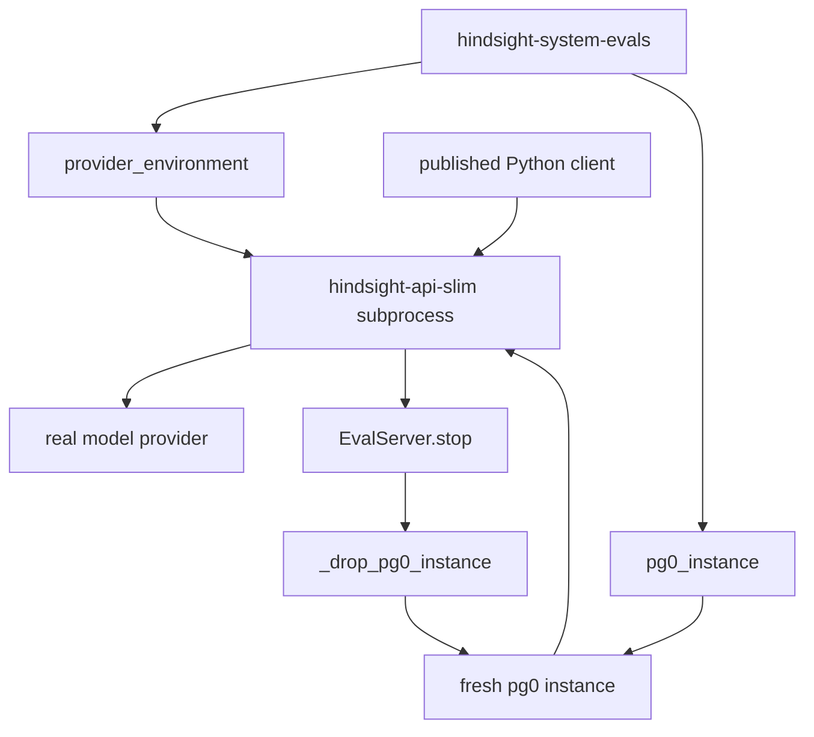
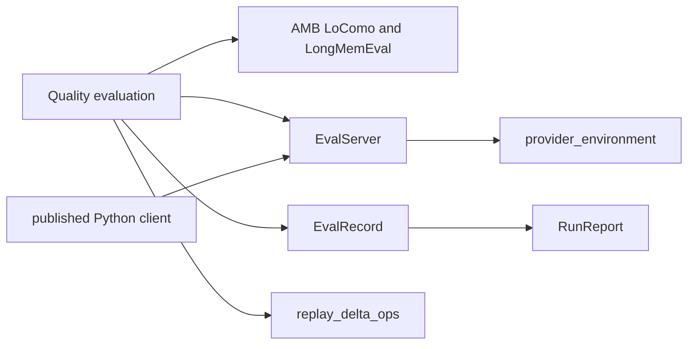
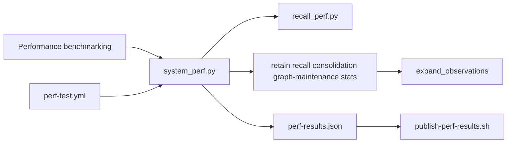

<!-- source: DeepWiki mcp.deepwiki.com · repo vectorize-io/hindsight · extra page Evaluations and Benchmarks · fetched 2026-10-27 -->

# 8.3.2 Evaluations and Benchmarks

Relevant source files

The following files were used as context for generating this wiki page:

- [.github/workflows/perf-test.yml](.github/workflows/perf-test.yml)
- [hindsight-api-slim/tests/test_delta_rereads_summary_llm.py](hindsight-api-slim/tests/test_delta_rereads_summary_llm.py)
- [hindsight-api-slim/tests/test_observation_expansion_scoring.py](hindsight-api-slim/tests/test_observation_expansion_scoring.py)
- [hindsight-api-slim/tests/test_prompt_context_truncation.py](hindsight-api-slim/tests/test_prompt_context_truncation.py)
- [hindsight-api-slim/tests/test_reflect_tool_result_fields.py](hindsight-api-slim/tests/test_reflect_tool_result_fields.py)
- [hindsight-api-slim/tests/test_structured_delta_prompt_budget.py](hindsight-api-slim/tests/test_structured_delta_prompt_budget.py)
- [hindsight-dev/benchmarks/perf/README.md](hindsight-dev/benchmarks/perf/README.md)
- [hindsight-dev/benchmarks/perf/recall_perf.py](hindsight-dev/benchmarks/perf/recall_perf.py)
- [hindsight-dev/benchmarks/perf/system_perf.py](hindsight-dev/benchmarks/perf/system_perf.py)
- [hindsight-system-evals/README.md](hindsight-system-evals/README.md)
- [hindsight-system-evals/evals/conftest.py](hindsight-system-evals/evals/conftest.py)
- [hindsight-system-evals/evals/test_07_source_priority.py](hindsight-system-evals/evals/test_07_source_priority.py)
- [hindsight-system-evals/evals/test_08_retrieval_metrics.py](hindsight-system-evals/evals/test_08_retrieval_metrics.py)
- [hindsight-system-evals/evals/test_10_page_stays_consistent.py](hindsight-system-evals/evals/test_10_page_stays_consistent.py)
- [hindsight-system-evals/fixtures/beir-scifact-bank.json](hindsight-system-evals/fixtures/beir-scifact-bank.json)
- [hindsight-system-evals/fixtures/beir-scifact-bank.zip](hindsight-system-evals/fixtures/beir-scifact-bank.zip)
- [hindsight-system-evals/fixtures/beir-scifact-slice.json](hindsight-system-evals/fixtures/beir-scifact-slice.json)
- [hindsight-system-evals/hindsight_system_evals/answers.py](hindsight-system-evals/hindsight_system_evals/answers.py)
- [hindsight-system-evals/hindsight_system_evals/beir.py](hindsight-system-evals/hindsight_system_evals/beir.py)
- [hindsight-system-evals/hindsight_system_evals/consolidation.py](hindsight-system-evals/hindsight_system_evals/consolidation.py)
- [hindsight-system-evals/hindsight_system_evals/corpus.py](hindsight-system-evals/hindsight_system_evals/corpus.py)
- [hindsight-system-evals/hindsight_system_evals/debug/replay_delta_ops.py](hindsight-system-evals/hindsight_system_evals/debug/replay_delta_ops.py)
- [hindsight-system-evals/hindsight_system_evals/judge.py](hindsight-system-evals/hindsight_system_evals/judge.py)
- [hindsight-system-evals/hindsight_system_evals/report.py](hindsight-system-evals/hindsight_system_evals/report.py)
- [hindsight-system-evals/hindsight_system_evals/retrieval.py](hindsight-system-evals/hindsight_system_evals/retrieval.py)
- [hindsight-system-evals/hindsight_system_evals/retrieval_metrics.py](hindsight-system-evals/hindsight_system_evals/retrieval_metrics.py)
- [hindsight-system-evals/hindsight_system_evals/server.py](hindsight-system-evals/hindsight_system_evals/server.py)
- [hindsight-system-evals/hindsight_system_evals/sources.py](hindsight-system-evals/hindsight_system_evals/sources.py)
- [hindsight-system-evals/pyproject.toml](hindsight-system-evals/pyproject.toml)
- [hindsight-system-evals/uv.lock](hindsight-system-evals/uv.lock)
- [hindsight-system-tests/tests/test_46_source_priority.py](hindsight-system-tests/tests/test_46_source_priority.py)
- [scripts/benchmarks/publish-locomo-results.sh](scripts/benchmarks/publish-locomo-results.sh)
- [scripts/benchmarks/publish-perf-results.sh](scripts/benchmarks/publish-perf-results.sh)

## Purpose and scope

This page documents two complementary validation tracks: `hindsight-system-evals` measures blackbox quality using a real Hindsight server and real model providers, while `hindsight-dev/benchmarks` measures performance using isolated benchmark suites. It also describes the `perf-test` GitHub Actions workflow, which runs performance tests and includes separate AMB and system-evaluation jobs. [hindsight-system-evals/README.md:1-25]() [hindsight-dev/benchmarks/perf/README.md:1-24]() [.github/workflows/perf-test.yml:1-197]()

Sources: `hindsight-system-evals/README.md:1-25`; `hindsight-dev/benchmarks/perf/README.md:1-24`; `.github/workflows/perf-test.yml:1-197`

## 1. `hindsight-system-evals`: quality evaluations

### Purpose and evaluation model

`hindsight-system-evals` runs blackbox quality checks against a real `hindsight-api` process and a real model provider. Tests use the published Python client rather than engine imports or direct SQL. This separates quality measurement from `hindsight-system-tests`, whose stubbed LLM calls make tests deterministic and suitable for runs without provider secrets. [hindsight-system-evals/README.md:1-25]()

| Dimension | `hindsight-system-tests` | `hindsight-system-evals` |
|---|---|---|
| Model | Stubbed LLM | Real provider |
| Secrets | Not required | Required; the README says these evals are not run on PRs |
| Assertion model | Exact equality | Judged outcomes reported as rates |
| Failure interpretation | Mechanism may be broken | Quality regression or sampling noise |

Because real model output can vary between runs, an individual failure is a signal to investigate or rerun, not by itself proof of a regression. [hindsight-system-evals/README.md:7-25]()

Sources: `hindsight-system-evals/README.md:1-25`

### Evaluation suites and data flow

The README describes a set of quality checks that cover retrieval, answer generation, ingestion, and knowledge-page updates. The knowledge-page and reflect suites share a corpus; each question is graded for whether the answer is correct and whether it asserts a baited falsehood. The trap check is evaluated first. [hindsight-system-evals/README.md:27-33]()

| Suite described in the README | What it evaluates |
|---|---|
| `test_01` — knowledge-page convergence | Whether a page continues to represent facts correctly as data arrives in successive waves and refreshes update existing content. [hindsight-system-evals/README.md:35-48]() |
| `test_02` — reflect answers | Whether a one-shot reflect answer is supported by the corpus; failures also report whether gold facts reached the model through the tool trace. [hindsight-system-evals/README.md:49-54]() |
| `test_03` — retain language | Whether extracted facts remain in the input language. The described test repeats each input, stores separate documents, and judges each document; it does not use the shared corpus. [hindsight-system-evals/README.md:56-63]() |
| `test_04` — retain fidelity | Whether extraction avoids borrowing a date, owner, or place stated for one subject and applying it to another subject. [hindsight-system-evals/README.md:64-82]() |
| `test_05` — refresh cost | A cost and token-usage baseline for full and delta knowledge-page refreshes. It captures LLM request information and measures against a frozen fixture bank. [hindsight-system-evals/README.md:84-111]() |
| `test_06` — reflect reads the page | Whether reflect uses the knowledge-page layer and answers consistently with the page it was given, as verified from the tool trace and judged against the page. [hindsight-system-evals/README.md:120-125]() |

The cost suite records refresh prompts and token counts, and its documented `--cost-output DIR` option writes detailed JSON and prompt outputs. The README cautions that the model is not frozen, so cost comparisons should use medians over multiple runs rather than a single run. [hindsight-system-evals/README.md:84-111]()

Sources: `hindsight-system-evals/README.md:27-33`; `hindsight-system-evals/README.md:35-82`; `hindsight-system-evals/README.md:84-111`; `hindsight-system-evals/README.md:120-125`

### Corpus, answers, and sources

The AMB datasets `LoComo` and `LongMemEval` are owned by the external Agent Memory Benchmark project, which owns their datasets, prompts, answer model, judge, and scoring. In the workflow, the AMB job starts a Hindsight server and points AMB’s `hindsight-http` provider at it; this avoids maintaining a second in-repository copy of those datasets. The workflow matrix shown in the supplied file includes `locomo` with split `locomo10` and `longmemeval` with split `s`. [hindsight-system-evals/README.md:1-5]() [.github/workflows/perf-test.yml:141-159]()

The workflow distinguishes the model used by the Hindsight server under test from AMB’s answer and judge models. In the displayed workflow configuration, the server uses Vertex AI settings, while AMB’s models are configured separately using a Gemini API key. The workflow notes that its Vertex AI service account covers the server, not AMB’s own answer and judge calls. [ .github/workflows/perf-test.yml:160-170]()

The quality suites also use corpus and source evidence beyond the AMB datasets: the README says `test_01` and `test_02` share a corpus, while the retain tests use their own inputs. For reflect answers, the tool trace helps distinguish a retrieval miss from a reasoning miss, since those imply different investigation paths. [hindsight-system-evals/README.md:27-33]() [hindsight-system-evals/README.md:49-63]()

Sources: `hindsight-system-evals/README.md:1-5`; `hindsight-system-evals/README.md:27-33`; `hindsight-system-evals/README.md:49-63`; `.github/workflows/perf-test.yml:141-170`

### Server lifecycle and provider configuration

`hindsight_system_evals.server` manages the real server process used by these evaluations. `EvalServer` stores the server URL, log path, subprocess, pg0 instance name, and whether `stop()` should delete that instance. Its `stop()` method terminates the subprocess, waits for it, kills it if it remains alive, and then attempts database cleanup when the instance is owned by the evaluation run. [hindsight-system-evals/hindsight_system_evals/server.py:64-100]()

Each default server run receives a fresh pg0 instance name using the `hindsight-system-evals-` prefix. `pg0_instance()` reads `HINDSIGHT_EVAL_PG0_INSTANCE` each time it is called, allowing a caller to supply a named instance; otherwise it generates a fresh identifier. [hindsight-system-evals/hindsight_system_evals/server.py:32-58]()

`provider_environment()` selects settings from `HINDSIGHT_EVAL_*` first and then `HINDSIGHT_API_*`. It builds the child server environment explicitly rather than inheriting arbitrary parent-process variables. For Vertex AI, it passes the service-account key, project ID, and region when present; for other providers, it looks for an API key. Except for the `none` provider path, it raises an error when the provider, model, or required credentials are missing. [hindsight-system-evals/hindsight_system_evals/server.py:111-155]()

**Server lifecycle and model boundary**

Sources: `hindsight-system-evals/hindsight_system_evals/server.py:32-58`; `hindsight-system-evals/hindsight_system_evals/server.py:64-100`; `hindsight-system-evals/hindsight_system_evals/server.py:111-155`; `hindsight-system-evals/README.md:1-5`

### Reporting and repeatability

`report.py` defines the report schema. `EvalKind` distinguishes `knowledge_page`, `delta_update`, `reflect`, `retain`, `source_priority`, and `consolidation`. Each `EvalRecord` stores the evaluation kind, question and category identifiers, correctness and trap outcomes, bank identifier, reason, optional page ID, and page sizes across waves. [hindsight-system-evals/hindsight_system_evals/report.py:14-28]()

`RunReport` contains run metadata, model configuration, totals, a nullable correctness rate, trap count, per-kind summaries, and individual records. Its `to_json()` method serializes with the `model_config` alias. `summarise()` counts records, correct results, and trap hits; the module-level `RECORDED` list is intended to hold records as evals finish so that an assertion failure can still publish the observed outcome. [hindsight-system-evals/hindsight_system_evals/report.py:30-78]()

The report keeps correctness and trap counts separate: an incomplete answer can fail correctness without asserting a falsehood, while a trap hit represents the distinct error of asserting the baited claim. [hindsight-system-evals/hindsight_system_evals/report.py:46-62]()

Sources: `hindsight-system-evals/hindsight_system_evals/report.py:14-28`; `hindsight-system-evals/hindsight_system_evals/report.py:30-78`; `hindsight-system-evals/README.md:27-33`

### Debugging delta-update prompt behavior

`replay_delta_ops.py` provides a faster way to investigate captured `mental_model_delta_ops` requests than rerunning an end-to-end page evaluation. `load()` reads the captured system and user messages. `score()` replays the user request repeatedly for a candidate system prompt and scores whether required text survives in the resulting document. The scoring is mechanical: it parses returned operations, conservatively treats destructive operations as discarding the captured document, and checks the combined result for all required tokens. [hindsight-system-evals/hindsight_system_evals/debug/replay_delta_ops.py:1-29]() [hindsight-system-evals/hindsight_system_evals/debug/replay_delta_ops.py:69-93]() [hindsight-system-evals/hindsight_system_evals/debug/replay_delta_ops.py:116-126]()

The tool supports multiple repeats because the same request may produce different outputs even at temperature zero. Its optional interrogation step asks the model to explain its choice and propose a prompt change, but the module describes that explanation as a lead rather than a substitute for replay scoring and the end-to-end evaluation. [hindsight-system-evals/hindsight_system_evals/debug/replay_delta_ops.py:14-21]() [hindsight-system-evals/hindsight_system_evals/debug/replay_delta_ops.py:129-154]()

Sources: `hindsight-system-evals/hindsight_system_evals/debug/replay_delta_ops.py:1-29`; `hindsight-system-evals/hindsight_system_evals/debug/replay_delta_ops.py:69-93`; `hindsight-system-evals/hindsight_system_evals/debug/replay_delta_ops.py:116-154`

## 2. `hindsight-dev/benchmarks`: performance benchmarks

### Purpose and suite organization

The performance benchmark runner is a thin orchestrator over independent suites. `system_perf.py` reuses benchmark building blocks from `recall_perf.py`; the runner’s documented usage supports selecting a suite and a scale, and writing structured JSON output. [hindsight-dev/benchmarks/perf/system_perf.py:1-30]() [hindsight-dev/benchmarks/perf/system_perf.py:51-64]()

The benchmark README describes the following system suites: [hindsight-dev/benchmarks/perf/README.md:15-24]()

| Suite | Measurement focus |
|---|---|
| `retain` | The retain pipeline with mock LLM fact extraction, embedding generation, database writes, and entity linking. [hindsight-dev/benchmarks/perf/README.md:17-20]() |
| `recall` | Pre-populated-bank recall across semantic, BM25, graph, and temporal retrieval, including RRF fusion and percentile latency. [hindsight-dev/benchmarks/perf/README.md:17-20]() |
| `graph-maintenance` | `run_graph_maintenance_job` after deletes, with wall-clock breakdown by probe and entity/co-occurrence prune counts. [hindsight-dev/benchmarks/perf/README.md:21-21]() |
| `graph-maintenance-contention` | Graph-maintenance co-occurrence sweeping under concurrent retain-shaped upserts; measures deadlock escapes that silently drop maintenance passes. [hindsight-dev/benchmarks/perf/README.md:22-22]() |
| `observation-hubs` | `expand_observations` over a COPY-loaded bank shaped to exercise high-degree entities; reports result digests so query changes can be checked for output stability. [hindsight-dev/benchmarks/perf/README.md:23-23]() |
| `stats` | `/stats` aggregation latency with result caching disabled, comparing uncached and cached paths. [hindsight-dev/benchmarks/perf/README.md:24-24]() |

`system_perf.py` defines scales for retain, recall, consolidation, graph maintenance, contention, stats, and observation-hub workloads. Its `large` configuration uses 5,000 retain items and a 5,000-unit recall bank; it also sets graph-maintenance and stats bank sizes to 15,000 to exercise larger-bank paths. [hindsight-dev/benchmarks/perf/system_perf.py:70-103]() [hindsight-dev/benchmarks/perf/system_perf.py:122-159]()

The `huge` scale is intended for the `stats` suite. The README describes a production-simulation bank loaded using `COPY`, rather than through the retain pipeline, and states that other suites fall back to `large` sizing at this scale. [hindsight-dev/benchmarks/perf/README.md:62-68]() [hindsight-dev/benchmarks/perf/system_perf.py:161-168]()

Sources: `hindsight-dev/benchmarks/perf/README.md:15-24`; `hindsight-dev/benchmarks/perf/README.md:62-68`; `hindsight-dev/benchmarks/perf/system_perf.py:1-30`; `hindsight-dev/benchmarks/perf/system_perf.py:51-64`; `hindsight-dev/benchmarks/perf/system_perf.py:70-103`; `hindsight-dev/benchmarks/perf/system_perf.py:122-168`

### Deterministic performance runs and scale selection

The benchmark README describes `perf-test` as running independent suites with a mock LLM and pg0 to produce deterministic, LLM-independent performance baselines. Each suite has its own engine, bank, and cleanup. [hindsight-dev/benchmarks/perf/README.md:3-12]() [hindsight-dev/benchmarks/perf/system_perf.py:4-7]()

| Scale | Retain items | Recall bank size | Recall iterations | Recall concurrency |
|---|---:|---:|---:|---:|
| `tiny` | 20 | 20 | 5 | 1 |
| `small` | 200 | 200 | 20 | 4 |
| `medium` | 1,000 | 1,000 | 50 | 8 |
| `large` | 5,000 | 5,000 | 100 | 16 |
| `huge` | `stats` only | `stats` only | — | — |

The `tiny` through `large` figures are defined in `system_perf.py`; the `huge` limitation is documented in the benchmark README. [hindsight-dev/benchmarks/perf/system_perf.py:70-159]() [hindsight-dev/benchmarks/perf/README.md:52-68]()

The standalone `recall_perf.py` benchmark offers separate generate, benchmark, and clean modes. It can operate in-process using `MemoryEngine` with a mocked LLM or over HTTP against a remote Hindsight API. It uses a synthetic fact corpus and entity vocabulary to populate banks for load testing. [hindsight-dev/benchmarks/perf/recall_perf.py:1-38]() [hindsight-dev/benchmarks/perf/recall_perf.py:58-69]()

Sources: `hindsight-dev/benchmarks/perf/README.md:3-12`; `hindsight-dev/benchmarks/perf/README.md:52-68`; `hindsight-dev/benchmarks/perf/system_perf.py:70-159`; `hindsight-dev/benchmarks/perf/recall_perf.py:1-38`; `hindsight-dev/benchmarks/perf/recall_perf.py:58-69`

### Recall benchmark design

`recall_perf.py` populates synthetic banks using the real retain pipeline with mocked fact extraction, then measures recall latency without an LLM. It supports in-process measurement and HTTP measurement through `--api-url`. Its documented temporal-recall mode creates a bank whose memories cluster on a date and runs recall with a matching temporal date. [hindsight-dev/benchmarks/perf/recall_perf.py:1-10]() [hindsight-dev/benchmarks/perf/recall_perf.py:22-33]()

`system_perf.py` imports helpers from `recall_perf.py`, including `_build_engine`, `_make_fact_callback`, `_insert_synthetic_observations`, and `_RRFReranker`. This lets the system runner reuse existing synthetic-data and recall benchmark machinery while orchestrating separate suite configurations. [hindsight-dev/benchmarks/perf/system_perf.py:51-64]()

Sources: `hindsight-dev/benchmarks/perf/recall_perf.py:1-10`; `hindsight-dev/benchmarks/perf/recall_perf.py:22-33`; `hindsight-dev/benchmarks/perf/system_perf.py:51-64`

### Observation deduplication and observation expansion

The observation-expansion tests pin the scoring semantics for candidates returned by `expand_observations`: score is the number of distinct source facts shared with the seed neighborhood, and higher scores rank first. Duplicate source IDs count once, and the seed observation itself must not be returned. [hindsight-api-slim/tests/test_observation_expansion_scoring.py:1-9]() [hindsight-api-slim/tests/test_observation_expansion_scoring.py:86-115]()

A second test documents a cost concern with wide source arrays: the array can contain unrelated IDs without changing the score for an observation sharing one relevant source. The test compares narrow and wide candidates to preserve that result behavior. [hindsight-api-slim/tests/test_observation_expansion_scoring.py:122-127]() [hindsight-api-slim/tests/test_observation_expansion_scoring.py:141-172]()

The `observation-hubs` benchmark measures `expand_observations` on a COPY-loaded bank, running seed sets individually and in parallel under a statement timeout. Its per-set result digest is intended to make output changes visible alongside timing changes. [hindsight-dev/benchmarks/perf/README.md:23-23]()

Sources: `hindsight-api-slim/tests/test_observation_expansion_scoring.py:1-9`; `hindsight-api-slim/tests/test_observation_expansion_scoring.py:86-127`; `hindsight-api-slim/tests/test_observation_expansion_scoring.py:141-172`; `hindsight-dev/benchmarks/perf/README.md:23-23`

### Document evolution and refresh prompt budgets

The system-evaluation README includes a knowledge-page convergence suite that tests successive data waves and refreshes. The described regressions include losing a fact from an earlier wave and producing an incorrect count after new facts arrive. [hindsight-system-evals/README.md:35-48]()

The API tests also pin structured delta prompt behavior. `test_structured_delta_prompt_budget.py` checks that a very large current document is truncated to fit the prompt budget, that small prompts remain unchanged, and that surviving and retracted facts appear under the correct headings. It also checks the final date-order instruction, the reread of the opening summary, and that the delta prompt does not carry a batch-only synthesis. [hindsight-api-slim/tests/test_structured_delta_prompt_budget.py:1-10]() [hindsight-api-slim/tests/test_structured_delta_prompt_budget.py:12-70]() [hindsight-api-slim/tests/test_structured_delta_prompt_budget.py:72-146]()

Sources: `hindsight-system-evals/README.md:35-48`; `hindsight-api-slim/tests/test_structured_delta_prompt_budget.py:1-10`; `hindsight-api-slim/tests/test_structured_delta_prompt_budget.py:12-70`; `hindsight-api-slim/tests/test_structured_delta_prompt_budget.py:72-146`

### Consolidation, graph maintenance, and micro-benchmark scope

The `perf-test` suite list includes `consolidation` and `graph-maintenance`; the `system_perf.py` scale configuration provides dedicated `consolidation_items`, graph-maintenance bank sizes, and graph-contention parameters. The benchmark README also describes graph-maintenance contention as concurrent sweep and retain-shaped upsert activity, with deadlock escape rate as its gate metric. [hindsight-dev/benchmarks/perf/system_perf.py:70-103]() [hindsight-dev/benchmarks/perf/system_perf.py:122-159]() [hindsight-dev/benchmarks/perf/README.md:21-22]() [hindsight-dev/benchmarks/perf/README.md:26-50]()

The supplied files do not expose the implementation details of separate consolidation, document-evolution, or micro-benchmark modules. The descriptions here are therefore limited to the suites and behaviors visible in the benchmark runner, README, and tests. [hindsight-dev/benchmarks/perf/README.md:15-24]() [hindsight-dev/benchmarks/perf/system_perf.py:70-168]()

Sources: `hindsight-dev/benchmarks/perf/system_perf.py:70-168`; `hindsight-dev/benchmarks/perf/README.md:15-50`

## 3. `perf-test` CI workflow

### Triggers and workflow inputs

The workflow is named `Performance Tests`. It runs daily at 06:00 UTC and supports manual dispatch. Manual inputs select scale (`tiny`, `small`, `medium`, or `large`), a performance suite, whether to skip the AMB benchmark job, AMB arguments, whether to skip the observation-dedup benchmark, the observation dataset and fraction, whether to skip system-evaluation quality jobs, the system-eval mode (`full` or `minimum`), and a Git ref. [ .github/workflows/perf-test.yml:1-64]()

Runs share a concurrency group named `perf-test`, and a newer run cancels an in-progress run in the same group. [ .github/workflows/perf-test.yml:66-68]()

Sources: `.github/workflows/perf-test.yml:1-68`

### Performance job

The visible `perf-test` job checks out the selected ref, installs `uv`, configures Python from `.python-version`, caches Hugging Face models, and pre-downloads `BAAI/bge-small-en-v1.5`. It then installs `hindsight-dev` dependencies. [ .github/workflows/perf-test.yml:70-110]()

The job invokes `scripts/benchmarks/run-perf-test.sh` with the selected scale, optional suite, and `--output perf-results.json`. It uploads the results artifact even if earlier steps fail, retaining it for 90 days. It also runs `scripts/benchmarks/publish-perf-results.sh` for scheduled, push, and manual-dispatch events, passing the generated JSON results file. [ .github/workflows/perf-test.yml:111-139]()

Sources: `.github/workflows/perf-test.yml:70-139`

### AMB job and job boundaries

The visible workflow defines an `amb` job unless `inputs.amb_skip` is true. It uses a matrix with the LoComo and LongMemEval dataset/split pairs, disables fail-fast so one dataset failure does not cancel the other, and sets a 300-minute timeout. [ .github/workflows/perf-test.yml:141-159]()

The job configures separate model settings for the Hindsight server and AMB’s answer/judge calls, prepares GCP credentials, and caches Hugging Face models. The workflow comments state that AMB owns these datasets and scoring and that the job connects AMB’s `hindsight-http` provider to the server under test. [ .github/workflows/perf-test.yml:141-170]() [ .github/workflows/perf-test.yml:176-197]()

The workflow also declares inputs for an observation-dedup benchmark and system-evals quality job, including dataset/fraction and `full`/`minimum` mode selection. Their job execution steps are beyond the supplied excerpt, so this page documents the inputs but does not infer their implementation or artifact behavior. [ .github/workflows/perf-test.yml:38-60]()

Sources: `.github/workflows/perf-test.yml:38-60`; `.github/workflows/perf-test.yml:141-170`; `.github/workflows/perf-test.yml:176-197`

## 4. Natural-language concepts mapped to code entities

### Quality evaluation concepts to implementation

Sources: `hindsight-system-evals/README.md:1-5`; `.github/workflows/perf-test.yml:141-170`; `hindsight-system-evals/hindsight_system_evals/server.py:64-155`; `hindsight-system-evals/hindsight_system_evals/report.py:14-78`; `hindsight-system-evals/hindsight_system_evals/debug/replay_delta_ops.py:1-29`

### Performance concepts to implementation

Sources: `hindsight-dev/benchmarks/perf/system_perf.py:1-30`; `hindsight-dev/benchmarks/perf/system_perf.py:51-64`; `hindsight-dev/benchmarks/perf/README.md:15-24`; `hindsight-api-slim/tests/test_observation_expansion_scoring.py:50-117`; `.github/workflows/perf-test.yml:111-139`

## 5. Component reference

| Component | Role |
|---|---|
| `hindsight_system_evals.server.EvalServer` | Holds server process and pg0 lifecycle state; provides `stop()` and best-effort database cleanup. [hindsight-system-evals/hindsight_system_evals/server.py:64-100]() |
| `pg0_instance()` | Selects an explicit evaluation pg0 instance or creates a fresh name. [hindsight-system-evals/hindsight_system_evals/server.py:32-58]() |
| `provider_environment()` | Builds model environment settings from `HINDSIGHT_EVAL_*` and `HINDSIGHT_API_*`, with provider-specific credential handling. [hindsight-system-evals/hindsight_system_evals/server.py:111-155]() |
| `EvalRecord`, `RunReport`, `summarise()` | Define individual evaluation records, run-level report serialization, and per-kind counts. [hindsight-system-evals/hindsight_system_evals/report.py:14-78]() |
| `CapturedRequest`, `survives()`, `score()` | Load and score captured delta-operation prompts through repeated model replays. [hindsight-system-evals/hindsight_system_evals/debug/replay_delta_ops.py:45-93]() [hindsight-system-evals/hindsight_system_evals/debug/replay_delta_ops.py:116-126]() |
| `system_perf.py` | Orchestrates performance suites, scale selection, and JSON result output. [hindsight-dev/benchmarks/perf/system_perf.py:1-30]() [hindsight-dev/benchmarks/perf/system_perf.py:70-103]() |
| `recall_perf.py` | Creates synthetic recall banks and measures recall in-process or over HTTP. [hindsight-dev/benchmarks/perf/recall_perf.py:1-10]() |
| `perf-test.yml` | Defines scheduled/manual workflow inputs, the performance job, result upload, and the visible AMB matrix job. [.github/workflows/perf-test.yml:1-68]() [.github/workflows/perf-test.yml:70-159]() |

Sources: `hindsight-system-evals/hindsight_system_evals/server.py:32-155`; `hindsight-system-evals/hindsight_system_evals/report.py:14-78`; `hindsight-system-evals/hindsight_system_evals/debug/replay_delta_ops.py:45-126`; `hindsight-dev/benchmarks/perf/system_perf.py:1-103`; `hindsight-dev/benchmarks/perf/recall_perf.py:1-10`; `.github/workflows/perf-test.yml:1-159`

## 6. Practical interpretation

Use system tests when validating deterministic mechanisms without model-provider secrets. Use `hindsight-system-evals` when measuring quality under real model behavior; interpret individual failures in light of sampling variability and use the reported rates and per-kind breakdowns to localize changes. [hindsight-system-evals/README.md:7-25]() [hindsight-system-evals/hindsight_system_evals/report.py:46-62]()

Use `perf-test` to compare system behavior under repeatable mock-LLM workloads, selecting the suite and scale that exercise the path being investigated. For large-bank recall investigations, `recall_perf.py` supports synthetic data generation, repeated queries, and HTTP mode; for observation expansion, the tests provide correctness expectations that complement benchmark timing. [hindsight-dev/benchmarks/perf/README.md:3-12]() [hindsight-dev/benchmarks/perf/recall_perf.py:1-38]() [hindsight-api-slim/tests/test_observation_expansion_scoring.py:50-117]()

Sources: `hindsight-system-evals/README.md:7-25`; `hindsight-system-evals/hindsight_system_evals/report.py:46-62`; `hindsight-dev/benchmarks/perf/README.md:3-12`; `hindsight-dev/benchmarks/perf/recall_perf.py:1-38`; `hindsight-api-slim/tests/test_observation_expansion_scoring.py:50-117`

---

