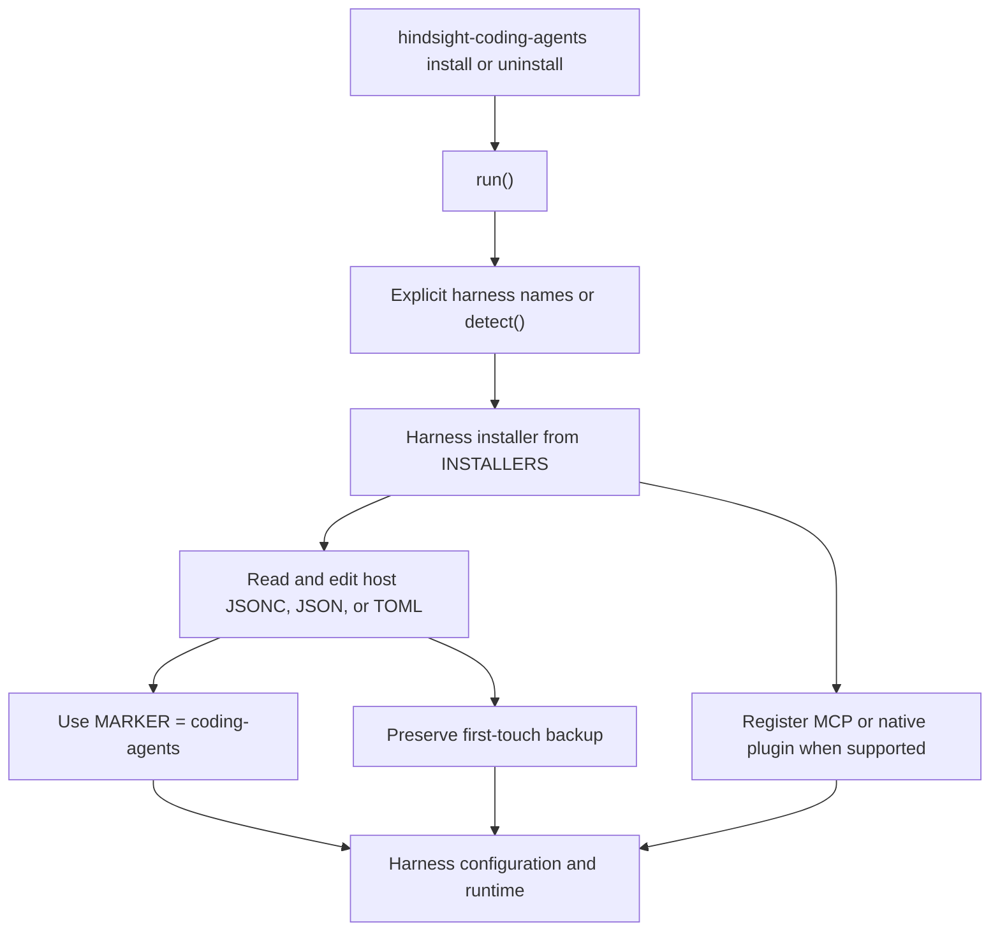
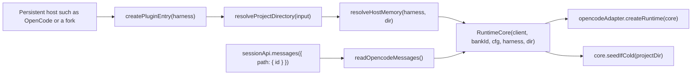
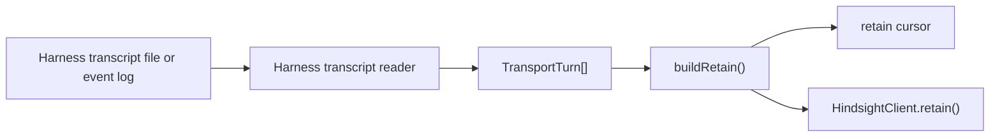
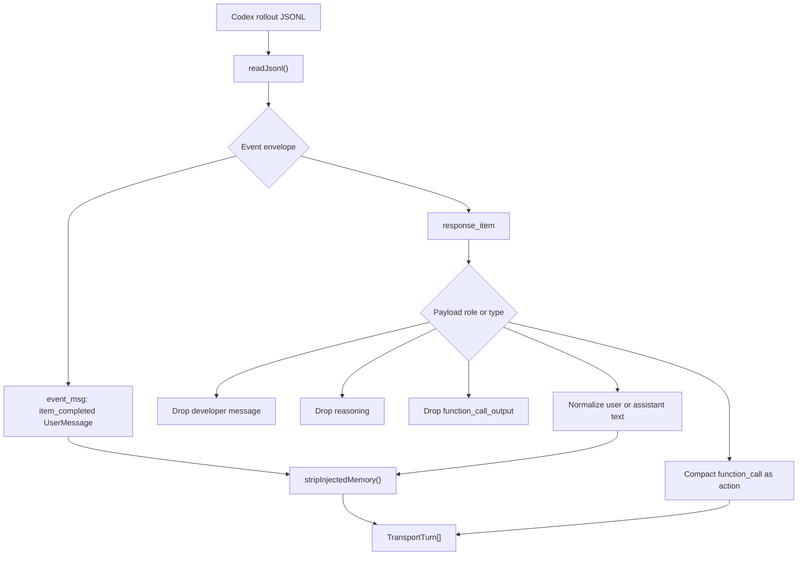

<!-- source: DeepWiki mcp.deepwiki.com · repo vectorize-io/hindsight · extra page Installer, Harnesses and Transcript Parsers · fetched 2026-10-27 -->

# Installer, Harnesses and Transcript Parsers

Relevant source files

The following files were used as context for generating this wiki page:

- [hindsight-control-plane/public/img/harness/dcode.svg](hindsight-control-plane/public/img/harness/dcode.svg)
- [hindsight-docs/src/pages/changelog/integrations/coding-agents.md](hindsight-docs/src/pages/changelog/integrations/coding-agents.md)
- [hindsight-docs/static/img/harness/dcode.svg](hindsight-docs/static/img/harness/dcode.svg)
- [hindsight-integrations/coding-agents/e2e/Dockerfile.dcode](hindsight-integrations/coding-agents/e2e/Dockerfile.dcode)
- [hindsight-integrations/coding-agents/hooks/hooks.json](hindsight-integrations/coding-agents/hooks/hooks.json)
- [hindsight-integrations/coding-agents/package-lock.json](hindsight-integrations/coding-agents/package-lock.json)
- [hindsight-integrations/coding-agents/package.json](hindsight-integrations/coding-agents/package.json)
- [hindsight-integrations/coding-agents/plugin.json](hindsight-integrations/coding-agents/plugin.json)
- [hindsight-integrations/coding-agents/src/cline.ts](hindsight-integrations/coding-agents/src/cline.ts)
- [hindsight-integrations/coding-agents/src/core/diag.ts](hindsight-integrations/coding-agents/src/core/diag.ts)
- [hindsight-integrations/coding-agents/src/core/history.test.ts](hindsight-integrations/coding-agents/src/core/history.test.ts)
- [hindsight-integrations/coding-agents/src/core/history.ts](hindsight-integrations/coding-agents/src/core/history.ts)
- [hindsight-integrations/coding-agents/src/core/jsonl.test.ts](hindsight-integrations/coding-agents/src/core/jsonl.test.ts)
- [hindsight-integrations/coding-agents/src/core/jsonl.ts](hindsight-integrations/coding-agents/src/core/jsonl.ts)
- [hindsight-integrations/coding-agents/src/core/retain-hook.test.ts](hindsight-integrations/coding-agents/src/core/retain-hook.test.ts)
- [hindsight-integrations/coding-agents/src/core/transcript-antigravity.ts](hindsight-integrations/coding-agents/src/core/transcript-antigravity.ts)
- [hindsight-integrations/coding-agents/src/core/transcript-codex.test.ts](hindsight-integrations/coding-agents/src/core/transcript-codex.test.ts)
- [hindsight-integrations/coding-agents/src/core/transcript-codex.ts](hindsight-integrations/coding-agents/src/core/transcript-codex.ts)
- [hindsight-integrations/coding-agents/src/core/transcript-copilot.ts](hindsight-integrations/coding-agents/src/core/transcript-copilot.ts)
- [hindsight-integrations/coding-agents/src/core/transcript-cursor.ts](hindsight-integrations/coding-agents/src/core/transcript-cursor.ts)
- [hindsight-integrations/coding-agents/src/core/transcript-dcode.ts](hindsight-integrations/coding-agents/src/core/transcript-dcode.ts)
- [hindsight-integrations/coding-agents/src/core/transcript-droid.ts](hindsight-integrations/coding-agents/src/core/transcript-droid.ts)
- [hindsight-integrations/coding-agents/src/core/transcript-dsh.test.ts](hindsight-integrations/coding-agents/src/core/transcript-dsh.test.ts)
- [hindsight-integrations/coding-agents/src/core/transcript-dsh.ts](hindsight-integrations/coding-agents/src/core/transcript-dsh.ts)
- [hindsight-integrations/coding-agents/src/core/transcript-grok.ts](hindsight-integrations/coding-agents/src/core/transcript-grok.ts)
- [hindsight-integrations/coding-agents/src/core/transcript-opencode.test.ts](hindsight-integrations/coding-agents/src/core/transcript-opencode.test.ts)
- [hindsight-integrations/coding-agents/src/core/transcript-opencode.ts](hindsight-integrations/coding-agents/src/core/transcript-opencode.ts)
- [hindsight-integrations/coding-agents/src/core/transcript-pi.ts](hindsight-integrations/coding-agents/src/core/transcript-pi.ts)
- [hindsight-integrations/coding-agents/src/core/transcript-qwen.ts](hindsight-integrations/coding-agents/src/core/transcript-qwen.ts)
- [hindsight-integrations/coding-agents/src/core/transcript.ts](hindsight-integrations/coding-agents/src/core/transcript.ts)
- [hindsight-integrations/coding-agents/src/dsh.test.ts](hindsight-integrations/coding-agents/src/dsh.test.ts)
- [hindsight-integrations/coding-agents/src/dsh.ts](hindsight-integrations/coding-agents/src/dsh.ts)
- [hindsight-integrations/coding-agents/src/harness/hook-lifecycle.test.ts](hindsight-integrations/coding-agents/src/harness/hook-lifecycle.test.ts)
- [hindsight-integrations/coding-agents/src/harness/hook-lifecycle.ts](hindsight-integrations/coding-agents/src/harness/hook-lifecycle.ts)
- [hindsight-integrations/coding-agents/src/harness/pi-extension.test.ts](hindsight-integrations/coding-agents/src/harness/pi-extension.test.ts)
- [hindsight-integrations/coding-agents/src/harness/pi-extension.ts](hindsight-integrations/coding-agents/src/harness/pi-extension.ts)
- [hindsight-integrations/coding-agents/src/harness/plugin-entry.ts](hindsight-integrations/coding-agents/src/harness/plugin-entry.ts)
- [hindsight-integrations/coding-agents/src/installer.test.ts](hindsight-integrations/coding-agents/src/installer.test.ts)
- [hindsight-integrations/coding-agents/src/installer.ts](hindsight-integrations/coding-agents/src/installer.ts)
- [hindsight-integrations/coding-agents/src/prime-agent.ts](hindsight-integrations/coding-agents/src/prime-agent.ts)
- [hindsight-integrations/coding-agents/tsup.config.ts](hindsight-integrations/coding-agents/tsup.config.ts)
- [skills/hindsight-docs/references/changelog/integrations/coding-agents.md](skills/hindsight-docs/references/changelog/integrations/coding-agents.md)

## Purpose and scope

This page documents the `@vectorize-io/hindsight-coding-agents` package’s installer, harness integration surfaces, skill packaging, and transcript normalization. It focuses on how the installer modifies host configuration, how integrations map host events to shared runtime behavior, and how transcript readers produce conversation turns for retention. [hindsight-integrations/coding-agents/package.json:1-20]() [hindsight-integrations/coding-agents/src/installer.ts:1-24]()

Sources: `hindsight-integrations/coding-agents/package.json`, `hindsight-integrations/coding-agents/src/installer.ts`

---

## 1. Installer CLI and Configuration Injection

The `hindsight-coding-agents` executable is the package’s installer entry point. Its `install` and `uninstall` commands configure supported coding agents, either for explicitly named harnesses or, when no names are supplied, by detecting available agents through their binaries or configuration directories. [hindsight-integrations/coding-agents/package.json:13-18]() [hindsight-integrations/coding-agents/src/installer.ts:1-18]()

The installer is designed to preserve unrelated host configuration. Its documented behavior is idempotent: entries containing the package marker are replaced on reinstall and removed on uninstall, while other entries are retained. Existing files receive a `<file>.hindsight-backup` copy the first time the installer touches them; missing configuration files can be created. [hindsight-integrations/coding-agents/src/installer.ts:20-24]()

### Configuration formats, markers, and registration

The installer imports `jsonc-parser` for JSONC-aware edits and `smol-toml` for TOML parsing. It also defines `parseJsonc`-related functionality in the installer implementation; the shown `readJson` helper parses JSON and accepts only a plain-object top-level value, returning an empty object for invalid JSON or non-object values. [hindsight-integrations/coding-agents/src/installer.ts:42-44]() [hindsight-integrations/coding-agents/src/installer.ts:123-141]()

The `MARKER` constant is `"coding-agents"`. The installer uses this substring to identify its own entries across both npm-package and repository-checkout paths, supporting deduplication on reinstall and targeted removal on uninstall. The installer’s `InstallCtx` also exposes injectable host-CLI functions for Claude, Qwen, Cline, and Dcode, along with test seams for daemon prerequisites and legacy configuration reads. [hindsight-integrations/coding-agents/src/installer.ts:66-76]() [hindsight-integrations/coding-agents/src/installer.ts:85-110]()

The supported native integration styles include hook/config injection, plugin registration, and MCP registration. The installer’s header documents host-specific targets: for example, Claude Code uses `~/.claude/settings.json` and a user-scope `claude mcp add`; Codex uses `~/.codex/hooks.json` and TOML configuration; Cursor and Copilot use their own hook and MCP configuration files; DSH uses a Cordis plugin row in `$DSH_HOME/cordis.patch.yml`. [hindsight-integrations/coding-agents/src/installer.ts:5-18]()

| Installer concern | Implementation entity | Behavior |
|---|---|---|
| CLI entry | `hindsight-coding-agents` | Published as the package’s `dist/installer.js` binary. [hindsight-integrations/coding-agents/package.json:13-15]() |
| JSONC edits | `jsonc-parser`, `parseJsonc` | The installer imports JSONC parsing/editing utilities; JSONC is used for host files that may include comments or trailing commas. [hindsight-integrations/coding-agents/src/installer.ts:42-44]() [hindsight-integrations/coding-agents/src/installer.ts:143-145]() |
| TOML reads | `parseToml` from `smol-toml` | TOML parsing is available for harness configuration such as Codex’s config. [hindsight-integrations/coding-agents/src/installer.ts:42-44]() |
| Entry identity | `MARKER` | `"coding-agents"` identifies installer-owned entries for reinstall and uninstall. [hindsight-integrations/coding-agents/src/installer.ts:66-76]() |
| Backups | `<file>.hindsight-backup` | The first edit of an existing file creates a backup. [hindsight-integrations/coding-agents/src/installer.ts:20-24]() |
| Native MCP/plugin commands | `InstallCtx` CLI seams | Host commands can be injected or stubbed instead of invoking real CLIs. [hindsight-integrations/coding-agents/src/installer.ts:85-97]() |

Sources: `hindsight-integrations/coding-agents/package.json`, `hindsight-integrations/coding-agents/src/installer.ts`

### Installer flow

The installer’s public behavior separates harness selection from the harness-specific configuration work. A test can pass explicit harness names to `run()` and supply a temporary `InstallCtx`; the installer tests use this to avoid probing the developer’s PATH or modifying their actual home directory. [hindsight-integrations/coding-agents/src/installer.test.ts:32-34]() [hindsight-integrations/coding-agents/src/installer.test.ts:57-81]()

**Diagram: Installer selection and host configuration flow**

Sources: `hindsight-integrations/coding-agents/src/installer.ts`

### Verification and test seams

Installer tests use fresh temporary home directories and stub host-CLI callbacks. The Claude Code tests verify that installation writes `SessionStart`, `UserPromptSubmit`, and `Stop` hooks with the corresponding built commands and timeouts; they also verify preservation of foreign entries and idempotent reinstall behavior. [hindsight-integrations/coding-agents/src/installer.test.ts:32-34]() [hindsight-integrations/coding-agents/src/installer.test.ts:123-159]()

The test context stubs `claudeMcp`, `qwenMcp`, `clinePlugin`, and `dcodePlugin`, and provides a synthetic package path containing `MARKER`. This isolates tests from installed host CLIs and ensures the same marker logic used in production is exercised. [hindsight-integrations/coding-agents/src/installer.test.ts:57-81]()

Sources: `hindsight-integrations/coding-agents/src/installer.test.ts`

---

## 2. Per-Harness Adapters and Plugin Architecture

The package exposes one installer binary and numerous harness-specific hook binaries through its npm `bin` map. The entries include Claude, Cursor, Copilot, Grok, Codex, Antigravity, Qwen, Droid, ZCode, TraeCode, WorkBuddy, CodeBuddy, Kimi, and other harness commands. [hindsight-integrations/coding-agents/package.json:13-52]()

The host integration model depends on the harness lifecycle. Persistent-plugin hosts load a plugin once and route multiple lifecycle events through it; hook-oriented hosts invoke a command for individual events. The shared plugin-entry factory documents this distinction and is used for OpenCode and compatible forks. It resolves the project directory, resolves host memory configuration, constructs `RuntimeCore`, and creates the host runtime through `opencodeAdapter`. [hindsight-integrations/coding-agents/src/harness/plugin-entry.ts:1-18]() [hindsight-integrations/coding-agents/src/harness/plugin-entry.ts:35-48]() [hindsight-integrations/coding-agents/src/harness/plugin-entry.ts:98-108]()

### Persistent plugin entry and runtime mapping

`createPluginEntry(harness)` uses the harness name when resolving configuration and bank identity. It selects a project directory from the supplied worktree or directory, falls back to the current working directory, and calls `resolveHostMemory(harness, dir)`. When memory is enabled, it creates a `RuntimeCore` and passes it to `opencodeAdapter.createRuntime(core)`. [hindsight-integrations/coding-agents/src/harness/plugin-entry.ts:27-47]() [hindsight-integrations/coding-agents/src/harness/plugin-entry.ts:98-99]()

The plugin entry can wire a transcript source using the host’s session-message API. On session idle, it fetches the session messages and normalizes them with `readOpencodeMessages`; the entry also starts `core.seedIfCold(projectDir)` asynchronously so plugin startup does not wait for a network round trip. [hindsight-integrations/coding-agents/src/harness/plugin-entry.ts:76-96]() [hindsight-integrations/coding-agents/src/harness/plugin-entry.ts:100-108]()

**Diagram: Harness lifecycle concepts mapped to implementation entities**

Sources: `hindsight-integrations/coding-agents/src/harness/plugin-entry.ts`

### DeepSeek Harness native plugin

The DSH entry point implements a native Cordis plugin rather than installing hook binaries. It binds directly to `agent/session-start`, `agent/pre-step`, `agent/turn-stopping`, and `agent/disposed`, and registers the Hindsight knowledge tools through the host tool registry. [hindsight-integrations/coding-agents/src/dsh.ts:1-13]() [hindsight-integrations/coding-agents/src/dsh.ts:75-105]()

DSH may serve sessions from multiple workspaces in one process. The plugin derives a workspace root from `session.header.cwd`, caches a `Workspace` per root, and maps session IDs to live agents so the transcript can be read at stop time. Disposed agents are removed from the live-agent map to avoid retaining session logs indefinitely. [hindsight-integrations/coding-agents/src/dsh.ts:15-18]() [hindsight-integrations/coding-agents/src/dsh.ts:113-131]() [hindsight-integrations/coding-agents/src/dsh.ts:144-165]()

Sources: `hindsight-integrations/coding-agents/src/dsh.ts`

### Plugin and package entries

The package metadata includes a `dsh` export for `./dsh`, a Cline plugin declaration pointing to `dist/cline.js`, and a `plugin.json` manifest that declares the package’s skills, hooks, and DSH MCP server command. The DSH MCP entry runs `dist/mcp-server.js` with `HINDSIGHT_MCP_HARNESS=dsh`. [hindsight-integrations/coding-agents/package.json:54-87]() [hindsight-integrations/coding-agents/plugin.json:1-16]()

| Entry surface | Package entity | Declared role |
|---|---|---|
| Installer | `hindsight-coding-agents` | CLI mapped to `dist/installer.js`. [hindsight-integrations/coding-agents/package.json:13-15]() |
| Hook commands | `hindsight-*-hook` | Per-harness hook executables mapped to built files in `dist/`. [hindsight-integrations/coding-agents/package.json:15-52]() |
| Cline plugin | `cline.plugins` | Declares `dist/cline.js` with hook capability. [hindsight-integrations/coding-agents/package.json:77-87]() |
| DSH module | `./dsh` export | Exposes the native DSH entry point. [hindsight-integrations/coding-agents/package.json:54-62]() |
| Plugin manifest | `plugin.json` | Declares `./skill`, `./hooks/hooks.json`, and the DSH MCP server. [hindsight-integrations/coding-agents/plugin.json:1-16]() |

Sources: `hindsight-integrations/coding-agents/package.json`, `hindsight-integrations/coding-agents/plugin.json`

---

## 3. Skill Synchronization

The package includes a `skill` directory in its published files and defines a `skill:build` script that builds the skill during `prepublishOnly`. The manifest also points to `./skill`, allowing plugin-aware hosts to discover the packaged skills. [hindsight-integrations/coding-agents/package.json:64-71]() [hindsight-integrations/coding-agents/package.json:89-96]() [hindsight-integrations/coding-agents/plugin.json:1-6]()

The installer imports `SKILL_DIRS`, `resolveSkillDirs`, and `traecodeDotDirName` from `core/skill-dirs`; the provided installer test imports `SKILL_DIRS` as well. These symbols establish that host-specific skill-directory resolution is part of the installer integration, though the implementation details of the synchronization routines are in the separate skill-directory and skill-sync modules. [hindsight-integrations/coding-agents/src/installer.ts:48-49]() [hindsight-integrations/coding-agents/src/installer.test.ts:15-19]()

Sources: `hindsight-integrations/coding-agents/package.json`, `hindsight-integrations/coding-agents/plugin.json`, `hindsight-integrations/coding-agents/src/installer.ts`, `hindsight-integrations/coding-agents/src/installer.test.ts`

---

## 4. Transcript Parsers Architecture

Transcript parsers adapt host-specific session formats into normalized turns for shared retention logic. The Codex parser explicitly returns the same `TransportTurn[]` shape as Claude’s `readClaudeTranscript`, enabling the live write-back path to render both formats consistently. [hindsight-integrations/coding-agents/src/core/transcript-codex.ts:12-18]()

### Canonical turn representation and retention

`TransportTurn` is imported from `core/chat`. The Codex parser’s documented output consists of user text, assistant text, and compact `role:"action"` turns. `buildRetain` tests demonstrate that the resulting turns are serialized into a retained conversation with a session reference and that subsequent new turns use append mode. [hindsight-integrations/coding-agents/src/core/transcript-codex.ts:36-38]() [hindsight-integrations/coding-agents/src/core/retain-hook.test.ts:133-173]()

**Diagram: Transcript normalization mapped to retention entities**

Sources: `hindsight-integrations/coding-agents/src/core/transcript-codex.ts`, `hindsight-integrations/coding-agents/src/core/retain-hook.test.ts`

### Codex rollout reader

`readCodexTranscript` reads Codex’s JSONL rollout format. `response_item` payloads can represent messages, tool calls, tool outputs, or reasoning; `event_msg` entries can identify completed user messages. The parser drops reasoning and tool outputs, and normalizes function calls to compact action turns. [hindsight-integrations/coding-agents/src/core/transcript-codex.ts:1-18]()

Codex `role:"user"` response items are not necessarily user-authored prompts: they can contain startup context, aborted-turn notices, or compaction summaries. When available, `UserMessage` `item_completed` events are treated as the authoritative user-turn source. Older rollouts use fallback content-provenance checks and startup-text heuristics. [hindsight-integrations/coding-agents/src/core/transcript-codex.ts:19-26]() [hindsight-integrations/coding-agents/src/core/transcript-codex.ts:82-101]() [hindsight-integrations/coding-agents/src/core/transcript-codex.ts:112-145]()

Developer-role messages are dropped because they may contain the system prompt and injected Hindsight context; kept text is also passed through `stripInjectedMemory`. The reader is fail-open for missing files or malformed lines, and timestamp values are accepted only when they are non-empty strings. [hindsight-integrations/coding-agents/src/core/transcript-codex.ts:31-38]() [hindsight-integrations/coding-agents/src/core/transcript-codex.ts:72-80]()

**Diagram: Codex JSONL event filtering and normalization**

Sources: `hindsight-integrations/coding-agents/src/core/transcript-codex.ts`

### Harness parser inventory

The package contains separate transcript modules for the harness formats listed below. The package metadata additionally exposes hook binaries for several of these harnesses; the parser module inventory identifies the corresponding source files. The detailed parsing rules vary by host format, so consult the individual parser module for format-specific behavior. [hindsight-integrations/coding-agents/package.json:13-52]()

| Harness | Parser module |
|---|---|
| Claude Code | `src/core/transcript.ts` [hindsight-integrations/coding-agents/src/core/transcript.ts:1-1]() |
| Codex | `src/core/transcript-codex.ts` [hindsight-integrations/coding-agents/src/core/transcript-codex.ts:1-38]() |
| Cursor | `src/core/transcript-cursor.ts` [hindsight-integrations/coding-agents/src/core/transcript-cursor.ts:1-1]() |
| Grok | `src/core/transcript-grok.ts` [hindsight-integrations/coding-agents/src/core/transcript-grok.ts:1-1]() |
| Copilot | `src/core/transcript-copilot.ts` [hindsight-integrations/coding-agents/src/core/transcript-copilot.ts:1-1]() |
| Antigravity | `src/core/transcript-antigravity.ts` [hindsight-integrations/coding-agents/src/core/transcript-antigravity.ts:1-1]() |
| Droid | `src/core/transcript-droid.ts` [hindsight-integrations/coding-agents/src/core/transcript-droid.ts:1-1]() |
| Pi | `src/core/transcript-pi.ts` [hindsight-integrations/coding-agents/src/core/transcript-pi.ts:1-1]() |
| Qwen | `src/core/transcript-qwen.ts` [hindsight-integrations/coding-agents/src/core/transcript-qwen.ts:1-1]() |
| DSH | `src/core/transcript-dsh.ts` [hindsight-integrations/coding-agents/src/core/transcript-dsh.ts:1-1]() |

Sources: `hindsight-integrations/coding-agents/package.json`, `hindsight-integrations/coding-agents/src/core/transcript.ts`, `hindsight-integrations/coding-agents/src/core/transcript-codex.ts`, `hindsight-integrations/coding-agents/src/core/transcript-cursor.ts`, `hindsight-integrations/coding-agents/src/core/transcript-grok.ts`, `hindsight-integrations/coding-agents/src/core/transcript-copilot.ts`, `hindsight-integrations/coding-agents/src/core/transcript-antigravity.ts`, `hindsight-integrations/coding-agents/src/core/transcript-droid.ts`, `hindsight-integrations/coding-agents/src/core/transcript-pi.ts`, `hindsight-integrations/coding-agents/src/core/transcript-qwen.ts`, `hindsight-integrations/coding-agents/src/core/transcript-dsh.ts`

---

## Summary

- The installer exposes `hindsight-coding-agents`, supports harness selection, and uses a stable `MARKER` to recognize its own configuration entries. [hindsight-integrations/coding-agents/package.json:13-18]() [hindsight-integrations/coding-agents/src/installer.ts:66-76]()
- Host configuration is modified through format-aware utilities; installer behavior is designed to preserve unrelated settings, create first-touch backups, and support native MCP or plugin registration. [hindsight-integrations/coding-agents/src/installer.ts:20-24]() [hindsight-integrations/coding-agents/src/installer.ts:42-44]()
- Persistent plugin hosts can use `createPluginEntry`, which connects `resolveHostMemory`, `RuntimeCore`, the OpenCode adapter, transcript retrieval, and cold seeding. [hindsight-integrations/coding-agents/src/harness/plugin-entry.ts:35-48]() [hindsight-integrations/coding-agents/src/harness/plugin-entry.ts:76-108]()
- DSH binds directly to Cordis lifecycle events and caches runtime state per workspace. [hindsight-integrations/coding-agents/src/dsh.ts:1-18]() [hindsight-integrations/coding-agents/src/dsh.ts:113-165]()
- Transcript readers adapt multiple host formats; the Codex reader illustrates the filtering and normalization contract, including suppression of injected context and compact action turns. [hindsight-integrations/coding-agents/src/core/transcript-codex.ts:12-38]()

Sources: `hindsight-integrations/coding-agents/package.json`, `hindsight-integrations/coding-agents/src/installer.ts`, `hindsight-integrations/coding-agents/src/harness/plugin-entry.ts`, `hindsight-integrations/coding-agents/src/dsh.ts`, `hindsight-integrations/coding-agents/src/core/transcript-codex.ts`

---

