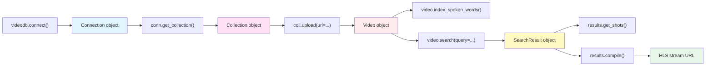
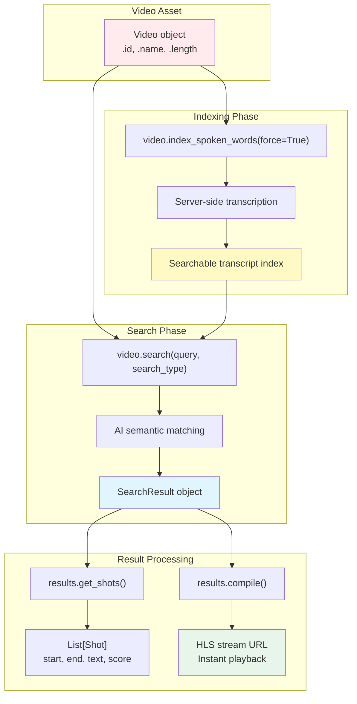

<!-- source: DeepWiki mcp.deepwiki.com · repo video-db/skills · page 1.2 Quick Start · fetched 2026-10-27 -->

# Quick Start

<details>
<summary>Relevant source files</summary>

The following files were used as context for generating this wiki page:

- [python/SKILL.md](python/SKILL.md)
- [python/reference/search.md](python/reference/search.md)

</details>


This page provides a hands-on introduction to VideoDB's core workflow: uploading media, indexing it for search, finding specific moments, and creating clips. By the end of this guide, you'll understand how to transform raw video into searchable, queryable content and extract specific segments.

For installation and API key configuration, see [Installation and Setup](#1.1). For detailed explanations of the object model and architecture, see [Core Concepts](#2). For advanced search capabilities including scene search and cross-collection queries, see [Searching Videos](#6).

---

## Prerequisites

Before starting, ensure you have:

1. **VideoDB SDK installed**: `pip install videodb python-dotenv`
2. **API Key configured**: Set `VIDEO_DB_API_KEY` in your environment or project `.env` file
3. **Python environment**: Python 3.7+ with access to run scripts

Get a free API key at https://console.videodb.io (50 free uploads, no credit card required).

**Sources:** [python/SKILL.md:98-123]()

---

## Workflow Overview



**Workflow: Basic Quick Start Flow**

This diagram illustrates the object-oriented API flow from authentication through video upload, indexing, search, and stream generation. Each box represents an actual class or method in the VideoDB SDK.

**Sources:** [python/SKILL.md:68-167](), [python/reference/search.md:14-85]()

---

## Step 1: Connect to VideoDB

The SDK requires authentication before any operations. The `videodb.connect()` function reads `VIDEO_DB_API_KEY` from the environment or `.env` file and returns a `Connection` object.

```python
from dotenv import load_dotenv
load_dotenv(".env")

import videodb

# Raises AuthenticationError if VIDEO_DB_API_KEY is missing or invalid
conn = videodb.connect()
```

The `Connection` object is the root of all VideoDB operations. It provides factory methods for creating and retrieving `Collection` objects, which contain media assets.

**Sources:** [python/SKILL.md:68-80]()

---

## Step 2: Get or Create a Collection

Collections are containers for organizing media assets (videos, audio, images). Every account has a default collection that can be retrieved without specifying an ID.

```python
# Get the default collection
coll = conn.get_collection()

# Or create a new collection with a specific name
# coll = conn.create_collection(name="my_project", description="Project videos")
```

The `Collection` object provides methods for uploading media, searching across multiple videos, and generating AI content.

**Sources:** [python/SKILL.md:91-96]()

---

## Step 3: Upload a Video

The `Collection.upload()` method accepts URLs, YouTube links, or local file paths. The method blocks until the upload completes and returns a `Video` object.

```python
# Upload from URL
video = coll.upload(url="https://example.com/sample-video.mp4")

# Or from YouTube
# video = coll.upload(url="https://www.youtube.com/watch?v=VIDEO_ID")

# Or from local file
# video = coll.upload(file_path="/path/to/video.mp4")

print(f"Uploaded video ID: {video.id}")
print(f"Video length: {video.length} seconds")
```

The returned `Video` object contains metadata (`.id`, `.name`, `.length`) and provides methods for indexing, searching, and editing.

**Sources:** [python/SKILL.md:129-138]()

---

## Step 4: Index the Video

Before searching, the video must be indexed. The `index_spoken_words()` method transcribes the audio track and builds a searchable index of spoken content.

```python
# Index the video for search
# force=True makes indexing idempotent — skips if already indexed
video.index_spoken_words(force=True)
```

**Important:** Indexing is a one-time operation per video. Subsequent calls with `force=True` skip indexing if the video is already indexed, avoiding errors. Without `force=True`, re-indexing an already-indexed video raises an exception.

**Sources:** [python/SKILL.md:142-147](), [python/reference/search.md:14-20]()

---

## Step 5: Search the Video

The `video.search()` method queries the indexed content using natural language. The SDK supports semantic search (natural language matching), keyword search (exact term matching), and scene search (visual content matching).

```python
from videodb import SearchType
from videodb.exceptions import InvalidRequestError

# Semantic search using natural language
try:
    results = video.search(
        query="product demonstration",
        search_type=SearchType.semantic,
    )
except InvalidRequestError as e:
    if "No results found" in str(e):
        print("No matching segments found")
        results = None
    else:
        raise
```

**Critical error handling:** `video.search()` raises `InvalidRequestError` with message "No results found" when no segments match the query. Always wrap search calls in try/except and treat this as an empty result set, not a failure.

**Sources:** [python/SKILL.md:149-167](), [python/reference/search.md:72-85]()

---

## Step 6: Work with Search Results

The `SearchResult` object provides methods to access individual matching segments (`Shot` objects) or compile them into a single playable stream.

```python
if results:
    # Get individual matching segments
    shots = results.get_shots()
    
    for shot in shots:
        print(f"Match found: {shot.start:.1f}s - {shot.end:.1f}s")
        print(f"Score: {shot.search_score:.2f}")
        print(f"Text: {shot.text}")
        print("---")
    
    # Compile all matching segments into a single stream
    stream_url = results.compile()
    print(f"Compiled highlights: {stream_url}")
    
    # Open in browser (optional)
    results.play()
```

Each `Shot` represents a timestamped segment with:
- `.start` and `.end`: Timestamps in seconds
- `.search_score`: Relevance score (0.0 - 1.0)
- `.text`: Transcript or scene description
- `.video_id`: Source video ID

The `compile()` method generates an HLS stream URL containing all matching segments concatenated together, ready for instant playback.

**Sources:** [python/reference/search.md:156-180]()

---

## Understanding the Index → Search → Compile Pipeline



**Workflow: Index → Search → Compile Pipeline with SDK Methods**

This diagram shows the complete pipeline from a `Video` object through indexing, searching, and compiling results. All processing happens server-side; the SDK returns references and stream URLs.

**Sources:** [python/SKILL.md:142-167](), [python/reference/search.md:14-85](), [python/reference/search.md:156-180]()

---

## Complete Example

Here's a complete script demonstrating the entire workflow:

```python
from dotenv import load_dotenv
load_dotenv(".env")

import videodb
from videodb import SearchType
from videodb.exceptions import InvalidRequestError, AuthenticationError

try:
    # Step 1: Connect
    conn = videodb.connect()
    
    # Step 2: Get collection
    coll = conn.get_collection()
    
    # Step 3: Upload video
    video = coll.upload(url="https://example.com/sample-video.mp4")
    print(f"Uploaded: {video.name} ({video.length}s)")
    
    # Step 4: Index for search
    video.index_spoken_words(force=True)
    print("Indexing complete")
    
    # Step 5: Search
    try:
        results = video.search(
            query="product features",
            search_type=SearchType.semantic,
        )
        
        # Step 6: Process results
        shots = results.get_shots()
        print(f"Found {len(shots)} matching segments:")
        
        for shot in shots:
            print(f"  {shot.start:.1f}s - {shot.end:.1f}s (score: {shot.search_score:.2f})")
        
        # Compile into single stream
        stream_url = results.compile()
        print(f"Highlights stream: {stream_url}")
        
    except InvalidRequestError as e:
        if "No results found" in str(e):
            print("No matching segments found for query")
        else:
            raise

except AuthenticationError:
    print("ERROR: VIDEO_DB_API_KEY not found or invalid")
except Exception as e:
    print(f"ERROR: {e}")
```

**Sources:** [python/SKILL.md:68-167](), [python/reference/search.md:14-85]()

---

## Key Concepts Summary

| Concept | Code Entity | Purpose |
|---------|-------------|---------|
| **Root object** | `Connection` | Created by `videodb.connect()`, factory for collections and timelines |
| **Media container** | `Collection` | Holds videos/audio/images, provides `upload()` and `search()` |
| **Media asset** | `Video` | Represents uploaded video with `.id`, `.name`, `.length` properties |
| **Indexing** | `video.index_spoken_words(force=True)` | One-time transcription and search index creation |
| **Search** | `video.search(query, search_type)` | Query indexed content, returns `SearchResult` |
| **Result container** | `SearchResult` | Contains matching `Shot` objects and `compile()` method |
| **Result segment** | `Shot` | Timestamped segment with `.start`, `.end`, `.text`, `.search_score` |
| **Stream generation** | `results.compile()` | Creates HLS stream URL from all matching shots |

**Sources:** [python/SKILL.md:68-167](), [python/reference/search.md:1-231]()

---

## Common Pitfalls and Solutions

| Issue | Error Message | Solution |
|-------|--------------|----------|
| Missing API key | `AuthenticationError` | Set `VIDEO_DB_API_KEY` in environment or `.env` file |
| Re-indexing video | `Spoken word index for video already exists` | Use `video.index_spoken_words(force=True)` |
| Search returns no results | `InvalidRequestError: No results found` | Catch exception and treat as empty: `if "No results found" in str(e): shots = []` |
| Forgot to index before search | `Video is not indexed` | Call `video.index_spoken_words(force=True)` before searching |

**Sources:** [python/SKILL.md:273-298]()

---

## Next Steps

Now that you understand the basic workflow, explore these related capabilities:

- **[Scene Search](#5.2)**: Search by visual content instead of spoken words using `index_scenes()` and scene-based queries
- **[Timeline Editing](#7)**: Combine search results with overlays, text, and music using the `Timeline` editor
- **[Cross-Collection Search](#6.3)**: Query across multiple videos in a collection with `coll.search()`
- **[Desktop Capture](#8)**: Record screen activity with real-time transcription and AI analysis
- **[AI Media Generation](#11)**: Generate images, videos, music, voices, and text from prompts

**Sources:** [python/SKILL.md:1-362]()

---

