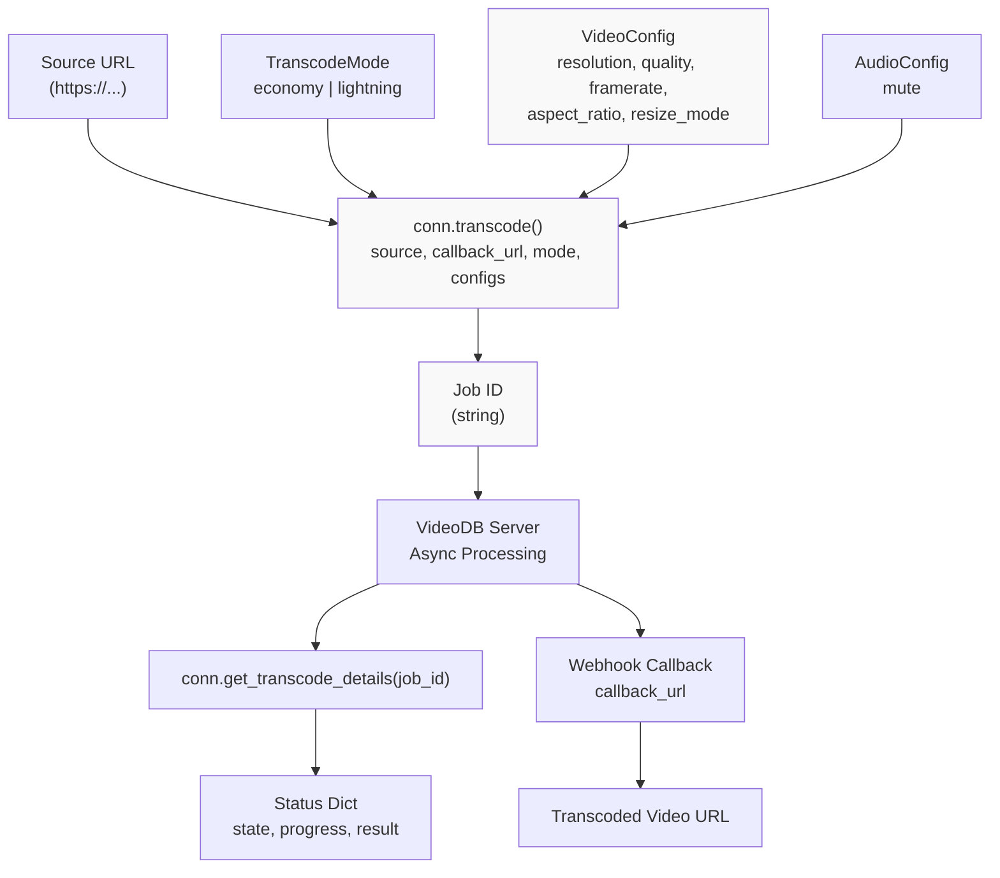
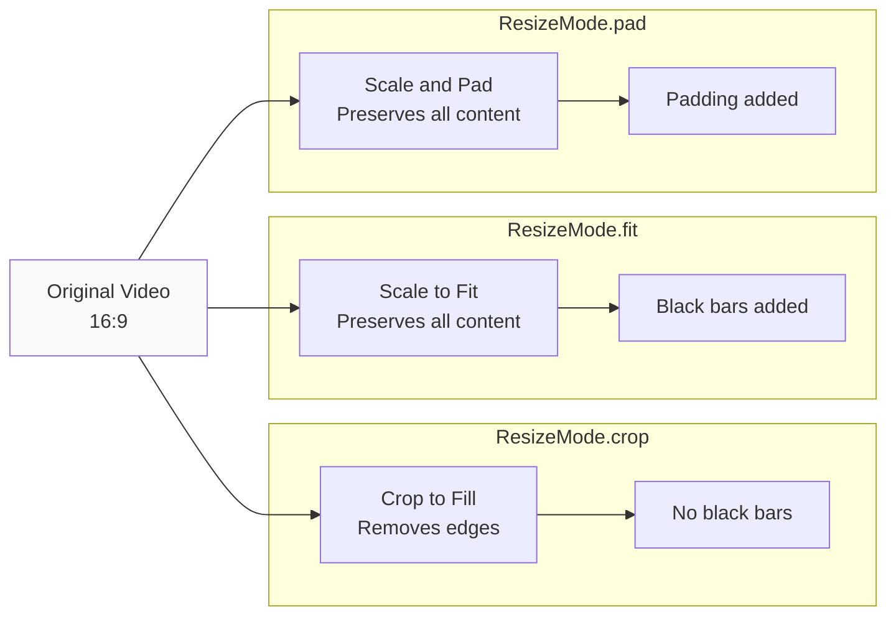
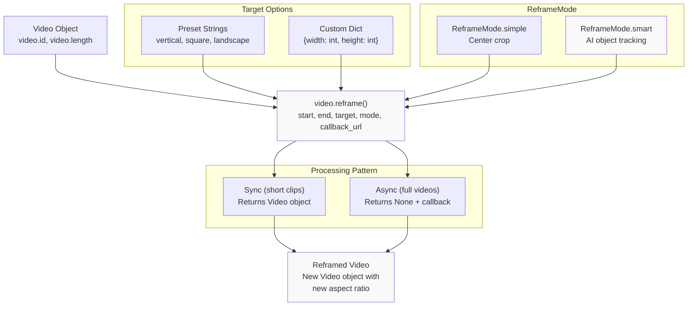
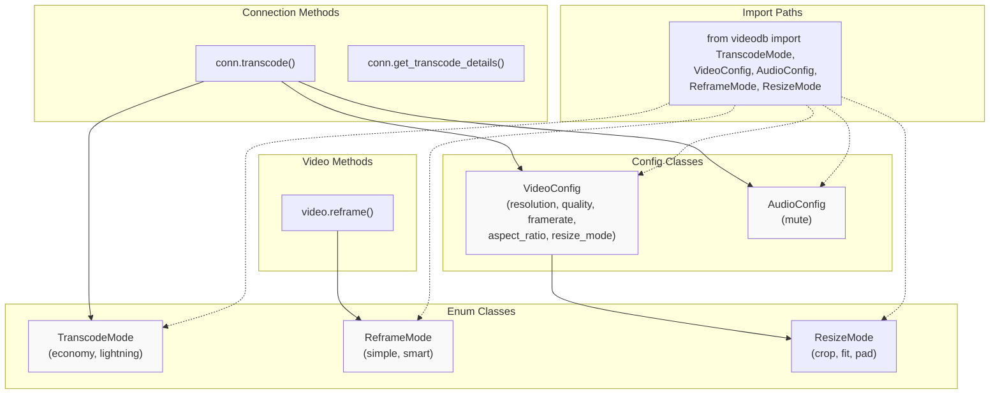

<!-- source: DeepWiki mcp.deepwiki.com · repo video-db/skills · page 10 Media Transformation · fetched 2026-10-27 -->

# Media Transformation

<details>
<summary>Relevant source files</summary>

The following files were used as context for generating this wiki page:

- [python/SKILL.md](python/SKILL.md)
- [python/reference/api-reference.md](python/reference/api-reference.md)

</details>


This document covers server-side video transformation operations that change video format, resolution, quality, or aspect ratio without requiring local processing tools. Media transformation includes **transcoding** (changing codec, resolution, quality, or bitrate) and **reframing** (changing aspect ratio with optional smart object tracking).

For video editing operations like trimming, overlays, and composing multiple assets, see [Timeline Editing](#7). For format conversion during upload, these transformations are applied post-upload.

---

## Overview

VideoDB provides two primary transformation operations:

| Operation | Method | Purpose | Returns |
|-----------|--------|---------|---------|
| **Transcoding** | `conn.transcode()` | Change resolution, quality, framerate, codec, aspect ratio | Job ID (async) |
| **Reframing** | `video.reframe()` | Change aspect ratio with smart cropping | `Video` object or `None` (async) |

Both operations execute server-side—no local `ffmpeg` installation required. All processing happens on VideoDB infrastructure and returns HLS stream URLs for instant playback.

**Sources:** [python/SKILL.md:225-262](), [python/reference/api-reference.md:33-221]()

---

## Transcoding

Transcoding converts a video from a source URL to a different encoding configuration. This operation is always asynchronous and requires a `callback_url` to receive the result.

### Transcoding Architecture



**Diagram:** Transcoding workflow showing the async pattern with job ID polling and webhook callbacks.

**Sources:** [python/reference/api-reference.md:33-63](), [python/SKILL.md:225-238]()

### VideoConfig Parameters

The `VideoConfig` class controls video encoding settings:

| Parameter | Type | Default | Description |
|-----------|------|---------|-------------|
| `resolution` | `int\|None` | `None` | Target resolution height in pixels (e.g. 480, 720, 1080) |
| `quality` | `int` | `23` | Encoding quality (lower = better quality, range: 0-51) |
| `framerate` | `int\|None` | `None` | Target framerate (e.g. 24, 30, 60) |
| `aspect_ratio` | `str\|None` | `None` | Target aspect ratio (e.g. `"16:9"`, `"9:16"`, `"1:1"`) |
| `resize_mode` | `ResizeMode` | `ResizeMode.crop` | How to fit video: `crop`, `fit`, or `pad` |

**Sources:** [python/reference/api-reference.md:66-86]()

### AudioConfig Parameters

The `AudioConfig` class controls audio encoding:

| Parameter | Type | Default | Description |
|-----------|------|---------|-------------|
| `mute` | `bool` | `False` | Mute the audio track completely |

**Sources:** [python/reference/api-reference.md:88-97]()

### TranscodeMode

Two processing modes are available:

| Mode | Speed | Use Case |
|------|-------|----------|
| `TranscodeMode.economy` | Standard | General-purpose transcoding with balanced speed/quality |
| `TranscodeMode.lightning` | Fast | Priority processing for time-sensitive workflows |

**Sources:** [python/reference/api-reference.md:55-56]()

### ResizeMode Strategies

When `aspect_ratio` is set in `VideoConfig`, the `resize_mode` determines how the video is fitted:



**Diagram:** `ResizeMode` strategies for aspect ratio conversion during transcoding.

**Sources:** [python/reference/api-reference.md:75-85]()

### Async Transcoding Pattern

Transcoding is always asynchronous. The caller must provide a `callback_url` and poll for status:

```python
# Start transcode job
from videodb import TranscodeMode, VideoConfig, AudioConfig

job_id = conn.transcode(
    source="https://example.com/video.mp4",
    callback_url="https://example.com/webhook",
    mode=TranscodeMode.economy,
    video_config=VideoConfig(resolution=720, quality=23, aspect_ratio="16:9"),
    audio_config=AudioConfig(mute=False),
)

# Poll for status
details = conn.get_transcode_details(job_id)
# Returns: {"state": "processing" | "completed" | "failed", "progress": 0-100, ...}
```

The `callback_url` receives a POST request when transcoding completes with the transcoded video URL.

**Sources:** [python/reference/api-reference.md:37-63](), [python/SKILL.md:225-238]()

### Common Transcoding Use Cases

| Scenario | Configuration |
|----------|---------------|
| Reduce file size for web delivery | `VideoConfig(resolution=720, quality=28)` |
| Convert to vertical for mobile | `VideoConfig(aspect_ratio="9:16", resize_mode=ResizeMode.crop)` |
| Standardize framerate | `VideoConfig(framerate=30)` |
| Remove audio track | `AudioConfig(mute=True)` |
| High-quality archive | `VideoConfig(quality=18)` |

**Sources:** [python/SKILL.md:351-361]()

---

## Reframing

Reframing changes a video's aspect ratio with optional AI-powered object tracking to keep important subjects in frame. Unlike transcoding, reframing can be synchronous for short segments or asynchronous for full-length videos.

### Reframing Architecture



**Diagram:** Reframing workflow showing target options, processing modes, and sync/async patterns.

**Sources:** [python/reference/api-reference.md:192-221](), [python/SKILL.md:240-262]()

### Target Presets

Three preset strings optimize for common social media platforms:

| Preset | Aspect Ratio | Platform Use Case |
|--------|--------------|-------------------|
| `"vertical"` | 9:16 | Instagram Stories, TikTok, YouTube Shorts |
| `"square"` | 1:1 | Instagram Feed, Facebook Posts |
| `"landscape"` | 16:9 | YouTube, Twitter, Standard Web |

Custom dimensions can be specified with a dict: `{"width": 1080, "height": 1080}`.

**Sources:** [python/reference/api-reference.md:217](), [python/SKILL.md:257-261]()

### ReframeMode

| Mode | Behavior | Best For |
|------|----------|----------|
| `ReframeMode.simple` | Center crop to target aspect ratio | Static scenes, uniform framing |
| `ReframeMode.smart` | AI-powered object tracking keeps subjects in frame | Dynamic scenes with moving subjects |

**Sources:** [python/reference/api-reference.md:218](), [python/SKILL.md:252]()

### Performance Considerations

**Critical:** Reframing is a slow server-side operation. It can take several minutes for long videos and may time out.

**Best practices:**

| Scenario | Recommendation |
|----------|----------------|
| Short segment (< 60s) | Use synchronous call with `start`/`end` parameters |
| Full-length video | Always use `callback_url` for async processing |
| Timeline workflow | Trim on `Timeline` first, then reframe the compiled result |
| Testing/preview | Test on 10-15 second segments before processing full videos |

```python
# GOOD: Reframe short segment synchronously
reframed = video.reframe(start=0, end=60, target="vertical", mode=ReframeMode.smart)

# BAD: Reframe full video synchronously (will timeout on long videos)
# reframed = video.reframe(target="vertical")  # May hang for minutes

# GOOD: Reframe full video asynchronously
video.reframe(target="vertical", callback_url="https://example.com/webhook")
# Returns None immediately, result delivered to webhook
```

**Sources:** [python/reference/api-reference.md:196-209](), [python/SKILL.md:241-256]()

### Reframe Parameters

| Parameter | Type | Default | Description |
|-----------|------|---------|-------------|
| `start` | `float\|None` | `None` | Start time in seconds (None = beginning) |
| `end` | `float\|None` | `None` | End time in seconds (None = end of video) |
| `target` | `str\|dict` | `"vertical"` | Preset string or `{"width": int, "height": int}` |
| `mode` | `ReframeMode` | `ReframeMode.smart` | `simple` (center crop) or `smart` (object tracking) |
| `callback_url` | `str\|None` | `None` | Webhook URL for async notification (required for full videos) |

**Returns:** `Video` object when `callback_url` is `None`, otherwise returns `None` and delivers result via webhook.

**Sources:** [python/reference/api-reference.md:212-220]()

---

## Choosing Between Transcoding and Reframing

Both operations can change aspect ratio, but they serve different purposes:

| Need | Use | Reason |
|------|-----|--------|
| Change resolution (1080p → 720p) | `conn.transcode()` | Resolution is a transcoding parameter |
| Change quality/bitrate | `conn.transcode()` | Quality encoding settings |
| Change codec or framerate | `conn.transcode()` | Encoder-level changes |
| Change aspect ratio with cropping | `video.reframe()` | Optimized for aspect ratio conversion with AI tracking |
| Social media optimization | `video.reframe()` | Presets designed for platforms |
| Batch processing from URLs | `conn.transcode()` | Works on external URLs without upload |
| Object-aware cropping | `video.reframe()` | `ReframeMode.smart` tracks subjects |

**Sources:** [python/SKILL.md:351-361]()

### Code Entity Mapping



**Diagram:** Code entities and import paths for media transformation operations.

**Sources:** [python/reference/api-reference.md:33-221](), [python/SKILL.md:225-262]()

---

## Error Handling

Both operations can fail due to invalid parameters or processing errors:

| Error Type | Common Cause | Solution |
|------------|--------------|----------|
| `InvalidRequestError` | Invalid source URL for transcode | Verify URL is downloadable |
| `RequestTimeoutError` | Reframe operation timed out | Use `callback_url` for async processing or limit segment with `start`/`end` |
| `AuthenticationError` | Missing API key | Set `VIDEO_DB_API_KEY` environment variable |
| Invalid aspect ratio | Non-string target in reframe | Use preset strings or `{"width": int, "height": int}` dict |

```python
from videodb.exceptions import InvalidRequestError, RequestTimeoutError

try:
    reframed = video.reframe(start=0, end=60, target="vertical")
except RequestTimeoutError:
    # Fallback to async processing
    video.reframe(start=0, end=60, target="vertical", 
                  callback_url="https://example.com/webhook")
except InvalidRequestError as e:
    print(f"Invalid parameters: {e}")
```

**Sources:** [python/reference/api-reference.md:532-548](), [python/SKILL.md:273-287]()

---

