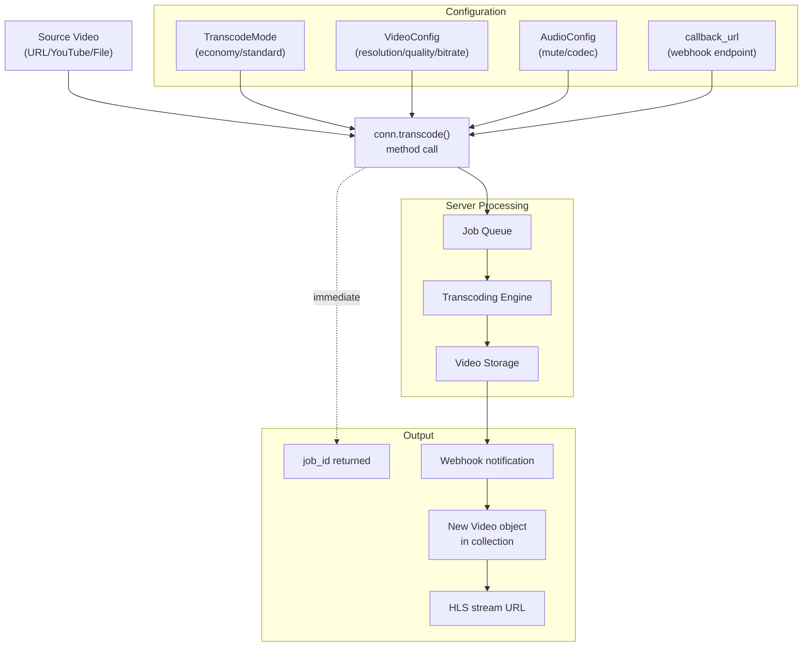
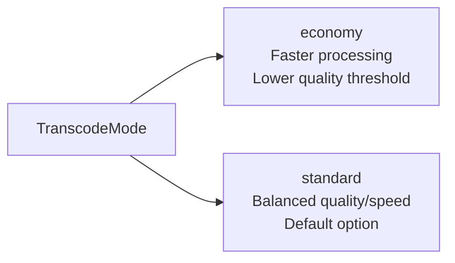
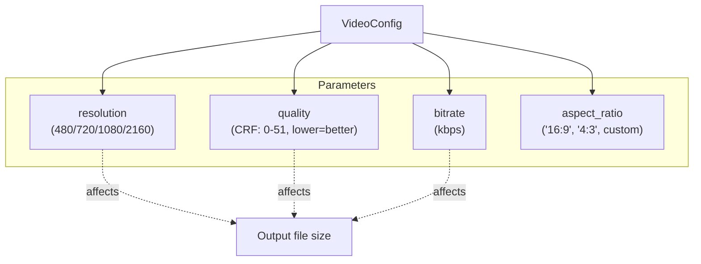
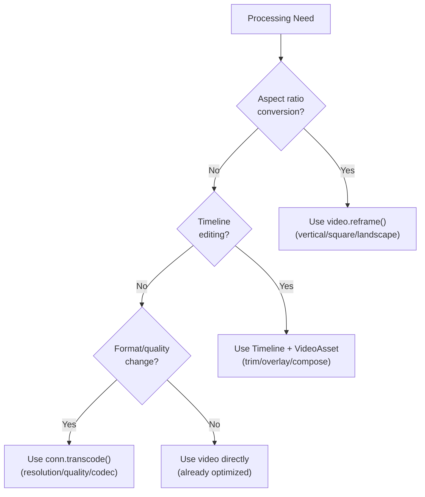

<!-- source: DeepWiki mcp.deepwiki.com · repo video-db/skills · page 10.1 Transcoding · fetched 2026-10-27 -->

# Transcoding

<details>
<summary>Relevant source files</summary>

The following files were used as context for generating this wiki page:

- [python/SKILL.md](python/SKILL.md)

</details>


## Purpose and Scope

Transcoding is the server-side conversion of video files to different formats, codecs, resolutions, quality levels, or bitrates. This page covers the `conn.transcode()` method and its configuration options for delivery optimization and format normalization.

For aspect ratio conversion and platform-specific formatting (vertical, square, landscape), see [Reframing](#10.2).

---

## Overview

The VideoDB transcoding system operates entirely server-side, eliminating the need for local encoding tools like FFmpeg or MoviePy. All transcoding operations are asynchronous and return a `job_id` for tracking.

**Key characteristics:**
- **Server-side processing**: No client-side encoding or downloads required
- **Asynchronous execution**: Operations run in the background with webhook notifications
- **Format agnostic input**: Accepts any video source (URL, YouTube, uploaded file)
- **Optimized delivery**: Outputs are immediately available as HLS streams via CDN

### When to Use Transcoding

| Scenario | Solution |
|----------|----------|
| Reduce file size for bandwidth-limited delivery | `VideoConfig(resolution=720, quality=28)` |
| Normalize mixed-format content to single spec | `TranscodeMode.standard` with consistent `VideoConfig` |
| Platform rejects codec/container | `conn.transcode()` with target resolution |
| Remove audio track entirely | `AudioConfig(mute=True)` |
| Downsample high-bitrate source | `VideoConfig(quality=23)` with economy mode |

**Sources:** [python/SKILL.md:225-238](), [python/SKILL.md:349-361]()

---

## Transcoding Workflow



**Diagram: Transcoding Operation Flow**

The `transcode()` method is called on the `Connection` object, not on individual `Video` objects. This allows transcoding from any source URL without prior upload.

**Sources:** [python/SKILL.md:225-238]()

---

## The transcode() Method

The transcoding operation is invoked via `conn.transcode()` with the following signature:

```python
job_id = conn.transcode(
    source="https://example.com/video.mp4",
    callback_url="https://example.com/webhook",
    mode=TranscodeMode.economy,
    video_config=VideoConfig(resolution=720, quality=23, aspect_ratio="16:9"),
    audio_config=AudioConfig(mute=False),
)
```

### Parameters

| Parameter | Type | Required | Description |
|-----------|------|----------|-------------|
| `source` | `str` | Yes | URL to video file (HTTP/HTTPS/YouTube) |
| `callback_url` | `str` | Yes | Webhook endpoint for completion notification |
| `mode` | `TranscodeMode` | No | Processing quality mode (default: `standard`) |
| `video_config` | `VideoConfig` | No | Video encoding parameters |
| `audio_config` | `AudioConfig` | No | Audio encoding parameters |

### Return Value

Returns a `job_id` string that can be used to track the transcoding operation. The actual result is delivered asynchronously via the `callback_url` webhook.

**Sources:** [python/SKILL.md:225-238]()

---

## TranscodeMode Enumeration



**Diagram: TranscodeMode Options**

The `TranscodeMode` enum controls the speed-quality tradeoff during server-side encoding:

- **`TranscodeMode.economy`**: Prioritizes faster processing time, suitable for preview generation or bandwidth-constrained delivery
- **`TranscodeMode.standard`**: Balanced quality and speed, recommended for most use cases

### Usage Example

```python
from videodb import TranscodeMode

# Fast processing for preview
job_id = conn.transcode(
    source="https://example.com/long-video.mp4",
    callback_url="https://example.com/webhook",
    mode=TranscodeMode.economy,
)

# Higher quality for final delivery
job_id = conn.transcode(
    source="https://example.com/final-cut.mp4",
    callback_url="https://example.com/webhook",
    mode=TranscodeMode.standard,
)
```

**Sources:** [python/SKILL.md:228]()

---

## VideoConfig Class



**Diagram: VideoConfig Parameters and Relationships**

The `VideoConfig` class configures video encoding parameters. All parameters are optional; omitted values retain source settings.

### Parameters

| Parameter | Type | Description | Typical Values |
|-----------|------|-------------|----------------|
| `resolution` | `int` | Output height in pixels | `480`, `720`, `1080`, `2160` |
| `quality` | `int` | CRF value (lower = better quality) | `18` (high), `23` (standard), `28` (economy) |
| `bitrate` | `int` | Target bitrate in kbps | `2500` (720p), `5000` (1080p) |
| `aspect_ratio` | `str` | Output aspect ratio | `"16:9"`, `"4:3"`, `"21:9"` |

### Quality Guidelines

The `quality` parameter uses the Constant Rate Factor (CRF) scale:
- **18**: Visually lossless, large file size
- **23**: Standard quality (default), balanced size/quality
- **28**: Economy quality, smaller files
- **51**: Lowest quality, minimal file size

### Usage Example

```python
from videodb import VideoConfig

# High-quality 1080p output
video_config = VideoConfig(
    resolution=1080,
    quality=18,
    aspect_ratio="16:9",
)

# Bandwidth-optimized 720p
video_config = VideoConfig(
    resolution=720,
    quality=28,
    bitrate=2500,
)

job_id = conn.transcode(
    source="https://example.com/4k-source.mp4",
    callback_url="https://example.com/webhook",
    video_config=video_config,
)
```

**Sources:** [python/SKILL.md:225-238]()

---

## AudioConfig Class

The `AudioConfig` class configures audio stream handling during transcoding.

### Parameters

| Parameter | Type | Description | Default |
|-----------|------|-------------|---------|
| `mute` | `bool` | Remove audio track entirely | `False` |

### Usage Example

```python
from videodb import AudioConfig

# Remove audio track
audio_config = AudioConfig(mute=True)

job_id = conn.transcode(
    source="https://example.com/video-with-copyrighted-music.mp4",
    callback_url="https://example.com/webhook",
    audio_config=audio_config,
)
```

**Common use cases for audio muting:**
- Removing copyrighted music for public sharing
- Creating silent video loops for backgrounds
- Preparing content for audio overlay or dubbing

**Sources:** [python/SKILL.md:225-238]()

---

## Asynchronous Processing and Callbacks

All transcoding operations are asynchronous and require a `callback_url` webhook endpoint to receive completion notifications.

### Webhook Payload Structure

When transcoding completes, VideoDB sends an HTTP POST request to the provided `callback_url` with the following payload:

```json
{
  "job_id": "abc123...",
  "status": "completed",
  "video_id": "xyz789...",
  "collection_id": "def456...",
  "stream_url": "https://stream.videodb.io/..."
}
```

### Callback Implementation Example

```python
from flask import Flask, request
import videodb

app = Flask(__name__)

@app.route('/webhook', methods=['POST'])
def transcode_webhook():
    data = request.json
    
    if data['status'] == 'completed':
        video_id = data['video_id']
        collection_id = data['collection_id']
        
        # Retrieve the transcoded video
        conn = videodb.connect()
        coll = conn.get_collection(collection_id)
        video = coll.get_video(video_id)
        
        # Access the stream URL
        print(f"Transcoded video ready: {data['stream_url']}")
    
    return '', 200
```

### Why Callbacks Are Required

Transcoding is a long-running operation that can take minutes for large files. The callback pattern:
- **Prevents timeout errors**: Client doesn't wait indefinitely
- **Enables parallelization**: Multiple transcoding jobs can run simultaneously
- **Decouples processing**: Server continues work after API call returns
- **Provides notifications**: Webhook fires immediately on completion

**Sources:** [python/SKILL.md:225-238]()

---

## Common Transcoding Scenarios

### Scenario 1: Platform Requirement Compliance

Many platforms reject uploads that don't meet specific encoding requirements.

```python
# Twitter video requirements: 720p max, 23 CRF
job_id = conn.transcode(
    source="https://example.com/original.mp4",
    callback_url="https://example.com/webhook",
    mode=TranscodeMode.standard,
    video_config=VideoConfig(resolution=720, quality=23, aspect_ratio="16:9"),
)
```

### Scenario 2: Bandwidth Optimization

Reduce file size for faster delivery on mobile networks.

```python
# Economy mode with reduced resolution and higher compression
job_id = conn.transcode(
    source="https://example.com/4k-presentation.mp4",
    callback_url="https://example.com/webhook",
    mode=TranscodeMode.economy,
    video_config=VideoConfig(resolution=720, quality=28),
)
```

### Scenario 3: Format Normalization

Standardize mixed-source content to a single specification.

```python
# Normalize all videos to 1080p @ 23 CRF
for source_url in video_urls:
    job_id = conn.transcode(
        source=source_url,
        callback_url="https://example.com/webhook",
        video_config=VideoConfig(resolution=1080, quality=23, aspect_ratio="16:9"),
    )
```

**Sources:** [python/SKILL.md:349-361]()

---

## Transcoding vs. Other Operations



**Diagram: Decision Tree for Video Processing Operations**

| Operation | Use Case | Method |
|-----------|----------|--------|
| **Transcode** | Change resolution, quality, bitrate, or codec | `conn.transcode()` |
| **Reframe** | Change aspect ratio for social platforms | `video.reframe()` |
| **Timeline** | Trim, overlay, or compose multiple assets | `Timeline.add_inline()` |
| **Subtitle** | Add captions or subtitles | `video.add_subtitle()` |

### Key Differences

- **Transcode** operates on source URLs and requires webhooks (always async)
- **Reframe** operates on existing `Video` objects and can be sync or async
- **Timeline** operates on multiple assets and produces a new composed stream

**Sources:** [python/SKILL.md:225-238](), [python/SKILL.md:349-361]()

---

## Error Handling and Limitations

### Common Errors

| Error | Cause | Solution |
|-------|-------|----------|
| `InvalidRequestError` | Invalid source URL or callback URL | Verify URLs are accessible and valid |
| `AuthenticationError` | Missing or invalid API key | Check `VIDEO_DB_API_KEY` environment variable |
| Webhook timeout | Callback endpoint unreachable | Ensure webhook server is running and accessible |

### Limitations

- **Callback URL required**: Transcoding always operates asynchronously; synchronous mode is not supported
- **Source must be URL**: Local file paths are not supported; upload to VideoDB first or use a public URL
- **No real-time preview**: Cannot monitor progress; must wait for webhook notification
- **Plan limits**: Free tier has monthly transcoding quotas; check plan limits at console.videodb.io

### Error Handling Pattern

```python
from videodb.exceptions import InvalidRequestError, AuthenticationError

try:
    job_id = conn.transcode(
        source="https://example.com/video.mp4",
        callback_url="https://example.com/webhook",
        video_config=VideoConfig(resolution=720),
    )
    print(f"Transcoding job started: {job_id}")
except InvalidRequestError as e:
    print(f"Invalid request: {e}")
except AuthenticationError:
    print("Check VIDEO_DB_API_KEY environment variable")
```

**Sources:** [python/SKILL.md:273-298]()

---

