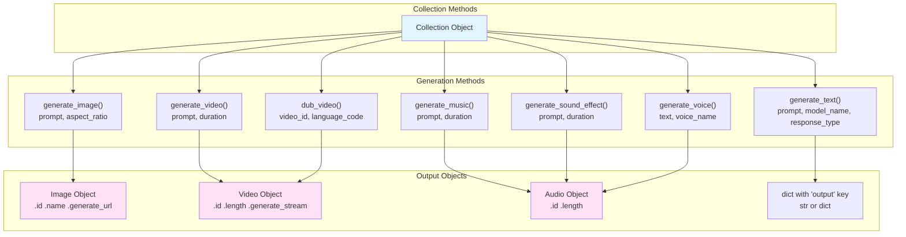
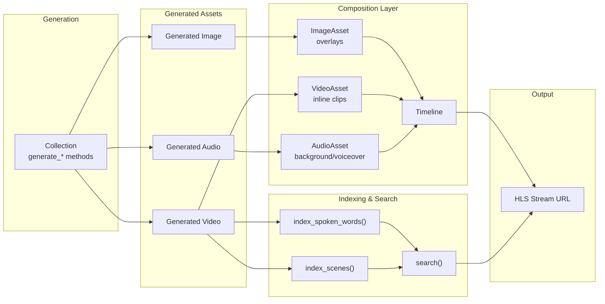
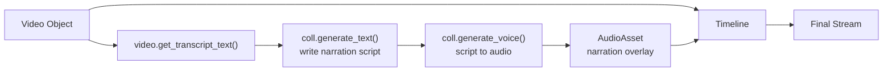

<!-- source: DeepWiki mcp.deepwiki.com · repo video-db/skills · page 11 AI Media Generation · fetched 2026-10-27 -->

# AI Media Generation

<details>
<summary>Relevant source files</summary>

The following files were used as context for generating this wiki page:

- [.gitignore](.gitignore)
- [python/.env.example](python/.env.example)
- [python/SKILL.md](python/SKILL.md)
- [python/reference/generative.md](python/reference/generative.md)

</details>


## Purpose and Scope

This document covers AI-powered content creation capabilities in VideoDB. All generative operations are methods on the `Collection` object and produce new media assets (images, videos, audio) or text analysis.

**Generation categories covered:**
- Image generation from text prompts
- Video generation from text prompts
- Audio generation (music, sound effects, voice/TTS)
- Text generation (LLM analysis)
- Dubbing and translation

For non-generative media operations, see [Timeline Editing](#7) for composition, [Media Transformation](#10) for transcoding/reframing, and [Video Understanding and Indexing](#5) for content analysis.

**Sources:** [python/reference/generative.md:1-321]()

---

## Architecture Overview

All generation methods are accessed through the `Collection` object. Generated assets are automatically added to the collection and can be used immediately in searches, timelines, and compositions.

### Collection Generation API



**Sources:** [python/reference/generative.md:1-40](), [python/reference/generative.md:69-127](), [python/reference/generative.md:129-159]()

---

## Generation Methods Reference

| Method | Input | Output | Primary Use Case |
|--------|-------|--------|------------------|
| `generate_image()` | Text prompt, aspect ratio | `Image` | Thumbnails, overlays, static graphics |
| `generate_video()` | Text prompt, duration (5-8s) | `Video` | B-roll, transitions, generative clips |
| `generate_music()` | Text prompt, duration | `Audio` | Background music, soundtracks |
| `generate_sound_effect()` | Text prompt, duration | `Audio` | SFX, ambient sounds, foley |
| `generate_voice()` | Text string, voice name | `Audio` | Narration, voiceover, TTS |
| `generate_text()` | Prompt with context, model tier | `dict` | Summarization, analysis, structured extraction |
| `dub_video()` | Video ID, language code | `Video` | Multi-language versions |

### Key Design Patterns

1. **Three separate audio methods**: No unified `generate_audio()` method exists. Use `generate_music()`, `generate_sound_effect()`, or `generate_voice()` depending on content type.

2. **Collection-level only**: All generation is on `Collection`, not on individual `Video` objects.

3. **Persistent assets**: Generated content is stored in the collection and can be reused across multiple timelines.

4. **Async support**: All methods support `callback_url` parameter for long-running operations.

**Sources:** [python/reference/generative.md:16-40](), [python/reference/generative.md:44-66](), [python/reference/generative.md:69-127]()

---

## Integration with Video Processing Pipeline

Generated assets integrate seamlessly with other VideoDB subsystems:



**Example workflow:**
1. `generate_video()` creates a new `Video` object
2. `video.index_spoken_words()` analyzes the generated content
3. `video.search()` finds specific moments
4. `Timeline` combines generated clips with uploaded videos
5. `timeline.generate_stream()` produces final output

**Sources:** [python/reference/generative.md:229-293](), [python/SKILL.md:264-271]()

---

## Common Parameters

### Aspect Ratio (Images)

| Value | Ratio | Use Case |
|-------|-------|----------|
| `"1:1"` | Square | Social media posts |
| `"16:9"` | Landscape | Thumbnails, overlays |
| `"9:16"` | Vertical | Stories, Reels, Shorts |
| `"4:3"` | Standard | Traditional displays |
| `"3:4"` | Vertical standard | Portrait mode |

### Duration Constraints

| Method | Duration Range | Default |
|--------|---------------|---------|
| `generate_video()` | 5-8 seconds (integer) | 5 |
| `generate_music()` | Flexible | 5 |
| `generate_sound_effect()` | Flexible | 2 |

### Model Tiers (Text Generation)

| Tier | Speed | Quality | Recommended Use |
|------|-------|---------|-----------------|
| `"basic"` | Fastest | Standard | Simple summaries, keyword extraction |
| `"pro"` | Balanced | High | Analysis, structured extraction |
| `"ultra"` | Slowest | Highest | Complex reasoning, detailed analysis |

**Sources:** [python/reference/generative.md:33-36](), [python/reference/generative.md:59-63](), [python/reference/generative.md:146-152]()

---

## Text Generation and LLM Integration

The `generate_text()` method provides LLM analysis capabilities. **Critical:** This is a collection-level method with no automatic video context access.

### Basic Pattern

```python
# Get video context first
transcript_text = video.get_transcript_text()

# Pass context explicitly in prompt
result = coll.generate_text(
    prompt=f"Summarize the key points:\n{transcript_text}",
    model_name="pro"
)

print(result["output"])  # str when response_type="text"
```

### Structured JSON Output

```python
result = coll.generate_text(
    prompt="Return JSON with keys: summary, topics (array), action_items (array)",
    model_name="pro",
    response_type="json"
)

# result["output"] is a dict when response_type="json"
summary = result["output"]["summary"]
topics = result["output"]["topics"]
```

### Parameters

| Parameter | Type | Default | Description |
|-----------|------|---------|-------------|
| `prompt` | `str` | required | Full prompt including all context |
| `model_name` | `str` | `"basic"` | Model tier: `"basic"`, `"pro"`, `"ultra"` |
| `response_type` | `str` | `"text"` | Response format: `"text"` or `"json"` |

**Sources:** [python/reference/generative.md:129-186](), [python/reference/generative.md:294-311]()

---

## Dubbing and Translation

### Video Dubbing

`dub_video()` replaces the original audio track with AI-generated speech in the target language:

```python
dubbed_video = coll.dub_video(
    video_id=video.id,
    language_code="es",  # Spanish
)

stream_url = dubbed_video.generate_stream()
```

**Common language codes:**
- `"en"` - English
- `"es"` - Spanish
- `"fr"` - French
- `"de"` - German
- `"ja"` - Japanese
- `"zh"` - Chinese
- `"hi"` - Hindi
- `"ar"` - Arabic

### Transcript Translation

`translate_transcript()` translates text without modifying the video:

```python
translated = video.translate_transcript(
    language="Spanish",
    additional_notes="Use formal tone"
)

for entry in translated:
    print(entry)  # timestamped translation entries
```

**Sources:** [python/reference/generative.md:188-227]()

---

## Output Object Details

### Image Objects

Generated images return `Image` objects:

```python
image = coll.generate_image(prompt="sunset over mountains", aspect_ratio="16:9")

# Properties
image.id           # Unique identifier
image.name         # Auto-generated name
image.collection_id

# Get download URL (NOT .url property)
url = image.generate_url()  # Returns signed URL
```

**Important:** Use `.generate_url()` method, not `.url` property, for generated images.

### Video Objects

Generated videos return standard `Video` objects with all capabilities:

```python
video = coll.generate_video(prompt="flower blooming", duration=5)

# All standard Video methods available
video.index_spoken_words()
video.search("petal")
video.generate_stream()
video.play()
```

### Audio Objects

All three audio generation methods return `Audio` objects:

```python
music = coll.generate_music(prompt="upbeat electronic", duration=30)
sfx = coll.generate_sound_effect(prompt="thunder", duration=10)
voice = coll.generate_voice(text="Welcome", voice_name="Default")

# Common properties
music.id
music.name
music.length
music.collection_id
```

**Sources:** [python/reference/generative.md:16-40](), [python/reference/generative.md:44-66](), [python/reference/generative.md:69-127]()

---

## Workflow Examples

### Complete Narration Workflow



Implementation:

```python
# 1. Get video context
transcript_text = video.get_transcript_text()

# 2. Generate script using LLM
result = coll.generate_text(
    prompt=f"Write narration script for:\n{transcript_text[:2000]}",
    model_name="pro"
)
script = result["output"]

# 3. Convert to speech
narration = coll.generate_voice(text=script)

# 4. Compose on timeline
from videodb.timeline import Timeline
from videodb.asset import VideoAsset, AudioAsset

timeline = Timeline(conn)
timeline.add_inline(VideoAsset(asset_id=video.id))
timeline.add_overlay(0, AudioAsset(asset_id=narration.id))

stream_url = timeline.generate_stream()
```

### Generated Thumbnail Workflow

```python
# Generate thumbnail matching video content
thumbnail = coll.generate_image(
    prompt="professional thumbnail: data analytics dashboard, modern",
    aspect_ratio="16:9"
)

# Get signed download URL
thumbnail_url = thumbnail.generate_url()

# Use in timeline as overlay
from videodb.asset import ImageAsset

timeline.add_overlay(
    0, 
    ImageAsset(asset_id=thumbnail.id, x=10, y=10, duration=5)
)
```

### Music + Video Composition

```python
# Generate background music
music = coll.generate_music(
    prompt="calm ambient music for tutorial video",
    duration=video.length  # Match video duration
)

# Compose
timeline = Timeline(conn)
timeline.add_inline(VideoAsset(asset_id=video.id))
timeline.add_overlay(0, AudioAsset(
    asset_id=music.id,
    disable_other_tracks=False  # Mix with original audio
))

stream_url = timeline.generate_stream()
```

**Sources:** [python/reference/generative.md:229-293]()

---

## Asynchronous Generation

All generation methods support `callback_url` for long-running operations:

```python
# Synchronous (blocks until complete)
video = coll.generate_video(prompt="sunset timelapse", duration=5)

# Asynchronous (returns immediately, None response)
coll.generate_video(
    prompt="sunset timelapse",
    duration=8,
    callback_url="https://example.com/webhook"
)
```

**When to use async:**
- Video generation > 5 seconds
- Music generation > 30 seconds
- Dubbing full-length videos
- Processing multiple generation requests in parallel

The webhook receives a POST request with the generated asset details upon completion.

**Sources:** [python/reference/generative.md:37-39](), [python/reference/generative.md:62-64]()

---

## Limitations and Constraints

| Operation | Limitation | Workaround |
|-----------|-----------|------------|
| `generate_video()` | 5-8 seconds only | Generate multiple clips, compose on timeline |
| `generate_text()` | No auto video context | Fetch transcript with `video.get_transcript_text()` and pass in prompt |
| Audio generation | Three separate methods | Use correct method: `generate_music()`, `generate_sound_effect()`, or `generate_voice()` |
| `Image.url` property | May be `None` for generated images | Always use `image.generate_url()` method |
| Dubbing | Replaces entire audio track | Use `translate_transcript()` if you only need text |

**Sources:** [python/reference/generative.md:313-321]()

---

## Integration with Search and Indexing

Generated videos can be indexed and searched like uploaded content:

```python
# Generate video
generated_video = coll.generate_video(
    prompt="corporate office meeting, professional setting",
    duration=5
)

# Index for search
generated_video.index_spoken_words()
generated_video.index_scenes(
    extraction_type=SceneExtractionType.shot_based,
    prompt="Describe office environment and people"
)

# Search generated content
results = generated_video.search("presentation")
clips = results.compile()
```

This enables:
- Searching across both uploaded and generated content
- Using generated B-roll in automated compilation workflows
- Building searchable libraries of generative assets

**Sources:** [python/reference/generative.md:44-66](), [python/reference/generative.md:161-186]()

---

## Best Practices

1. **Prompt quality matters**: Descriptive, specific prompts produce better results across all generation types.

2. **Use model tiers appropriately**: Use `"pro"` for most analysis tasks, `"basic"` for simple operations, `"ultra"` only when necessary.

3. **Generated media is persistent**: All assets remain in your collection for reuse. Clean up unused assets to manage storage.

4. **Context is explicit**: `generate_text()` does not automatically access video content. Always fetch and pass context in the prompt.

5. **Aspect ratio selection**: Choose aspect ratios matching your delivery target (`"16:9"` for YouTube, `"9:16"` for TikTok, `"1:1"` for Instagram).

6. **Combine generation types**: Generate images for overlays, music for backgrounds, voice for narration, then compose using timelines.

7. **Audio method selection**: 
   - `generate_music()` for background tracks
   - `generate_sound_effect()` for specific sounds
   - `generate_voice()` for speech/narration

**Sources:** [python/reference/generative.md:313-321]()

---

## Related Documentation

- For using generated assets in compositions, see [Timeline Editing](#7)
- For indexing and searching generated videos, see [Video Understanding and Indexing](#5)
- For format conversion of generated content, see [Media Transformation](#10)
- For detailed API signatures, see subsections [Image and Video Generation](#11.1), [Audio Generation](#11.2), [Text and LLM](#11.3), [Dubbing and Translation](#11.4)

---

