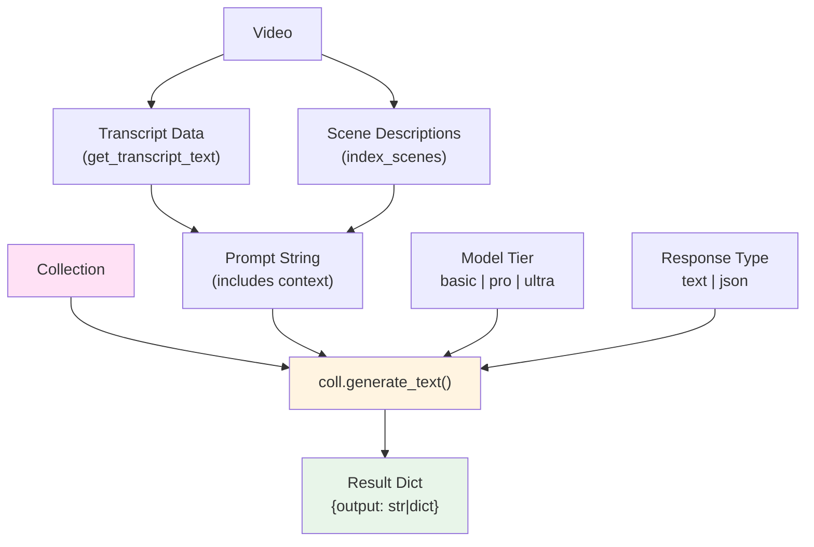
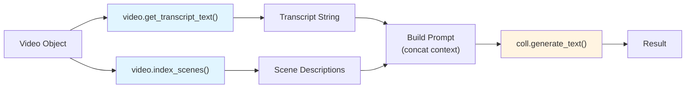
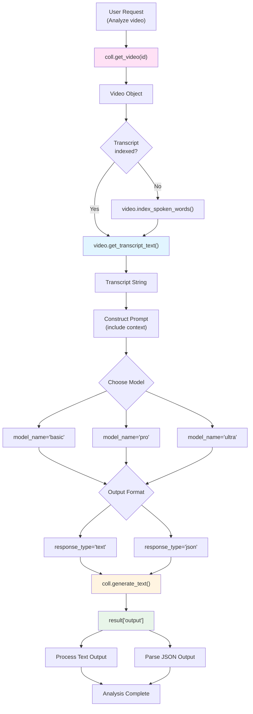

<!-- source: DeepWiki mcp.deepwiki.com · repo video-db/skills · page 11.3 Text and LLM · fetched 2026-10-27 -->

# Text and LLM

<details>
<summary>Relevant source files</summary>

The following files were used as context for generating this wiki page:

- [.gitignore](.gitignore)
- [python/.env.example](python/.env.example)
- [python/reference/generative.md](python/reference/generative.md)

</details>


This page documents the text generation and Large Language Model (LLM) integration capabilities in VideoDB, primarily through the `generate_text()` method. This method enables AI-powered analysis, summarization, and structured extraction from video content.

For generating other media types (images, videos, audio), see [Image and Video Generation](#11.1) and [Audio Generation](#11.2). For subtitle generation, see [Subtitles and Captions](#7.3).

---

## Overview

The `generate_text()` method provides access to LLM capabilities for analyzing video content. Unlike indexing methods that run automatically, text generation is **prompt-driven** and **Collection-level**, meaning:

- The method is called on a `Collection` object, not a `Video` object
- Video context (transcripts, scene descriptions) must be explicitly passed in the prompt
- The LLM does not have automatic access to video metadata

This design allows flexible analysis patterns where you control exactly what context the LLM receives.

**Sources:** [python/reference/generative.md:128-159]()

---

## Architecture and Object Relationships



**Diagram: Text Generation Object Flow**

The diagram shows that `generate_text()` is a Collection method that accepts a prompt string. Video context is fetched separately using `get_transcript_text()` or scene indexing, then included in the prompt. The method also accepts model tier and response type parameters, returning a dictionary with an `output` key.

**Sources:** [python/reference/generative.md:128-159]()

---

## Method Signature and Parameters

The `generate_text()` method is called on a `Collection` object:

```python
result = coll.generate_text(
    prompt="<your prompt with context>",
    model_name="pro",
    response_type="text"
)
```

### Parameters

| Parameter | Type | Default | Description |
|-----------|------|---------|-------------|
| `prompt` | `str` | required | Prompt with all necessary context for the LLM |
| `model_name` | `str` | `"basic"` | Model tier: `"basic"`, `"pro"`, or `"ultra"` |
| `response_type` | `str` | `"text"` | Response format: `"text"` or `"json"` |

### Return Value

Returns a `dict` with a single `output` key:
- When `response_type="text"`: `output` is a `str`
- When `response_type="json"`: `output` is a `dict`

```python
result = coll.generate_text(prompt="Summarize this", model_name="pro")
text_output = result["output"]  # str

result = coll.generate_text(prompt="Return JSON", model_name="pro", response_type="json")
json_output = result["output"]  # dict
```

**Sources:** [python/reference/generative.md:145-159]()

---

## Model Tiers

VideoDB provides three model tiers with different performance characteristics:

| Model Tier | Speed | Quality | Use Case |
|------------|-------|---------|----------|
| `"basic"` | Fastest | Good | Simple tasks, quick summaries, keyword extraction |
| `"pro"` | Balanced | High | Most analysis tasks, detailed summaries, Q&A |
| `"ultra"` | Slowest | Highest | Complex reasoning, long-form generation, critical analysis |

**Recommendation:** Use `"pro"` for most video analysis tasks. It provides good quality at reasonable speed. Only use `"ultra"` when `"pro"` results are insufficient.

**Sources:** [python/reference/generative.md:318]()

---

## Integrating Video Context



**Diagram: Video Context Integration Pattern**

Since `generate_text()` is a Collection-level method, it does not automatically access video content. The standard pattern is:

1. Fetch transcript using `video.get_transcript_text()`
2. Optionally fetch scene descriptions from `video.index_scenes()`
3. Concatenate context into the prompt string
4. Call `coll.generate_text()` with the enriched prompt

**Sources:** [python/reference/generative.md:132-144](), [python/reference/generative.md:160-186]()

---

## Text Response Format

When `response_type="text"` (default), the LLM returns unstructured text:

```python
transcript_text = video.get_transcript_text()

result = coll.generate_text(
    prompt=f"Summarize the key points discussed in this video:\n{transcript_text}",
    model_name="pro",
    response_type="text"  # default
)

summary = result["output"]  # str
print(summary)
```

### Example Output
```
The video discusses three main topics: cloud infrastructure scaling, 
cost optimization strategies, and deployment automation. The speaker 
emphasizes the importance of monitoring and provides specific examples...
```

**Sources:** [python/reference/generative.md:132-143]()

---

## JSON Response Format

When `response_type="json"`, the LLM returns structured data as a dictionary:

```python
transcript_text = video.get_transcript_text()

result = coll.generate_text(
    prompt=(
        f"Given this transcript:\n{transcript_text}\n\n"
        "Return a JSON object with keys: summary, topics (array), action_items (array)."
    ),
    model_name="pro",
    response_type="json"
)

data = result["output"]  # dict
print(data["summary"])
print(data["topics"])
print(data["action_items"])
```

### Example Output
```python
{
    "summary": "Discussion of cloud infrastructure best practices",
    "topics": ["scaling", "cost optimization", "automation"],
    "action_items": [
        "Review current deployment pipeline",
        "Implement auto-scaling policies"
    ]
}
```

**Important:** You must explicitly request JSON structure in your prompt. The `response_type="json"` parameter ensures parsing, but the prompt must guide the LLM to produce valid JSON.

**Sources:** [python/reference/generative.md:295-311]()

---

## Common Analysis Patterns

### Pattern 1: Video Summarization

```python
# Fetch transcript
transcript_text = video.get_transcript_text()

# Generate summary
result = coll.generate_text(
    prompt=f"Summarize the key points discussed in this video:\n{transcript_text}",
    model_name="pro"
)

summary = result["output"]
```

### Pattern 2: Combining Visual and Spoken Context

```python
from videodb import SceneExtractionType

# Index scenes with descriptions
video.index_scenes(
    extraction_type=SceneExtractionType.time_based,
    extraction_config={"time": 10},
    prompt="Describe the visual content in this scene."
)

# Get transcript
transcript_text = video.get_transcript_text()

# Analyze both visual and spoken content
result = coll.generate_text(
    prompt=(
        f"Given this video transcript:\n{transcript_text}\n\n"
        "Based on the spoken and visual content, describe the main topics covered."
    ),
    model_name="pro"
)
```

**Sources:** [python/reference/generative.md:160-186]()

### Pattern 3: Structured Data Extraction

```python
transcript_text = video.get_transcript_text()

result = coll.generate_text(
    prompt=(
        f"Analyze this meeting transcript:\n{transcript_text}\n\n"
        "Extract: meeting_type, participants_mentioned (array), "
        "decisions_made (array), next_meeting_date (string or null)"
    ),
    model_name="pro",
    response_type="json"
)

meeting_data = result["output"]
```

### Pattern 4: Question Answering

```python
transcript_text = video.get_transcript_text()
question = "What pricing plans were mentioned?"

result = coll.generate_text(
    prompt=(
        f"Video transcript:\n{transcript_text}\n\n"
        f"Question: {question}\n\n"
        "Answer based only on information in the transcript."
    ),
    model_name="pro"
)

answer = result["output"]
```

**Sources:** [python/reference/generative.md:232-256]()

---

## Complete Workflow Example

This example demonstrates fetching video context, generating analysis, and creating narration:

```python
import videodb

# Connect and get video
conn = videodb.connect()
coll = conn.get_collection()
video = coll.get_video("your-video-id")

# Get transcript context
transcript_text = video.get_transcript_text()

# Generate narration script using LLM
result = coll.generate_text(
    prompt=(
        f"Write a professional narration script for this video content:\n"
        f"{transcript_text[:2000]}"
    ),
    model_name="pro"
)
script = result["output"]

# Convert script to speech (see Audio Generation page)
narration = coll.generate_voice(text=script)

print(f"Generated narration audio: {narration.id}")
```

**Sources:** [python/reference/generative.md:232-256]()

---

## Workflow Diagram



**Diagram: Complete Text Generation Workflow**

This diagram shows the full workflow from user request to final analysis. Key decision points include checking if transcript indexing is needed, selecting the appropriate model tier, and choosing between text or JSON response format.

**Sources:** [python/reference/generative.md:128-311]()

---

## Tips and Best Practices

### Context Length Management

Transcripts can be very long. Consider truncating or chunking:

```python
transcript_text = video.get_transcript_text()
first_2000_chars = transcript_text[:2000]  # Truncate for quick analysis
```

### Prompt Engineering

- **Be specific**: "Summarize key technical decisions" is better than "Summarize"
- **Provide structure**: "List 3-5 bullet points" gives more consistent output
- **Request JSON explicitly**: Include field names and types in the prompt

### Error Handling

The method may fail if:
- The prompt is too long for the model
- JSON parsing fails (when `response_type="json"` but LLM returns invalid JSON)
- Rate limits are exceeded

### Model Selection Guidelines

| Task Type | Recommended Model |
|-----------|-------------------|
| Keyword extraction | `"basic"` |
| Simple Q&A | `"basic"` or `"pro"` |
| Detailed summaries | `"pro"` |
| Multi-step reasoning | `"pro"` or `"ultra"` |
| Critical analysis | `"ultra"` |

### Combining with Other Generation Methods

`generate_text()` is often used with other generation methods:

1. **Generate script** with `generate_text()`
2. **Create narration** with `generate_voice()`
3. **Compose timeline** with both video and narration audio

See [Audio Generation](#11.2) for voice generation and [Timeline Editing](#7) for composition.

**Sources:** [python/reference/generative.md:313-322]()

---

## Key Differences from Video Methods

Understanding method scope is critical:

| Aspect | `coll.generate_text()` | `video.index_spoken_words()` |
|--------|------------------------|------------------------------|
| **Object** | Collection | Video |
| **Purpose** | On-demand LLM analysis | Automatic indexing |
| **Context** | Explicit in prompt | Automatic from video |
| **Output** | Analysis text/JSON | Searchable index |
| **Persistence** | Not stored (regenerate on demand) | Stored (query repeatedly) |

If you need **searchable** content, use indexing methods ([Spoken Word Indexing](#5.1), [Scene Indexing](#5.2)). If you need **analysis** or **summarization**, use `generate_text()`.

**Sources:** [python/reference/generative.md:130](), [python/reference/generative.md:317]()

---

## Related Pages

- [Image and Video Generation](#11.1) - Generate visual media from prompts
- [Audio Generation](#11.2) - Generate music, sound effects, and voice
- [Dubbing and Translation](#11.4) - Multi-language support for videos
- [Spoken Word Indexing](#5.1) - Create searchable transcript indexes
- [Scene Indexing](#5.2) - Visual content understanding and search

---

