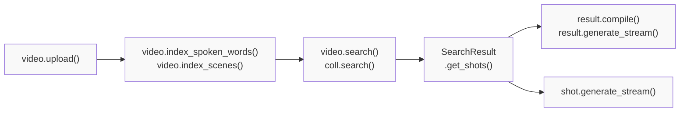
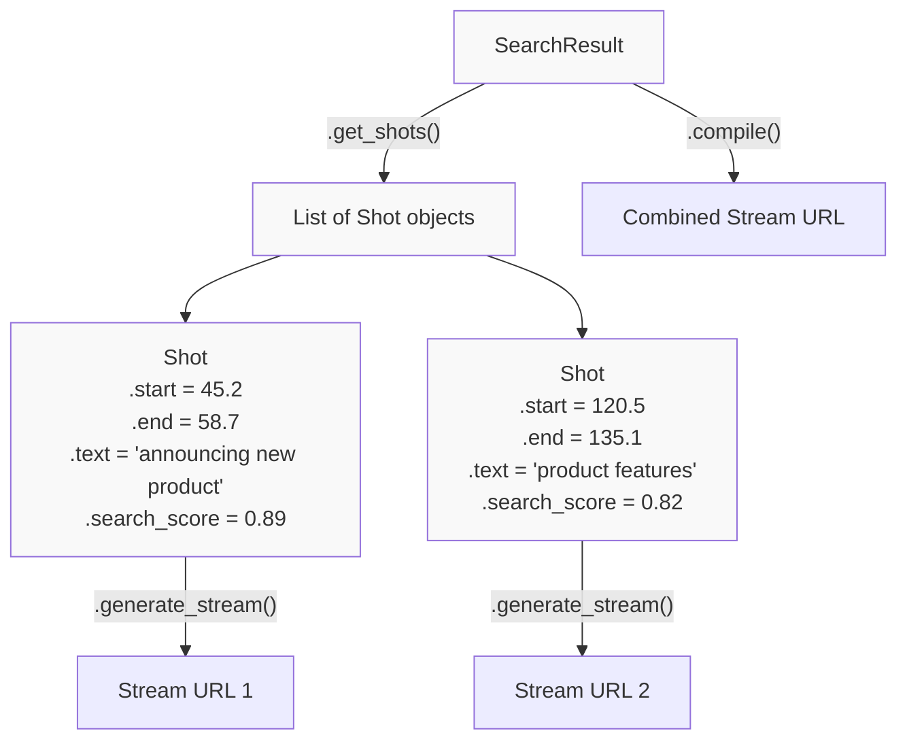
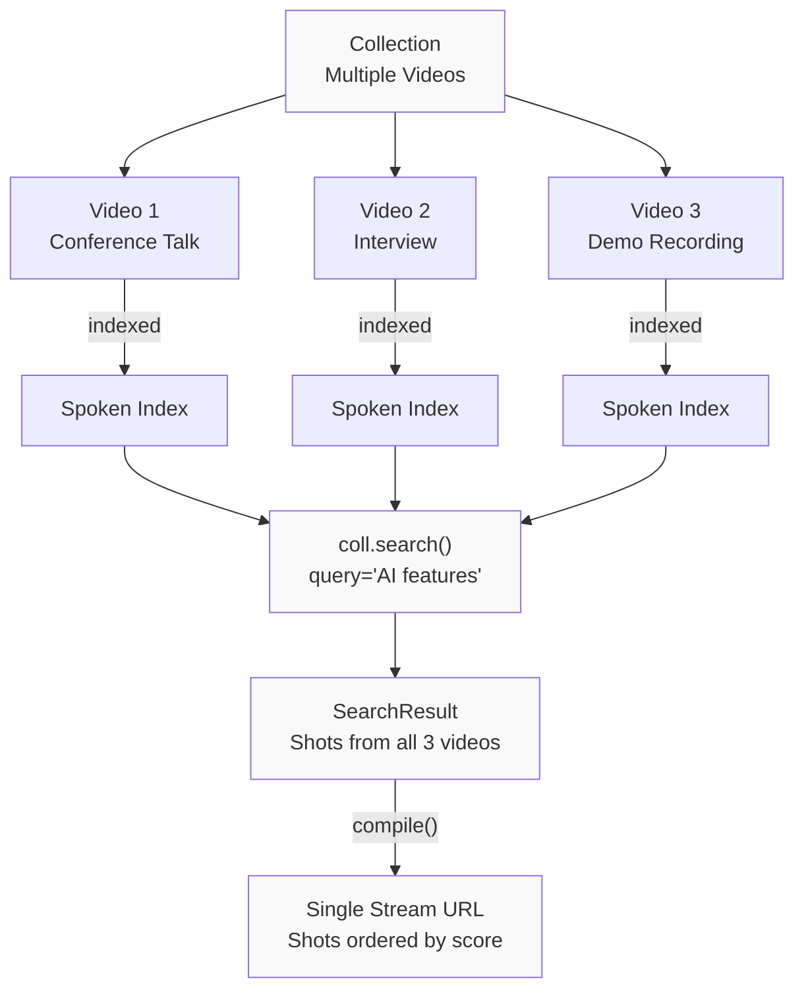

<!-- source: DeepWiki mcp.deepwiki.com · repo video-db/skills · page 12.1 Highlight Reels and Clips · fetched 2026-10-27 -->

# Highlight Reels and Clips

<details>
<summary>Relevant source files</summary>

The following files were used as context for generating this wiki page:

- [python/reference/use-cases.md](python/reference/use-cases.md)

</details>


## Purpose and Scope

This document covers workflows for creating shareable video compilations by searching long-form content and extracting relevant moments. The core pattern is: index video for semantic understanding, search for topics of interest, and compile matching segments into a single stream URL or extract individual clips.

For detailed information about search operations, see [Searching Videos](#6). For timeline-based composition with multiple assets, see [Timeline Editing](#7). For post-capture clip generation from desktop recordings, see [Post-Session Processing](#8.4).

Sources: [python/reference/use-cases.md:7-17]()

---

## Core Workflow

Creating highlight reels follows a four-step process: upload, index, search, and compile. Each step builds on structured metadata to enable precise moment extraction from hours of content.

### Workflow: From Upload to Highlight Reel



**Workflow Steps:**

| Step | Method | Purpose | Output |
|------|--------|---------|--------|
| **Upload** | `collection.upload(url=...)` | Ingest video from URL, YouTube, or file | `Video` object with `.id` |
| **Index** | `video.index_spoken_words()` | Transcribe speech, create searchable index | Index completion status |
| **Index** | `video.index_scenes(prompt=...)` | Analyze visual content with AI | `scene_index_id` string |
| **Search** | `video.search(query=...)` | Find moments matching semantic/keyword query | `SearchResult` object |
| **Compile** | `result.compile()` | Merge all matching shots into single stream | Stream URL string |
| **Extract** | `shot.generate_stream()` | Create individual clip from one shot | Stream URL string |

Sources: [python/reference/use-cases.md:7-17]()

---

## Creating Highlight Reels from Search Results

After indexing, the `search()` method returns a `SearchResult` object containing timestamped `Shot` segments. The `compile()` method merges all shots into a single playable stream.

### Single Video Highlights

Search a single video and compile matching moments:

```python
# Upload and index
video = coll.upload(url="https://example.com/conference-talk.mp4")
video.index_spoken_words()

# Search for topic
result = video.search(query="product announcement")

# Compile all matching shots into one stream
highlight_url = result.compile()
# Returns: https://console.videodb.io/player?url=...

# Access individual shots if needed
shots = result.get_shots()
# Returns: list[Shot] with .start, .end, .text, .search_score
```

### Shot Object Structure

Each `Shot` in the search result represents a timestamped segment:



**Score-Based Filtering:**

Filter shots by relevance score to control compilation quality:

```python
# Get shots above threshold
shots = result.get_shots(score=0.8)

# Compile only high-confidence matches
for shot in shots:
    if shot.search_score > 0.85:
        clip_url = shot.generate_stream()
```

For detailed information on `SearchResult` and `Shot` objects, see [Working with Search Results](#6.2).

Sources: [python/reference/use-cases.md:7-17]()

---

## Extracting Individual Clips

Instead of compiling all shots into one stream, extract each as a separate clip with its own URL. This is useful for creating multiple shareable moments from a single search.

### Per-Shot Clip Generation

```python
result = video.search(query="demo")
shots = result.get_shots()

# Generate individual clip URLs
clips = []
for shot in shots:
    clip_url = shot.generate_stream()
    clips.append({
        'url': clip_url,
        'start': shot.start,
        'end': shot.end,
        'score': shot.search_score
    })

# Each clip is independently playable
# clips[0]['url'] -> stream of first demo mention
# clips[1]['url'] -> stream of second demo mention
```

### Clip Metadata Tracking

Track clip metadata for downstream processing or analytics:

| Field | Source | Purpose |
|-------|--------|---------|
| `start` | `shot.start` | Timestamp in source video (seconds) |
| `end` | `shot.end` | End timestamp in source video |
| `text` | `shot.text` | Transcript excerpt or scene description |
| `search_score` | `shot.search_score` | Relevance score (0.0 - 1.0) |
| `stream_url` | `shot.generate_stream()` | Playable HLS stream |

Sources: [python/reference/use-cases.md:15-17]()

---

## Cross-Collection Highlights

Search across all videos in a collection to create highlight reels from diverse sources. This enables building compilations from conference talks, interviews, or product videos stored in the same collection.

### Cross-Collection Search Workflow



### Implementation Example

```python
# Upload and index multiple videos
video1 = coll.upload(url="https://example.com/talk1.mp4")
video2 = coll.upload(url="https://example.com/talk2.mp4")
video3 = coll.upload(url="https://example.com/interview.mp4")

video1.index_spoken_words()
video2.index_spoken_words()
video3.index_spoken_words()

# Search across all videos in collection
result = coll.search(query="AI features", index_type="spoken_word")

# Compile returns shots from all videos, ordered by relevance
highlight_url = result.compile()

# Access source video for each shot
shots = result.get_shots()
for shot in shots:
    print(f"From {shot.video_id}: {shot.text} (score: {shot.search_score})")
```

**Note:** Cross-collection search only supports `index_type="spoken_word"` (semantic/keyword search of transcripts). Scene-based search requires a specific `scene_index_id` tied to a single video.

For more details on cross-collection search, see [Cross-Collection Search](#6.3).

Sources: [python/reference/use-cases.md:12-14]()

---

## Advanced Compilation with Timeline

When search-based compilation is insufficient (e.g., adding intros, overlays, transitions), use the `Timeline` editor to manually compose clips with full control over asset ordering, timing, and overlays.

### When to Use Timeline vs. Search Compilation

| Requirement | Use `compile()` | Use `Timeline` |
|-------------|----------------|----------------|
| Simple concatenation of search results | ✓ | |
| Auto-ordered by relevance score | ✓ | |
| Custom clip ordering | | ✓ |
| Add intro/outro sequences | | ✓ |
| Overlay text, images, audio | | ✓ |
| Mix multiple asset types | | ✓ |
| Trim shots to custom timestamps | | ✓ |

### Timeline-Based Highlight Reel

```python
from videodb import connect
from videodb.timeline import Timeline, VideoAsset, TextAsset, TextStyle

conn = connect()
timeline = conn.get_timeline()

# Search for moments
result = video.search(query="key insights")
shots = result.get_shots(score=0.85)

# Add intro text
intro = TextAsset(
    text="Key Insights Compilation",
    duration=3,
    style=TextStyle(fontsize=48, x="center", y="center")
)
timeline.add_inline(intro)

# Add each shot as VideoAsset with custom trim
for shot in shots[:5]:  # Top 5 shots only
    clip = VideoAsset(
        asset_id=video.id,
        start=shot.start,
        end=shot.end
    )
    timeline.add_inline(clip)

# Generate final stream
final_url = timeline.generate_stream()
```

For complete timeline capabilities, see [Timeline Editing](#7) and [Asset Types](#7.2).

Sources: [python/reference/use-cases.md:110-119]()

---

## Workflow Patterns

Common highlight reel patterns and their implementation approaches:

| Goal | Steps | Key Methods |
|------|-------|-------------|
| **Conference talk highlights** | Upload → Index spoken → Search topics → Compile | `upload()`, `index_spoken_words()`, `search()`, `compile()` |
| **Product demo moments** | Upload → Index scenes → Scene search → Extract clips | `upload()`, `index_scenes()`, `search(type=scene)`, `generate_stream()` |
| **Best-of compilation** | Upload multiple → Index all → Collection search → Compile | `upload()` x N, `index_spoken_words()`, `coll.search()`, `compile()` |
| **Custom-ordered highlights** | Search → Get shots → Timeline composition | `search()`, `get_shots()`, `Timeline.add_inline()`, `generate_stream()` |
| **Searchable clip library** | Upload → Index → Search → Individual clips | `upload()`, `index_spoken_words()`, `search()`, `shot.generate_stream()` |
| **Topic-based chapters** | Search multiple queries → Compile each separately | `search(query1)`, `search(query2)`, `compile()` x N |

### Example: Multi-Topic Highlight Reel

```python
topics = ["product announcement", "Q&A session", "demo"]
chapters = {}

for topic in topics:
    result = video.search(query=topic)
    # Compile each topic into separate chapter
    chapters[topic] = result.compile()

# Or combine all topics into one timeline
timeline = conn.get_timeline()
for topic in topics:
    result = video.search(query=topic)
    shots = result.get_shots(score=0.8)
    for shot in shots:
        timeline.add_inline(VideoAsset(
            asset_id=video.id,
            start=shot.start,
            end=shot.end
        ))

all_highlights_url = timeline.generate_stream()
```

Sources: [python/reference/use-cases.md:7-17](), [python/reference/use-cases.md:110-119]()

---

## Search Type Comparison for Highlights

Different search types yield different highlight characteristics:

| Search Type | Index Required | Best For | Compilation Behavior |
|-------------|---------------|----------|---------------------|
| **Semantic** | `index_spoken_words()` | Natural language queries, concept matching | Shots ordered by AI relevance score |
| **Keyword** | `index_spoken_words()` | Exact phrase matching, names, technical terms | Shots in chronological order |
| **Scene** | `index_scenes(prompt=...)` | Visual content queries, object detection | Shots ordered by visual relevance score |

### Choosing Search Strategy

```python
# Semantic: broad concept matching
result = video.search(query="discussion about budget constraints")
# Returns: shots where cost, money, budget are discussed

# Keyword: exact phrase
result = video.search(query="Q4 revenue", search_type="keyword")
# Returns: only shots with exact phrase "Q4 revenue"

# Scene: visual content
scene_id = video.index_scenes(prompt="Identify product demonstrations")
result = video.search(
    query="close-up of product features",
    search_type="scene",
    scene_index_id=scene_id
)
# Returns: shots with visual product demos
```

For detailed search type documentation, see [Search Types](#6.1).

Sources: [python/reference/use-cases.md:7-17]()

---

## Performance Considerations

### Indexing Cost

- **Spoken word indexing**: One-time cost, required before any search
- **Scene indexing**: Optional, only needed for visual search
- Indexes persist across searches—index once, search many times

### Compilation Speed

- `compile()` returns instantly—no rendering required
- Streams are assembled on-demand during playback
- Multiple searches on same video reuse existing indexes

### Best Practices

1. **Index immediately after upload** for interactive workflows
2. **Filter shots by score** to reduce compilation length
3. **Use keyword search** for faster, exact-match queries
4. **Reuse indexes** across multiple search queries
5. **Batch upload and index** multiple videos for collection search

Sources: [python/reference/use-cases.md:110-119]()

---

