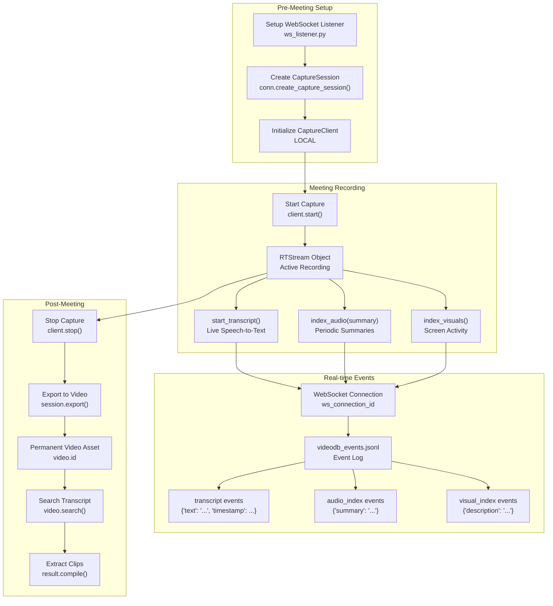
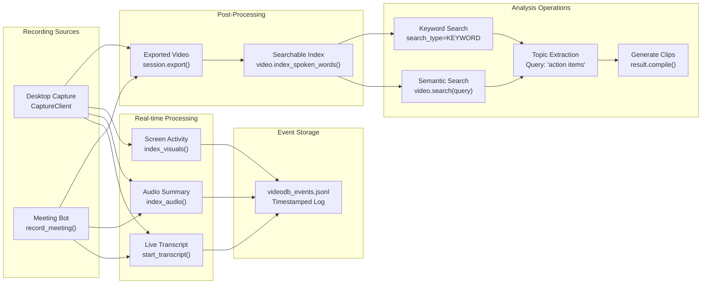
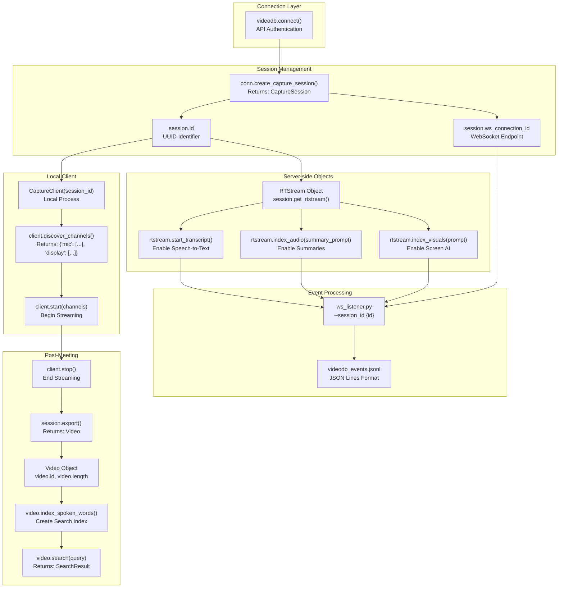

<!-- source: DeepWiki mcp.deepwiki.com · repo video-db/skills · page 12.3 Meeting Recording and Analysis · fetched 2026-10-27 -->

# Meeting Recording and Analysis

<details>
<summary>Relevant source files</summary>

The following files were used as context for generating this wiki page:

- [python/reference/use-cases.md](python/reference/use-cases.md)

</details>


## Purpose and Scope

This document covers using VideoDB to record meetings with real-time AI processing and post-meeting analysis capabilities. The system supports recording meetings through desktop capture (screen and audio) or meeting bot integration (Zoom, Teams, Google Meet), with live transcription, summarization, and searchable archives.

For detailed desktop capture setup and configuration, see [Desktop Capture](#8). For comprehensive search capabilities, see [Searching Videos](#6). For creating meeting highlight compilations, see [Timeline Editing](#7).

---

## Meeting Recording Approaches

VideoDB provides two methods for recording meetings:

### Desktop Capture

Local recording of screen activity, microphone input, and system audio using `CaptureSession` and `CaptureClient`. The user's machine streams content to VideoDB's infrastructure where AI pipelines process it in real-time.

**Use cases:**
- Recording meetings where you are a participant
- Capturing screen shares and presentations
- Recording local audio conferences
- Tutorial and demo recording

### Meeting Bot Integration

Programmatic meeting bots that join Zoom, Teams, or Google Meet calls as participants to record all attendees. The bot captures audio and video streams directly from the meeting platform.

**Use cases:**
- Recording meetings without requiring individual participants to capture
- Centralized recording for compliance or archival
- Capturing meetings across different platforms consistently
- Recording meetings when the organizer is not present

**API Method:** `Connection.record_meeting(platform, meeting_url)` creates a bot that joins the specified meeting.

Sources: [python/reference/use-cases.md:39-61]()

---

## Meeting Recording Workflow



**Workflow Stages:**

| Stage | Description | Code Entities |
|-------|-------------|---------------|
| **Setup** | Start WebSocket listener to capture events, create session | `ws_listener.py`, `Connection.create_capture_session()` |
| **Initialize** | Create local client, discover channels (mic/display) | `CaptureClient(session_id, use_ws_listener=True)` |
| **Record** | Start streaming, enable AI pipelines | `client.start()`, `RTStream.start_transcript()`, `RTStream.index_audio()` |
| **Monitor** | Receive real-time events in JSONL log | `videodb_events.jsonl`, WebSocket events |
| **Finalize** | Stop capture, export to permanent video | `client.stop()`, `CaptureSession.export()` |
| **Analyze** | Search transcript, extract highlights | `Video.search()`, `SearchResult.compile()` |

Sources: [python/reference/use-cases.md:39-61]()

---

## Live Meeting Analysis

During an active recording session, AI pipelines process content in real-time and deliver results via WebSocket events.

### Real-time Transcription

```python
# Enable live transcription
rtstream = session.get_rtstream()
rtstream.start_transcript()
```

**Output:** `transcript` events containing timestamped speech-to-text:
```json
{
  "type": "transcript",
  "timestamp": "2024-01-15T10:23:45.123Z",
  "data": {
    "text": "Let's discuss the Q4 budget allocations",
    "start_time": 145.2,
    "end_time": 148.7
  }
}
```

### Audio Summarization

```python
# Generate periodic summaries every 60 seconds
rtstream.index_audio(
    summary_prompt="Summarize key discussion points, decisions, and action items"
)
```

**Output:** `audio_index` events with AI-generated summaries:
```json
{
  "type": "audio_index",
  "timestamp": "2024-01-15T10:24:00.000Z",
  "data": {
    "summary": "Team discussed Q4 budget. Decisions: Increase marketing spend by 15%, reallocate engineering resources. Action items: Sarah to prepare detailed breakdown by Friday.",
    "start_time": 60.0,
    "end_time": 120.0
  }
}
```

**Configuration Parameters:**

| Parameter | Purpose | Default |
|-----------|---------|---------|
| `summary_prompt` | Customize summary focus | Generic summary |
| `summary_batch_size` | Seconds of audio per summary | 60 |
| `profanity_filter` | Detect inappropriate language | False |

### Screen Activity Tracking

```python
# Track what's visible on screen
rtstream.index_visuals(
    prompt="Describe what application is visible and what the user is doing"
)
```

**Output:** `visual_index` events describing screen content:
```json
{
  "type": "visual_index",
  "timestamp": "2024-01-15T10:25:10.500Z",
  "data": {
    "description": "User is viewing a PowerPoint presentation titled 'Q4 Financial Review' showing a bar chart of revenue by region",
    "start_time": 180.5,
    "end_time": 185.5
  }
}
```

Sources: [python/reference/use-cases.md:41-53]()

---

## Meeting Analysis Capabilities



**Analysis Workflow:**

1. **During Meeting:** Real-time AI generates transcripts, summaries, and screen descriptions
2. **Event Log:** All events written to `videodb_events.jsonl` with precise timestamps
3. **Export:** Meeting recording becomes permanent `Video` object with unique ID
4. **Indexing:** Video automatically indexed for spoken word search
5. **Query:** Search for specific topics, keywords, or moments
6. **Extract:** Create highlight clips from matching segments

Sources: [python/reference/use-cases.md:46-61]()

---

## Post-Meeting Processing

After stopping a capture session, the recording is exported as a permanent video asset that can be searched, clipped, and shared.

### Exporting the Recording

```python
# Stop capture
client.stop()

# Export to permanent video
video = session.export()
print(f"Meeting recorded: {video.id}")
print(f"Duration: {video.length} seconds")
```

The exported `Video` object contains the complete meeting recording and can be processed like any other video asset.

### Creating Searchable Archives

```python
# Index the meeting for search
video.index_spoken_words()

# Search for specific topics
result = video.search("budget discussion", search_type=SearchType.SEMANTIC)
shots = result.get_shots()

for shot in shots:
    print(f"Found at {shot.start}s - {shot.end}s (score: {shot.search_score})")
```

### Generating Meeting Highlights

Create compilation videos of key moments:

```python
# Search for multiple topics
action_items = video.search("action items")
decisions = video.search("decisions made")
questions = video.search("questions asked")

# Compile all matching segments
highlight_url = action_items.compile()  # Single topic
```

Or use `Timeline` for custom highlight reels:

```python
from videodb import Timeline, VideoAsset

timeline = conn.create_timeline()

# Add intro
intro = coll.generate_image("Meeting Highlights: Q4 Planning")
timeline.add_overlay(start=0, asset=ImageAsset(image=intro, duration=3))

# Add action items
for shot in action_items.get_shots()[:5]:  # Top 5 matches
    timeline.add_inline(VideoAsset(video=video, start=shot.start, end=shot.end))

# Generate final highlight reel
stream_url = timeline.generate_stream()
```

Sources: [python/reference/use-cases.md:56-61]()

---

## Meeting Recording Code Flow



**Key Code Entities:**

| Entity | Type | Purpose |
|--------|------|---------|
| `Connection.create_capture_session()` | Factory method | Creates server-side session |
| `CaptureSession` | Object | Manages session lifecycle |
| `CaptureSession.id` | Property | Unique session identifier |
| `CaptureSession.ws_connection_id` | Property | WebSocket endpoint ID |
| `CaptureClient(session_id)` | Constructor | Local capture process |
| `CaptureClient.discover_channels()` | Method | List available mic/display |
| `CaptureClient.start(channels)` | Method | Begin streaming |
| `CaptureSession.get_rtstream()` | Method | Get RTStream object |
| `RTStream.start_transcript()` | Method | Enable transcription |
| `RTStream.index_audio(summary_prompt)` | Method | Enable summaries |
| `RTStream.index_visuals(prompt)` | Method | Enable screen AI |
| `CaptureClient.stop()` | Method | End streaming |
| `CaptureSession.export()` | Method | Convert to Video |
| `Video.index_spoken_words()` | Method | Create search index |
| `Video.search(query)` | Method | Query transcript |

Sources: [python/reference/use-cases.md:39-61]()

---

## Common Meeting Analysis Patterns

### Pattern 1: Action Item Extraction

```python
# After meeting export
video = session.export()
video.index_spoken_words()

# Search for action items
result = video.search("action items and tasks assigned", search_type=SearchType.SEMANTIC)

# Get matching segments
for shot in result.get_shots():
    transcript = video.get_transcript(start=shot.start, end=shot.end)
    print(f"\nAction Item ({shot.start}s):")
    print(transcript.text)
```

### Pattern 2: Decision Point Highlights

```python
# Find all decision moments
decisions = video.search("decision made or agreement reached")

# Create compilation
decision_reel = decisions.compile()
print(f"Decision highlights: {decision_reel}")
```

### Pattern 3: Meeting Minutes Generation

```python
from videodb import TextGenerationTier

# Generate structured summary using video context
minutes = coll.generate_text(
    prompt="Create meeting minutes with: attendees, topics discussed, decisions made, and action items",
    tier=TextGenerationTier.LARGE,
    response_type="structured",
    video_context=[video]
)

print(minutes)
```

### Pattern 4: Q&A Segment Extraction

```python
# Find question and answer exchanges
qa_segments = video.search("question asked and answer given")

# Extract each Q&A as separate clip
for i, shot in enumerate(qa_segments.get_shots()[:10]):
    clip_url = video.generate_stream(
        timeline=[(shot.start, shot.end)],
        name=f"QA_{i+1}"
    )
    print(f"Q&A {i+1}: {clip_url}")
```

Sources: [python/reference/use-cases.md:46-61]()

---

## Meeting Bot Integration

For recording meetings without desktop capture:

```python
# Join Zoom meeting as bot
meeting_session = conn.record_meeting(
    platform="zoom",
    meeting_url="https://zoom.us/j/1234567890"
)

# Bot joins meeting automatically
# Recording begins when bot enters

# Check status
status = meeting_session.get_status()
print(f"Bot status: {status}")

# After meeting ends, export recording
video = meeting_session.export()
```

**Supported Platforms:**
- Zoom
- Microsoft Teams
- Google Meet

**Bot Capabilities:**
- Records all participants' audio and video
- Appears as "VideoDB Bot" in participant list
- Can be configured with custom name
- Transcription and AI processing enabled by default

**Limitations:**
- Meeting host must allow bots/recording
- Bot name appears in participant list
- Some platforms require paid accounts for bot access

Sources: [python/reference/use-cases.md:46-48]()

---

## Summary

Meeting recording and analysis with VideoDB enables:

| Capability | Implementation | Output |
|------------|----------------|--------|
| **Live Recording** | `CaptureClient` or `record_meeting()` | Streaming capture |
| **Real-time Transcript** | `RTStream.start_transcript()` | JSON events with text + timestamps |
| **Meeting Summaries** | `RTStream.index_audio(summary_prompt)` | Periodic AI summaries |
| **Screen Activity** | `RTStream.index_visuals()` | AI descriptions of display |
| **Searchable Archive** | `Video.index_spoken_words()` + `search()` | Semantic/keyword search |
| **Highlight Clips** | `SearchResult.compile()` or `Timeline` | Compiled video segments |
| **Meeting Minutes** | `Collection.generate_text()` with video context | Structured text summary |

The system supports both active monitoring (real-time events) and retrospective analysis (post-meeting search and clipping), with all processing happening server-side for instant availability.

For complete desktop capture setup including WebSocket listener configuration, see [Desktop Capture](#8). For advanced search techniques, see [Searching Videos](#6). For creating custom meeting highlight compilations, see [Timeline Editing](#7).

Sources: [python/reference/use-cases.md:39-61]()

---

