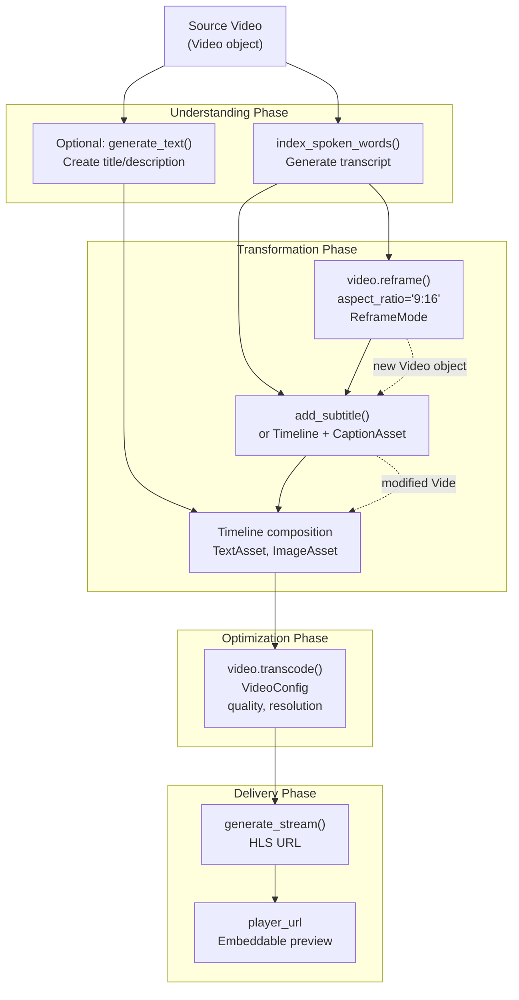
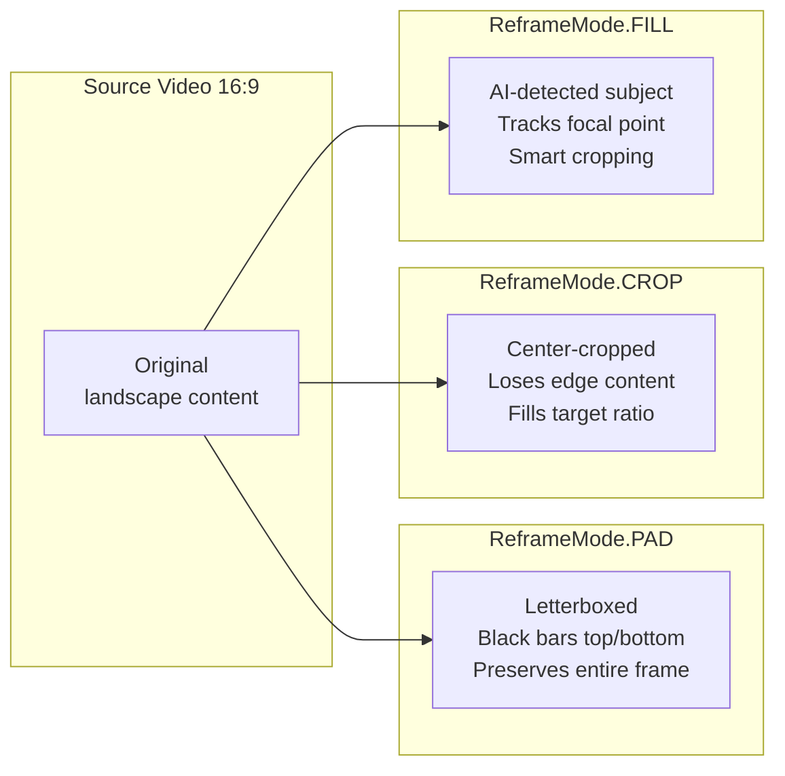
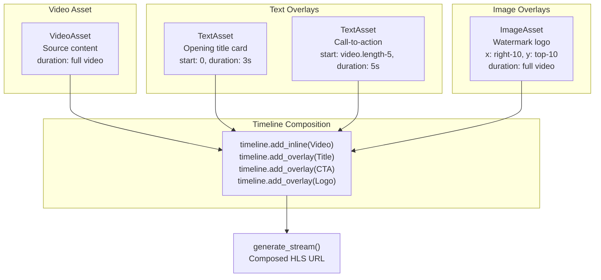
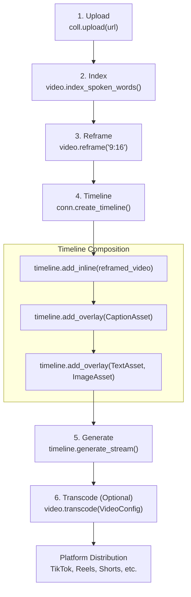

<!-- source: DeepWiki mcp.deepwiki.com · repo video-db/skills · page 12.5 Social Media Publishing · fetched 2026-10-27 -->

# Social Media Publishing

<details>
<summary>Relevant source files</summary>

The following files were used as context for generating this wiki page:

- [python/reference/use-cases.md](python/reference/use-cases.md)

</details>


This document describes workflows for preparing video content for social media platforms using VideoDB's reframing, subtitle overlay, composition, and transcoding capabilities. Social media publishing requires adapting content to platform-specific constraints: aspect ratios (vertical, square, landscape), subtitle styling, quality optimization, and visual branding.

For detailed information on aspect ratio conversion, see [Reframing](#10.2). For subtitle generation and styling, see [Subtitles and Captions](#7.3). For video composition with overlays, see [Timeline Editing](#7). For format optimization, see [Transcoding](#10.1).

---

## Purpose and Scope

Social media publishing workflows transform existing video content for distribution across multiple platforms with different technical requirements. This involves:

- **Aspect ratio conversion** - Reframing videos from source format (e.g., 16:9 landscape) to platform targets (9:16 vertical, 1:1 square)
- **Subtitle overlays** - Adding auto-generated captions with platform-appropriate styling
- **Visual branding** - Overlaying text (titles, CTAs) and images (logos, watermarks)
- **Quality optimization** - Transcoding to meet platform file size and bitrate limits
- **Batch processing** - Applying consistent transformations across content libraries

All operations produce streaming URLs for immediate preview or download, with no local rendering required.

**Sources:** [python/reference/use-cases.md:94-104]()

---

## Social Media Publishing Workflow



**Diagram: Social Media Publishing Pipeline**

The workflow transforms a source `Video` object through sequential operations:

1. **Understanding** - `index_spoken_words()` generates transcript for subtitles; optionally `generate_text()` creates promotional text
2. **Transformation** - `reframe()` converts aspect ratio; `add_subtitle()` or `Timeline` adds captions; `Timeline` composition overlays branding
3. **Optimization** - `transcode()` adjusts quality/resolution for platform limits
4. **Delivery** - `generate_stream()` produces HLS URLs; `.player_url` provides embeddable preview

Each transformation creates a new `Video` object (reframe/transcode) or returns a stream URL (Timeline), enabling non-destructive workflow branches.

**Sources:** [python/reference/use-cases.md:94-104]()

---

## Platform-Specific Requirements

| Platform | Aspect Ratio | Resolution | Max Duration | Subtitle Position | Key Features |
|----------|-------------|-----------|--------------|-------------------|--------------|
| **TikTok** | 9:16 (vertical) | 1080x1920 | 10 min | Bottom-center, avoid bottom 20% | Bold text, high contrast |
| **Instagram Reels** | 9:16 (vertical) | 1080x1920 | 90 sec | Bottom-center | Text overlays in safe zone |
| **Instagram Feed** | 1:1 (square) or 4:5 | 1080x1080 or 1080x1350 | 60 sec | Center, avoid edges | Captions optional |
| **YouTube Shorts** | 9:16 (vertical) | 1080x1920 | 60 sec | Bottom-center | Minimal text clutter |
| **YouTube Standard** | 16:9 (landscape) | 1920x1080 | Unlimited | Bottom-center | Standard subtitle format |
| **Twitter/X** | 16:9 or 1:1 | 1280x720 or 720x720 | 2 min 20 sec | Bottom-center | Captions strongly recommended |
| **LinkedIn** | 1:1 (square) or 16:9 | 1080x1080 or 1920x1080 | 10 min | Bottom-center | Professional styling |

**Sources:** [python/reference/use-cases.md:94-98]()

---

## Aspect Ratio Conversion with Reframing

### Basic Reframing Operation

The `video.reframe()` method converts video aspect ratios for platform targets. It returns a new `Video` object with the transformed content:

```python
# Reframe landscape video to vertical for TikTok/Reels
vertical_video = video.reframe(aspect_ratio="9:16")

# Reframe to square for Instagram feed
square_video = video.reframe(aspect_ratio="1:1")

# Reframe to landscape for YouTube
landscape_video = video.reframe(aspect_ratio="16:9")
```

### ReframeMode Options



**Diagram: Reframing Strategies**

- **`ReframeMode.PAD`** - Adds letterboxing (black bars) to preserve entire frame, resulting in smaller content area
- **`ReframeMode.CROP`** - Center-crops source to fill target aspect ratio, losing edge content but maximizing screen usage
- **`ReframeMode.FILL`** - AI-powered subject tracking that intelligently crops to keep focal points visible (default, recommended)

```python
from videodb import ReframeMode

# Smart crop with subject tracking (default)
video.reframe(aspect_ratio="9:16", reframe_mode=ReframeMode.FILL)

# Center crop (predictable but may lose important content)
video.reframe(aspect_ratio="9:16", reframe_mode=ReframeMode.CROP)

# Letterbox (preserves everything but wastes screen space)
video.reframe(aspect_ratio="9:16", reframe_mode=ReframeMode.PAD)
```

Reframing is asynchronous and computationally intensive. For details on callbacks and performance, see [Reframing](#10.2).

**Sources:** [python/reference/use-cases.md:94-98]()

---

## Subtitle Overlays for Accessibility

Social media platforms prioritize accessibility and autoplay-friendly content. Subtitles are essential because most users watch videos on mute.

### Method 1: Simple Subtitle Overlay

The `add_subtitle()` method generates auto-styled subtitles directly on the video:

```python
# Index spoken words first
video.index_spoken_words()

# Add subtitles with default styling
subtitled_video = video.add_subtitle()
```

This returns a new `Video` object with burned-in subtitles. The styling is platform-generic: white text, black background, bottom-center position.

### Method 2: Custom Subtitle Styling via Timeline

For platform-specific styling (e.g., TikTok's bold text, Instagram's safe zones), use the `Timeline` editor with `TextStyle`:

```python
from videodb import Connection, TextStyle

conn = Connection(api_key="your_api_key")
timeline = conn.create_timeline()

# Add video as inline asset
timeline.add_inline(asset=video)

# Get transcript for timing
transcript = video.get_transcript()

# Create styled captions for each transcript segment
for segment in transcript.segments:
    caption_style = TextStyle(
        font="Inter",
        font_size=24,
        font_color="#FFFFFF",
        background_color="#000000",
        background_alpha=0.8,
        align="center",
        y_align="bottom"
    )
    
    timeline.add_overlay(
        start=segment.start,
        asset=TextAsset(
            text=segment.text,
            duration=segment.end - segment.start,
            style=caption_style
        )
    )

# Generate stream with custom-styled subtitles
stream_url = timeline.generate_stream()
```

For complete subtitle styling options and the Editor API for advanced caption workflows, see [Subtitles and Captions](#7.3).

**Sources:** [python/reference/use-cases.md:22-34]()

---

## Text and Image Overlays for Branding

Social media content often requires visual branding: titles, CTAs (calls-to-action), logos, and watermarks. The `Timeline` editor handles overlay composition.



**Diagram: Multi-Layer Overlay Composition**

### Example: Social Media Post with Branding

```python
from videodb import Connection, TextAsset, ImageAsset, TextStyle

conn = Connection(api_key="your_api_key")
coll = conn.get_collection()

# Upload or generate logo image
logo_image = coll.upload(url="https://example.com/logo.png")

# Create timeline
timeline = conn.create_timeline()

# Add reframed video as base
vertical_video = video.reframe(aspect_ratio="9:16")
timeline.add_inline(asset=vertical_video)

# Add opening title (first 3 seconds)
title_style = TextStyle(
    font="Poppins",
    font_size=48,
    font_color="#FFFFFF",
    align="center",
    y_align="center"
)
timeline.add_overlay(
    start=0,
    asset=TextAsset(
        text="Top 5 Tips for Productivity",
        duration=3,
        style=title_style
    )
)

# Add call-to-action (last 5 seconds)
cta_style = TextStyle(
    font="Inter",
    font_size=36,
    font_color="#FFD700",
    align="center",
    y_align="bottom"
)
video_length = vertical_video.length
timeline.add_overlay(
    start=video_length - 5,
    asset=TextAsset(
        text="Follow for more tips! 👉",
        duration=5,
        style=cta_style
    )
)

# Add persistent logo watermark (entire video duration)
timeline.add_overlay(
    start=0,
    asset=ImageAsset(
        asset=logo_image,
        duration=video_length,
        x="right-20",  # 20px from right edge
        y="top-20"     # 20px from top edge
    )
)

# Generate final composed stream
final_stream = timeline.generate_stream()
print(f"Social media ready URL: {final_stream}")
```

For detailed overlay positioning, asset types, and Timeline API, see [Timeline Editing](#7) and [Asset Types](#7.2).

**Sources:** [python/reference/use-cases.md:22-34]()

---

## Complete Publishing Workflow Example



**Diagram: End-to-End Publishing Workflow with Code Entities**

### Full Code Example: TikTok/Reels Publishing

```python
from videodb import connect, TextAsset, ImageAsset, TextStyle, VideoConfig, ReframeMode

# 1. Connect and upload source video
conn = connect(api_key="your_api_key")
coll = conn.get_collection()
source_video = coll.upload(url="https://example.com/landscape_video.mp4")

# 2. Index for subtitles
source_video.index_spoken_words()

# 3. Reframe to vertical (9:16) for TikTok/Reels
vertical_video = source_video.reframe(
    aspect_ratio="9:16",
    reframe_mode=ReframeMode.FILL  # AI subject tracking
)

# 4. Create timeline composition
timeline = conn.create_timeline()
timeline.add_inline(asset=vertical_video)

# 5. Add auto-generated subtitles with TikTok-style formatting
transcript = vertical_video.get_transcript()
subtitle_style = TextStyle(
    font="Poppins",
    font_size=32,
    font_color="#FFFFFF",
    background_color="#000000",
    background_alpha=0.7,
    align="center",
    y_align="bottom"
)

for segment in transcript.segments:
    timeline.add_overlay(
        start=segment.start,
        asset=TextAsset(
            text=segment.text.upper(),  # TikTok often uses uppercase
            duration=segment.end - segment.start,
            style=subtitle_style
        )
    )

# 6. Add logo watermark
logo = coll.upload(url="https://example.com/logo.png")
timeline.add_overlay(
    start=0,
    asset=ImageAsset(
        asset=logo,
        duration=vertical_video.length,
        x="right-15",
        y="top-15"
    )
)

# 7. Generate stream
social_stream = timeline.generate_stream()

# 8. Optional: Transcode for file size optimization
optimized_video = coll.upload(url=social_stream)
final_video = optimized_video.transcode(
    video_config=VideoConfig(
        resolution="1080x1920",  # Full HD vertical
        quality="high",
        bitrate="4M"
    )
)

print(f"Final TikTok-ready stream: {final_video.stream_url}")
print(f"Preview in player: {final_video.player_url}")
```

**Sources:** [python/reference/use-cases.md:94-104]()

---

## Platform-Specific Optimization Strategies

### TikTok and Instagram Reels

- **Aspect Ratio**: 9:16 vertical
- **Resolution**: 1080x1920 (full HD)
- **Subtitles**: Bold, uppercase text with high contrast. Position bottom-center, above 20% from bottom edge to avoid UI elements
- **Duration**: Keep under 60 seconds for maximum reach
- **File Size**: Under 30MB for upload reliability

```python
# TikTok/Reels optimization
tiktok_video = video.reframe(aspect_ratio="9:16", reframe_mode=ReframeMode.FILL)
tiktok_optimized = tiktok_video.transcode(
    video_config=VideoConfig(
        resolution="1080x1920",
        quality="high",
        bitrate="4M"
    )
)
```

### Instagram Feed Posts

- **Aspect Ratio**: 1:1 square or 4:5 portrait
- **Resolution**: 1080x1080 or 1080x1350
- **Subtitles**: Optional, but recommended for accessibility
- **Duration**: 60 seconds maximum
- **File Size**: Under 15MB

```python
# Instagram feed optimization
insta_square = video.reframe(aspect_ratio="1:1", reframe_mode=ReframeMode.FILL)
insta_optimized = insta_square.transcode(
    video_config=VideoConfig(
        resolution="1080x1080",
        quality="medium",
        bitrate="3M"
    )
)
```

### YouTube Standard and Shorts

- **YouTube Standard**: 16:9 landscape, 1920x1080, unlimited duration
- **YouTube Shorts**: 9:16 vertical, 1080x1920, under 60 seconds
- **Subtitles**: Standard SRT-style captions, bottom-center
- **File Size**: More flexible (up to 128GB), but optimize for faster upload

```python
# YouTube Shorts
shorts_video = video.reframe(aspect_ratio="9:16", reframe_mode=ReframeMode.FILL)

# YouTube Standard (if source is already landscape, may not need reframe)
# Just add subtitles and optimize
youtube_video = video.add_subtitle()
youtube_optimized = youtube_video.transcode(
    video_config=VideoConfig(
        resolution="1920x1080",
        quality="high",
        bitrate="8M"
    )
)
```

### LinkedIn

- **Aspect Ratio**: 1:1 square or 16:9 landscape
- **Resolution**: 1080x1080 or 1920x1080
- **Subtitles**: Professional styling, avoid flashy colors
- **Duration**: Up to 10 minutes
- **Tone**: Professional branding with minimal overlays

```python
# LinkedIn optimization (square)
linkedin_video = video.reframe(aspect_ratio="1:1", reframe_mode=ReframeMode.FILL)
linkedin_video = linkedin_video.add_subtitle()  # Professional subtitle styling
```

**Sources:** [python/reference/use-cases.md:94-104]()

---

## Batch Processing for Multi-Platform Distribution

For content creators publishing to multiple platforms simultaneously, VideoDB supports batch operations through the collection API:

```python
# Source video
source_video = coll.upload(url="https://example.com/source.mp4")
source_video.index_spoken_words()

# Define platform configurations
platforms = {
    "tiktok": {"aspect_ratio": "9:16", "resolution": "1080x1920"},
    "instagram_feed": {"aspect_ratio": "1:1", "resolution": "1080x1080"},
    "youtube": {"aspect_ratio": "16:9", "resolution": "1920x1080"},
}

# Process for each platform
outputs = {}
for platform, config in platforms.items():
    # Reframe
    reframed = source_video.reframe(aspect_ratio=config["aspect_ratio"])
    
    # Add subtitles
    subtitled = reframed.add_subtitle()
    
    # Transcode with platform-specific settings
    optimized = subtitled.transcode(
        video_config=VideoConfig(
            resolution=config["resolution"],
            quality="high"
        )
    )
    
    outputs[platform] = {
        "stream_url": optimized.stream_url,
        "player_url": optimized.player_url
    }

# Results ready for distribution
print(outputs["tiktok"]["stream_url"])  # Ready for TikTok
print(outputs["instagram_feed"]["stream_url"])  # Ready for Instagram
print(outputs["youtube"]["stream_url"])  # Ready for YouTube
```

Each transformation is non-destructive, allowing parallel processing of the same source content.

**Sources:** [python/reference/use-cases.md:94-104]()

---

## Automatic Content Tagging and Descriptions

Social media platforms require metadata (titles, descriptions, hashtags) for discovery. VideoDB's `generate_text()` can create platform-optimized content:

```python
# Generate platform-specific description
video.index_spoken_words()  # Required for context

# TikTok/Reels description with hashtags
tiktok_description = coll.generate_text(
    prompt="Create a TikTok description with trending hashtags for this video about productivity tips. Keep it under 150 characters.",
    video=video
)

# YouTube description (longer format)
youtube_description = coll.generate_text(
    prompt="Write a YouTube video description with timestamps for key sections. Include SEO keywords.",
    video=video
)

# LinkedIn professional summary
linkedin_description = coll.generate_text(
    prompt="Create a professional LinkedIn post description highlighting business value. No emojis.",
    video=video
)
```

For details on text generation with video context, see [Text and LLM](#11.3).

**Sources:** [python/reference/use-cases.md:22-34]()

---

## Common Pitfalls and Best Practices

### Subtitle Positioning Safe Zones

Different platforms have UI elements (buttons, progress bars, profile info) that can obscure subtitles:

- **TikTok**: Avoid bottom 20% (follow/like buttons) and top 15% (video metadata)
- **Instagram Reels**: Avoid bottom 25% (action buttons) and top 10% (username)
- **YouTube Shorts**: Avoid bottom 15% (comments icon) and top 10% (back button)

Use `TextStyle.y_align="bottom"` with margin to position subtitles safely above UI elements.

### Reframing with Subject Tracking

`ReframeMode.FILL` uses AI to track subjects, but it may fail with:
- **Multiple focal points** - If two subjects are at opposite edges, one will be cropped
- **Text-heavy content** - Important on-screen text may be cropped
- **Static scenes** - Subject detection may default to center-crop

For content with critical edge information, use `ReframeMode.PAD` (letterboxing) or manually compose with `Timeline`.

### Transcoding Performance

Transcoding is computationally expensive. For batch operations:
- Use asynchronous callbacks (see [Transcoding](#10.1))
- Process lower-priority platforms (e.g., LinkedIn) after high-priority ones (TikTok, Instagram)
- Consider skipping transcode if resolution already matches target

### File Size Limits

Platforms have upload size limits. If `transcode()` output exceeds limits:
- Reduce `bitrate` in `VideoConfig` (e.g., from "8M" to "4M")
- Lower `quality` from "high" to "medium"
- Reduce `resolution` if acceptable for platform

**Sources:** [python/reference/use-cases.md:94-104]()

---

## Summary

Social media publishing with VideoDB involves:

1. **Reframe** source video to platform aspect ratios using `video.reframe()`
2. **Add subtitles** via `add_subtitle()` or custom-styled captions via `Timeline`
3. **Overlay branding** with `TextAsset` and `ImageAsset` in `Timeline` composition
4. **Optimize delivery** with `transcode()` for resolution/quality/bitrate constraints
5. **Batch process** for multi-platform distribution from single source

All operations produce streaming URLs for immediate preview or download, enabling rapid content adaptation without local video rendering infrastructure.

**Sources:** [python/reference/use-cases.md:94-119]()

---

