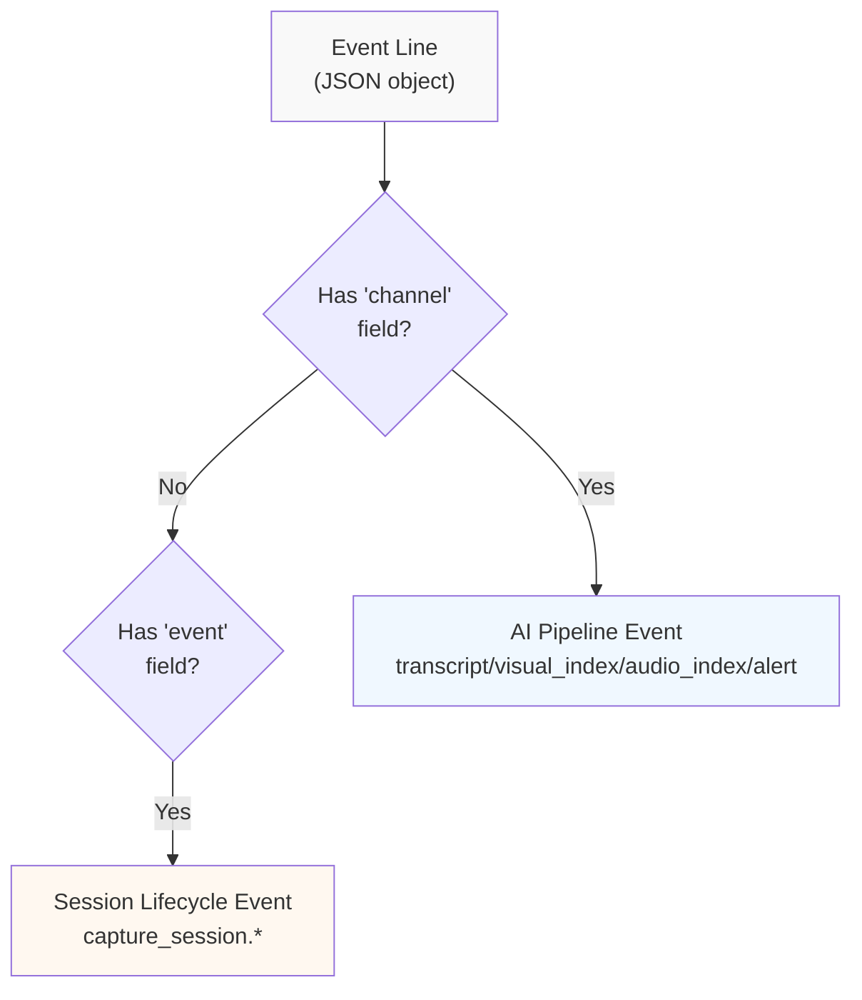
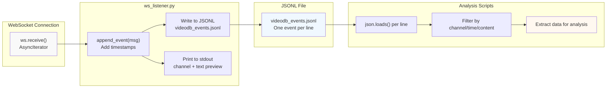
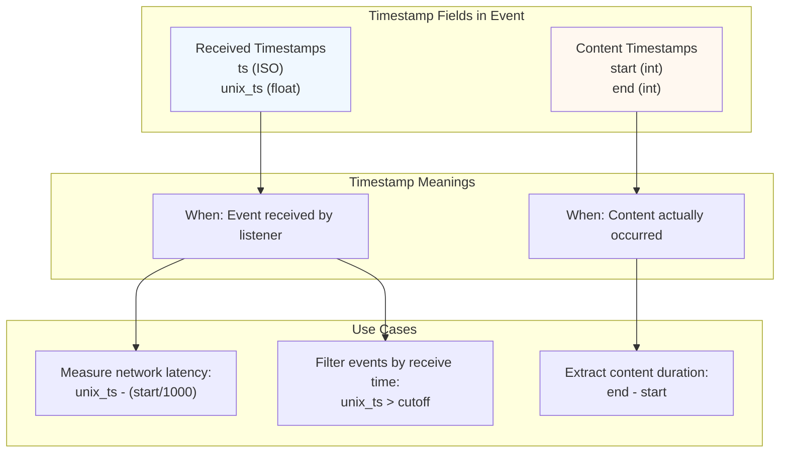

<!-- source: DeepWiki mcp.deepwiki.com · repo video-db/skills · page 13.2 Event Format and Consumption · fetched 2026-10-27 -->

# Event Format and Consumption

<details>
<summary>Relevant source files</summary>

The following files were used as context for generating this wiki page:

- [python/reference/capture-reference.md](python/reference/capture-reference.md)
- [python/scripts/ws_listener.py](python/scripts/ws_listener.py)

</details>


This document describes the JSONL (JSON Lines) event format written by `ws_listener.py` and patterns for parsing and filtering events in analysis workflows. For information on running the listener script, see [Running the Listener](#13.1).

---

## JSONL File Format

The `ws_listener.py` script writes all WebSocket events to a JSONL file where each line is a complete, self-contained JSON object. The default output location is `/tmp/videodb_events.jsonl`, but can be customized via the `output_dir` argument or `VIDEODB_EVENTS_DIR` environment variable.

### File Structure

Each event received from the WebSocket connection is augmented with timestamps and written as a single line:

```json
{"ts": "2026-03-02T10:15:30.123Z", "unix_ts": 1709374530.12, "channel": "transcript", "rtstream_id": "rts-abc", "data": {"text": "...", "start": 1710000001234, "end": 1710000002345}}
{"ts": "2026-03-02T10:15:31.456Z", "unix_ts": 1709374531.45, "event": "capture_session.active", "capture_session_id": "cap-xyz", "status": "active", "data": {"rtstreams": [...]}}
```

### Timestamp Fields

| Field | Type | Description | Source |
|-------|------|-------------|--------|
| `ts` | `string` | ISO 8601 timestamp in UTC when event was received | Added by `append_event()` |
| `unix_ts` | `float` | Unix epoch timestamp (seconds) when event was received | Added by `append_event()` |
| `start` | `int` | Event-specific start time (milliseconds since epoch) | From WebSocket payload |
| `end` | `int` | Event-specific end time (milliseconds since epoch) | From WebSocket payload |

The `ts` and `unix_ts` fields represent when the event was **received** by the listener, while `start` and `end` (when present) represent the **content timestamps** from the capture session or AI pipeline.

**Sources:** [python/scripts/ws_listener.py:79-84]()

---

## Event Categories

Events are distinguished by either a `channel` field (for AI pipeline results) or an `event` field (for session lifecycle changes).

### Event Type Identification



**Sources:** [python/reference/capture-reference.md:15-21](), [python/scripts/ws_listener.py:136-141]()

---

## AI Pipeline Event Structures

AI pipeline events have a `channel` field identifying the source pipeline and contain timestamped analysis results.

### Transcript Events

```json
{
  "ts": "2026-03-02T10:15:30.123Z",
  "unix_ts": 1709374530.12,
  "channel": "transcript",
  "rtstream_id": "rts-abc123",
  "rtstream_name": "mic:default",
  "data": {
    "text": "Let's schedule the meeting for Thursday",
    "is_final": true,
    "start": 1710000001234,
    "end": 1710000002345
  }
}
```

| Field | Type | Description |
|-------|------|-------------|
| `channel` | `string` | Always `"transcript"` |
| `rtstream_id` | `string` | RTStream object ID generating transcripts |
| `rtstream_name` | `string` | Human-readable channel name (e.g., `"mic:default"`) |
| `data.text` | `string` | Transcribed text segment |
| `data.is_final` | `boolean` | Whether this is a final or interim transcript |
| `data.start` | `int` | Speech start time (milliseconds since epoch) |
| `data.end` | `int` | Speech end time (milliseconds since epoch) |

**Sources:** [python/reference/capture-reference.md:37-50]()

### Visual Index Events

```json
{
  "ts": "2026-03-02T10:15:32.456Z",
  "unix_ts": 1709374532.45,
  "channel": "visual_index",
  "rtstream_id": "rts-xyz789",
  "rtstream_name": "display:1",
  "data": {
    "text": "User is viewing a Slack conversation with 3 unread messages",
    "start": 1710000012340,
    "end": 1710000018900
  }
}
```

| Field | Type | Description |
|-------|------|-------------|
| `channel` | `string` | `"visual_index"` or `"scene_index"` (aliases) |
| `rtstream_id` | `string` | RTStream object ID being analyzed |
| `rtstream_name` | `string` | Display channel name (e.g., `"display:1"`) |
| `data.text` | `string` | AI-generated visual description |
| `data.start` | `int` | Analysis window start (milliseconds since epoch) |
| `data.end` | `int` | Analysis window end (milliseconds since epoch) |

**Sources:** [python/reference/capture-reference.md:52-64]()

### Audio Index Events

```json
{
  "ts": "2026-03-02T10:15:33.789Z",
  "unix_ts": 1709374533.78,
  "channel": "audio_index",
  "rtstream_id": "rts-abc123",
  "rtstream_name": "mic:default",
  "data": {
    "text": "Discussion about scheduling a team meeting",
    "start": 1710000021500,
    "end": 1710000029200
  }
}
```

| Field | Type | Description |
|-------|------|-------------|
| `channel` | `string` | Always `"audio_index"` |
| `rtstream_id` | `string` | RTStream object ID being analyzed |
| `rtstream_name` | `string` | Audio channel name |
| `data.text` | `string` | AI-generated audio content description |
| `data.start` | `int` | Analysis window start (milliseconds since epoch) |
| `data.end` | `int` | Analysis window end (milliseconds since epoch) |

**Sources:** [python/reference/capture-reference.md:66-78]()

---

## Session Lifecycle Event Structures

Session lifecycle events have an `event` field following the pattern `capture_session.<status>` and include the current session status.

### Event Types Table

| Event | Status | Description | Key Data Fields |
|-------|--------|-------------|-----------------|
| `capture_session.created` | `created` | Session object created on server | — |
| `capture_session.starting` | `starting` | Client initiating capture | — |
| `capture_session.active` | `active` | Streams flowing, AI pipelines active | `rtstreams[]` |
| `capture_session.stopping` | `stopping` | Client stopping capture | — |
| `capture_session.stopped` | `stopped` | All streams finalized | — |
| `capture_session.exported` | `exported` | Session exported to permanent video | `exported_video_id`, `stream_url`, `player_url` |
| `capture_session.failed` | `failed` | Session encountered an error | `error` |

**Sources:** [python/reference/capture-reference.md:23-33]()

### Active Event Example

```json
{
  "ts": "2026-03-02T10:15:25.000Z",
  "unix_ts": 1709374525.00,
  "event": "capture_session.active",
  "capture_session_id": "cap-xyz789",
  "status": "active",
  "data": {
    "rtstreams": [
      {
        "rtstream_id": "rts-1",
        "name": "mic:default",
        "media_types": ["audio"]
      },
      {
        "rtstream_id": "rts-2",
        "name": "system_audio:default",
        "media_types": ["audio"]
      },
      {
        "rtstream_id": "rts-3",
        "name": "display:1",
        "media_types": ["video"]
      }
    ]
  }
}
```

The `active` event is critical because it provides the `rtstream_id` values needed to correlate subsequent AI pipeline events back to specific capture channels.

**Sources:** [python/reference/capture-reference.md:80-94]()

### Exported Event Example

```json
{
  "ts": "2026-03-02T10:20:15.000Z",
  "unix_ts": 1709374815.00,
  "event": "capture_session.exported",
  "capture_session_id": "cap-xyz789",
  "status": "exported",
  "data": {
    "exported_video_id": "v_xyz789",
    "stream_url": "https://stream.videodb.io/v_xyz789",
    "player_url": "https://console.videodb.io/player?url=..."
  }
}
```

The `exported` event provides the permanent `video_id` and playback URLs for the finalized recording.

**Sources:** [python/reference/capture-reference.md:96-108]()

---

## Event Consumption Patterns

### Basic Parsing

```python
import json

# Load all events from JSONL file
events = []
with open("/tmp/videodb_events.jsonl") as f:
    for line in f:
        events.append(json.loads(line))

# Or using list comprehension
events = [json.loads(line) for line in open("/tmp/videodb_events.jsonl")]
```

**Sources:** [python/reference/capture-reference.md:177-179]()

### Filter by Channel

```python
# Get all transcript events
transcripts = [e for e in events if e.get("channel") == "transcript"]

# Get all visual index events
visual_events = [e for e in events if e.get("channel") == "visual_index"]

# Get all audio index events
audio_events = [e for e in events if e.get("channel") == "audio_index"]
```

**Sources:** [python/reference/capture-reference.md:181-182]()

### Filter by Time Range

```python
import time

# Get events from the last 10 minutes
cutoff = time.time() - 600
recent_events = [e for e in events if e["unix_ts"] > cutoff]

# Get events between specific timestamps
start_time = 1709374500.0
end_time = 1709374600.0
time_range_events = [
    e for e in events 
    if start_time <= e["unix_ts"] <= end_time
]
```

**Sources:** [python/reference/capture-reference.md:184-187]()

### Content-Based Filtering

```python
# Find visual events containing specific keywords
code_mentions = [
    e for e in events 
    if e.get("channel") == "visual_index" 
    and "code" in e.get("data", {}).get("text", "").lower()
]

# Find transcript segments mentioning specific topics
meeting_mentions = [
    e for e in events
    if e.get("channel") == "transcript"
    and e.get("data", {}).get("is_final")
    and "meeting" in e.get("data", {}).get("text", "").lower()
]
```

**Sources:** [python/reference/capture-reference.md:189-193]()

### Extract RTStream Mappings

```python
# Build rtstream_id -> name mapping from active event
active_event = next(
    e for e in events 
    if e.get("event") == "capture_session.active"
)

rtstream_map = {
    stream["rtstream_id"]: stream["name"]
    for stream in active_event["data"]["rtstreams"]
}

# Example: {'rts-1': 'mic:default', 'rts-2': 'system_audio:default', 'rts-3': 'display:1'}
```

This mapping allows you to associate AI pipeline events with human-readable channel names.

**Sources:** [python/reference/capture-reference.md:80-94]()

---

## Event Processing Pipeline



**Sources:** [python/scripts/ws_listener.py:79-84](), [python/scripts/ws_listener.py:136-141](), [python/reference/capture-reference.md:177-193]()

---

## Timestamp Conversion

Events contain three types of timestamps that serve different purposes:

### Timestamp Types



### Conversion Examples

```python
from datetime import datetime

# Parse ISO timestamp
event_time = datetime.fromisoformat(event["ts"].replace("Z", "+00:00"))

# Convert unix timestamp to datetime
import datetime
event_dt = datetime.datetime.fromtimestamp(event["unix_ts"], tz=datetime.timezone.utc)

# Convert content timestamp (milliseconds) to seconds
content_start_sec = event["data"]["start"] / 1000.0
content_end_sec = event["data"]["end"] / 1000.0

# Calculate content duration
duration_ms = event["data"]["end"] - event["data"]["start"]
duration_sec = duration_ms / 1000.0
```

**Sources:** [python/scripts/ws_listener.py:79-84](), [python/reference/capture-reference.md:169-173]()

---

## Common Analysis Workflows

### Build Timeline from Transcripts

```python
# Extract all final transcripts in chronological order
transcripts = [
    e for e in events
    if e.get("channel") == "transcript"
    and e.get("data", {}).get("is_final")
]

# Sort by content start time (not receive time)
transcripts.sort(key=lambda e: e["data"]["start"])

# Generate full transcript text
full_text = " ".join(e["data"]["text"] for e in transcripts)
```

### Correlate Visual and Transcript Events

```python
# Find visual events that overlap with transcript mentioning "code"
code_transcripts = [
    e for e in events
    if e.get("channel") == "transcript"
    and "code" in e.get("data", {}).get("text", "").lower()
]

for transcript in code_transcripts:
    t_start = transcript["data"]["start"]
    t_end = transcript["data"]["end"]
    
    # Find visual events in same time range
    overlapping_visuals = [
        e for e in events
        if e.get("channel") == "visual_index"
        and e["data"]["start"] <= t_end
        and e["data"]["end"] >= t_start
    ]
    
    # Process correlations...
```

### Extract Session Summary

```python
# Get session boundaries
created = next(e for e in events if e.get("event") == "capture_session.created")
exported = next(e for e in events if e.get("event") == "capture_session.exported")

session_duration_sec = exported["unix_ts"] - created["unix_ts"]

# Count events by type
event_counts = {}
for e in events:
    channel = e.get("channel", e.get("event", "unknown"))
    event_counts[channel] = event_counts.get(channel, 0) + 1

# Get export details
video_id = exported["data"]["exported_video_id"]
stream_url = exported["data"]["stream_url"]
```

**Sources:** [python/reference/capture-reference.md:177-193]()

---

## File Location and Management

### Default Output Paths

| File | Default Path | Environment Variable | Description |
|------|-------------|---------------------|-------------|
| Events JSONL | `/tmp/videodb_events.jsonl` | `VIDEODB_EVENTS_DIR` | All events (one per line) |
| WebSocket ID | `/tmp/videodb_ws_id` | `VIDEODB_EVENTS_DIR` | Connection ID for session creation |
| Process ID | `/tmp/videodb_ws_pid` | `VIDEODB_EVENTS_DIR` | Listener PID for termination |

### Clearing Events

Use the `--clear` flag when starting a new capture session to remove old events:

```bash
python scripts/ws_listener.py --clear &
```

Without `--clear`, new events are **appended** to existing events, which is useful for reconnecting to an ongoing session.

**Sources:** [python/scripts/ws_listener.py:12-13](), [python/scripts/ws_listener.py:46-66](), [python/scripts/ws_listener.py:118-121]()

---

## Performance Considerations

### Event Volume Estimates

| Event Source | Typical Frequency | Notes |
|--------------|------------------|-------|
| Transcript | 1-2 per second | Depends on speech rate and interim vs. final |
| Visual Index | 1 per batch interval | Default 30-second batches (configurable) |
| Audio Index | 1 per batch interval | Default 30-second batches (configurable) |
| Session Lifecycle | ~5 per session | Fixed count per session |

For a 1-hour capture session with all AI pipelines enabled:
- Transcripts: ~3,600-7,200 events
- Visual Index: ~120 events
- Audio Index: ~120 events
- Total: ~4,000-7,500 events

File size: Typically 1-2 MB per hour of capture.

### Streaming vs. Batch Loading

```python
# Streaming: Process events as they arrive (low memory)
with open("/tmp/videodb_events.jsonl") as f:
    for line in f:
        event = json.loads(line)
        # Process immediately
        if event.get("channel") == "transcript":
            handle_transcript(event)

# Batch: Load all events first (faster filtering, more memory)
events = [json.loads(line) for line in open("/tmp/videodb_events.jsonl")]
transcripts = [e for e in events if e.get("channel") == "transcript"]
```

Use streaming for long-running sessions or resource-constrained environments. Use batch loading for post-session analysis where you need to filter/correlate across all events.

**Sources:** [python/reference/capture-reference.md:177-193]()

---

