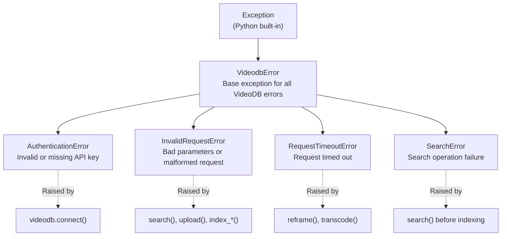
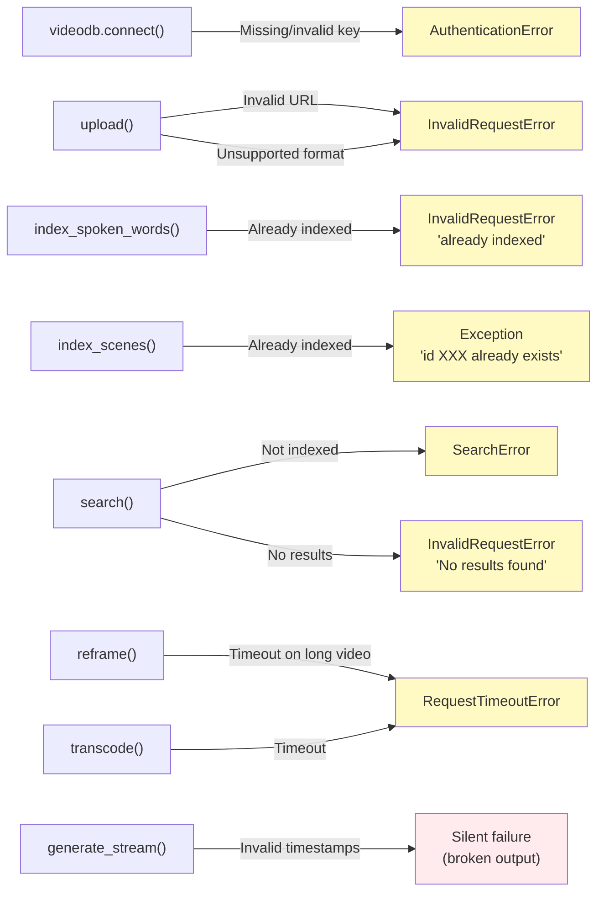
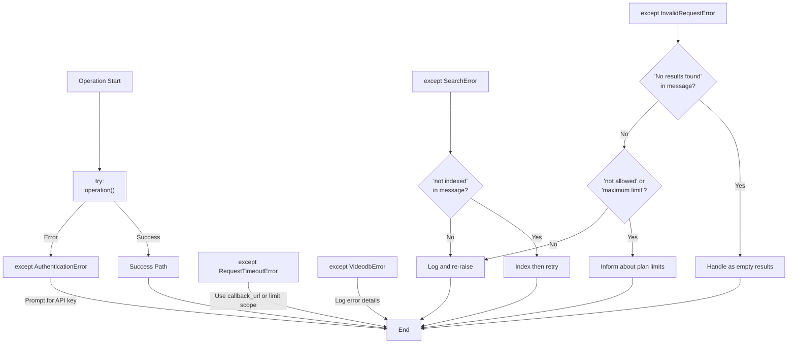

<!-- source: DeepWiki mcp.deepwiki.com · repo video-db/skills · page 14 Error Handling · fetched 2026-10-27 -->

# Error Handling

<details>
<summary>Relevant source files</summary>

The following files were used as context for generating this wiki page:

- [python/SKILL.md](python/SKILL.md)
- [python/reference/api-reference.md](python/reference/api-reference.md)

</details>


This document covers the exception types, error patterns, and recovery strategies in the VideoDB SDK. It provides guidance on properly handling failures during video operations, search, indexing, and streaming workflows.

For API method signatures and parameters, see [API Reference](#15). For specific operation workflows like search or capture, see their respective sections ([Searching Videos](#6), [Desktop Capture](#8)).

---

## Exception Types

The VideoDB SDK defines a hierarchy of exception classes in the `videodb.exceptions` module. All VideoDB-specific exceptions inherit from `VideodbError`, allowing both specific and catch-all error handling.

**Exception Hierarchy Diagram**



**Sources:** [python/reference/api-reference.md:531-549]()

### VideodbError

Base exception class for all VideoDB SDK errors. Use this for generic error handling when you don't need to distinguish between specific error types.

```python
from videodb.exceptions import VideodbError

try:
    video = coll.upload(url="https://example.com/video.mp4")
except VideodbError as e:
    print(f"VideoDB operation failed: {e}")
```

**Common causes:** Server errors, network issues, generic API failures

**Sources:** [python/reference/api-reference.md:548]()

### AuthenticationError

Raised when the API key is missing, invalid, or expired. This error occurs during `videodb.connect()` or when the server rejects credentials.

```python
from videodb.exceptions import AuthenticationError

try:
    conn = videodb.connect()
except AuthenticationError:
    print("Check your VIDEO_DB_API_KEY environment variable")
```

**Common causes:**
- `VIDEO_DB_API_KEY` not set in environment or `.env` file
- Invalid API key format
- Expired or revoked API key

**Recovery strategy:** Prompt user to verify their API key at https://console.videodb.io

**Sources:** [python/SKILL.md:276-281](), [python/reference/api-reference.md:544]()

### InvalidRequestError

Raised when request parameters are invalid, malformed, or unsupported. This is the most common exception type, covering a wide range of operational errors.

```python
from videodb.exceptions import InvalidRequestError

try:
    video = coll.upload(url="https://example.com/video.mp4")
except InvalidRequestError as e:
    print(f"Upload failed: {e}")
```

**Common causes:**
- Invalid URL format or inaccessible resource
- Unsupported media format
- Bad parameters (e.g., negative timestamps, invalid language codes)
- Resource not found (e.g., invalid video ID)
- Operation not allowed on current plan
- **Search returning no results** (special case, see below)

**Sources:** [python/SKILL.md:283-287](), [python/reference/api-reference.md:545]()

### RequestTimeoutError

Raised when a server-side operation takes too long to complete. Most commonly occurs with `reframe()` on long videos or slow `transcode()` operations.

**Common scenarios:**
- `video.reframe()` on videos longer than 2-3 minutes without `start`/`end` parameters
- Large file uploads
- Complex timeline compilations

**Recovery strategy:** Use `callback_url` for async processing, or limit operation scope with `start`/`end` parameters.

**Sources:** [python/reference/api-reference.md:546]()

### SearchError

Raised when search operations fail, typically because the video hasn't been indexed yet.

```python
from videodb.exceptions import SearchError

try:
    results = video.search("product demo")
except SearchError as e:
    if "not indexed" in str(e).lower():
        print("Video needs to be indexed first")
        video.index_spoken_words()
    else:
        raise
```

**Common causes:**
- Searching before calling `index_spoken_words()` or `index_scenes()`
- Invalid search type for the index (e.g., scene search without scene index)

**Sources:** [python/reference/api-reference.md:547]()

---

## Common Error Patterns

### No Results Found in Search

The `search()` method raises `InvalidRequestError` with the message `"No results found"` when there are no matching segments. This is **not a SearchError** — it's an `InvalidRequestError`. You must explicitly catch this and treat it as an empty result set.

```python
from videodb.exceptions import InvalidRequestError

video.index_spoken_words(force=True)

try:
    results = video.search("product demo")
    shots = results.get_shots()
    stream_url = results.compile()
except InvalidRequestError as e:
    if "No results found" in str(e):
        shots = []  # Treat as empty results
        print("No matching segments found")
    else:
        raise  # Re-raise if it's a different error
```

**Why this matters:** Without this pattern, "no results" failures will crash your application instead of being handled gracefully.

**Best practice:** For scene search, use `score_threshold=0.3` or higher to filter low-relevance matches and reduce false positives.

**Sources:** [python/SKILL.md:152-167](), [python/SKILL.md:191-206]()

### Idempotency: Already-Indexed Errors

#### Spoken Word Indexing

`index_spoken_words()` raises an error if the video is already indexed. Use `force=True` to skip the error:

```python
# Without force - raises error if already indexed
video.index_spoken_words()

# With force - no error if already indexed
video.index_spoken_words(force=True)
```

**Sources:** [python/SKILL.md:143-144](), [python/SKILL.md:293]()

#### Scene Indexing

`index_scenes()` **does not** have a `force` parameter. If a scene index already exists, you must extract the `scene_index_id` from the error message:

```python
import re
from videodb import SceneExtractionType
from videodb.exceptions import InvalidRequestError

try:
    scene_index_id = video.index_scenes(
        extraction_type=SceneExtractionType.shot_based,
        prompt="Describe the visual content in this scene.",
    )
except Exception as e:
    match = re.search(r"id\s+([a-f0-9]+)", str(e))
    if match:
        scene_index_id = match.group(1)
        print(f"Using existing scene index: {scene_index_id}")
    else:
        raise
```

This pattern is critical because scene indexes can have different prompts and configurations, so the API doesn't auto-reuse them.

**Sources:** [python/SKILL.md:176-188](), [python/SKILL.md:294]()

### Timeout Management for Long Operations

Operations like `reframe()`, `transcode()`, and long timeline compilations can time out on synchronous calls. The SDK provides two mitigation strategies:

#### 1. Limit Scope with Start/End Parameters

```python
# BAD - May timeout on long videos
reframed = video.reframe(target="vertical")

# GOOD - Limit to specific segment
reframed = video.reframe(start=0, end=60, target="vertical")
```

**Sources:** [python/SKILL.md:242-262](), [python/SKILL.md:296]()

#### 2. Use Callback URLs for Async Processing

```python
# Returns None immediately, result delivered to webhook
video.reframe(
    target="vertical",
    callback_url="https://example.com/webhook"
)

job_id = conn.transcode(
    source="https://example.com/video.mp4",
    callback_url="https://example.com/webhook",
    mode=TranscodeMode.economy,
)
```

The webhook receives the completed asset when processing finishes.

**Sources:** [python/SKILL.md:254-256](), [python/reference/api-reference.md:196-197]()

### Silent Failures: Timeline Asset Validation

The Timeline editor **silently accepts invalid parameters** and produces broken output. You must validate timestamps before creating `VideoAsset` objects:

```python
from videodb.asset import VideoAsset

# BAD - Negative start silently accepted but produces broken stream
asset = VideoAsset(asset_id=video.id, start=-5, end=30)

# GOOD - Validate before creating asset
start = max(0, user_start)  # Ensure >= 0
end = min(user_end, video.length)  # Ensure <= video length

if start >= end:
    raise ValueError(f"Invalid range: start={start}, end={end}")

asset = VideoAsset(asset_id=video.id, start=start, end=end)
```

**Validation rules:**
- `start >= 0` (negative values produce broken output)
- `start < end`
- `end <= video.length`

**Sources:** [python/SKILL.md:210-213](), [python/SKILL.md:297]()

### Plan-Gated Operations

Some operations fail with "Operation not allowed" or "maximum limit" errors based on the user's plan:

```python
try:
    video = coll.generate_video(prompt="a cat playing piano")
except InvalidRequestError as e:
    if "not allowed" in str(e).lower() or "maximum limit" in str(e).lower():
        print("Video generation requires a paid plan")
        print("Upgrade at https://console.videodb.io")
    else:
        raise
```

**Plan-gated features:**
- `generate_video()`
- `create_collection()` (beyond free tier limit)
- Scene search (some plans)

**Sources:** [python/SKILL.md:298]()

---

## Error Handling by Operation Type

**Operation-to-Exception Mapping**



**Sources:** [python/SKILL.md:289-298](), [python/reference/api-reference.md:531-549]()

### Upload Operations

```python
from videodb.exceptions import InvalidRequestError

try:
    video = coll.upload(url="https://example.com/video.mp4")
except InvalidRequestError as e:
    error_msg = str(e).lower()
    
    if "invalid url" in error_msg:
        print("URL is malformed or inaccessible")
    elif "unsupported format" in error_msg:
        print("File format not supported")
    elif "not allowed" in error_msg:
        print("Upload limit reached on current plan")
    else:
        print(f"Upload failed: {e}")
```

**Sources:** [python/SKILL.md:283-287]()

### Indexing Operations

```python
import re
from videodb import SceneExtractionType
from videodb.exceptions import InvalidRequestError

# Spoken word indexing - use force=True
video.index_spoken_words(force=True)

# Scene indexing - extract existing ID if present
try:
    scene_index_id = video.index_scenes(
        extraction_type=SceneExtractionType.shot_based,
        prompt="Describe the content",
    )
except Exception as e:
    match = re.search(r"id\s+([a-f0-9]+)", str(e))
    if match:
        scene_index_id = match.group(1)
    else:
        raise
```

**Sources:** [python/SKILL.md:143-144](), [python/SKILL.md:176-188]()

### Search Operations

```python
from videodb import SearchType, IndexType
from videodb.exceptions import InvalidRequestError, SearchError

try:
    results = video.search(
        query="product demo",
        search_type=SearchType.semantic,
        score_threshold=0.3,
    )
    shots = results.get_shots()
except SearchError as e:
    if "not indexed" in str(e).lower():
        print("Indexing video first...")
        video.index_spoken_words(force=True)
        results = video.search("product demo")
        shots = results.get_shots()
    else:
        raise
except InvalidRequestError as e:
    if "No results found" in str(e):
        shots = []  # Empty results
    else:
        raise
```

**Sources:** [python/SKILL.md:152-167](), [python/SKILL.md:191-206]()

### Timeline Operations

```python
from videodb.timeline import Timeline
from videodb.asset import VideoAsset

def create_validated_asset(video, start, end):
    """Create VideoAsset with validated timestamps"""
    if start < 0:
        raise ValueError(f"start must be >= 0, got {start}")
    if end > video.length:
        raise ValueError(f"end exceeds video length: {end} > {video.length}")
    if start >= end:
        raise ValueError(f"start must be < end: {start} >= {end}")
    
    return VideoAsset(asset_id=video.id, start=start, end=end)

timeline = Timeline(conn)

try:
    asset = create_validated_asset(video, start=10, end=30)
    timeline.add_inline(asset)
    stream_url = timeline.generate_stream()
except ValueError as e:
    print(f"Invalid timeline parameters: {e}")
```

**Sources:** [python/SKILL.md:210-213](), [python/SKILL.md:297]()

### Reframe and Transcode Operations

```python
from videodb import ReframeMode
from videodb.exceptions import RequestTimeoutError

try:
    # Always prefer limited segments to avoid timeouts
    reframed = video.reframe(
        start=0,
        end=60,
        target="vertical",
        mode=ReframeMode.smart,
    )
except RequestTimeoutError:
    print("Reframe timed out, retrying with async callback...")
    
    # Retry with async processing
    video.reframe(
        start=0,
        end=60,
        target="vertical",
        callback_url="https://example.com/webhook",
    )
    print("Reframe job submitted, result will be delivered to webhook")
```

**Sources:** [python/SKILL.md:242-262](), [python/SKILL.md:296]()

---

## Error Handling Best Practices

**Comprehensive Error Handling Template**



**Sources:** [python/SKILL.md:273-298]()

### General Guidelines

1. **Always wrap search operations** in try/except for `InvalidRequestError` with "No results found" check
2. **Use `force=True`** for `index_spoken_words()` to avoid re-indexing errors
3. **Extract scene_index_id** from errors using regex when `index_scenes()` fails
4. **Validate timeline timestamps** before creating `VideoAsset` objects
5. **Limit scope with start/end** or use `callback_url` for long operations
6. **Check for plan limits** when operations fail with "not allowed" messages
7. **Catch specific exceptions first**, then fall back to `VideodbError` for generic handling

**Sources:** [python/SKILL.md:273-298]()

---

## Summary Table: Quick Reference

| Error Type | Common Trigger | Detection Pattern | Recovery Strategy |
|------------|----------------|-------------------|-------------------|
| `AuthenticationError` | `videodb.connect()` with invalid key | Exception type | Prompt user to verify `VIDEO_DB_API_KEY` |
| `InvalidRequestError` (no results) | `search()` with no matches | `"No results found"` in message | Treat as empty result set (`shots = []`) |
| `InvalidRequestError` (already indexed) | `index_spoken_words()` on indexed video | `"already indexed"` in message | Use `force=True` parameter |
| `Exception` (scene index exists) | `index_scenes()` on indexed video | `"id XXX already exists"` in message | Extract `scene_index_id` with regex |
| `SearchError` | `search()` before indexing | `"not indexed"` in message | Call `index_spoken_words()` or `index_scenes()` first |
| `RequestTimeoutError` | `reframe()` on long video | Exception type | Use `start`/`end` or `callback_url` |
| Silent failure | `VideoAsset` with negative `start` | No exception | Validate `start >= 0`, `start < end`, `end <= length` |
| `InvalidRequestError` (plan limit) | `generate_video()`, `create_collection()` | `"not allowed"` or `"maximum limit"` in message | Inform user about plan upgrade |

**Sources:** [python/SKILL.md:289-298]()

---

