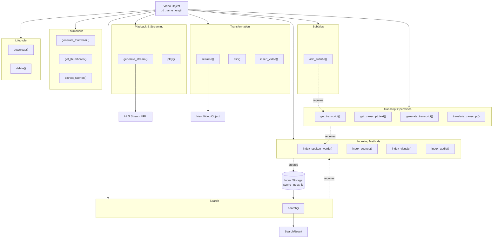
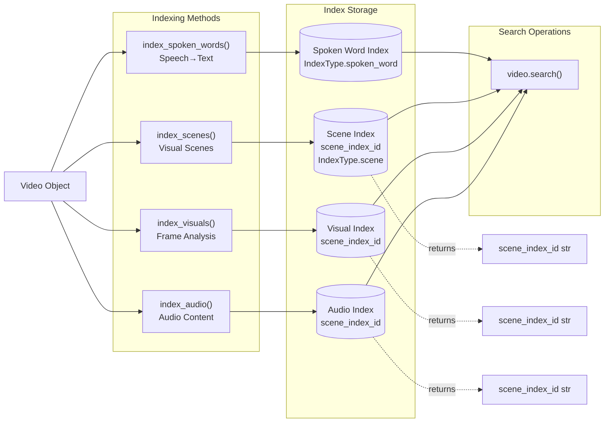
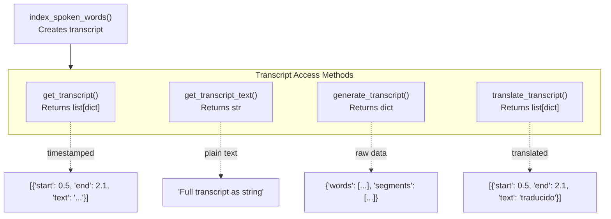
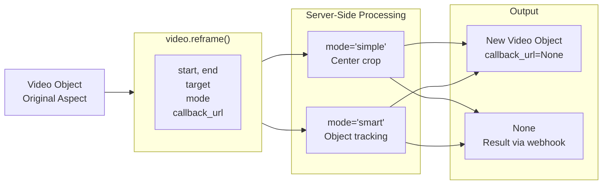
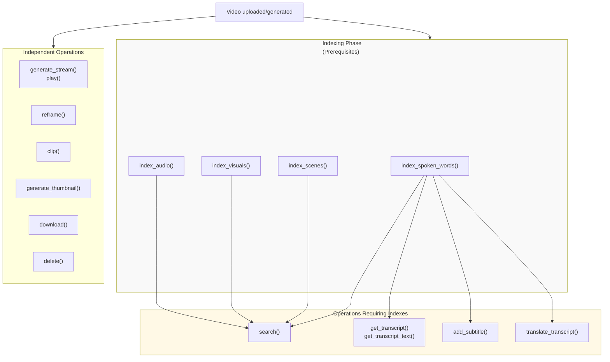

<!-- source: DeepWiki mcp.deepwiki.com · repo video-db/skills · page 15.3 Video Methods · fetched 2026-10-27 -->

# Video Methods

<details>
<summary>Relevant source files</summary>

The following files were used as context for generating this wiki page:

- [python/reference/api-reference.md](python/reference/api-reference.md)

</details>


This page documents all methods and properties available on `Video` objects. Video objects represent uploaded or generated video assets stored in a VideoDB collection. These methods enable indexing, searching, editing, transformation, and playback operations on video content.

For methods on `Connection` objects, see [Connection Methods](#15.1). For methods on `Collection` objects, see [Collection Methods](#15.2). For methods on `Audio` and `Image` objects, see [Audio and Image Methods](#15.4).

---

## Video Object Properties

Video objects expose the following read-only properties:

| Property | Type | Description |
|----------|------|-------------|
| `video.id` | `str` | Unique video identifier |
| `video.collection_id` | `str` | Parent collection ID |
| `video.name` | `str` | Video name |
| `video.description` | `str` | Video description |
| `video.length` | `float` | Duration in seconds |
| `video.stream_url` | `str` | Default HLS stream URL |
| `video.player_url` | `str` | Embeddable player URL |
| `video.thumbnail_url` | `str` | Thumbnail image URL |

Sources: [python/reference/api-reference.md:154-165]()

---

## Method Categories Overview

The following diagram maps Video methods to their functional categories and relationships with other system components:

**Diagram: Video Method Categories and System Integration**



Sources: [python/reference/api-reference.md:167-191]()

---

## Playback and Stream Generation

### `generate_stream(timeline=None)`

Generates an HLS stream URL for the video. Accepts an optional timeline parameter to create a trimmed or segmented stream without modifying the original video.

**Parameters:**

| Parameter | Type | Default | Description |
|-----------|------|---------|-------------|
| `timeline` | `list[tuple]` | `None` | List of `(start, end)` tuples in seconds for segments to include |

**Returns:** `str` - HLS stream URL

**Example:**

```python
# Full video stream
stream_url = video.generate_stream()

# Trimmed segment
stream_url = video.generate_stream(timeline=[(10.5, 45.2)])

# Multiple segments compiled
stream_url = video.generate_stream(timeline=[(0, 30), (60, 90), (120, 150)])
```

### `play()`

Opens the video stream in the default web browser and returns the player URL.

**Returns:** `str` - Player URL

Sources: [python/reference/api-reference.md:171-172]()

---

## Indexing Methods

Indexing methods enable AI analysis of video content. Each indexing operation processes the video server-side and stores structured metadata that powers search and understanding features.

**Diagram: Indexing Pipeline and Index Types**



Sources: [python/reference/api-reference.md:173-176]()

### `index_spoken_words(language_code=None, force=False)`

Transcribes speech in the video and creates a searchable transcript index. This is required before performing semantic or keyword searches on spoken content.

**Parameters:**

| Parameter | Type | Default | Description |
|-----------|------|---------|-------------|
| `language_code` | `str` | `None` | ISO language code (e.g., `"en"`, `"es"`, `"fr"`). Auto-detected if omitted. |
| `force` | `bool` | `False` | Set to `True` to skip indexing if already indexed |

**Returns:** `None`

**Behavior:**
- Blocking operation that completes before returning
- Idempotent when `force=False` (skips if already indexed)
- Creates timestamped transcript accessible via `get_transcript()`

### `index_scenes(extraction_type, prompt, extraction_config, metadata, model_name, name, scenes, callback_url)`

Creates a visual scene index by analyzing video frames with AI. Returns a `scene_index_id` that must be provided when searching this specific index.

**Parameters:**

| Parameter | Type | Default | Description |
|-----------|------|---------|-------------|
| `extraction_type` | `SceneExtractionType` | required | `shot_based`, `time_based`, or `transcript` |
| `prompt` | `str` | required | AI prompt describing what to extract from scenes |
| `extraction_config` | `dict` | `None` | Configuration for extraction (e.g., interval for time-based) |
| `metadata` | `dict` | `None` | Custom metadata to attach to scenes |
| `model_name` | `str` | `None` | AI model to use for analysis |
| `name` | `str` | `None` | Name for this scene index |
| `scenes` | `list` | `None` | Pre-defined scene boundaries |
| `callback_url` | `str` | `None` | Webhook URL for async completion notification |

**Returns:** `str` - `scene_index_id` identifier for this index

**Important:** A single video can have multiple scene indexes with different prompts. Always store the returned `scene_index_id` and pass it to `search()` via the `scene_index_id` kwarg.

### `index_visuals(prompt, batch_config, ...)`

Performs frame-level visual analysis with AI. This is more granular than `index_scenes()` and analyzes individual frames or small batches.

**Returns:** `str` - `scene_index_id` for this visual index

### `index_audio(prompt, model_name, ...)`

Analyzes audio content using AI (e.g., detect profanity, music, specific sounds, speaker sentiment).

**Returns:** `str` - `scene_index_id` for this audio index

Sources: [python/reference/api-reference.md:173-176]()

---

## Transcript Methods

Transcript methods provide access to speech-to-text data. All transcript methods require `index_spoken_words()` to have been called first.

**Method Relationships:**



Sources: [python/reference/api-reference.md:177-180]()

### `get_transcript(start=None, end=None)`

Returns the timestamped transcript as a list of dictionaries, optionally filtered by time range.

**Parameters:**

| Parameter | Type | Default | Description |
|-----------|------|---------|-------------|
| `start` | `float` | `None` | Start time in seconds |
| `end` | `float` | `None` | End time in seconds |

**Returns:** `list[dict]` - List of transcript segments with `start`, `end`, and `text` keys

### `get_transcript_text(start=None, end=None)`

Returns the full transcript as plain text, optionally filtered by time range.

**Parameters:**

| Parameter | Type | Default | Description |
|-----------|------|---------|-------------|
| `start` | `float` | `None` | Start time in seconds |
| `end` | `float` | `None` | End time in seconds |

**Returns:** `str` - Plain text transcript

### `generate_transcript(force=None)`

Generates or retrieves the raw transcript data structure.

**Parameters:**

| Parameter | Type | Default | Description |
|-----------|------|---------|-------------|
| `force` | `bool` | `None` | Force regeneration if already exists |

**Returns:** `dict` - Raw transcript data with `words` and `segments` keys

### `translate_transcript(language, additional_notes)`

Translates the transcript to another language.

**Parameters:**

| Parameter | Type | Default | Description |
|-----------|------|---------|-------------|
| `language` | `str` | required | Target language code or name |
| `additional_notes` | `str` | `None` | Additional instructions for translation |

**Returns:** `list[dict]` - Translated transcript segments

Sources: [python/reference/api-reference.md:177-180]()

---

## Search

### `search(query, search_type, index_type, filter, **kwargs)`

Searches within the video for specific content. Returns a `SearchResult` object containing timestamped segments.

**Parameters:**

| Parameter | Type | Default | Description |
|-----------|------|---------|-------------|
| `query` | `str` | required | Search query text |
| `search_type` | `SearchType` | required | `semantic`, `keyword`, or `scene` |
| `index_type` | `IndexType` | required | `spoken_word` or `scene` |
| `filter` | `list` | `[]` | Metadata filters for scene search |
| `result_threshold` | `int` | `None` | Maximum number of results (via kwargs) |
| `score_threshold` | `float` | `None` | Minimum relevance score (via kwargs) |
| `dynamic_score_percentage` | `float` | `None` | Dynamic score percentage (via kwargs) |
| `scene_index_id` | `str` | `None` | Target scene index ID (via kwargs) |

**Returns:** `SearchResult` object with `get_shots()`, `compile()`, and `play()` methods

**Important Error Handling:**
- Raises `InvalidRequestError` with message `"No results found"` when no matches exist
- Always wrap search calls in `try/except` blocks
- For scene search, use `score_threshold=0.3` or higher to filter noise

**Example:**

```python
from videodb import SearchType, IndexType
from videodb.exceptions import InvalidRequestError

try:
    results = video.search(
        query="artificial intelligence",
        search_type=SearchType.semantic,
        index_type=IndexType.spoken_word,
        score_threshold=0.5,
    )
    shots = results.get_shots()
except InvalidRequestError as e:
    print("No results found")
```

**Scene Search Example:**

```python
# First create a scene index
scene_index_id = video.index_scenes(
    extraction_type=SceneExtractionType.shot_based,
    prompt="Identify all scenes with people speaking"
)

# Search using the scene index
results = video.search(
    query="person at podium",
    search_type=SearchType.semantic,
    index_type=IndexType.scene,
    scene_index_id=scene_index_id,
    score_threshold=0.3,
)
```

Sources: [python/reference/api-reference.md:181, 366-384]()

---

## Transformation Methods

### `reframe(start, end, target, mode, callback_url)`

Converts video to a different aspect ratio with optional smart object tracking. This is a server-side operation that can be slow for long videos.

**Diagram: Reframe Operation Flow**



Sources: [python/reference/api-reference.md:186, 192-222]()

**Parameters:**

| Parameter | Type | Default | Description |
|-----------|------|---------|-------------|
| `start` | `float` | `None` | Start time in seconds (None = beginning) |
| `end` | `float` | `None` | End time in seconds (None = full video) |
| `target` | `str\|dict` | `"vertical"` | Preset (`"vertical"`, `"square"`, `"landscape"`) or `{"width": int, "height": int}` |
| `mode` | `ReframeMode` | `ReframeMode.smart` | `"simple"` (center crop) or `"smart"` (object tracking) |
| `callback_url` | `str` | `None` | Webhook URL for async notification |

**Returns:** 
- `Video` object when `callback_url=None` (synchronous)
- `None` when `callback_url` provided (asynchronous)

**Warning:** Reframe is slow and may timeout on long videos. Always use `start`/`end` to limit segments, or use `callback_url` for async processing.

**Example:**

```python
from videodb import ReframeMode

# Short segment (synchronous)
vertical = video.reframe(start=0, end=60, target="vertical", mode=ReframeMode.smart)

# Full video (async)
video.reframe(target="vertical", callback_url="https://example.com/webhook")

# Custom dimensions
square = video.reframe(start=0, end=30, target={"width": 1080, "height": 1080})
```

### `clip(prompt, content_type, model_name)`

Generates a clip from the video using an AI prompt. Returns a stream URL.

**Parameters:**

| Parameter | Type | Default | Description |
|-----------|------|---------|-------------|
| `prompt` | `str` | required | Description of desired clip content |
| `content_type` | `str` | `None` | Type of content to extract |
| `model_name` | `str` | `None` | AI model for processing |

**Returns:** `str` - Stream URL for the generated clip

### `insert_video(video, timestamp)`

Inserts another video at a specific timestamp. Returns a stream URL of the composite.

**Parameters:**

| Parameter | Type | Default | Description |
|-----------|------|---------|-------------|
| `video` | `Video` | required | Video object to insert |
| `timestamp` | `float` | required | Insertion point in seconds |

**Returns:** `str` - Stream URL of the composite video

Sources: [python/reference/api-reference.md:187-188]()

---

## Subtitle Methods

### `add_subtitle(style=SubtitleStyle())`

Adds auto-generated subtitles to the video based on the transcript. Returns a stream URL with embedded subtitles.

**Parameters:**

| Parameter | Type | Default | Description |
|-----------|------|---------|-------------|
| `style` | `SubtitleStyle` | `SubtitleStyle()` | Styling configuration for subtitles |

**Returns:** `str` - Stream URL with subtitles burned in

**Requires:** `index_spoken_words()` must be called first

**Example:**

```python
from videodb import SubtitleStyle

style = SubtitleStyle(
    font_name="Arial",
    font_size=24,
    primary_colour="&H00FFFFFF",
    bold=True,
)

stream_url = video.add_subtitle(style=style)
```

Sources: [python/reference/api-reference.md:182, 478-491]()

---

## Thumbnail Methods

### `generate_thumbnail(time=None)`

Generates a thumbnail image from a specific frame.

**Parameters:**

| Parameter | Type | Default | Description |
|-----------|------|---------|-------------|
| `time` | `float` | `None` | Timestamp in seconds (None = random frame) |

**Returns:** `str` or `Image` object - Thumbnail URL or Image object

### `get_thumbnails()`

Retrieves all thumbnails generated for this video.

**Returns:** `list[Image]` - List of Image objects

### `extract_scenes(extraction_type, extraction_config)`

Extracts scene boundaries and metadata without creating a full index.

**Parameters:**

| Parameter | Type | Default | Description |
|-----------|------|---------|-------------|
| `extraction_type` | `SceneExtractionType` | required | Extraction method |
| `extraction_config` | `dict` | `None` | Configuration parameters |

**Returns:** `SceneCollection` object

Sources: [python/reference/api-reference.md:183-185]()

---

## Lifecycle Methods

### `download(name=None)`

Downloads the video file.

**Parameters:**

| Parameter | Type | Default | Description |
|-----------|------|---------|-------------|
| `name` | `str` | `None` | Filename for download |

**Returns:** `dict` - Download metadata

### `delete()`

Permanently deletes the video from the collection.

**Returns:** `None`

Sources: [python/reference/api-reference.md:189-190]()

---

## Method Dependency Graph

The following diagram illustrates which methods must be called before others:

**Diagram: Method Dependencies**



Sources: [python/reference/api-reference.md:167-191]()

---

## Common Patterns

### Pattern: Search and Compile Highlights

```python
from videodb import SearchType, IndexType
from videodb.exceptions import InvalidRequestError

# 1. Index the video
video.index_spoken_words()

# 2. Search for content
try:
    results = video.search(
        query="product launch announcement",
        search_type=SearchType.semantic,
        index_type=IndexType.spoken_word,
        score_threshold=0.4,
    )
except InvalidRequestError:
    print("No results found")
    exit()

# 3. Compile all matching segments
highlight_url = results.compile()
```

### Pattern: Scene-based Search

```python
from videodb import SceneExtractionType, SearchType, IndexType

# 1. Create scene index
scene_index_id = video.index_scenes(
    extraction_type=SceneExtractionType.shot_based,
    prompt="Identify all product demonstrations",
)

# 2. Search the scene index
results = video.search(
    query="smartphone demo",
    search_type=SearchType.semantic,
    index_type=IndexType.scene,
    scene_index_id=scene_index_id,
    score_threshold=0.3,
)

# 3. Get individual shots
for shot in results.get_shots():
    print(f"Match at {shot.start}s - {shot.end}s (score: {shot.search_score})")
```

### Pattern: Transcript Extraction and Translation

```python
# 1. Index speech
video.index_spoken_words(language_code="en")

# 2. Get transcript
transcript = video.get_transcript()

# 3. Translate
spanish_transcript = video.translate_transcript(
    language="Spanish",
    additional_notes="Use formal language"
)

# 4. Export text
text = video.get_transcript_text()
```

### Pattern: Social Media Reformatting

```python
from videodb import ReframeMode

# Create vertical video for Instagram/TikTok
vertical = video.reframe(
    start=10,
    end=70,
    target="vertical",
    mode=ReframeMode.smart,
)

# Add subtitles
from videodb import SubtitleStyle
styled_url = vertical.add_subtitle(
    style=SubtitleStyle(font_size=28, bold=True)
)
```

Sources: [python/reference/api-reference.md:173-191, 366-384]()

---

