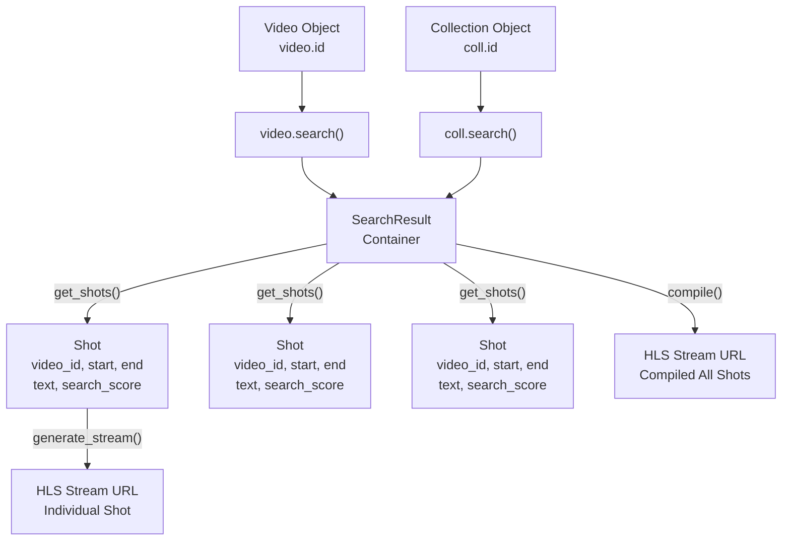
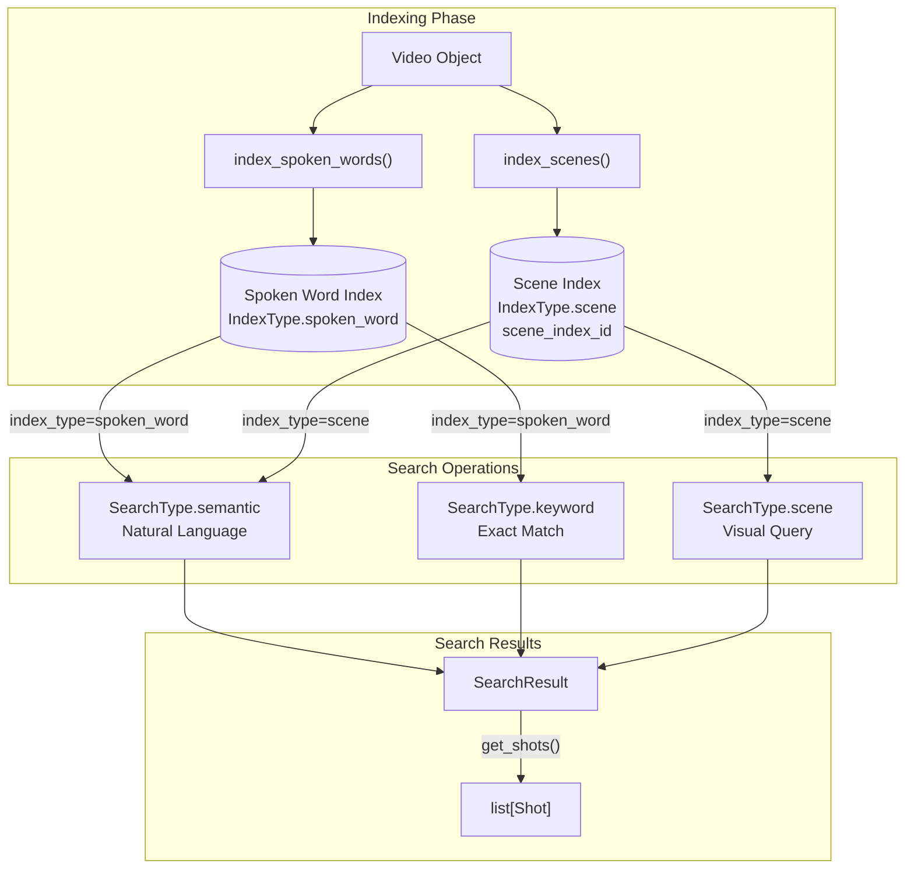
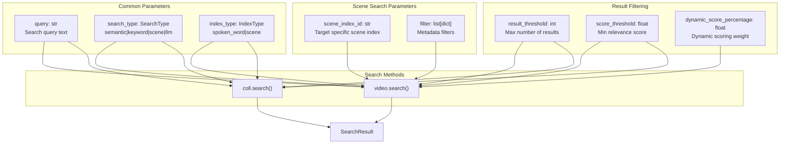

<!-- source: DeepWiki mcp.deepwiki.com · repo video-db/skills · page 15.6 Search and Result Classes · fetched 2026-10-27 -->

# Search and Result Classes

<details>
<summary>Relevant source files</summary>

The following files were used as context for generating this wiki page:

- [python/reference/api-reference.md](python/reference/api-reference.md)
- [python/reference/search.md](python/reference/search.md)

</details>


This document describes the classes and enumerations returned by search operations in VideoDB. These objects encapsulate search results, individual matching segments, and the types of search operations available.

For information about performing search operations, see [Searching Videos](#6). For indexing operations that enable search, see [Video Understanding and Indexing](#5).

---

## Overview

The VideoDB SDK defines four primary types related to search operations:

| Type | Purpose | Returned By |
|------|---------|-------------|
| `SearchResult` | Container for search results | `video.search()`, `coll.search()` |
| `Shot` | Individual timestamped segment | `SearchResult.get_shots()` |
| `SearchType` | Enum defining search algorithms | Used as parameter in search calls |
| `IndexType` | Enum defining index targets | Used as parameter in search calls |

These types form the interface between search queries and playable video segments.

---

## SearchResult Class

The `SearchResult` object is returned by `video.search()` and `coll.search()` operations. It encapsulates all matching segments and provides methods to access them individually or as a compiled stream.

[python/reference/api-reference.md:386-396]()

### Methods

| Method | Returns | Description |
|--------|---------|-------------|
| `get_shots()` | `list[Shot]` | Returns list of all matching segments |
| `compile()` | `str` | Merges all shots into a single stream URL |
| `play()` | `str` | Opens compiled stream in browser, returns player URL |

### Usage Pattern

```python
# Search returns a SearchResult
results = video.search("your query", search_type=SearchType.semantic)

# Access individual segments
shots = results.get_shots()
for shot in shots:
    print(f"{shot.start} - {shot.end}: {shot.text}")

# Or compile all segments into one stream
stream_url = results.compile()
```

**Important:** Search operations raise `InvalidRequestError` with message `"No results found"` when no segments match the query. Always wrap search calls in try/except blocks.

[python/reference/api-reference.md:382]()

**Sources:** [python/reference/api-reference.md:386-396](), [python/reference/search.md:156-180]()

---

## Shot Class

The `Shot` object represents a single timestamped segment from a search result. Each shot contains metadata about the source video, the time bounds of the segment, the matched text content, and a relevance score.

[python/reference/api-reference.md:398-413]()

### Properties

| Property | Type | Description |
|----------|------|-------------|
| `video_id` | `str` | ID of the source video containing this segment |
| `video_length` | `float` | Total duration of the source video in seconds |
| `video_title` | `str` | Name/title of the source video |
| `start` | `float` | Start timestamp of the segment in seconds |
| `end` | `float` | End timestamp of the segment in seconds |
| `text` | `str` | Matched text content (transcript or scene description) |
| `search_score` | `float` | Relevance score for this match (higher = more relevant) |

### Methods

| Method | Returns | Description |
|--------|---------|-------------|
| `generate_stream()` | `str` | Generate HLS stream URL for this specific shot |
| `play()` | `str` | Open shot stream in browser, returns player URL |

### Usage Pattern

```python
results = video.search("machine learning", search_type=SearchType.semantic)

for shot in results.get_shots():
    print(f"Video: {shot.video_id}")
    print(f"Segment: {shot.start:.2f}s - {shot.end:.2f}s")
    print(f"Content: {shot.text}")
    print(f"Score: {shot.search_score:.3f}")
    
    # Generate individual stream for this shot
    shot_url = shot.generate_stream()
```

**Sources:** [python/reference/api-reference.md:398-413](), [python/reference/search.md:156-190]()

---

## SearchType Enumeration

The `SearchType` enum defines the search algorithm used to match queries against indexed content. Different search types operate on different index types and use different matching strategies.

[python/reference/api-reference.md:457-466]()

### Values

```python
from videodb import SearchType

SearchType.semantic    # Natural language semantic search using embeddings
SearchType.keyword     # Exact keyword/phrase matching
SearchType.scene       # Visual scene search (may require paid plan)
SearchType.llm         # LLM-powered search with reasoning
```

### Search Type Characteristics

| Type | Matching Strategy | Works With | Best For |
|------|-------------------|------------|----------|
| `semantic` | AI embeddings similarity | `IndexType.spoken_word` or `IndexType.scene` | Natural language queries, concept matching |
| `keyword` | Exact text matching | `IndexType.spoken_word` | Precise term/phrase searches |
| `scene` | Visual content matching | `IndexType.scene` | Visual queries (availability depends on plan) |
| `llm` | LLM reasoning | Custom indexes | Complex queries requiring inference |

**Important compatibility notes:**

- **Semantic search** is the most versatile and works with both spoken word and scene indexes
- **Keyword search** only works with spoken word indexes (requires exact text match)
- **Scene search** may not be available on all plans; prefer `SearchType.semantic` with `IndexType.scene` for visual queries
- **Collection-level search** (`coll.search()`) only supports `SearchType.semantic`

[python/reference/search.md:209]()

### Usage Examples

```python
# Semantic search on transcript
results = video.search(
    query="explaining neural networks",
    search_type=SearchType.semantic,
)

# Keyword search for exact phrase
results = video.search(
    query="artificial intelligence",
    search_type=SearchType.keyword,
)

# Semantic search on visual content (recommended approach)
results = video.search(
    query="person writing on whiteboard",
    search_type=SearchType.semantic,
    index_type=IndexType.scene,
    scene_index_id=scene_index_id,
)
```

**Sources:** [python/reference/api-reference.md:457-466](), [python/reference/search.md:72-135]()

---

## IndexType Enumeration

The `IndexType` enum specifies which index to search against. Videos can have multiple indexes (spoken word, multiple scene indexes), and the `IndexType` parameter selects the target index.

[python/reference/api-reference.md:519]()

### Values

```python
from videodb import IndexType

IndexType.spoken_word    # Transcription index from audio
IndexType.scene          # Visual scene description index
```

### Index Type Requirements

| IndexType | Created By | Contains | Used For |
|-----------|------------|----------|----------|
| `spoken_word` | `video.index_spoken_words()` | Timestamped transcript text | Semantic and keyword search of spoken content |
| `scene` | `video.index_scenes()` | AI-generated scene descriptions | Visual content search |

**Multiple scene indexes:** A single video can have multiple scene indexes created with different prompts or extraction types. Use the `scene_index_id` parameter to target a specific scene index when searching.

[python/reference/search.md:106-107]()

### Usage Examples

```python
# Search spoken content (default)
results = video.search(
    query="your query",
    search_type=SearchType.semantic,
    index_type=IndexType.spoken_word,
)

# Search visual content
results = video.search(
    query="visual query",
    search_type=SearchType.semantic,
    index_type=IndexType.scene,
    scene_index_id=scene_index_id,  # optional: target specific scene index
)
```

**Sources:** [python/reference/api-reference.md:519](), [python/reference/search.md:103-135]()

---

## Diagram 1: Search Result Object Model

This diagram shows the relationship between search results, shots, and the underlying video objects.



**Sources:** [python/reference/api-reference.md:386-413]()

---

## Diagram 2: Search Type and Index Type Flow

This diagram illustrates how different `SearchType` values interact with `IndexType` values and the required indexing operations.



**Sources:** [python/reference/api-reference.md:365-384](), [python/reference/search.md:9-135]()

---

## Diagram 3: Search Method Parameters

This diagram maps the complete parameter space for search operations, showing which parameters apply to which search types.



**Sources:** [python/reference/api-reference.md:365-384](), [python/reference/search.md:103-154]()

---

## Search Parameters Reference

This table summarizes all parameters accepted by `video.search()` and `coll.search()`.

| Parameter | Type | Default | Applies To | Description |
|-----------|------|---------|------------|-------------|
| `query` | `str` | required | All | Search query text or phrase |
| `search_type` | `SearchType` | required | All | Algorithm: `semantic`, `keyword`, `scene`, `llm` |
| `index_type` | `IndexType` | `spoken_word` | All | Target index: `spoken_word` or `scene` |
| `result_threshold` | `int\|None` | `None` | All | Maximum number of results to return |
| `score_threshold` | `float\|None` | `None` | All | Minimum relevance score (0.0-1.0) |
| `dynamic_score_percentage` | `float\|None` | `None` | `video.search()` | Weight for dynamic scoring |
| `scene_index_id` | `str\|None` | `None` | Scene search | Target specific scene index (passed via `**kwargs`) |
| `filter` | `list[dict]` | `[]` | Scene search | Metadata filters for scenes |

[python/reference/api-reference.md:365-384]()

**Parameter notes:**

- `filter` is an explicit named parameter in `video.search()`
- `scene_index_id` is passed through `**kwargs` to the API
- `score_threshold` is particularly important for scene search to filter noise (recommended: 0.3 or higher)
- Collection search (`coll.search()`) only supports `SearchType.semantic`

**Sources:** [python/reference/api-reference.md:365-384](), [python/reference/search.md:113-154]()

---

## Exception Handling

Search operations can raise specific exceptions that must be handled:

### InvalidRequestError: No Results Found

When a search query matches no segments, `video.search()` raises `InvalidRequestError` with message `"No results found"`. This is **not** an error condition—it indicates an empty result set.

```python
from videodb import SearchType
from videodb.exceptions import InvalidRequestError

try:
    results = video.search(
        query="rare query that might not match",
        search_type=SearchType.semantic,
    )
    shots = results.get_shots()
except InvalidRequestError as e:
    if "No results found" in str(e):
        shots = []  # Treat as empty result set
        print("No matching segments found")
    else:
        raise  # Re-raise other request errors
```

[python/reference/api-reference.md:382]()

### SearchError

Raised when search operations fail due to missing indexes or invalid search configurations:

```python
from videodb.exceptions import SearchError

try:
    results = video.search("query", search_type=SearchType.semantic)
except SearchError as e:
    # Video not indexed, or invalid search type for index type
    print(f"Search failed: {e}")
```

[python/reference/api-reference.md:547]()

**Common causes:**
- Searching before indexing (no spoken word or scene index exists)
- Invalid `search_type` for the specified `index_type`
- Scene index not found when `scene_index_id` is specified

**Sources:** [python/reference/api-reference.md:382](), [python/reference/api-reference.md:532-548]()

---

## Best Practices

### Score Thresholds

Scene search can return low-relevance matches for vague queries. Use `score_threshold` to filter noise:

```python
results = video.search(
    query="person using computer",
    search_type=SearchType.semantic,
    index_type=IndexType.scene,
    scene_index_id=scene_index_id,
    score_threshold=0.3,  # Filter low-relevance results
)
```

[python/reference/search.md:229]()

### Targeting Specific Scene Indexes

A video can have multiple scene indexes. Always pass `scene_index_id` to target a specific index:

```python
# Create scene index (returns scene_index_id)
scene_index_id = video.index_scenes(
    extraction_type=SceneExtractionType.shot_based,
    prompt="Describe products shown in this scene.",
)

# Target that specific index in search
results = video.search(
    query="red shoes",
    search_type=SearchType.semantic,
    index_type=IndexType.scene,
    scene_index_id=scene_index_id,
)
```

[python/reference/search.md:106-135]()

### Collection Search Limitations

Cross-collection search only supports semantic search:

```python
# ✓ Supported
results = coll.search(
    query="product demo",
    search_type=SearchType.semantic,
)

# ✗ Not supported - raises NotImplementedError
results = coll.search(
    query="exact phrase",
    search_type=SearchType.keyword,  # ERROR
)
```

[python/reference/search.md:209]()

For keyword or scene search across multiple videos, iterate over videos individually:

```python
all_shots = []
for video in coll.get_videos():
    try:
        results = video.search(query, search_type=SearchType.keyword)
        all_shots.extend(results.get_shots())
    except InvalidRequestError:
        continue  # No results for this video
```

**Sources:** [python/reference/search.md:194-230]()

---

## Related Enumerations

The following enumerations are related to search operations but defined elsewhere:

| Enum | Purpose | See |
|------|---------|-----|
| `SceneExtractionType` | Scene indexing strategies | [Scene Indexing](#5.2) |
| `SegmentationType` | Transcript segmentation | [Spoken Word Indexing](#5.1) |
| `SubtitleStyle` | Subtitle styling | [Subtitles and Captions](#7.3) |

[python/reference/api-reference.md:469-489]()

**Sources:** [python/reference/api-reference.md:455-528]()

---

