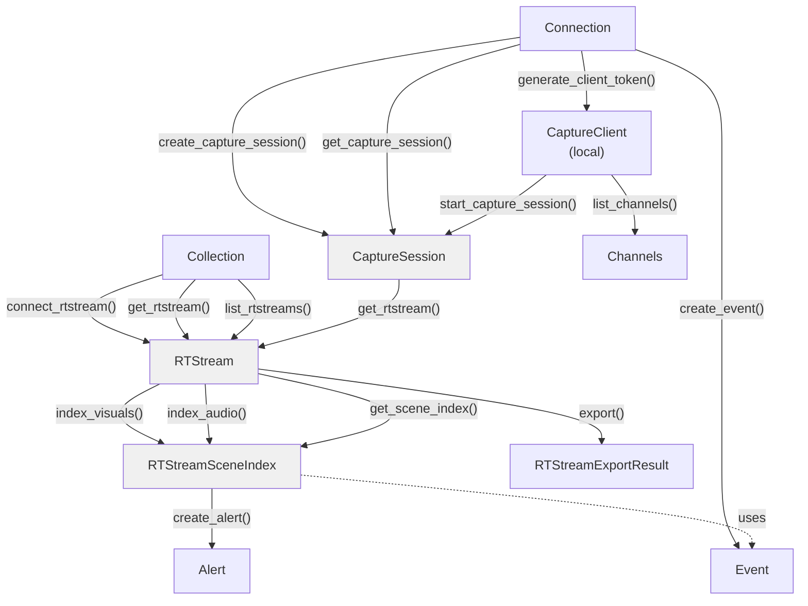
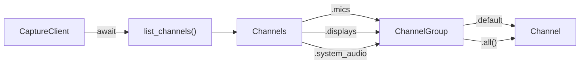
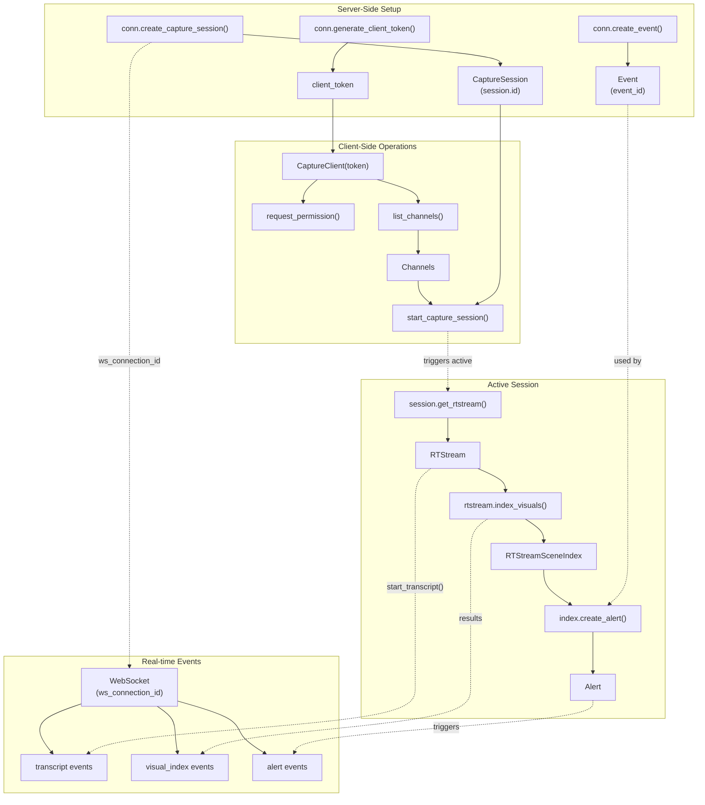

<!-- source: DeepWiki mcp.deepwiki.com · repo video-db/skills · page 15.7 Capture and RTStream Classes · fetched 2026-10-27 -->

# Capture and RTStream Classes

<details>
<summary>Relevant source files</summary>

The following files were used as context for generating this wiki page:

- [python/reference/api-reference.md](python/reference/api-reference.md)
- [python/reference/capture-reference.md](python/reference/capture-reference.md)
- [python/reference/rtstream-reference.md](python/reference/rtstream-reference.md)
- [python/reference/streaming.md](python/reference/streaming.md)

</details>


This page provides a complete API reference for capture sessions, real-time streams, and their related classes. These classes enable desktop recording, live stream ingestion, and real-time AI processing.

For workflow guides and usage examples, see [Desktop Capture](#8) and [Live Stream Processing](#9). For WebSocket event structures, see [Capture Events](#8.3). For session lifecycle management, see [Capture Workflow](#8.1).

---

## Class Relationships



**Sources:** [python/reference/capture-reference.md:214-258](), [python/reference/rtstream-reference.md:9-78]()

---

## CaptureSession

Represents a server-side capture session lifecycle. Created by `Connection.create_capture_session()` or retrieved with `Connection.get_capture_session()`.

### Factory Methods

| Method | Returns | Description |
|--------|---------|-------------|
| `conn.create_capture_session(end_user_id, collection_id, ws_connection_id, metadata)` | `CaptureSession` | Create new capture session |
| `conn.get_capture_session(capture_session_id)` | `CaptureSession` | Retrieve existing session by ID |

**Sources:** [python/reference/capture-reference.md:217-222]()

### Creation Parameters

```python
session = conn.create_capture_session(
    end_user_id="user-123",         # required: unique user identifier
    collection_id="default",         # optional: collection for captured media
    ws_connection_id=ws_id,          # optional: WebSocket connection for events
    metadata={"app": "my-app"},      # optional: custom session metadata
)
```

| Parameter | Type | Required | Description |
|-----------|------|----------|-------------|
| `end_user_id` | `str` | Yes | Unique identifier for the user initiating capture |
| `collection_id` | `str` | No | Collection ID to store captured media (default: `"default"`) |
| `ws_connection_id` | `str` | No | WebSocket connection ID for real-time events |
| `metadata` | `dict` | No | Custom metadata associated with the session |

**Sources:** [python/reference/capture-reference.md:224-238]()

### Properties

| Property | Type | Description |
|----------|------|-------------|
| `session.id` | `str` | Unique capture session ID (format: `cap-xxx`) |

**Sources:** [python/reference/capture-reference.md:240-244]()

### Methods

| Method | Returns | Description |
|--------|---------|-------------|
| `session.get_rtstream(type)` | `list[RTStream]` | Get RTStreams by type: `"mic"`, `"screen"`, or `"system_audio"` |

**Usage:**
```python
# After session becomes active
mics = session.get_rtstream("mic")
displays = session.get_rtstream("screen")
system_audios = session.get_rtstream("system_audio")
```

**Sources:** [python/reference/capture-reference.md:246-250](), [python/reference/rtstream-reference.md:62-70]()

### Lifecycle States

| State | Triggered By | WebSocket Event | Description |
|-------|-------------|-----------------|-------------|
| `created` | `create_capture_session()` | `capture_session.created` | Session initialized, awaiting client connection |
| `starting` | `client.start_capture_session()` | `capture_session.starting` | Client connecting to session |
| `active` | Client streams ready | `capture_session.active` | Recording in progress, RTStreams available |
| `stopping` | `client.stop_capture()` | `capture_session.stopping` | Finalizing streams |
| `stopped` | Streams finalized | `capture_session.stopped` | Recording stopped |
| `exported` | Export complete (if `store=True`) | `capture_session.exported` | Video exported to collection |
| `failed` | Error occurred | `capture_session.failed` | Session failure |

**Sources:** [python/reference/capture-reference.md:357-386]()

---

## CaptureClient

Local client that runs on the user's machine to handle permissions, device discovery, and streaming to a `CaptureSession`. Requires a client token generated by `Connection.generate_client_token()`.

### Initialization

```python
from videodb.capture import CaptureClient

token = conn.generate_client_token()
client = CaptureClient(client_token=token)
```

| Parameter | Type | Required | Description |
|-----------|------|----------|-------------|
| `client_token` | `str` | Yes | Authentication token from `generate_client_token()` |

**Sources:** [python/reference/capture-reference.md:252-268]()

### Methods

| Method | Returns | Description |
|--------|---------|-------------|
| `await client.request_permission(type)` | `None` | Request device permissions (`"microphone"`, `"screen_capture"`) |
| `await client.list_channels()` | `Channels` | Discover available audio/video channels |
| `await client.start_capture_session(capture_session_id, channels, primary_video_channel_id)` | `None` | Start streaming selected channels to session |
| `await client.stop_capture()` | `None` | Gracefully stop the capture session |
| `await client.shutdown()` | `None` | Clean up client resources |

**Sources:** [python/reference/capture-reference.md:270-278]()

### Permission Requests

```python
await client.request_permission("microphone")
await client.request_permission("screen_capture")
```

Triggers OS-level permission dialogs for device access.

**Sources:** [python/reference/capture-reference.md:280-285]()

### Starting a Capture Session

```python
channels = await client.list_channels()
selected_channels = [
    channels.mics.default,
    channels.displays.default,
    channels.system_audio.default,
]

await client.start_capture_session(
    capture_session_id=session.id,
    channels=selected_channels,
    primary_video_channel_id=channels.displays.default.id if channels.displays.default else None,
)
```

| Parameter | Type | Required | Description |
|-----------|------|----------|-------------|
| `capture_session_id` | `str` | Yes | Session ID from `create_capture_session()` |
| `channels` | `list[Channel]` | Yes | List of channels to stream |
| `primary_video_channel_id` | `str` | No | ID of primary display channel for visual indexing |

**Sources:** [python/reference/capture-reference.md:287-296]()

### Stopping a Session

```python
await client.stop_capture()
await client.shutdown()
```

**Sources:** [python/reference/capture-reference.md:298-303]()

---

## Channels

Container for available capture devices, returned by `CaptureClient.list_channels()`.

### Channel Discovery Flow



**Sources:** [python/reference/capture-reference.md:305-343]()

### Channel Group Properties

| Property | Type | Description |
|----------|------|-------------|
| `channels.mics` | `ChannelGroup` | Available microphones |
| `channels.displays` | `ChannelGroup` | Available screen displays |
| `channels.system_audio` | `ChannelGroup` | Available system audio sources |

**Usage:**
```python
channels = await client.list_channels()

mic = channels.mics.default
display = channels.displays.default
system_audio = channels.system_audio.default

# List all channels
for ch in channels.all():
    print(f"{ch.id} ({ch.type}): {ch.name}")
```

**Sources:** [python/reference/capture-reference.md:320-328]()

### ChannelGroup

| Member | Type | Description |
|--------|------|-------------|
| `group.default` | `Channel` or `None` | Default channel in the group |
| `group.all()` | `list[Channel]` | All channels in the group |

**Sources:** [python/reference/capture-reference.md:329-334]()

### Channel Properties

| Property | Type | Description |
|----------|------|-------------|
| `ch.id` | `str` | Unique channel ID |
| `ch.type` | `str` | Channel type: `"mic"`, `"display"`, or `"system_audio"` |
| `ch.name` | `str` | Human-readable channel name |
| `ch.store` | `bool` | Whether to persist the recording (set to `True` to save) |

**Important:** Without `store = True`, streams are processed in real-time but not saved for export.

**Sources:** [python/reference/capture-reference.md:336-345]()

---

## RTStream

Represents a live stream (RTSP/RTMP) or a capture channel. Created by `Collection.connect_rtstream()` or retrieved from an active `CaptureSession`.

### Factory Methods

| Method | Returns | Description |
|--------|---------|-------------|
| `coll.connect_rtstream(url, name, ...)` | `RTStream` | Create RTStream from RTSP/RTMP URL |
| `coll.get_rtstream(id)` | `RTStream` | Get existing RTStream by ID |
| `coll.list_rtstreams(limit, offset, status, name, ordering)` | `List[RTStream]` | List all RTStreams in collection |

**Sources:** [python/reference/rtstream-reference.md:9-18]()

### Connection Parameters

```python
rtstream = coll.connect_rtstream(
    url="rtmp://your-stream-server/live/stream-key",
    name="My Live Stream",
    media_types=["video"],      # or ["audio", "video"]
    sample_rate=30,             # optional: frames per second
    store=True,                 # enable recording storage for export
    enable_transcript=True,     # optional: enable live transcription
    ws_connection_id=ws_id,     # optional: WebSocket connection for events
)
```

| Parameter | Type | Required | Description |
|-----------|------|----------|-------------|
| `url` | `str` | Yes | RTSP or RTMP stream URL |
| `name` | `str` | Yes | Human-readable stream name |
| `media_types` | `list[str]` | No | Types to ingest: `["video"]`, `["audio"]`, or both (default: `["video"]`) |
| `sample_rate` | `int` | No | Frame sampling rate for video streams |
| `store` | `bool` | No | Enable recording for later export (default: `False`) |
| `enable_transcript` | `bool` | No | Enable automatic transcription |
| `ws_connection_id` | `str` | No | WebSocket connection ID for real-time events |

**Sources:** [python/reference/rtstream-reference.md:20-37]()

### Listing RTStreams

```python
rtstreams = coll.list_rtstreams(
    limit=10,
    offset=0,
    status="connected",      # optional filter
    name="meeting",          # optional filter
    ordering="-created_at",  # sort order
)

for rts in rtstreams:
    print(f"{rts.id}: {rts.name} - {rts.status}")
```

**Sources:** [python/reference/rtstream-reference.md:45-58]()

### Core Methods

| Method | Returns | Description |
|--------|---------|-------------|
| `rtstream.start()` | `None` | Begin ingestion |
| `rtstream.stop()` | `None` | Stop ingestion |
| `rtstream.generate_stream(start, end)` | `str` | Generate stream URL for recorded segment (Unix timestamps) |
| `rtstream.export(name=None)` | `RTStreamExportResult` | Export to permanent video in collection |

**Sources:** [python/reference/rtstream-reference.md:82-88]()

### AI Pipeline Methods

| Method | Returns | Description |
|--------|---------|-------------|
| `rtstream.index_visuals(prompt, batch_config, ...)` | `RTStreamSceneIndex` | Create visual index with AI analysis |
| `rtstream.index_audio(prompt, batch_config, ...)` | `RTStreamSceneIndex` | Create audio index with LLM summarization |
| `rtstream.list_scene_indexes()` | `List[RTStreamSceneIndex]` | List all scene indexes on the stream |
| `rtstream.get_scene_index(index_id)` | `RTStreamSceneIndex` | Get a specific scene index |

**Sources:** [python/reference/rtstream-reference.md:89-92]()

### Transcription Methods

| Method | Returns | Description |
|--------|---------|-------------|
| `rtstream.start_transcript(ws_connection_id, engine)` | `dict` | Start live transcription |
| `rtstream.get_transcript(page, page_size, start, end, since)` | `dict` | Get transcript pages with optional filters |
| `rtstream.stop_transcript(engine)` | `dict` | Stop transcription |

**Sources:** [python/reference/rtstream-reference.md:94-96]()

### Search Method

| Method | Returns | Description |
|--------|---------|-------------|
| `rtstream.search(query, ...)` | `RTStreamSearchResult` | Search indexed content |

**Sources:** [python/reference/rtstream-reference.md:93]()

### Starting and Stopping

```python
# Begin ingestion
rtstream.start()

# ... stream is being recorded ...

# Stop ingestion
rtstream.stop()
```

**Sources:** [python/reference/rtstream-reference.md:100-110]()

### Generating Stream URLs

Use Unix timestamps (not seconds offsets) to generate playback URLs:

```python
import time

start_ts = time.time()
rtstream.start()

# Let it record for a while...
time.sleep(60)

end_ts = time.time()
rtstream.stop()

# Generate stream URL for the recorded segment
stream_url = rtstream.generate_stream(start=start_ts, end=end_ts)
print(f"Recorded stream: {stream_url}")
```

| Parameter | Type | Required | Description |
|-----------|------|----------|-------------|
| `start` | `float` | Yes | Start Unix timestamp |
| `end` | `float` | Yes | End Unix timestamp |

**Sources:** [python/reference/rtstream-reference.md:113-134]()

### Visual Indexing

```python
scene_index = rtstream.index_visuals(
    prompt="Describe what is happening on screen",
    batch_config={"type": "time", "value": 2, "frame_count": 5},
    model_name="basic",          # "mini", "basic", "pro", or "ultra"
    name="screen_monitor",       # optional index name
    ws_connection_id=ws_id,      # required for real-time results
)
```

| Parameter | Type | Required | Description |
|-----------|------|----------|-------------|
| `prompt` | `str` | Yes | Instructions for the AI model (supports structured JSON output) |
| `batch_config` | `dict` | Yes | Frame sampling configuration (see below) |
| `model_name` | `str` | No | Model tier: `"mini"`, `"basic"`, `"pro"`, `"ultra"` (default: `"basic"`) |
| `name` | `str` | No | Name for the index |
| `ws_connection_id` | `str` | Yes | WebSocket connection ID for receiving results |

**Batch Config for Visuals:**

| Key | Type | Description |
|-----|------|-------------|
| `type` | `str` | Only `"time"` supported for visuals |
| `value` | `int` | Window size in seconds |
| `frame_count` | `int` | Number of frames to extract per window |

Example: `{"type": "time", "value": 2, "frame_count": 5}` samples 5 frames every 2 seconds.

**Sources:** [python/reference/rtstream-reference.md:204-260]()

### Audio Indexing

```python
audio_index = rtstream.index_audio(
    prompt="Summarize what is being discussed",
    batch_config={"type": "word", "value": 50},
    model_name=None,             # optional
    name="meeting_audio",        # optional index name
    ws_connection_id=ws_id,      # required for real-time results
)
```

| Parameter | Type | Required | Description |
|-----------|------|----------|-------------|
| `prompt` | `str` | Yes | Instructions for LLM summarization |
| `batch_config` | `dict` | Yes | Audio segmentation configuration (see below) |
| `model_name` | `str` | No | Model tier for LLM |
| `name` | `str` | No | Name for the index |
| `ws_connection_id` | `str` | Yes | WebSocket connection ID for receiving results |

**Batch Config for Audio:**

| Type | Value | Description |
|------|-------|-------------|
| `"word"` | count | Segment every N words |
| `"sentence"` | count | Segment every N sentences |
| `"time"` | seconds | Segment every N seconds |

Examples:
```python
{"type": "word", "value": 50}       # every 50 words
{"type": "sentence", "value": 5}    # every 5 sentences
{"type": "time", "value": 30}       # every 30 seconds
```

**Sources:** [python/reference/rtstream-reference.md:173-203]()

### Transcription

```python
# Start live transcription
rtstream.start_transcript(
    ws_connection_id=ws_id,
    engine=None,  # optional, defaults to "assemblyai"
)

# Get transcript pages (with optional filters)
transcript = rtstream.get_transcript(
    page=1,
    page_size=100,
    start=None,   # optional: start timestamp filter
    end=None,     # optional: end timestamp filter
    since=None,   # optional: for polling, get transcripts after this timestamp
    engine=None,
)

# Stop transcription
rtstream.stop_transcript(engine=None)
```

Transcript results arrive on the `transcript` WebSocket channel.

**Sources:** [python/reference/rtstream-reference.md:283-310]()

---

## RTStreamSceneIndex

Represents a running visual or audio index on an `RTStream`. Returned by `rtstream.index_visuals()` or `rtstream.index_audio()`.

### Properties

| Property | Type | Description |
|----------|------|-------------|
| `rtstream_index_id` | `str` | Unique ID of the index |
| `rtstream_id` | `str` | ID of the parent RTStream |
| `extraction_type` | `str` | Type of extraction: `"time"` or `"transcript"` |
| `extraction_config` | `dict` | Extraction configuration (batch_config) |
| `prompt` | `str` | The prompt used for analysis |
| `name` | `str` | Name of the index |
| `status` | `str` | Status: `"connected"` or `"stopped"` |

**Sources:** [python/reference/rtstream-reference.md:330-341]()

### Methods

| Method | Returns | Description |
|--------|---------|-------------|
| `index.get_scenes(start, end, page, page_size)` | `dict` | Get indexed scenes with pagination |
| `index.start()` | `None` | Start or resume the index |
| `index.stop()` | `None` | Stop the index |
| `index.create_alert(event_id, callback_url, ws_connection_id)` | `str` (alert_id) | Create alert for event detection |
| `index.list_alerts()` | `list` | List all alerts on this index |
| `index.enable_alert(alert_id)` | `None` | Enable an alert |
| `index.disable_alert(alert_id)` | `None` | Disable an alert |

**Sources:** [python/reference/rtstream-reference.md:343-353]()

### Getting Scenes

```python
result = scene_index.get_scenes(
    start=None,      # optional: start timestamp
    end=None,        # optional: end timestamp
    page=1,
    page_size=100,
)

for scene in result["scenes"]:
    print(f"[{scene['start']}-{scene['end']}] {scene['text']}")

if result["next_page"]:
    # fetch next page
    pass
```

**Sources:** [python/reference/rtstream-reference.md:355-373]()

### Managing Scene Indexes

```python
# List all indexes on the stream
indexes = rtstream.list_scene_indexes()

# Get a specific index by ID
scene_index = rtstream.get_scene_index(index_id)

# Stop an index
scene_index.stop()

# Restart an index
scene_index.start()
```

**Sources:** [python/reference/rtstream-reference.md:375-389]()

---

## RTStreamExportResult

Returned by `RTStream.export()` when exporting a recorded stream to a permanent video.

### Properties

| Property | Type | Description |
|----------|------|-------------|
| `video_id` | `str` | ID of the exported video |
| `stream_url` | `str` | HLS stream URL for playback |
| `player_url` | `str` | Web player URL |
| `name` | `str` | Video name |
| `duration` | `float` | Duration in seconds |

**Usage:**
```python
export_result = rtstream.export(name="Meeting Recording 2024-01-15")

print(f"Video ID: {export_result.video_id}")
print(f"Stream URL: {export_result.stream_url}")
print(f"Player URL: {export_result.player_url}")
print(f"Duration: {export_result.duration}s")
```

**Sources:** [python/reference/rtstream-reference.md:137-159]()

---

## Event

Reusable detection rules created once and attached to any `RTStreamSceneIndex` via alerts. Events are managed at the `Connection` level.

### Event Factory Methods

| Method | Returns | Description |
|--------|---------|-------------|
| `conn.create_event(event_prompt, label)` | `str` (event_id) | Create detection event |
| `conn.list_events()` | `list` | List all events |

**Sources:** [python/reference/rtstream-reference.md:397-403]()

### Creating an Event

```python
event_id = conn.create_event(
    event_prompt="User opened Slack application",
    label="slack_opened",
)
```

| Parameter | Type | Required | Description |
|-----------|------|----------|-------------|
| `event_prompt` | `str` | Yes | Detection criteria for AI to match against indexed content |
| `label` | `str` | Yes | Unique identifier for the event |

**Sources:** [python/reference/rtstream-reference.md:405-411]()

### Listing Events

```python
events = conn.list_events()
for event in events:
    print(f"{event['event_id']}: {event['label']}")
```

**Sources:** [python/reference/rtstream-reference.md:413-419]()

---

## Alert

Wires an `Event` to an `RTStreamSceneIndex` for real-time notifications. When AI detects content matching the event description, an alert is sent via WebSocket and/or webhook.

### Creating an Alert

```python
# Get the RTStreamSceneIndex from index_visuals
scene_index = rtstream.index_visuals(
    prompt="Describe what application is open on screen",
    ws_connection_id=ws_id,
)

# Create an alert on the index
alert_id = scene_index.create_alert(
    event_id=event_id,
    callback_url="https://your-backend.com/alerts",  # for webhook delivery
    ws_connection_id=ws_id,  # for WebSocket delivery (optional)
)
```

| Parameter | Type | Required | Description |
|-----------|------|----------|-------------|
| `event_id` | `str` | Yes | Event ID from `conn.create_event()` |
| `callback_url` | `str` | Yes | URL for webhook delivery (use `""` if only using WebSocket) |
| `ws_connection_id` | `str` | No | WebSocket connection ID for real-time delivery |

**Important:** `callback_url` is required. Pass an empty string `""` if only using WebSocket delivery.

**Sources:** [python/reference/rtstream-reference.md:422-444]()

### Managing Alerts

```python
# List all alerts on an index
alerts = scene_index.list_alerts()

# Enable/disable alerts
scene_index.disable_alert(alert_id)
scene_index.enable_alert(alert_id)
```

**Sources:** [python/reference/rtstream-reference.md:446-455]()

### Alert Delivery Methods

| Method | Latency | Use Case |
|--------|---------|----------|
| WebSocket | Real-time | Dashboards, live UI |
| Webhook | < 1 second | Server-to-server, automation |

**Sources:** [python/reference/rtstream-reference.md:457-463]()

### WebSocket Alert Event Structure

```json
{
  "channel": "alert",
  "rtstream_id": "rts-xxx",
  "data": {
    "event_label": "slack_opened",
    "timestamp": 1710000012340,
    "text": "User opened Slack application"
  }
}
```

**Sources:** [python/reference/rtstream-reference.md:465-476]()

### Webhook Payload Structure

```json
{
  "event_id": "event-xxx",
  "label": "slack_opened",
  "confidence": 0.95,
  "explanation": "User opened the Slack application",
  "timestamp": "2024-01-15T10:30:45Z",
  "start_time": 1234.5,
  "end_time": 1238.0,
  "stream_url": "https://stream.videodb.io/v3/...",
  "player_url": "https://console.videodb.io/player?url=..."
}
```

**Sources:** [python/reference/rtstream-reference.md:478-492]()

---

## WebSocket Integration

All real-time AI results from capture sessions and RTStreams are delivered via WebSocket. Pass `ws_connection_id` to the following methods to receive events:

| Method | WebSocket Channel | Content |
|--------|------------------|---------|
| `conn.create_capture_session(ws_connection_id=...)` | `capture_session` | Session lifecycle events |
| `rtstream.start_transcript(ws_connection_id=...)` | `transcript` | Real-time speech-to-text |
| `rtstream.index_visuals(ws_connection_id=...)` | `scene_index` or `visual_index` | Visual analysis results |
| `rtstream.index_audio(ws_connection_id=...)` | `audio_index` | Audio analysis results |
| `scene_index.create_alert(ws_connection_id=...)` | `alert` | Alert notifications |

**Sources:** [python/reference/rtstream-reference.md:495-513](), [python/reference/capture-reference.md:13-22]()

### WebSocket Connection

```python
# Connect to WebSocket and get connection ID
ws_wrapper = conn.connect_websocket()
ws = await ws_wrapper.connect()
ws_id = ws.connection_id

# Use ws_id in AI pipeline methods
rtstream.index_visuals(
    prompt="...",
    ws_connection_id=ws_id,
)
```

| Property / Method | Type | Description |
|-------------------|------|-------------|
| `ws.connection_id` | `str` | Unique connection ID |
| `ws.receive()` | `AsyncIterator[dict]` | Async iterator yielding real-time messages |

**Sources:** [python/reference/capture-reference.md:196-211]()

---

## Complete Integration Flow



**Sources:** [python/reference/capture-reference.md:1-386](), [python/reference/rtstream-reference.md:1-552]()