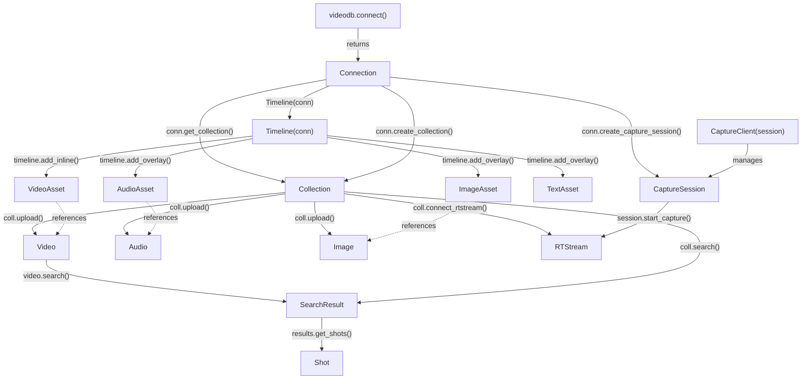
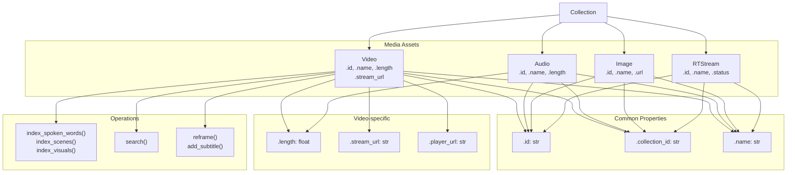
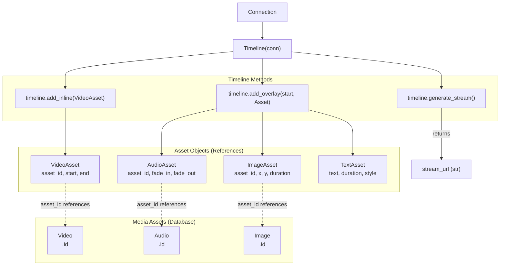
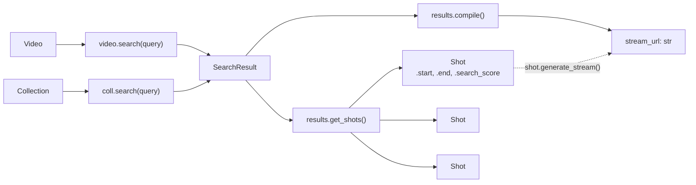
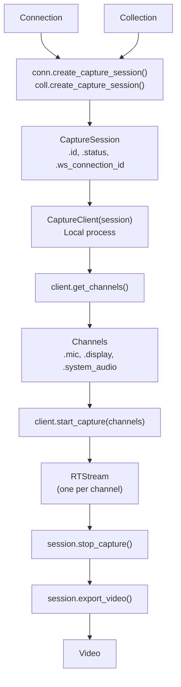
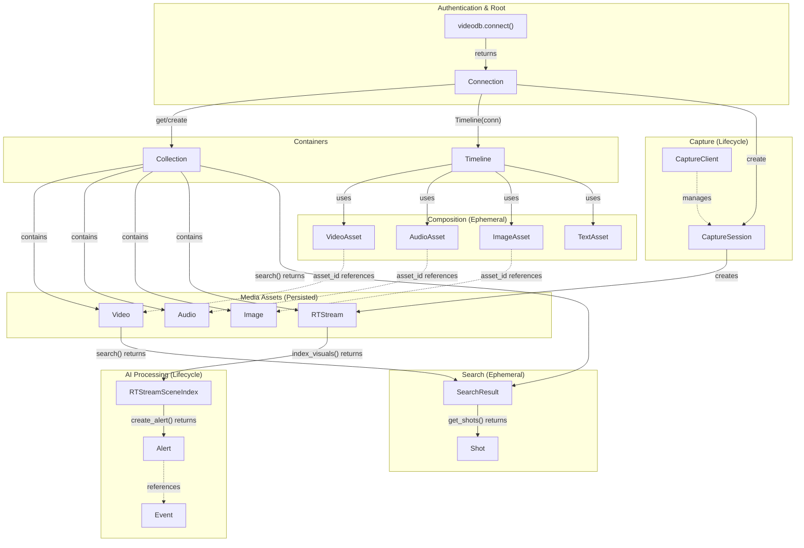

<!-- source: DeepWiki mcp.deepwiki.com · repo video-db/skills · page 2.1 Object Model · fetched 2026-10-27 -->

# Object Model

<details>
<summary>Relevant source files</summary>

The following files were used as context for generating this wiki page:

- [python/SKILL.md](python/SKILL.md)
- [python/reference/api-reference.md](python/reference/api-reference.md)

</details>


This page documents the complete object hierarchy in the VideoDB SDK, including the relationships between `Connection`, `Collection`, `Video`, `Audio`, `Image`, `RTStream`, and their associated objects. This is the foundational architecture for all SDK operations.

For authentication details, see [Authentication](#2.2). For editing and composition workflows, see [Timeline Editing](#7). For real-time capture, see [Desktop Capture](#8) and [Live Stream Processing](#9).

---

## Authentication and Root Object

The SDK entry point is the `videodb.connect()` function, which validates credentials and returns a `Connection` object. All operations originate from this root object.

```python
import videodb

conn = videodb.connect(
    api_key="your-api-key",  # optional: defaults to VIDEO_DB_API_KEY env var
    base_url=None,            # optional: custom API endpoint
)
```

The `Connection` object:
- Validates the API key on creation (raises `AuthenticationError` if invalid)
- Acts as a factory for `Collection` and `Timeline` objects
- Provides top-level operations like `upload()`, `transcode()`, and `create_capture_session()`
- Maintains authentication context for all child objects

**Sources:** [python/SKILL.md:68-74](), [python/reference/api-reference.md:6-12]()

---

## Core Object Hierarchy

The SDK follows a strict ownership hierarchy. Objects are created by their parent and maintain a reference to their parent's ID.

**Hierarchy Diagram: Object Ownership and Creation**



**Key ownership rules:**
- **Solid arrows** indicate creation/ownership (parent creates child)
- **Dashed arrows** indicate references (child references parent's asset by ID)
- `Connection` never belongs to `Collection` — both are peer-level objects
- `Timeline` is created independently from `Connection`, not from `Collection`
- Asset objects (`VideoAsset`, `AudioAsset`, etc.) reference media by ID, not ownership

**Sources:** [python/reference/api-reference.md:1-31](), [python/SKILL.md:68-74]()

---

## Connection Object

The `Connection` object is the root factory for all SDK operations. It provides access to collections, uploads, transcoding, and capture sessions.

### Connection Properties

| Property | Type | Description |
|----------|------|-------------|
| `.api_key` | `str` | API key used for authentication |
| `.base_url` | `str` | API endpoint URL |

### Connection Methods (Factory Operations)

| Method | Returns | Purpose |
|--------|---------|---------|
| `conn.get_collection(collection_id="default")` | `Collection` | Retrieve a collection by ID (defaults to "default") |
| `conn.get_collections()` | `list[Collection]` | List all collections |
| `conn.create_collection(name, description, is_public)` | `Collection` | Create a new collection |
| `conn.update_collection(id, name, description)` | `Collection` | Update collection metadata |

### Connection Methods (Direct Operations)

| Method | Returns | Purpose |
|--------|---------|---------|
| `conn.upload(source, media_type, name, ...)` | `Video\|Audio\|Image` | Upload to default collection |
| `conn.transcode(source, callback_url, mode, ...)` | `str` | Transcode video (returns job ID) |
| `conn.get_transcode_details(job_id)` | `dict` | Check transcode job status |
| `conn.check_usage()` | `dict` | Get account usage stats |
| `conn.youtube_search(query, ...)` | `list[dict]` | Search YouTube |
| `conn.record_meeting(meeting_url, bot_name, ...)` | `Meeting` | Record a meeting |
| `conn.create_capture_session(...)` | `CaptureSession` | Create a desktop capture session |
| `conn.connect_websocket(collection_id)` | `WebSocketConnection` | Connect to WebSocket for events |

**Sources:** [python/reference/api-reference.md:18-31]()

---

## Collection Object

The `Collection` object acts as a container for media assets and provides factory methods for uploads, generation, and search.

### Collection Properties

| Property | Type | Description |
|----------|------|-------------|
| `.id` | `str` | Unique collection ID |
| `.name` | `str` | Collection name |
| `.description` | `str` | Collection description |
| `.is_public` | `bool` | Public visibility flag |

### Collection Methods (Media Retrieval)

| Method | Returns | Purpose |
|--------|---------|---------|
| `coll.get_videos()` | `list[Video]` | List all videos in collection |
| `coll.get_video(video_id)` | `Video` | Get specific video by ID |
| `coll.get_audios()` | `list[Audio]` | List all audio assets |
| `coll.get_audio(audio_id)` | `Audio` | Get specific audio by ID |
| `coll.get_images()` | `list[Image]` | List all images |
| `coll.get_image(image_id)` | `Image` | Get specific image by ID |

### Collection Methods (Media Creation)

| Method | Returns | Purpose |
|--------|---------|---------|
| `coll.upload(url, file_path, media_type, ...)` | `Video\|Audio\|Image` | Upload media from URL or file |
| `coll.generate_image(prompt, aspect_ratio)` | `Image` | AI-generated image |
| `coll.generate_video(prompt, duration)` | `Video` | AI-generated video |
| `coll.generate_music(prompt, duration)` | `Audio` | AI-generated music |
| `coll.generate_sound_effect(prompt, duration)` | `Audio` | AI-generated sound effect |
| `coll.generate_voice(text, voice_name)` | `Audio` | Text-to-speech |
| `coll.dub_video(video_id, language_code)` | `Video` | Dub video into another language |

### Collection Methods (Search and Capture)

| Method | Returns | Purpose |
|--------|---------|---------|
| `coll.search(query, search_type, ...)` | `SearchResult` | Semantic search across collection |
| `coll.create_capture_session(...)` | `CaptureSession` | Create desktop capture session |
| `coll.get_capture_session(...)` | `CaptureSession` | Retrieve capture session |
| `coll.connect_rtstream(url, name, ...)` | `RTStream` | Connect to live stream |
| `coll.record_meeting(meeting_url, bot_name, ...)` | `Meeting` | Record a meeting |

**Sources:** [python/reference/api-reference.md:99-133]()

---

## Media Asset Objects

Media assets are the primary content objects in VideoDB. All media assets share common properties and lifecycle methods.

**Object Model: Media Asset Types**



**Sources:** [python/reference/api-reference.md:148-268]()

### Video Object

The most feature-rich media asset. Provides indexing, search, editing, and transformation operations.

| Property | Type | Description |
|----------|------|-------------|
| `.id` | `str` | Unique video ID |
| `.collection_id` | `str` | Parent collection ID |
| `.name` | `str` | Video name |
| `.description` | `str` | Video description |
| `.length` | `float` | Duration in seconds |
| `.stream_url` | `str` | Default HLS stream URL |
| `.player_url` | `str` | Web player embed URL |
| `.thumbnail_url` | `str` | Thumbnail image URL |

**Key Methods:**

| Category | Methods |
|----------|---------|
| **Indexing** | `index_spoken_words()`, `index_scenes()`, `index_visuals()`, `index_audio()` |
| **Search** | `search(query, search_type, index_type, ...)` |
| **Transcripts** | `get_transcript()`, `get_transcript_text()`, `translate_transcript()` |
| **Editing** | `add_subtitle()`, `generate_stream()`, `clip()`, `insert_video()` |
| **Transformation** | `reframe(start, end, target, mode, ...)` |
| **Metadata** | `generate_thumbnail()`, `get_thumbnails()`, `extract_scenes()` |
| **Lifecycle** | `download()`, `delete()`, `play()` |

**Sources:** [python/reference/api-reference.md:148-190](), [python/SKILL.md:142-147]()

### Audio Object

Audio assets have simpler operations focused on transcription and playback.

| Property | Type | Description |
|----------|------|-------------|
| `.id` | `str` | Unique audio ID |
| `.collection_id` | `str` | Parent collection ID |
| `.name` | `str` | Audio name |
| `.length` | `float` | Duration in seconds |

**Methods:**

| Method | Returns | Purpose |
|--------|---------|---------|
| `generate_url()` | `str` | Generate signed playback URL |
| `get_transcript()` | `list[dict]` | Timestamped transcript |
| `get_transcript_text()` | `str` | Full transcript text |
| `generate_transcript()` | `dict` | Generate transcript |
| `delete()` | `None` | Delete audio |

**Sources:** [python/reference/api-reference.md:223-246]()

### Image Object

Image assets are used for overlays, thumbnails, or standalone images.

| Property | Type | Description |
|----------|------|-------------|
| `.id` | `str` | Unique image ID |
| `.collection_id` | `str` | Parent collection ID |
| `.name` | `str` | Image name |
| `.url` | `str\|None` | Image URL (may be `None` for generated images) |

**Methods:**

| Method | Returns | Purpose |
|--------|---------|---------|
| `generate_url()` | `str` | Generate signed URL |
| `delete()` | `None` | Delete image |

**Note:** For AI-generated images, `.url` may be `None`. Always use `image.generate_url()` for a valid URL.

**Sources:** [python/reference/api-reference.md:248-268]()

### RTStream Object

Represents live streams from RTSP/RTMP sources or desktop capture sessions. See [Live Stream Processing](#9) for complete documentation.

| Property | Type | Description |
|----------|------|-------------|
| `.id` | `str` | Unique stream ID |
| `.collection_id` | `str` | Parent collection ID |
| `.name` | `str` | Stream name |
| `.status` | `str` | Stream status (active, stopped, etc.) |

**Sources:** [python/reference/api-reference.md:449-452]()

---

## Composition Objects

Composition objects are used with the `Timeline` API to build non-destructive edits. Unlike media assets, these objects do not persist in the database — they are configuration objects that reference media assets.

**Timeline Composition Model**



**Sources:** [python/reference/api-reference.md:270-363]()

### Timeline Object

Created from `Connection`, not from `Collection`. Manages sequential and overlay tracks.

| Method | Parameters | Purpose |
|--------|-----------|---------|
| `timeline.add_inline(asset)` | `VideoAsset` | Add video sequentially to main track |
| `timeline.add_overlay(start, asset)` | `float, Asset` | Overlay audio/image/text at timestamp |
| `timeline.generate_stream()` | None | Compile timeline and return HLS URL |

**Usage pattern:**

```python
from videodb.timeline import Timeline
from videodb.asset import VideoAsset, AudioAsset

timeline = Timeline(conn)
timeline.add_inline(VideoAsset(asset_id=video.id, start=10, end=30))
timeline.add_overlay(0, AudioAsset(asset_id=audio.id))
stream_url = timeline.generate_stream()
```

**Critical validation:** Always validate timestamps before adding assets. Negative `start` values are silently accepted but produce broken output. See [Timeline Editing](#7) for complete documentation.

**Sources:** [python/reference/api-reference.md:270-285](), [python/SKILL.md:208-223]()

### Asset Types

| Asset Class | Parameters | Reference Target | Purpose |
|-------------|-----------|------------------|---------|
| `VideoAsset` | `asset_id, start, end` | `Video.id` | Trim and sequence video clips |
| `AudioAsset` | `asset_id, start, end, disable_other_tracks, fade_in_duration, fade_out_duration` | `Audio.id` | Overlay or replace audio |
| `ImageAsset` | `asset_id, duration, width, height, x, y` | `Image.id` | Overlay image at position |
| `TextAsset` | `text, duration, style` | None | Overlay text with styling |

**Reference semantics:** Asset objects store `asset_id` (a string ID), not the media object itself. Multiple timelines can reference the same media asset without duplication.

**Sources:** [python/reference/api-reference.md:288-347]()

---

## Search Objects

Search operations return structured result objects that provide access to matching segments.

**Search Result Flow**



**Sources:** [python/reference/api-reference.md:365-413]()

### SearchResult Object

| Method | Returns | Purpose |
|--------|---------|---------|
| `results.get_shots()` | `list[Shot]` | Get list of matching segments |
| `results.compile()` | `str` | Compile all shots into single stream URL |
| `results.play()` | `str` | Open compiled stream in browser |

**Important:** `video.search()` raises `InvalidRequestError` with message `"No results found"` when there are no matches. Always wrap in try/except:

```python
from videodb.exceptions import InvalidRequestError

try:
    results = video.search("query")
    shots = results.get_shots()
except InvalidRequestError as e:
    if "No results found" in str(e):
        shots = []
    else:
        raise
```

**Sources:** [python/SKILL.md:152-167](), [python/reference/api-reference.md:388-397]()

### Shot Object

Represents a single matching segment with metadata.

| Property | Type | Description |
|----------|------|-------------|
| `.video_id` | `str` | Source video ID |
| `.video_length` | `float` | Source video duration |
| `.video_title` | `str` | Source video title |
| `.start` | `float` | Segment start time (seconds) |
| `.end` | `float` | Segment end time (seconds) |
| `.text` | `str` | Matched text content |
| `.search_score` | `float` | Search relevance score (0.0 - 1.0) |

| Method | Returns | Purpose |
|--------|---------|---------|
| `shot.generate_stream()` | `str` | Generate stream URL for this shot only |
| `shot.play()` | `str` | Open shot in browser |

**Sources:** [python/reference/api-reference.md:399-413]()

---

## Capture and Real-time Objects

Desktop capture and live stream processing use a distinct set of objects for managing real-time sessions and events.

**Capture Session Lifecycle**



**Sources:** [python/reference/api-reference.md:27-28](), [python/SKILL.md:315-347]()

### CaptureSession Object

Server-side session manager for desktop capture.

| Property | Type | Description |
|----------|------|-------------|
| `.id` | `str` | Unique session ID |
| `.collection_id` | `str` | Parent collection ID |
| `.status` | `str` | Session status (created, active, stopped, etc.) |
| `.ws_connection_id` | `str` | WebSocket connection ID for events |

**Key Methods:**

| Method | Returns | Purpose |
|--------|---------|---------|
| `session.stop_capture()` | `None` | Stop all capture channels |
| `session.export_video(name, description)` | `Video` | Export session to permanent video |

See [Desktop Capture](#8) for complete documentation.

**Sources:** [python/reference/api-reference.md:449-452]()

### CaptureClient Object

Local client process that streams to a `CaptureSession`.

| Method | Returns | Purpose |
|--------|---------|---------|
| `client.get_channels()` | `Channels` | Discover available input devices |
| `client.start_capture(channels)` | `None` | Start streaming selected channels |

**Sources:** [python/reference/api-reference.md:449-452]()

### Channels Object

Represents discovered input devices.

| Property | Type | Description |
|----------|------|-------------|
| `.mic` | `list[dict]` | Available microphone devices |
| `.display` | `list[dict]` | Available displays/screens |
| `.system_audio` | `list[dict]` | System audio devices |

**Sources:** [python/reference/api-reference.md:449-452]()

---

## AI Processing Objects

Real-time AI processing uses index and event objects.

### RTStreamSceneIndex Object

Returned by `rtstream.index_visuals()` or `rtstream.index_audio()`. Represents an active AI processing pipeline on a live stream.

| Property | Type | Description |
|----------|------|-------------|
| `.id` | `str` | Unique index ID |
| `.rtstream_id` | `str` | Parent RTStream ID |
| `.status` | `str` | Processing status |

**Methods:**

| Method | Returns | Purpose |
|--------|---------|---------|
| `index.create_alert(event, callback_url, webhook_url)` | `Alert` | Create event-based alert |
| `index.stop()` | `None` | Stop AI processing pipeline |

See [Live Stream Processing](#9) for complete documentation.

**Sources:** [python/reference/api-reference.md:449-452]()

### Event Object

Reusable event detection rule defined by a prompt.

| Property | Type | Description |
|----------|------|-------------|
| `.id` | `str` | Unique event ID |
| `.prompt` | `str` | Detection prompt |

### Alert Object

Wires an `Event` to an `RTStreamSceneIndex` for notifications.

| Property | Type | Description |
|----------|------|-------------|
| `.id` | `str` | Unique alert ID |
| `.event_id` | `str` | Referenced event ID |
| `.index_id` | `str` | Referenced index ID |
| `.callback_url` | `str` | WebSocket callback URL |
| `.webhook_url` | `str` | HTTP webhook URL |

**Sources:** [python/reference/api-reference.md:449-452]()

---

## Object Relationships Summary

**Complete Object Relationship Map**



**Relationship types:**
- **Solid arrows**: Creation/ownership (parent creates child)
- **Dashed arrows**: Reference (child holds ID reference to parent)

**Key patterns:**
1. **Factory Pattern**: `Connection` and `Collection` create objects
2. **Reference Pattern**: Asset objects reference media by ID
3. **Ephemeral Pattern**: Search and composition objects are temporary
4. **Lifecycle Pattern**: Capture and stream objects transition through states

**Sources:** [python/reference/api-reference.md:1-549](), [python/SKILL.md:1-362]()

---

## Key Design Patterns

### 1. Object Creation Scoping

Objects are created by authorized parents, inheriting authentication context:

| Creator | Creates | Access Pattern |
|---------|---------|---------------|
| `videodb.connect()` | `Connection` | `conn = videodb.connect()` |
| `Connection` | `Collection`, `Timeline`, `CaptureSession` | `coll = conn.get_collection()` |
| `Collection` | `Video`, `Audio`, `Image`, `RTStream` | `video = coll.upload(...)` |
| `Timeline` | None (accepts assets) | `timeline.add_inline(asset)` |

### 2. Reference vs Ownership

- **Ownership**: `Collection` owns `Video` (deleting collection deletes videos)
- **Reference**: `VideoAsset` references `Video` by ID (multiple timelines can reference same video)

### 3. Persistent vs Ephemeral

| Persistent (Database) | Ephemeral (Runtime) |
|----------------------|---------------------|
| `Video`, `Audio`, `Image` | `VideoAsset`, `AudioAsset`, `ImageAsset` |
| `Collection`, `RTStream` | `SearchResult`, `Shot` |
| `CaptureSession` | `Timeline`, `CaptureClient` |

### 4. Lifecycle State Machines

Objects like `CaptureSession` and `RTStream` have state transitions:

```
CaptureSession: created → active → stopped → exported
RTStream: created → active → stopped → exported
```

**Sources:** [python/reference/api-reference.md:1-549]()

---

