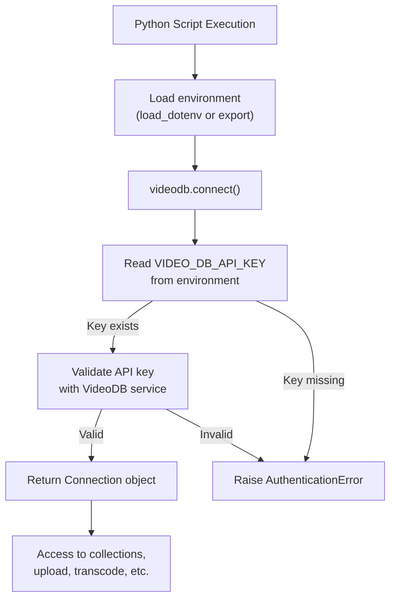
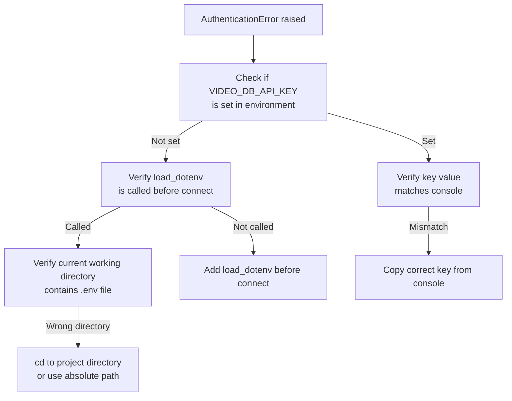

<!-- source: DeepWiki mcp.deepwiki.com · repo video-db/skills · page 2.2 Authentication · fetched 2026-10-27 -->

# Authentication

<details>
<summary>Relevant source files</summary>

The following files were used as context for generating this wiki page:

- [.gitignore](.gitignore)
- [python/.env.example](python/.env.example)
- [python/SKILL.md](python/SKILL.md)
- [python/reference/generative.md](python/reference/generative.md)

</details>


Authentication in VideoDB is handled through API keys and the `videodb.connect()` function. This page covers API key management, connection initialization, and error handling for authentication failures. For information about the `Connection` object itself and its methods, see [Object Model](#2.1). For complete API reference of `videodb.connect()`, see [Connection Methods](#15.1).

---

## API Key Management

VideoDB requires a valid API key to authenticate all operations. The key is stored in the `VIDEO_DB_API_KEY` environment variable and validated when calling `videodb.connect()`.

### Obtaining an API Key

API keys are obtained from the VideoDB console at `https://console.videodb.io`. Free tier accounts receive 50 free uploads with no credit card required.

### Setting the API Key

There are two methods for providing the API key to the SDK:

| Method | Command/File | Scope | Recommended Use |
|--------|--------------|-------|-----------------|
| **Environment Variable** | `export VIDEO_DB_API_KEY=your-key` | Terminal session | Development, CI/CD pipelines |
| **`.env` File** | `VIDEO_DB_API_KEY=your-key` | Project directory | Multi-project environments |

**Environment Variable (Recommended):**

```bash
export VIDEO_DB_API_KEY=your-api-key-here
```

This method sets the key for the current terminal session. It is ideal for development workflows and CI/CD environments where secrets are injected via environment variables.

**`.env` File:**

Create a `.env` file in your project directory:

```
VIDEO_DB_API_KEY=your-api-key-here
```

Load it using `python-dotenv`:

```python
from dotenv import load_dotenv
load_dotenv(".env")

import videodb
conn = videodb.connect()
```

The SDK automatically reads from environment variables when `videodb.connect()` is called. The `.env` approach is useful when working with multiple projects that require different API keys.

**Sources:** [python/SKILL.md:115-123](), [python/.env.example:1]()

---

## Connection Initialization

### The `videodb.connect()` Function

The `videodb.connect()` function validates the API key and returns a `Connection` object, which serves as the root object for all VideoDB operations.

**Basic Usage:**

```python
import videodb

conn = videodb.connect()
```

This function:
1. Reads `VIDEO_DB_API_KEY` from the environment
2. Validates the key with the VideoDB service
3. Returns a `Connection` object on success
4. Raises `AuthenticationError` on failure

**No Parameters Required:** The function takes no arguments—authentication is handled entirely through the environment variable.

### Authentication Flow



**Diagram:** Authentication flow from script execution to `Connection` object creation.

**Sources:** [python/SKILL.md:68-80](), [python/SKILL.md:276-281]()

---

## The Connection Object

The `Connection` object returned by `videodb.connect()` is the entry point for all VideoDB operations. It provides factory methods for creating and retrieving collections, timelines, and media assets.

**Key Characteristics:**

- **Authorization Context:** The `Connection` object holds the authenticated session. All objects created from it (collections, timelines) inherit this authorization context.
- **Stateless Design:** The connection does not maintain persistent state—it is a lightweight wrapper around the API key.
- **Factory Pattern:** The connection creates other objects (`Collection`, `Timeline`, `CaptureSession`) via factory methods.

**Example:**

```python
import videodb

conn = videodb.connect()

# Factory methods
coll = conn.get_collection()
timeline = Timeline(conn)
session = conn.create_capture_session()
```

For detailed documentation of `Connection` methods, see [Connection Methods](#15.1).

**Sources:** [python/SKILL.md:68-74]()

---

## Authentication Errors

### AuthenticationError Exception

When `videodb.connect()` fails due to invalid or missing credentials, it raises `videodb.exceptions.AuthenticationError`.

**Common Failure Scenarios:**

| Scenario | Error Behavior | Solution |
|----------|----------------|----------|
| `VIDEO_DB_API_KEY` not set | `AuthenticationError` raised | Export the key or add to `.env` |
| Invalid API key | `AuthenticationError` raised | Verify key from console |
| Expired API key | `AuthenticationError` raised | Generate new key from console |
| Network connectivity issues | May raise timeout or connection error | Check network/firewall settings |

### Error Handling Pattern

Always wrap `videodb.connect()` in a try-except block to handle authentication failures gracefully:

```python
from videodb.exceptions import AuthenticationError

try:
    conn = videodb.connect()
except AuthenticationError:
    print("Authentication failed. Check your VIDEO_DB_API_KEY.")
    exit(1)
```

**Important:** The `AuthenticationError` is raised immediately during `connect()`, not lazily. If the function succeeds, the key is valid and all subsequent operations will be authorized.

### Debugging Authentication Issues



**Diagram:** Debugging flow for authentication failures.

**Debugging Commands:**

```bash
# Check if key is set in environment
echo $VIDEO_DB_API_KEY

# Verify .env file location
ls -la .env

# Test connection
python -c "import videodb; videodb.connect(); print('Success')"
```

**Sources:** [python/SKILL.md:276-287]()

---

## Best Practices

### Security

| Practice | Rationale |
|----------|-----------|
| **Never commit API keys to version control** | Keys in git history remain accessible even after deletion |
| **Use `.env` files for local development** | Keeps secrets out of code |
| **Add `.env` to `.gitignore`** | Prevents accidental commits |
| **Use environment variables in production** | Most deployment platforms support secret injection |
| **Rotate keys periodically** | Limits exposure window if key is compromised |

**Example `.gitignore`:**

```
.env
.venv/
__pycache__/
```

### Workflow Integration

**AI Agent Context (Claude/Cursor):**

When working with AI agents, the agent should **never** read, write, or handle the API key directly. The user must set it themselves via export or `.env` file. AI agents can only instruct users on how to set it.

**CI/CD Pipelines:**

```bash
# GitHub Actions example
export VIDEO_DB_API_KEY=${{ secrets.VIDEODB_API_KEY }}
python script.py
```

**Multi-Project Environments:**

When managing multiple projects with different VideoDB accounts, use separate `.env` files per project and ensure `load_dotenv(".env")` is called from the correct working directory:

```python
import os
os.chdir("/path/to/project")

from dotenv import load_dotenv
load_dotenv(".env")

import videodb
conn = videodb.connect()
```

### Connection Reuse

The `Connection` object can be reused across multiple operations. There is no need to call `videodb.connect()` repeatedly:

```python
import videodb

# Connect once
conn = videodb.connect()

# Reuse connection
coll1 = conn.get_collection()
coll2 = conn.create_collection(name="New Collection")
timeline = Timeline(conn)
```

**Sources:** [python/SKILL.md:64-96](), [python/SKILL.md:115-123](), [.gitignore:1]()

---

## Code Entity Reference

The following code symbols and entities are central to authentication:

| Entity | Type | Location | Purpose |
|--------|------|----------|---------|
| `VIDEO_DB_API_KEY` | Environment Variable | User's environment or `.env` | Stores API key |
| `videodb.connect()` | Function | SDK entry point | Validates key, returns `Connection` |
| `Connection` | Object | Returned by `connect()` | Root object for all operations |
| `AuthenticationError` | Exception | `videodb.exceptions` | Raised on auth failure |
| `load_dotenv()` | Function | `python-dotenv` package | Loads `.env` into environment |

**Sources:** [python/SKILL.md:68-96](), [python/SKILL.md:276-287]()

---

