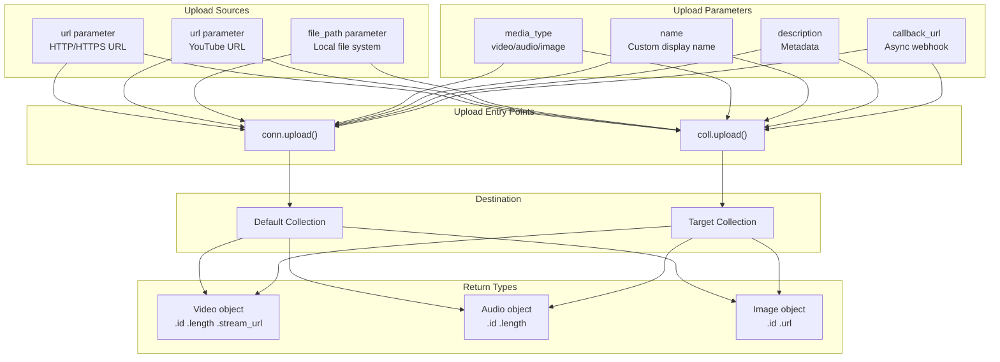
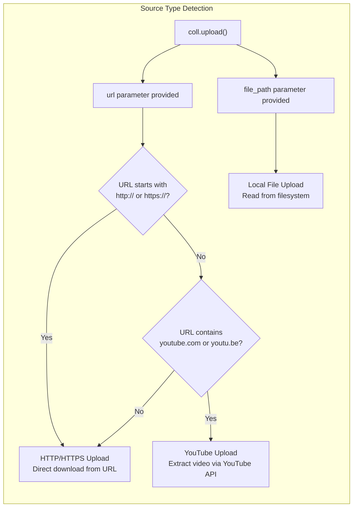
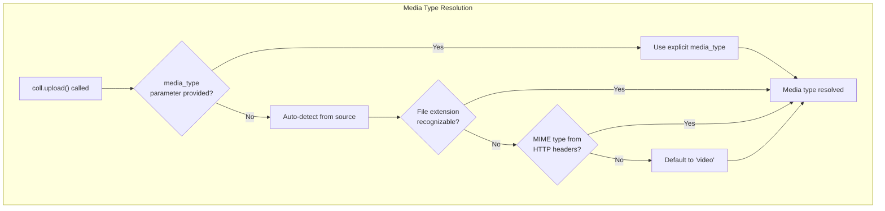
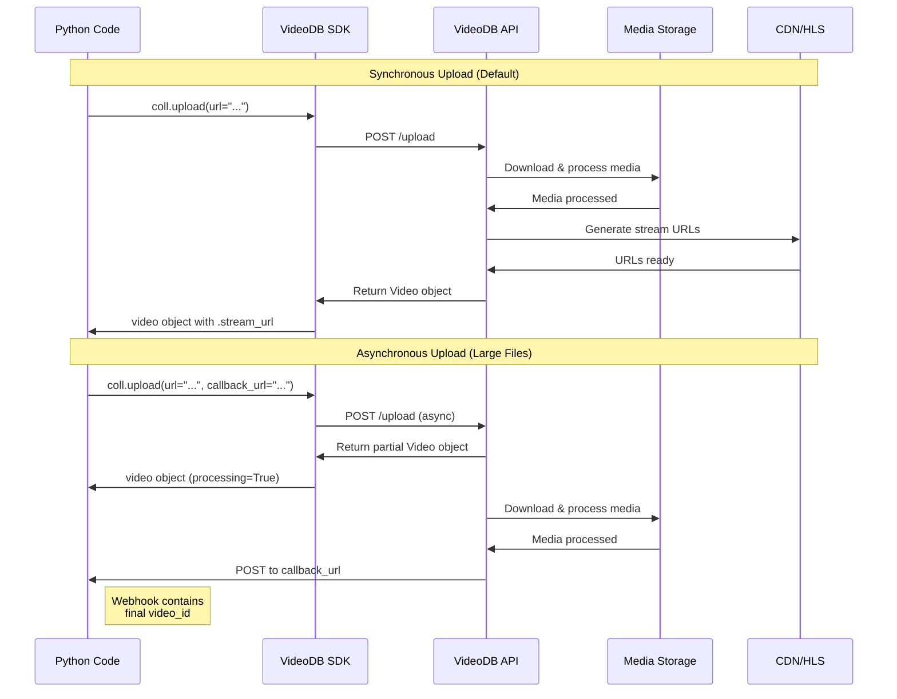

<!-- source: DeepWiki mcp.deepwiki.com · repo video-db/skills · page 4.1 Uploading Media · fetched 2026-10-27 -->

# Uploading Media

<details>
<summary>Relevant source files</summary>

The following files were used as context for generating this wiki page:

- [python/SKILL.md](python/SKILL.md)
- [python/reference/api-reference.md](python/reference/api-reference.md)

</details>


## Purpose and Scope

This document covers the methods and parameters for uploading media assets (videos, audio, images) into VideoDB collections. Uploading is the primary ingestion mechanism in the **See** phase of the See→Understand→Act workflow, transforming external content into VideoDB-managed assets that can be indexed, searched, and edited.

This page focuses exclusively on upload mechanics and parameters. For information about organizing uploaded media into collections, see [Collections](#4.2). For indexing uploaded content to make it searchable, see [Video Understanding and Indexing](#5).

**Sources:** [python/SKILL.md:20-22](), [python/reference/api-reference.md:135-146]()

---

## Upload Architecture

VideoDB provides two upload entry points: `Connection.upload()` and `Collection.upload()`. Both methods accept the same parameters and return the same media object types (`Video`, `Audio`, or `Image`), but differ in where the uploaded asset is stored.



**Upload Method Selection**

| Method | Destination | Use Case |
|--------|-------------|----------|
| `conn.upload()` | Default collection (`collection_id="default"`) | Quick uploads without collection management |
| `coll.upload()` | Specific collection | Organized content, multi-collection workflows |

**Sources:** [python/reference/api-reference.md:18-31](), [python/reference/api-reference.md:99-133]()

---

## Upload Methods and Signatures

### Collection.upload()

The primary upload method for most workflows. Uploads media to a specific collection.

```python
# Signature from api-reference.md
video = coll.upload(
    url=None,            # Remote URL (HTTP, YouTube)
    file_path=None,      # Local file path
    media_type=None,     # "video", "audio", or "image" (auto-detected if omitted)
    name=None,           # Custom name for the media
    description=None,    # Description
    callback_url=None,   # Webhook URL for async notification
)
```

**Parameters:**

| Parameter | Type | Required | Description |
|-----------|------|----------|-------------|
| `url` | `str` | Conditional | HTTP/HTTPS URL or YouTube URL (mutually exclusive with `file_path`) |
| `file_path` | `str` | Conditional | Path to local file (mutually exclusive with `url`) |
| `media_type` | `str` | Optional | `"video"`, `"audio"`, or `"image"` (auto-detected from source if omitted) |
| `name` | `str` | Optional | Custom display name (defaults to filename or URL-derived name) |
| `description` | `str` | Optional | Metadata description for the asset |
| `callback_url` | `str` | Optional | Webhook endpoint to receive upload completion notification |

**Returns:** `Video`, `Audio`, or `Image` object depending on the uploaded content type.

**Sources:** [python/reference/api-reference.md:135-146](), [python/SKILL.md:128-138]()

### Connection.upload()

Convenience method that uploads to the default collection. Identical parameters to `Collection.upload()`.

```python
# Uploads to default collection
video = conn.upload(url="https://example.com/video.mp4")

# Equivalent to:
coll = conn.get_collection()  # Gets "default" collection
video = coll.upload(url="https://example.com/video.mp4")
```

**Sources:** [python/reference/api-reference.md:25]()

---

## Upload Sources

VideoDB supports three distinct upload sources, selected by which parameter is provided to the upload method.



### URL Upload (HTTP/HTTPS)

Upload from any publicly accessible URL. The URL must return a downloadable media file.

```python
# Direct URL upload
video = coll.upload(url="https://example.com/video.mp4")

# Works with any HTTP/HTTPS endpoint
audio = coll.upload(url="https://cdn.example.com/podcast.mp3")
image = coll.upload(url="https://example.com/thumbnail.jpg")
```

**Requirements:**
- URL must be publicly accessible (no authentication)
- Server must respond with appropriate `Content-Type` header
- File must be in a supported format (MP4, MOV, AVI, MP3, WAV, JPG, PNG, etc.)

**Sources:** [python/SKILL.md:130-131](), [python/reference/api-reference.md:139]()

### YouTube Upload

Upload directly from YouTube URLs. VideoDB extracts the video without requiring local downloads.

```python
# YouTube video URL
video = coll.upload(url="https://www.youtube.com/watch?v=VIDEO_ID")

# Short YouTube URLs also supported
video = coll.upload(url="https://youtu.be/VIDEO_ID")
```

**Supported YouTube URL Formats:**
- Standard: `https://www.youtube.com/watch?v=VIDEO_ID`
- Short: `https://youtu.be/VIDEO_ID`
- Embedded: URLs with `&t=` timestamp parameters

**Note:** YouTube upload extracts only the video content. Comments, metadata, and channel information are not imported.

**Sources:** [python/SKILL.md:133-134](), [python/reference/api-reference.md:139]()

### Local File Upload

Upload files from the local filesystem. The file is read and transferred to VideoDB servers.

```python
# Absolute path
video = coll.upload(file_path="/path/to/video.mp4")

# Relative path (from current working directory)
audio = coll.upload(file_path="./recordings/meeting.mp3")

# User home directory expansion supported
image = coll.upload(file_path="~/Pictures/screenshot.png")
```

**File System Requirements:**
- File must be readable by the Python process
- Sufficient disk space for temporary buffering during upload
- Stable network connection for large files

**Sources:** [python/SKILL.md:136-137](), [python/reference/api-reference.md:140]()

---

## Media Type Detection and Override

VideoDB automatically detects media type (video, audio, image) from the file extension and MIME type. The `media_type` parameter allows explicit override when auto-detection fails or when uploading ambiguous formats.



### Automatic Detection

For most common formats, `media_type` can be omitted:

```python
# Auto-detected as video
video = coll.upload(url="https://example.com/clip.mp4")

# Auto-detected as audio
audio = coll.upload(file_path="podcast.mp3")

# Auto-detected as image
image = coll.upload(url="https://example.com/banner.png")
```

### Explicit Override

Use `media_type` for ambiguous cases or to force specific handling:

```python
# Force audio extraction from video file
audio = coll.upload(
    url="https://example.com/video.mp4",
    media_type="audio"  # Extract audio track only
)

# Ensure image handling for unusual extension
image = coll.upload(
    file_path="logo.svg",
    media_type="image"
)
```

**Valid `media_type` Values:**
- `"video"` - Returns `Video` object
- `"audio"` - Returns `Audio` object
- `"image"` - Returns `Image` object

**Sources:** [python/reference/api-reference.md:141](), [python/SKILL.md:128-138]()

---

## Upload Parameters

### Name and Description

Custom metadata attached to uploaded assets. Useful for organization and search.

```python
video = coll.upload(
    url="https://example.com/webinar.mp4",
    name="Q4 Product Launch Webinar",
    description="Full recording of product launch event, includes Q&A session"
)

# Access metadata on returned object
print(video.name)         # "Q4 Product Launch Webinar"
print(video.description)  # "Full recording of product launch event..."
```

**Default Behavior:**
- If `name` is omitted, VideoDB derives it from the filename or URL
- If `description` is omitted, it remains empty

**Sources:** [python/reference/api-reference.md:142-143]()

### Asynchronous Upload with Callbacks

Large file uploads can be processed asynchronously using `callback_url`. When provided, the upload method returns immediately, and VideoDB sends a webhook notification when processing completes.

```python
# Async upload for large files
video = coll.upload(
    url="https://example.com/large-video.mp4",
    callback_url="https://yourserver.com/webhook/upload-complete",
)

# Method returns immediately with partial Video object
# Full metadata populated after processing
```

**Callback Payload:**

The webhook receives a POST request with JSON payload containing:
- `status`: `"completed"` or `"failed"`
- `video_id`: ID of the uploaded video (if successful)
- `error`: Error message (if failed)

**When to Use Callbacks:**
- Files larger than 1GB
- Batch upload operations
- Background processing workflows
- Integration with external systems

**Sources:** [python/reference/api-reference.md:144]()

---

## Return Types and Object Properties

Upload methods return different object types based on the media content. All returned objects are fully initialized and can be used immediately for further operations.

### Video Object

Returned when uploading video content.

```python
video = coll.upload(url="https://example.com/clip.mp4")

# Available properties immediately after upload
video.id              # Unique video ID (str)
video.collection_id   # Parent collection ID (str)
video.name            # Video name (str)
video.description     # Description (str)
video.length          # Duration in seconds (float)
video.stream_url      # HLS stream URL for playback (str)
video.player_url      # Embeddable player URL (str)
video.thumbnail_url   # Auto-generated thumbnail (str)
```

**Sources:** [python/reference/api-reference.md:148-166]()

### Audio Object

Returned when uploading audio content or extracting audio from video.

```python
audio = coll.upload(file_path="podcast.mp3")

# Available properties
audio.id              # Unique audio ID (str)
audio.collection_id   # Parent collection ID (str)
audio.name            # Audio name (str)
audio.length          # Duration in seconds (float)

# Generate playback URL
url = audio.generate_url()  # Returns signed URL for direct playback
```

**Sources:** [python/reference/api-reference.md:223-247]()

### Image Object

Returned when uploading image content.

```python
image = coll.upload(url="https://example.com/logo.png")

# Available properties
image.id              # Unique image ID (str)
image.collection_id   # Parent collection ID (str)
image.name            # Image name (str)
image.url             # Image URL (str or None for generated images)

# For generated images, use:
url = image.generate_url()  # Returns signed URL
```

**Sources:** [python/reference/api-reference.md:248-268]()

---

## Upload Workflow Patterns



### Synchronous Upload Pattern

Most uploads complete synchronously within seconds:

```python
# Upload completes before returning
video = coll.upload(url="https://example.com/short-clip.mp4")

# Immediately usable
print(f"Stream URL: {video.stream_url}")
print(f"Duration: {video.length} seconds")

# Can start indexing right away
video.index_spoken_words()
```

**Sources:** [python/SKILL.md:128-138]()

### Asynchronous Upload Pattern

For large files or batch operations:

```python
# Start async upload
video = coll.upload(
    url="https://example.com/2-hour-webinar.mp4",
    callback_url="https://yourserver.com/webhook",
)

# Returns immediately with partial object
print(f"Upload started: {video.id}")

# Full metadata available after webhook callback
# Webhook handler receives:
# {
#   "status": "completed",
#   "video_id": "abc123...",
#   "stream_url": "https://...",
# }
```

**Sources:** [python/reference/api-reference.md:144]()

---

## Error Handling

Upload operations can fail for various reasons. The SDK raises specific exceptions that should be caught and handled.

### Exception Types

| Exception | Common Cause | Resolution |
|-----------|--------------|------------|
| `AuthenticationError` | Missing or invalid `VIDEO_DB_API_KEY` | Verify API key in environment or `.env` file |
| `InvalidRequestError` | Invalid URL, unsupported format, missing parameters | Check URL accessibility, file format, parameter values |
| `RequestTimeoutError` | Large file upload timeout | Use `callback_url` for async upload |
| `VideodbError` | Generic server or network error | Retry with exponential backoff |

### Error Handling Pattern

```python
from videodb.exceptions import (
    AuthenticationError, 
    InvalidRequestError,
    RequestTimeoutError
)

try:
    video = coll.upload(url="https://example.com/video.mp4")
    
except AuthenticationError:
    print("Check your VIDEO_DB_API_KEY environment variable")
    
except InvalidRequestError as e:
    print(f"Upload failed: {e}")
    # Possible causes:
    # - URL not accessible
    # - Unsupported file format
    # - Invalid parameters
    
except RequestTimeoutError:
    print("Upload timed out - try using callback_url for async upload")
    # Retry with callback:
    video = coll.upload(
        url="https://example.com/video.mp4",
        callback_url="https://yourserver.com/webhook"
    )
```

**Sources:** [python/SKILL.md:273-287](), [python/reference/api-reference.md:531-548]()

### Common Upload Errors

| Error Message | Cause | Solution |
|---------------|-------|----------|
| `Invalid API key` | Missing or incorrect `VIDEO_DB_API_KEY` | Set environment variable: `export VIDEO_DB_API_KEY=your-key` |
| `URL not accessible` | URL returns 403/404 or requires authentication | Ensure URL is publicly accessible |
| `Unsupported format` | File format not recognized | Check file extension matches content, or set `media_type` explicitly |
| `File not found` | Invalid `file_path` | Verify file exists and path is correct |
| `Operation not allowed` | Plan limit exceeded | Check account limits with `conn.check_usage()` |

**Sources:** [python/SKILL.md:289-298]()

---

## Best Practices

### 1. Always Specify `name` for Batch Uploads

When uploading multiple files programmatically, provide explicit names to avoid auto-generated naming collisions:

```python
for file in ["video1.mp4", "video2.mp4", "video3.mp4"]:
    video = coll.upload(
        file_path=file,
        name=f"Training Video - {file.split('.')[0].upper()}"
    )
```

### 2. Use Async Upload for Large Files

Files larger than 500MB should use `callback_url` to avoid timeout issues:

```python
# Large file - use async
if file_size_mb > 500:
    video = coll.upload(
        file_path=large_file,
        callback_url="https://yourserver.com/webhook"
    )
else:
    video = coll.upload(file_path=large_file)
```

### 3. Validate URLs Before Upload

For URL uploads, verify accessibility before calling `upload()`:

```python
import requests

def upload_from_url(coll, url):
    # Verify URL is accessible
    try:
        response = requests.head(url, timeout=5)
        response.raise_for_status()
    except requests.RequestException as e:
        print(f"URL not accessible: {e}")
        return None
    
    # Proceed with upload
    return coll.upload(url=url)
```

### 4. Use Collections for Organization

Upload related content to specific collections rather than the default:

```python
# Create project-specific collection
project_coll = conn.create_collection(
    name="Q4 Marketing Campaign",
    description="All assets for Q4 campaign"
)

# Upload to specific collection
video = project_coll.upload(url="https://example.com/ad.mp4")
```

### 5. Handle Upload Failures Gracefully

Implement retry logic with exponential backoff for transient failures:

```python
import time
from videodb.exceptions import RequestTimeoutError, VideodbError

def upload_with_retry(coll, url, max_retries=3):
    for attempt in range(max_retries):
        try:
            return coll.upload(url=url)
        except RequestTimeoutError:
            if attempt < max_retries - 1:
                time.sleep(2 ** attempt)  # Exponential backoff
                continue
            else:
                raise
        except VideodbError as e:
            print(f"Upload failed: {e}")
            return None
```

**Sources:** [python/SKILL.md:273-298](), [python/reference/api-reference.md:135-146]()

---

