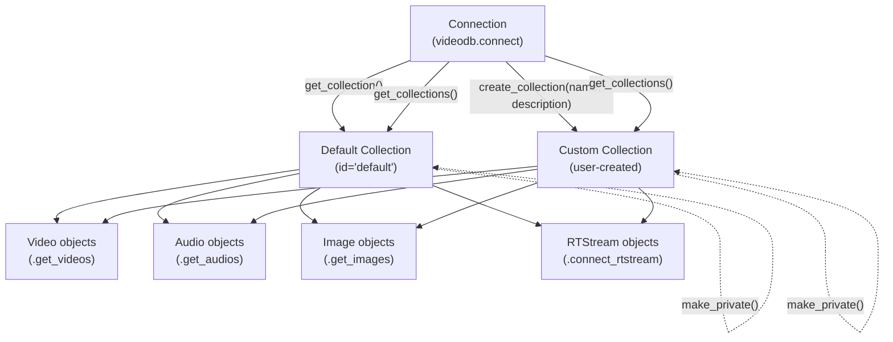
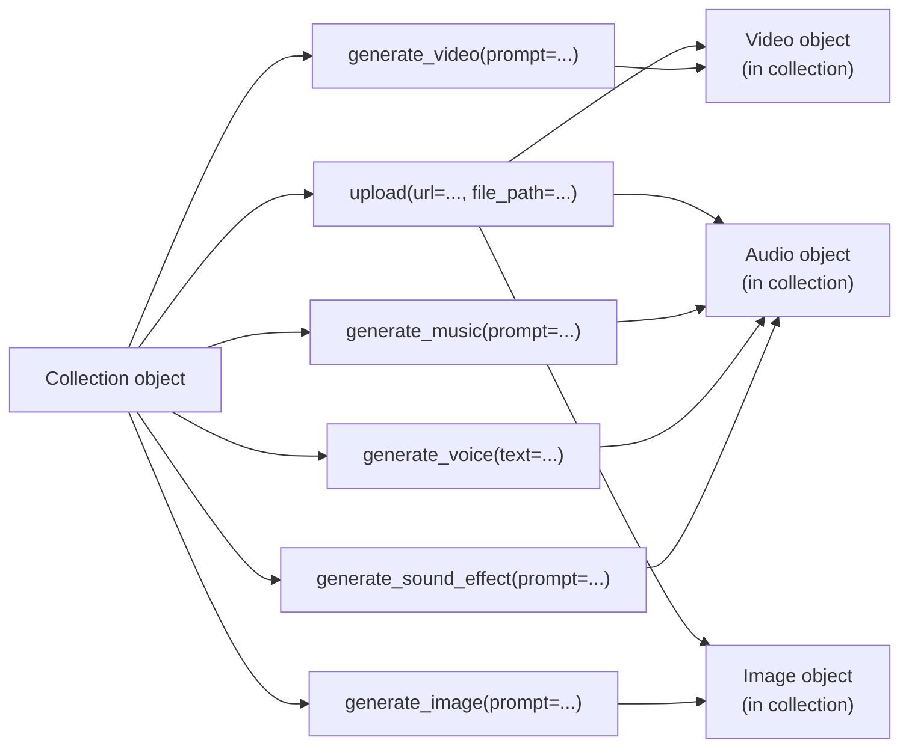

<!-- source: DeepWiki mcp.deepwiki.com · repo video-db/skills · page 4.2 Collections · fetched 2026-10-27 -->

# Collections

<details>
<summary>Relevant source files</summary>

The following files were used as context for generating this wiki page:

- [python/SKILL.md](python/SKILL.md)
- [python/reference/api-reference.md](python/reference/api-reference.md)

</details>


Collections are containers that organize and group media assets (videos, audio, images, and live streams) within the VideoDB system. Each collection provides isolated storage, access control, and shared operations across all contained media.

For information about uploading media into collections, see [Uploading Media](#4.1). For details about the Connection object that creates collections, see [Authentication](#2.2) and [Object Model](#2.1).

---

## Overview

A `Collection` serves as the primary organizational unit for media assets. Every media object belongs to exactly one collection, and collections provide the scope for bulk operations like cross-media search and AI generation.

**Key characteristics:**

- Each user account has a **default collection** created automatically
- Collections can be **public** (accessible via share links) or **private** (API key required)
- Collections provide factory methods for uploading and generating media
- Search operations can query across all videos within a collection
- Collections are retrieved or created through the `Connection` object

**Sources:** [python/reference/api-reference.md:99-133](), [python/SKILL.md:72-73]()

---

## Collection Lifecycle

### Collection Object Model



**Sources:** [python/reference/api-reference.md:6-31](), [python/reference/api-reference.md:99-133]()

---

### Retrieving Collections

The default collection is retrieved using `conn.get_collection()` with no arguments:

```python
import videodb

conn = videodb.connect()
coll = conn.get_collection()  # Returns default collection
```

To retrieve a specific collection by ID:

```python
coll = conn.get_collection(collection_id="abc123")
```

To list all collections for the authenticated account:

```python
collections = conn.get_collections()  # Returns list[Collection]
for c in collections:
    print(f"{c.id}: {c.name}")
```

**Sources:** [python/reference/api-reference.md:20](), [python/SKILL.md:93]()

---

### Creating Collections

Custom collections are created via `conn.create_collection()`:

```python
coll = conn.create_collection(
    name="Project Alpha Videos",
    description="Marketing content for Q1 campaign",
    is_public=False,  # Private by default
)
```

**Parameters:**

| Parameter | Type | Default | Description |
|-----------|------|---------|-------------|
| `name` | `str` | required | Collection display name |
| `description` | `str` | required | Collection description |
| `is_public` | `bool` | `False` | Whether collection is publicly accessible |

**Returns:** `Collection` object

**Sources:** [python/reference/api-reference.md:22]()

---

### Updating Collections

Existing collections can be updated:

```python
updated_coll = conn.update_collection(
    id="abc123",
    name="Updated Project Name",
    description="Revised description",
)
```

**Sources:** [python/reference/api-reference.md:23]()

---

## Public vs Private Collections

Collections have two visibility modes that control access:

### Private Collections (Default)

- Require valid API key for all operations
- Media assets are not accessible via public URLs
- Default setting for new collections

### Public Collections

- Allow unauthenticated access to stream URLs
- Enable sharing media without exposing API keys
- Useful for published content and public galleries

**Toggle visibility:**

```python
coll.make_public()   # Enable public access
coll.make_private()  # Require authentication
```

**Warning:** Making a collection public exposes all contained media stream URLs. Anyone with a stream URL can access the content without authentication.

**Sources:** [python/reference/api-reference.md:128-129]()

---

## Media Organization

### Collection as Media Factory

Collections provide factory methods for creating and uploading media assets:



**Sources:** [python/reference/api-reference.md:115-122](), [python/SKILL.md:129-138]()

---

### Retrieving Media from Collections

Each collection maintains separate lists for each media type:

```python
# Get all videos
videos = coll.get_videos()  # Returns list[Video]

# Get specific video by ID
video = coll.get_video(video_id="xyz789")

# Get all audio files
audios = coll.get_audios()  # Returns list[Audio]

# Get specific audio
audio = coll.get_audio(audio_id="abc123")

# Get all images
images = coll.get_images()  # Returns list[Image]

# Get specific image
image = coll.get_image(image_id="def456")
```

**Sources:** [python/reference/api-reference.md:109-114]()

---

### Deleting Media

Collections provide deletion methods for each media type:

```python
coll.delete_video(video_id="xyz789")
coll.delete_audio(audio_id="abc123")
coll.delete_image(image_id="def456")
```

**Warning:** Deletion is permanent and cannot be undone. All associated indexes, stream URLs, and metadata are also deleted.

**Sources:** [python/reference/api-reference.md:130-132]()

---

## Collection Operations

### Cross-Collection Search

Collections support semantic search across **all videos** in the collection:

```python
from videodb import SearchType

results = coll.search(
    query="product demonstration with customer testimonial",
    search_type=SearchType.semantic,
    score_threshold=0.4,
)

shots = results.get_shots()  # Returns list[Shot] from all videos
```

**Limitations:**

- Only `SearchType.semantic` is supported for collection search
- Keyword and scene search raise `NotImplementedError`
- Videos must be indexed with `video.index_spoken_words()` before searching

For details on search types and parameters, see [Search Types](#6.1) and [Cross-Collection Search](#6.3).

**Sources:** [python/reference/api-reference.md:116](), [python/SKILL.md:149-167]()

---

### AI Media Generation

Collections provide methods for generating media assets using AI:

| Method | Returns | Description |
|--------|---------|-------------|
| `generate_image(prompt, aspect_ratio="1:1")` | `Image` | Generate image from text prompt |
| `generate_video(prompt, duration=5)` | `Video` | Generate video from text prompt |
| `generate_music(prompt, duration=5)` | `Audio` | Generate music track |
| `generate_sound_effect(prompt, duration=2)` | `Audio` | Generate sound effect |
| `generate_voice(text, voice_name="Default")` | `Audio` | Text-to-speech synthesis |

**Example:**

```python
# Generate background music
music = coll.generate_music(
    prompt="upbeat electronic background music",
    duration=30,
)

# Generate promotional image
image = coll.generate_image(
    prompt="modern tech startup office with diverse team",
    aspect_ratio="16:9",
)
```

For detailed parameters and capabilities, see [AI Media Generation](#11).

**Sources:** [python/reference/api-reference.md:117-121](), [python/SKILL.md:266-271]()

---

### Video Dubbing and Translation

Collections provide dubbing services for videos:

```python
# Dub video into Spanish
dubbed_video = coll.dub_video(
    video_id="xyz789",
    language_code="es",
)
```

The dubbing process:
1. Transcribes original audio
2. Translates transcript to target language
3. Generates synthetic voice in target language
4. Returns new `Video` object with dubbed audio

For transcript translation without dubbing, see [Dubbing and Translation](#11.4).

**Sources:** [python/reference/api-reference.md:123]()

---

## Collection Properties and Metadata

### Collection Attributes

| Property | Type | Description |
|----------|------|-------------|
| `id` | `str` | Unique collection identifier |
| `name` | `str` | Collection display name |
| `description` | `str` | Collection description |
| `is_public` | `bool` | Public visibility flag |

**Sources:** [python/reference/api-reference.md:99-133]()

---

## Deleting Collections

Entire collections can be permanently deleted:

```python
coll.delete()
```

**Warning:** This deletes:
- The collection itself
- All videos, audio files, and images in the collection
- All indexes and metadata
- All generated stream URLs become invalid

**Cannot delete:** The default collection (`id="default"`) cannot be deleted.

**Sources:** [python/reference/api-reference.md:133]()

---

## Collection Method Reference

### Complete Method List

```mermaid
graph TB
    Collection["Collection object"]
    
    subgraph "Media Retrieval"
        GetVideos["get_videos() → list[Video]"]
        GetVideo["get_video(video_id) → Video"]
        GetAudios["get_audios() → list[Audio]"]
        GetAudio["get_audio(audio_id) → Audio"]
        GetImages["get_images() → list[Image]"]
        GetImage["get_image(image_id) → Image"]
    end
    
    subgraph "Media Creation"
        Upload["upload(url=..., file_path=...) → Media"]
        GenImage["generate_image(prompt) → Image"]
        GenVideo["generate_video(prompt) → Video"]
        GenMusic["generate_music(prompt) → Audio"]
        GenVoice["generate_voice(text) → Audio"]
        GenSFX["generate_sound_effect(prompt) → Audio"]
    end
    
    subgraph "Search & Analysis"
        Search["search(query, search_type) → SearchResult"]
        GenText["generate_text(prompt) → dict"]
    end
    
    subgraph "Transformations"
        Dub["dub_video(video_id, language) → Video"]
    end
    
    subgraph "Live Systems"
        RecordMeeting["record_meeting(url) → Meeting"]
        CreateCapture["create_capture_session() → CaptureSession"]
        GetCapture["get_capture_session(session_id) → CaptureSession"]
        ConnectRT["connect_rtstream(url) → RTStream"]
    end
    
    subgraph "Management"
        MakePublic["make_public()"]
        MakePrivate["make_private()"]
        DeleteMedia["delete_video/audio/image(id)"]
        DeleteColl["delete()"]
    end
    
    Collection --> GetVideos
    Collection --> GetVideo
    Collection --> GetAudios
    Collection --> GetAudio
    Collection --> GetImages
    Collection --> GetImage
    Collection --> Upload
    Collection --> GenImage
    Collection --> GenVideo
    Collection --> GenMusic
    Collection --> GenVoice
    Collection --> GenSFX
    Collection --> Search
    Collection --> GenText
    Collection --> Dub
    Collection --> RecordMeeting
    Collection --> CreateCapture
    Collection --> GetCapture
    Collection --> ConnectRT
    Collection --> MakePublic
    Collection --> MakePrivate
    Collection --> DeleteMedia
    Collection --> DeleteColl
```



**Sources:** [python/reference/api-reference.md:99-133]()

---

## Common Patterns

### Organizing by Project

```python
# Create separate collections for different projects
marketing_coll = conn.create_collection(
    name="Marketing Videos",
    description="Product demos and testimonials",
)

training_coll = conn.create_collection(
    name="Training Materials",
    description="Employee onboarding and tutorials",
)

# Upload to specific collections
demo_video = marketing_coll.upload(url="https://example.com/demo.mp4")
tutorial_video = training_coll.upload(url="https://example.com/tutorial.mp4")
```

**Sources:** [python/reference/api-reference.md:22](), [python/reference/api-reference.md:115]()

---

### Sharing Content

```python
# Create public collection for published content
public_coll = conn.create_collection(
    name="Published Content",
    description="Public-facing videos and media",
    is_public=True,
)

# Upload and get shareable stream URL
video = public_coll.upload(url="https://example.com/announcement.mp4")
stream_url = video.stream_url  # Can be shared without authentication
```

**Sources:** [python/reference/api-reference.md:22](), [python/reference/api-reference.md:128]()

---

### Bulk Operations

```python
# Process all videos in a collection
videos = coll.get_videos()

for video in videos:
    # Index if not already indexed
    try:
        video.index_spoken_words()
    except Exception as e:
        if "already exists" in str(e):
            pass  # Skip already indexed videos
        else:
            raise
    
    # Generate thumbnails
    video.generate_thumbnail()

print(f"Processed {len(videos)} videos")
```

**Sources:** [python/reference/api-reference.md:109](), [python/SKILL.md:144-145](), [python/SKILL.md:293]()

---

## Error Handling

### Collection Not Found

```python
from videodb.exceptions import InvalidRequestError

try:
    coll = conn.get_collection(collection_id="nonexistent")
except InvalidRequestError as e:
    print(f"Collection not found: {e}")
```

### Plan Limitations

Some operations may be restricted based on account plan:

```python
try:
    new_coll = conn.create_collection(
        name="New Collection",
        description="Description",
    )
except InvalidRequestError as e:
    if "maximum limit" in str(e):
        print("Collection limit reached for this plan")
    else:
        raise
```

**Sources:** [python/reference/api-reference.md:532-548](), [python/SKILL.md:298]()

---

