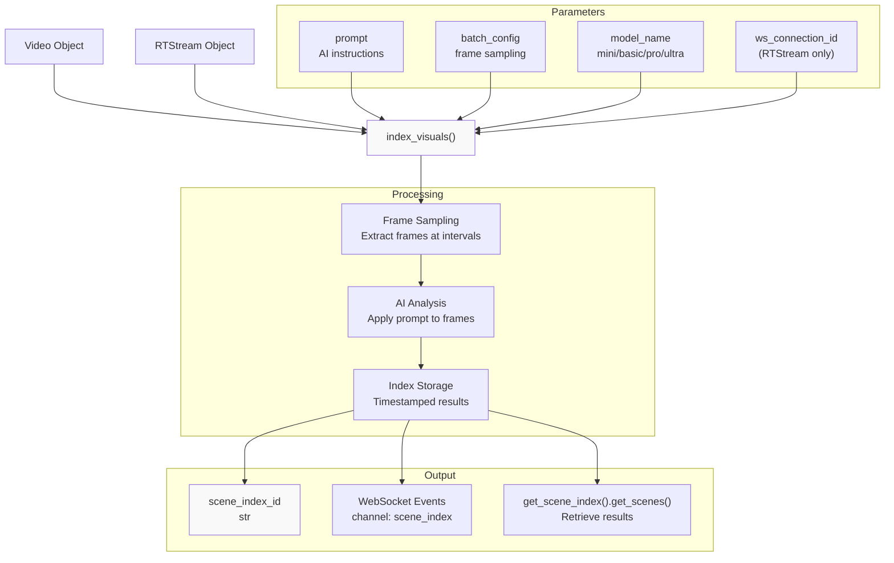
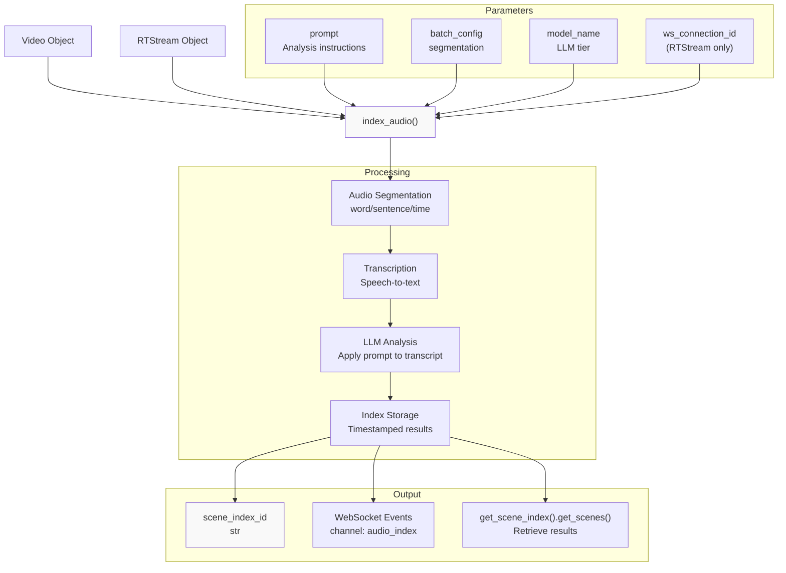
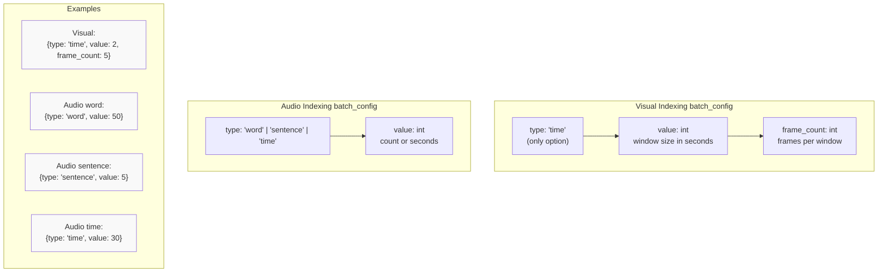
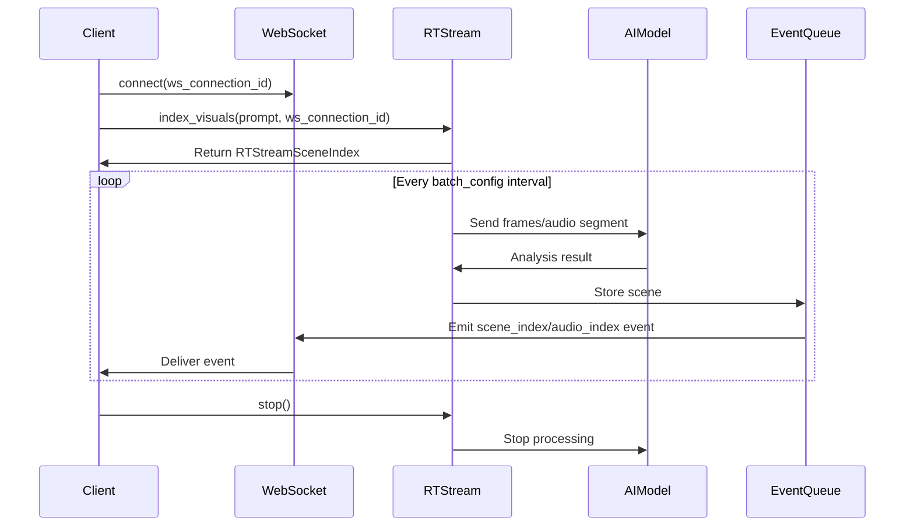
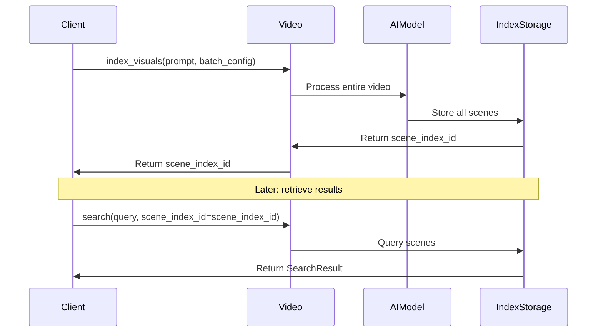

<!-- source: DeepWiki mcp.deepwiki.com · repo video-db/skills · page 5.3 Visual and Audio Indexing · fetched 2026-10-27 -->

# Visual and Audio Indexing

<details>
<summary>Relevant source files</summary>

The following files were used as context for generating this wiki page:

- [python/reference/api-reference.md](python/reference/api-reference.md)
- [python/reference/rtstream-reference.md](python/reference/rtstream-reference.md)
- [python/reference/streaming.md](python/reference/streaming.md)

</details>


This page documents frame-level visual analysis and audio content indexing operations. These indexing methods provide more granular control than scene indexing (see [Scene Indexing](#5.2)) and enable custom prompts for specialized analysis tasks.

**Visual indexing** (`index_visuals`) performs frame-level AI analysis with configurable sampling rates and custom prompts. **Audio indexing** (`index_audio`) analyzes audio content for specific patterns, sounds, profanity, or other audio features beyond basic transcription (see [Spoken Word Indexing](#5.1)).

Both methods return a `scene_index_id` and can be applied to permanent `Video` objects or real-time `RTStream` objects. For real-time streams, results are delivered via WebSocket events.

---

## Visual Indexing Overview

Visual indexing performs AI analysis on video frames at configurable intervals. Unlike scene indexing which operates on shot boundaries, visual indexing samples frames at precise time intervals and analyzes them with custom prompts.



**Diagram: Visual Indexing Pipeline**

Sources: [python/reference/api-reference.md:174-176](), [python/reference/rtstream-reference.md:204-260]()

---

## Video.index_visuals()

For permanent video objects, `index_visuals()` creates a frame-level index with a custom analysis prompt.

### Basic Usage

```python
scene_index_id = video.index_visuals(
    prompt="Describe what is visible on screen",
    batch_config={"type": "time", "value": 2, "frame_count": 5},
    model_name="basic",
    name="screen_activity",
)
```

### Parameters

| Parameter | Type | Required | Description |
|-----------|------|----------|-------------|
| `prompt` | `str` | Yes | Instructions for AI analysis; supports structured JSON output |
| `batch_config` | `dict` | Yes | Frame sampling configuration (see [Batch Configuration](#batch-configuration)) |
| `model_name` | `str` | No | Model tier: `"mini"`, `"basic"`, `"pro"`, `"ultra"` (default: `"basic"`) |
| `name` | `str` | No | Human-readable name for the index |
| `extraction_config` | `dict` | No | Additional extraction parameters |
| `metadata` | `dict` | No | Custom metadata to attach to the index |
| `callback_url` | `str` | No | Webhook URL for async completion notification |

### Returns

Returns `str`: The `scene_index_id` identifying the created index. Use this ID to search the index or retrieve scenes.

Sources: [python/reference/api-reference.md:175](), [python/reference/rtstream-reference.md:204-228]()

---

## RTStream.index_visuals()

For real-time streams, `index_visuals()` continuously analyzes frames and delivers results via WebSocket.

### Basic Usage

```python
scene_index = rtstream.index_visuals(
    prompt="Describe what application is open on screen",
    batch_config={"type": "time", "value": 2, "frame_count": 5},
    model_name="pro",
    name="app_monitor",
    ws_connection_id=ws_id,
)
```

### Parameters

Same as `video.index_visuals()`, with one additional required parameter:

| Parameter | Type | Required | Description |
|-----------|------|----------|-------------|
| `ws_connection_id` | `str` | Yes | WebSocket connection ID for receiving real-time results |

### Returns

Returns `RTStreamSceneIndex` object with methods for managing the index and creating alerts.

### Real-time Event Delivery

Results are delivered via WebSocket on the `scene_index` channel:

```json
{
  "channel": "scene_index",
  "rtstream_id": "rts-xxx",
  "data": {
    "start": 1234.5,
    "end": 1236.5,
    "text": "User has Visual Studio Code open with Python file",
    "timestamp": 1710000012340
  }
}
```

Sources: [python/reference/rtstream-reference.md:204-260]()

---

## Structured JSON Output

Visual indexing prompts can request structured JSON responses for programmatic consumption.

### Example: Application Monitoring

```python
scene_index = rtstream.index_visuals(
    prompt="""Analyze the screen and return a JSON object with:
{
  "app_name": "name of the active application",
  "activity": "what the user is doing",
  "ui_elements": ["list of visible UI elements"],
  "contains_text": true/false,
  "dominant_colors": ["list of main colors"]
}
Return only valid JSON.""",
    batch_config={"type": "time", "value": 3, "frame_count": 3},
    model_name="pro",
    ws_connection_id=ws_id,
)
```

The AI model will attempt to return responses in the requested JSON format. Parse the `text` field in the WebSocket event or scene result to extract the JSON.

### Use Cases for Structured Output

- **Desktop activity monitoring**: Track application usage, window titles, visible UI elements
- **Content moderation**: Detect specific visual elements (logos, text, objects)
- **Quality assurance**: Analyze video quality metrics (blur, lighting, composition)
- **Accessibility analysis**: Identify UI elements, text visibility, color contrast

Sources: [python/reference/rtstream-reference.md:239-260]()

---

## Audio Indexing Overview

Audio indexing analyzes audio content beyond basic transcription. It can detect profanity, music, sound effects, speaker emotions, or any other audio patterns specified in the prompt.



**Diagram: Audio Indexing Pipeline**

Sources: [python/reference/api-reference.md:176](), [python/reference/rtstream-reference.md:173-203]()

---

## Video.index_audio()

For permanent video objects, `index_audio()` creates an audio content index using LLM analysis of the transcript.

### Basic Usage

```python
scene_index_id = video.index_audio(
    prompt="Identify any profanity or inappropriate language",
    model_name="basic",
    name="content_moderation",
)
```

### Parameters

| Parameter | Type | Required | Description |
|-----------|------|----------|-------------|
| `prompt` | `str` | Yes | Instructions for LLM analysis of audio content |
| `model_name` | `str` | No | LLM model tier: `"mini"`, `"basic"`, `"pro"`, `"ultra"` |
| `name` | `str` | No | Human-readable name for the index |

### Returns

Returns `str`: The `scene_index_id` identifying the created audio index.

**Note:** Audio indexing requires the video to already have a transcript. Run `video.index_spoken_words()` first if not already indexed (see [Spoken Word Indexing](#5.1)).

Sources: [python/reference/api-reference.md:176]()

---

## RTStream.index_audio()

For real-time streams, `index_audio()` continuously analyzes audio segments and delivers results via WebSocket.

### Basic Usage

```python
audio_index = rtstream.index_audio(
    prompt="Summarize what is being discussed",
    batch_config={"type": "word", "value": 50},
    model_name="basic",
    name="meeting_summary",
    ws_connection_id=ws_id,
)
```

### Parameters

| Parameter | Type | Required | Description |
|-----------|------|----------|-------------|
| `prompt` | `str` | Yes | Instructions for LLM analysis |
| `batch_config` | `dict` | Yes | Segmentation configuration (see [Batch Configuration](#batch-configuration)) |
| `model_name` | `str` | No | LLM model tier |
| `name` | `str` | No | Name for the index |
| `ws_connection_id` | `str` | Yes | WebSocket connection ID for results |

### Returns

Returns `RTStreamSceneIndex` object.

### Real-time Event Delivery

Results are delivered via WebSocket on the `audio_index` channel:

```json
{
  "channel": "audio_index",
  "rtstream_id": "rts-xxx",
  "data": {
    "start": 1234.5,
    "end": 1270.8,
    "text": "Discussion about Q4 sales targets and marketing strategy",
    "timestamp": 1710000012340
  }
}
```

Sources: [python/reference/rtstream-reference.md:173-203]()

---

## Batch Configuration

Both visual and audio indexing use `batch_config` to control sampling/segmentation intervals. The configuration format differs between the two.



**Diagram: Batch Configuration Options**

### Visual Indexing Batch Config

Visual indexing only supports **time-based** sampling:

| Field | Type | Required | Description |
|-------|------|----------|-------------|
| `type` | `str` | Yes | Must be `"time"` |
| `value` | `int` | Yes | Window size in seconds |
| `frame_count` | `int` | Yes | Number of frames to extract per window |

**Example:** `{"type": "time", "value": 2, "frame_count": 5}`

This samples 5 frames every 2 seconds and sends them to the AI model for analysis.

### Audio Indexing Batch Config

Audio indexing supports **three segmentation types**:

| Type | Value | Description |
|------|-------|-------------|
| `"word"` | `int` | Segment every N words |
| `"sentence"` | `int` | Segment every N sentences |
| `"time"` | `int` | Segment every N seconds |

**Examples:**

```python
# Analyze every 50 words
{"type": "word", "value": 50}

# Analyze every 5 sentences
{"type": "sentence", "value": 5}

# Analyze every 30 seconds
{"type": "time", "value": 30}
```

### Choosing Batch Config Values

**Visual indexing considerations:**
- Lower `value` (shorter windows) = higher analysis frequency = more API calls
- Higher `frame_count` = more context per analysis but higher processing cost
- Typical values: `value=2-5`, `frame_count=3-5`

**Audio indexing considerations:**
- Word-based: Good for detailed content analysis (50-100 words recommended)
- Sentence-based: Good for topic segmentation (3-5 sentences recommended)
- Time-based: Good for periodic summaries (30-60 seconds recommended)

Sources: [python/reference/rtstream-reference.md:188-280]()

---

## Real-time vs Permanent Video Indexing

The indexing methods behave differently for `RTStream` vs `Video` objects:

| Aspect | RTStream.index_visuals/audio | Video.index_visuals/audio |
|--------|------------------------------|---------------------------|
| **Execution** | Continuous, processes stream in real-time | Batch, processes entire video |
| **Results** | WebSocket events as they occur | Stored in index, retrieved via API |
| **Return value** | `RTStreamSceneIndex` object | `str` (scene_index_id) |
| **Required params** | `ws_connection_id` required | `ws_connection_id` not used |
| **Lifecycle** | Can be stopped/restarted with `.stop()` / `.start()` | Runs to completion |
| **Alerts** | Can create alerts via `create_alert()` | Alerts not supported |

### RTStream Indexing Workflow



**Diagram: Real-time Indexing Event Flow**

### Video Indexing Workflow



**Diagram: Permanent Video Indexing Flow**

Sources: [python/reference/api-reference.md:174-176](), [python/reference/rtstream-reference.md:164-260]()

---

## Working with Index Results

### Retrieving Scenes from RTStreamSceneIndex

For real-time streams, use the returned `RTStreamSceneIndex` object to retrieve scenes:

```python
scene_index = rtstream.index_visuals(
    prompt="Describe what is on screen",
    ws_connection_id=ws_id,
)

# Retrieve scenes with pagination
result = scene_index.get_scenes(
    start=None,      # optional: start timestamp filter
    end=None,        # optional: end timestamp filter
    page=1,
    page_size=100,
)

for scene in result["scenes"]:
    print(f"[{scene['start']}-{scene['end']}] {scene['text']}")

if result["next_page"]:
    # Fetch additional pages
    result = scene_index.get_scenes(page=2, page_size=100)
```

### Searching Video Indexes

For permanent videos, use the `scene_index_id` to search the index:

```python
scene_index_id = video.index_visuals(
    prompt="Identify any UI elements or buttons",
)

# Search the visual index
from videodb import SearchType, IndexType

results = video.search(
    query="button click",
    search_type=SearchType.semantic,
    index_type=IndexType.scene,
    scene_index_id=scene_index_id,
)

for shot in results.get_shots():
    print(f"[{shot.start:.1f}s-{shot.end:.1f}s] {shot.text}")
```

For details on search operations, see [Searching Videos](#6).

### Managing Scene Indexes

Both `Video` and `RTStream` can have multiple indexes:

```python
# List all indexes on an RTStream
indexes = rtstream.list_scene_indexes()

for idx in indexes:
    print(f"{idx.rtstream_index_id}: {idx.name} ({idx.status})")

# Retrieve a specific index
scene_index = rtstream.get_scene_index(index_id)

# Stop/start real-time indexing
scene_index.stop()
scene_index.start()
```

Sources: [python/reference/rtstream-reference.md:313-389]()

---

## Use Cases

### Content Moderation

Detect inappropriate visual content or profanity in audio:

```python
# Visual content moderation
visual_index_id = video.index_visuals(
    prompt="Identify any violence, explicit content, or inappropriate imagery",
    batch_config={"type": "time", "value": 1, "frame_count": 3},
    model_name="pro",
)

# Audio profanity detection
audio_index_id = video.index_audio(
    prompt="Flag any profanity, hate speech, or inappropriate language",
    model_name="basic",
)
```

### Desktop Activity Monitoring

Track application usage and user activity:

```python
scene_index = rtstream.index_visuals(
    prompt="""Return JSON: {
  "app": "active application name",
  "category": "productivity|communication|entertainment|other",
  "activity": "brief description of what user is doing"
}""",
    batch_config={"type": "time", "value": 5, "frame_count": 3},
    model_name="pro",
    ws_connection_id=ws_id,
)
```

### Meeting Summaries

Generate periodic summaries of meeting discussions:

```python
audio_index = rtstream.index_audio(
    prompt="Summarize key discussion points, decisions, and action items",
    batch_config={"type": "sentence", "value": 10},
    model_name="basic",
    ws_connection_id=ws_id,
)
```

### Quality Assurance

Analyze video quality metrics:

```python
visual_index_id = video.index_visuals(
    prompt="""Analyze video quality and return JSON: {
  "blur_level": "none|slight|moderate|severe",
  "lighting": "good|poor|dark|overexposed",
  "framing": "centered|off-center",
  "visible_issues": ["list any visual problems"]
}""",
    batch_config={"type": "time", "value": 10, "frame_count": 1},
    model_name="basic",
)
```

### Sound Event Detection

Detect specific sounds or audio events:

```python
audio_index_id = video.index_audio(
    prompt="Identify any background noise, music, laughter, or non-speech audio",
    model_name="basic",
)
```

Sources: [python/reference/rtstream-reference.md:173-280]()

---

## Comparison Matrix

| Feature | index_spoken_words | index_scenes | index_visuals | index_audio |
|---------|-------------------|--------------|---------------|-------------|
| **Purpose** | Transcription | Scene descriptions | Frame-level analysis | Audio content analysis |
| **Granularity** | Word-level | Shot-level | Frame-level | Word/sentence/time-based |
| **Custom prompts** | No | Yes | Yes | Yes |
| **Batch config** | No | No | Yes (time only) | Yes (word/sentence/time) |
| **Real-time support** | Yes (RTStream) | No | Yes (RTStream) | Yes (RTStream) |
| **Structured output** | No | No | Yes (JSON prompts) | Yes (JSON prompts) |
| **Search type** | Semantic, keyword | Semantic, scene | Semantic, scene | Semantic, scene |
| **Returns** | None | scene_index_id | scene_index_id | scene_index_id |

Sources: [python/reference/api-reference.md:173-176](), [python/reference/rtstream-reference.md:91-172]()

---

## Best Practices

1. **Choose appropriate batch intervals**: Balance analysis frequency with API costs
   - Visual: 2-5 second intervals with 3-5 frames
   - Audio: 50-100 words or 30-60 seconds

2. **Use specific prompts**: Clear, detailed prompts produce better results
   - Bad: "Analyze the video"
   - Good: "Identify visible text, logos, and UI buttons"

3. **Request structured output**: Use JSON format for programmatic consumption
   - Specify exact JSON schema in prompt
   - Include "Return only valid JSON" instruction

4. **Monitor WebSocket events**: For real-time indexing, always use `ws_listener.py` or custom WebSocket handler

5. **Store scene_index_id**: Save the returned ID to search the index later

6. **Index before searching**: Visual and audio indexes must exist before scene search operations (see [Searching Videos](#6))

7. **Consider model tiers**: Higher tiers (`pro`, `ultra`) provide better accuracy but cost more

8. **Handle multiple indexes**: Name indexes clearly when creating multiple visual/audio indexes on the same video

Sources: [python/reference/rtstream-reference.md:204-280]()

---

