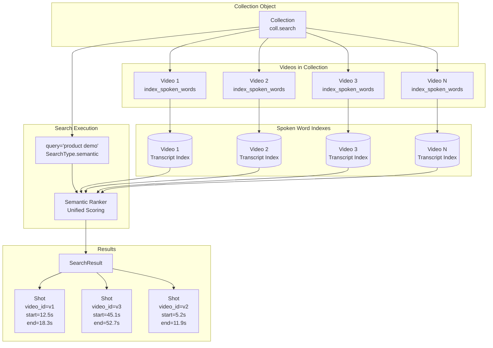
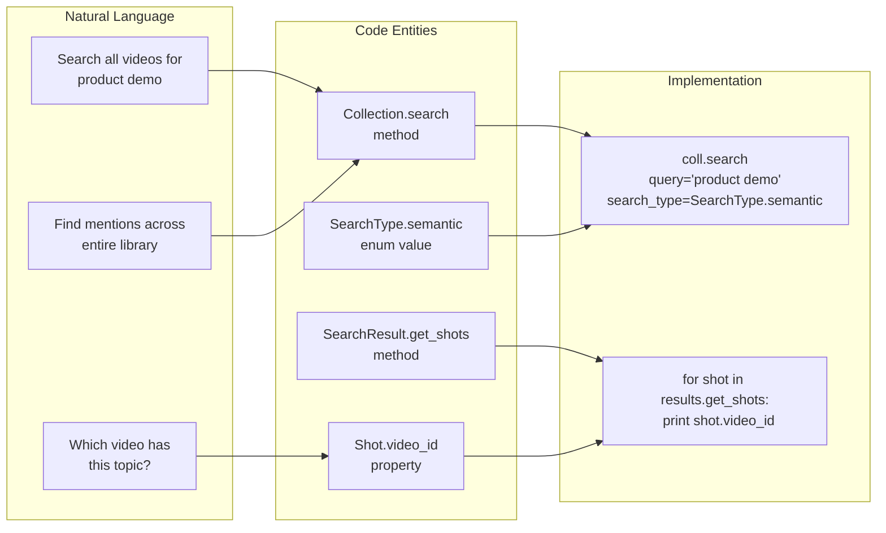
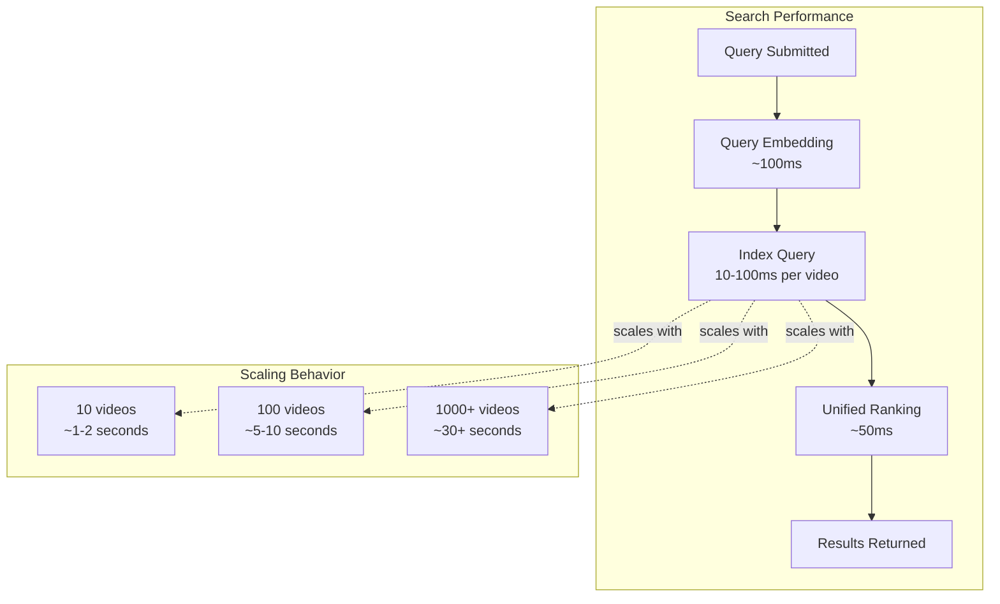

<!-- source: DeepWiki mcp.deepwiki.com · repo video-db/skills · page 6.3 Cross-Collection Search · fetched 2026-10-27 -->

# Cross-Collection Search

<details>
<summary>Relevant source files</summary>

The following files were used as context for generating this wiki page:

- [python/reference/search.md](python/reference/search.md)

</details>


## Purpose and Scope

Cross-collection search enables querying across all videos in a collection with a single operation, returning ranked results from any video that matches. This document covers the collection-level search API, result handling across multiple videos, and limitations.

For single-video search operations, see [Search Types](#6.1). For general information about search results and shot compilation, see [Working with Search Results](#6.2). For collection management and organization, see [Collections](#4.2).

---

## Overview

Cross-collection search allows you to search an entire collection of videos with one query instead of iterating through each video individually. This is useful when:

- You have a video library and don't know which specific video contains the content
- You want to create compilations from multiple source videos
- You need to find all instances of a topic across your entire archive
- You're building a search interface over a video catalog

The key difference from single-video search is that results include `video_id` to identify which video each segment came from, enabling multi-source compilation workflows.

**Sources:** [python/reference/search.md:192-209]()

---

## Architecture



**Collection Search Architecture**

This diagram shows how collection search queries multiple video indexes simultaneously. The collection aggregates spoken word indexes from all videos, ranks results across the entire corpus, and returns shots that include `video_id` for source identification.

**Sources:** [python/reference/search.md:192-209]()

---

## API Mapping: Natural Language to Code



**Code Entity Mapping**

This diagram maps user intent to specific SDK methods and properties. Collection search is exposed through `Collection.search()`, requires `SearchType.semantic`, and returns `Shot` objects with `video_id` populated to identify the source video.

**Sources:** [python/reference/search.md:192-209]()

---

## Using Collection Search

### Basic Usage

```python
from videodb import SearchType

# Get a collection
coll = conn.get_collection()

# Search across all videos in the collection
results = coll.search(
    query="product demo",
    search_type=SearchType.semantic,
)

# Iterate through results from all videos
for shot in results.get_shots():
    print(f"Video: {shot.video_id}")
    print(f"Timestamp: {shot.start:.1f}s - {shot.end:.1f}s")
    print(f"Relevance: {shot.search_score:.3f}")
    print(f"Text: {shot.text}")
    print("---")
```

The `query` parameter accepts natural language descriptions. The search engine ranks segments semantically across all indexed videos in the collection.

**Sources:** [python/reference/search.md:196-207]()

---

## Search Type Limitation

Collection search **only supports `SearchType.semantic`**. The following search types raise `NotImplementedError`:

| Search Type | Supported? | Reason |
|-------------|------------|--------|
| `SearchType.semantic` | ✓ Yes | Designed for cross-video semantic matching |
| `SearchType.keyword` | ✗ No | Not implemented at collection level |
| `SearchType.scene` | ✗ No | Scene indexes are video-specific |

```python
# This works
results = coll.search(
    query="machine learning",
    search_type=SearchType.semantic,
)

# These raise NotImplementedError
results = coll.search(
    query="machine learning",
    search_type=SearchType.keyword,  # ❌ Not supported
)

results = coll.search(
    query="person at whiteboard",
    search_type=SearchType.scene,  # ❌ Not supported
)
```

For keyword or scene search, query individual videos using `video.search()` and aggregate results manually.

**Sources:** [python/reference/search.md:209]()

---

## Result Handling

### Shot Properties

Each `Shot` object returned by collection search includes:

| Property | Type | Description |
|----------|------|-------------|
| `video_id` | `str` | The video ID this shot originated from |
| `start` | `float` | Start timestamp in seconds |
| `end` | `float` | End timestamp in seconds |
| `text` | `str` | Transcript text for this segment |
| `search_score` | `float` | Relevance score (higher = better match) |

The `video_id` property is critical for identifying which video each result came from.

**Sources:** [python/reference/search.md:205-206]()

---

### Creating Multi-Source Compilations

Collection search results can be compiled into a single playback stream, even when shots span multiple source videos:

```python
results = coll.search(
    query="product features",
    search_type=SearchType.semantic,
)

# Compile all matching segments into one stream
stream_url = results.compile()
results.play()  # Opens in browser

# Access individual shots
for shot in results.get_shots():
    print(f"From video {shot.video_id}: {shot.start:.1f}s - {shot.end:.1f}s")
```

The compiled stream seamlessly joins segments from different videos in relevance-ranked order.

**Sources:** [python/reference/search.md:196-207]()

---

### Grouping Results by Video

To organize results by source video:

```python
from collections import defaultdict

results = coll.search(query="tutorial", search_type=SearchType.semantic)

# Group shots by video_id
shots_by_video = defaultdict(list)
for shot in results.get_shots():
    shots_by_video[shot.video_id].append(shot)

# Process each video's results
for video_id, shots in shots_by_video.items():
    print(f"Video {video_id}: {len(shots)} matching segments")
    for shot in shots:
        print(f"  {shot.start:.1f}s - {shot.end:.1f}s")
```

This pattern is useful when you want to perform per-video operations on search results.

**Sources:** [python/reference/search.md:205-206]()

---

## Indexing Requirements

### Prerequisites

All videos in the collection **must have spoken word indexes** before collection search works. Unindexed videos are silently excluded from results.

```python
# Index all videos in a collection
coll = conn.get_collection()
videos = coll.get_videos()

for video in videos:
    print(f"Indexing {video.name}...")
    video.index_spoken_words(force=True)  # force=True for idempotency

# Now collection search will include all videos
results = coll.search(
    query="introduction",
    search_type=SearchType.semantic,
)
```

The `force=True` parameter prevents errors if a video is already indexed.

**Sources:** [python/reference/search.md:18-19]()

---

## Performance Characteristics



**Collection Search Performance**

Search time scales roughly linearly with the number of indexed videos in the collection. For large collections (1000+ videos), consider:

- Splitting collections into topical sub-collections
- Using score thresholds to limit result set size
- Caching frequent queries at the application level

**Sources:** [python/reference/search.md:192-209]()

---

## Common Patterns

### Pattern 1: Finding Source Video

Identify which video(s) contain a specific topic:

```python
results = coll.search(
    query="quarterly revenue discussion",
    search_type=SearchType.semantic,
)

# Get unique video IDs from results
video_ids = {shot.video_id for shot in results.get_shots()}
print(f"Found in {len(video_ids)} videos: {video_ids}")

# Retrieve full video objects if needed
for video_id in video_ids:
    video = coll.get_video(video_id)
    print(f"- {video.name}")
```

**Sources:** [python/reference/search.md:205-206]()

---

### Pattern 2: Best-Match Retrieval

Get the single best matching segment across all videos:

```python
results = coll.search(
    query="mission statement",
    search_type=SearchType.semantic,
)

shots = results.get_shots()
if shots:
    best_match = shots[0]  # Results are sorted by score
    print(f"Best match: Video {best_match.video_id}")
    print(f"Timestamp: {best_match.start:.1f}s")
    print(f"Score: {best_match.search_score:.3f}")
else:
    print("No matches found")
```

**Sources:** [python/reference/search.md:205-206]()

---

### Pattern 3: Cross-Video Highlight Reel

Create a compilation from multiple videos:

```python
# Search for key moments across all product demos
results = coll.search(
    query="key feature demonstration",
    search_type=SearchType.semantic,
)

# Limit to top 10 results for a concise highlight reel
shots = results.get_shots()[:10]

# Compile into single stream
stream_url = results.compile()
print(f"Highlight reel from {len(set(s.video_id for s in shots))} videos")
print(f"Stream: {stream_url}")
```

**Sources:** [python/reference/search.md:196-207]()

---

## Best Practices

| Practice | Rationale |
|----------|-----------|
| **Index all videos first** | Unindexed videos won't appear in results and there's no error indication |
| **Use `force=True` when indexing** | Prevents "already indexed" errors during batch indexing |
| **Check for empty results** | `get_shots()` returns empty list if no matches, not an exception |
| **Group by `video_id`** | Essential for per-video operations on cross-collection results |
| **Limit result count** | For large collections, slice `get_shots()` to avoid overwhelming response sizes |
| **Use descriptive queries** | Semantic search works best with natural language phrases, not single keywords |
| **Consider score thresholds** | Filter low-relevance results by checking `shot.search_score` |

**Sources:** [python/reference/search.md:192-231]()

---

## Comparison with Single-Video Search

| Aspect | Single-Video Search | Collection Search |
|--------|---------------------|-------------------|
| **Method** | `video.search()` | `coll.search()` |
| **Supported types** | Semantic, Keyword, Scene | Semantic only |
| **Result scope** | One video | All videos in collection |
| **Shot.video_id** | Always same as searched video | Identifies source video |
| **Index type** | Spoken word, Scene | Spoken word only |
| **Use case** | Known video, specific segment | Unknown video, corpus-wide search |

For keyword or scene search across multiple videos, iterate through videos manually:

```python
# Manual cross-video keyword search
all_shots = []
for video in coll.get_videos():
    results = video.search(
        query="exact phrase",
        search_type=SearchType.keyword,
    )
    all_shots.extend(results.get_shots())

# Sort by score across all videos
all_shots.sort(key=lambda s: s.search_score, reverse=True)
```

**Sources:** [python/reference/search.md:192-209]()

---

## Error Handling

Collection search has simpler error handling than single-video search:

```python
from videodb import SearchType

results = coll.search(
    query="machine learning",
    search_type=SearchType.semantic,
)

# No exception for zero results - just empty list
shots = results.get_shots()
if not shots:
    print("No matching content found in collection")
else:
    print(f"Found {len(shots)} matching segments")
```

Unlike `video.search()`, which raises `InvalidRequestError` for "No results found", `coll.search()` returns a valid `SearchResult` with an empty shot list.

**Sources:** [python/reference/search.md:228]()

---

## Limitations Summary

1. **Semantic search only**: No keyword or scene search at collection level
2. **Requires spoken word indexes**: Unindexed videos are silently excluded
3. **No scene index support**: Scene search must be done per-video
4. **No metadata filtering**: Custom metadata filters not supported in collection search
5. **Performance scaling**: Search time grows with collection size

For use cases requiring keyword, scene search, or metadata filtering across videos, implement manual iteration over `coll.get_videos()`.

**Sources:** [python/reference/search.md:209]()

---

