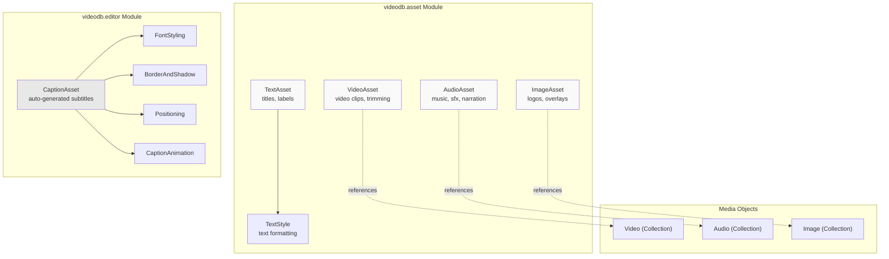
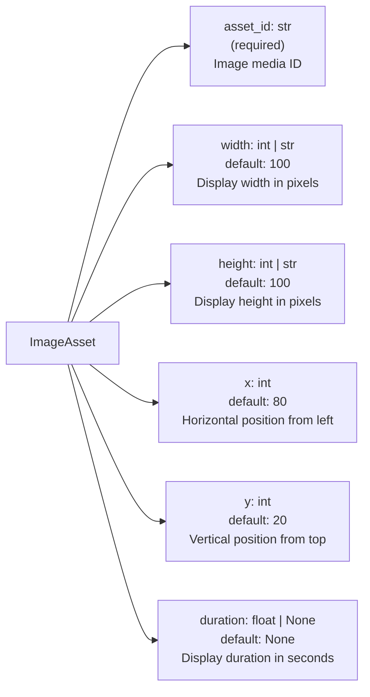
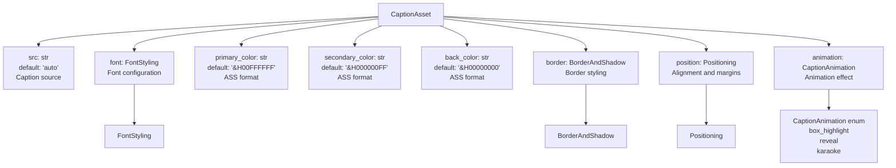
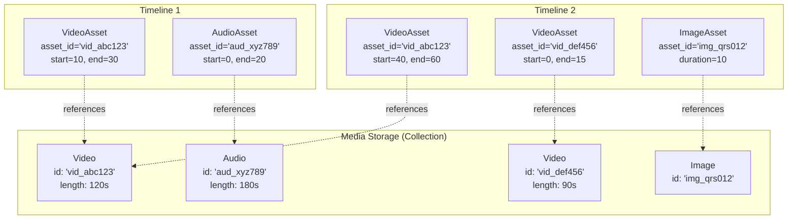
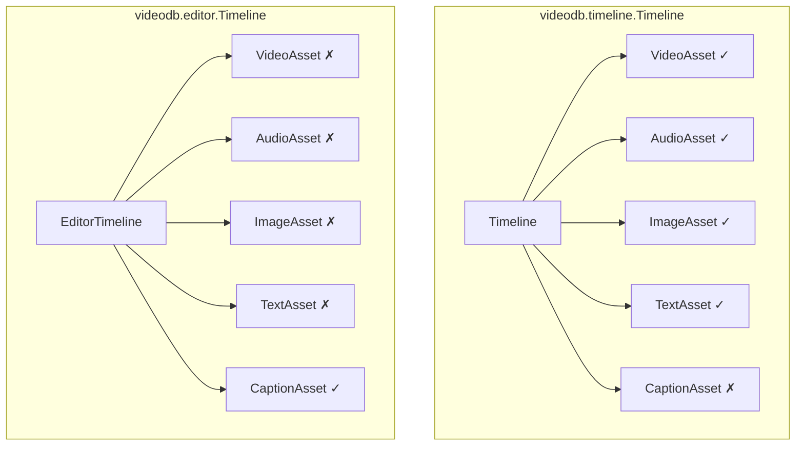

<!-- source: DeepWiki mcp.deepwiki.com · repo video-db/skills · page 7.2 Asset Types · fetched 2026-10-27 -->

# Asset Types

<details>
<summary>Relevant source files</summary>

The following files were used as context for generating this wiki page:

- [python/reference/editor.md](python/reference/editor.md)

</details>


This document describes the five asset classes used in VideoDB's timeline composition system: `VideoAsset`, `AudioAsset`, `ImageAsset`, `TextAsset`, and `CaptionAsset`. Each asset type represents a placeable element on a timeline with specific parameters for trimming, positioning, styling, and duration control. For timeline workflow concepts and the `add_inline()` vs `add_overlay()` methods, see [Timeline Basics](#7.1). For caption-specific workflows including the Editor API, see [Subtitles and Captions](#7.3).

---

## Asset Type Overview

All timeline elements are represented as asset objects. Assets do not contain media data—they reference uploaded media by ID and specify how that media should be rendered in the composition.

### Asset Type Hierarchy



**Sources:** [python/reference/editor.md:23-31]()

| Asset Class | Import Statement | Primary Use | Placement Method |
|-------------|------------------|-------------|------------------|
| `VideoAsset` | `from videodb.asset import VideoAsset` | Video clips with optional trimming | `add_inline()` only |
| `AudioAsset` | `from videodb.asset import AudioAsset` | Music, sound effects, voiceover | `add_overlay()` only |
| `ImageAsset` | `from videodb.asset import ImageAsset` | Logos, watermarks, graphics | `add_overlay()` only |
| `TextAsset` | `from videodb.asset import TextAsset, TextStyle` | Titles, lower-thirds, labels | `add_overlay()` only |
| `CaptionAsset` | `from videodb.editor import CaptionAsset` | Auto-rendered subtitles | Editor API only |

**Sources:** [python/reference/editor.md:23-31]()

---

## VideoAsset

`VideoAsset` represents a video clip on the timeline. It references an uploaded `Video` object by its `asset_id` and supports trimming via `start` and `end` parameters. `VideoAsset` is the only asset type that can be added to the inline track using `timeline.add_inline()`.

### Parameters

```mermaid
graph LR
    VideoAsset["VideoAsset"]
    
    asset_id["asset_id: str<br/>(required)<br/>Video media ID"]
    start["start: float<br/>default: 0<br/>Trim start in seconds"]
    end["end: float | None<br/>default: None<br/>Trim end (None = full length)"]
    
    VideoAsset --> asset_id
    VideoAsset --> start
    VideoAsset --> end
```

**Sources:** [python/reference/editor.md:62-69]()

| Parameter | Type | Default | Description |
|-----------|------|---------|-------------|
| `asset_id` | `str` | required | ID of the `Video` object from collection |
| `start` | `float` | `0` | Trim start timestamp in seconds |
| `end` | `float \| None` | `None` | Trim end timestamp; `None` uses full video length |

**Sources:** [python/reference/editor.md:62-69]()

### Usage Example

```python
from videodb.asset import VideoAsset

# Full video clip
full_clip = VideoAsset(asset_id=video.id)

# Trimmed clip from 10-30 seconds
trimmed_clip = VideoAsset(asset_id=video.id, start=10, end=30)

timeline.add_inline(full_clip)
timeline.add_inline(trimmed_clip)
```

**Sources:** [python/reference/editor.md:54-60]()

### Validation Warning

The SDK **does not validate** timestamp parameters. Passing invalid values such as `start=-5`, `start > end`, or `end > video.length` is silently accepted but produces broken output. Developers must ensure:
- `start >= 0`
- `start < end`
- `end <= video.length`

**Sources:** [python/reference/editor.md:70-70]()

---

## AudioAsset

`AudioAsset` represents an audio track for background music, sound effects, or narration. It references an uploaded `Audio` object and supports trimming and fade effects. Audio assets must be added using `timeline.add_overlay()` at a specific timestamp.

### Parameters

```mermaid
graph LR
    AudioAsset["AudioAsset"]
    
    asset_id["asset_id: str<br/>(required)<br/>Audio media ID"]
    start["start: float<br/>default: 0<br/>Trim start"]
    end["end: float | None<br/>default: None<br/>Trim end"]
    disable_other_tracks["disable_other_tracks: bool<br/>default: True<br/>Mute other audio"]
    fade_in_duration["fade_in_duration: float<br/>default: 0<br/>Fade-in seconds (max 5)"]
    fade_out_duration["fade_out_duration: float<br/>default: 0<br/>Fade-out seconds (max 5)"]
    
    AudioAsset --> asset_id
    AudioAsset --> start
    AudioAsset --> end
    AudioAsset --> disable_other_tracks
    AudioAsset --> fade_in_duration
    AudioAsset --> fade_out_duration
```

**Sources:** [python/reference/editor.md:145-154]()

| Parameter | Type | Default | Description |
|-----------|------|---------|-------------|
| `asset_id` | `str` | required | ID of the `Audio` object from collection |
| `start` | `float` | `0` | Trim start timestamp in seconds |
| `end` | `float \| None` | `None` | Trim end timestamp; `None` uses full audio length |
| `disable_other_tracks` | `bool` | `True` | When `True`, mutes all other audio tracks during this asset's duration |
| `fade_in_duration` | `float` | `0` | Fade-in duration in seconds (maximum 5 seconds) |
| `fade_out_duration` | `float` | `0` | Fade-out duration in seconds (maximum 5 seconds) |

**Sources:** [python/reference/editor.md:145-154]()

### Usage Example

```python
from videodb.asset import AudioAsset

music = coll.get_audio(music_id)

# Background music with fade effects, mixed with video audio
audio_layer = AudioAsset(
    asset_id=music.id,
    disable_other_tracks=False,  # Mix with video audio
    fade_in_duration=2,
    fade_out_duration=2,
)

timeline.add_overlay(0, audio_layer)  # Start at t=0
```

**Sources:** [python/reference/editor.md:130-143]()

### Audio Mixing Behavior

- **`disable_other_tracks=True`** (default): Mutes all video audio and other audio tracks during this asset's duration. Use for voiceovers or replacing soundtrack.
- **`disable_other_tracks=False`**: Mixes this audio with existing tracks at full volume. Use for background music layered on top of video audio.

The SDK does not support volume control—audio is either full volume or muted. Fade durations are capped at 5 seconds.

**Sources:** [python/reference/editor.md:414-414](), [python/reference/editor.md:421-421]()

---

## ImageAsset

`ImageAsset` represents a static image overlay such as logos, watermarks, or generated graphics. It references an uploaded `Image` object and supports positioning, sizing, and duration control.

### Parameters



**Sources:** [python/reference/editor.md:178-186]()

| Parameter | Type | Default | Description |
|-----------|------|---------|-------------|
| `asset_id` | `str` | required | ID of the `Image` object from collection |
| `width` | `int \| str` | `100` | Display width in pixels or expression |
| `height` | `int \| str` | `100` | Display height in pixels or expression |
| `x` | `int` | `80` | Horizontal position in pixels from left edge |
| `y` | `int` | `20` | Vertical position in pixels from top edge |
| `duration` | `float \| None` | `None` | Display duration in seconds; `None` shows for entire timeline |

**Sources:** [python/reference/editor.md:178-186]()

### Usage Example

```python
from videodb.asset import ImageAsset

logo = coll.get_image(logo_id)

# Logo in top-right corner for 10 seconds
logo_overlay = ImageAsset(
    asset_id=logo.id,
    duration=10,
    width=120,
    height=60,
    x=20,   # 20px from left
    y=20,   # 20px from top
)

timeline.add_overlay(0, logo_overlay)
```

**Sources:** [python/reference/editor.md:160-174]()

### Positioning

Image positions are specified in pixels from the top-left corner of the video frame. The coordinate system uses:
- `x=0, y=0`: Top-left corner
- `x` increases rightward
- `y` increases downward

For right-aligned positioning, calculate based on video resolution (e.g., `x=1140` for a logo 120px wide in a 1280px wide frame).

**Sources:** [python/reference/editor.md:178-186]()

---

## TextAsset and TextStyle

`TextAsset` represents text overlays for titles, labels, or lower-thirds. Text rendering is configured via a `TextStyle` object that controls font, color, background, positioning, and effects.

### TextAsset Parameters

```mermaid
graph LR
    TextAsset["TextAsset"]
    
    text["text: str<br/>(required)<br/>Text content"]
    duration["duration: float<br/>(required)<br/>Display duration in seconds"]
    style["style: TextStyle<br/>(required)<br/>Text formatting"]
    
    TextAsset --> text
    TextAsset --> duration
    TextAsset --> style
```

**Sources:** [python/reference/editor.md:76-93]()

| Parameter | Type | Default | Description |
|-----------|------|---------|-------------|
| `text` | `str` | required | Text content to display |
| `duration` | `float` | required | Display duration in seconds |
| `style` | `TextStyle` | required | Text formatting and positioning configuration |

### TextStyle Parameters

`TextStyle` controls all visual aspects of text rendering. It supports extensive customization including fonts, colors, backgrounds, borders, shadows, and positioning.

```mermaid
graph TB
    TextStyle["TextStyle"]
    
    subgraph "Font Properties"
        fontsize["fontsize: int<br/>default: 24"]
        font["font: str<br/>default: 'Sans'"]
        fontcolor["fontcolor: str<br/>default: 'black'"]
        alpha["alpha: float<br/>default: 1.0"]
    end
    
    subgraph "Background Box"
        box["box: bool<br/>default: True"]
        boxcolor["boxcolor: str<br/>default: 'white'"]
        boxborderw["boxborderw: str<br/>default: '10'"]
        boxw["boxw: int<br/>default: 0"]
        boxh["boxh: int<br/>default: 0"]
    end
    
    subgraph "Positioning"
        x["x: str<br/>default: '(main_w-text_w)/2'"]
        y["y: str<br/>default: '(main_h-text_h)/2'"]
        text_align["text_align: str<br/>default: 'T'"]
        y_align["y_align: str<br/>default: 'text'"]
    end
    
    subgraph "Effects"
        borderw["borderw: int<br/>default: 0"]
        bordercolor["bordercolor: str<br/>default: 'black'"]
        shadowcolor["shadowcolor: str<br/>default: 'black'"]
        shadowx["shadowx: int<br/>default: 0"]
        shadowy["shadowy: int<br/>default: 0"]
    end
    
    TextStyle --> fontsize
    TextStyle --> font
    TextStyle --> fontcolor
    TextStyle --> alpha
    TextStyle --> box
    TextStyle --> boxcolor
    TextStyle --> boxborderw
    TextStyle --> boxw
    TextStyle --> boxh
    TextStyle --> x
    TextStyle --> y
    TextStyle --> text_align
    TextStyle --> y_align
    TextStyle --> borderw
    TextStyle --> bordercolor
    TextStyle --> shadowcolor
    TextStyle --> shadowx
    TextStyle --> shadowy
```



**Sources:** [python/reference/editor.md:95-123]()

| Parameter | Type | Default | Description |
|-----------|------|---------|-------------|
| `fontsize` | `int` | `24` | Font size in pixels |
| `fontcolor` | `str` | `"black"` | Text color (CSS name or hex) |
| `fontcolor_expr` | `str` | `""` | Dynamic font color expression |
| `alpha` | `float` | `1.0` | Text opacity (0.0 = transparent, 1.0 = opaque) |
| `font` | `str` | `"Sans"` | Font family name |
| `box` | `bool` | `True` | Enable background box |
| `boxcolor` | `str` | `"white"` | Background box color |
| `boxborderw` | `str` | `"10"` | Box border width |
| `boxw` | `int` | `0` | Box width override (0 = auto) |
| `boxh` | `int` | `0` | Box height override (0 = auto) |
| `line_spacing` | `int` | `0` | Additional line spacing |
| `text_align` | `str` | `"T"` | Text alignment within box |
| `y_align` | `str` | `"text"` | Vertical alignment reference |
| `borderw` | `int` | `0` | Text border width |
| `bordercolor` | `str` | `"black"` | Text border color |
| `expansion` | `str` | `"normal"` | Text expansion mode |
| `basetime` | `int` | `0` | Base time for expressions |
| `fix_bounds` | `bool` | `False` | Fix text bounds |
| `text_shaping` | `bool` | `True` | Enable text shaping |
| `shadowcolor` | `str` | `"black"` | Text shadow color |
| `shadowx` | `int` | `0` | Shadow horizontal offset |
| `shadowy` | `int` | `0` | Shadow vertical offset |
| `tabsize` | `int` | `4` | Tab size in spaces |
| `x` | `str` | `"(main_w-text_w)/2"` | Horizontal position expression (centered) |
| `y` | `str` | `"(main_h-text_h)/2"` | Vertical position expression (centered) |

**Sources:** [python/reference/editor.md:95-123]()

### Usage Example

```python
from videodb.asset import TextAsset, TextStyle

title = TextAsset(
    text="Welcome to the Demo",
    duration=5,
    style=TextStyle(
        fontsize=36,
        fontcolor="white",
        boxcolor="black",
        alpha=0.8,
        font="Sans",
    ),
)

timeline.add_overlay(0, title)  # Display at t=0
```

**Sources:** [python/reference/editor.md:76-93]()

### Positioning Expressions

The `x` and `y` parameters accept FFmpeg filter expressions for dynamic positioning:
- Default `x="(main_w-text_w)/2"` centers text horizontally
- Default `y="(main_h-text_h)/2"` centers text vertically
- Variables: `main_w` (video width), `main_h` (video height), `text_w` (text width), `text_h` (text height)

Examples:
- Bottom-center: `x="(main_w-text_w)/2"`, `y="main_h-text_h-20"`
- Top-left: `x="20"`, `y="20"`
- Top-right: `x="main_w-text_w-20"`, `y="20"`

**Sources:** [python/reference/editor.md:122-123]()

### Limitations

- **No animation**: Text is static for its entire duration. No fade-in, fade-out, or movement effects.
- **Single style**: Cannot mix fonts, colors, or formatting within a single `TextAsset`. Each style variation requires a separate asset.
- **Requires video track**: Text overlays require at least one `VideoAsset` on the inline track. Cannot create standalone title cards.

**Sources:** [python/reference/editor.md:411-413]()

---

## CaptionAsset

`CaptionAsset` is used for auto-generated subtitle overlays with the Editor API (`videodb.editor`). It differs from `TextAsset` in that it automatically generates captions from video transcripts and supports advanced styling and animation effects.

### Parameters



**Sources:** [python/reference/editor.md:252-263]()

| Parameter | Type | Default | Description |
|-----------|------|---------|-------------|
| `src` | `str` | `"auto"` | Caption source: `"auto"` for transcript-based or base64-encoded ASS string |
| `font` | `FontStyling \| None` | `FontStyling()` | Font configuration (name, size, bold, italic, etc.) |
| `primary_color` | `str` | `"&H00FFFFFF"` | Primary text color in ASS format (white) |
| `secondary_color` | `str` | `"&H000000FF"` | Secondary text color in ASS format |
| `back_color` | `str` | `"&H00000000"` | Background color in ASS format (transparent black) |
| `border` | `BorderAndShadow \| None` | `BorderAndShadow()` | Border and shadow styling configuration |
| `position` | `Positioning \| None` | `Positioning()` | Caption alignment and margin settings |
| `animation` | `CaptionAnimation \| None` | `None` | Animation effect (`box_highlight`, `reveal`, `karaoke`) |

**Sources:** [python/reference/editor.md:252-263]()

### Usage Example

```python
from videodb.editor import (
    CaptionAsset,
    Clip,
    Track,
    Timeline as EditorTimeline,
    FontStyling,
    BorderAndShadow,
    Positioning,
    CaptionAnimation,
)

# Video must be indexed for spoken words first
video.index_spoken_words(force=True)

caption = CaptionAsset(
    src="auto",
    font=FontStyling(name="Clear Sans", size=30),
    primary_color="&H00FFFFFF",
    back_color="&H00000000",
    border=BorderAndShadow(outline=1),
    position=Positioning(margin_v=30),
    animation=CaptionAnimation.box_highlight,
)

# Build editor timeline
editor_tl = EditorTimeline(conn)
track = Track()
track.add_clip(start=0, clip=Clip(asset=caption, duration=video.length))
editor_tl.add_track(track)
stream_url = editor_tl.generate_stream()
```

**Sources:** [python/reference/editor.md:218-250]()

### API Distinction

`CaptionAsset` only works with the **Editor API** (`videodb.editor.Timeline`). It cannot be used with the standard `videodb.timeline.Timeline`. For simpler subtitle workflows using the standard timeline API, use `video.add_subtitle()` instead.

**Sources:** [python/reference/editor.md:189-263](), [python/reference/editor.md:385-396]()

---

## Asset Reference Model

Assets reference media objects but do not contain media data. This separation allows multiple compositions to reuse the same underlying media without duplication.



**Sources:** [python/reference/editor.md:6-7]()

Key characteristics:
- **Reference by ID**: Assets store `asset_id` strings that reference media objects
- **Non-destructive**: Original media is never modified by timeline operations
- **Reusable**: The same video can be referenced by multiple `VideoAsset` instances with different trim points
- **Immutable media**: Media objects (`Video`, `Audio`, `Image`) are immutable after upload

**Sources:** [python/reference/editor.md:428-428]()

---

## Two Timeline API Systems

VideoDB provides two separate and incompatible timeline systems. Assets from one system cannot be used with the other.

### API Comparison

| Feature | `videodb.timeline.Timeline` | `videodb.editor.Timeline` |
|---------|----------------------------|---------------------------|
| **Import** | `from videodb.timeline import Timeline` | `from videodb.editor import Timeline as EditorTimeline` |
| **Asset Types** | `VideoAsset`, `AudioAsset`, `ImageAsset`, `TextAsset` | `CaptionAsset`, `Clip`, `Track` |
| **Placement Methods** | `add_inline()`, `add_overlay()` | `add_track()` with `Track`/`Clip` composition |
| **Primary Use Case** | Video composition, overlays, multi-clip editing | Subtitle/caption styling with animations |
| **Import Paths** | `from videodb.asset import ...` | `from videodb.editor import ...` |

**Sources:** [python/reference/editor.md:385-396]()

### Asset-API Compatibility Matrix



**Sources:** [python/reference/editor.md:385-396]()

### When to Use Each System

**Use `videodb.timeline.Timeline`** for:
- Multi-video compositions
- Audio and image overlays
- Text overlays with custom positioning
- Trimming and sequencing clips

**Use `videodb.editor.Timeline`** (Editor API) for:
- Auto-generated subtitles from transcripts
- Caption animations (`box_highlight`, `reveal`, `karaoke`)
- Advanced caption styling with ASS format controls

**Sources:** [python/reference/editor.md:189-263](), [python/reference/editor.md:385-396]()

---

## Summary

Asset types in VideoDB provide a composable system for timeline editing:

- **`VideoAsset`**: References video clips with optional trimming; the only asset type for `add_inline()`
- **`AudioAsset`**: References audio tracks with fade effects and track mixing control
- **`ImageAsset`**: References images with positioning and duration control
- **`TextAsset`**: Standalone text overlays with extensive `TextStyle` configuration
- **`CaptionAsset`**: Auto-generated subtitles with animation support (Editor API only)

All assets reference media by ID rather than containing data, enabling non-destructive editing and media reuse across multiple compositions. The two timeline systems (`videodb.timeline` vs `videodb.editor`) are incompatible and serve different use cases.

**Sources:** [python/reference/editor.md:1-435]()

---

