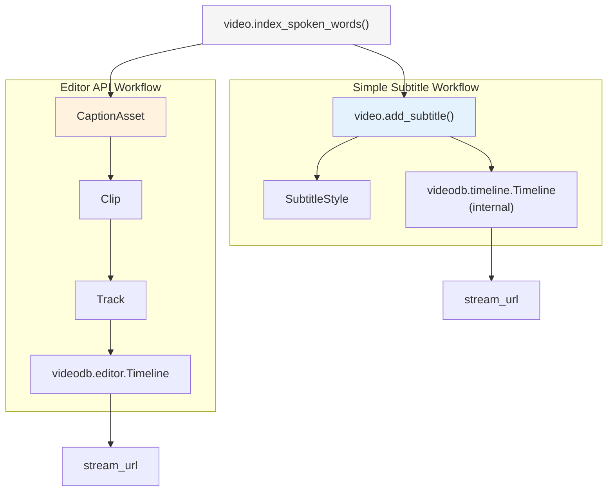
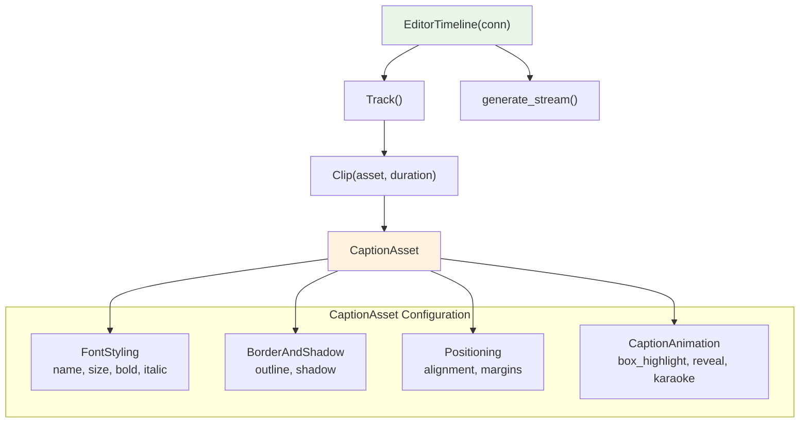
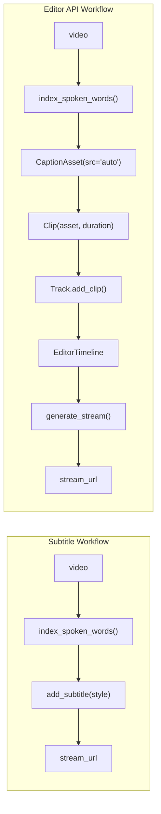

<!-- source: DeepWiki mcp.deepwiki.com · repo video-db/skills · page 7.3 Subtitles and Captions · fetched 2026-10-27 -->

# Subtitles and Captions

<details>
<summary>Relevant source files</summary>

The following files were used as context for generating this wiki page:

- [python/SKILL.md](python/SKILL.md)
- [python/reference/editor.md](python/reference/editor.md)

</details>


This page documents the two methods for adding subtitles and captions to videos in VideoDB: the simple subtitle workflow using `video.add_subtitle()`, and the advanced Editor API using `CaptionAsset` with track-based composition. Both methods auto-generate captions from transcripts and burn them into video streams server-side.

For general timeline editing concepts, see [Timeline Basics](#7.1). For other asset types (video, audio, image, text), see [Asset Types](#7.2).

---

## Prerequisites

All subtitle and caption workflows require the video to be indexed for spoken words first. This generates the transcript that captions are based on:

```python
# Index the video for spoken words (force=True skips if already done)
video.index_spoken_words(force=True)
```

Without indexing, both `video.add_subtitle()` and `CaptionAsset` will fail. The indexing process transcribes audio into timestamped text segments that become subtitle entries.

**Sources:** [python/reference/editor.md:190-212](), [python/SKILL.md:140-147]()

---

## Two Subtitle Approaches

VideoDB provides two distinct APIs for adding captions. They are not interchangeable:



**Diagram: Two Distinct Caption Workflows**

| Method | API | Complexity | Customization | Use Case |
|--------|-----|------------|---------------|----------|
| **Subtitle Workflow** | `video.add_subtitle()` with `SubtitleStyle` | Simple, one function call | Basic styling (font, color, bold) | Quick subtitle overlays, standard captions |
| **Editor API** | `CaptionAsset` with `videodb.editor.Timeline` | Advanced, multi-step composition | Extensive styling, animations, positioning | Animated captions, precise control, multi-track editing |

**Sources:** [python/reference/editor.md:189-264](), [python/reference/editor.md:386-396]()

---

## Method 1: Subtitle Workflow

The simplest approach uses `video.add_subtitle()` to burn subtitles directly onto the video stream. This method uses `videodb.timeline.Timeline` internally but abstracts away the timeline construction.

### Basic Usage

```python
from videodb import SubtitleStyle

# Index spoken words first
video.index_spoken_words(force=True)

# Add subtitles with default styling
stream_url = video.add_subtitle()
```

The returned `stream_url` is an HLS stream with subtitles burned into the video frames. No separate subtitle file is created.

### Custom Styling

```python
stream_url = video.add_subtitle(style=SubtitleStyle(
    font_name="Arial",
    font_size=22,
    primary_colour="&H00FFFFFF",  # White text
    secondary_colour="&H000000FF",  # Red (used for karaoke)
    back_colour="&H00000000",  # Transparent background
    bold=True,
    italic=False,
))
```

### SubtitleStyle Parameters

The `SubtitleStyle` class controls the appearance of subtitles. All parameters are optional with sensible defaults:

| Parameter | Type | Default | Description |
|-----------|------|---------|-------------|
| `font_name` | `str` | `"Arial"` | Font family name |
| `font_size` | `int` | `16` | Font size in pixels |
| `primary_colour` | `str` | `"&H00FFFFFF"` | Primary text color (ASS format: `&HAABBGGRR`) |
| `secondary_colour` | `str` | `"&H000000FF"` | Secondary color for karaoke effects (ASS format) |
| `back_colour` | `str` | `"&H00000000"` | Background box color (ASS format) |
| `bold` | `bool` | `False` | Enable bold text |
| `italic` | `bool` | `False` | Enable italic text |

**Color Format:** Colors use ASS subtitle format `&HAABBGGRR` where AA=alpha, BB=blue, GG=green, RR=red in hexadecimal. For example:
- `&H00FFFFFF` = opaque white
- `&H00000000` = transparent black
- `&HFF0000FF` = opaque red

**Sources:** [python/reference/editor.md:195-212]()

---

## Method 2: Editor API

The Editor API (`videodb.editor`) provides a track-based composition system with `CaptionAsset` for advanced caption styling, animations, and precise positioning. This is a separate API from `videodb.timeline.Timeline`.

### Basic Editor API Usage

```python
from videodb.editor import (
    CaptionAsset,
    Clip,
    Track,
    Timeline as EditorTimeline,
    FontStyling,
    BorderAndShadow,
    Positioning,
    CaptionAnimation,
)

# Index spoken words first
video.index_spoken_words(force=True)

# Create caption asset
caption = CaptionAsset(
    src="auto",
    font=FontStyling(name="Clear Sans", size=30),
    primary_color="&H00FFFFFF",
    back_color="&H00000000",
)

# Build editor timeline with track and clip
editor_tl = EditorTimeline(conn)
track = Track()
track.add_clip(start=0, clip=Clip(asset=caption, duration=video.length))
editor_tl.add_track(track)

stream_url = editor_tl.generate_stream()
```

**Sources:** [python/reference/editor.md:214-250]()

### Editor API Object Model



**Diagram: Editor API Composition Structure**

**Sources:** [python/reference/editor.md:214-264]()

---

## CaptionAsset Parameters

The `CaptionAsset` class provides extensive configuration for caption appearance and behavior:

| Parameter | Type | Default | Description |
|-----------|------|---------|-------------|
| `src` | `str` | `"auto"` | Caption source (`"auto"` for transcript, or base64 ASS string) |
| `font` | `FontStyling\|None` | `FontStyling()` | Font configuration object |
| `primary_color` | `str` | `"&H00FFFFFF"` | Primary text color (ASS format) |
| `secondary_color` | `str` | `"&H000000FF"` | Secondary text color (ASS format) |
| `back_color` | `str` | `"&H00000000"` | Background box color (ASS format) |
| `border` | `BorderAndShadow\|None` | `BorderAndShadow()` | Border and shadow styling |
| `position` | `Positioning\|None` | `Positioning()` | Caption alignment and margins |
| `animation` | `CaptionAnimation\|None` | `None` | Animation effect |

**Sources:** [python/reference/editor.md:253-264]()

---

## FontStyling Configuration

The `FontStyling` class controls text appearance:

```python
from videodb.editor import FontStyling

font = FontStyling(
    name="Clear Sans",
    size=30,
    bold=True,
    italic=False,
    underline=False,
    strikeout=False,
)
```

| Parameter | Type | Default | Description |
|-----------|------|---------|-------------|
| `name` | `str` | `"Arial"` | Font family name |
| `size` | `int` | `20` | Font size in pixels |
| `bold` | `bool` | `False` | Enable bold weight |
| `italic` | `bool` | `False` | Enable italic style |
| `underline` | `bool` | `False` | Enable underline |
| `strikeout` | `bool` | `False` | Enable strikethrough |

**Sources:** [python/reference/editor.md:218-250]()

---

## BorderAndShadow Configuration

The `BorderAndShadow` class controls text borders and drop shadows:

```python
from videodb.editor import BorderAndShadow

border = BorderAndShadow(
    outline=2,
    shadow=1,
)
```

| Parameter | Type | Default | Description |
|-----------|------|---------|-------------|
| `outline` | `int` | `1` | Border width in pixels |
| `shadow` | `int` | `0` | Shadow depth in pixels |

**Sources:** [python/reference/editor.md:218-250]()

---

## Positioning Configuration

The `Positioning` class controls caption placement and alignment:

```python
from videodb.editor import Positioning

position = Positioning(
    alignment=2,  # Bottom center
    margin_l=10,
    margin_r=10,
    margin_v=30,
)
```

| Parameter | Type | Default | Description |
|-----------|------|---------|-------------|
| `alignment` | `int` | `2` | Alignment (1=bottom left, 2=bottom center, 3=bottom right, etc.) |
| `margin_l` | `int` | `10` | Left margin in pixels |
| `margin_r` | `int` | `10` | Right margin in pixels |
| `margin_v` | `int` | `10` | Vertical margin from edge |

**Sources:** [python/reference/editor.md:218-250]()

---

## CaptionAnimation Options

The `CaptionAnimation` enumeration provides built-in animation effects:

```python
from videodb.editor import CaptionAnimation

# Available animations:
CaptionAnimation.box_highlight  # Highlight background box
CaptionAnimation.reveal         # Text reveal effect
CaptionAnimation.karaoke       # Karaoke-style word highlighting
```

Animations add visual interest to captions without requiring manual keyframe animation. Pass the animation to `CaptionAsset`:

```python
caption = CaptionAsset(
    src="auto",
    font=FontStyling(name="Arial", size=28),
    animation=CaptionAnimation.box_highlight,
)
```

**Sources:** [python/reference/editor.md:218-250]()

---

## Complete Examples

### Simple Subtitle with Custom Style

```python
import videodb
from videodb import SubtitleStyle

conn = videodb.connect()
coll = conn.get_collection()
video = coll.get_video("video-id")

# Index for spoken words
video.index_spoken_words(force=True)

# Add styled subtitles
stream_url = video.add_subtitle(style=SubtitleStyle(
    font_name="Helvetica",
    font_size=24,
    primary_colour="&H00FFFF00",  # Yellow text
    bold=True,
))

print(f"Video with subtitles: {stream_url}")
```

**Sources:** [python/reference/editor.md:195-212]()

### Animated Captions with Editor API

```python
import videodb
from videodb.editor import (
    CaptionAsset,
    Clip,
    Track,
    Timeline as EditorTimeline,
    FontStyling,
    BorderAndShadow,
    Positioning,
    CaptionAnimation,
)

conn = videodb.connect()
coll = conn.get_collection()
video = coll.get_video("video-id")

# Index for spoken words
video.index_spoken_words(force=True)

# Create animated caption
caption = CaptionAsset(
    src="auto",
    font=FontStyling(
        name="Clear Sans",
        size=32,
        bold=True,
    ),
    primary_color="&H00FFFFFF",  # White text
    back_color="&H00000000",     # Transparent background
    border=BorderAndShadow(
        outline=2,
        shadow=1,
    ),
    position=Positioning(
        alignment=2,      # Bottom center
        margin_v=40,      # 40px from bottom
    ),
    animation=CaptionAnimation.box_highlight,
)

# Build timeline
editor_tl = EditorTimeline(conn)
track = Track()
track.add_clip(start=0, clip=Clip(asset=caption, duration=video.length))
editor_tl.add_track(track)

stream_url = editor_tl.generate_stream()
print(f"Video with animated captions: {stream_url}")
```

**Sources:** [python/reference/editor.md:218-250]()

---

## Workflow Comparison



**Diagram: Side-by-Side Workflow Comparison**

**Sources:** [python/reference/editor.md:189-264](), [python/reference/editor.md:386-396]()

---

## When to Use Each Method

| Scenario | Recommended Method | Reason |
|----------|-------------------|--------|
| Quick subtitle overlay | Subtitle Workflow | Single function call, minimal code |
| Standard YouTube-style captions | Subtitle Workflow | Simple styling sufficient |
| Animated captions (e.g., box highlight) | Editor API | Only method supporting animations |
| Multi-track composition with captions | Editor API | Full timeline control |
| Precise positioning control | Editor API | Fine-grained `Positioning` parameters |
| Custom ASS subtitle file | Editor API | Can pass base64 ASS string to `src` |
| Combining captions with other assets | Editor API | Track-based composition supports layering |

**Sources:** [python/reference/editor.md:386-396]()

---

## API Incompatibility Warning

The two caption APIs are **not interchangeable**. Do not attempt to mix them:

```python
# WRONG: Cannot use CaptionAsset with videodb.timeline.Timeline
from videodb.timeline import Timeline
from videodb.editor import CaptionAsset

timeline = Timeline(conn)
caption = CaptionAsset(src="auto")
timeline.add_overlay(0, caption)  # ERROR: Not supported
```

```python
# CORRECT: Use CaptionAsset with videodb.editor.Timeline
from videodb.editor import Timeline as EditorTimeline, CaptionAsset

editor_tl = EditorTimeline(conn)
caption = CaptionAsset(src="auto")
# ... (proper Track/Clip usage)
```

The `videodb.timeline.Timeline` (used by `video.add_subtitle()` internally) accepts `VideoAsset`, `AudioAsset`, `ImageAsset`, and `TextAsset`. The `videodb.editor.Timeline` accepts `CaptionAsset` via `Track` and `Clip` objects.

**Sources:** [python/reference/editor.md:386-396]()

---

## Limitations

Both caption methods have the following constraints:

| Limitation | Details |
|------------|---------|
| **Requires transcript** | Both methods fail if `index_spoken_words()` was not called first |
| **Burned-in only** | Captions are rendered into video frames; no separate SRT/VTT file output |
| **No manual timing** | Caption timing is determined by transcript timestamps; cannot manually set entry/exit times |
| **No per-word styling** | Cannot style individual words differently within a subtitle entry |
| **Animation limited to Editor API** | Subtitle workflow provides no animation; static captions only |
| **No mixed fonts in single entry** | Each caption entry uses one font style; cannot mix bold and regular within one line |

For timeline editor constraints that apply to all assets (not just captions), see [Limitations and Best Practices](#7.4).

**Sources:** [python/reference/editor.md:398-426]()

---

## Key Differences Summary

| Feature | Subtitle Workflow | Editor API |
|---------|------------------|-----------|
| **Import** | `from videodb import SubtitleStyle` | `from videodb.editor import CaptionAsset` |
| **Timeline** | `videodb.timeline.Timeline` (internal) | `videodb.editor.Timeline` (explicit) |
| **Lines of code** | 2-3 | 8-12 |
| **Styling class** | `SubtitleStyle` | `FontStyling`, `BorderAndShadow`, `Positioning` |
| **Animations** | None | `CaptionAnimation.box_highlight`, `reveal`, `karaoke` |
| **Custom ASS** | Not supported | Supported via `src=base64_string` |
| **Multi-track** | Not applicable | Full track-based composition |

**Sources:** [python/reference/editor.md:386-396]()

---

