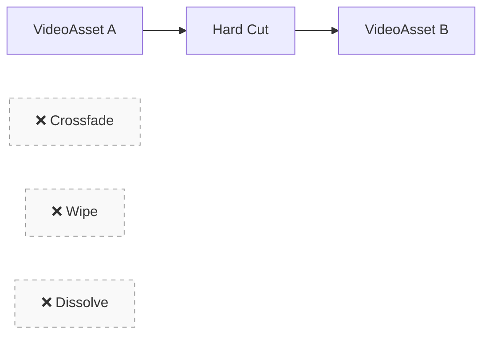
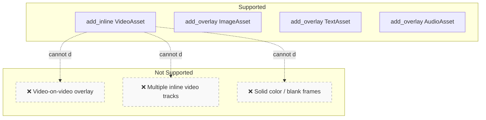
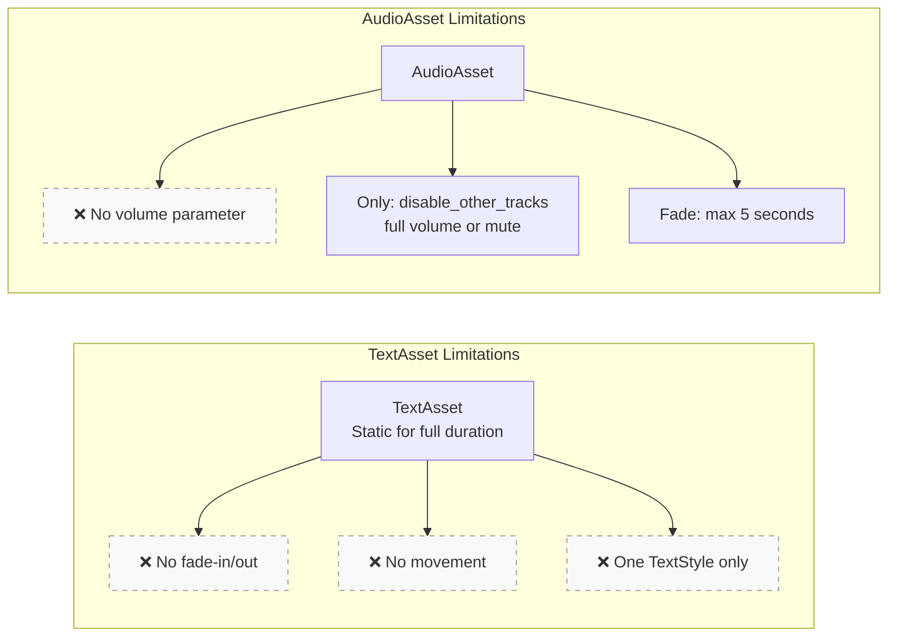
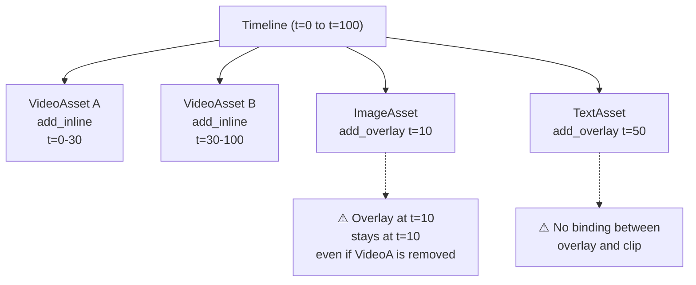
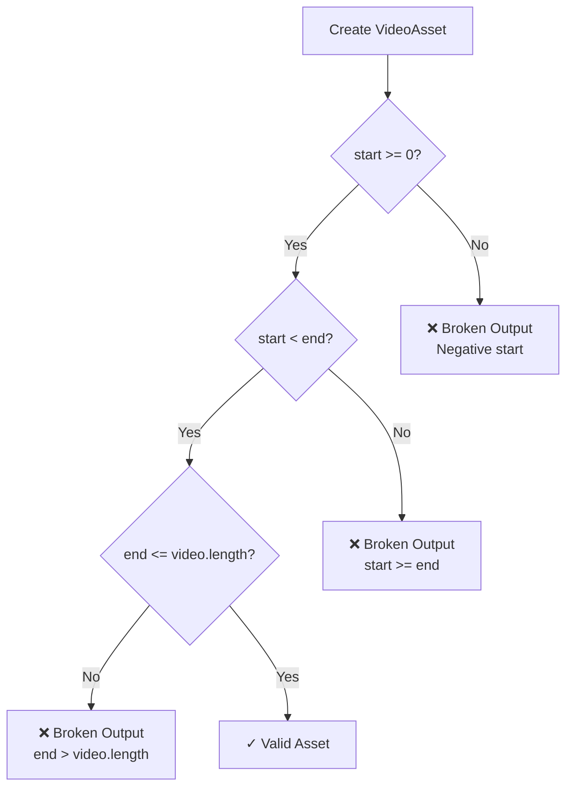
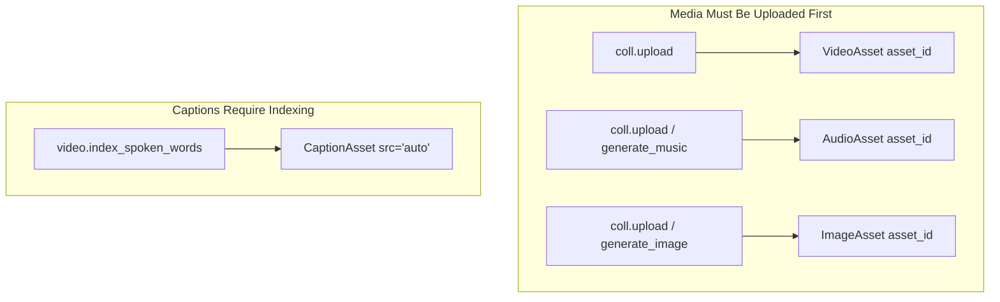

<!-- source: DeepWiki mcp.deepwiki.com · repo video-db/skills · page 7.4 Limitations and Best Practices · fetched 2026-10-27 -->

# Limitations and Best Practices

<details>
<summary>Relevant source files</summary>

The following files were used as context for generating this wiki page:

- [python/SKILL.md](python/SKILL.md)
- [python/reference/editor.md](python/reference/editor.md)

</details>


This page documents the operational boundaries, constraints, and validation requirements for the VideoDB Timeline editing system. Understanding these limitations is essential for designing effective video composition workflows and avoiding silent failures.

For core Timeline concepts and usage patterns, see [Timeline Basics](#7.1). For detailed asset configuration, see [Asset Types](#7.2). For subtitle workflows, see [Subtitles and Captions](#7.3).

---

## Unsupported Operations

The Timeline editor is designed for non-destructive linear composition and asset layering. The following operations are **not supported** by the `videodb.timeline.Timeline` API:

### Visual Effects and Transitions



| Operation | Status | Detail |
|-----------|--------|--------|
| **Transitions** | ❌ Not Supported | No crossfades, wipes, dissolves, or transitions between clips. All cuts are hard cuts. |
| **Video filters** | ❌ Not Supported | No brightness, contrast, saturation, hue, or color correction adjustments. |
| **Keyframe animation** | ❌ Not Supported | Cannot change overlay properties over time (e.g., move an `ImageAsset` from position A to B). |

**Sources:** [python/reference/editor.md:398-425]()

### Video Composition Constraints



| Limitation | Detail |
|------------|--------|
| **No video-on-video (picture-in-picture)** | `add_inline()` only accepts `VideoAsset`. You cannot overlay one video stream on top of another. `ImageAsset` overlays can approximate static PiP but not live video. |
| **No blank or solid-color clips** | Cannot create a solid color frame, black screen, or standalone title card. `TextAsset` and `ImageAsset` overlays require a `VideoAsset` beneath them on the inline track. |
| **Inline track is video only** | `add_inline()` only accepts `VideoAsset`. Audio, image, and text must use `add_overlay()`. |

**Sources:** [python/reference/editor.md:403-413]()

### Playback and Temporal Control

| Operation | Status | Detail |
|-----------|--------|--------|
| **Speed control** | ❌ Not Supported | No slow-motion, fast-forward, reverse playback, or time remapping. `VideoAsset` has no `speed` parameter. |
| **Crop / zoom / pan** | ❌ Not Supported | Cannot crop a region of a video frame, apply zoom effects, or pan across a frame. Note: `video.reframe()` is for aspect-ratio conversion only, not for cropping. |

**Sources:** [python/reference/editor.md:408-409]()

### Text and Audio Limitations



| Limitation | Detail |
|------------|--------|
| **No animated text** | `TextAsset` is static for its full duration. No fade-in/out, movement, or animation. For animated captions, use `CaptionAsset` with the Editor API (see [Subtitles and Captions](#7.3)). |
| **No mixed text styling** | A single `TextAsset` has one `TextStyle`. Cannot mix bold, italic, or colors within a single text block. |
| **No audio volume control** | `AudioAsset` has no `volume` parameter. Audio is either full volume or muted via `disable_other_tracks`. Cannot mix at a reduced level. |

**Sources:** [python/reference/editor.md:411-414]()

---

## Constraints on Supported Operations

The following operations **are supported** but have specific constraints:

### Audio Fade Duration Limits

```python
# AudioAsset fade parameters
from videodb.asset import AudioAsset

# Maximum fade duration: 5 seconds
audio_layer = AudioAsset(
    asset_id=music.id,
    fade_in_duration=5,   # MAX: 5 seconds
    fade_out_duration=5,  # MAX: 5 seconds
)
```

| Parameter | Type | Maximum | Detail |
|-----------|------|---------|--------|
| `fade_in_duration` | `float` | 5 seconds | Fade-in duration is capped at 5 seconds |
| `fade_out_duration` | `float` | 5 seconds | Fade-out duration is capped at 5 seconds |

**Sources:** [python/reference/editor.md:419-420](), [python/reference/editor.md:153-154]()

### Overlay Positioning Model



| Constraint | Detail |
|------------|--------|
| **Overlay positioning is absolute** | Overlays use absolute timestamps from the timeline start. Rearranging inline clips does **not** move their overlays. |
| **No overlay-to-clip binding** | Overlays are placed at a fixed timeline timestamp. There is no way to attach an overlay to a specific inline clip so it moves with that clip. |

**Sources:** [python/reference/editor.md:422-424]()

---

## Critical Validation Requirements

### Timestamp Validation

**The SDK does not validate timestamps.** Passing invalid values (negative, out-of-bounds) is silently accepted but produces broken or unexpected output.



**Required Validation Rules:**

```python
from videodb.asset import VideoAsset

# ❌ WRONG: No validation - will produce broken output
bad_asset = VideoAsset(asset_id=video.id, start=-5, end=30)

# ✓ CORRECT: Always validate before creating asset
def create_validated_asset(video, start, end):
    # Rule 1: start must be >= 0
    if start < 0:
        raise ValueError(f"start must be >= 0, got {start}")
    
    # Rule 2: start must be < end
    if start >= end:
        raise ValueError(f"start ({start}) must be < end ({end})")
    
    # Rule 3: end must be <= video.length
    if end > video.length:
        raise ValueError(f"end ({end}) exceeds video length ({video.length})")
    
    return VideoAsset(asset_id=video.id, start=start, end=end)
```

| Rule | Validation | Consequence of Violation |
|------|-----------|--------------------------|
| **Non-negative start** | `start >= 0` | Negative values are silently accepted but produce broken output |
| **Valid range** | `start < end` | Invalid range produces broken or empty output |
| **Within bounds** | `end <= video.length` | Out-of-bounds end produces broken or truncated output |

**Sources:** [python/reference/editor.md:70](), [python/SKILL.md:210-213]()

### Asset Prerequisite Validation



| Asset Type | Prerequisite | Detail |
|------------|--------------|--------|
| `VideoAsset` | Video must be uploaded to collection | Cannot reference a video ID that doesn't exist |
| `AudioAsset` | Audio must be uploaded or generated | Cannot reference an audio ID that doesn't exist |
| `ImageAsset` | Image must be uploaded or generated | Cannot reference an image ID that doesn't exist |
| `CaptionAsset` | Video must have spoken word index | `video.index_spoken_words()` must complete before `CaptionAsset(src="auto")` works |

**Sources:** [python/reference/editor.md:4-7]()

---

## Best Practices

### Non-Destructive Workflow

Timelines never modify source media. You can create multiple timeline compositions from the same assets.

```python
# Original video is never modified
video = coll.get_video("vid_123")

# Create multiple compositions from the same source
highlight_reel = Timeline(conn)
highlight_reel.add_inline(VideoAsset(asset_id=video.id, start=10, end=30))

full_version = Timeline(conn)
full_version.add_inline(VideoAsset(asset_id=video.id))

# Both timelines reference the same source video
# Neither modifies the original
```

**Sources:** [python/reference/editor.md:427-428]()

### Overlay Stacking

Multiple overlays can start at the same timestamp. Audio overlays mix together; image and text overlays layer in the order they were added.

```python
timeline = Timeline(conn)
timeline.add_inline(VideoAsset(asset_id=video.id))

# All overlays at t=0 - they stack in add-order
timeline.add_overlay(0, AudioAsset(asset_id=music.id))
timeline.add_overlay(0, ImageAsset(asset_id=logo.id, x=20, y=20))
timeline.add_overlay(0, TextAsset(text="Title", duration=5))

# Rendering order (bottom to top):
# 1. VideoAsset (inline track)
# 2. AudioAsset (mixed into audio track)
# 3. ImageAsset (first overlay added)
# 4. TextAsset (second overlay added, appears on top)
```

**Sources:** [python/reference/editor.md:429]()

### Generated Media Integration

Use the collection's `generate_*` methods to create media that can be used as timeline assets immediately.

```python
# Generate media first
music = coll.generate_music(prompt="upbeat background music", duration=30)
voiceover = coll.generate_voice(text="Welcome to the video", voice_id="...")
logo = coll.generate_image(prompt="company logo", aspect_ratio="16:9")

# Use generated media in timeline
timeline = Timeline(conn)
timeline.add_inline(VideoAsset(asset_id=video.id))
timeline.add_overlay(0, AudioAsset(asset_id=music.id, disable_other_tracks=False))
timeline.add_overlay(5, AudioAsset(asset_id=voiceover.id, disable_other_tracks=False))
timeline.add_overlay(0, ImageAsset(asset_id=logo.id, x=20, y=20, duration=10))
```

**Sources:** [python/reference/editor.md:434]()

---

## Alternative Approaches for Unsupported Operations

### Workarounds for Common Limitations


| Limitation | Workaround | Example |
|------------|-----------|---------|
| **No transitions** | Pre-render transition externally, upload result | Use `ffmpeg` with `xfade` filter, then `coll.upload()` |
| **No speed control** | Pre-process video externally, upload result | Use `ffmpeg` with `setpts` filter, then `coll.upload()` |
| **No volume control** | Pre-mix audio externally, upload result | Use `ffmpeg` with `volume` filter, then `coll.upload()` as audio asset |
| **No crop/zoom** | Pre-crop externally, upload result | Use `ffmpeg` with `crop` filter, then `coll.upload()` |
| **No color grading** | Pre-grade externally, upload result | Use `ffmpeg` with color filters, then `coll.upload()` |

**Sources:** [python/SKILL.md:349]()

### When NOT to Use Timeline

The following scenarios should use alternative VideoDB features instead of Timeline:

| Scenario | Use Instead | Reference |
|----------|-------------|-----------|
| Simple subtitle overlay | `video.add_subtitle()` | [Subtitles and Captions](#7.3) |
| Aspect ratio conversion | `video.reframe()` | [Reframing](#10.2) |
| Resolution / codec change | `conn.transcode()` | [Transcoding](#10.1) |
| Search result compilation | `search_result.compile()` | [Working with Search Results](#6.2) |

**Sources:** [python/reference/editor.md:195-212]()

---

## Common Error Patterns

### Silent Failures

```python
# ❌ This produces broken output but does NOT raise an error
timeline = Timeline(conn)
timeline.add_inline(VideoAsset(asset_id=video.id, start=-10, end=20))
stream_url = timeline.generate_stream()  # Returns URL, but stream is broken

# ✓ Always validate before timeline operations
if start < 0 or end > video.length or start >= end:
    raise ValueError("Invalid timestamp range")
```

### Asset Reference Errors

```python
from videodb.exceptions import InvalidRequestError

# ❌ Referencing non-existent asset ID
try:
    timeline.add_inline(VideoAsset(asset_id="nonexistent_id"))
except InvalidRequestError as e:
    print(f"Asset not found: {e}")

# ✓ Verify asset exists before referencing
video = coll.get_video("vid_123")  # Raises error if not found
timeline.add_inline(VideoAsset(asset_id=video.id))
```

### Caption Prerequisites

```python
from videodb.editor import CaptionAsset

# ❌ CaptionAsset requires prior indexing
caption = CaptionAsset(src="auto")  # Will fail if video not indexed

# ✓ Index spoken words first
video.index_spoken_words(force=True)
caption = CaptionAsset(src="auto")  # Now works correctly
```

**Sources:** [python/reference/editor.md:70](), [python/reference/editor.md:231]()

---

## Summary Table: What Timeline Can and Cannot Do

| Operation | Timeline Support | Alternative |
|-----------|------------------|-------------|
| **Trim video clips** | ✅ `VideoAsset(start, end)` | - |
| **Sequence multiple videos** | ✅ Multiple `add_inline()` calls | - |
| **Add text overlays** | ✅ `TextAsset` | - |
| **Add image overlays** | ✅ `ImageAsset` | - |
| **Mix audio tracks** | ✅ `AudioAsset` | - |
| **Auto-generated subtitles** | ✅ `video.add_subtitle()` or `CaptionAsset` | - |
| **Crossfade transitions** | ❌ Not supported | External tool → upload |
| **Video-on-video (PiP)** | ❌ Not supported | External tool → upload |
| **Slow-motion / speed** | ❌ Not supported | External tool → upload |
| **Crop / zoom** | ❌ Not supported | External tool → upload |
| **Volume control** | ❌ Not supported | Pre-mix audio → upload |
| **Color grading** | ❌ Not supported | External tool → upload |
| **Aspect ratio conversion** | ❌ Use `video.reframe()` instead | `video.reframe()` |
| **Resolution change** | ❌ Use `conn.transcode()` instead | `conn.transcode()` |

**Sources:** [python/reference/editor.md:398-425](), [python/SKILL.md:349-361]()

---

