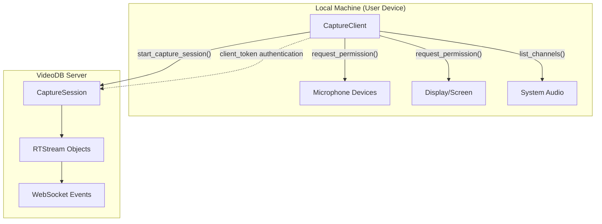
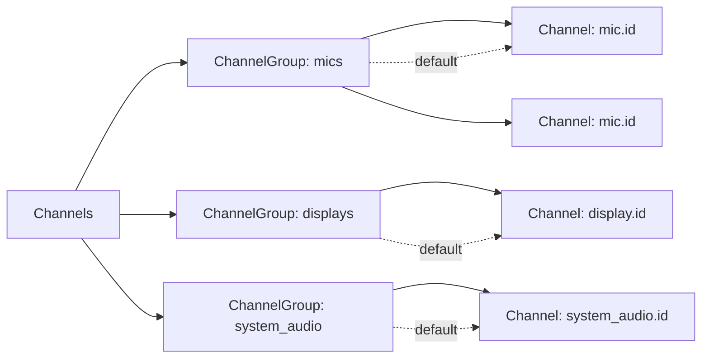
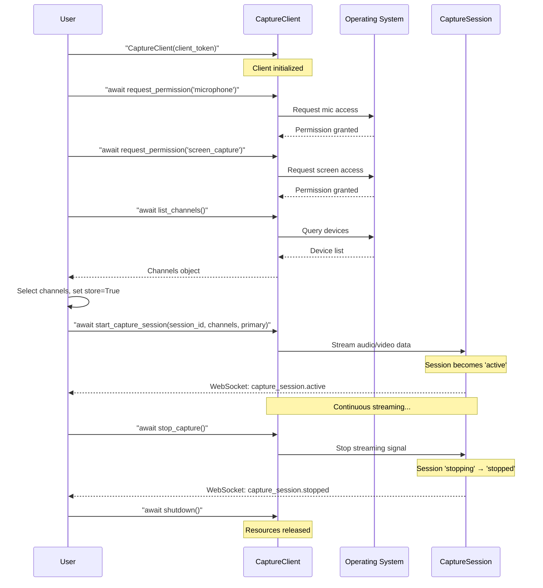
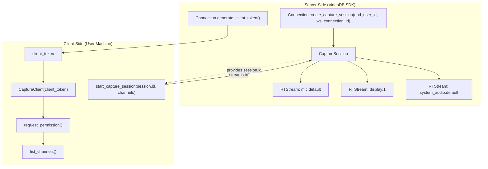

<!-- source: DeepWiki mcp.deepwiki.com · repo video-db/skills · page 8.2 CaptureClient API · fetched 2026-10-27 -->

# CaptureClient API

<details>
<summary>Relevant source files</summary>

The following files were used as context for generating this wiki page:

- [python/reference/capture-reference.md](python/reference/capture-reference.md)

</details>


This document covers the `CaptureClient` class, which runs on the end user's local machine to handle desktop capture operations. The client manages device permissions, discovers available audio/video channels, and streams selected channels to a server-side `CaptureSession`.

For the complete capture workflow including session creation and WebSocket setup, see [Capture Workflow](#8.1). For event handling and monitoring, see [Capture Events](#8.3).

---

## Overview

The `CaptureClient` is a local component that interfaces with the user's operating system to access microphone, screen, and system audio devices. It operates independently from the VideoDB SDK's server-side components, communicating with `CaptureSession` objects through authenticated streaming connections.

### Client vs Server Architecture



**Sources:** [python/reference/capture-reference.md:260-303]()

---

## Initialization

### Creating a CaptureClient

The `CaptureClient` requires a client token generated from the server-side `Connection` object. This token authenticates the client's streaming connection.

```python
from videodb.capture import CaptureClient

# Generate token from server-side Connection
token = conn.generate_client_token()

# Initialize client on local machine
client = CaptureClient(client_token=token)
```

**Constructor Parameters:**

| Parameter | Type | Required | Description |
|-----------|------|----------|-------------|
| `client_token` | `str` | Yes | Authentication token from `conn.generate_client_token()` |

**Sources:** [python/reference/capture-reference.md:260-268](), [python/reference/capture-reference.md:254-256]()

---

## Permission Management

The client must request explicit permissions before accessing device hardware. This triggers OS-level permission dialogs.

### Request Permission Method

```python
await client.request_permission("microphone")
await client.request_permission("screen_capture")
```

**Method Signature:**

| Method | Returns | Description |
|--------|---------|-------------|
| `await client.request_permission(type)` | `None` | Request device permission |

**Permission Types:**

| Type | Access Granted |
|------|----------------|
| `"microphone"` | Audio input devices (microphones) |
| `"screen_capture"` | Screen/display recording |

**Notes:**
- System audio capture typically does not require separate permission
- Permission must be granted before calling `list_channels()`
- OS dialogs are triggered asynchronously; await the response
- Permissions persist across sessions based on OS policy

**Sources:** [python/reference/capture-reference.md:271-285]()

---

## Channel Discovery

After permissions are granted, the client can discover available audio and video input devices.

### Discovering Channels

```python
channels = await client.list_channels()

# Access channel groups
mic = channels.mics.default
display = channels.displays.default
system_audio = channels.system_audio.default

# Iterate all channels
for ch in channels.all():
    print(f"{ch.id} ({ch.type}): {ch.name}")
```

**Method Signature:**

| Method | Returns | Description |
|--------|---------|-------------|
| `await client.list_channels()` | `Channels` | Discover available audio/video channels |

**Sources:** [python/reference/capture-reference.md:308-319]()

### Channels Object Structure



**Sources:** [python/reference/capture-reference.md:308-346]()

### Channels Properties

| Property | Type | Description |
|----------|------|-------------|
| `channels.mics` | `ChannelGroup` | Available microphones |
| `channels.displays` | `ChannelGroup` | Available screen displays |
| `channels.system_audio` | `ChannelGroup` | Available system audio sources |

**Sources:** [python/reference/capture-reference.md:321-327]()

### ChannelGroup Members

| Member | Type | Description |
|--------|------|-------------|
| `group.default` | `Channel` or `None` | Default channel in the group |
| `group.all()` | `list[Channel]` | All channels in the group |

**Sources:** [python/reference/capture-reference.md:329-334]()

### Channel Properties

| Property | Type | Description |
|----------|------|-------------|
| `ch.id` | `str` | Unique channel identifier |
| `ch.type` | `str` | Channel type: `"mic"`, `"display"`, or `"system_audio"` |
| `ch.name` | `str` | Human-readable device name |
| `ch.store` | `bool` | Whether to persist the recording (default: `False`) |

**Important:** Set `ch.store = True` for channels you want to save as permanent recordings. Without this, streams are processed in real-time for AI analysis but not saved to video files.

**Sources:** [python/reference/capture-reference.md:336-346]()

---

## Session Management

The client starts and stops streaming to a server-side `CaptureSession`.

### Starting Capture

```python
# Select channels to capture
selected_channels = [mic, display, system_audio]

# Optional: Enable storage for specific channels
if display:
    display.store = True

# Start streaming
await client.start_capture_session(
    capture_session_id=session.id,
    channels=selected_channels,
    primary_video_channel_id=display.id if display else None,
)
```

**Method Signature:**

| Method | Returns | Description |
|--------|---------|-------------|
| `await client.start_capture_session(capture_session_id, channels, primary_video_channel_id)` | `None` | Start streaming selected channels |

**Parameters:**

| Parameter | Type | Required | Description |
|-----------|------|----------|-------------|
| `capture_session_id` | `str` | Yes | ID of the server-side `CaptureSession` |
| `channels` | `list[Channel]` | Yes | List of channels to capture |
| `primary_video_channel_id` | `str` or `None` | No | ID of the primary video channel for multi-display scenarios |

**Notes:**
- The `capture_session_id` must match a session created via `conn.create_capture_session()`
- Multiple channels can be captured simultaneously (e.g., mic + display + system audio)
- Each channel creates a separate `RTStream` on the server side
- Only channels with `store=True` will be saved as permanent recordings
- The session transitions to `active` status when streaming begins

**Sources:** [python/reference/capture-reference.md:271-296]()

### Stopping Capture

```python
# Gracefully stop streaming
await client.stop_capture()

# Clean up client resources
await client.shutdown()
```

**Method Signatures:**

| Method | Returns | Description |
|--------|---------|-------------|
| `await client.stop_capture()` | `None` | Gracefully stop the capture session |
| `await client.shutdown()` | `None` | Clean up client resources |

**Lifecycle Notes:**
- `stop_capture()` signals the server to finalize all `RTStream` objects
- Server-side session transitions: `active` → `stopping` → `stopped` → `exported` (if any channel had `store=True`)
- `shutdown()` releases local device handles and closes network connections
- Always call both methods in sequence for proper cleanup

**Sources:** [python/reference/capture-reference.md:298-303]()

---

## Complete Client Workflow



**Sources:** [python/reference/capture-reference.md:260-303](), [python/reference/capture-reference.md:358-386]()

---

## Integration with CaptureSession

The `CaptureClient` and `CaptureSession` are tightly coupled but operate in different environments:



**Key Relationships:**

1. **Token Generation:** Server-side `Connection` generates `client_token` for authentication
2. **Session Creation:** Server-side `CaptureSession` must exist before client can stream
3. **Session ID Matching:** Client's `start_capture_session()` parameter must match server's `session.id`
4. **RTStream Generation:** Each client channel creates a corresponding `RTStream` on the server
5. **WebSocket Events:** Session lifecycle events are delivered to the `ws_connection_id` specified during session creation

**Sources:** [python/reference/capture-reference.md:214-256](), [python/reference/capture-reference.md:260-303]()

---

## Error Handling

### Common Issues

| Issue | Cause | Solution |
|-------|-------|----------|
| Permission denied | OS-level permission not granted | Ensure `request_permission()` is called and user accepts dialog |
| No channels found | Permissions not requested before `list_channels()` | Call `request_permission()` first |
| Session start fails | Invalid `capture_session_id` | Verify session ID matches server-side `CaptureSession` |
| Stream interrupted | Network issues or device disconnection | Client should detect and handle gracefully; session enters `failed` state |

**Sources:** [python/reference/capture-reference.md:260-303]()

---

## Platform Considerations

The `CaptureClient` behavior varies by operating system:

| Platform | Microphone | Screen Capture | System Audio |
|----------|------------|----------------|--------------|
| **macOS** | Requires permission | Requires permission | Requires permission (loopback audio) |
| **Windows** | Requires permission | Requires permission | Available without extra permission |
| **Linux** | Varies by distribution | Varies by compositor | Varies by audio system (PulseAudio/PipeWire) |

**Notes:**
- Permission dialogs and behavior are OS-dependent
- System audio capture may require additional OS configuration on some platforms
- Display selection in multi-monitor setups uses `primary_video_channel_id` parameter

**Sources:** [python/reference/capture-reference.md:260-346]()

---

## Best Practices

### Channel Selection Strategy

```python
# Get all available channels
channels = await client.list_channels()

# Select defaults if available
mic = channels.mics.default
display = channels.displays.default
system_audio = channels.system_audio.default

# Build capture list
selected = []
if mic:
    mic.store = True  # Save mic recording
    selected.append(mic)
if display:
    display.store = True  # Save screen recording
    selected.append(display)
if system_audio:
    system_audio.store = False  # Process but don't save
    selected.append(system_audio)

# Start with selected channels
await client.start_capture_session(
    capture_session_id=session.id,
    channels=selected,
    primary_video_channel_id=display.id if display else None,
)
```

### Cleanup Pattern

```python
try:
    # Start capture operations
    await client.start_capture_session(session.id, channels, primary)
    
    # ... capture operations ...
    
finally:
    # Always clean up
    await client.stop_capture()
    await client.shutdown()
```

**Sources:** [python/reference/capture-reference.md:289-303]()

---

