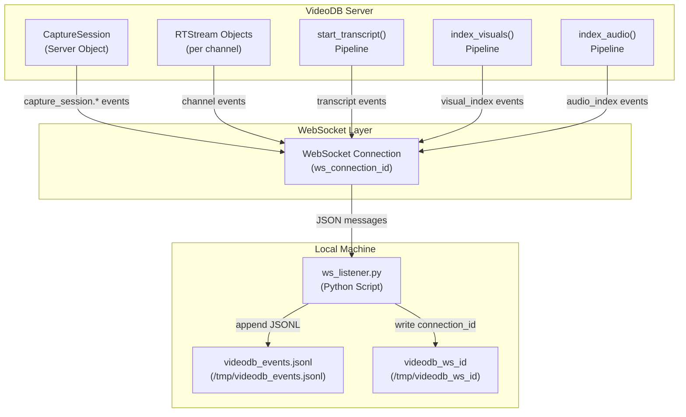
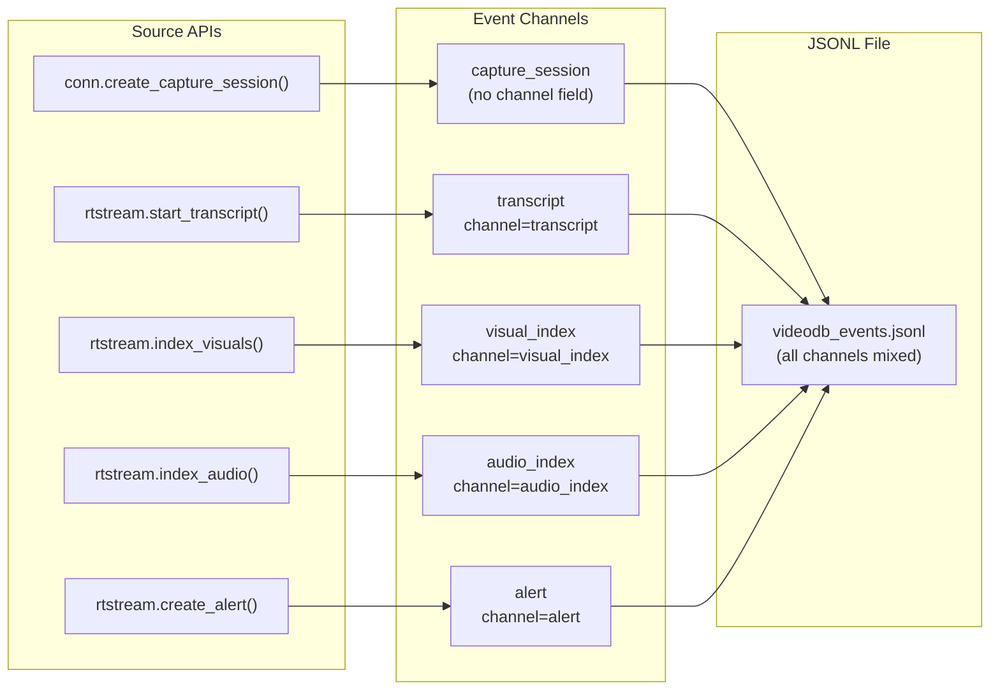
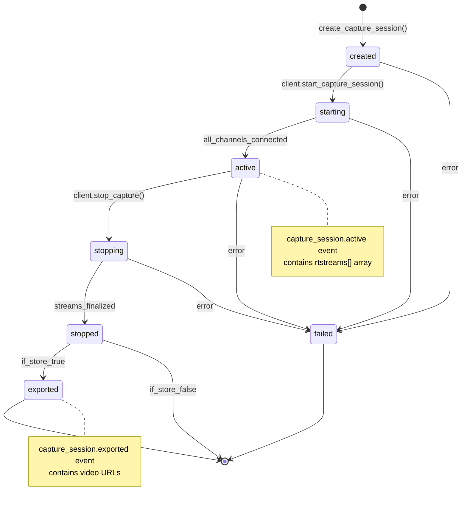
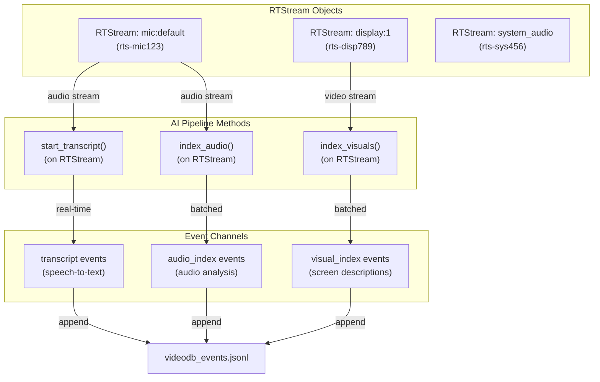
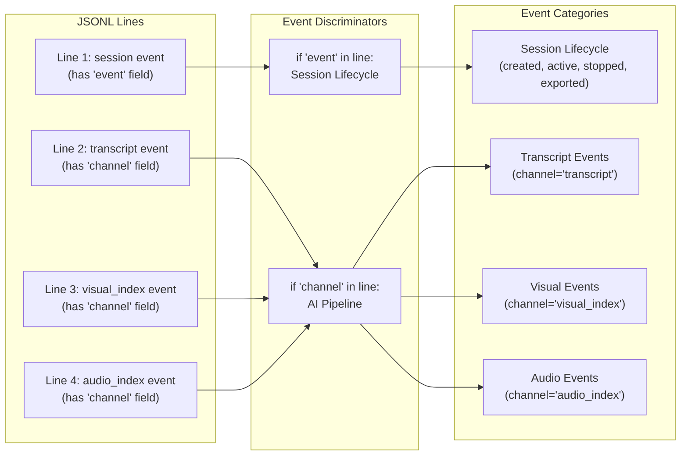

<!-- source: DeepWiki mcp.deepwiki.com · repo video-db/skills · page 8.3 Capture Events · fetched 2026-10-27 -->

# Capture Events

<details>
<summary>Relevant source files</summary>

The following files were used as context for generating this wiki page:

- [python/reference/capture-reference.md](python/reference/capture-reference.md)
- [python/reference/capture.md](python/reference/capture.md)

</details>


This page documents the WebSocket event types delivered during desktop capture sessions. Events provide real-time notifications for session lifecycle changes (created, active, stopped, exported) and AI pipeline results (transcripts, visual descriptions, audio analysis). All events are received via WebSocket and persisted to JSONL format by the `ws_listener.py` script.

For the complete capture workflow including WebSocket setup and session management, see [Capture Workflow](#8.1). For post-session analysis of event logs, see [Post-Session Processing](#8.4).

---

## Event Delivery Architecture

Capture events flow from VideoDB's server-side infrastructure through WebSocket connections to local JSONL logs. The `ws_listener.py` script maintains the WebSocket connection and writes all events to disk for analysis.

**Event Flow Diagram**



**Sources:** [python/reference/capture.md:1-102](), [python/reference/capture-reference.md:1-212]()

| Component | File | Description |
|-----------|------|-------------|
| `ws_listener.py` | [scripts/ws_listener.py]() | Maintains WebSocket connection, writes events to JSONL |
| `videodb_events.jsonl` | `/tmp/videodb_events.jsonl` | All events appended as JSON lines |
| `videodb_ws_id` | `/tmp/videodb_ws_id` | WebSocket connection ID for API calls |
| `videodb_ws_pid` | `/tmp/videodb_ws_pid` | Process ID for terminating listener |

**Sources:** [python/reference/capture.md:89-96](), [python/reference/capture-reference.md:155-159]()

---

## Event Channels

Events are categorized into channels based on their source. Each channel delivers a specific type of real-time data.

| Channel | Source API | Content | Event Structure |
|---------|------------|---------|-----------------|
| `capture_session` | Session lifecycle | Status changes (created, active, stopped, exported) | `{"event": "capture_session.*", "capture_session_id": "...", "status": "..."}` |
| `transcript` | `rtstream.start_transcript()` | Speech-to-text with timestamps | `{"channel": "transcript", "rtstream_id": "...", "data": {...}}` |
| `visual_index` | `rtstream.index_visuals()` | AI screen descriptions | `{"channel": "visual_index", "rtstream_id": "...", "data": {...}}` |
| `scene_index` | `rtstream.index_visuals()` | Alias for `visual_index` | Same as `visual_index` |
| `audio_index` | `rtstream.index_audio()` | Audio content analysis | `{"channel": "audio_index", "rtstream_id": "...", "data": {...}}` |
| `alert` | `rtstream.create_alert()` | Custom event detection | `{"channel": "alert", "rtstream_id": "...", "data": {...}}` |

**Sources:** [python/reference/capture-reference.md:14-21]()

**Channel-Based Event Routing**



**Sources:** [python/reference/capture-reference.md:14-21]()

---

## Session Lifecycle Events

Session lifecycle events track the state transitions of a `CaptureSession` from creation through export. These events use the `event` field (not `channel`) and are sent automatically by the server.

| Event | Status | Trigger | Key Data |
|-------|--------|---------|----------|
| `capture_session.created` | `created` | `conn.create_capture_session()` | Session initialized, token ready |
| `capture_session.starting` | `starting` | `client.start_capture_session()` | Client began streaming |
| `capture_session.active` | `active` | All channels connected | `rtstreams[]` array with IDs |
| `capture_session.stopping` | `stopping` | `client.stop_capture()` | Finalizing streams |
| `capture_session.stopped` | `stopped` | All streams finalized | Capture complete |
| `capture_session.exported` | `exported` | Video processing complete (if `store=True`) | `exported_video_id`, `stream_url`, `player_url` |
| `capture_session.failed` | `failed` | Error during lifecycle | `error` message |

**Sources:** [python/reference/capture-reference.md:23-33]()

### Event: `capture_session.created`

Sent immediately after `conn.create_capture_session()` returns. Indicates the session is ready to accept client connections.

**Structure:**
```json
{
  "event": "capture_session.created",
  "capture_session_id": "cap-abc123",
  "status": "created"
}
```

**Sources:** [python/reference/capture-reference.md:23-33]()

### Event: `capture_session.starting`

Sent when `client.start_capture_session()` is called and the client begins streaming.

**Structure:**
```json
{
  "event": "capture_session.starting",
  "capture_session_id": "cap-abc123",
  "status": "starting"
}
```

**Sources:** [python/reference/capture-reference.md:23-33]()

### Event: `capture_session.active`

**Critical event** that signals all channels are connected and provides `rtstreams[]` array. AI pipelines must wait for this event to retrieve RTStream IDs.

**Structure:**
```json
{
  "event": "capture_session.active",
  "capture_session_id": "cap-abc123",
  "status": "active",
  "data": {
    "rtstreams": [
      {
        "rtstream_id": "rts-mic123",
        "name": "mic:default",
        "media_types": ["audio"]
      },
      {
        "rtstream_id": "rts-sys456",
        "name": "system_audio:default",
        "media_types": ["audio"]
      },
      {
        "rtstream_id": "rts-disp789",
        "name": "display:1",
        "media_types": ["video"]
      }
    ]
  }
}
```

**Key Fields:**
- `data.rtstreams[]` - Array of RTStream objects for each captured channel
- `rtstream_id` - Unique ID for calling `rtstream.start_transcript()`, `rtstream.index_visuals()`, etc.
- `name` - Human-readable channel name (e.g., `"mic:default"`, `"display:1"`)
- `media_types[]` - Whether channel contains `"audio"` or `"video"`

**Sources:** [python/reference/capture-reference.md:80-94]()

### Event: `capture_session.stopping`

Sent when `client.stop_capture()` is called. Server begins finalizing all streams.

**Structure:**
```json
{
  "event": "capture_session.stopping",
  "capture_session_id": "cap-abc123",
  "status": "stopping"
}
```

**Sources:** [python/reference/capture-reference.md:23-33]()

### Event: `capture_session.stopped`

Sent when all streams are finalized. If any channel had `store=True`, the session proceeds to export.

**Structure:**
```json
{
  "event": "capture_session.stopped",
  "capture_session_id": "cap-abc123",
  "status": "stopped"
}
```

**Sources:** [python/reference/capture-reference.md:23-33]()

### Event: `capture_session.exported`

**Final event** sent when video processing is complete. Provides playback URLs for the exported video. Only sent if at least one channel had `store=True`.

**Structure:**
```json
{
  "event": "capture_session.exported",
  "capture_session_id": "cap-abc123",
  "status": "exported",
  "data": {
    "exported_video_id": "v_xyz789",
    "stream_url": "https://stream.videodb.io/v_xyz789_s1.m3u8",
    "player_url": "https://console.videodb.io/player?url=..."
  }
}
```

**Key Fields:**
- `exported_video_id` - Video ID for searching and indexing
- `stream_url` - HLS stream URL for playback
- `player_url` - VideoDB Console player link

**Sources:** [python/reference/capture-reference.md:96-108]()

### Event: `capture_session.failed`

Sent if an error occurs during any lifecycle stage.

**Structure:**
```json
{
  "event": "capture_session.failed",
  "capture_session_id": "cap-abc123",
  "status": "failed",
  "data": {
    "error": "Error message description"
  }
}
```

**Sources:** [python/reference/capture-reference.md:23-33]()

**Lifecycle State Diagram**



**Sources:** [python/reference/capture-reference.md:358-386]()

---

## AI Pipeline Events

AI pipeline events are sent continuously during an active capture session by `rtstream.start_transcript()`, `rtstream.index_visuals()`, and `rtstream.index_audio()`. Each event includes `channel`, `rtstream_id`, and `data` fields.

### Event: `transcript`

Real-time speech-to-text results from `rtstream.start_transcript()`. Events arrive as speech is recognized.

**Structure:**
```json
{
  "channel": "transcript",
  "rtstream_id": "rts-mic123",
  "rtstream_name": "mic:default",
  "data": {
    "text": "Let's schedule the meeting for Thursday",
    "is_final": true,
    "start": 1710000001234,
    "end": 1710000002345
  }
}
```

**Key Fields:**
- `data.text` - Transcribed speech segment
- `data.is_final` - `true` if transcription is finalized, `false` for interim results
- `data.start` - Start timestamp in Unix milliseconds
- `data.end` - End timestamp in Unix milliseconds

**Sources:** [python/reference/capture-reference.md:37-50]()

### Event: `visual_index`

AI-generated descriptions of screen content from `rtstream.index_visuals()`. Events arrive at intervals based on batch configuration.

**Structure:**
```json
{
  "channel": "visual_index",
  "rtstream_id": "rts-disp789",
  "rtstream_name": "display:1",
  "data": {
    "text": "User is viewing a Slack conversation with 3 unread messages",
    "start": 1710000012340,
    "end": 1710000018900
  }
}
```

**Key Fields:**
- `data.text` - AI-generated description of visual content
- `data.start` - Start timestamp in Unix milliseconds
- `data.end` - End timestamp in Unix milliseconds

**Note:** The `scene_index` channel is an alias for `visual_index` and uses the same structure.

**Sources:** [python/reference/capture-reference.md:52-64]()

### Event: `audio_index`

Audio content analysis from `rtstream.index_audio()`. Provides higher-level semantic understanding than raw transcripts.

**Structure:**
```json
{
  "channel": "audio_index",
  "rtstream_id": "rts-mic123",
  "rtstream_name": "mic:default",
  "data": {
    "text": "Discussion about scheduling a team meeting",
    "start": 1710000021500,
    "end": 1710000029200
  }
}
```

**Key Fields:**
- `data.text` - Semantic description of audio content
- `data.start` - Start timestamp in Unix milliseconds
- `data.end` - End timestamp in Unix milliseconds

**Sources:** [python/reference/capture-reference.md:66-78]()

**AI Pipeline Event Flow**



**Sources:** [python/reference/capture-reference.md:14-78]()

---

## Event Structure

All events share common fields for identification and timestamp tracking. Events are augmented with local timestamps by `ws_listener.py` before writing to JSONL.

### Common Fields

| Field | Type | Description | Present In |
|-------|------|-------------|------------|
| `ts` | `string` | ISO 8601 timestamp (added by `ws_listener.py`) | All events |
| `unix_ts` | `float` | Unix timestamp with milliseconds (added by `ws_listener.py`) | All events |
| `event` | `string` | Event type (e.g., `"capture_session.active"`) | Session lifecycle events |
| `channel` | `string` | Channel name (e.g., `"transcript"`, `"visual_index"`) | AI pipeline events |
| `capture_session_id` | `string` | Session identifier | Session lifecycle events |
| `rtstream_id` | `string` | RTStream identifier | AI pipeline events |
| `rtstream_name` | `string` | Human-readable stream name | AI pipeline events |
| `status` | `string` | Session status (e.g., `"active"`, `"stopped"`) | Session lifecycle events |
| `data` | `object` | Event-specific payload | Most events |

**Sources:** [python/reference/capture-reference.md:166-175]()

### Timestamp Fields

The `ws_listener.py` script adds two timestamp fields to every event before writing to JSONL:

- `ts` - ISO 8601 format (e.g., `"2026-03-02T10:15:30.123Z"`)
- `unix_ts` - Unix epoch seconds with milliseconds (e.g., `1709374530.12`)

These timestamps represent **when the event was received by the listener**, not when it occurred on the server.

**Sources:** [python/reference/capture-reference.md:166-175]()

---

## JSONL Format

Events are persisted to `/tmp/videodb_events.jsonl` (or custom directory via `--output` flag or `VIDEODB_EVENTS_DIR` environment variable). Each line is a complete JSON object with no trailing commas.

### Example JSONL File

```jsonl
{"ts": "2026-03-02T10:15:30.123Z", "unix_ts": 1709374530.12, "event": "capture_session.created", "capture_session_id": "cap-abc123", "status": "created"}
{"ts": "2026-03-02T10:15:32.456Z", "unix_ts": 1709374532.45, "event": "capture_session.active", "capture_session_id": "cap-abc123", "status": "active", "data": {"rtstreams": [{"rtstream_id": "rts-mic123", "name": "mic:default", "media_types": ["audio"]}]}}
{"ts": "2026-03-02T10:15:35.789Z", "unix_ts": 1709374535.78, "channel": "transcript", "rtstream_id": "rts-mic123", "rtstream_name": "mic:default", "data": {"text": "Hello team", "is_final": true, "start": 1710000000000, "end": 1710000001500}}
{"ts": "2026-03-02T10:15:38.012Z", "unix_ts": 1709374538.01, "channel": "visual_index", "rtstream_id": "rts-disp789", "rtstream_name": "display:1", "data": {"text": "User opened Chrome browser", "start": 1710000002000, "end": 1710000008000}}
{"ts": "2026-03-02T10:16:42.345Z", "unix_ts": 1709374602.34, "event": "capture_session.stopped", "capture_session_id": "cap-abc123", "status": "stopped"}
{"ts": "2026-03-02T10:16:47.678Z", "unix_ts": 1709374607.67, "event": "capture_session.exported", "capture_session_id": "cap-abc123", "status": "exported", "data": {"exported_video_id": "v_xyz789", "stream_url": "https://stream.videodb.io/...", "player_url": "https://console.videodb.io/player?url=..."}}
```

**Sources:** [python/reference/capture-reference.md:166-175]()

### Reading JSONL Events

Parse the file line-by-line as individual JSON objects:

```python
import json

# Read all events
with open("/tmp/videodb_events.jsonl") as f:
    events = [json.loads(line) for line in f]

# Filter by channel
transcripts = [e for e in events if e.get("channel") == "transcript"]
visual_events = [e for e in events if e.get("channel") == "visual_index"]

# Filter by event type
lifecycle_events = [e for e in events if "event" in e]
active_event = [e for e in events if e.get("event") == "capture_session.active"][0]

# Filter by time range (last 10 minutes)
import time
cutoff = time.time() - 600
recent = [e for e in events if e["unix_ts"] > cutoff]

# Filter by keyword in AI results
slack_mentions = [
    e for e in events 
    if e.get("channel") == "visual_index" 
    and "slack" in e.get("data", {}).get("text", "").lower()
]
```

**Sources:** [python/reference/capture-reference.md:176-193]()

**JSONL Event Types Mapping**



**Sources:** [python/reference/capture-reference.md:166-193]()

### File Management

| File | Purpose | Location | Managed By |
|------|---------|----------|------------|
| `videodb_events.jsonl` | All WebSocket events | `/tmp/` or custom dir | `ws_listener.py` (append) |
| `videodb_ws_id` | WebSocket connection ID | `/tmp/` or custom dir | `ws_listener.py` (write once) |
| `videodb_ws_pid` | Listener process ID | `/tmp/` or custom dir | `ws_listener.py` (write on start) |

**Clearing Events:** Use `python scripts/ws_listener.py --clear` to truncate the JSONL file before starting a new capture session.

**Sources:** [python/reference/capture.md:89-96](), [python/reference/capture-reference.md:155-165]()

---

## Event Delivery Guarantees

| Guarantee | Status | Notes |
|-----------|--------|-------|
| Order preservation | ✓ Yes | Events within a single channel are ordered |
| At-least-once delivery | ✓ Yes | WebSocket auto-reconnects with backoff |
| Exactly-once delivery | ✗ No | Duplicate events possible on reconnect |
| Cross-channel ordering | ✗ No | Events from different channels may interleave |

**Auto-reconnect behavior:** The `ws_listener.py` script implements exponential backoff reconnection. If the WebSocket connection drops, it automatically reconnects and resumes receiving events. Events sent during disconnection may be lost.

**Sources:** [python/reference/capture.md:97-102]()

---

