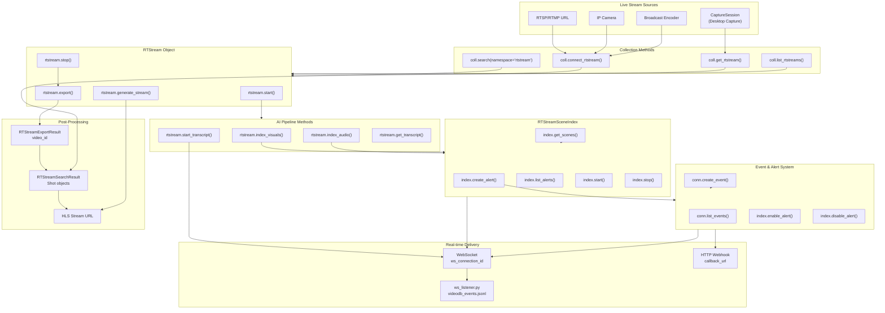
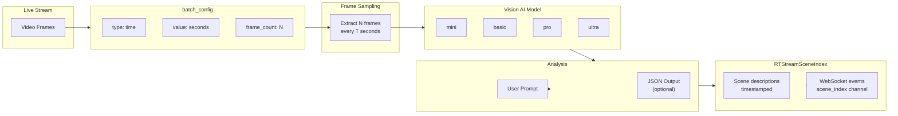
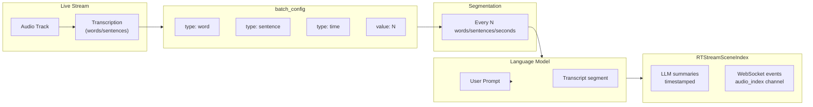
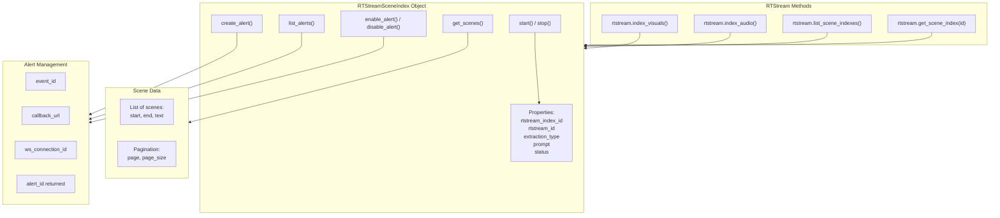
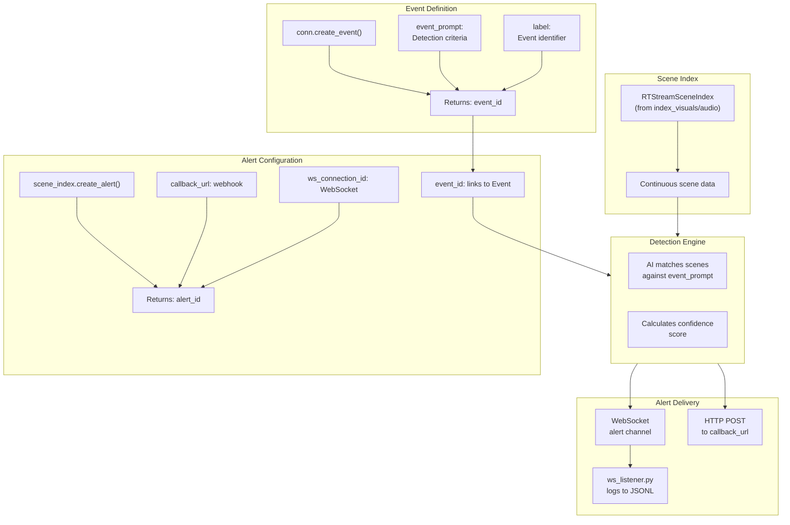

<!-- source: DeepWiki mcp.deepwiki.com · repo video-db/skills · page 9 Live Stream Processing · fetched 2026-10-27 -->

# Live Stream Processing

<details>
<summary>Relevant source files</summary>

The following files were used as context for generating this wiki page:

- [python/reference/rtstream-reference.md](python/reference/rtstream-reference.md)
- [python/reference/rtstream.md](python/reference/rtstream.md)
- [python/reference/streaming.md](python/reference/streaming.md)

</details>


This document covers real-time processing of RTSP/RTMP live streams, including ingestion, AI indexing, event detection, and search. For desktop screen/audio capture, see [Desktop Capture](#8). For batch video processing, see [Video Understanding and Indexing](#5).

---

## Overview

Live stream processing enables real-time ingestion and AI analysis of network video streams from IP cameras, broadcast encoders, or RTMP/RTSP servers. The system records incoming streams, runs parallel AI pipelines for visual and audio analysis, and delivers results via WebSocket for immediate monitoring or post-processing.

**Core workflow:**
1. Connect to an RTSP/RTMP stream using `Collection.connect_rtstream()`
2. Start ingestion with `RTStream.start()`
3. Launch AI pipelines: `index_visuals()`, `index_audio()`, `start_transcript()`
4. Monitor real-time events via WebSocket (`ws_listener.py`)
5. Stop ingestion with `RTStream.stop()`
6. Export to permanent video with `RTStream.export()`
7. Search recorded content using `Collection.search(namespace="rtstream")`

**Key objects:**
- `RTStream`: Represents a live stream connection
- `RTStreamSceneIndex`: Returned by indexing methods, manages AI analysis
- `Event`: Reusable detection rule definition
- `Alert`: Wires an event to an index for notifications

Sources: [python/reference/rtstream.md:1-66](), [python/reference/rtstream-reference.md:1-97]()

---

## Complete System Architecture



**RTStream Lifecycle:**
The diagram shows the complete flow from connection through processing to delivery. `Collection.connect_rtstream()` creates an `RTStream` object from an RTSP/RTMP URL. The `rtstream.start()` method begins ingestion, enabling AI pipelines. `index_visuals()` and `index_audio()` return `RTStreamSceneIndex` objects that manage ongoing analysis. Events and alerts wire detection rules to indexes. All real-time results flow through WebSocket connections tracked by `ws_connection_id`. After stopping, `rtstream.export()` creates a permanent video asset that can be searched and streamed.

Sources: [python/reference/rtstream.md:3-58](), [python/reference/rtstream-reference.md:9-78]()

---

## RTStream Connection and Lifecycle

### Connecting to Live Streams

Create an `RTStream` object from an RTSP or RTMP URL:

```python
rtstream = coll.connect_rtstream(
    url="rtmp://stream-server/live/key",
    name="Security Camera 1",
    media_types=["video"],      # or ["audio", "video"]
    sample_rate=30,             # optional: frames per second
    store=True,                 # enable recording for export
    enable_transcript=True,     # auto-start transcription
    ws_connection_id=ws_id,     # for real-time events
)
```

**Parameters:**
| Parameter | Type | Description |
|-----------|------|-------------|
| `url` | `str` | RTSP/RTMP stream URL |
| `name` | `str` | Display name for the stream |
| `media_types` | `List[str]` | `["video"]` or `["audio", "video"]` |
| `sample_rate` | `int` | Frame sampling rate (default: 30 fps) |
| `store` | `bool` | Enable recording storage for export |
| `enable_transcript` | `bool` | Auto-start transcription pipeline |
| `ws_connection_id` | `str` | WebSocket connection ID for events |

**From Capture Sessions:**
Desktop capture sessions create multiple `RTStream` objects (one per audio/video source):

```python
session = conn.get_capture_session(session_id)
mic_streams = session.get_rtstream("mic")
display_streams = session.get_rtstream("screen")
system_audio_streams = session.get_rtstream("system_audio")
```

Sources: [python/reference/rtstream-reference.md:20-78]()

### Starting and Stopping Ingestion

```python
# Begin recording
rtstream.start()

# ... stream is being recorded and indexed ...

# Stop recording
rtstream.stop()
```

The `start()` method initiates recording and enables AI pipeline processing. The `stop()` method halts ingestion and closes the stream.

Sources: [python/reference/rtstream-reference.md:100-110]()

### Listing and Retrieving Streams

```python
# List all RTStreams in collection
rtstreams = coll.list_rtstreams(
    limit=10,
    offset=0,
    status="connected",     # optional filter
    name="camera",          # optional filter
    ordering="-created_at"  # sort order
)

# Get specific RTStream by ID
rtstream = coll.get_rtstream("rts-xxx")
```

**RTStream Properties:**
| Property | Type | Description |
|----------|------|-------------|
| `id` | `str` | Unique identifier (e.g., `"rts-xxx"`) |
| `name` | `str` | Stream name |
| `status` | `str` | `"connected"`, `"stopped"`, etc. |
| `url` | `str` | Original RTSP/RTMP URL |
| `created_at` | `datetime` | Creation timestamp |

Sources: [python/reference/rtstream-reference.md:46-78]()

---

## AI Processing Pipelines

### Visual Indexing

**Visual Indexing Architecture:**



The visual indexing pipeline samples frames at configurable intervals, sends them to a vision AI model with a user-provided prompt, and delivers structured results via WebSocket.

Sources: [python/reference/rtstream-reference.md:205-260]()

### index_visuals Method

```python
scene_index = rtstream.index_visuals(
    prompt="Describe what is visible on screen",
    batch_config={"type": "time", "value": 2, "frame_count": 5},
    model_name="basic",         # "mini", "basic", "pro", "ultra"
    name="screen_monitor",
    ws_connection_id=ws_id,
)
```

**Parameters:**
| Parameter | Type | Description |
|-----------|------|-------------|
| `prompt` | `str` | Instructions for the AI model (supports JSON requests) |
| `batch_config` | `dict` | Frame sampling configuration (see below) |
| `model_name` | `str` | Model tier: `"mini"`, `"basic"`, `"pro"`, `"ultra"` |
| `name` | `str` | Optional index name |
| `ws_connection_id` | `str` | WebSocket ID for receiving results |

**batch_config for Visual Indexing:**
| Key | Value | Description |
|-----|-------|-------------|
| `type` | `"time"` | Only time-based sampling is supported |
| `value` | `int` | Window size in seconds |
| `frame_count` | `int` | Number of frames to extract per window |

**Example:** `{"type": "time", "value": 2, "frame_count": 5}` extracts 5 frames every 2 seconds and sends them to the model for analysis.

**Structured JSON Output:**
Request JSON responses in the prompt for structured data:

```python
scene_index = rtstream.index_visuals(
    prompt="""Analyze the screen and return JSON:
{
  "app_name": "name of active application",
  "activity": "what user is doing",
  "ui_elements": ["visible UI elements"],
  "contains_text": true/false,
  "dominant_colors": ["main colors"]
}
Return only valid JSON.""",
    batch_config={"type": "time", "value": 3, "frame_count": 3},
    model_name="pro",
    ws_connection_id=ws_id,
)
```

The model will attempt to return valid JSON conforming to the requested structure.

Sources: [python/reference/rtstream-reference.md:205-260]()

### Audio Indexing

**Audio Indexing Architecture:**



Audio indexing transcribes the audio stream, segments it based on word/sentence/time boundaries, and generates LLM summaries of each segment using the provided prompt.

Sources: [python/reference/rtstream-reference.md:174-203]()

### index_audio Method

```python
audio_index = rtstream.index_audio(
    prompt="Summarize what is being discussed",
    batch_config={"type": "word", "value": 50},
    model_name=None,            # optional
    name="meeting_audio",
    ws_connection_id=ws_id,
)
```

**Parameters:**
| Parameter | Type | Description |
|-----------|------|-------------|
| `prompt` | `str` | Instructions for LLM summarization |
| `batch_config` | `dict` | Segmentation configuration (see below) |
| `model_name` | `str` | Optional model tier (default uses standard LLM) |
| `name` | `str` | Optional index name |
| `ws_connection_id` | `str` | WebSocket ID for receiving results |

**batch_config for Audio Indexing:**
| Type | Value | Description |
|------|-------|-------------|
| `"word"` | `int` | Segment every N words |
| `"sentence"` | `int` | Segment every N sentences |
| `"time"` | `int` | Segment every N seconds |

**Examples:**
```python
# Every 50 words
{"type": "word", "value": 50}

# Every 5 sentences
{"type": "sentence", "value": 5}

# Every 30 seconds
{"type": "time", "value": 30}
```

Sources: [python/reference/rtstream-reference.md:174-203]()

### Transcription

Real-time speech-to-text transcription:

```python
# Start transcription
rtstream.start_transcript(
    ws_connection_id=ws_id,
    engine=None,  # defaults to "assemblyai"
)

# Retrieve transcript pages
transcript = rtstream.get_transcript(
    page=1,
    page_size=100,
    start=None,   # optional: filter by start timestamp
    end=None,     # optional: filter by end timestamp
    since=None,   # optional: get transcripts after this timestamp
    engine=None,
)

# Stop transcription
rtstream.stop_transcript(engine=None)
```

**Transcript Page Structure:**
```python
{
    "page": 1,
    "page_size": 100,
    "total_pages": 5,
    "transcripts": [
        {
            "text": "Hello everyone",
            "start": 1234.5,
            "end": 1236.2,
            "confidence": 0.95
        },
        # ...
    ]
}
```

Transcripts are delivered in real-time via the `transcript` WebSocket channel and can be polled using `get_transcript()` with the `since` parameter for incremental updates.

Sources: [python/reference/rtstream-reference.md:285-310]()

---

## Batch Configuration Summary

| Indexing Type | Supported `type` Values | `value` Meaning | Extra Keys |
|---------------|-------------------------|-----------------|------------|
| **Visual** | `"time"` only | Seconds per window | `frame_count` (frames per window) |
| **Audio** | `"word"`, `"sentence"`, `"time"` | Words/sentences/seconds per segment | None |

**Visual Example:** `{"type": "time", "value": 2, "frame_count": 5}` = 5 frames every 2 seconds  
**Audio Example:** `{"type": "word", "value": 50}` = LLM summary every 50 words

Sources: [python/reference/rtstream-reference.md:263-281]()

---

## RTStreamSceneIndex Management

**RTStreamSceneIndex Object Relationships:**



The `RTStreamSceneIndex` object is returned by `index_visuals()` and `index_audio()`. It provides methods for retrieving indexed scenes, managing the index lifecycle, and configuring alerts.

Sources: [python/reference/rtstream-reference.md:313-390]()

### RTStreamSceneIndex Properties

| Property | Type | Description |
|----------|------|-------------|
| `rtstream_index_id` | `str` | Unique identifier for this index |
| `rtstream_id` | `str` | Parent RTStream ID |
| `extraction_type` | `str` | `"time"` or `"transcript"` |
| `extraction_config` | `dict` | The `batch_config` used |
| `prompt` | `str` | The analysis prompt |
| `name` | `str` | Index name |
| `status` | `str` | `"connected"`, `"stopped"` |

Sources: [python/reference/rtstream-reference.md:332-342]()

### Retrieving Scenes

```python
result = scene_index.get_scenes(
    start=None,      # optional: start timestamp filter
    end=None,        # optional: end timestamp filter
    page=1,
    page_size=100,
)

for scene in result["scenes"]:
    print(f"[{scene['start']:.1f}-{scene['end']:.1f}] {scene['text']}")

if result["next_page"]:
    # Fetch next page
    next_result = scene_index.get_scenes(page=2, page_size=100)
```

**Response Structure:**
```python
{
    "scenes": [
        {
            "start": 1234.5,
            "end": 1236.8,
            "text": "AI analysis result text or JSON"
        },
        # ...
    ],
    "page": 1,
    "page_size": 100,
    "total_pages": 3,
    "next_page": 2
}
```

Sources: [python/reference/rtstream-reference.md:356-390]()

### Managing Indexes

```python
# List all indexes on an RTStream
indexes = rtstream.list_scene_indexes()

# Get specific index by ID
scene_index = rtstream.get_scene_index("idx-xxx")

# Stop an index
scene_index.stop()

# Restart an index
scene_index.start()
```

Multiple indexes can run concurrently on the same `RTStream`, each with different prompts and batch configurations.

Sources: [python/reference/rtstream-reference.md:376-390]()

---

## Events and Alerts

**Event Detection System Architecture:**



Events are reusable detection rules defined once and attached to multiple indexes via alerts. When the AI detects content matching the event criteria, an alert is triggered and delivered via WebSocket and/or webhook.

Sources: [python/reference/rtstream-reference.md:393-493]()

### Creating Events

Events define detection criteria as natural language prompts:

```python
event_id = conn.create_event(
    event_prompt="User opened Slack application",
    label="slack_opened",
)
```

**Parameters:**
| Parameter | Type | Description |
|-----------|------|-------------|
| `event_prompt` | `str` | Natural language description of what to detect |
| `label` | `str` | Identifier for the event (used in alerts) |

**Returns:** `event_id` (string)

**Listing Events:**
```python
events = conn.list_events()
for event in events:
    print(f"{event['event_id']}: {event['label']}")
    print(f"  Prompt: {event['event_prompt']}")
```

Sources: [python/reference/rtstream-reference.md:397-420]()

### Creating Alerts

Alerts wire events to scene indexes for real-time notifications:

```python
# Get the scene index from index_visuals
scene_index = rtstream.index_visuals(
    prompt="Describe what application is open on screen",
    batch_config={"type": "time", "value": 2, "frame_count": 5},
    ws_connection_id=ws_id,
)

# Create an alert on the index
alert_id = scene_index.create_alert(
    event_id=event_id,
    callback_url="https://your-backend.com/alerts",
    ws_connection_id=ws_id,  # optional, for WebSocket delivery
)
```

**Parameters:**
| Parameter | Type | Required | Description |
|-----------|------|----------|-------------|
| `event_id` | `str` | Yes | Event ID from `create_event()` |
| `callback_url` | `str` | Yes | Webhook URL (use `""` if only WebSocket) |
| `ws_connection_id` | `str` | No | WebSocket ID for real-time delivery |

**Important:** `callback_url` is a required parameter. Pass an empty string `""` if you only want WebSocket delivery.

Sources: [python/reference/rtstream-reference.md:428-455]()

### Managing Alerts

```python
# List all alerts on an index
alerts = scene_index.list_alerts()

# Disable an alert
scene_index.disable_alert(alert_id)

# Enable an alert
scene_index.enable_alert(alert_id)
```

Sources: [python/reference/rtstream-reference.md:447-455]()

### Alert Delivery Formats

**WebSocket Alert Event:**
```json
{
  "channel": "alert",
  "rtstream_id": "rts-xxx",
  "data": {
    "event_label": "slack_opened",
    "timestamp": 1710000012340,
    "text": "User opened Slack application"
  }
}
```

**Webhook POST Payload:**
```json
{
  "event_id": "event-xxx",
  "label": "slack_opened",
  "confidence": 0.95,
  "explanation": "User opened the Slack application",
  "timestamp": "2024-01-15T10:30:45Z",
  "start_time": 1234.5,
  "end_time": 1238.0,
  "stream_url": "https://stream.videodb.io/v3/...",
  "player_url": "https://console.videodb.io/player?url=..."
}
```

**Delivery Comparison:**
| Method | Latency | Use Case |
|--------|---------|----------|
| WebSocket | Real-time | Live dashboards, monitoring UIs |
| Webhook | < 1 second | Server-to-server integration, automation |

Sources: [python/reference/rtstream-reference.md:457-493]()

---

## WebSocket Integration

### WebSocket Channels

All real-time AI results are delivered via WebSocket connections identified by `ws_connection_id`:

| Channel | Source Method | Content |
|---------|---------------|---------|
| `transcript` | `rtstream.start_transcript()` | Real-time speech-to-text |
| `scene_index` | `rtstream.index_visuals()` | Visual analysis results |
| `audio_index` | `rtstream.index_audio()` | Audio analysis results |
| `alert` | `scene_index.create_alert()` | Event detection notifications |

**Connection Flow:**
1. Run `ws_listener.py` script to obtain a `ws_connection_id`
2. Pass `ws_connection_id` to indexing methods
3. Events are logged to `videodb_events.jsonl`

For complete WebSocket setup and event format details, see [WebSocket Listener](#13) and [Capture Events](#8.3).

Sources: [python/reference/rtstream-reference.md:495-514]()

---

## Generating Stream Segments

After recording, generate playback streams from specific time ranges using Unix timestamps (not second offsets):

```python
import time

start_ts = time.time()
rtstream.start()

# Record for 60 seconds
time.sleep(60)

end_ts = time.time()
rtstream.stop()

# Generate stream URL for the recorded segment
stream_url = rtstream.generate_stream(start=start_ts, end=end_ts)
print(f"Recorded stream: {stream_url}")
```

**Important:** Unlike `video.generate_stream(timeline=[(10, 30)])` which uses second offsets, `rtstream.generate_stream()` requires Unix timestamps from the recording session.

Sources: [python/reference/rtstream-reference.md:115-134]()

---

## Exporting to Video

Export recorded streams to permanent video assets in the collection:

```python
export_result = rtstream.export(name="Security Recording 2024-01-15")

print(f"Video ID: {export_result.video_id}")
print(f"Stream URL: {export_result.stream_url}")
print(f"Player URL: {export_result.player_url}")
print(f"Duration: {export_result.duration}s")
```

**RTStreamExportResult Properties:**
| Property | Type | Description |
|----------|------|-------------|
| `video_id` | `str` | ID of the exported video asset |
| `stream_url` | `str` | HLS stream URL |
| `player_url` | `str` | Web player URL |
| `name` | `str` | Video name |
| `duration` | `float` | Duration in seconds |

After export, the video can be indexed and searched like any other video asset:

```python
video = coll.get_video(export_result.video_id)
video.index_spoken_words(force=True)
results = video.search("important discussion")
```

Sources: [python/reference/rtstream-reference.md:137-159]()

---

## Searching Live Streams

Search across indexed RTStream content using namespace-based search:

```python
# Search all RTStreams in collection
results = coll.search(
    query="security incident",
    namespace="rtstream",  # Required for RTStream search
)
```

**RTStreamSearchResult Object:**
The `search()` method returns an `RTStreamSearchResult` with the same interface as video search results:

```python
# Get matching shots
shots = results.get_shots()

for shot in shots:
    print(f"RTStream: {shot.rtstream_id}")
    print(f"Time: {shot.start:.1f}s - {shot.end:.1f}s")
    print(f"Score: {shot.search_score:.2f}")
    
    # Generate stream for this segment
    stream_url = shot.generate_stream()
    print(f"Stream: {stream_url}\n")

# Compile all results into single stream
compiled_url = results.compile()
```

**Note:** RTStream search queries the scene indexes created by `index_visuals()` and `index_audio()`. The stream must have active or completed indexing for search to return results.

For general search concepts, see [Searching Videos](#6).

Sources: [python/reference/rtstream-reference.md:16-18](), [python/reference/rtstream.md:30]()

---

## Complete Workflow Example

```python
import time
import videodb

conn = videodb.connect()
coll = conn.get_collection()

# 1. Connect to live stream
rtstream = coll.connect_rtstream(
    url="rtmp://stream-server/live/key",
    name="Security Camera - Entrance",
    store=True,
)

# 2. Create event for detection
event_id = conn.create_event(
    event_prompt="Person entering through door",
    label="door_entry",
)

# 3. Start recording
rtstream.start()

# 4. Start visual indexing
scene_index = rtstream.index_visuals(
    prompt="Describe what is happening at the entrance",
    batch_config={"type": "time", "value": 3, "frame_count": 5},
    model_name="basic",
    ws_connection_id=ws_id,
)

# 5. Create alert for event
alert_id = scene_index.create_alert(
    event_id=event_id,
    callback_url="https://security-backend.com/alerts",
    ws_connection_id=ws_id,
)

# 6. Start transcription (if audio is available)
rtstream.start_transcript(ws_connection_id=ws_id)

# 7. Record for desired duration
time.sleep(3600)  # 1 hour

# 8. Stop recording
rtstream.stop()

# 9. Export to permanent video
export_result = rtstream.export(name="Security Recording 2024-01-15")
video = coll.get_video(export_result.video_id)

# 10. Search the recording
video.index_spoken_words(force=True)
results = video.search("door entry event")

# 11. Generate highlight reel
stream_url = results.compile()
print(f"Highlight reel: {stream_url}")
```

Sources: [python/reference/rtstream-reference.md:517-552]()

---

## Key Differences: RTStream vs Video

| Feature | RTStream | Video |
|---------|----------|-------|
| **Source** | RTSP/RTMP/Capture | Upload/Generate |
| **Lifecycle** | start() → stop() → export() | Permanent after upload |
| **Indexing** | Real-time pipelines | Batch processing |
| **Timestamps** | Unix timestamps | Second offsets |
| **Search** | `namespace="rtstream"` | Default namespace |
| **Events** | Event/Alert system | N/A |
| **Object Type** | `RTStream` → `RTStreamSceneIndex` | `Video` → scene_index_id |

Both systems use WebSocket delivery for real-time results and share the same search result interface (`Shot` objects, `compile()` method).

Sources: [python/reference/rtstream-reference.md:1-552](), [python/reference/rtstream.md:1-66]()

---

