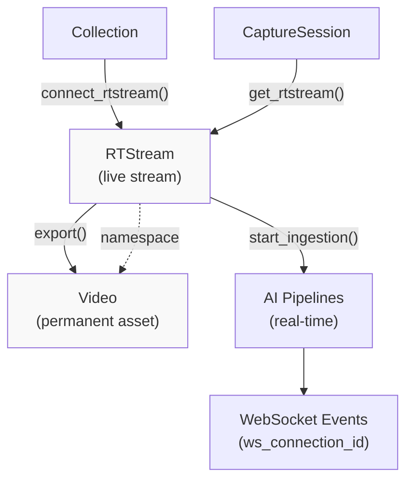
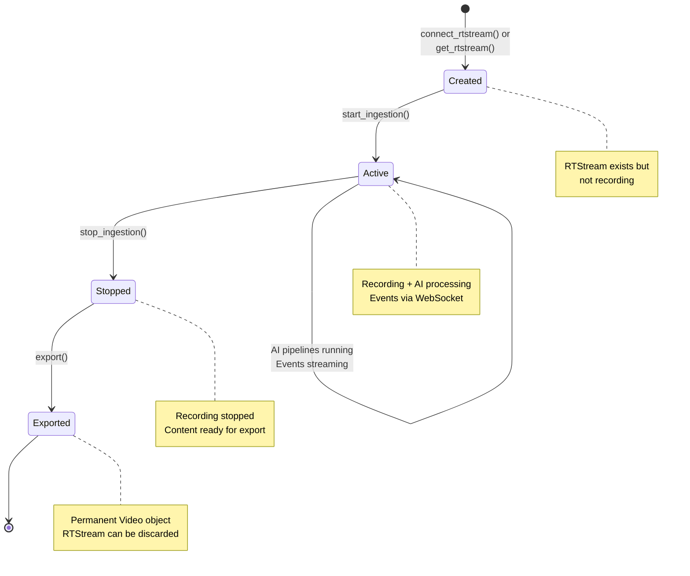
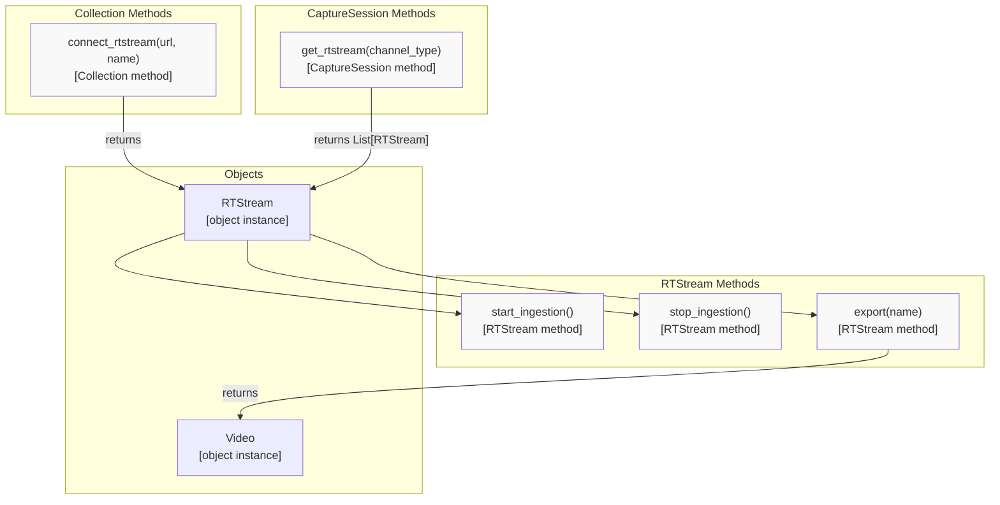

<!-- source: DeepWiki mcp.deepwiki.com · repo video-db/skills · page 9.1 RTStream Basics · fetched 2026-10-27 -->

# RTStream Basics

<details>
<summary>Relevant source files</summary>

The following files were used as context for generating this wiki page:

- [python/reference/rtstream.md](python/reference/rtstream.md)

</details>


## Purpose and Scope

This document covers the fundamental operations of `RTStream` objects, which represent real-time video stream ingestion from RTSP/RTMP sources or desktop capture sessions. The focus is on connecting to live streams, managing the ingestion lifecycle (starting, stopping), and exporting recordings to permanent video assets.

For real-time AI processing (transcription, visual indexing, audio indexing), see [Real-time AI Pipelines](#9.2). For event detection and alerting, see [Events and Alerts](#9.3). For searching recorded stream content, see [Searching Live Streams](#9.4). For desktop capture session management, see [Capture Workflow](#8.1).

---

## RTStream Object Model

An `RTStream` represents an active or stopped real-time video stream ingestion. It serves as the interface between live video sources and VideoDB's processing and storage infrastructure.

### Key Characteristics

| Property | Description |
|----------|-------------|
| **Source** | Either RTSP/RTMP network stream or capture session channel |
| **State** | Created → Active (ingesting) → Stopped → Exported |
| **Persistence** | Temporary until exported to `Video` object |
| **Real-time** | Supports live AI processing while ingesting |
| **Output** | Exports to permanent `Video` asset in collection |

### Relationship to Other Objects



**Diagram: RTStream Object Relationships**

An `RTStream` is created either by calling `Collection.connect_rtstream()` for network streams or by retrieving channels from a `CaptureSession` via `get_rtstream()`. Once ingestion starts, AI pipelines process the stream in real-time, emitting events via WebSocket. When stopped, the `export()` method converts the recorded stream into a permanent `Video` object. The `RTStream` maintains a namespace that links to the exported `Video` for search operations.

**Sources:** [python/reference/rtstream.md:1-66]()

---

## Sources of RTStream Objects

`RTStream` objects originate from two distinct sources, each serving different use cases.

### RTSP/RTMP Network Streams

For ingesting IP cameras, broadcast encoders, or any RTSP/RTMP source:

```python
rtstream = coll.connect_rtstream(
    url="rtmp://your-stream-server/live/stream-key",
    name="My Live Stream",
)
```

The `Collection.connect_rtstream()` method establishes a connection to the network stream. The stream does not begin recording until `start_ingestion()` is called.

**Common RTSP/RTMP Sources:**
- IP security cameras (RTSP)
- Video encoders (RTSP/RTMP)
- Streaming servers (RTMP)
- OBS/broadcast software output (RTMP)

### Capture Session Channels

For desktop screen recording, microphone, and system audio:

```python
session = conn.get_capture_session(session_id)

# Get RTStream objects for each channel
mic_streams = session.get_rtstream("mic")
display_streams = session.get_rtstream("screen")
system_audio_streams = session.get_rtstream("system_audio")
```

The `CaptureSession.get_rtstream()` method returns a list of `RTStream` objects because multiple devices may exist (e.g., multiple microphones or displays). Each channel type returns its own set of streams.

**Capture Channel Types:**

| Channel Type | Description | Returns |
|--------------|-------------|---------|
| `"mic"` | Microphone inputs | List of mic RTStreams |
| `"screen"` | Display/screen captures | List of display RTStreams |
| `"system_audio"` | System audio outputs | List of system audio RTStreams |

**Sources:** [python/reference/rtstream.md:32-58]()

---

## Lifecycle Management



**Diagram: RTStream Lifecycle State Machine**

The lifecycle progresses through four states: Created (connected but not recording), Active (ingesting and processing), Stopped (recording ended), and Exported (converted to permanent Video). Only in the Active state do AI pipelines run and emit real-time events.

### Connecting to a Stream

**For RTSP/RTMP:**
[python/reference/rtstream.md:36-43]()

The connection is established but ingestion does not start automatically. The stream URL must be accessible from VideoDB's infrastructure.

**For Capture Sessions:**
[python/reference/rtstream.md:47-55]()

Capture sessions must be created and have a `CaptureClient` streaming to them before `RTStream` objects are available. See [Capture Workflow](#8.1) for session setup.

### Starting Ingestion

```python
rtstream.start_ingestion()
```

This method begins recording the live stream. For capture sessions, ingestion starts automatically when the `CaptureClient` begins streaming, so calling `start_ingestion()` explicitly is typically unnecessary.

Once active:
- The stream is recorded to temporary storage
- AI pipelines (if configured) begin processing
- Events are emitted via WebSocket with `ws_connection_id`

### Monitoring Status

The `RTStream` object properties indicate the current state:
- `.id` - Unique identifier for the stream
- `.name` - Descriptive name provided at creation
- Current status can be checked before performing operations

### Stopping Ingestion

```python
rtstream.stop_ingestion()
```

This method halts recording. After stopping:
- AI pipelines cease processing
- No new events are emitted
- The recorded content remains available for export
- The `RTStream` cannot be restarted (it's a one-time recording)

For capture sessions, calling `stop_ingestion()` stops the individual channel. To stop all channels, call `CaptureSession.stop()`.

### Exporting to Video

```python
video = rtstream.export(name="Exported Recording")
```

The `export()` method converts the recorded stream into a permanent `Video` object stored in the collection. This is required for long-term storage and further processing.

**After export:**
- A `Video` object is returned and can be used like any uploaded video
- The video can be indexed, searched, edited in timelines, transcoded, etc.
- The `RTStream` namespace links to this video for search operations (see [Searching Live Streams](#9.4))
- The original `RTStream` can be discarded

**Export timing:** Export can only occur after `stop_ingestion()`. Attempting to export while still active will fail.

**Sources:** [python/reference/rtstream.md:1-30]()

---

## Core Methods Reference

The following table summarizes the essential `RTStream` methods for lifecycle management:

| Method | Purpose | Timing | Returns |
|--------|---------|--------|---------|
| `start_ingestion()` | Begin recording the stream | After creation | None |
| `stop_ingestion()` | End recording | During active ingestion | None |
| `export(name)` | Convert to permanent Video | After stopping | `Video` object |

**Additional Methods** (covered in other sections):

| Method | Purpose | See Section |
|--------|---------|-------------|
| `index_visuals()` | Start visual AI pipeline | [9.2](#9.2) |
| `index_audio()` | Start audio AI pipeline | [9.2](#9.2) |
| `start_transcript()` | Start transcription pipeline | [9.2](#9.2) |
| `create_alert()` | Set up event detection | [9.3](#9.3) |

**Sources:** [python/reference/rtstream.md:16-28]()

---

## Code Entity Mapping



**Diagram: RTStream Code Entity Relationships**

This diagram maps natural language concepts to specific code entities. `Collection.connect_rtstream()` and `CaptureSession.get_rtstream()` are factory methods that return `RTStream` instances. The instance methods `start_ingestion()`, `stop_ingestion()`, and `export()` control the lifecycle. The `export()` method returns a `Video` object that persists in the collection.

**Sources:** [python/reference/rtstream.md:32-58]()

---

## Usage Pattern Example

A typical workflow for RTSP/RTMP streams follows this sequence:

1. **Connect**: `rtstream = coll.connect_rtstream(url, name)`
2. **Configure AI** (optional): `rtstream.index_visuals()`, `rtstream.start_transcript()` (see [9.2](#9.2))
3. **Start**: `rtstream.start_ingestion()`
4. **Monitor**: Listen to WebSocket events via `ws_listener.py` (see [13](#13))
5. **Stop**: `rtstream.stop_ingestion()`
6. **Export**: `video = rtstream.export(name)`
7. **Process**: Use the `Video` object for search, editing, transcoding (see [6](#6), [7](#7), [10](#10))

For capture sessions, the workflow differs slightly because `CaptureClient` automatically starts ingestion:

1. **Create session**: `session = conn.create_capture_session()`
2. **Run listener**: Start `ws_listener.py` with `session.ws_connection_id`
3. **Run client**: `CaptureClient` handles channel discovery and streaming
4. **Configure AI**: Call indexing methods on retrieved `RTStream` objects
5. **Stop**: `session.stop()` stops all channels
6. **Export**: Call `export()` on each `RTStream` to get `Video` objects
7. **Process**: Query events, search content, create clips (see [8.4](#8.4))

**Sources:** [python/reference/rtstream.md:16-30]()

---

## Namespace and Video Linking

When an `RTStream` exports to a `Video`, the system maintains a namespace relationship. This enables searching the recorded content using the stream's namespace even after the `RTStream` object is no longer needed.

The namespace is used in search operations to target specific streams:
- Search by `RTStream` namespace to find moments in the recording
- The namespace persists in the exported `Video` metadata
- Multiple `RTStream` objects from the same session (e.g., mic + screen) maintain separate namespaces

For details on namespace-based search, see [Searching Live Streams](#9.4).

**Sources:** [python/reference/rtstream.md:1-66]()

---

