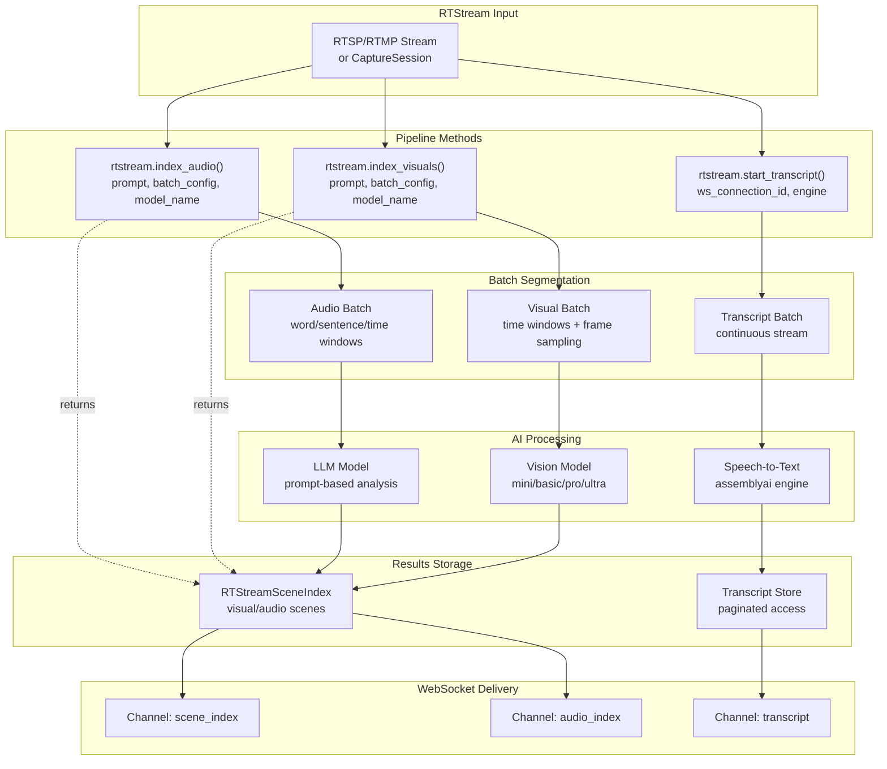
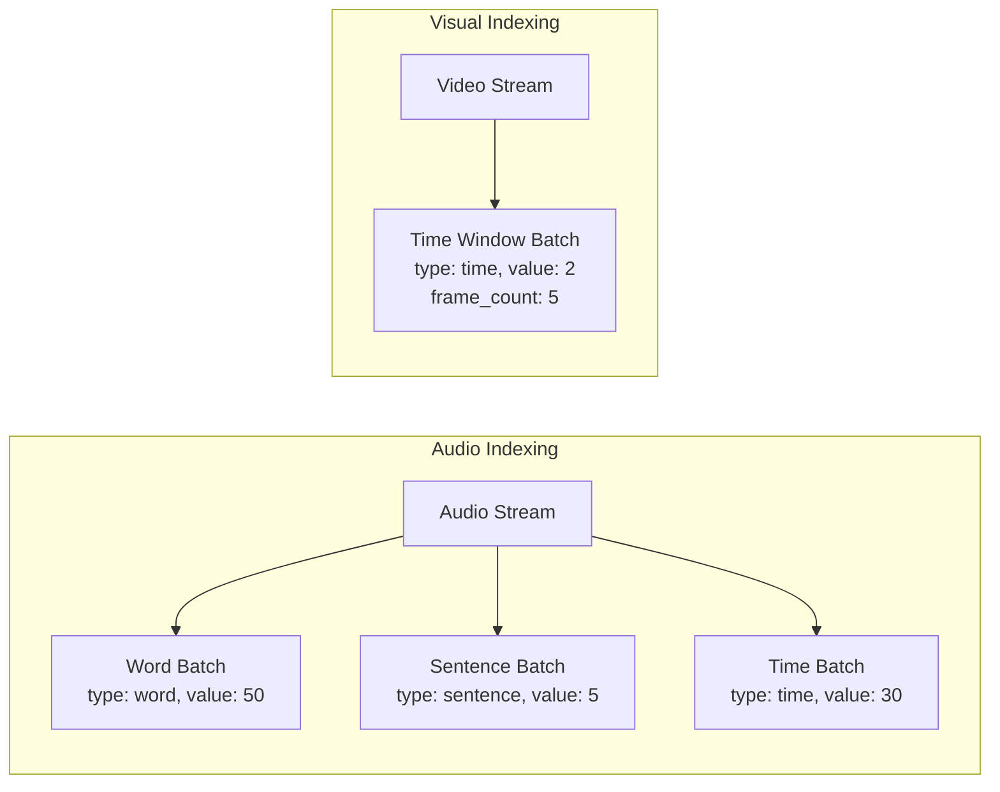
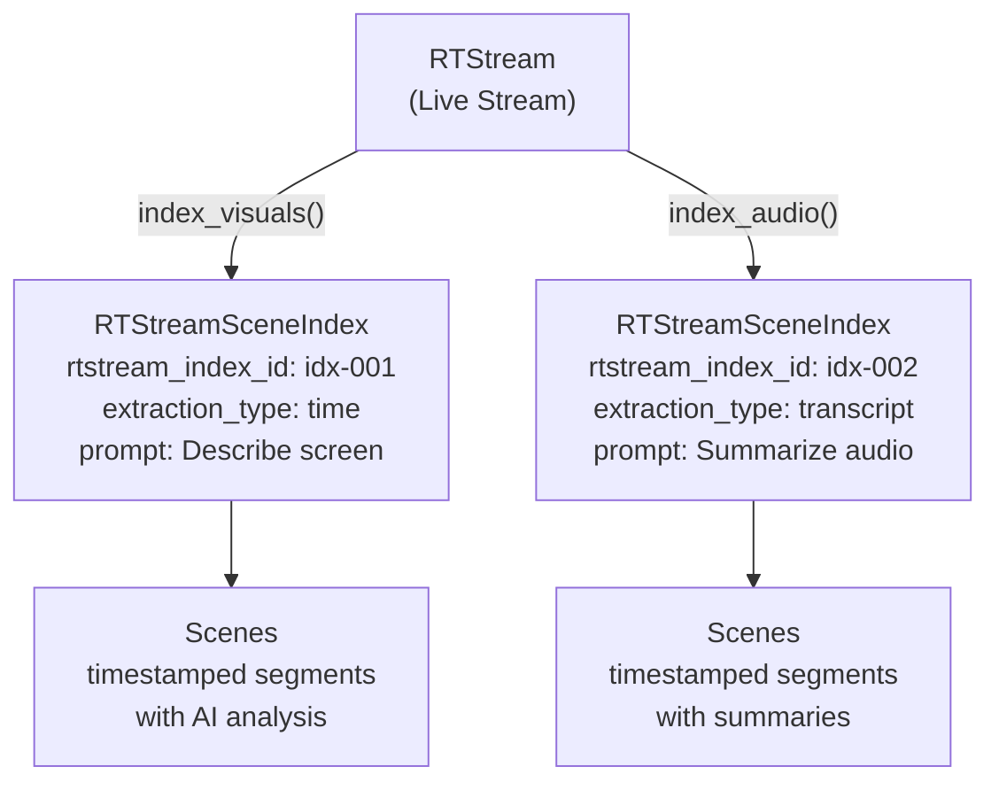
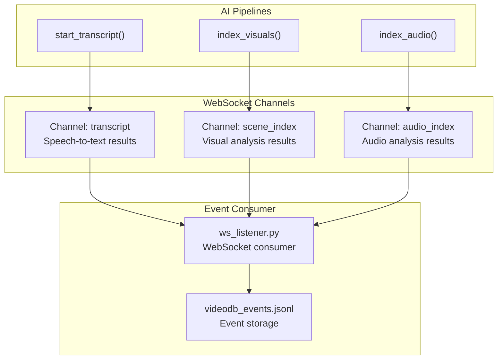

<!-- source: DeepWiki mcp.deepwiki.com · repo video-db/skills · page 9.2 Real-time AI Pipelines · fetched 2026-10-27 -->

# Real-time AI Pipelines

<details>
<summary>Relevant source files</summary>

The following files were used as context for generating this wiki page:

- [python/reference/rtstream-reference.md](python/reference/rtstream-reference.md)
- [python/reference/streaming.md](python/reference/streaming.md)

</details>


This page documents the AI processing pipelines that analyze live streams in real-time: visual indexing, audio indexing, and transcription. These pipelines process RTStream content as it arrives and deliver results via WebSocket events.

For basic RTStream operations (connecting, starting, stopping), see [RTStream Basics](#9.1). For event detection and alerting on pipeline results, see [Events and Alerts](#9.3). For WebSocket event formats, see [Capture Events](#8.3).

---

## Overview

Real-time AI pipelines analyze live stream content and generate structured metadata as the stream flows. Unlike batch indexing on uploaded videos, these pipelines process content in configurable windows (by time, word count, or sentence count) and deliver results immediately via WebSocket.

Three pipeline types are available:

| Pipeline Type | Method | Output | Use Case |
|--------------|--------|--------|----------|
| **Visual Indexing** | `rtstream.index_visuals()` | AI descriptions of screen/camera content | Monitor applications, detect visual events |
| **Audio Indexing** | `rtstream.index_audio()` | LLM summaries of audio segments | Summarize discussions, track topics |
| **Transcription** | `rtstream.start_transcript()` | Speech-to-text with timestamps | Live captions, keyword monitoring |

All three pipelines return results via WebSocket channels and can run simultaneously on the same stream.

**Sources:** [python/reference/rtstream-reference.md:162-310]()

---

## Pipeline Architecture



**Pipeline Lifecycle:**

1. Call `index_visuals()`, `index_audio()`, or `start_transcript()` on an RTStream
2. Content is segmented into batches based on `batch_config`
3. Each batch is processed by the appropriate AI model
4. Results are stored in `RTStreamSceneIndex` or transcript database
5. Results are delivered via WebSocket in real-time
6. Methods return `RTStreamSceneIndex` object for management and alerts

**Sources:** [python/reference/rtstream-reference.md:162-280]()

---

## Visual Indexing

The `index_visuals()` method analyzes video frames using vision models and generates AI descriptions at regular intervals.

### Method Signature

```python
rtstream.index_visuals(
    prompt: str,
    batch_config: dict,
    model_name: str = "basic",
    name: str = None,
    ws_connection_id: str = None
) -> RTStreamSceneIndex
```

### Parameters

| Parameter | Type | Required | Description |
|-----------|------|----------|-------------|
| `prompt` | `str` | Yes | Instructions for the vision model (supports structured JSON) |
| `batch_config` | `dict` | Yes | Frame sampling configuration (see below) |
| `model_name` | `str` | No | Model tier: `"mini"`, `"basic"`, `"pro"`, `"ultra"` (default: `"basic"`) |
| `name` | `str` | No | Name for the index (for identification) |
| `ws_connection_id` | `str` | No | WebSocket ID for receiving results |

### Batch Configuration

Visual indexing uses time-based windows with frame sampling:

```python
batch_config = {
    "type": "time",        # Only "time" is supported for visuals
    "value": 2,            # Window size in seconds
    "frame_count": 5       # Number of frames to sample per window
}
```

| Key | Type | Description |
|-----|------|-------------|
| `type` | `str` | Must be `"time"` |
| `value` | `int` | Window size in seconds (how often to analyze) |
| `frame_count` | `int` | Number of frames extracted per window and sent to model |

**Example:** `{"type": "time", "value": 2, "frame_count": 5}` samples 5 frames every 2 seconds.

### Basic Visual Indexing

```python
import videodb

conn = videodb.connect()
coll = conn.get_collection()

# Connect to a live stream
rtstream = coll.connect_rtstream(
    url="rtmp://stream-server/live/key",
    name="Security Camera",
)
rtstream.start()

# Start visual indexing
scene_index = rtstream.index_visuals(
    prompt="Describe what is happening on screen",
    batch_config={"type": "time", "value": 2, "frame_count": 5},
    model_name="basic",
    ws_connection_id="ws-connection-id",
)

print(f"Scene Index ID: {scene_index.rtstream_index_id}")
```

### Structured JSON Output

Request structured JSON responses for programmatic consumption:

```python
scene_index = rtstream.index_visuals(
    prompt="""Analyze the screen and return JSON:
{
  "app_name": "name of active application",
  "activity": "what user is doing",
  "ui_elements": ["list of visible UI elements"],
  "contains_text": true/false,
  "dominant_colors": ["list of main colors"]
}
Return only valid JSON.""",
    batch_config={"type": "time", "value": 3, "frame_count": 3},
    model_name="pro",
    ws_connection_id="ws-id",
)
```

### Model Tiers

| Model | Speed | Cost | Quality | Use Case |
|-------|-------|------|---------|----------|
| `"mini"` | Fastest | Lowest | Basic | Simple detection, real-time monitoring |
| `"basic"` | Fast | Low | Good | General-purpose description |
| `"pro"` | Medium | Medium | High | Detailed analysis, structured output |
| `"ultra"` | Slow | High | Highest | Complex scenes, fine-grained detail |

**Sources:** [python/reference/rtstream-reference.md:205-260]()

---

## Audio Indexing

The `index_audio()` method generates LLM summaries of audio content at configurable intervals.

### Method Signature

```python
rtstream.index_audio(
    prompt: str,
    batch_config: dict,
    model_name: str = None,
    name: str = None,
    ws_connection_id: str = None
) -> RTStreamSceneIndex
```

### Batch Configuration

Audio indexing supports three segmentation types:

```python
# Segment by word count
batch_config = {"type": "word", "value": 50}

# Segment by sentence count
batch_config = {"type": "sentence", "value": 5}

# Segment by time
batch_config = {"type": "time", "value": 30}
```

| Type | Value Unit | Description |
|------|------------|-------------|
| `"word"` | word count | Segment every N words |
| `"sentence"` | sentence count | Segment every N sentences |
| `"time"` | seconds | Segment every N seconds |

### Audio Indexing Example

```python
audio_index = rtstream.index_audio(
    prompt="Summarize what is being discussed",
    batch_config={"type": "word", "value": 50},
    name="meeting_audio",
    ws_connection_id="ws-id",
)

print(f"Audio Index ID: {audio_index.rtstream_index_id}")
```

### Advanced Audio Analysis

Use detailed prompts for specific analysis:

```python
audio_index = rtstream.index_audio(
    prompt="""Analyze the audio segment and identify:
- Main topics discussed
- Action items mentioned
- Questions asked
- Decisions made
Format as bullet points.""",
    batch_config={"type": "sentence", "value": 10},
    ws_connection_id="ws-id",
)
```

**Sources:** [python/reference/rtstream-reference.md:173-203]()

---

## Transcription

The `start_transcript()` method provides real-time speech-to-text conversion.

### Method Signature

```python
rtstream.start_transcript(
    ws_connection_id: str,
    engine: str = None
) -> dict

rtstream.get_transcript(
    page: int = 1,
    page_size: int = 100,
    start: float = None,
    end: float = None,
    since: float = None,
    engine: str = None
) -> dict

rtstream.stop_transcript(
    engine: str = None
) -> dict
```

### Starting Transcription

```python
# Start live transcription
rtstream.start_transcript(
    ws_connection_id="ws-id",
    engine="assemblyai",  # optional, defaults to "assemblyai"
)
```

### Retrieving Transcripts

```python
# Get transcript pages
transcript = rtstream.get_transcript(
    page=1,
    page_size=100,
    start=None,   # optional: start timestamp filter
    end=None,     # optional: end timestamp filter
    since=None,   # optional: for polling, get new transcripts after this timestamp
)

for entry in transcript["results"]:
    print(f"[{entry['start']:.2f}s] {entry['text']}")
```

### Polling for New Transcripts

Use the `since` parameter to poll for new transcripts:

```python
import time

last_timestamp = 0

while True:
    transcript = rtstream.get_transcript(since=last_timestamp)
    
    for entry in transcript["results"]:
        print(f"[{entry['start']:.2f}s] {entry['text']}")
        last_timestamp = max(last_timestamp, entry['end'])
    
    time.sleep(2)  # Poll every 2 seconds
```

### Stopping Transcription

```python
rtstream.stop_transcript()
```

**Sources:** [python/reference/rtstream-reference.md:283-310]()

---

## Batch Configuration Comparison



### Batch Configuration Table

| Indexing Type | Supported `type` Values | `value` Unit | Extra Keys | Example |
|---------------|------------------------|--------------|------------|---------|
| **Audio** | `"word"`, `"sentence"`, `"time"` | words/sentences/seconds | None | `{"type": "word", "value": 50}` |
| **Visual** | `"time"` only | seconds | `frame_count` | `{"type": "time", "value": 2, "frame_count": 5}` |

### Choosing Batch Size

**Audio:**
- **Word-based**: Use for consistent content length (50-100 words = ~30-60 seconds of speech)
- **Sentence-based**: Use for semantic coherence (5-10 sentences = complete thoughts)
- **Time-based**: Use for fixed intervals (30-60 seconds = regular updates)

**Visual:**
- **Window size (`value`)**: Shorter intervals (1-3s) for fast-changing content, longer (5-10s) for slower scenes
- **Frame count**: More frames (5-10) for complex analysis, fewer (3-5) for simple detection

**Sources:** [python/reference/rtstream-reference.md:263-280]()

---

## RTStreamSceneIndex Object

Both `index_visuals()` and `index_audio()` return an `RTStreamSceneIndex` object that represents the running index.

### Object Hierarchy



### Properties

| Property | Type | Description |
|----------|------|-------------|
| `rtstream_index_id` | `str` | Unique ID of the index |
| `rtstream_id` | `str` | Parent RTStream ID |
| `extraction_type` | `str` | `"time"` or `"transcript"` based on batch config |
| `extraction_config` | `dict` | The `batch_config` used |
| `prompt` | `str` | The prompt used for analysis |
| `name` | `str` | Name of the index |
| `status` | `str` | `"connected"` (running) or `"stopped"` |

### Methods

| Method | Returns | Description |
|--------|---------|-------------|
| `index.get_scenes(start, end, page, page_size)` | `dict` | Retrieve indexed scenes |
| `index.start()` | `None` | Start or resume the index |
| `index.stop()` | `None` | Stop the index |
| `index.create_alert(event_id, callback_url, ws_connection_id)` | `str` | Create alert for event detection (see [Events and Alerts](#9.3)) |
| `index.list_alerts()` | `list` | List alerts on this index |
| `index.enable_alert(alert_id)` | `None` | Enable an alert |
| `index.disable_alert(alert_id)` | `None` | Disable an alert |

### Retrieving Scenes

```python
# Get scenes with pagination
result = scene_index.get_scenes(
    start=None,      # optional: start timestamp filter
    end=None,        # optional: end timestamp filter
    page=1,
    page_size=100,
)

for scene in result["scenes"]:
    print(f"[{scene['start']:.2f}s - {scene['end']:.2f}s]")
    print(f"  {scene['text']}")

# Check if more pages exist
if result["next_page"]:
    next_result = scene_index.get_scenes(page=2, page_size=100)
```

### Managing Indexes

```python
# List all indexes on a stream
indexes = rtstream.list_scene_indexes()

for idx in indexes:
    print(f"{idx.rtstream_index_id}: {idx.name} - {idx.status}")

# Get a specific index by ID
scene_index = rtstream.get_scene_index("idx-abc123")

# Stop an index
scene_index.stop()

# Restart an index
scene_index.start()
```

**Sources:** [python/reference/rtstream-reference.md:313-390]()

---

## WebSocket Event Delivery

All AI pipeline results are delivered via WebSocket in real-time. Each pipeline type uses a dedicated channel.

### WebSocket Channels



| Channel | Triggered By | Event Content |
|---------|-------------|---------------|
| `transcript` | `start_transcript()` | Real-time speech-to-text with timestamps |
| `scene_index` | `index_visuals()` | Visual analysis results with frame descriptions |
| `audio_index` | `index_audio()` | Audio analysis results with LLM summaries |
| `alert` | `create_alert()` (see [Events and Alerts](#9.3)) | Alert notifications when events are detected |

### Event Format

All events follow the structure:

```json
{
  "channel": "scene_index",
  "rtstream_id": "rts-abc123",
  "timestamp": 1710000012340,
  "data": {
    // channel-specific data
  }
}
```

For detailed event schemas, see [Capture Events](#8.3).

### Using ws_listener

The `ws_listener.py` script consumes WebSocket events and logs them to a JSONL file:

```bash
python ws_listener.py --ws_connection_id "ws-abc123" --output "rtstream_events.jsonl"
```

For full usage details, see [WebSocket Listener](#13).

**Sources:** [python/reference/rtstream-reference.md:496-513]()

---

## Complete Workflow

### Multi-Pipeline Monitoring

```python
import videodb
import time

conn = videodb.connect()
coll = conn.get_collection()

# Connect to live stream
rtstream = coll.connect_rtstream(
    url="rtmp://stream-server/live/meeting",
    name="Team Meeting",
)
rtstream.start()

ws_id = "ws-abc123"  # From ws_listener

# Start transcription for live captions
rtstream.start_transcript(ws_connection_id=ws_id)

# Index visuals to monitor screen sharing
visual_index = rtstream.index_visuals(
    prompt="Describe what is being presented on screen",
    batch_config={"type": "time", "value": 5, "frame_count": 3},
    model_name="basic",
    name="screen_monitor",
    ws_connection_id=ws_id,
)

# Index audio to summarize discussion
audio_index = rtstream.index_audio(
    prompt="Summarize the main points being discussed",
    batch_config={"type": "sentence", "value": 10},
    name="discussion_summary",
    ws_connection_id=ws_id,
)

print(f"Visual Index: {visual_index.rtstream_index_id}")
print(f"Audio Index: {audio_index.rtstream_index_id}")

# Let meeting run...
time.sleep(3600)  # 1 hour

# Stop all pipelines
rtstream.stop_transcript()
visual_index.stop()
audio_index.stop()
rtstream.stop()

# Export to permanent video
export = rtstream.export(name="Team Meeting Recording")
print(f"Exported Video: {export.video_id}")
```

### Processing Captured Results

```python
# Retrieve transcript pages
transcript = rtstream.get_transcript(page=1, page_size=100)

print("=== Transcript ===")
for entry in transcript["results"]:
    print(f"[{entry['start']:.1f}s] {entry['text']}")

# Retrieve visual scenes
visual_scenes = visual_index.get_scenes(page=1, page_size=50)

print("\n=== Visual Scenes ===")
for scene in visual_scenes["scenes"]:
    print(f"[{scene['start']:.1f}s - {scene['end']:.1f}s]")
    print(f"  {scene['text']}")

# Retrieve audio summaries
audio_scenes = audio_index.get_scenes(page=1, page_size=50)

print("\n=== Audio Summaries ===")
for scene in audio_scenes["scenes"]:
    print(f"[{scene['start']:.1f}s - {scene['end']:.1f}s]")
    print(f"  {scene['text']}")
```

**Sources:** [python/reference/rtstream-reference.md:517-551]()

---

## Performance Considerations

### Pipeline Latency

| Pipeline | Typical Latency | Factors |
|----------|----------------|---------|
| Transcription | 1-3 seconds | Engine performance, audio quality |
| Audio Indexing | 5-15 seconds | Batch size, LLM model tier, prompt complexity |
| Visual Indexing | 10-30 seconds | Frame count, model tier, prompt complexity |

### Optimization Strategies

**Reduce Visual Indexing Latency:**
- Use smaller `frame_count` (3 instead of 5)
- Use faster models (`"mini"` or `"basic"`)
- Increase window size (`value`) to process less frequently
- Keep prompts concise

**Reduce Audio Indexing Latency:**
- Use smaller batch sizes (30-50 words instead of 100+)
- Keep prompts focused on specific information
- Use time-based batching for predictable intervals

**WebSocket Delivery:**
- Run `ws_listener.py` on a stable connection
- Handle reconnection logic for long-running sessions
- Process events asynchronously to avoid blocking

### Resource Limits

- Maximum concurrent indexes per RTStream: 10
- Maximum scenes stored per index: 10,000 (older scenes are archived)
- Transcript retention: 30 days from stream stop
- WebSocket connection timeout: 24 hours (requires reconnection)

**Sources:** [python/reference/rtstream-reference.md:162-280]()

---

