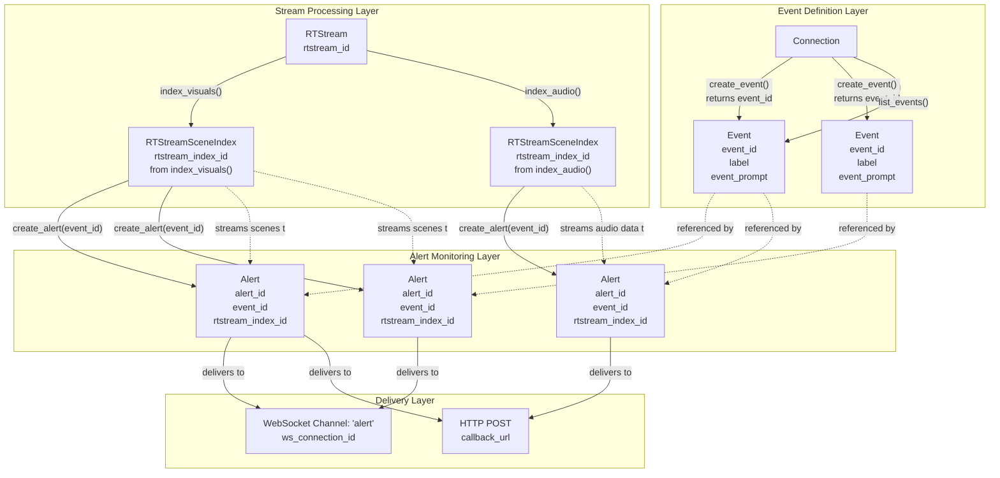
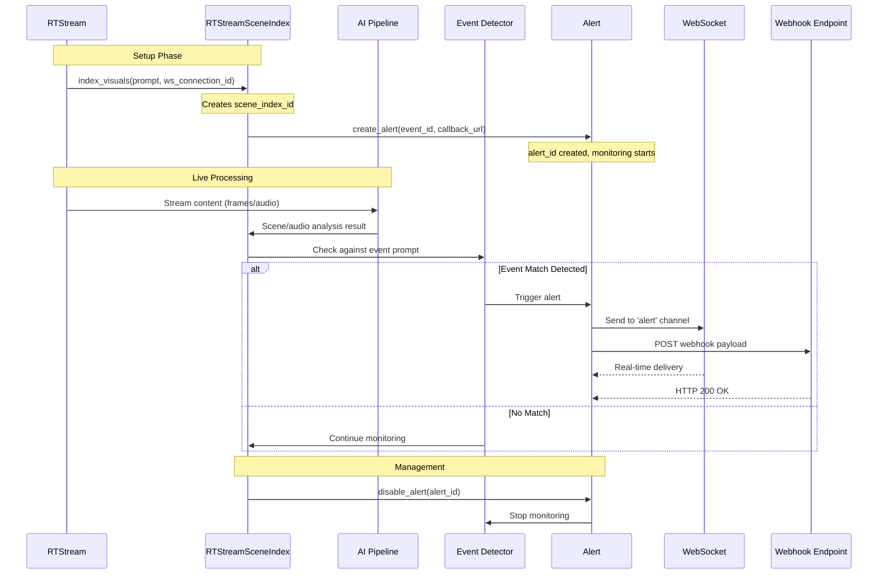

<!-- source: DeepWiki mcp.deepwiki.com · repo video-db/skills · page 9.3 Events and Alerts · fetched 2026-10-27 -->

# Events and Alerts

<details>
<summary>Relevant source files</summary>

The following files were used as context for generating this wiki page:

- [python/reference/rtstream-reference.md](python/reference/rtstream-reference.md)
- [python/reference/streaming.md](python/reference/streaming.md)

</details>


This document explains the event detection and alerting system for real-time streams. Events define reusable detection rules using natural language prompts, while alerts wire these events to live stream indexes to trigger notifications when matching content is detected.

For information about creating and managing RTStream objects, see [RTStream Basics](#9.1). For details on the AI pipelines that produce content for event detection, see [Real-time AI Pipelines](#9.2). For searching historical stream content, see [Searching Live Streams](#9.4).

---

## Overview

The Events and Alerts system enables real-time monitoring and notification for live streams. The architecture separates **event definitions** (reusable detection rules) from **alert configurations** (active monitoring instances), allowing the same event to be applied across multiple streams and indexes.

### Key Components

| Component | Type | Purpose |
|-----------|------|---------|
| `Event` | Definition | Reusable detection rule with natural language prompt |
| `RTStreamSceneIndex` | Index | Running AI pipeline analyzing stream content |
| `Alert` | Monitor | Active wiring of an event to an index for notifications |
| WebSocket | Delivery | Real-time notification channel |
| Webhook | Delivery | HTTP callback for server-to-server integration |

The system operates in three phases:

1. **Define** events as prompts describing what to detect
2. **Wire** events to stream indexes via alerts
3. **Receive** notifications when matches occur

**Sources:** [python/reference/rtstream-reference.md:393-514]()

---

## Architecture

### Event and Alert Relationships



**Key relationships:**
- **Events** are owned by `Connection` and are reusable across streams
- **RTStreamSceneIndex** objects are created by `rtstream.index_visuals()` or `rtstream.index_audio()`
- **Alerts** are owned by `RTStreamSceneIndex` and reference an `event_id`
- Multiple alerts can reference the same event
- Multiple alerts can exist on the same scene index

**Sources:** [python/reference/rtstream-reference.md:313-390](), [python/reference/rtstream-reference.md:393-493]()

---

## Alert Detection Flow



**Sources:** [python/reference/rtstream-reference.md:422-493]()

---

## Creating Events

Events are reusable detection rules defined by natural language prompts. Create events once and attach them to multiple indexes.

### Event Creation

```python
# Create a reusable event definition
event_id = conn.create_event(
    event_prompt="A person enters the restricted area",
    label="restricted_area_entry"
)
```

| Parameter | Type | Description |
|-----------|------|-------------|
| `event_prompt` | `str` | Natural language description of what to detect |
| `label` | `str` | Human-readable identifier for the event |

**Returns:** `str` - The `event_id` for use in alert creation

### Listing Events

```python
# Retrieve all defined events
events = conn.list_events()

for event in events:
    print(f"ID: {event['event_id']}")
    print(f"Label: {event['label']}")
    print(f"Prompt: {event['event_prompt']}")
```

**Sources:** [python/reference/rtstream-reference.md:393-420]()

---

## Creating Alerts

Alerts wire events to `RTStreamSceneIndex` objects for active monitoring. When the AI analysis matches the event prompt, notifications are delivered.

### Prerequisites

Before creating an alert, you must:
1. Have a running `RTStream` with `start()` called
2. Have created an `RTStreamSceneIndex` via `index_visuals()` or `index_audio()`
3. Have defined an `Event` via `create_event()`

### Alert Creation

```python
# Step 1: Create the scene index
scene_index = rtstream.index_visuals(
    prompt="Describe what is happening on screen",
    batch_config={"type": "time", "value": 2, "frame_count": 5},
    ws_connection_id=ws_id
)

# Step 2: Create an alert on the index
alert_id = scene_index.create_alert(
    event_id=event_id,
    callback_url="https://your-backend.com/webhook/alerts",
    ws_connection_id=ws_id  # optional, for WebSocket delivery
)
```

| Parameter | Type | Required | Description |
|-----------|------|----------|-------------|
| `event_id` | `str` | Yes | ID from `create_event()` |
| `callback_url` | `str` | Yes | HTTP endpoint for webhook delivery (use `""` if WebSocket only) |
| `ws_connection_id` | `str` | No | WebSocket connection for real-time delivery |

**Returns:** `str` - The `alert_id` for managing the alert

**Note:** The `callback_url` parameter is required. Pass an empty string `""` if you only want WebSocket delivery.

### Managing Alerts

```python
# List all alerts on an index
alerts = scene_index.list_alerts()

for alert in alerts:
    print(f"Alert ID: {alert['alert_id']}")
    print(f"Event ID: {alert['event_id']}")
    print(f"Enabled: {alert['enabled']}")

# Disable an alert (stops notifications)
scene_index.disable_alert(alert_id)

# Re-enable an alert
scene_index.enable_alert(alert_id)
```

**Sources:** [python/reference/rtstream-reference.md:422-456]()

---

## Alert Delivery

Alerts can be delivered via WebSocket (real-time) or HTTP webhook (server-to-server). Both delivery methods can be used simultaneously.

### Delivery Comparison

| Method | Latency | Use Case | Configuration |
|--------|---------|----------|---------------|
| WebSocket | Milliseconds | Live dashboards, UI updates | Pass `ws_connection_id` to `create_alert()` |
| Webhook | < 1 second | Server automation, logging | Pass `callback_url` to `create_alert()` |

### WebSocket Delivery

WebSocket events are delivered on the `alert` channel:

```json
{
  "channel": "alert",
  "rtstream_id": "rts-abc123",
  "data": {
    "event_label": "restricted_area_entry",
    "timestamp": 1710000012340,
    "text": "A person entered the restricted area through the north door"
  }
}
```

| Field | Type | Description |
|-------|------|-------------|
| `channel` | `str` | Always `"alert"` |
| `rtstream_id` | `str` | ID of the stream that triggered the alert |
| `data.event_label` | `str` | Label from the event definition |
| `data.timestamp` | `int` | Unix timestamp in milliseconds |
| `data.text` | `str` | AI-generated description of the matched event |

### Webhook Delivery

HTTP POST payload sent to `callback_url`:

```json
{
  "event_id": "event-xyz789",
  "label": "restricted_area_entry",
  "confidence": 0.95,
  "explanation": "A person entered the restricted area through the north door",
  "timestamp": "2024-01-15T10:30:45Z",
  "start_time": 1234.5,
  "end_time": 1238.0,
  "stream_url": "https://stream.videodb.io/v3/...",
  "player_url": "https://console.videodb.io/player?url=..."
}
```

| Field | Type | Description |
|-------|------|-------------|
| `event_id` | `str` | ID of the triggered event |
| `label` | `str` | Event label for routing/filtering |
| `confidence` | `float` | AI confidence score (0-1) |
| `explanation` | `str` | Detailed description of the detection |
| `timestamp` | `str` | ISO 8601 timestamp |
| `start_time` | `float` | Start of detected segment (seconds) |
| `end_time` | `float` | End of detected segment (seconds) |
| `stream_url` | `str` | HLS URL for the detected segment |
| `player_url` | `str` | Web player URL for the segment |

**Sources:** [python/reference/rtstream-reference.md:457-493]()

---

## Code Entity Reference

### Connection Methods

```python
# Event management methods
event_id = conn.create_event(event_prompt: str, label: str) -> str
events = conn.list_events() -> list
```

### RTStreamSceneIndex Methods

```python
# Alert management methods
alert_id = scene_index.create_alert(
    event_id: str,
    callback_url: str,
    ws_connection_id: str = None
) -> str

alerts = scene_index.list_alerts() -> list
scene_index.enable_alert(alert_id: str) -> None
scene_index.disable_alert(alert_id: str) -> None

# Index control
scene_index.start() -> None
scene_index.stop() -> None
```

### RTStreamSceneIndex Properties

```python
scene_index.rtstream_index_id  # str
scene_index.rtstream_id        # str
scene_index.extraction_type    # str
scene_index.extraction_config  # dict
scene_index.prompt             # str
scene_index.name               # str
scene_index.status             # str
```

**Sources:** [python/reference/rtstream-reference.md:313-456]()

---

## Complete Workflow Example

### Security Monitoring with Alerts

```python
import videodb
import time

# Initialize connection
conn = videodb.connect()
coll = conn.get_collection()

# Step 1: Define reusable events
unauthorized_entry = conn.create_event(
    event_prompt="A person enters the restricted area or secure zone",
    label="unauthorized_entry"
)

suspicious_activity = conn.create_event(
    event_prompt="Person loitering near entrance for more than 30 seconds",
    label="suspicious_loitering"
)

# Step 2: Connect to security camera stream
rtstream = coll.connect_rtstream(
    url="rtsp://camera.example.com/live",
    name="North Entrance Camera",
    store=True
)
rtstream.start()

# Step 3: Start visual indexing with WebSocket connection
ws_id = "your-websocket-connection-id"

scene_index = rtstream.index_visuals(
    prompt="Describe what people are doing near the entrance",
    batch_config={"type": "time", "value": 3, "frame_count": 5},
    model_name="pro",
    ws_connection_id=ws_id
)

# Step 4: Create alerts for both events
alert1 = scene_index.create_alert(
    event_id=unauthorized_entry,
    callback_url="https://security-system.example.com/alerts",
    ws_connection_id=ws_id
)

alert2 = scene_index.create_alert(
    event_id=suspicious_activity,
    callback_url="https://security-system.example.com/alerts",
    ws_connection_id=ws_id
)

print(f"Monitoring started. Alert IDs: {alert1}, {alert2}")

# Step 5: Let monitoring run
time.sleep(3600)  # Monitor for 1 hour

# Step 6: Stop and export
rtstream.stop()
export_result = rtstream.export(name="North Entrance - Security Log")
print(f"Exported video: {export_result.video_id}")
```

### Desktop Monitoring with Audio Alerts

```python
import videodb

conn = videodb.connect()
ws_id = "your-websocket-connection-id"

# Define event for profanity detection
profanity_event = conn.create_event(
    event_prompt="The speaker uses profane or inappropriate language",
    label="profanity_detected"
)

# Start capture session (assumes ws_listener is running)
session = conn.create_capture_session(
    name="Meeting Recording",
    ws_connection_id=ws_id
)

# Get the system audio RTStream
system_audio_streams = session.get_rtstream("system_audio")
audio_stream = system_audio_streams[0]

# Create audio index with real-time analysis
audio_index = audio_stream.index_audio(
    prompt="Summarize what is being said, noting tone and content",
    batch_config={"type": "sentence", "value": 10},
    ws_connection_id=ws_id
)

# Create alert for profanity
alert_id = audio_index.create_alert(
    event_id=profanity_event,
    callback_url="https://moderation-service.example.com/alerts",
    ws_connection_id=ws_id
)

print(f"Audio monitoring active. Alert ID: {alert_id}")
```

**Sources:** [python/reference/rtstream-reference.md:393-514]()

---

## Best Practices

### Event Design

| Guideline | Rationale |
|-----------|-----------|
| Use specific, actionable prompts | Vague prompts like "detect something unusual" produce unreliable results |
| Include temporal context when needed | "Person standing for more than 30 seconds" is better than "person standing" |
| Avoid negations | "Person without a badge" is harder to detect than "Person wearing a badge" |
| Test prompts iteratively | Monitor initial results and refine prompts based on false positives/negatives |

### Alert Configuration

| Practice | Benefit |
|----------|---------|
| Use both WebSocket and webhook delivery | Redundancy ensures no missed alerts |
| Set appropriate `batch_config` intervals | Balance latency vs. compute cost (shorter intervals = more processing) |
| Start with higher model tiers (`pro`, `ultra`) for critical alerts | Lower latency and better accuracy for important detections |
| Enable/disable alerts dynamically | Avoid alert fatigue by toggling monitoring based on context |

### Webhook Implementation

Your webhook endpoint should:
- Respond with HTTP 200 OK quickly (< 500ms)
- Process alerts asynchronously in a queue
- Handle duplicate deliveries idempotently
- Log all received alerts for audit trails
- Validate the `event_id` and `label` fields

### WebSocket Consumption

When consuming WebSocket alerts:
- Filter by `channel: "alert"` in your event handler
- Use `event_label` for routing to appropriate handlers
- Store `timestamp` and `stream_url` for forensic review
- Implement reconnection logic for connection drops

**Sources:** [python/reference/rtstream-reference.md:457-493]()

---

## Limitations

| Limitation | Workaround |
|------------|------------|
| Events cannot be updated after creation | Create a new event with a different label |
| Alerts process batches, not frame-by-frame | Use smaller `batch_config.value` for lower latency |
| No built-in alert rate limiting | Implement debouncing in your webhook handler |
| Webhook retries are not automatic | Implement your own retry queue if needed |
| Maximum of one alert per event per index | Create multiple scene indexes to monitor the same stream with different prompts |

**Sources:** [python/reference/rtstream-reference.md:313-514]()

---

