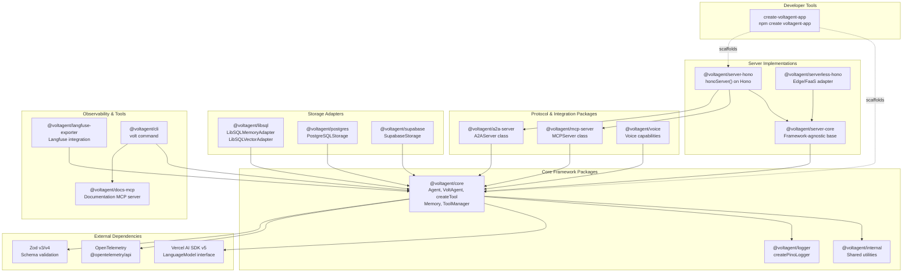
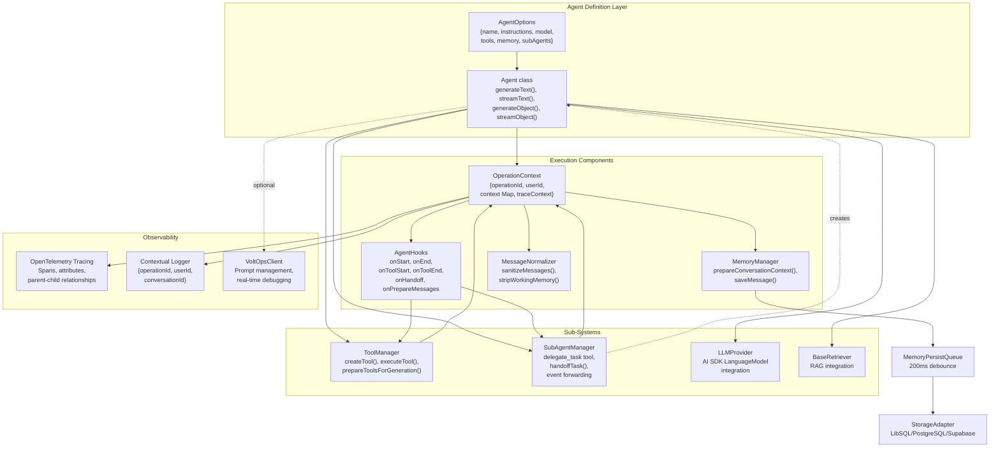
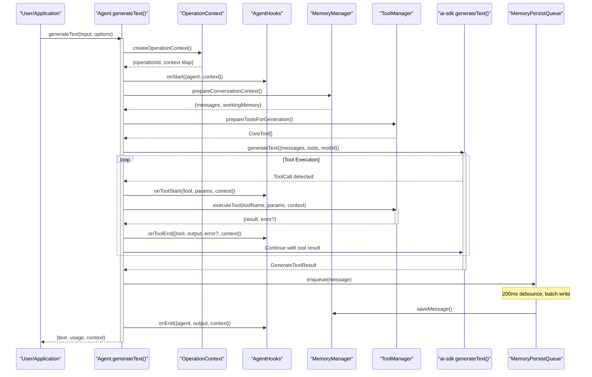
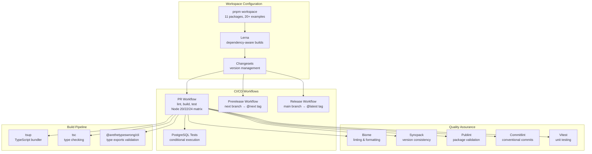
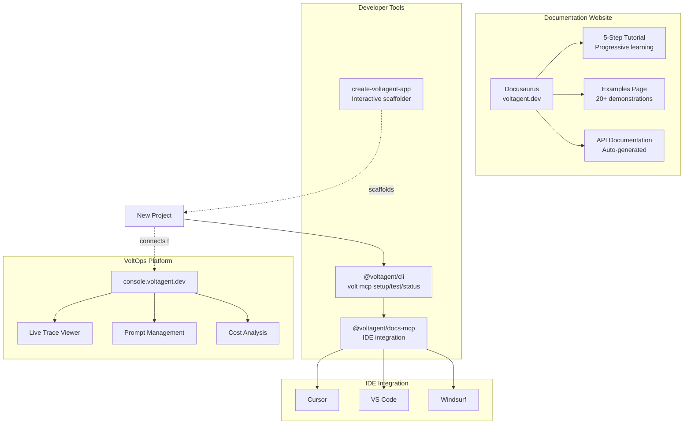
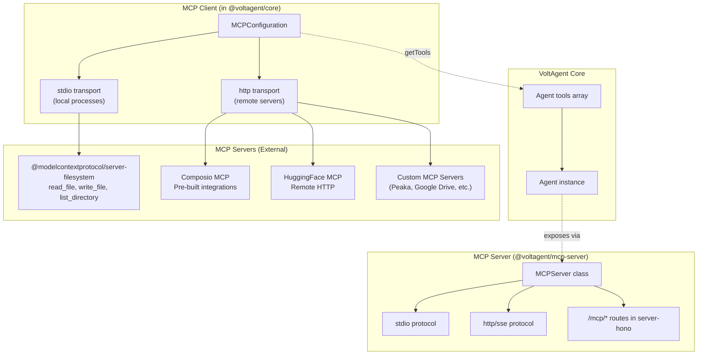

<!-- source: DeepWiki mcp.deepwiki.com · repo voltagent/voltagent · page 1 VoltAgent Overview · fetched 2026-10-27 -->

# VoltAgent Overview

<details>
<summary>Relevant source files</summary>

The following files were used as context for generating this wiki page:

- [CHANGELOG.md](CHANGELOG.md)
- [changelog.sh](changelog.sh)
- [examples/base/src/index.ts](examples/base/src/index.ts)
- [examples/with-client-side-tools/app/globals.css](examples/with-client-side-tools/app/globals.css)
- [examples/with-google-ai/package.json](examples/with-google-ai/package.json)
- [examples/with-google-vertex-ai/package.json](examples/with-google-vertex-ai/package.json)
- [examples/with-groq-ai/package.json](examples/with-groq-ai/package.json)
- [examples/with-mcp/package.json](examples/with-mcp/package.json)
- [examples/with-nextjs/package.json](examples/with-nextjs/package.json)
- [packages/cli/package.json](packages/cli/package.json)
- [packages/core/package.json](packages/core/package.json)
- [packages/create-voltagent-app/CHANGELOG.md](packages/create-voltagent-app/CHANGELOG.md)
- [packages/create-voltagent-app/package.json](packages/create-voltagent-app/package.json)
- [packages/voice/package.json](packages/voice/package.json)
- [pnpm-lock.yaml](pnpm-lock.yaml)
- [website/blog/2025-07-30-claude-code-agents/index.md](website/blog/2025-07-30-claude-code-agents/index.md)
- [website/docusaurus.config.ts](website/docusaurus.config.ts)
- [website/src/components/tutorial/TutorialLayout.tsx](website/src/components/tutorial/TutorialLayout.tsx)
- [website/src/components/tutorial/TutorialNavbar.tsx](website/src/components/tutorial/TutorialNavbar.tsx)
- [website/src/css/layout.css](website/src/css/layout.css)
- [website/src/pages/tutorial/chatbot-problem.tsx](website/src/pages/tutorial/chatbot-problem.tsx)
- [website/src/pages/tutorial/introduction.tsx](website/src/pages/tutorial/introduction.tsx)
- [website/src/pages/tutorial/mcp.tsx](website/src/pages/tutorial/mcp.tsx)
- [website/src/pages/tutorial/memory.tsx](website/src/pages/tutorial/memory.tsx)
- [website/src/pages/tutorial/subagents.tsx](website/src/pages/tutorial/subagents.tsx)

</details>


VoltAgent is a production-ready TypeScript framework for building AI agent applications. It provides a modular architecture that abstracts the complexity of agent development while maintaining flexibility for sophisticated use cases.

## What is VoltAgent?

VoltAgent is an enterprise-grade TypeScript framework for building AI agent applications. At its core, the framework provides a modular architecture centered around the `Agent` class from `@voltagent/core`, orchestrated by the `VoltAgent` runtime, and integrated with the Vercel AI SDK v5 for LLM abstraction.

**Core Capabilities**:

- **Agent Runtime**: `Agent` class with `generateText()`, `streamText()`, `generateObject()`, and `streamObject()` methods for LLM interactions
- **Tool Execution**: `createTool()` helper and `ToolManager` class for function calling and external integrations
- **Memory & Persistence**: `Memory` class with pluggable storage adapters (`LibSQLMemoryAdapter`, `PostgreSQLStorage`, `SupabaseStorage`, `InMemoryStorage`)
- **Multi-Agent Coordination**: `SubAgentManager` for hierarchical agent delegation via the `delegate_task` tool
- **Workflow Orchestration**: `createWorkflow()` with `andThen()`, `andAgent()`, `andAll()`, `andRace()`, and `andWhen()` primitives
- **Protocol Support**: Model Context Protocol (MCP) via `@modelcontextprotocol/sdk` and Agent-to-Agent (A2A) communication
- **Server Infrastructure**: HTTP/WebSocket APIs via `@voltagent/server-hono` built on Hono framework
- **Observability**: Built-in OpenTelemetry spans, VoltOps Console integration via `VoltOpsClient`, and `@voltagent/langfuse-exporter`

The framework operates as a pnpm workspace monorepo with 11+ `@voltagent/*` scoped packages, enabling developers to compose exactly the capabilities they need.

Sources: [packages/core/package.json:1-77](), [pnpm-lock.yaml:1-111](), [CHANGELOG.md:1-27]()

## Framework Architecture

### Monorepo Package Ecosystem



**Package Summary**:

| Package | Version | Primary Exports | Description |
|---------|---------|-----------------|-------------|
| `@voltagent/core` | 1.1.26 | `Agent`, `VoltAgent`, `createTool`, `Memory` | Core agent orchestration |
| `@voltagent/server-hono` | 1.0.18 | `honoServer()` | HTTP server on Hono framework |
| `@voltagent/libsql` | 1.0.7 | `LibSQLMemoryAdapter`, `LibSQLVectorAdapter` | SQLite/Turso storage |
| `@voltagent/postgres` | 1.0.6 | `PostgreSQLStorage` | PostgreSQL adapter |
| `@voltagent/supabase` | 1.0.5 | `SupabaseStorage` | Supabase cloud adapter |
| `@voltagent/mcp-server` | 1.0.2 | `MCPServer` | Model Context Protocol server |
| `@voltagent/a2a-server` | 1.0.1 | `A2AServer` | Agent-to-Agent communication |
| `@voltagent/cli` | 0.1.11 | `volt` CLI | Command-line tools |
| `create-voltagent-app` | 0.2.10 | N/A | Project scaffolding |

Sources: [pnpm-lock.yaml:1-111](), [packages/core/package.json:1-77](), [CHANGELOG.md:1-27]()

### Agent Core Architecture



The `Agent` class orchestrates execution through `OperationContext`, which flows through all stages providing shared state, logging, and tracing. `MemoryManager` handles persistence using `MemoryPersistQueue` with 200ms debouncing for batch writes. `SubAgentManager` enables multi-agent workflows via the `delegate_task` tool. `MessageNormalizer` preprocesses messages to strip working memory tool calls. All operations are instrumented with OpenTelemetry spans for distributed tracing.

Sources: [packages/core/src/agent/agent.ts:1-500](), [CHANGELOG.md:221-280](), [CHANGELOG.md:577-622]()

### Agent Execution Flow



**Key Execution Steps**:

1. **Context Creation**: `createOperationContext()` initializes `OperationContext` with `operationId`, `userId`, and shared `context` Map
2. **Memory Loading**: `MemoryManager.prepareConversationContext()` retrieves conversation history and working memory
3. **Tool Preparation**: `ToolManager.prepareToolsForGeneration()` converts `AgentTool[]` to `CoreTool[]` for AI SDK
4. **LLM Invocation**: AI SDK `generateText()` with messages, tools, and model configuration
5. **Tool Execution Loop**: For each tool call, execute via `ToolManager.executeTool()` with lifecycle hooks
6. **Persistence**: `MemoryPersistQueue` batches message saves with 200ms debounce to reduce database writes
7. **Response**: Return `GenerateTextResult` with `text`, `usage`, and updated `context`

Sources: [packages/core/src/agent/agent.ts:1-500](), [CHANGELOG.md:221-280]()

## Core Framework Components

### Agent Class

The `Agent` class from `@voltagent/core` is the primary interface for AI agent operations. It orchestrates:

1. LLM communication via ai-sdk integration
2. Tool execution through `ToolManager`
3. Memory persistence via `Memory` adapters
4. SubAgent delegation for multi-agent workflows
5. Lifecycle hooks for observability and customization

**Agent Configuration**:

| Property | Type | Description |
|----------|------|-------------|
| `name` | `string` | Agent identifier |
| `instructions` | `string` | System prompt for the agent |
| `model` | `LanguageModel` | ai-sdk model (e.g., `openai("gpt-4o")`) |
| `tools` | `AgentTool[]` | Available functions |
| `memory` | `Memory` | Storage backend |
| `subAgents` | `Agent[]` | Delegatable agents |
| `hooks` | `AgentHooks` | Lifecycle callbacks |

**Agent Methods**:

| Method | Return Type | Description |
|--------|-------------|-------------|
| `generateText(input, options?)` | `Promise<TextResponse>` | Complete text generation |
| `streamText(input, options?)` | `Promise<StreamTextResponse>` | Streaming text generation |
| `generateObject<T>(input, schema, options?)` | `Promise<ObjectResponse<T>>` | Structured object generation |
| `streamObject<T>(input, schema, options?)` | `Promise<StreamObjectResponse<T>>` | Streaming object generation |
| `getHistory(options?)` | `Promise<AgentHistoryEntry[]>` | Conversation history |

Sources: [packages/core/package.json:1-77](), [CHANGELOG.md:577-622]()

### VoltAgent Runtime

The `VoltAgent` class manages multiple agents and provides:

- HTTP server via `@voltagent/server-hono`
- WebSocket API for real-time monitoring
- Agent registration and lifecycle management
- Integration with VoltOps observability platform

**VoltAgent Configuration**:

| Property | Type | Description |
|----------|------|-------------|
| `agents` | `Record<string, Agent>` | Named agent instances |
| `workflows` | `Record<string, Workflow>` | Named workflow instances |
| `logger` | `Logger` | Logging implementation |
| `voltOpsClient` | `VoltOpsClient` | Observability client |
| `server` | `ServerConfig` | HTTP server configuration |

Sources: [examples/with-nextjs/package.json:1-39](), [packages/create-voltagent-app/CHANGELOG.md:29-63]()

### Package Ecosystem

VoltAgent operates as a monorepo with focused, composable packages:

**Core Framework**:
- `@voltagent/core` (v1.1.11): Agent runtime, tools, memory, workflows
- `@voltagent/logger` (v1.0.1): Structured logging with Pino integration  
- `@voltagent/internal` (v0.0.10): Shared utilities across packages

**Memory & Storage**:
- `@voltagent/postgres` (v1.0.6): PostgreSQL storage adapter
- `@voltagent/supabase` (v1.0.5): Supabase cloud database adapter
- `@voltagent/libsql` (v1.0.5): LibSQL/Turso SQLite adapter

**Server & API**:
- `@voltagent/server-core` (v1.0.6): Framework-agnostic server foundation
- `@voltagent/server-hono` (v1.0.6): Hono-based HTTP server implementation

**Observability**:
- `@voltagent/langfuse-exporter` (v1.1.2): Langfuse integration for LLM observability
- `@voltagent/sdk` (v0.1.6): JavaScript SDK for external observability integration

**Development Tools**:
- `@voltagent/cli` (v0.1.10): Command-line tools (`volt` command)
- `create-voltagent-app` (v0.2.9): Project scaffolding tool

Sources: [pnpm-lock.yaml:112-1277](), [packages/cli/package.json:1-61](), [packages/create-voltagent-app/package.json:1-60]()

### AI Provider Integration

VoltAgent integrates with AI providers through the Vercel AI SDK ecosystem. The framework uses `LanguageModel` instances from ai-sdk packages:

**Supported AI Providers**:

| ai-sdk Package | Models | Example Usage |
|----------------|--------|---------------|
| `@ai-sdk/openai` | GPT-4o, GPT-4-turbo, GPT-3.5-turbo | `openai("gpt-4o-mini")` |
| `@ai-sdk/anthropic` | Claude-3.5-sonnet, Claude-3-haiku | `anthropic("claude-3-5-sonnet-20241022")` |
| `@ai-sdk/google` | Gemini-1.5-pro, Gemini-1.5-flash | `google("gemini-1.5-pro")` |
| `@ai-sdk/google-vertex` | Vertex AI models | `vertex("gemini-1.5-pro")` |
| `@ai-sdk/groq` | Groq-hosted models | `groq("llama-3.1-8b-instant")` |
| `@ai-sdk/amazon-bedrock` | Amazon Bedrock models | `bedrock("anthropic.claude-3-sonnet")` |

**Agent Configuration with AI Providers**:
```typescript
import { Agent } from "@voltagent/core";
import { openai } from "@ai-sdk/openai";

const agent = new Agent({
  name: "Assistant",
  instructions: "You are a helpful assistant",
  model: openai("gpt-4o-mini"), // Direct ai-sdk integration
});
```

Sources: [examples/with-groq-ai/package.json:1-32](), [examples/with-google-ai/package.json:1-33](), [examples/with-anthropic/package.json:1-286]()

### Tool System

The tool system enables function calling through `createTool` and `ToolManager` classes:

**Tool Definition**:
```typescript
import { createTool } from "@voltagent/core";
import { z } from "zod";

const weatherTool = createTool({
  name: "get_weather",
  description: "Get current weather for a location", 
  parameters: z.object({
    location: z.string().describe("City and state"),
  }),
  outputSchema: z.object({ // Optional validation
    temperature: z.number(),
    condition: z.string(),
  }),
  execute: async ({ location }, context) => {
    // Tool implementation
    return { temperature: 72, condition: "sunny" };
  },
});
```

**ToolManager Operations**:

| Method | Description |
|--------|-------------|
| `addTool(tool)` | Register a single tool |
| `addItems(tools)` | Register multiple tools |
| `removeTool(name)` | Unregister tool by name |
| `prepareToolsForGeneration(dynamicTools?)` | Get tools for LLM execution |
| `getToolsForApi()` | Get simplified tool info for API |
| `hasTool(name)` | Check if tool exists |

**Tool Execution Flow**:
1. LLM calls tool via ai-sdk function calling
2. `onToolStart` hook triggered
3. `ToolManager` executes tool with parameters
4. Optional `outputSchema` validation
5. `onToolEnd` hook triggered with result/error
6. Result returned to LLM for continued generation

Sources: [packages/core/src/tool/manager/index.spec.ts:1-211](), [CHANGELOG.md:710-758]()

### Memory System

VoltAgent provides persistent conversation storage through pluggable `Memory` adapters:

**Memory Implementations**:

| Package | Backend | Use Case |
|---------|---------|----------|
| `@voltagent/postgres` | PostgreSQL | Production deployments |
| `@voltagent/supabase` | Supabase | Cloud-hosted PostgreSQL |
| `@voltagent/libsql` | LibSQL/Turso | SQLite-compatible, edge |
| `InMemoryStorage` | In-memory | Development/testing |

**Memory Interface**:

| Method | Description |
|--------|-------------|
| `getMessages(options)` | Retrieve conversation history |
| `saveMessage(message)` | Persist message to storage |
| `getConversations()` | List user conversations |
| `deleteConversation(id)` | Remove conversation |
| `getWorkingMemory(agentId)` | Get agent context |
| `saveWorkingMemory(agentId, data)` | Save agent context |

**Memory Configuration**:
```typescript
import { Agent } from "@voltagent/core";
import { LibSQLStorage } from "@voltagent/libsql";

const agent = new Agent({
  name: "Assistant",
  instructions: "You are helpful",
  model: openai("gpt-4o-mini"),
  memory: new LibSQLStorage({
    url: process.env.DATABASE_URL,
  }),
});
```

**Context Management**:
- `OperationContext`: Contains `userContext` Map for operation-scoped data
- `SystemContext`: Contains internal tracking values (agent_start_time, tool execution data)
- Context flows through hooks, tools, and sub-agents

Sources: [examples/with-postgres/package.json:1-128](), [examples/with-nextjs/package.json:1-39](), [CHANGELOG.md:321-356]()

### Lifecycle Hooks

The hook system provides observability and customization points during agent execution:

**Available Hooks**:

| Hook | Trigger Point | Parameters |
|------|---------------|------------|
| `onStart` | Before agent operation begins | `{ agent, context, input }` |
| `onEnd` | After operation completes | `{ agent, context, output?, error? }` |
| `onToolStart` | Before tool execution | `{ agent, tool, params, context }` |
| `onToolEnd` | After tool execution | `{ agent, tool, output?, error?, context }` |
| `onPrepareMessages` | Before LLM call | `{ messages, context }` |

**Hook Implementation**:
```typescript
import { Agent, createHooks } from "@voltagent/core";

const hooks = createHooks({
  onStart: async ({ agent, context }) => {
    console.log(`Operation ${context.operationId} started`);
  },
  onPrepareMessages: async ({ messages, context }) => {
    // Transform messages before LLM
    const timestamp = new Date().toLocaleTimeString();
    return {
      messages: messages.map(msg => 
        messageHelpers.addTimestampToMessage(msg, timestamp)
      )
    };
  },
  onToolStart: async ({ tool, params, context }) => {
    context.userContext.set(`tool_${tool.name}_start`, Date.now());
  },
  onEnd: async ({ agent, output, error, context }) => {
    if (error && isAbortError(error)) {
      console.log("Operation was aborted");
    }
  },
});
```

**Use Cases**:
- OpenTelemetry span creation
- Request/response logging
- Performance monitoring
- Error handling and retry logic
- Message transformation and filtering

Sources: [CHANGELOG.md:139-209](), [CHANGELOG.md:533-571]()

## Development Workflow and Infrastructure

### Monorepo Management



**Development Scripts** (common across packages):

| Script | Command | Purpose |
|--------|---------|---------|
| `build` | `tsup` | Bundle TypeScript with tsup |
| `dev` | `tsup --watch` | Watch mode development |
| `lint` | `biome check .` | Lint and format check |
| `lint:fix` | `biome check . --write` | Auto-fix issues |
| `test` | `vitest` | Run unit tests |
| `typecheck` | `tsc --noEmit` | Type checking only |
| `attw` | `attw --pack` | Validate type exports |
| `publint` | `publint --strict` | Package.json validation |

**CI/CD Matrix Testing**:
- Node.js versions: 20, 22, 24
- Operating systems: Ubuntu, macOS, Windows
- Package managers: pnpm (primary)

Sources: [pnpm-lock.yaml:14-110](), [packages/core/package.json:65-76](), [changelog.sh:1-76]()

### Documentation and Developer Experience



**Documentation Structure**:
- **Tutorial System**: 5-step progressive tutorial with `TutorialLayout` component ([website/src/components/tutorial/TutorialLayout.tsx:1-133]())
  - Step 1: Introduction to VoltAgent
  - Step 2: The Chatbot Problem (tools)
  - Step 3: Memory systems
  - Step 4: MCP integration
  - Step 5: Subagent coordination
- **Examples**: 20+ example projects organized by category (AI providers, databases, features, deployment)
- **API Reference**: Auto-generated from TypeScript definitions

**CLI Commands** (`@voltagent/cli`):

| Command | Description |
|---------|-------------|
| `volt mcp setup` | Interactive MCP configuration for IDEs |
| `volt mcp test` | Test MCP connection and list tools |
| `volt mcp status` | Show current MCP configuration |
| `volt mcp remove` | Remove MCP configuration |

Sources: [website/docusaurus.config.ts:1-420](), [packages/cli/package.json:1-61](), [website/src/components/tutorial/TutorialLayout.tsx:1-133]()

### Project Creation and Development

**create-voltagent-app Interactive Scaffolding**:

```bash
npm create voltagent-app@latest my-agent-app
```

**Interactive Prompts**:
1. **AI Provider Selection**: OpenAI, Anthropic, Google, Groq, Mistral, Ollama
2. **API Key Input**: Optional with skip option
3. **Package Manager**: Auto-detection (npm, pnpm, yarn)
4. **Auto-Installation**: Dependencies installed automatically

**Generated Project Structure**:
```
my-agent-app/
├── src/
│   ├── index.ts              # VoltAgent + honoServer setup
│   ├── agents/
│   │   └── agent.ts          # Agent with tools + memory
│   └── workflows/
│       └── workflow.ts       # Example workflow
├── .env                      # OPENAI_API_KEY, etc.
├── .voltagent/
│   └── memory.db             # LibSQL database (auto-created)
├── package.json
└── tsconfig.json
```

**Default Template Dependencies** ([packages/create-voltagent-app/CHANGELOG.md:6-13]()):
- `@voltagent/core` (latest): Agent framework
- `@voltagent/logger` (latest): `createPinoLogger()`
- `@voltagent/server-hono` (latest): `honoServer()`
- `@voltagent/libsql` (latest): `LibSQLMemoryAdapter`
- AI SDK package (based on selection): `@ai-sdk/openai`, etc.
- `ai` (v5): Vercel AI SDK
- `zod` (^3.25.76 || ^4.0.0): Schema validation

**Development Scripts** (generated `package.json`):
```json
{
  "scripts": {
    "dev": "tsx watch --env-file=.env ./src",
    "build": "tsc",
    "start": "node dist/index.js",
    "volt": "volt"
  }
}
```

Sources: [packages/create-voltagent-app/CHANGELOG.md:6-193](), [packages/create-voltagent-app/package.json:1-60](), [examples/base/src/index.ts:1-38]()

## Protocol Integration and External Systems

### Model Context Protocol (MCP) Integration



**MCP Client Configuration** (consuming external MCP servers):
```typescript
import { Agent, MCPConfiguration } from "@voltagent/core";

const mcpConfig = new MCPConfiguration({
  servers: {
    filesystem: {
      type: "stdio",
      command: "npx",
      args: ["-y", "@modelcontextprotocol/server-filesystem", "/path/to/allowed/dir"],
    },
    huggingface: {
      type: "http",
      url: "https://huggingface-mcp-server.com",
    }
  }
});

const tools = await mcpConfig.getTools(); // Fetch tools from MCP servers

const agent = new Agent({
  name: "MCP Agent",
  instructions: "You can access filesystem and HuggingFace via MCP",
  model: openai("gpt-4o-mini"),
  tools: [...tools], // Add MCP tools to agent
});
```

**MCP Server Configuration** (exposing VoltAgent as MCP server):
```typescript
import { MCPServer } from "@voltagent/mcp-server";
import { VoltAgent } from "@voltagent/core";
import { honoServer } from "@voltagent/server-hono";

const mcpServer = new MCPServer({
  name: "voltagent-mcp",
  version: "1.0.0",
  agents: { assistant: myAgent },
  protocols: { stdio: true, http: true, sse: true }
});

new VoltAgent({
  agents: { assistant: myAgent },
  mcpServers: { primary: mcpServer },
  server: honoServer({ port: 3141 })
});
// Exposes /mcp/* routes for remote MCP clients
```

**Example MCP Integrations**:
- `examples/with-mcp/`: Filesystem server ([examples/with-mcp/package.json:1-29]())
- `examples/with-composio-mcp/`: Composio integrations ([examples/with-composio-mcp/package.json:1-372]())
- `examples/with-google-drive-mcp/`: Google Drive access
- `examples/with-hugging-face-mcp/`: HuggingFace models
- `examples/with-peaka-mcp/`: Peaka data platform

Sources: [CHANGELOG.md:122-196](), [examples/with-mcp/package.json:1-29]()

### Vector Database Integration

**Supported Vector Databases**:
- `examples/with-chroma/`: ChromaDB with `@chroma-core/*` packages
- `examples/with-pinecone/`: Pinecone with `@pinecone-database/pinecone`
- `examples/with-qdrant/`: Qdrant with `@qdrant/js-client-rest`

**RAG Implementation**:
```typescript
// example: with-rag-chatbot
const agent = new Agent({
  name: "RAG Assistant", 
  instructions: "Answer questions using retrieved context",
  model: openai("gpt-4o-mini"),
  memory: new LibSQLStorage({ url: "..." }),
  // Vector search integrated via tools
});
```

Sources: [examples/with-chroma/package.json:1-335](), [examples/with-pinecone/package.json:1-1030](), [examples/with-qdrant/package.json:1-1171]()

### Web Framework Integration

**Next.js Integration** (`examples/with-nextjs/`):
- Server-side agent execution
- `@ai-sdk/react` for UI components
- Streaming responses with `streamText`
- TailwindCSS styling

**Playwright Automation** (`examples/with-playwright/`):
- Browser automation tools
- Web scraping capabilities
- Multi-browser support (Chromium, Firefox, WebKit)

**JWT Authentication** (`examples/with-jwt-auth/`):
- `jsonwebtoken` integration
- User session management
- Secure agent access

Sources: [examples/with-nextjs/package.json:1-39](), [examples/with-playwright/package.json:1-1091](), [examples/with-jwt-auth/package.json:1-800]()

### Example Applications

VoltAgent includes 25+ examples demonstrating various capabilities:

**Basic Examples**:
- `examples/base/`: Minimal agent setup
- `examples/with-hooks/`: Lifecycle hook implementation
- `examples/with-custom-endpoints/`: API customization
- `examples/with-dynamic-parameters/`: Runtime configuration
- `examples/with-dynamic-prompts/`: Prompt engineering

**AI Provider Examples**:
- `examples/with-anthropic/`: Claude integration
- `examples/with-google-ai/`: Gemini integration  
- `examples/with-groq-ai/`: Groq fast inference
- `examples/with-amazon-bedrock/`: AWS Bedrock integration
- `examples/with-google-vertex-ai/`: Google Cloud Vertex AI

**Database Examples**:
- `examples/with-postgres/`: PostgreSQL storage
- `examples/with-supabase/`: Supabase cloud database

**Advanced Examples**:
- `examples/with-retrieval/`: RAG implementation
- `examples/with-research-assistant/`: Multi-step research
- `examples/github-repo-analyzer/`: GitHub API integration
- `examples/with-recipe-generator/`: Structured output generation
- `examples/with-thinking-tool/`: Reasoning workflows

**Observability Examples**:
- `examples/with-langfuse/`: LLM monitoring
- `examples/sdk-trace-example/`: External SDK integration

Sources: [examples/with-thinking-tool/package.json:1-36](), [examples/github-repo-analyzer/package.json:1-187](), [examples/with-retrieval/package.json:1-303]()

## Getting Started

**1. Create a new VoltAgent project**:
```bash
npm create voltagent-app@latest my-agent
cd my-agent
npm run dev
```

**2. Basic Agent implementation**:
```typescript
import { Agent, VoltAgent } from "@voltagent/core";
import { openai } from "@ai-sdk/openai";

const agent = new Agent({
  name: "Assistant",
  instructions: "You are a helpful assistant",
  model: openai("gpt-4o-mini"),
});

new VoltAgent({
  agents: { agent },
});
```

**3. Access the Console**:
- Open https://console.voltagent.dev
- Connect to localhost:3141 (default server port)
- Chat with your agent and monitor execution

**4. Explore Examples**:
```bash
# Clone repository
git clone https://github.com/voltagent/voltagent
cd voltagent/examples/with-nextjs
npm install && npm run dev
```

**5. Add Capabilities**:
- Memory: Add `@voltagent/libsql` or `@voltagent/postgres`
- Tools: Use `createTool` for function calling
- Observability: Configure `VoltOpsClient` for production monitoring
- Workflows: Use `createWorkflow` for multi-step processes

Sources: [packages/create-voltagent-app/CHANGELOG.md:6-13](), [examples/base/package.json:1-147]()

## Package Structure

VoltAgent is organized as a monorepo with multiple packages, each serving a specific purpose:

| Package | Description |
|---------|-------------|
| `@voltagent/core` | Core framework with Agent, VoltAgent, tools, memory, etc. |
| `@voltagent/vercel-ai` | Integration with Vercel AI SDK |
| `@voltagent/google-ai` | Integration with Google AI |
| `@voltagent/groq-ai` | Integration with Groq |
| `@voltagent/xsai` | Integration with xsAI |
| `@voltagent/voice` | Voice capabilities (STT/TTS) |
| `@voltagent/supabase` | Supabase integration (primarily for memory) |
| `@voltagent/cli` | Command-line interface tools |
| `create-voltagent-app` | Project scaffolding tool |

The repository also includes numerous examples demonstrating various features and use cases.

Sources: [pnpm-lock.yaml:61-807](), [CHANGELOG.md:1-17]()

---

